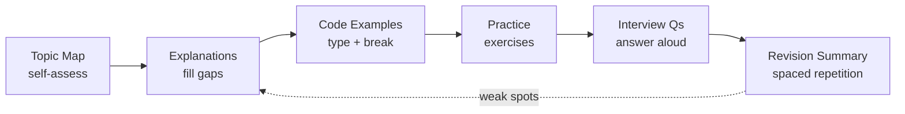
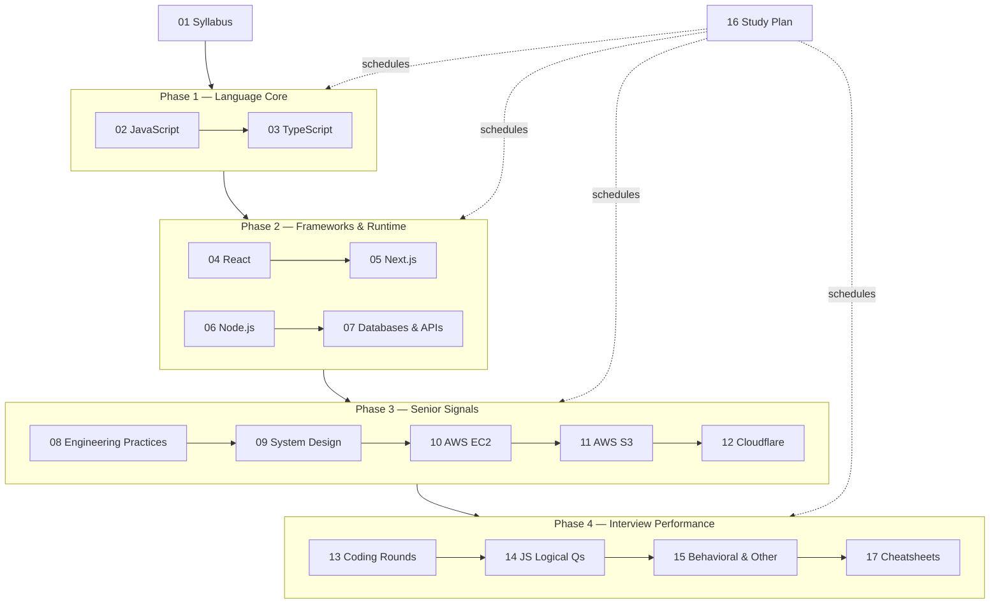

# Full Stack Interview Prep — Knowledge Base

> A self-contained, ordered path from "I know the stack" to "I'm ready for a mid-to-senior full stack interview".
> Audience: full stack developer with 3+ years on Node.js, Next.js, React, TypeScript, JavaScript.

## Table of Contents

- [How to Use This Knowledge Base](#how-to-use-this-knowledge-base)
- [File Index](#file-index)
- [Recommended Study Order](#recommended-study-order)
- [Progress Tracker](#progress-tracker)
- [Self-Assessment: Where Are You Starting From?](#self-assessment-where-are-you-starting-from)
- [Conventions Used in These Docs](#conventions-used-in-these-docs)
- [What "Ready" Means](#what-ready-means)
- [Next Steps](#next-steps)

---

## How to Use This Knowledge Base

Every topic file (02–12) follows the same 11-section structure so you always know where to look:

| # | Section | Use it for |
|---|---------|-----------|
| 1 | Overview | Why the topic matters and the depth expected at 3+ years |
| 2 | Topic Map | A checklist — tick off subtopics as you master them |
| 3 | Detailed Explanations | Internals, pitfalls, trade-offs (the "why") |
| 4 | Code Examples | Runnable TypeScript, often with bad vs. good versions |
| 5 | Diagrams | Mermaid / ASCII flows for mental models |
| 6 | Resources Table | Curated docs, videos, books, repos |
| 7 | How to Learn It | Read → Watch → Build → Practice → Revise, with time estimates |
| 8 | Hands-on Practice | Graded exercises with acceptance criteria |
| 9 | Interview Questions | Basic / Intermediate / Advanced / Tricky, with model answers |
| 10 | Common Mistakes & Red Flags | What makes candidates fail |
| 11 | Quick Revision Summary | 1-page recap + last-day checklist |

**The loop for each file:**

1. **Skim the Topic Map** and mark what you already know confidently. Be honest — "I've used it" is not "I can explain its internals".
2. **Read Detailed Explanations** only for unmarked items, plus anything tagged as an interview favorite.
3. **Type out the code examples** yourself. Don't copy-paste; break them on purpose and observe what changes.
4. **Do at least the medium exercises** in Hands-on Practice.
5. **Answer the Interview Questions out loud** before reading the model answer. Record yourself occasionally.
6. **Revisit the Quick Revision Summary** after 1 day, 1 week, and before the interview (spaced repetition).

> 💡 Interview Tip: Interviewers at 3+ years probe *depth on one path* rather than breadth. For every topic, aim to explain one thing all the way down (e.g. "what happens between `setState` and pixels on screen").

---

## File Index

| # | File | Covers |
|---|------|--------|
| 00 | [00-README.md](./00-README.md) | This index, study order, progress tracker |
| 01 | [01-fullstack-syllabus.md](./01-fullstack-syllabus.md) | Master syllabus: every topic, priority, hours, resources |
| 02 | [02-javascript.md](./02-javascript.md) (hub) → [Part 1](./02-javascript-part1.md) · [Part 2](./02-javascript-part2.md) · [Part 3](./02-javascript-part3.md) | Execution context, closures, `this`, prototypes, event loop, polyfills, browser basics |
| 03 | [03-typescript.md](./03-typescript.md) (hub) → [Part 1](./03-typescript-part1.md) · [Part 2](./03-typescript-part2.md) · [Part 3](./03-typescript-part3.md) | Type system, generics, conditional/mapped types, narrowing, tsconfig, Zod |
| 04 | [04-react.md](./04-react.md) (hub) → [Part 1](./04-react-part1.md) · [Part 2](./04-react-part2.md) · [Part 3](./04-react-part3.md) · [Part 4](./04-react-part4.md) | Reconciliation, Fiber, hooks, state management, performance, React 19, machine coding |
| 05 | [05-nextjs.md](./05-nextjs.md) (hub) → [Part 1](./05-nextjs-part1.md) · [Part 2](./05-nextjs-part2.md) · [Part 3](./05-nextjs-part3.md) · [Part 4](./05-nextjs-part4.md) | App Router, RSC, rendering strategies and PPR, both caching models, Server Actions, Proxy, auth, SEO, Web Vitals, deployment |
| 06 | [06-nodejs.md](./06-nodejs.md) (hub) → [Part 1](./06-nodejs-part1.md) · [Part 2](./06-nodejs-part2.md) · [Part 3](./06-nodejs-part3.md) · [Part 4](./06-nodejs-part4.md) | Event loop phases, libuv, streams, workers, Express/Fastify/NestJS, auth, rate limiting, uploads, real-time, Redis caching, queues, observability, shutdown, security, testing, profiling |
| 07 | [07-databases-and-apis.md](./07-databases-and-apis.md) | SQL, PostgreSQL, MongoDB, Redis, ORMs, REST/GraphQL/tRPC/gRPC, API design |
| 08 | [08-engineering-practices.md](./08-engineering-practices.md) | SOLID, patterns, testing, Git, CI/CD, Docker, monorepos, security, monitoring |
| 09 | [09-system-design.md](./09-system-design.md) | Framework, scaling building blocks, classic design problems |
| 10 | [10-deployment-aws-ec2.md](./10-deployment-aws-ec2.md) | EC2, VPC, IAM, ALB, Auto Scaling, Nginx + PM2 + SSL walkthrough |
| 11 | [11-deployment-aws-s3.md](./11-deployment-aws-s3.md) | Buckets, policies, pre-signed URLs, multipart, CloudFront, SDK v3 code |
| 12 | [12-cloudflare.md](./12-cloudflare.md) | DNS, CDN, SSL modes, WAF, Workers, R2, KV, D1, Durable Objects, Tunnels |
| 13 | [13-coding-round-practice.md](./13-coding-round-practice.md) | DSA patterns, templates, curated problems, machine-coding strategy |
| 14 | [14-js-logical-interview-questions.md](./14-js-logical-interview-questions.md) | 100+ output-prediction puzzles + implementation questions |
| 15 | [15-other-interview-questions.md](./15-other-interview-questions.md) | Behavioral/STAR, project deep-dive, incidents, negotiation, resume |
| 16 | [16-study-plan.md](./16-study-plan.md) | 4 / 8 / 12-week plans with daily tasks and mock checkpoints |
| 17 | [17-cheatsheets.md](./17-cheatsheets.md) | Compact revision sheets for everything |

> Files that grow too long are split into parts (e.g. `02-javascript-part1.md`, `02-javascript-part2.md`). When that happens, the parts are listed under the parent entry in the [Progress Tracker](#progress-tracker).

---

## Recommended Study Order

The numbering is the default order, but the files are grouped into four phases. Phases 1 and 2 build the foundation; phase 3 is what separates mid from senior; phase 4 converts knowledge into interview performance.

**Run in parallel from day 1** (don't leave these to the end):

- **13 Coding Rounds** — 1 DSA problem per day minimum. DSA skill decays fast and builds slowly.
- **14 JS Logical Questions** — 5 output-prediction questions per day while studying 02.
- **15 Behavioral** — draft one STAR story per week from your real projects.

**If your interview is in < 2 weeks**, use the 4-week plan in [16-study-plan.md](./16-study-plan.md) compressed, prioritizing High-priority rows from [01-fullstack-syllabus.md](./01-fullstack-syllabus.md), then [17-cheatsheets.md](./17-cheatsheets.md).

---

## Progress Tracker

Two trackers: one for **authoring** (is the doc written?) and one for **your learning** (have you mastered it?). Update the learning column yourself as you go.

**Status legend:** ⬜ Not started · 🟨 In progress · ✅ Done

| # | File | Doc written | My learning | Confidence (1–5) | Last revised |
|---|------|:-----------:|:-----------:|:----------------:|:------------:|
| 00 | [README](./00-README.md) | ✅ | — | — | — |
| 01 | [Full Stack Syllabus](./01-fullstack-syllabus.md) | ✅ | ⬜ | | |
| 02 | [JavaScript](./02-javascript.md) | ✅ | ⬜ | | |
| ↳ | [Part 1 — Core language & async internals](./02-javascript-part1.md) | ✅ | ⬜ | | |
| ↳ | [Part 2 — Advanced topics, browser & polyfills](./02-javascript-part2.md) | ✅ | ⬜ | | |
| ↳ | [Part 3 — Resources, practice, interview Qs, revision](./02-javascript-part3.md) | ✅ | ⬜ | | |
| 03 | [TypeScript](./03-typescript.md) | ✅ | ⬜ | | |
| ↳ | [Part 1 — The type system](./03-typescript-part1.md) | ✅ | ⬜ | | |
| ↳ | [Part 2 — tsconfig, React/Node/Next typing, Zod](./03-typescript-part2.md) | ✅ | ⬜ | | |
| ↳ | [Part 3 — Resources, practice, interview Qs, revision](./03-typescript-part3.md) | ✅ | ⬜ | | |
| 04 | [React](./04-react.md) | ✅ | ⬜ | | |
| ↳ | [Part 1 — Rendering, reconciliation & hooks](./04-react-part1.md) | ✅ | ⬜ | | |
| ↳ | [Part 2 — State, performance, React 19, patterns, testing](./04-react-part2.md) | ✅ | ⬜ | | |
| ↳ | [Part 3 — Machine coding round](./04-react-part3.md) | ✅ | ⬜ | | |
| ↳ | [Part 4 — Resources, practice, interview Qs, revision](./04-react-part4.md) | ✅ | ⬜ | | |
| 05 | [Next.js](./05-nextjs.md) | ✅ | ⬜ | | |
| ↳ | [Part 1 — Routing, Server Components, rendering & data](./05-nextjs-part1.md) | ✅ | ⬜ | | |
| ↳ | [Part 2 — Caching, Server Actions, Route Handlers, Proxy, auth](./05-nextjs-part2.md) | ✅ | ⬜ | | |
| ↳ | [Part 3 — Optimization, SEO, Web Vitals, errors, deployment](./05-nextjs-part3.md) | ✅ | ⬜ | | |
| ↳ | [Part 4 — Resources, practice, interview Qs, revision](./05-nextjs-part4.md) | ✅ | ⬜ | | |
| 06 | [Node.js](./06-nodejs.md) | ✅ | ⬜ | | |
| ↳ | [Part 1 — Runtime, event loop, streams, concurrency](./06-nodejs-part1.md) | ✅ | ⬜ | | |
| ↳ | [Part 2 — Express/Fastify/Nest, auth, rate limits, uploads, real-time](./06-nodejs-part2.md) | ✅ | ⬜ | | |
| ↳ | [Part 3 — Caching, queues, observability, shutdown, security, testing](./06-nodejs-part3.md) | ✅ | ⬜ | | |
| ↳ | [Part 4 — Resources, practice, interview Qs, revision](./06-nodejs-part4.md) | ✅ | ⬜ | | |
| 07 | [Databases & APIs](./07-databases-and-apis.md) | ⬜ | ⬜ | | |
| 08 | [Engineering Practices](./08-engineering-practices.md) | ⬜ | ⬜ | | |
| 09 | [System Design](./09-system-design.md) | ⬜ | ⬜ | | |
| 10 | [AWS EC2](./10-deployment-aws-ec2.md) | ⬜ | ⬜ | | |
| 11 | [AWS S3](./11-deployment-aws-s3.md) | ⬜ | ⬜ | | |
| 12 | [Cloudflare](./12-cloudflare.md) | ⬜ | ⬜ | | |
| 13 | [Coding Round Practice](./13-coding-round-practice.md) | ⬜ | ⬜ | | |
| 14 | [JS Logical Questions](./14-js-logical-interview-questions.md) | ⬜ | ⬜ | | |
| 15 | [Other Interview Questions](./15-other-interview-questions.md) | ⬜ | ⬜ | | |
| 16 | [Study Plan](./16-study-plan.md) | ⬜ | ⬜ | | |
| 17 | [Cheatsheets](./17-cheatsheets.md) | ⬜ | ⬜ | | |

**Confidence scale:**

| Score | Meaning |
|:-----:|---------|
| 1 | I recognize the terms |
| 2 | I can use it with docs open |
| 3 | I can explain how it works without notes |
| 4 | I can explain internals, trade-offs and edge cases, and answer follow-ups |
| 5 | I could teach it and design with it under pressure |

Target **4+ on all High-priority topics** and **3+ on Medium** before interviewing.

---

## Self-Assessment: Where Are You Starting From?

Answer each out loud in under 2 minutes. If you can't, that topic's file goes to the front of your queue.

| Question | Tests | File |
|----------|-------|------|
| Walk me through what happens when `await` is hit inside an async function. | Event loop, microtasks | [02](./02-javascript.md) |
| Write a type that extracts the resolved type of a Promise-returning function. | Conditional types, `infer` | [03](./03-typescript.md) |
| Why does React need a `key` on list items, and what breaks with index keys? | Reconciliation | [04](./04-react.md) |
| What's cached on this Next.js page, for how long, and how is it invalidated — with and without Cache Components? | Next.js caching | [05](./05-nextjs.md) |
| Why can a CPU-heavy JSON parse take down a Node.js API, and how do you fix it? | Event loop, workers | [06](./06-nodejs.md) |
| When would a composite index on `(a, b)` *not* be used for a query? | Index internals | [07](./07-databases-and-apis.md) |
| How do you make a payment endpoint safe to retry? | Idempotency | [07](./07-databases-and-apis.md) |
| Design a rate limiter for a multi-instance API. | System design | [09](./09-system-design.md) |
| How do you deploy a Next.js app to EC2 with zero downtime? | Deployment | [10](./10-deployment-aws-ec2.md) |
| How does a browser upload a 2 GB file directly to S3 without touching your server? | Pre-signed URLs, multipart | [11](./11-deployment-aws-s3.md) |
| What's the difference between Cloudflare "Full" and "Full (strict)" SSL? | TLS modes | [12](./12-cloudflare.md) |
| Tell me about the hardest production bug you've fixed. | Behavioral, debugging | [15](./15-other-interview-questions.md) |

---

## Conventions Used in These Docs

**Callouts**

> 💡 Interview Tip: How to frame an answer, or what interviewers are actually probing for.

> ⚠️ Pitfall: A common misconception or bug that trips up experienced developers.

**Code**

- TypeScript by default; plain JavaScript only when the point is runtime behavior (e.g. output-prediction puzzles).
- Every snippet is meant to run. Where it needs a setup step (e.g. `npm i zod`), that's stated above it.
- Bad vs. good versions are labelled `// ❌ Bad` and `// ✅ Good`.

**Versions**

Fast-moving topics carry a version note at the top of the section, e.g. *"Applies to: Next.js App Router, v15+ — verify on nextjs.org/docs"*. If something in your project behaves differently, trust the official docs for your installed version over these notes.

**Links**

- Resources are limited to ones that are well known to exist. Where an exact URL isn't certain, the entry says where to find it (e.g. "search 'event loop' on Hussein Nasser's YouTube channel").
- Cross-links point to the canonical explanation instead of repeating it — e.g. the event loop is explained once in [02](./02-javascript.md) for the browser and once in [06](./06-nodejs.md) for libuv phases, and each links to the other.

---

## What "Ready" Means

You're ready to interview when you can do all of these without notes:

- [ ] Solve a LeetCode medium in ~25 minutes while explaining your thinking out loud ([13](./13-coding-round-practice.md))
- [ ] Build an autocomplete / infinite scroll / modal component in 45–60 minutes with clean state and accessibility basics ([04](./04-react.md), [13](./13-coding-round-practice.md))
- [ ] Predict output of event-loop / closure / `this` puzzles and explain why ([14](./14-js-logical-interview-questions.md))
- [ ] Implement `Promise.all`, `debounce`, `deepClone`, an LRU cache and an event emitter from scratch ([02](./02-javascript.md), [14](./14-js-logical-interview-questions.md))
- [ ] Explain React rendering and Next.js caching end-to-end, including when each cache is invalidated ([04](./04-react.md), [05](./05-nextjs.md))
- [ ] Design an auth system with access + refresh tokens and explain where each token lives and why ([06](./06-nodejs.md))
- [ ] Run a 45-minute system design interview using a structured framework, with a diagram ([09](./09-system-design.md))
- [ ] Describe exactly how you would deploy, secure and monitor a Node/Next.js app on AWS behind Cloudflare ([10](./10-deployment-aws-ec2.md)–[12](./12-cloudflare.md))
- [ ] Tell 6–8 STAR stories covering conflict, failure, ownership, ambiguity, impact and leadership ([15](./15-other-interview-questions.md))
- [ ] Deliver a 90-second "tell me about yourself" and a 10-minute deep-dive on your best project ([15](./15-other-interview-questions.md))

---

## Next Steps

➡️ Start with the master syllabus: [01-fullstack-syllabus.md](./01-fullstack-syllabus.md)
