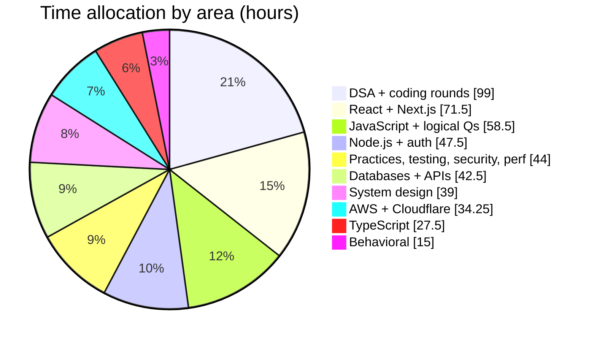
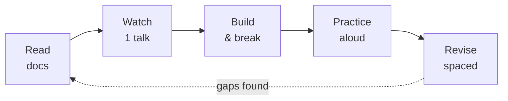
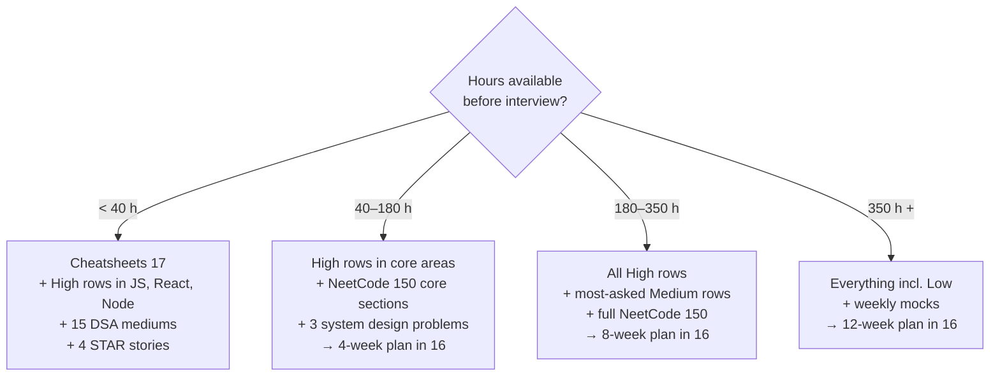

# 01 — Full Stack Interview Master Syllabus

> Every topic you can be asked about in a mid-to-senior full stack interview (Node.js / Next.js / React / TypeScript), with priority, time estimate, resources, a learning method, and a link to the doc that covers it in depth.

## Table of Contents

- [How to Read This Syllabus](#how-to-read-this-syllabus)
- [Time Budget Overview](#time-budget-overview)
- [The Learning Method (applies to every row)](#the-learning-method-applies-to-every-row)
- [1. JavaScript](#1-javascript)
- [2. TypeScript](#2-typescript)
- [3. React](#3-react)
- [4. Next.js](#4-nextjs)
- [5. Node.js](#5-nodejs)
- [6. Databases](#6-databases)
- [7. APIs](#7-apis)
- [8. Authentication & Authorization](#8-authentication--authorization)
- [9. Testing](#9-testing)
- [10. Engineering Practices](#10-engineering-practices)
- [11. Web Security](#11-web-security)
- [12. Web Performance & Browser](#12-web-performance--browser)
- [13. System Design](#13-system-design)
- [14. AWS EC2 & Deployment](#14-aws-ec2--deployment)
- [15. AWS S3 & CloudFront](#15-aws-s3--cloudfront)
- [16. Cloudflare](#16-cloudflare)
- [17. DSA & Coding Rounds](#17-dsa--coding-rounds)
- [18. Machine Coding & Live Coding](#18-machine-coding--live-coding)
- [19. JS Logical / Output Questions](#19-js-logical--output-questions)
- [20. Behavioral & Career](#20-behavioral--career)
- [Core Resource Library](#core-resource-library)
- [Priority Triage: If You Only Have X Hours](#priority-triage-if-you-only-have-x-hours)
- [Next Steps](#next-steps)

---

## How to Read This Syllabus

**Priority** reflects how often a topic comes up in mid-to-senior full stack interviews *and* how badly a weak answer hurts you:

| Priority | Meaning | Target confidence |
|----------|---------|:-----------------:|
| **High** | Asked in most interviews; a weak answer is often disqualifying | 4–5 |
| **Medium** | Asked often, or asked deeply at some companies; a good answer is a differentiator | 3–4 |
| **Low** | Niche, role-specific, or "nice to know"; skim unless the job description mentions it | 2–3 |

**Est. hours** assume 3+ years of experience — you're filling gaps and learning internals, not learning from zero. Halve them for topics you use daily; double them for topics you've never touched.

**Doc** links to the file where the topic is covered in depth. Confidence levels are defined in [00-README.md](./00-README.md#progress-tracker).

---

## Time Budget Overview

| Area | High | Medium | Low | Est. hours | Doc |
|------|:----:|:------:|:---:|:----------:|-----|
| JavaScript | 14 | 8 | 2 | 47.5 | [02](./02-javascript.md) |
| TypeScript | 9 | 6 | 2 | 27.5 | [03](./03-typescript.md) |
| React | 12 | 9 | 2 | 42.5 | [04](./04-react.md) |
| Next.js | 10 | 7 | 2 | 29 | [05](./05-nextjs.md) |
| Node.js | 10 | 9 | 3 | 37.5 | [06](./06-nodejs.md) |
| Databases | 7 | 5 | 3 | 28 | [07](./07-databases-and-apis.md) |
| APIs | 7 | 4 | 2 | 14.5 | [07](./07-databases-and-apis.md) |
| Auth | 5 | 3 | 1 | 10 | [06](./06-nodejs.md), [05](./05-nextjs.md) |
| Testing | 3 | 3 | 1 | 10 | [08](./08-engineering-practices.md) |
| Engineering practices | 4 | 7 | 3 | 16 | [08](./08-engineering-practices.md) |
| Web security | 4 | 3 | 1 | 8 | [08](./08-engineering-practices.md), [06](./06-nodejs.md) |
| Web performance & browser | 4 | 3 | 1 | 10 | [02](./02-javascript.md), [05](./05-nextjs.md) |
| System design | 10 | 9 | 3 | 39 | [09](./09-system-design.md) |
| AWS EC2 | 5 | 7 | 3 | 16.5 | [10](./10-deployment-aws-ec2.md) |
| AWS S3 / CloudFront | 4 | 5 | 2 | 8.5 | [11](./11-deployment-aws-s3.md) |
| Cloudflare | 4 | 6 | 4 | 9.25 | [12](./12-cloudflare.md) |
| DSA | 11 | 5 | 2 | 81 | [13](./13-coding-round-practice.md) |
| Machine / live coding | 4 | 2 | — | 18 | [13](./13-coding-round-practice.md), [04](./04-react.md) |
| JS logical questions | 6 | 2 | — | 11 | [14](./14-js-logical-interview-questions.md) |
| Behavioral & career | 6 | 3 | 1 | 15 | [15](./15-other-interview-questions.md) |
| **Total** | **139** | **106** | **38** | **≈ 479** | |

High-priority rows alone add up to **≈ 303 hours**.

> 💡 Interview Tip: ~480 hours is the "complete" path. The [12-week plan](./16-study-plan.md) fits it at ~5.5–6 hours/day. The 8-week plan covers all High rows plus the most-asked Medium rows; the 4-week plan covers only the High rows in the core areas (JS, React, Next.js, Node.js, databases/APIs, DSA, behavioral). See [Priority Triage](#priority-triage-if-you-only-have-x-hours).

---

## The Learning Method (applies to every row)

Each row's "How to learn" column is a shorthand of this five-step loop:

| Step | What you do | Share of time |
|------|-------------|:-------------:|
| **1. Read** | Official docs / canonical article first. Take notes as questions, not summaries. | 20% |
| **2. Watch** | One talk or video for the mental model (event loop, Fiber, caching). Skip if the docs clicked. | 10% |
| **3. Build** | Smallest program that exercises the concept; then break it deliberately. | 35% |
| **4. Practice** | Exercises + interview questions from the doc, answered out loud before checking. | 25% |
| **5. Revise** | Re-read the Quick Revision Summary at +1 day, +1 week, and before the interview. | 10% |

> ⚠️ Pitfall: The most common failure mode for experienced devs is over-indexing on Read/Watch. Recognizing an explanation is not the same as producing one under pressure. Spend most of your time in Build and Practice.

---

## 1. JavaScript

Doc: [02-javascript.md](./02-javascript.md) · Puzzles: [14-js-logical-interview-questions.md](./14-js-logical-interview-questions.md)

| Topic | Priority | Hrs | Resources | Where to find | How to learn | Doc |
|-------|:--------:|:---:|-----------|---------------|--------------|:---:|
| Execution context, call stack, creation vs execution phase | High | 2 | javascript.info; *You Don't Know JS Yet* — Scope & Closures | javascript.info; github.com/getify/You-Dont-Know-JS | Trace 5 snippets on paper: stack frames, variable environment, outer reference | [02](./02-javascript.md) |
| Hoisting & TDZ (`var` / `let` / `const` / functions / classes) | High | 1.5 | MDN "Hoisting" glossary; javascript.info "Variable scope" | developer.mozilla.org | Predict output of 15 hoisting puzzles in [14](./14-js-logical-interview-questions.md) | [02](./02-javascript.md) |
| Scope chain & lexical scope | High | 1 | YDKJS Yet — Scope & Closures | GitHub (getify) | Draw scope "bubbles" for nested functions | [02](./02-javascript.md) |
| Closures (memory, loops, module pattern, stale closures) | High | 3 | javascript.info "Closure"; MDN "Closures" | javascript.info; MDN | Build counter, `once`, memoize, private state; explain loop+`var` bug | [02](./02-javascript.md) |
| `this` binding rules (default, implicit, explicit, `new`, arrow) | High | 2.5 | YDKJS (1st ed.) — *this & Object Prototypes*; MDN `this` | GitHub (getify); MDN | Classify 20 call sites by rule; implement `call`/`apply`/`bind` | [02](./02-javascript.md) |
| Prototypes, `[[Prototype]]` chain, `class` desugaring, inheritance | High | 3 | javascript.info "Prototypes, inheritance"; MDN "Inheritance and the prototype chain" | javascript.info; MDN | Rewrite a `class` hierarchy using only functions + `Object.create` | [02](./02-javascript.md) |
| Event loop: call stack, microtasks, macrotasks, rendering | High | 3 | Jake Archibald "In The Loop" (JSConf.Asia 2018); Philip Roberts "What the heck is the event loop anyway?" (JSConf EU 2014); javascript.info "Event loop" | YouTube (search talk titles); javascript.info | Predict ordering for 20 `setTimeout`/`Promise`/`queueMicrotask` puzzles | [02](./02-javascript.md) |
| Promises internals, chaining, error propagation | High | 3 | javascript.info "Promises, async/await" chapter; MDN "Using promises" | javascript.info; MDN | Implement a minimal Promise (then, catch, resolve chaining) | [02](./02-javascript.md) |
| async/await desugaring, error handling, parallel vs sequential | High | 2 | MDN `async function`; V8 blog "Faster async functions and promises" | MDN; v8.dev/blog | Rewrite async code as generator + runner; benchmark sequential vs `Promise.all` | [02](./02-javascript.md) |
| Promise combinators (`all`, `allSettled`, `race`, `any`) + polyfills | High | 2 | MDN `Promise` reference | MDN | Implement all four from scratch with tests | [02](./02-javascript.md), [14](./14-js-logical-interview-questions.md) |
| Polyfills: `bind`, `call`, `apply`, `map`, `filter`, `reduce`, `flat` | High | 3 | BigFrontEnd.dev; GreatFrontEnd | bigfrontend.dev; greatfrontend.com | Write each, then compare edge cases against spec behavior (sparse arrays, `thisArg`) | [02](./02-javascript.md), [14](./14-js-logical-interview-questions.md) |
| Debounce, throttle, currying, memoize, compose/pipe | High | 2 | BigFrontEnd.dev; Lodash source | bigfrontend.dev; github.com/lodash/lodash | Implement with leading/trailing options; wire to a search input | [02](./02-javascript.md) |
| Type coercion, `==` vs `===`, `Object.is`, truthiness | Medium | 1.5 | YDKJS Yet — *Types & Grammar* (1st ed.); MDN "Equality comparisons and sameness" | GitHub; MDN | Work through the abstract equality algorithm for 10 cases | [02](./02-javascript.md), [14](./14-js-logical-interview-questions.md) |
| Generators & iterators, iteration protocols, async iterators | Medium | 2 | javascript.info "Generators, advanced iteration"; MDN "Iteration protocols" | javascript.info; MDN | Build a paginated API async iterator; a lazy `range()` | [02](./02-javascript.md) |
| Proxy & Reflect | Medium | 1.5 | javascript.info "Proxy and Reflect" | javascript.info | Build a validation proxy and a tiny reactive store | [02](./02-javascript.md) |
| Modules: ESM vs CommonJS, live bindings, dynamic `import()`, interop | Medium | 2 | Node.js docs "Modules: ECMAScript modules" / "CommonJS modules"; MDN "JavaScript modules" | nodejs.org/docs; MDN | Create a dual ESM/CJS package; observe live-binding vs copy behavior | [02](./02-javascript.md), [06](./06-nodejs.md) |
| Memory management, GC (mark-and-sweep, generational), leaks | Medium | 2 | MDN "Memory management"; V8 blog "Trash talk: the Orinoco garbage collector" | MDN; v8.dev/blog | Create a leak (detached DOM, closure, listener), find it in Chrome DevTools Memory tab | [02](./02-javascript.md) |
| Deep clone, `structuredClone`, immutability, `Object.freeze` | Medium | 1.5 | MDN `structuredClone` | MDN | Implement deep clone handling cycles, `Date`, `Map`, `Set` | [02](./02-javascript.md) |
| ES2015 → ES2024+ features (optional chaining, `??`, `at`, `Object.groupBy`, `Array.prototype.toSorted`, `Promise.withResolvers`, etc.) | Medium | 2 | MDN; TC39 finished proposals list | MDN; github.com/tc39/proposals/blob/main/finished-proposals.md | Refactor an old util file using modern features; know which year each landed | [02](./02-javascript.md) |
| Error handling: `Error` subclasses, `cause`, async errors, unhandled rejections | High | 1.5 | MDN `Error` | MDN | Build a typed error hierarchy used by an API layer | [02](./02-javascript.md) |
| DOM, event propagation (capture/bubble), event delegation | High | 2 | MDN "Introduction to events"; javascript.info "Bubbling and capturing" | MDN; javascript.info | Implement delegated click handling for a dynamic list | [02](./02-javascript.md) |
| Web APIs: `fetch` + `AbortController`, storage, `IntersectionObserver`, Web Workers | Medium | 2 | MDN Web APIs index | MDN | Cancellable fetch with timeout; lazy-load images with IO | [02](./02-javascript.md) |
| WeakMap/WeakSet/WeakRef, Symbols, getters/setters, property descriptors | Low | 1 | MDN; javascript.info "Property flags and descriptors" | MDN; javascript.info | Use WeakMap for private data / caching keyed by object | [02](./02-javascript.md) |
| Tagged templates, labels, `with`, other rarities | Low | 0.5 | MDN | MDN | Skim; know they exist | [02](./02-javascript.md) |

---

## 2. TypeScript

Doc: [03-typescript.md](./03-typescript.md)

| Topic | Priority | Hrs | Resources | Where to find | How to learn | Doc |
|-------|:--------:|:---:|-----------|---------------|--------------|:---:|
| Structural typing, type inference, widening/narrowing of literals | High | 1.5 | TypeScript Handbook | typescriptlang.org/docs/handbook | Explain why excess property checks only apply to fresh object literals | [03](./03-typescript.md) |
| `any` vs `unknown` vs `never`; `void`; top & bottom types | High | 1 | TS Handbook; Total TypeScript articles | typescriptlang.org; totaltypescript.com | Replace every `any` in a small codebase with `unknown` + narrowing | [03](./03-typescript.md) |
| Type guards & narrowing (`typeof`, `in`, `instanceof`, predicates, assertion functions) | High | 2 | TS Handbook "Narrowing" | typescriptlang.org | Write `isUser(x): x is User` and an `assertNever` | [03](./03-typescript.md) |
| Discriminated unions & exhaustiveness checking | High | 1.5 | TS Handbook "Narrowing" → discriminated unions | typescriptlang.org | Model API states (`idle`/`loading`/`success`/`error`) and a reducer | [03](./03-typescript.md) |
| Generics (constraints, defaults, inference from arguments) | High | 3 | TS Handbook "Generics"; Total TypeScript free tutorials | typescriptlang.org; totaltypescript.com | Type a `groupBy`, a typed `fetcher<T>`, a generic React `<Select<T>>` | [03](./03-typescript.md) |
| Utility types (`Partial`, `Pick`, `Omit`, `Record`, `ReturnType`, `Awaited`, `NoInfer`, …) | High | 1.5 | TS Handbook "Utility Types" | typescriptlang.org | Re-implement 10 utilities yourself | [03](./03-typescript.md) |
| `interface` vs `type`, declaration merging, module augmentation | High | 1 | TS Handbook "Declaration Merging" | typescriptlang.org | Augment Express `Request` with `user`; augment `process.env` | [03](./03-typescript.md) |
| Mapped types, key remapping (`as`), modifiers (`-readonly`, `-?`) | Medium | 1.5 | TS Handbook "Mapped Types" | typescriptlang.org | Build `DeepReadonly<T>`, `Getters<T>` | [03](./03-typescript.md) |
| Conditional types, distributive behavior, `infer` | Medium | 2 | TS Handbook "Conditional Types" | typescriptlang.org | Implement `UnwrapPromise`, `ElementType`, `Parameters` from scratch | [03](./03-typescript.md) |
| Template literal types | Medium | 1 | TS Handbook "Template Literal Types" | typescriptlang.org | Type-safe event names (`on${Capitalize<K>}`), route params extraction | [03](./03-typescript.md) |
| `satisfies`, `as const`, const type parameters | Medium | 1 | TS 4.9 / 5.0 release notes | typescriptlang.org/docs/handbook/release-notes | Type a config object that keeps literal keys but is validated | [03](./03-typescript.md) |
| tsconfig deep dive (`strict` family, `moduleResolution`, `module`, `target`, `isolatedModules`, `verbatimModuleSyntax`, project references) | Medium | 2 | TSConfig Reference | typescriptlang.org/tsconfig | Set up configs for a Node ESM service and a Next.js app; explain each flag | [03](./03-typescript.md) |
| Typing React (props, children, events, refs, generic components, `ComponentProps`) | High | 2 | React TypeScript Cheatsheet; react.dev "Using TypeScript" | react-typescript-cheatsheet.netlify.app; react.dev | Type a polymorphic `<Button as="a">` and a `forwardRef` input | [03](./03-typescript.md), [04](./04-react.md) |
| Typing Node/Express/Next (handlers, middleware, route params, env) | Medium | 1.5 | `@types/express`; Next.js TS docs | npm; nextjs.org/docs | Type an Express middleware that adds `req.user` | [03](./03-typescript.md) |
| Runtime validation with Zod (schemas, `z.infer`, parsing at boundaries) | High | 1.5 | Zod docs | zod.dev | Validate env vars, API request bodies and form data with one schema each | [03](./03-typescript.md) |
| Type-challenges (easy → medium) | Low | 3 | type-challenges repo | github.com/type-challenges/type-challenges | Do all "easy" and 15 "medium" | [03](./03-typescript.md) |
| Variance, function parameter bivariance, `strictFunctionTypes` | Low | 0.5 | TS Handbook; TS FAQ on GitHub wiki | typescriptlang.org; github.com/microsoft/TypeScript/wiki/FAQ | Understand why method params are bivariant | [03](./03-typescript.md) |

---

## 3. React

Doc: [04-react.md](./04-react.md) · Applies to React 19 (verify current version on react.dev)

| Topic | Priority | Hrs | Resources | Where to find | How to learn | Doc |
|-------|:--------:|:---:|-----------|---------------|--------------|:---:|
| Rendering model: render vs commit, what triggers a re-render | High | 2 | react.dev "Render and Commit"; Josh Comeau "Why React Re-Renders" | react.dev; joshwcomeau.com | Log renders in a tree; predict which children re-render | [04](./04-react.md) |
| Reconciliation, keys, virtual DOM diffing heuristics | High | 2 | react.dev "Preserving and Resetting State"; legacy docs "Reconciliation" | react.dev; legacy.reactjs.org | Break a list with index keys + inputs; fix with stable keys | [04](./04-react.md) |
| Fiber architecture, lanes, interruptible rendering | Medium | 2 | Andrew Clark "React Fiber Architecture" notes; Lin Clark "A Cartoon Intro to Fiber" (React Conf 2017) | github.com/acdlite/react-fiber-architecture; YouTube | Explain why Fiber made concurrent rendering possible | [04](./04-react.md) |
| Core hooks (`useState`, `useEffect`, `useRef`, `useContext`, `useReducer`) — semantics & rules | High | 3 | react.dev Hooks reference; "You Might Not Need an Effect" | react.dev | Refactor 5 effects that should be derived state or event handlers | [04](./04-react.md) |
| `useEffect` deep dive: dependencies, cleanup, stale closures, Strict Mode double-invoke | High | 2 | react.dev "Synchronizing with Effects", "Lifecycle of Reactive Effects"; Dan Abramov "A Complete Guide to useEffect" | react.dev; overreacted.io | Build a subscription with correct cleanup; fix a race condition in data fetching | [04](./04-react.md) |
| `useLayoutEffect`, `useId`, `useSyncExternalStore`, `useImperativeHandle`, `useDeferredValue`, `useTransition` | Medium | 2 | react.dev Hooks reference | react.dev | Build a store hook with `useSyncExternalStore` | [04](./04-react.md) |
| Custom hooks (design, composition, testing) | High | 2 | react.dev "Reusing Logic with Custom Hooks" | react.dev | Write `useDebounce`, `useFetch` (with abort), `useLocalStorage`, `useMediaQuery` | [04](./04-react.md) |
| Performance: `memo`, `useMemo`, `useCallback`, React Compiler | High | 2.5 | react.dev `memo` / `useMemo` docs; React Compiler docs | react.dev | Profile with React DevTools Profiler; prove when memo helps and when it doesn't | [04](./04-react.md) |
| Code splitting (`lazy`, `Suspense`), list virtualization | Medium | 1.5 | react.dev `lazy`; TanStack Virtual docs | react.dev; tanstack.com/virtual | Virtualize a 10k-row list | [04](./04-react.md) |
| State management: lifting state, Context (and its re-render cost) | High | 1.5 | react.dev "Managing State" section | react.dev | Split a fat context; measure re-renders before/after | [04](./04-react.md) |
| Redux Toolkit (slices, RTK Query) | Medium | 2 | Redux Toolkit docs | redux-toolkit.js.org | Build a cart slice; know when RTK is overkill | [04](./04-react.md) |
| Zustand | Medium | 1 | Zustand README & docs | github.com/pmndrs/zustand | Build a store with selectors; compare to Context | [04](./04-react.md) |
| TanStack Query (server state, caching, invalidation, optimistic updates) | High | 3 | TanStack Query docs; TkDodo's blog "Practical React Query" series | tanstack.com/query; tkdodo.eu/blog | Build list + detail + mutation with optimistic update and rollback | [04](./04-react.md) |
| Concurrent rendering, Suspense, transitions | High | 2 | react.dev `Suspense`, `useTransition`; React 18 release post | react.dev/blog | Search UI that stays responsive using `useTransition` | [04](./04-react.md) |
| React 19: Actions, `useActionState`, `useFormStatus`, `useOptimistic`, `use`, ref as prop | High | 2.5 | react.dev blog "React 19" | react.dev/blog | Rebuild a form with Actions + optimistic UI | [04](./04-react.md), [05](./05-nextjs.md) |
| Server Components (concept, boundaries, serialization) | High | 2 | react.dev "Server Components"; Dan Abramov's posts on overreacted.io | react.dev; overreacted.io | Map which components in an app can be server-only | [04](./04-react.md), [05](./05-nextjs.md) |
| Forms: controlled vs uncontrolled, React Hook Form + Zod | Medium | 1.5 | React Hook Form docs | react-hook-form.com | Multi-step form with schema validation | [04](./04-react.md) |
| Error boundaries & error handling | Medium | 1 | react.dev "Catching rendering errors with an error boundary" (in `Component` reference); `react-error-boundary` | react.dev; github.com/bvaughn/react-error-boundary | Wrap a widget; show retry UI | [04](./04-react.md) |
| Testing with React Testing Library + Vitest/Jest | High | 2.5 | Testing Library docs; Kent C. Dodds "Common mistakes with React Testing Library" | testing-library.com; kentcdodds.com/blog | Test an autocomplete: typing, async results, keyboard nav | [04](./04-react.md), [08](./08-engineering-practices.md) |
| Accessibility (semantic HTML, ARIA, focus management, keyboard) | Medium | 1.5 | WAI-ARIA Authoring Practices Guide; MDN Accessibility | w3.org/WAI/ARIA/apg; MDN | Build an accessible modal (focus trap, Esc, `aria-modal`) | [04](./04-react.md) |
| Patterns: compound components, render props, HOCs, controlled props, headless UI | Medium | 2 | patterns.dev; Kent C. Dodds blog | patterns.dev; kentcdodds.com | Build `<Tabs>` as compound components with context | [04](./04-react.md) |
| Portals, refs forwarding, `StrictMode` behaviors | Low | 0.5 | react.dev | react.dev | Render a tooltip via portal | [04](./04-react.md) |
| Class components & legacy lifecycles | Low | 0.5 | react.dev `Component` reference | react.dev | Map lifecycles to hooks for legacy-code questions | [04](./04-react.md) |

---

## 4. Next.js

Doc: [05-nextjs.md](./05-nextjs.md) · Applies to the App Router on Next.js 16.4. Cache Components (`'use cache'`) is the default for new apps; many existing codebases still run the previous caching model, and the doc covers both. Always verify on nextjs.org/docs.

| Topic | Priority | Hrs | Resources | Where to find | How to learn | Doc |
|-------|:--------:|:---:|-----------|---------------|--------------|:---:|
| App Router vs Pages Router (mental model, migration) | High | 1.5 | Next.js docs; "App Router Incremental Adoption Guide" | nextjs.org/docs | Port one Pages route to App Router | [05](./05-nextjs.md) |
| Server vs Client Components, `"use client"` boundary, serialization rules | High | 2.5 | Next.js docs "Server and Client Components" | nextjs.org/docs | Push `"use client"` to leaves in an existing page; pass server components as children | [05](./05-nextjs.md) |
| Rendering strategies: SSR, SSG, ISR, dynamic vs static, PPR | High | 2.5 | Next.js docs "Rendering"; PPR docs | nextjs.org/docs | Build one page of each kind; inspect `next build` output | [05](./05-nextjs.md) |
| Caching: Cache Components (`'use cache'`, `cacheLife`, `cacheTag`, static shell) and the previous model's four caches; invalidation (`updateTag`, `revalidateTag`, `revalidatePath`, `refresh`) | High | 3.5 | Next.js docs "Caching", "Caching without Cache Components", "How Revalidation Works"; Next.js release blog posts | nextjs.org/docs; nextjs.org/blog | Build a product page; trigger each cache and each invalidation path; read the `next build` Revalidate/Expire columns | [05](./05-nextjs.md) |
| Data fetching patterns: parallel vs sequential, `fetch` options, streaming | High | 2 | Next.js docs "Data Fetching" | nextjs.org/docs | Remove a request waterfall with parallel fetching + Suspense | [05](./05-nextjs.md) |
| Server Actions (security, validation, revalidation, progressive enhancement) | High | 2 | Next.js docs "Server Actions and Mutations" | nextjs.org/docs | CRUD form with Zod validation, auth check and `revalidatePath` | [05](./05-nextjs.md) |
| Route handlers (`route.ts`), webhooks, streaming responses | Medium | 1 | Next.js docs "Route Handlers" | nextjs.org/docs | Build a Stripe-style webhook endpoint with signature verification | [05](./05-nextjs.md) |
| Proxy (`proxy.ts`, formerly Middleware): optimistic auth redirects, i18n, headers; why it isn't the security boundary (CVE-2025-29927) | High | 1.5 | Next.js docs "Proxy"; Vercel postmortem on the middleware bypass | nextjs.org/docs; vercel.com/blog | Protect `/dashboard` with an optimistic redirect plus a Data Access Layer check; add security headers | [05](./05-nextjs.md) |
| Layouts, templates, loading/error/not-found, route groups, parallel & intercepting routes | Medium | 2 | Next.js docs "Routing" | nextjs.org/docs | Build a modal with intercepting routes | [05](./05-nextjs.md) |
| Streaming & Suspense in Next.js | Medium | 1 | Next.js docs "Loading UI and Streaming" | nextjs.org/docs | Stream a slow widget while the shell renders | [05](./05-nextjs.md) |
| Image & font optimization (`next/image`, `next/font`) | Medium | 1 | Next.js docs "Optimizing" | nextjs.org/docs | Fix CLS caused by images/fonts on a page | [05](./05-nextjs.md) |
| Metadata API & SEO (`generateMetadata`, sitemap, robots, OG images) | Medium | 1 | Next.js docs "Metadata" | nextjs.org/docs | Dynamic OG image per blog post | [05](./05-nextjs.md) |
| Auth with Auth.js (NextAuth) / alternatives; session strategies | High | 2 | Auth.js docs | authjs.dev | GitHub OAuth login, protected server component, protected action | [05](./05-nextjs.md), [06](./06-nodejs.md) |
| Environment variables (`NEXT_PUBLIC_`, build-time vs runtime) | Medium | 0.5 | Next.js docs "Environment Variables" | nextjs.org/docs | Explain why a `NEXT_PUBLIC_` var is baked at build time | [05](./05-nextjs.md) |
| Edge vs Node.js runtime (Edge deprecated in 16; why compute location vs data location matters) | Medium | 1 | Next.js docs "Edge and Node.js Runtimes" | nextjs.org/docs | List APIs unavailable on edge; explain why Node near the database usually wins | [05](./05-nextjs.md) |
| Deployment: Vercel vs self-hosted (`output: "standalone"`) vs Docker vs adapters; multi-instance concerns (encryption key, shared cache, `deploymentId`, streaming) | High | 1.5 | Next.js docs "Deploying", "Self-Hosting"; `vercel/next.js` examples (`with-docker`) | nextjs.org/docs; github.com/vercel/next.js/tree/canary/examples | Dockerize a Next app with standalone output; run two instances behind nginx | [05](./05-nextjs.md), [10](./10-deployment-aws-ec2.md) |
| Core Web Vitals (LCP, INP, CLS) & performance tuning | High | 1.5 | web.dev "Web Vitals"; Next.js `useReportWebVitals` | web.dev; nextjs.org/docs | Measure with Lighthouse + field data; fix one metric | [05](./05-nextjs.md) |
| Internationalization, `next.config` advanced options | Low | 0.5 | Next.js docs | nextjs.org/docs | Skim | [05](./05-nextjs.md) |
| Pages Router data APIs (`getServerSideProps`, `getStaticProps`) for legacy codebases | Low | 0.5 | Next.js docs (Pages Router section) | nextjs.org/docs/pages | Map each to its App Router equivalent | [05](./05-nextjs.md) |

---

## 5. Node.js

Doc: [06-nodejs.md](./06-nodejs.md) · Written for Node.js 24 LTS (Node 26 becomes Active LTS on 2026-10-28; verify on nodejs.org)

| Topic | Priority | Hrs | Resources | Where to find | How to learn | Doc |
|-------|:--------:|:---:|-----------|---------------|--------------|:---:|
| Event loop phases (timers, pending, poll, check, close), `process.nextTick` vs microtasks vs `setImmediate` | High | 3 | Node.js docs "The Node.js Event Loop"; Bert Belder "Everything You Need to Know About Node.js Event Loop" (talk) | nodejs.org/en/learn; YouTube | Predict ordering puzzles; explain `setTimeout(0)` vs `setImmediate` inside I/O callbacks | [06](./06-nodejs.md), [02](./02-javascript.md) |
| libuv & the thread pool (`UV_THREADPOOL_SIZE`, which APIs use it) | High | 1.5 | libuv docs "Design overview"; Node.js docs "Don't Block the Event Loop" | docs.libuv.org; nodejs.org/en/learn | Benchmark `crypto.pbkdf2` with pool size 4 vs 8 | [06](./06-nodejs.md) |
| Streams (readable, writable, transform, backpressure, `pipeline`) & Buffers | High | 3 | Node.js docs "Stream"; "Backpressuring in Streams" guide | nodejs.org/docs; nodejs.org/en/learn | Stream a 2 GB CSV → transform → gzip → file with flat memory | [06](./06-nodejs.md) |
| Cluster, worker threads, child processes — when to use which | High | 2 | Node.js docs `cluster`, `worker_threads`, `child_process` | nodejs.org/docs | Offload image resizing to a worker pool | [06](./06-nodejs.md) |
| Express internals (middleware chain, error middleware), Fastify, NestJS overview | High | 2.5 | expressjs.com; fastify.dev; docs.nestjs.com | Official sites | Build the same CRUD API in Express and Fastify; compare | [06](./06-nodejs.md) |
| Error handling (operational vs programmer errors, async errors, `unhandledRejection`) | High | 1.5 | Node.js Best Practices repo — Error handling section | github.com/goldbergyoni/nodebestpractices | Centralized error handler with typed errors and correct status codes | [06](./06-nodejs.md) |
| REST API best practices (status codes, validation, versioning, pagination) | High | 1.5 | Microsoft REST API Guidelines; Zalando RESTful API Guidelines | github.com/microsoft/api-guidelines; opensource.zalando.com/restful-api-guidelines | Review your last API against a guideline checklist | [06](./06-nodejs.md), [07](./07-databases-and-apis.md) |
| Auth: sessions vs JWT, refresh token rotation, OAuth2/OIDC, password hashing | High | 3 | OWASP Cheat Sheets (Authentication, Session Management, JWT); oauth.net/2 | cheatsheetseries.owasp.org; oauth.net | Implement access + refresh with rotation and reuse detection | [06](./06-nodejs.md) |
| Rate limiting (token bucket, sliding window) with Redis | Medium | 1.5 | Redis docs; Cloudflare blog posts on rate limiting | redis.io/docs; blog.cloudflare.com | Implement sliding-window limiter with a Lua script or sorted set | [06](./06-nodejs.md), [09](./09-system-design.md) |
| File uploads (multipart, streaming to S3, limits, validation) | Medium | 1.5 | Multer / Busboy READMEs; AWS SDK v3 docs | npm; docs.aws.amazon.com | Stream upload to S3 without buffering to disk | [06](./06-nodejs.md), [11](./11-deployment-aws-s3.md) |
| WebSockets & Server-Sent Events, scaling with pub/sub | Medium | 2 | MDN "WebSockets API", "Server-sent events"; Socket.IO docs | MDN; socket.io/docs | Chat with rooms; scale to 2 instances with Redis adapter | [06](./06-nodejs.md), [09](./09-system-design.md) |
| Background jobs & queues (BullMQ: retries, backoff, concurrency, idempotency) | Medium | 2 | BullMQ docs | docs.bullmq.io | Email queue with retries, DLQ-style failed set, dashboard | [06](./06-nodejs.md) |
| Caching with Redis (cache-aside, TTLs, stampede protection) | High | 1.5 | Redis docs | redis.io/docs | Add cache-aside to a slow endpoint; prevent stampede with a lock | [06](./06-nodejs.md), [07](./07-databases-and-apis.md) |
| Logging (structured logs with Pino), correlation IDs | Medium | 1 | Pino docs | getpino.io | Add request IDs via `AsyncLocalStorage` | [06](./06-nodejs.md) |
| Observability: metrics, tracing (OpenTelemetry), health checks | Medium | 1.5 | OpenTelemetry JS docs | opentelemetry.io/docs/languages/js | Instrument an Express app; export traces to a local collector | [06](./06-nodejs.md), [08](./08-engineering-practices.md) |
| Graceful shutdown (SIGTERM, draining connections, closing pools) | Medium | 1 | Node.js docs `process` signals; Node Best Practices | nodejs.org/docs; GitHub | Implement and test under `docker stop` | [06](./06-nodejs.md) |
| Security (OWASP Top 10 for APIs, Helmet, input validation, SSRF, prototype pollution) | High | 2 | OWASP API Security Top 10; Node.js docs "Security Best Practices" | owasp.org; nodejs.org/en/learn | Audit a sample API against OWASP API Top 10 | [06](./06-nodejs.md), [08](./08-engineering-practices.md) |
| Testing APIs (Supertest, integration tests with real DB via Testcontainers) | Medium | 1.5 | Supertest README; Testcontainers for Node docs | npm; node.testcontainers.org | Integration test suite with a throwaway Postgres | [06](./06-nodejs.md), [08](./08-engineering-practices.md) |
| Profiling & memory leaks (`--inspect`, heap snapshots, clinic.js, `--cpu-prof`) | Medium | 2 | Node.js docs "Diagnostics" guides; Clinic.js | nodejs.org/en/learn; clinicjs.org | Find a planted leak with heap snapshot diff | [06](./06-nodejs.md) |
| `AsyncLocalStorage`, `EventEmitter` internals | Low | 1 | Node.js docs | nodejs.org/docs | Implement your own EventEmitter | [06](./06-nodejs.md), [14](./14-js-logical-interview-questions.md) |
| Native test runner, `--watch`, built-in `fetch`, permission model | Low | 0.5 | Node.js docs | nodejs.org/docs | Skim release notes of the current LTS | [06](./06-nodejs.md) |
| N-API / native addons | Low | 0.5 | Node.js docs "Node-API" | nodejs.org/docs | Know it exists and why (`bcrypt`, `sharp`) | [06](./06-nodejs.md) |

---

## 6. Databases

Doc: [07-databases-and-apis.md](./07-databases-and-apis.md) · Written for PostgreSQL 18, MongoDB 8, Redis 8, Prisma 7 (verify current majors on the official docs)

| Topic | Priority | Hrs | Resources | Where to find | How to learn | Doc |
|-------|:--------:|:---:|-----------|---------------|--------------|:---:|
| SQL fundamentals: joins, aggregates, `GROUP BY`/`HAVING`, subqueries, CTEs, window functions | High | 4 | PostgreSQL docs tutorial; SQLBolt; PostgreSQL Exercises | postgresql.org/docs; sqlbolt.com; pgexercises.com | Solve all pgexercises; 10 LeetCode SQL problems (e.g. "SQL 50" study plan) | [07](./07-databases-and-apis.md) |
| Indexes: B-tree internals, composite index order, covering, partial, when indexes hurt | High | 3 | *Use The Index, Luke* | use-the-index-luke.com | `EXPLAIN ANALYZE` before/after for 5 queries | [07](./07-databases-and-apis.md) |
| Transactions, ACID, isolation levels, anomalies (dirty/non-repeatable/phantom reads), locking | High | 3 | PostgreSQL docs "Concurrency Control"; *Designing Data-Intensive Applications* ch. 7 | postgresql.org/docs; O'Reilly (book) | Reproduce a lost update; fix with `SELECT … FOR UPDATE` or optimistic locking | [07](./07-databases-and-apis.md) |
| Normalization (1NF–3NF/BCNF) & intentional denormalization | High | 1.5 | Any DB textbook; PostgreSQL docs | — | Normalize a messy orders spreadsheet into tables | [07](./07-databases-and-apis.md) |
| Query optimization: `EXPLAIN`, N+1 problem, pagination performance | High | 2 | PostgreSQL docs "Using EXPLAIN"; Use The Index, Luke | postgresql.org/docs; use-the-index-luke.com | Find and fix an N+1 in an ORM-based endpoint | [07](./07-databases-and-apis.md) |
| PostgreSQL specifics: JSONB, MVCC, `VACUUM`, connection pooling (PgBouncer) | Medium | 2 | PostgreSQL docs | postgresql.org/docs | Store + index JSONB; explain why serverless needs pooling | [07](./07-databases-and-apis.md) |
| MongoDB: document modeling (embed vs reference), indexes, aggregation pipeline | High | 3 | MongoDB docs "Data Modeling"; MongoDB University (free courses) | mongodb.com/docs; learn.mongodb.com | Model a blog with comments both ways; write a 4-stage aggregation | [07](./07-databases-and-apis.md) |
| SQL vs NoSQL: choosing, CAP/PACELC trade-offs | High | 1 | DDIA ch. 2, 5, 9; ByteByteGo | Book; bytebytego.com / YouTube | Justify DB choice for 3 product scenarios | [07](./07-databases-and-apis.md), [09](./09-system-design.md) |
| Redis data structures (strings, hashes, lists, sets, sorted sets, streams), persistence, eviction | Medium | 2 | Redis docs "Data types" | redis.io/docs | Leaderboard with sorted sets; session store with hashes | [07](./07-databases-and-apis.md) |
| ORMs: Prisma, Drizzle, Mongoose — trade-offs vs raw SQL | Medium | 2 | prisma.io/docs; orm.drizzle.team; mongoosejs.com/docs | Official sites | Same schema in Prisma and Drizzle; compare generated SQL | [07](./07-databases-and-apis.md) |
| Migrations & zero-downtime schema changes (expand/contract) | Medium | 1 | Prisma Migrate docs; Stripe engineering blog posts on migrations | prisma.io/docs; stripe.com/blog | Rename a column with zero downtime in 3 deploys | [07](./07-databases-and-apis.md) |
| Replication, read replicas, sharding, partitioning | Medium | 1.5 | DDIA ch. 5–6; PostgreSQL docs "Table Partitioning" | Book; postgresql.org/docs | Partition a logs table by month | [07](./07-databases-and-apis.md), [09](./09-system-design.md) |
| Full-text search (Postgres `tsvector`, Elasticsearch/OpenSearch basics) | Low | 1 | PostgreSQL docs "Full Text Search" | postgresql.org/docs | Search over product names with ranking | [07](./07-databases-and-apis.md) |
| Stored procedures, triggers, materialized views | Low | 0.5 | PostgreSQL docs | postgresql.org/docs | Skim; know trade-offs | [07](./07-databases-and-apis.md) |
| Vector databases / `pgvector` basics | Low | 0.5 | pgvector README | github.com/pgvector/pgvector | Know the concept for AI-feature questions | [07](./07-databases-and-apis.md) |

---

## 7. APIs

Doc: [07-databases-and-apis.md](./07-databases-and-apis.md) · REST/HTTP, pagination, idempotency, GraphQL, tRPC 11, gRPC, webhooks (Part 4)

| Topic | Priority | Hrs | Resources | Where to find | How to learn | Doc |
|-------|:--------:|:---:|-----------|---------------|--------------|:---:|
| REST design: resources, methods, status codes, idempotent vs safe methods | High | 1.5 | MDN "HTTP request methods" & "HTTP response status codes"; Zalando guidelines | MDN; opensource.zalando.com | Design endpoints for an e-commerce cart | [07](./07-databases-and-apis.md) |
| HTTP fundamentals: headers, caching (`Cache-Control`, `ETag`), CORS, HTTP/1.1 vs 2 vs 3 | High | 2.5 | MDN "HTTP" guide; Hussein Nasser HTTP videos | MDN; YouTube (Hussein Nasser) | Debug a CORS preflight failure; add ETags to an endpoint | [07](./07-databases-and-apis.md) |
| Pagination: offset vs cursor/keyset | High | 1 | Use The Index, Luke "Paging Through Results"; Slack engineering blog on pagination | use-the-index-luke.com; slack.engineering | Implement cursor pagination with a composite cursor | [07](./07-databases-and-apis.md) |
| Idempotency keys & safe retries | High | 1 | Stripe API docs "Idempotent requests"; Stripe blog "Designing robust and predictable APIs with idempotency" | docs.stripe.com; stripe.com/blog | Build idempotent `POST /payments` with a keys table | [07](./07-databases-and-apis.md) |
| API versioning strategies | Medium | 0.5 | Stripe API versioning docs/blog | stripe.com/blog | Compare URL vs header vs date-based versioning | [07](./07-databases-and-apis.md) |
| GraphQL: schema, resolvers, N+1 & DataLoader, caching, security (depth/complexity limits) | High | 2.5 | graphql.org/learn; DataLoader repo | graphql.org; github.com/graphql/dataloader | Build a small Apollo/Yoga server with DataLoader | [07](./07-databases-and-apis.md) |
| tRPC (end-to-end type safety) | Medium | 1 | tRPC docs | trpc.io | Add a tRPC router to a Next.js app | [07](./07-databases-and-apis.md) |
| gRPC & Protocol Buffers | Medium | 1 | grpc.io docs | grpc.io/docs | Know when it beats REST (internal services, streaming) | [07](./07-databases-and-apis.md) |
| REST vs GraphQL vs tRPC vs gRPC decision matrix | High | 0.5 | ByteByteGo videos on API styles | YouTube (ByteByteGo) | Defend a choice for 3 scenarios | [07](./07-databases-and-apis.md) |
| OpenAPI / Swagger, contract-first design | Medium | 1 | OpenAPI Specification | spec.openapis.org; swagger.io/docs | Generate a typed client from an OpenAPI spec | [07](./07-databases-and-apis.md) |
| Webhooks (signatures, retries, ordering, replay protection) | High | 1 | Stripe webhooks docs | docs.stripe.com | Verify HMAC signatures and dedupe events | [07](./07-databases-and-apis.md) |
| HATEOAS, JSON:API, OData | Low | 0.5 | jsonapi.org | jsonapi.org | Skim | [07](./07-databases-and-apis.md) |
| Long polling vs SSE vs WebSockets vs WebTransport | Low | 0.5 | MDN | MDN | Know the trade-off table | [07](./07-databases-and-apis.md), [06](./06-nodejs.md) |

---

## 8. Authentication & Authorization

Doc: [06-nodejs.md](./06-nodejs.md) (server side) · [05-nextjs.md](./05-nextjs.md) (Next.js integration)

| Topic | Priority | Hrs | Resources | Where to find | How to learn | Doc |
|-------|:--------:|:---:|-----------|---------------|--------------|:---:|
| Sessions (cookies, server store) vs JWT (stateless) — trade-offs | High | 1.5 | OWASP Session Management Cheat Sheet | cheatsheetseries.owasp.org | Build both; list revocation strategies for each | [06](./06-nodejs.md) |
| Cookie security (`HttpOnly`, `Secure`, `SameSite`, `__Host-` prefix) & token storage | High | 1 | MDN "Using HTTP cookies" | MDN | Explain why `localStorage` tokens are XSS-exposed | [06](./06-nodejs.md) |
| Access + refresh tokens, rotation, reuse detection | High | 2 | Auth0 docs "Refresh Token Rotation"; OWASP JWT Cheat Sheet | auth0.com/docs; cheatsheetseries.owasp.org | Implement rotation with a token family ID | [06](./06-nodejs.md) |
| OAuth 2.0 / OIDC flows (Authorization Code + PKCE) | High | 2 | oauth.net/2; "OAuth 2.0 Simplified" by Aaron Parecki | oauth.net; oauth.com | Draw the PKCE sequence diagram from memory | [06](./06-nodejs.md) |
| Password hashing (bcrypt/argon2/scrypt), MFA basics | High | 0.5 | OWASP Password Storage Cheat Sheet | cheatsheetseries.owasp.org | Explain salt, cost factor, why not SHA-256 | [06](./06-nodejs.md) |
| Authorization models: RBAC, ABAC, row-level security | Medium | 1 | OWASP Authorization Cheat Sheet; PostgreSQL docs "Row Security Policies" | cheatsheetseries.owasp.org; postgresql.org/docs | Implement RBAC middleware + a Postgres RLS policy | [06](./06-nodejs.md), [07](./07-databases-and-apis.md) |
| Auth.js / NextAuth integration in the App Router | Medium | 1 | Auth.js docs | authjs.dev | Protect pages, route handlers and Server Actions | [05](./05-nextjs.md) |
| CSRF protection with cookie-based auth | Medium | 0.5 | OWASP CSRF Prevention Cheat Sheet | cheatsheetseries.owasp.org | Explain when `SameSite=Lax` is enough and when it isn't | [06](./06-nodejs.md), [08](./08-engineering-practices.md) |
| SAML, passkeys/WebAuthn | Low | 0.5 | webauthn.guide; passkeys.dev | webauthn.guide; passkeys.dev | Know the concepts | [06](./06-nodejs.md) |

---

## 9. Testing

Doc: [08-engineering-practices.md](./08-engineering-practices.md)

| Topic | Priority | Hrs | Resources | Where to find | How to learn | Doc |
|-------|:--------:|:---:|-----------|---------------|--------------|:---:|
| Testing pyramid / trophy, what to test at each level | High | 1 | Kent C. Dodds "The Testing Trophy and Testing Classifications"; Martin Fowler "The Practical Test Pyramid" | kentcdodds.com/blog; martinfowler.com | Classify your current project's tests; find gaps | [08](./08-engineering-practices.md) |
| Unit testing with Vitest/Jest: mocks, spies, fake timers | High | 2 | vitest.dev; jestjs.io | Official docs | Test a debounced function with fake timers | [08](./08-engineering-practices.md) |
| Component testing with RTL (queries by role, user-event, async) | High | 2 | testing-library.com | Official docs | See React row; overlaps | [08](./08-engineering-practices.md), [04](./04-react.md) |
| API/integration testing (Supertest, Testcontainers), MSW for network mocking | Medium | 2 | mswjs.io; Testcontainers docs | mswjs.io; node.testcontainers.org | Mock a REST API in component tests with MSW | [08](./08-engineering-practices.md) |
| E2E testing with Playwright (locators, auth state, CI) | Medium | 2 | Playwright docs | playwright.dev | E2E test for login → create item → logout | [08](./08-engineering-practices.md) |
| TDD workflow, test doubles taxonomy, flaky tests | Medium | 0.5 | Martin Fowler "Mocks Aren't Stubs" | martinfowler.com | Explain stub vs mock vs fake vs spy | [08](./08-engineering-practices.md) |
| Load testing (k6), contract testing (Pact), mutation testing | Low | 0.5 | k6 docs; pact.io | grafana.com/docs/k6; docs.pact.io | Skim; run one k6 script | [08](./08-engineering-practices.md) |

---

## 10. Engineering Practices

Doc: [08-engineering-practices.md](./08-engineering-practices.md)

| Topic | Priority | Hrs | Resources | Where to find | How to learn | Doc |
|-------|:--------:|:---:|-----------|---------------|--------------|:---:|
| SOLID in TypeScript (with realistic examples, not just definitions) | High | 1.5 | *Clean Architecture* (Robert C. Martin); Refactoring Guru | Book; refactoring.guru | Refactor a "god service" applying SRP + DIP | [08](./08-engineering-practices.md) |
| Design patterns in JS/TS (Factory, Strategy, Observer, Adapter, Decorator, Singleton & why it's often an anti-pattern) | High | 2 | refactoring.guru/design-patterns; patterns.dev | Official sites | Identify 5 patterns in libraries you use (Express middleware = Chain of Responsibility, etc.) | [08](./08-engineering-practices.md) |
| Clean code & refactoring (naming, functions, code smells) | Medium | 1.5 | *Refactoring* (Martin Fowler, 2nd ed., JS examples); refactoring.guru "Code smells" | Book; refactoring.guru | Refactor a 200-line function with tests as a safety net | [08](./08-engineering-practices.md) |
| Git: branching strategies (trunk-based, GitFlow), rebase vs merge, interactive rebase, bisect, reflog | High | 1.5 | *Pro Git* book; Learn Git Branching | git-scm.com/book; learngitbranching.js.org | Recover a "lost" commit with reflog; find a bug with `git bisect` | [08](./08-engineering-practices.md) |
| Code review (what to look for, giving feedback, PR size) | Medium | 0.5 | Google Engineering Practices "Code Review" guide | google.github.io/eng-practices | Review an open-source PR using the guide | [08](./08-engineering-practices.md) |
| CI/CD with GitHub Actions (caching, matrix, secrets, environments, deploy jobs) | High | 2 | GitHub Actions docs | docs.github.com/en/actions | Lint → test → build → deploy pipeline for a Next.js app | [08](./08-engineering-practices.md), [10](./10-deployment-aws-ec2.md) |
| Docker: images vs containers, layers & caching, multi-stage builds, compose | Medium | 2 | Docker docs | docs.docker.com | Multi-stage Dockerfile for Node; compose with Postgres + Redis | [08](./08-engineering-practices.md) |
| Monorepos (Turborepo, Nx, pnpm workspaces) | Medium | 1 | turborepo.com docs; nx.dev; pnpm.io "Workspaces" | Official sites | Share a `types` package between a Next app and an API | [08](./08-engineering-practices.md) |
| Logging, monitoring & alerting (structured logs, SLIs/SLOs, Sentry) | Medium | 1 | Google SRE Book (free online) ch. 4 & 6; Sentry docs | sre.google/books; docs.sentry.io | Define an SLO for your API; wire Sentry to a Next app | [08](./08-engineering-practices.md) |
| Feature flags, trunk-based development, progressive rollout | Medium | 0.5 | Martin Fowler "Feature Toggles" | martinfowler.com | Implement a simple flag service | [08](./08-engineering-practices.md) |
| Accessibility as a practice (WCAG levels, audits, axe) | Medium | 1 | WCAG quick reference; axe DevTools | w3.org/WAI/WCAG22/quickref; deque.com/axe | Run axe on your app; fix 5 issues | [08](./08-engineering-practices.md) |
| Linting/formatting (ESLint flat config, Prettier, Biome), pre-commit hooks | Low | 0.5 | eslint.org; biomejs.dev | Official sites | Set up flat config + lint-staged | [08](./08-engineering-practices.md) |
| Documentation & ADRs (architecture decision records) | Low | 0.5 | adr.github.io | adr.github.io | Write one ADR for a past decision | [08](./08-engineering-practices.md) |
| Domain-Driven Design / hexagonal architecture basics | Low | 0.5 | Martin Fowler bliki; Alistair Cockburn "Hexagonal Architecture" | martinfowler.com; alistair.cockburn.us | Know the vocabulary | [08](./08-engineering-practices.md) |

---

## 11. Web Security

Doc: [08-engineering-practices.md](./08-engineering-practices.md) · [06-nodejs.md](./06-nodejs.md)

| Topic | Priority | Hrs | Resources | Where to find | How to learn | Doc |
|-------|:--------:|:---:|-----------|---------------|--------------|:---:|
| XSS (stored/reflected/DOM), output encoding, CSP | High | 1.5 | OWASP XSS Prevention Cheat Sheet; MDN "Content Security Policy" | cheatsheetseries.owasp.org; MDN | Exploit `dangerouslySetInnerHTML` in a test app; block with CSP | [08](./08-engineering-practices.md) |
| CSRF, CORS (and why CORS is not a security boundary for the server) | High | 1 | OWASP CSRF Cheat Sheet; MDN "CORS" | cheatsheetseries.owasp.org; MDN | Explain preflight; misconfigure `Access-Control-Allow-Origin: *` with credentials | [08](./08-engineering-practices.md) |
| Injection (SQL, NoSQL, command), parameterized queries | High | 1 | OWASP Injection Prevention Cheat Sheet | cheatsheetseries.owasp.org | Demonstrate NoSQL injection via `{ $ne: null }` and fix it | [08](./08-engineering-practices.md) |
| OWASP Top 10 (web) + API Security Top 10 overview | High | 1.5 | OWASP Top 10; OWASP API Security Project | owasp.org | One-line explanation + mitigation for each item | [08](./08-engineering-practices.md) |
| Secrets management, dependency scanning (npm audit, Dependabot), supply-chain risks | Medium | 1 | GitHub docs "Dependabot"; npm docs | docs.github.com; docs.npmjs.com | Enable Dependabot; rotate a leaked secret procedure | [08](./08-engineering-practices.md) |
| Security headers (HSTS, X-Frame-Options/`frame-ancestors`, Referrer-Policy) | Medium | 0.5 | MDN HTTP headers; securityheaders.com | MDN; securityheaders.com | Score A on securityheaders.com for a deployed app | [08](./08-engineering-practices.md) |
| SSRF, prototype pollution, ReDoS | Medium | 1 | OWASP SSRF Prevention Cheat Sheet; Snyk Learn | cheatsheetseries.owasp.org; learn.snyk.io | Write a URL allow-list fetcher | [08](./08-engineering-practices.md), [06](./06-nodejs.md) |
| Clickjacking, subresource integrity | Low | 0.5 | MDN | MDN | Skim | [08](./08-engineering-practices.md) |

---

## 12. Web Performance & Browser

Doc: [02-javascript.md](./02-javascript.md) (browser rendering) · [05-nextjs.md](./05-nextjs.md) (Core Web Vitals)

| Topic | Priority | Hrs | Resources | Where to find | How to learn | Doc |
|-------|:--------:|:---:|-----------|---------------|--------------|:---:|
| Critical rendering path: DOM, CSSOM, render tree, layout, paint, composite | High | 2 | web.dev "Critical rendering path"; MDN "How browsers work" | web.dev; MDN | Record a Performance trace; label each phase | [02](./02-javascript.md) |
| Reflow vs repaint, layout thrashing, compositor-only animations | High | 1 | web.dev rendering performance articles | web.dev | Fix a layout-thrashing loop with read/write batching | [02](./02-javascript.md) |
| Core Web Vitals (LCP, INP, CLS) — causes and fixes | High | 2 | web.dev "Web Vitals" | web.dev/articles/vitals | Improve each metric on a sample page | [05](./05-nextjs.md) |
| "What happens when you type a URL" (DNS → TCP → TLS → HTTP → render) | High | 1.5 | "what-happens-when" repo; Hussein Nasser videos | github.com/alex/what-happens-when; YouTube | Explain end-to-end in 5 minutes, including CDN and caching | [02](./02-javascript.md), [09](./09-system-design.md) |
| Resource hints (`preload`, `prefetch`, `preconnect`), `async`/`defer` scripts | Medium | 1 | MDN; web.dev | MDN; web.dev | Preload the LCP image | [02](./02-javascript.md) |
| Bundle analysis, tree shaking, code splitting | Medium | 1 | `@next/bundle-analyzer`; webpack docs "Tree Shaking" | npm; webpack.js.org | Cut a bundle by 30% | [05](./05-nextjs.md) |
| Browser caching & Service Workers (PWA basics) | Medium | 1 | MDN "HTTP caching"; MDN "Service Worker API" | MDN | Cache-first strategy for static assets | [02](./02-javascript.md) |
| Image formats (AVIF/WebP), responsive images (`srcset`/`sizes`) | Low | 0.5 | MDN "Responsive images" | MDN | Know when `next/image` does it for you | [05](./05-nextjs.md) |

---

## 13. System Design

Doc: [09-system-design.md](./09-system-design.md)

| Topic | Priority | Hrs | Resources | Where to find | How to learn | Doc |
|-------|:--------:|:---:|-----------|---------------|--------------|:---:|
| Interview framework (requirements → estimates → API → data model → high-level → deep dive → trade-offs) | High | 2 | *System Design Interview* Vol. 1 (Alex Xu) ch. 3; ByteByteGo | Book; bytebytego.com | Use the same framework in every practice problem | [09](./09-system-design.md) |
| Back-of-the-envelope estimation (QPS, storage, bandwidth) | High | 1.5 | System Design Primer "Back-of-the-envelope"; "Latency numbers every programmer should know" | github.com/donnemartin/system-design-primer | Estimate 5 systems in < 5 minutes each | [09](./09-system-design.md) |
| Scalability: vertical vs horizontal, stateless services | High | 1 | System Design Primer | GitHub | Make a stateful Express app stateless | [09](./09-system-design.md) |
| Load balancing (L4 vs L7, algorithms, health checks, sticky sessions) | High | 1.5 | System Design Primer; Hussein Nasser videos on load balancers | GitHub; YouTube | Configure Nginx upstream with health checks | [09](./09-system-design.md), [10](./10-deployment-aws-ec2.md) |
| Caching strategies (cache-aside, write-through, write-back, invalidation, stampedes) | High | 2 | System Design Primer "Cache"; ByteByteGo caching videos | GitHub; YouTube | Choose a strategy for 3 scenarios with consistency trade-offs | [09](./09-system-design.md) |
| CDNs & edge caching | High | 1 | Cloudflare Learning Center "What is a CDN?" | cloudflare.com/learning | Explain cache keys and purge strategies | [09](./09-system-design.md), [12](./12-cloudflare.md) |
| Database scaling: replication, sharding (strategies, hotspots), consistent hashing | High | 3 | DDIA ch. 5–6; System Design Interview Vol. 1 ch. 5 (consistent hashing) | Books | Implement consistent hashing in TS | [09](./09-system-design.md) |
| Message queues & event-driven architecture (Kafka vs RabbitMQ vs SQS, at-least-once, DLQs) | High | 2.5 | DDIA ch. 11; Confluent "Kafka 101" | Book; developer.confluent.io | Design an order pipeline with a queue + idempotent consumers | [09](./09-system-design.md) |
| Consistency models, CAP, PACELC, eventual consistency | High | 1.5 | DDIA ch. 9; Martin Kleppmann talks | Book; YouTube | Explain where your favorite app tolerates staleness | [09](./09-system-design.md) |
| Design: Rate limiter | High | 2 | System Design Interview Vol. 1 ch. 4 | Book | Full design with Redis + diagram | [09](./09-system-design.md) |
| Design: URL shortener | Medium | 2 | System Design Interview Vol. 1 ch. 8 | Book | ID generation trade-offs (hash vs counter vs Snowflake) | [09](./09-system-design.md) |
| Design: Chat application | Medium | 3 | System Design Interview Vol. 1 ch. 12 | Book | WebSocket fan-out, presence, message ordering | [09](./09-system-design.md) |
| Design: Notification system | Medium | 2 | System Design Interview Vol. 1 ch. 10 | Book | Multi-channel, retries, user preferences | [09](./09-system-design.md) |
| Design: News feed | Medium | 2.5 | System Design Interview Vol. 1 ch. 11 | Book | Fan-out on write vs read; celebrity problem | [09](./09-system-design.md) |
| Design: File upload / storage service | Medium | 2 | AWS S3 docs; System Design Interview Vol. 1 ch. 15 (Google Drive) | Book; docs.aws.amazon.com | Pre-signed + multipart + processing pipeline | [09](./09-system-design.md), [11](./11-deployment-aws-s3.md) |
| Design: Search autocomplete / typeahead | Medium | 2 | System Design Interview Vol. 1 ch. 13 | Book | Trie + top-k caching | [09](./09-system-design.md) |
| Frontend system design (component architecture, state, data fetching, performance budgets) | Medium | 2.5 | GreatFrontEnd "Front End System Design" (part free); "Front-End System Design" articles | greatfrontend.com | Design a news feed UI end-to-end | [09](./09-system-design.md) |
| Observability & reliability (SLOs, retries, circuit breakers, bulkheads, timeouts) | Medium | 1.5 | Google SRE Book; Microsoft Azure Architecture Center "Cloud design patterns" | sre.google; learn.microsoft.com/azure/architecture/patterns | Add timeouts + circuit breaker to a service client | [09](./09-system-design.md) |
| Microservices vs modular monolith; API gateway; service discovery | Medium | 1 | Martin Fowler "Microservices" & "MonolithFirst" | martinfowler.com | Argue for a modular monolith for a 10-person team | [09](./09-system-design.md) |
| Distributed transactions: 2PC, sagas, outbox pattern | Low | 1 | microservices.io patterns (Chris Richardson) | microservices.io | Draw a saga for order → payment → inventory | [09](./09-system-design.md) |
| Distributed ID generation (Snowflake, UUIDv7, ULID) | Low | 0.5 | System Design Interview Vol. 1 ch. 7 | Book | Know trade-offs | [09](./09-system-design.md) |
| Geo / proximity services, video streaming | Low | 1 | System Design Interview Vol. 2 (Alex Xu & Sahn Lam) | Book | Skim unless targeting such companies | [09](./09-system-design.md) |

---

## 14. AWS EC2 & Deployment

Doc: [10-deployment-aws-ec2.md](./10-deployment-aws-ec2.md) · AWS console and service names change — verify on docs.aws.amazon.com

| Topic | Priority | Hrs | Resources | Where to find | How to learn | Doc |
|-------|:--------:|:---:|-----------|---------------|--------------|:---:|
| EC2 fundamentals: instance types/families, AMIs, key pairs, user data | High | 1.5 | Amazon EC2 User Guide | docs.aws.amazon.com/ec2 | Launch a `t`-family instance from the console and CLI | [10](./10-deployment-aws-ec2.md) |
| Security groups vs NACLs; VPC basics (subnets, route tables, IGW, NAT) | High | 2 | Amazon VPC User Guide | docs.aws.amazon.com/vpc | Draw a VPC with public + private subnets | [10](./10-deployment-aws-ec2.md) |
| IAM: users, roles, policies, instance profiles, least privilege | High | 1.5 | IAM User Guide | docs.aws.amazon.com/IAM | Give an instance S3 access via a role (no keys on disk) | [10](./10-deployment-aws-ec2.md), [11](./11-deployment-aws-s3.md) |
| Deploying Node/Next.js: Nginx reverse proxy, PM2, Let's Encrypt (Certbot), env setup | High | 3 | Nginx docs; PM2 docs; Certbot instructions | nginx.org/en/docs; pm2.keymetrics.io; certbot.eff.org | Full walkthrough in doc 10 end-to-end on a real instance | [10](./10-deployment-aws-ec2.md) |
| CI/CD to EC2 (GitHub Actions + SSH or CodeDeploy), zero-downtime deploys (PM2 reload, blue/green) | High | 2 | GitHub Actions docs; AWS CodeDeploy docs | docs.github.com; docs.aws.amazon.com/codedeploy | Push-to-deploy pipeline with health-checked reload | [10](./10-deployment-aws-ec2.md) |
| Elastic IP, EBS (volume types, snapshots) | Medium | 0.5 | EC2 User Guide | docs.aws.amazon.com/ec2 | Attach, format and mount an EBS volume | [10](./10-deployment-aws-ec2.md) |
| ALB (target groups, listeners, health checks, TLS via ACM) | Medium | 1 | Elastic Load Balancing docs | docs.aws.amazon.com/elasticloadbalancing | Put 2 instances behind an ALB | [10](./10-deployment-aws-ec2.md) |
| Auto Scaling groups, launch templates, scaling policies | Medium | 1 | EC2 Auto Scaling User Guide | docs.aws.amazon.com/autoscaling | ASG with target-tracking on CPU | [10](./10-deployment-aws-ec2.md) |
| CloudWatch logs, metrics, alarms; CloudWatch agent | Medium | 1 | Amazon CloudWatch User Guide | docs.aws.amazon.com/cloudwatch | Ship PM2/Nginx logs; alarm on 5xx | [10](./10-deployment-aws-ec2.md) |
| Security hardening (SSH, SSM Session Manager, patching, IMDSv2) | Medium | 1 | AWS Systems Manager docs; EC2 docs "IMDSv2" | docs.aws.amazon.com | Disable password SSH; use SSM instead of port 22 | [10](./10-deployment-aws-ec2.md) |
| Cost optimization (right-sizing, Savings Plans, Spot, Graviton, Free Tier limits) | Medium | 0.5 | AWS Pricing pages; AWS Well-Architected — Cost Optimization Pillar | aws.amazon.com/pricing; docs.aws.amazon.com/wellarchitected | Estimate monthly cost with AWS Pricing Calculator | [10](./10-deployment-aws-ec2.md) |
| Troubleshooting (502/504, connection refused, disk full, OOM) | Medium | 0.5 | EC2 troubleshooting docs | docs.aws.amazon.com/ec2 | Reproduce and fix a 502 from a stopped app | [10](./10-deployment-aws-ec2.md) |
| ECS/Fargate, Elastic Beanstalk, App Runner, Lambda as alternatives | Low | 0.5 | Respective AWS docs | docs.aws.amazon.com | Know when each beats raw EC2 | [10](./10-deployment-aws-ec2.md) |
| Route 53 basics | Low | 0.25 | Route 53 Developer Guide | docs.aws.amazon.com/route53 | Know A/AAAA/CNAME/alias records | [10](./10-deployment-aws-ec2.md), [12](./12-cloudflare.md) |
| AWS Well-Architected Framework pillars | Low | 0.25 | AWS Well-Architected | aws.amazon.com/architecture/well-architected | Name the 6 pillars | [10](./10-deployment-aws-ec2.md) |

---

## 15. AWS S3 & CloudFront

Doc: [11-deployment-aws-s3.md](./11-deployment-aws-s3.md)

| Topic | Priority | Hrs | Resources | Where to find | How to learn | Doc |
|-------|:--------:|:---:|-----------|---------------|--------------|:---:|
| Buckets, objects, keys, consistency model, storage classes | High | 1 | Amazon S3 User Guide | docs.aws.amazon.com (S3 User Guide) | Create bucket via CLI; list storage-class trade-offs | [11](./11-deployment-aws-s3.md) |
| Access control: bucket policies vs IAM policies vs ACLs, Block Public Access, Object Ownership | High | 1.5 | S3 User Guide "Access control" | docs.aws.amazon.com | Write a policy allowing only CloudFront (OAC) to read | [11](./11-deployment-aws-s3.md) |
| Pre-signed URLs (PUT/GET), POST policies | High | 1 | AWS SDK for JavaScript v3 docs; S3 User Guide "Presigned URLs" | docs.aws.amazon.com | Browser → S3 direct upload from a Next.js app | [11](./11-deployment-aws-s3.md) |
| Multipart uploads (when, how, cleanup of incomplete uploads) | High | 1 | S3 User Guide "Multipart upload"; `@aws-sdk/lib-storage` | docs.aws.amazon.com; npm | Upload a 1 GB file with progress | [11](./11-deployment-aws-s3.md) |
| CORS configuration for browser uploads | Medium | 0.5 | S3 User Guide "CORS" | docs.aws.amazon.com | Fix a failing browser PUT | [11](./11-deployment-aws-s3.md) |
| Versioning, lifecycle rules, replication | Medium | 0.5 | S3 User Guide | docs.aws.amazon.com | Lifecycle: transition to IA after 30 days, expire after 365 | [11](./11-deployment-aws-s3.md) |
| Static website hosting & S3 + CloudFront (OAC, cache behaviors, invalidations) | Medium | 1.5 | CloudFront Developer Guide | docs.aws.amazon.com/cloudfront | Host a static Vite/Next export behind CloudFront with HTTPS | [11](./11-deployment-aws-s3.md) |
| Event notifications (S3 → Lambda/SQS/EventBridge) | Medium | 0.5 | S3 User Guide "Event notifications" | docs.aws.amazon.com | Generate thumbnails on upload | [11](./11-deployment-aws-s3.md) |
| Security best practices (encryption SSE-S3/SSE-KMS, least privilege, logging) | Medium | 0.5 | S3 User Guide "Security best practices" | docs.aws.amazon.com | Audit a bucket against the checklist | [11](./11-deployment-aws-s3.md) |
| S3 Object Lock, Transfer Acceleration, Select | Low | 0.25 | S3 User Guide | docs.aws.amazon.com | Skim | [11](./11-deployment-aws-s3.md) |
| Cost model (storage, requests, egress) | Low | 0.25 | S3 pricing page | aws.amazon.com/s3/pricing | Know egress is often the surprise bill | [11](./11-deployment-aws-s3.md) |

---

## 16. Cloudflare

Doc: [12-cloudflare.md](./12-cloudflare.md) · Product names and plan limits change often — verify on developers.cloudflare.com

| Topic | Priority | Hrs | Resources | Where to find | How to learn | Doc |
|-------|:--------:|:---:|-----------|---------------|--------------|:---:|
| DNS (records, proxied vs DNS-only, nameserver delegation) | High | 0.75 | Cloudflare DNS docs; Cloudflare Learning Center "What is DNS?" | developers.cloudflare.com/dns; cloudflare.com/learning | Move a domain's nameservers to Cloudflare | [12](./12-cloudflare.md) |
| Reverse proxy, CDN & caching (cache rules, cache keys, purging, `Cache-Control` interplay) | High | 1 | Cloudflare Cache docs | developers.cloudflare.com/cache | Cache static assets; bypass for API routes | [12](./12-cloudflare.md) |
| SSL/TLS modes (Off, Flexible, Full, Full (strict)), origin certificates, Authenticated Origin Pulls | High | 0.75 | Cloudflare SSL/TLS docs | developers.cloudflare.com/ssl | Configure Full (strict) with an Origin CA cert on EC2 | [12](./12-cloudflare.md) |
| Putting a domain behind Cloudflare in front of EC2 (and locking origin to Cloudflare IPs) | High | 1 | Cloudflare docs; Cloudflare IP ranges page | developers.cloudflare.com; cloudflare.com/ips | Full walkthrough in doc 12 | [12](./12-cloudflare.md), [10](./10-deployment-aws-ec2.md) |
| WAF (managed rules, custom rules), DDoS protection | Medium | 0.75 | Cloudflare WAF docs; DDoS protection docs | developers.cloudflare.com/waf; developers.cloudflare.com/ddos-protection | Block a path by country/ASN; challenge bots | [12](./12-cloudflare.md) |
| Rate limiting rules | Medium | 0.5 | Cloudflare WAF "Rate limiting rules" | developers.cloudflare.com/waf | Limit `/api/login` | [12](./12-cloudflare.md) |
| Rules (Page Rules legacy → Configuration/Redirect/Transform/Cache Rules) | Medium | 0.5 | Cloudflare Rules docs | developers.cloudflare.com/rules | Migrate a Page Rule to modern Rules | [12](./12-cloudflare.md) |
| Workers (V8 isolates, request lifecycle, limits) | Medium | 1 | Cloudflare Workers docs | developers.cloudflare.com/workers | Build an edge A/B-testing or auth-header Worker | [12](./12-cloudflare.md) |
| Pages (static + full-stack) | Medium | 0.5 | Cloudflare Pages docs | developers.cloudflare.com/pages | Deploy a static site | [12](./12-cloudflare.md) |
| R2 (S3-compatible, no egress fees) | Medium | 0.5 | Cloudflare R2 docs | developers.cloudflare.com/r2 | Use AWS SDK v3 against R2 | [12](./12-cloudflare.md), [11](./11-deployment-aws-s3.md) |
| KV (eventually consistent), D1 (SQLite), Durable Objects (strongly consistent, stateful) | Low | 1 | Respective Cloudflare docs | developers.cloudflare.com | Choose the right one for: config, relational data, chat room | [12](./12-cloudflare.md) |
| Cloudflare Tunnel (`cloudflared`) — exposing origins with no open inbound ports | Low | 0.5 | Cloudflare Tunnel docs (Zero Trust) | developers.cloudflare.com/cloudflare-one | Expose a local app via a tunnel | [12](./12-cloudflare.md) |
| Zero Trust / Access | Low | 0.25 | Cloudflare One docs | developers.cloudflare.com/cloudflare-one | Protect an admin panel with Access | [12](./12-cloudflare.md) |
| Cloudflare vs CloudFront comparison | Low | 0.25 | Both providers' docs | — | Know the decision factors | [12](./12-cloudflare.md) |

---

## 17. DSA & Coding Rounds

Doc: [13-coding-round-practice.md](./13-coding-round-practice.md)

| Topic | Priority | Hrs | Resources | Where to find | How to learn | Doc |
|-------|:--------:|:---:|-----------|---------------|--------------|:---:|
| Big-O analysis (time/space, amortized), JS-specific costs (`shift`, `splice`, `includes`, string concat) | High | 2 | NeetCode "Big-O" videos; Big-O Cheat Sheet | neetcode.io; bigocheatsheet.com | State complexity of every solution before running it | [13](./13-coding-round-practice.md) |
| Arrays & hashing | High | 6 | NeetCode 150 "Arrays & Hashing" | neetcode.io/practice | All problems in the NeetCode list section | [13](./13-coding-round-practice.md) |
| Two pointers | High | 4 | NeetCode 150 | neetcode.io | Section + re-solve after 3 days | [13](./13-coding-round-practice.md) |
| Sliding window | High | 5 | NeetCode 150 | neetcode.io | Memorize fixed vs variable window templates | [13](./13-coding-round-practice.md) |
| Stack (incl. monotonic stack) | High | 4 | NeetCode 150 | neetcode.io | Section | [13](./13-coding-round-practice.md) |
| Binary search (incl. on answer space) | High | 5 | NeetCode 150 | neetcode.io | Section; master the `lo < hi` vs `lo <= hi` invariants | [13](./13-coding-round-practice.md) |
| Linked list | High | 4 | NeetCode 150 | neetcode.io | Section; draw pointers on paper | [13](./13-coding-round-practice.md) |
| Trees (DFS/BFS, BST) | High | 8 | NeetCode 150 | neetcode.io | Section; iterative + recursive traversals | [13](./13-coding-round-practice.md) |
| Heap / priority queue (implement one in JS — no built-in) | High | 4 | NeetCode 150 | neetcode.io | Write a MinHeap class once, reuse it | [13](./13-coding-round-practice.md) |
| Graphs (BFS, DFS, topological sort, union-find) | High | 8 | NeetCode 150 | neetcode.io | Section; grid problems + course schedule | [13](./13-coding-round-practice.md) |
| Recursion & backtracking | High | 6 | NeetCode 150 | neetcode.io | Subsets/permutations/combinations template | [13](./13-coding-round-practice.md) |
| Dynamic programming basics (1D, 2D) | Medium | 8 | NeetCode 150 "1-D DP", "2-D DP" | neetcode.io | Recursion → memo → tabulation for each problem | [13](./13-coding-round-practice.md) |
| Greedy & intervals | Medium | 4 | NeetCode 150 | neetcode.io | Section | [13](./13-coding-round-practice.md) |
| Tries | Medium | 2 | NeetCode 150 | neetcode.io | Implement Trie; word search II | [13](./13-coding-round-practice.md) |
| Queue / deque, prefix sums, bit manipulation basics | Medium | 2 | NeetCode 150; LeetCode explore cards | neetcode.io; leetcode.com/explore | Selected problems | [13](./13-coding-round-practice.md) |
| Mock interviews (timed, out loud) | Medium | 6 | Pramp / interviewing.io / peers | Respective sites | 1 per week minimum from week 3 | [13](./13-coding-round-practice.md), [16](./16-study-plan.md) |
| Advanced graphs (Dijkstra, MST), segment trees | Low | 2 | NeetCode 150 "Advanced Graphs" | neetcode.io | Only Dijkstra for most product roles | [13](./13-coding-round-practice.md) |
| Math & geometry | Low | 1 | NeetCode 150 | neetcode.io | Skim | [13](./13-coding-round-practice.md) |

---

## 18. Machine Coding & Live Coding

Doc: [13-coding-round-practice.md](./13-coding-round-practice.md) · [04-react.md](./04-react.md)

| Topic | Priority | Hrs | Resources | Where to find | How to learn | Doc |
|-------|:--------:|:---:|-----------|---------------|--------------|:---:|
| Machine coding strategy (clarify → skeleton → core → edge cases → polish), time boxing | High | 1 | GreatFrontEnd "User Interface" questions; BigFrontEnd.dev React questions | greatfrontend.com; bigfrontend.dev | Same 5-step plan for every build | [13](./13-coding-round-practice.md) |
| React builds: autocomplete, infinite scroll, modal, tabs, accordion, star rating, todo, pagination, file explorer, OTP input, progress bar, data table with sort/filter | High | 10 | GreatFrontEnd; BigFrontEnd.dev; Jack Herrington YouTube | greatfrontend.com; bigfrontend.dev; YouTube | Build each in ≤ 60 min, then refactor | [04](./04-react.md), [13](./13-coding-round-practice.md) |
| Vanilla JS builds (no framework): DOM-based todo, carousel, event delegation-based list | High | 3 | MDN DOM docs | MDN | Build 3 without React | [13](./13-coding-round-practice.md), [02](./02-javascript.md) |
| Backend live coding: build a REST endpoint with validation, pagination, tests in 45 min | High | 2 | Your own Express/Fastify template | — | Timed run twice | [13](./13-coding-round-practice.md), [06](./06-nodejs.md) |
| Thinking aloud, asking clarifying questions, handling being stuck | Medium | 1 | Tech Interview Handbook "Coding interview" | techinterviewhandbook.org | Record yourself; review once | [13](./13-coding-round-practice.md) |
| Code reading / debugging rounds (find the bug in this PR) | Medium | 1 | Open-source PR histories on GitHub | GitHub | Review 3 bug-fix PRs, predict the bug before reading the fix | [13](./13-coding-round-practice.md) |

---

## 19. JS Logical / Output Questions

Doc: [14-js-logical-interview-questions.md](./14-js-logical-interview-questions.md)

| Topic | Priority | Hrs | Resources | Where to find | How to learn | Doc |
|-------|:--------:|:---:|-----------|---------------|--------------|:---:|
| Closures in loops, `var`/`let`/`const`, hoisting puzzles | High | 1.5 | Lydia Hallie "JavaScript Questions" repo | github.com/lydiahallie/javascript-questions | 5 per day; explain before revealing | [14](./14-js-logical-interview-questions.md) |
| `this` puzzles (method extraction, arrow vs regular, `bind` chains) | High | 1.5 | Same repo; YDKJS | GitHub | Classify each by binding rule | [14](./14-js-logical-interview-questions.md) |
| Event loop ordering puzzles (promises, `async`/`await`, timers) | High | 2 | BigFrontEnd.dev "JS quiz" section | bigfrontend.dev | Write the queue states at each step | [14](./14-js-logical-interview-questions.md) |
| Prototype & class puzzles | High | 1 | Lydia Hallie repo; BFE.dev quizzes | GitHub; bigfrontend.dev | Draw the prototype chain | [14](./14-js-logical-interview-questions.md) |
| Type coercion & equality puzzles | High | 1 | BFE.dev quizzes; MDN | bigfrontend.dev; MDN | Apply ToPrimitive / ToNumber step by step | [14](./14-js-logical-interview-questions.md) |
| Implementation questions: polyfills, LRU cache, event emitter, deep equal, memoize, retry with backoff, pub/sub, promise pool/concurrency limiter | High | 3 | BigFrontEnd.dev; GreatFrontEnd "JavaScript" questions | bigfrontend.dev; greatfrontend.com | Implement each with tests in ≤ 20 min | [14](./14-js-logical-interview-questions.md) |
| Getters/setters, property descriptors, `Object.freeze` puzzles | Medium | 0.5 | MDN | MDN | Selected puzzles | [14](./14-js-logical-interview-questions.md) |
| Generators, labels, `typeof` quirks, numeric precision (`0.1 + 0.2`) | Medium | 0.5 | MDN; BFE.dev quizzes | MDN; bigfrontend.dev | Selected puzzles | [14](./14-js-logical-interview-questions.md) |

---

## 20. Behavioral & Career

Doc: [15-other-interview-questions.md](./15-other-interview-questions.md)

| Topic | Priority | Hrs | Resources | Where to find | How to learn | Doc |
|-------|:--------:|:---:|-----------|---------------|--------------|:---:|
| "Tell me about yourself" (90-second version for 3+ years) | High | 1 | Tech Interview Handbook "Behavioral interviews" | techinterviewhandbook.org | Write, time, record, cut to 90 s | [15](./15-other-interview-questions.md) |
| STAR story bank (6–8 stories: conflict, failure, ownership, ambiguity, impact, mentoring, tight deadline, disagreement with manager) | High | 4 | Tech Interview Handbook; Amazon Leadership Principles (as a prompt list) | techinterviewhandbook.org; amazon.jobs (Leadership Principles page) | Draft from real projects; quantify results | [15](./15-other-interview-questions.md) |
| Project deep-dive (architecture, your role, trade-offs, what you'd change) | High | 3 | — | Your own projects | Draw the architecture; prepare for 5 levels of "why?" | [15](./15-other-interview-questions.md) |
| Debugging & production-incident scenarios | High | 2 | Google SRE Book "Postmortem Culture" chapter | sre.google/books | Write one blameless postmortem from a past incident | [15](./15-other-interview-questions.md) |
| "How would you improve this app?" / product sense | High | 1 | Your favorite apps | — | Practice on 3 apps: performance, UX, reliability, cost angles | [15](./15-other-interview-questions.md) |
| Questions to ask the interviewer | High | 0.5 | Tech Interview Handbook "Questions to ask" | techinterviewhandbook.org | Prepare 5 per interview stage | [15](./15-other-interview-questions.md) |
| Estimation & trade-off questions | Medium | 1 | System Design Primer | GitHub | Practice 3 estimation prompts | [15](./15-other-interview-questions.md), [09](./09-system-design.md) |
| Salary negotiation | Medium | 1 | Patrick McKenzie "Salary Negotiation: Make More Money, Be More Valued" (kalzumeus.com); Haseeb Qureshi "Ten Rules for Negotiating a Job Offer" | kalzumeus.com; haseebq.com | Rehearse the "what are your expectations?" answer | [15](./15-other-interview-questions.md) |
| Resume (impact-first bullets, metrics, ATS-friendly format) | Medium | 1 | Tech Interview Handbook "Resume" | techinterviewhandbook.org | Rewrite every bullet as "did X, measured by Y, by doing Z" | [15](./15-other-interview-questions.md) |
| Leadership & mentoring signals for senior roles | Low | 0.5 | *The Staff Engineer's Path* (Tanya Reilly); *The Manager's Path* (Camille Fournier) | Books (O'Reilly) | Prepare 2 stories of influence without authority | [15](./15-other-interview-questions.md) |

---

## Core Resource Library

The handful of resources that cover the most ground. If you only bookmark ten, bookmark these.

| Resource | Type | Where to find it | Free/Paid | Why it's good |
|----------|------|------------------|:---------:|---------------|
| MDN Web Docs | docs | developer.mozilla.org | Free | The reference for JS, Web APIs, HTTP, CSS, accessibility |
| javascript.info | docs/tutorial | javascript.info | Free | Deepest free JS tutorial; excellent on event loop, prototypes, async |
| *You Don't Know JS (Yet)* — Kyle Simpson | book | github.com/getify/You-Dont-Know-JS | Free (online) | Language internals: scope, closures, `this`, types |
| TypeScript Handbook & TSConfig reference | docs | typescriptlang.org/docs | Free | Official, accurate, and up to date |
| Total TypeScript — Matt Pocock | course/blog | totaltypescript.com | Free tutorials + Paid workshops | Best practical advanced-TS material |
| react.dev | docs | react.dev | Free | Rewritten docs with interactive examples; "You Might Not Need an Effect" is essential |
| overreacted.io — Dan Abramov | blog | overreacted.io | Free | Mental models for React from a core team member |
| Josh Comeau's blog | blog | joshwcomeau.com | Free (blog) / Paid courses | Visual, intuitive explanations of React rendering and CSS |
| Next.js docs | docs | nextjs.org/docs | Free | Only trustworthy source for current caching/rendering behavior |
| Node.js docs & Learn section | docs | nodejs.org | Free | Event loop, streams, diagnostics guides |
| Node.js Best Practices — Yoni Goldberg | repo | github.com/goldbergyoni/nodebestpractices | Free | Production-grade checklist for Node services |
| Use The Index, Luke — Markus Winand | book/site | use-the-index-luke.com | Free (online) | SQL indexing explained from first principles |
| *Designing Data-Intensive Applications* — Martin Kleppmann | book | O'Reilly; most bookstores | Paid | The single best book for databases and distributed systems |
| *System Design Interview* Vol. 1 & 2 — Alex Xu | book | Amazon / ByteByteGo | Paid | Interview-shaped walkthroughs of classic designs |
| System Design Primer | repo | github.com/donnemartin/system-design-primer | Free | Broad, free system design reference |
| ByteByteGo | video/newsletter | YouTube "ByteByteGo"; bytebytego.com | Free videos / Paid course | Clear animated system design explainers |
| Hussein Nasser | video | YouTube "Hussein Nasser" | Free | Backend, networking, databases and proxies in depth |
| OWASP Cheat Sheet Series | docs | cheatsheetseries.owasp.org | Free | Concrete security guidance per topic |
| NeetCode (NeetCode 150, Blind 75) | video/practice | neetcode.io; YouTube "NeetCode" | Free (core) / Paid (Pro) | Pattern-organized DSA list with video solutions |
| BigFrontEnd.dev | practice | bigfrontend.dev | Free (mostly) | JS implementation questions + JS quizzes |
| GreatFrontEnd | practice | greatfrontend.com | Free tier + Paid | Front-end coding, UI builds and front-end system design |
| Tech Interview Handbook — Yangshun Tay | docs | techinterviewhandbook.org | Free | Behavioral, resume, negotiation and coding interview process |
| AWS documentation | docs | docs.aws.amazon.com | Free | Authoritative EC2/S3/IAM/CloudFront reference |
| Cloudflare developer docs + Learning Center | docs | developers.cloudflare.com; cloudflare.com/learning | Free | Product docs + excellent networking primers |
| Fireship | video | YouTube "Fireship" | Free | Fast "X in 100 seconds" overviews to orient before deep dives |
| Jack Herrington | video | YouTube "Jack Herrington" | Free | React/Next.js/TypeScript patterns and machine-coding style builds |
| Theo (t3.gg) | video | YouTube "Theo - t3.gg" | Free | Opinionated takes on the modern TS/React/Next ecosystem — useful for trade-off discussions |
| roadmap.sh | roadmap | roadmap.sh | Free | Visual skill maps to sanity-check coverage |

---

## Priority Triage: If You Only Have X Hours

| Budget | Focus | Skip |
|--------|-------|------|
| **2 days / ~14 h** | Follow [18-prep-2-days.md](./18-prep-2-days.md) (or [17 last 48 h](./17-cheatsheets-part3.md#19-last-48-hours) if you already studied) | Everything not on that checklist |
| **1 week / ~42 h** | Follow [19-prep-1-week.md](./19-prep-1-week.md) | AWS/CF labs, DP, 08 Medium |
| **2 weeks / ~70–80 h** | Follow [20-prep-2-weeks.md](./20-prep-2-weeks.md) | DP deep, billed cloud, portfolio rewrite |
| **< 40 h** | [17 Cheatsheets](./17-cheatsheets.md); High rows from sections 1, 3, 5; event-loop + closure puzzles from [14](./14-js-logical-interview-questions.md); 15 DSA mediums (arrays, two pointers, sliding window, trees); 4 STAR stories | AWS/Cloudflare depth, DP, Low rows |
| **40–180 h** | **High** rows in sections 1–8, 17, 18 and 20; NeetCode 150 core sections; 3 system design problems (rate limiter, URL shortener, chat); 2 mock interviews | Medium/Low rows in AWS, Cloudflare, practices |
| **180–350 h** | All **High** rows (≈ 303 h) plus the Medium rows in React, Next.js, Node.js and system design; full NeetCode 150; all system design problems; 4+ mocks | Most Low rows |
| **350 h +** | Everything, plus weekly mocks and a portfolio project that exercises Next.js + Node + Postgres + Redis + S3 + Cloudflare end to end | — |

> 💡 Interview Tip: Read the job description and re-weight. "Heavy backend" roles move databases, queues and system design up; "product engineer" roles move React performance, Next.js and machine coding up. AWS/Cloudflare depth is usually a differentiator rather than a gate unless the role mentions DevOps.

> ⚠️ Pitfall: Don't defer DSA until the end. It's the slowest skill to build and the most common hard filter. Do one problem a day from day 1, regardless of which plan you follow.

---

## Next Steps

- Mark your starting confidence for each section in the [Progress Tracker](./00-README.md#progress-tracker).
- Pick a schedule: [18](./18-prep-2-days.md) (2 days), [19](./19-prep-1-week.md) (1 week), [20](./20-prep-2-weeks.md) (2 weeks), or [16](./16-study-plan.md) (4/8/12 weeks).
- ➡️ Continue to [02-javascript.md](./02-javascript.md)
