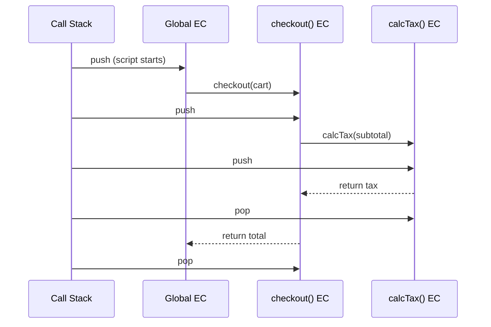
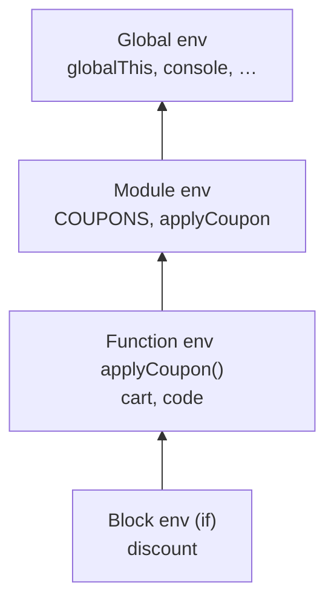
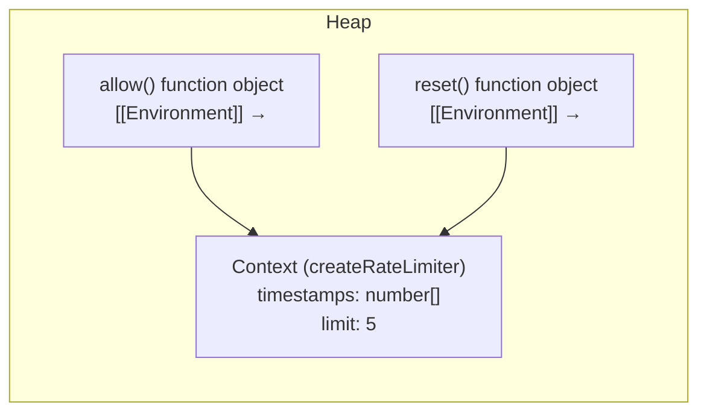
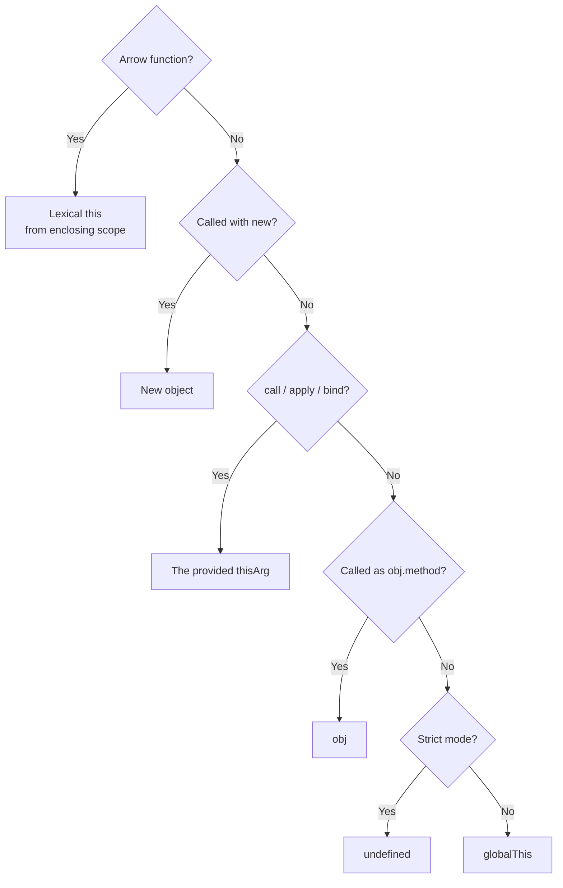
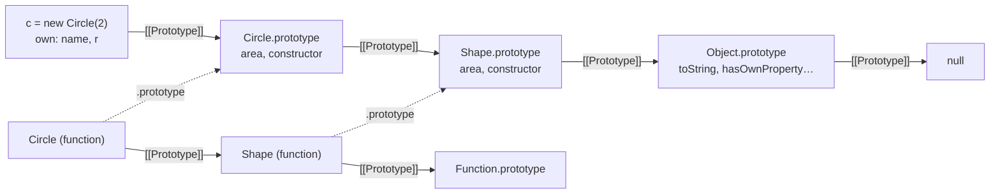
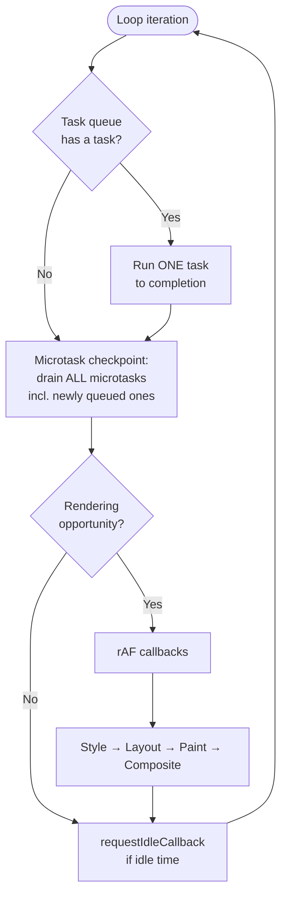
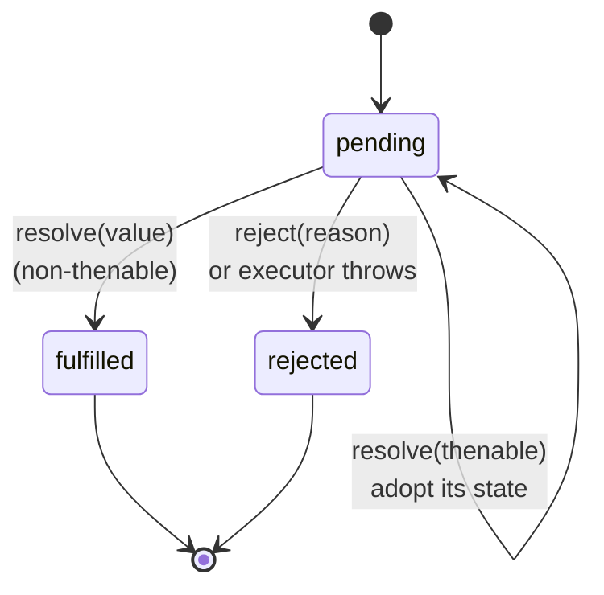

# 02 — JavaScript (Part 1 of 3): Core Language & Async Internals

> **Parts:** **Part 1 — Overview, Topic Map, Core Internals** · [Part 2 — Advanced Topics, Browser & Polyfills](./02-javascript-part2.md) · [Part 3 — Resources, Practice, Interview Questions & Revision](./02-javascript-part3.md)
>
> Applies to: ECMAScript 2025 and current evergreen browsers. Node-specific event loop phases live in [06-nodejs.md](./06-nodejs.md). Output-prediction drills live in [14-js-logical-interview-questions.md](./14-js-logical-interview-questions.md).

## Table of Contents

- [1. Overview](#1-overview)
- [2. Topic Map](#2-topic-map)
- [3. Detailed Explanations (Part 1)](#3-detailed-explanations-part-1)
  - [3.1 Execution Context & the Call Stack](#31-execution-context--the-call-stack)
  - [3.2 Hoisting & the Temporal Dead Zone](#32-hoisting--the-temporal-dead-zone)
  - [3.3 Scope & the Scope Chain](#33-scope--the-scope-chain)
  - [3.4 Closures](#34-closures)
  - [3.5 `this` Binding](#35-this-binding)
  - [3.6 Prototypes & Inheritance](#36-prototypes--inheritance)
  - [3.7 The Event Loop (Browser)](#37-the-event-loop-browser)
  - [3.8 Promises Internals](#38-promises-internals)
  - [3.9 async/await Internals](#39-asyncawait-internals)
  - [3.10 Type Coercion & Equality](#310-type-coercion--equality)
- [Next: Part 2](#next-part-2)

---

## 1. Overview

**What it is.** JavaScript is a single-threaded (per agent), garbage-collected, prototype-based, dynamically typed language with first-class functions and a run-to-completion concurrency model driven by an event loop supplied by the host (browser or Node.js).

**Why interviewers care.** Every framework question eventually bottoms out in JavaScript semantics:

| Framework symptom | Underlying JS concept |
|-------------------|----------------------|
| Stale state in a React `useEffect` / `setInterval` | Closures capture a specific scope's bindings |
| "`this` is undefined" in a class method passed as a callback | `this` is determined by call site, not definition |
| UI freezes during a big computation | Run-to-completion; the event loop can't render while the stack is busy |
| `await` inside `forEach` doesn't wait | `forEach` ignores returned promises |
| Memory grows in a long-lived SPA or Node process | Reachability; listeners/timers/closures retaining objects |
| `instanceof` fails across iframes / packages | Prototype identity per realm / per module copy |

**Depth expected at 3+ years.** Not "what is a closure" but:

- Explain *how* closures retain variables (environment records) and *what* that costs in memory.
- Predict the exact output order of mixed `setTimeout` / `Promise` / `async` code, and explain why using queue states.
- Implement `bind`, `Promise.all`, `debounce`, deep clone and a minimal Promise from scratch, including edge cases.
- Reason about trade-offs: `structuredClone` vs custom clone, ESM vs CJS, microtask vs macrotask scheduling, event delegation vs per-node listeners.

> 💡 Interview Tip: Interviewers grade *mechanism*, not vocabulary. "Closures remember variables" is junior. "A function object holds a reference to the environment record it was created in, so bindings stay reachable as long as the function is" is senior.

---

## 2. Topic Map

Legend: 🟢 fundamentals · 🟡 intermediate · 🔴 advanced · ⭐ interview favorite

**Part 1 — Core language & async (this file)**

- [ ] 🟢 Execution context: global vs function, creation vs execution phase
- [ ] 🟢 Call stack, stack overflow
- [ ] 🟢⭐ Hoisting: `var`, function declarations, function expressions
- [ ] 🟡⭐ TDZ for `let` / `const` / `class`; `typeof` in the TDZ
- [ ] 🟢 Lexical scope, block scope, module scope, global object
- [ ] 🟡 Shadowing, implicit globals, `globalThis`
- [ ] 🟡⭐ Closures: mechanism, loop + `var` bug, per-iteration bindings
- [ ] 🔴 Closure memory: shared context objects, accidental retention
- [ ] 🟡⭐ `this`: default, implicit, explicit, `new`, arrow — and precedence
- [ ] 🟡 Lost `this` in callbacks; class fields with arrow functions
- [ ] 🟡⭐ Prototype chain, `__proto__` vs `.prototype`, property lookup & shadowing
- [ ] 🟡 What `new` does (step by step); implementing `new` and `instanceof`
- [ ] 🔴 `class` desugaring: two prototype chains, `super`, fields vs methods
- [ ] 🔴 Hidden classes / shapes and inline caches (performance)
- [ ] 🟡⭐ Event loop: tasks, microtasks, rendering steps, `requestAnimationFrame`
- [ ] 🔴 Microtask starvation, timer clamping
- [ ] 🟡⭐ Promise states, reactions, chaining, error propagation
- [ ] 🔴 Resolving with thenables (extra ticks), unhandled rejections
- [ ] 🟡⭐ async/await desugaring, sequential vs parallel, `return await`
- [ ] 🟡 Coercion: ToPrimitive, ToNumber, `==` algorithm, `Object.is`

**Part 2 — Advanced topics & browser ([link](./02-javascript-part2.md))**

- [ ] 🟡 Iteration protocols, generators, async generators
- [ ] 🔴 Proxy & Reflect, invariants, private-field pitfall
- [ ] 🟡⭐ ESM vs CommonJS: live bindings, cycles, interop, dual packages
- [ ] 🔴 Memory management, V8 generational GC, leak patterns, heap snapshots
- [ ] 🟡⭐ Currying, partial application, compose/pipe, memoize
- [ ] 🟡⭐ Debounce & throttle (leading/trailing, cancel, flush)
- [ ] 🟡⭐ Shallow vs deep copy, `structuredClone`, custom deep clone with cycles
- [ ] 🟡 Immutability: `Object.freeze`, non-mutating array methods
- [ ] 🟢 ES2015 → ES2025 features by year
- [ ] 🟡 Error handling: custom errors, `cause`, `AggregateError`, async errors, `finally` semantics
- [ ] 🟡 Web APIs: `fetch` + `AbortController`, storage, observers, Web Workers
- [ ] 🟢⭐ Event propagation (capture/target/bubble), event delegation
- [ ] 🟡⭐ Critical rendering path, reflow vs repaint, layout thrashing, `async`/`defer`
- [ ] ⭐ Polyfills: `call`, `apply`, `bind`, `map`, `filter`, `reduce`, `flat`, `Promise.all/allSettled/race/any`, minimal Promise

---

## 3. Detailed Explanations (Part 1)

### 3.1 Execution Context & the Call Stack

**Explanation.** Every time code runs, it runs inside an *execution context* (EC). There is one global EC per realm (or one per module), and a new function EC is pushed onto the *call stack* each time a function is invoked. When the function returns, its EC is popped.

**Under the hood (spec terms).** Each EC holds:

| Component | Holds |
|-----------|-------|
| **LexicalEnvironment** | An *Environment Record* for `let`, `const`, `class`, function params, plus a pointer `[[OuterEnv]]` to the enclosing environment |
| **VariableEnvironment** | The Environment Record for `var` declarations (in a function, usually the same record as the function's top-level LexicalEnvironment) |
| **`this` binding** | Stored on the *function* Environment Record (arrow functions don't create one) |
| **Realm** | The set of intrinsics (`Array`, `Object.prototype`, …) — why `instanceof Array` can fail across iframes |

Each context goes through two phases:

1. **Creation (instantiation) phase** — the engine scans declarations *before* running any code:
   - `var` names → created and initialized to `undefined`.
   - Function declarations → created and initialized to the function object.
   - `let` / `const` / `class` → created but **uninitialized** (the TDZ).
   - Parameters bound; `arguments` object created for non-arrow functions.
2. **Execution phase** — statements run top to bottom; assignments fill in values.



```ts
// Trace this on paper: which EC is active at each line, and what's in it?
const TAX_RATE = 0.18;

function calcTax(amount: number): number {
  return amount * TAX_RATE; // TAX_RATE resolved via [[OuterEnv]] → global/module env
}

function checkout(prices: number[]): number {
  const subtotal = prices.reduce((sum, p) => sum + p, 0);
  return subtotal + calcTax(subtotal);
}

console.log(checkout([100, 250])); // 413
```

**Pitfalls & misconceptions**

- ⚠️ "Hoisting moves code to the top." Nothing moves. Declarations are *registered* during the creation phase.
- ⚠️ Deep recursion throws `RangeError: Maximum call stack size exceeded`. The limit is engine-dependent; JS engines (other than Safari's JavaScriptCore in strict mode) don't implement proper tail calls, so tail recursion doesn't save you. Convert to iteration or an explicit stack.

**Trade-offs.** Recursion reads well for trees but risks stack overflow on deep/unbalanced input (e.g. a 50k-deep linked JSON). Iteration with an explicit stack is safe but noisier.

---

### 3.2 Hoisting & the Temporal Dead Zone

**Explanation.** Because declarations are instantiated during the creation phase, they exist before the line that declares them runs. What differs is their *initial state*:

| Declaration | Hoisted? | Initial value before its line | Scope |
|-------------|:--------:|------------------------------|-------|
| `var x` | Yes | `undefined` | Function (or global) |
| `function f() {}` | Yes | The full function | Function (block in strict mode) |
| `let x` / `const x` | Yes | *Uninitialized* → `ReferenceError` (TDZ) | Block |
| `class C {}` | Yes | *Uninitialized* → `ReferenceError` (TDZ) | Block |
| `const f = () => {}` | The *binding* `f` is (TDZ) | Not callable before the line | Block |
| `import` | Yes (module linking) | Live binding, available before the line | Module |

**The TDZ** spans from the start of the block to the point where the declaration is evaluated. It's *temporal* (about when code runs), not *spatial*:

```ts
function readConfig(): string {
  // Called after `env` is initialized below → works, even though the function body
  // textually appears before the declaration.
  return env;
}

const env = "production";
console.log(readConfig()); // "production"
```

```js
// Classic interview snippet
console.log(typeof undeclaredVar); // "undefined" — typeof is safe on undeclared names
console.log(typeof tdzVar);        // ReferenceError — typeof is NOT safe in the TDZ
let tdzVar = 1;
```

**Why TDZ exists.** To make `const` meaningful (a `const` that is observably `undefined` first and then a value would be two values) and to catch use-before-define bugs.

**Pitfalls**

- ⚠️ Default parameters have their own scope and TDZ: `function f(a = b, b = 1) {}` throws when called without `a` because `b` is in its TDZ when `a`'s default runs.
- ⚠️ Function declarations inside blocks in **sloppy mode** follow legacy "Annex B" semantics (partially hoisted to the function scope). Always use strict mode / ES modules, where block functions are block-scoped.
- ⚠️ `var` in a `for` loop is shared across iterations — see [Closures](#34-closures).

> 💡 Interview Tip: When asked "are `let` and `const` hoisted?", the precise answer is "yes, their bindings are created at scope entry, but they're uninitialized until the declaration runs; accessing them in that window throws — that's the TDZ."

---

### 3.3 Scope & the Scope Chain

**Explanation.** Scope is determined **lexically** — by where code is written, not where it's called from. Each Environment Record points to its outer one, forming the *scope chain*. Identifier resolution walks outward until found, otherwise throws `ReferenceError` (for reads) or, in sloppy mode only, creates a global (for writes).



```ts
const COUPONS: Record<string, number> = { SAVE10: 0.1 };

export function applyCoupon(total: number, code: string): number {
  if (code in COUPONS) {
    const discount = COUPONS[code]; // block scope
    return total * (1 - discount);
  }
  // console.log(discount); // ReferenceError: discount is not defined (block-scoped)
  return total;
}
```

**Kinds of scope**

| Scope | Created by | Notes |
|-------|-----------|-------|
| Global | Script top level | Top-level `var` and function declarations become properties of `globalThis`; top-level `let`/`const`/`class` do **not** (they live in a separate declarative record) |
| Module | Each ES module | Top-level declarations are module-private; nothing leaks to `globalThis` |
| Function | Every function call | Holds params, `var`, inner function declarations |
| Block | `{}` with `let`/`const`/`class` | Loops, `if`, `try/catch`, bare blocks |
| Catch clause | `catch (err)` | `err` is block-scoped to the catch |

**Pitfalls**

- ⚠️ Implicit globals: `total = 5` without a declaration creates `globalThis.total` in sloppy mode. ES modules and classes are always strict, so this throws there.
- ⚠️ Dynamic scope doesn't exist in JS (except via `this`, which is a separate mechanism, and the deprecated `with`/direct `eval`).

---

### 3.4 Closures

**Explanation.** A closure is a function together with the lexical environment it was created in. Inner functions can read and write variables of outer functions even after those outer functions have returned.

**Under the hood.** When a function object is created, the engine stores a reference to the current Environment Record in its internal `[[Environment]]` slot. Calling the function creates a new environment whose `[[OuterEnv]]` is that saved record. As long as the function object is reachable, the captured record is reachable and won't be garbage-collected.

V8 optimizes this: variables referenced by *no* inner function stay on the stack; variables referenced by *any* inner function are allocated in a heap "Context" object. **All closures created in the same scope share that one Context.**



```ts
// ✅ Closures for private state — a sliding-window rate limiter
export function createRateLimiter(limit: number, windowMs: number) {
  let timestamps: number[] = []; // private: only reachable via the returned functions

  return {
    allow(now = Date.now()): boolean {
      timestamps = timestamps.filter((t) => now - t < windowMs);
      if (timestamps.length >= limit) return false;
      timestamps.push(now);
      return true;
    },
    reset(): void {
      timestamps = [];
    },
  };
}

const limiter = createRateLimiter(3, 1_000);
console.log([1, 2, 3, 4].map(() => limiter.allow(0))); // [true, true, true, false]
```

**The loop classic**

```js
// ❌ var: one binding shared by all iterations
for (var i = 0; i < 3; i++) {
  setTimeout(() => console.log(i), 0);
}
// 3 3 3

// ✅ let: the spec creates a NEW binding per iteration (CreatePerIterationEnvironment)
//    and copies the current value into it before the increment step
for (let i = 0; i < 3; i++) {
  setTimeout(() => console.log(i), 0);
}
// 0 1 2
```

**Accidental retention (memory pitfall)**

```ts
// ❌ `hugePayload` stays alive as long as `onClick` is alive,
//    because both closures share the same Context object.
function attachHandlers(button: HTMLButtonElement) {
  const hugePayload = new Array(1_000_000).fill("row");
  const logSize = () => console.log(hugePayload.length); // references hugePayload
  logSize();

  button.addEventListener("click", () => {
    console.log("clicked"); // doesn't reference hugePayload, but shares the Context
  });
}

// ✅ Narrow what's captured: compute what you need, drop the rest
function attachHandlersFixed(button: HTMLButtonElement) {
  const size = new Array(1_000_000).fill("row").length; // array is garbage after this line
  console.log(size);
  button.addEventListener("click", () => console.log("clicked"));
}
```

**Stale closures** — the React version of this bug (an effect or interval reading old state) is covered in [04-react.md](./04-react.md). The root cause is identical: the callback captured bindings from the render in which it was created.

**Trade-offs**

| Approach | Pros | Cons |
|----------|------|------|
| Closure-based privacy (factory functions) | True privacy, no `this` issues, easy composition | Methods recreated per instance (more memory than prototype methods) |
| Class with `#private` fields | Methods shared on the prototype; real privacy; better tooling | `this` binding pitfalls; private fields break Proxies (Part 2) |

---

### 3.5 `this` Binding

**Explanation.** `this` is not lexical (except in arrow functions). It's determined **at call time** by *how* the function is called. Four rules, in precedence order:

| Precedence | Rule | Call form | `this` is |
|:---------:|------|-----------|-----------|
| 1 | `new` binding | `new Fn()` | The newly created object |
| 2 | Explicit binding | `fn.call(obj)`, `fn.apply(obj)`, `fn.bind(obj)()` | `obj` (boxed to an object in sloppy mode; as-is in strict) |
| 3 | Implicit binding | `obj.fn()` | `obj` (the object before the dot at the call site) |
| 4 | Default binding | `fn()` | `undefined` in strict mode; `globalThis` in sloppy mode |
| — | Arrow function | any | `this` of the enclosing scope at creation; **cannot** be changed by `call`/`bind`/`new` |



```ts
class CartService {
  private items: string[] = [];

  add(item: string): void {
    this.items.push(item);
  }

  // Class field holding an arrow function: `this` is captured per instance
  addBound = (item: string): void => {
    this.items.push(item);
  };

  count(): number {
    return this.items.length;
  }
}

const cart = new CartService();

// ❌ Lost binding: the method is extracted, then called with default binding.
//    Class bodies are strict → this === undefined → TypeError.
const add = cart.add;
try {
  add("book");
} catch (e) {
  console.log((e as Error).message); // Cannot read properties of undefined (reading 'items')
}

// ✅ Fix options
["pen", "mug"].forEach((i) => cart.add(i)); // call site keeps implicit binding
["lamp"].forEach(cart.add.bind(cart));      // explicit binding
["desk"].forEach(cart.addBound);            // lexical this via arrow class field
console.log(cart.count()); // 4
```

**Under the hood.** A non-arrow function call creates a function Environment Record with a `[[ThisValue]]` slot filled according to the rules above. Arrow functions have no such slot, so `this` lookup walks the scope chain like any variable.

**Pitfalls**

- ⚠️ `bind` is permanent: `fn.bind(a).bind(b)` still has `this === a`.
- ⚠️ `new` overrides `bind`'s `this` (but keeps bound arguments).
- ⚠️ Arrow functions as object-literal methods: `{ total: 0, inc: () => this.total++ }` — `this` is the *module/outer* scope, not the object.
- ⚠️ `setTimeout(obj.method, 0)` loses the binding — same as extracting the method.

**Trade-offs (arrow class fields vs prototype methods).** Arrow fields make callbacks safe but create one function per instance and can't be overridden via `super.method()` in subclasses. Prototype methods are shared and overridable but need `bind` or wrapper arrows when passed around.

---

### 3.6 Prototypes & Inheritance

**Explanation.** Every object has an internal `[[Prototype]]` link (exposed as `Object.getPrototypeOf(obj)` and the legacy `obj.__proto__`). Property **reads** walk the chain until found or until `null`. Property **writes** create/update an *own* property on the object (unless a setter or a non-writable property exists up the chain).

- `Fn.prototype` — a property on *functions*: the object that will become `[[Prototype]]` of instances made with `new Fn()`.
- `obj.__proto__` — the actual link on an *object*.

**What `new Fn(...args)` does:**

1. Create a new object whose `[[Prototype]]` is `Fn.prototype`.
2. Call `Fn` with `this` bound to that object.
3. If `Fn` returns an object, return it; otherwise return the new object.

Implementing `new` for constructor functions (plain JS — class constructors can't be invoked with `apply`, which is exactly why `Reflect.construct` exists):

```js
function myNew(Ctor, ...args) {
  const instance = Object.create(Ctor.prototype); // step 1
  const result = Ctor.apply(instance, args);       // step 2
  return result !== null && (typeof result === "object" || typeof result === "function")
    ? result                                       // step 3a
    : instance;                                    // step 3b
}

function Product(name, price) {
  this.name = name;
  this.price = price;
}
Product.prototype.label = function () {
  return `${this.name} — $${this.price}`;
};

const p = myNew(Product, "Keyboard", 49);
console.log(p.label());              // "Keyboard — $49"
console.log(p instanceof Product);   // true
```

Implementing `instanceof` — walk the value's chain looking for `Ctor.prototype`:

```ts
function myInstanceOf(value: unknown, Ctor: { prototype: unknown }): boolean {
  if (value === null || (typeof value !== "object" && typeof value !== "function")) return false;
  let proto = Object.getPrototypeOf(value);
  while (proto !== null) {
    if (proto === Ctor.prototype) return true;
    proto = Object.getPrototypeOf(proto);
  }
  return false;
}

console.log(myInstanceOf([], Array));  // true
console.log(myInstanceOf([], Object)); // true
console.log(myInstanceOf({}, Array));  // false
```

(Real `instanceof` first checks `Ctor[Symbol.hasInstance]`, which is how bound functions and custom classes can override it.)

**`class` desugaring.** `class` is mostly syntax over prototypes, with real semantic differences (strict mode, non-enumerable methods, TDZ, must be called with `new`, `super`, private fields). `extends` wires up **two** chains:

```ts
class Shape {
  constructor(public readonly name: string) {}
  area(): number { return 0; }
  static create(name: string) { return new this(name); }
}

class Circle extends Shape {
  constructor(private readonly r: number) {
    super("circle"); // must run before `this` is touched in a derived constructor
  }
  override area(): number { return Math.PI * this.r ** 2; }
}

// Chain 1 (instances):  Circle.prototype.__proto__ === Shape.prototype
// Chain 2 (statics):    Circle.__proto__ === Shape   → Circle.create works
console.log(Object.getPrototypeOf(Circle.prototype) === Shape.prototype); // true
console.log(Object.getPrototypeOf(Circle) === Shape);                     // true
```



**Under the hood: shapes & inline caches.** Engines give objects a hidden class ("shape" / "map" in V8) describing their property layout. Property access sites cache the shape → offset mapping ("inline caches"). Objects created the same way share shapes, so access is fast. You deoptimize by:

- Adding properties in different orders across instances, or adding them after construction.
- `delete obj.prop` (often transitions the object to slow "dictionary mode").
- `Object.setPrototypeOf` on existing objects (invalidates prototype-chain assumptions engine-wide).

```ts
// ❌ Different shapes for the "same" kind of object
const a: Record<string, unknown> = {}; a.id = 1; a.name = "A";
const b: Record<string, unknown> = {}; b.name = "B"; b.id = 2;

// ✅ Same shape: initialize all fields, in the same order, at construction
class User { constructor(public id: number, public name: string) {} }
```

**Pitfalls**

- ⚠️ Mutating a shared object on a prototype (`Foo.prototype.tags = []`) means every instance shares the same array.
- ⚠️ `for...in` iterates inherited enumerable properties too; use `Object.keys` / `Object.hasOwn`.
- ⚠️ `Object.create(null)` objects have no `toString`/`hasOwnProperty` — useful for dictionaries (no prototype pollution via `__proto__` keys), but they break code that assumes `Object.prototype` methods.
- ⚠️ `instanceof` checks prototype identity; two copies of a library (or two realms) produce different prototypes. Prefer brand checks (`Array.isArray`, `Symbol.for` tags, or duck typing).

---

### 3.7 The Event Loop (Browser)

**Explanation.** JavaScript runs on one thread per agent (window, worker). Long-running work is delegated to the host (timers, network, DOM events), which later enqueues callbacks. The **event loop** decides what runs next.

**The model (simplified from the HTML spec):**

1. Pick the oldest runnable **task** (a.k.a. macrotask) from a task queue and run it to completion.
2. **Perform a microtask checkpoint**: run *all* microtasks, including those queued while draining, until the microtask queue is empty.
3. If it's time to render (typically ~60 times/s, only if something changed and the page is visible):
   - Run `requestAnimationFrame` callbacks.
   - Recalculate style → layout → paint → composite.
4. Optionally run `requestIdleCallback` callbacks if there's idle time.
5. Repeat.

Microtasks also run whenever the JS stack becomes empty *between* callbacks within a task (e.g. between two event listeners dispatched by a real user click).

| Queue | Sources | Drained |
|-------|---------|---------|
| **Microtask queue** | Promise reactions (`then`/`catch`/`finally`, `await` continuations), `queueMicrotask`, `MutationObserver` | Completely, after every task and whenever the stack empties |
| **Task queues** | `setTimeout`/`setInterval`, `MessageChannel`/`postMessage`, UI events, network callbacks, `setImmediate` (Node only) | One task per loop iteration (browsers may prioritize between queues, e.g. input events) |
| **Animation frame callbacks** | `requestAnimationFrame` | Once per rendering opportunity, before style/layout |



**Worked example**

```js
console.log("1: sync");

setTimeout(() => console.log("2: timeout"), 0);

Promise.resolve().then(() => console.log("3: then"));

queueMicrotask(() => console.log("4: microtask"));

(async () => {
  console.log("5: async body (sync part)");
  await null;
  console.log("6: after await");
})();

console.log("7: sync");
```

| Step | Logs | Call stack | Microtask queue | Task queue |
|------|------|-----------|-----------------|------------|
| Run script | `1`, `5`, `7` | script | `[3, 4, 6]` | `[2]` |
| Drain microtasks | `3`, `4`, `6` | — | `[]` | `[2]` |
| Next task | `2` | timeout cb | `[]` | `[]` |

**Output:** `1 5 7 3 4 6 2`

**Key facts that interviewers probe**

- `setTimeout(fn, 0)` means "at least 0 ms, as a task". After 5 levels of nesting, browsers clamp to ≥ 4 ms. Background tabs throttle timers further.
- An async function runs **synchronously** until its first `await`.
- Microtasks can **starve** rendering: a microtask that queues another microtask forever freezes the page just like `while (true)`, because the checkpoint never ends.
- `requestAnimationFrame` is the right place for visual updates; `setTimeout` animations drift and can run multiple times per frame or skip frames.
- To yield to the browser in long work, break it into tasks (`setTimeout`, `MessageChannel`, or `scheduler.yield()` where supported — verify browser support on MDN), not microtasks.

```ts
// ✅ Chunk a long computation so the UI can render between chunks
export async function processInChunks<T>(
  items: T[],
  handle: (item: T) => void,
  chunkSize = 500
): Promise<void> {
  for (let i = 0; i < items.length; i += chunkSize) {
    items.slice(i, i + chunkSize).forEach(handle);
    // Yield a *task* boundary (not a microtask) so rendering and input can happen.
    await new Promise<void>((resolve) => setTimeout(resolve, 0));
  }
}
```

> ⚠️ Pitfall: Node.js has a different loop (libuv phases, `process.nextTick` queue that runs *before* promise microtasks, `setImmediate`). Don't answer a Node question with the browser model. See [06-nodejs.md](./06-nodejs.md).

**Trade-offs: which scheduler?**

| Need | Use | Why |
|------|-----|-----|
| Run right after current code, before render | `queueMicrotask` / `Promise.then` | Fastest; batches state updates |
| Yield to rendering & input | `setTimeout(0)` / `MessageChannel` / `scheduler.yield()` | Creates a task boundary |
| Sync with the next frame | `requestAnimationFrame` | Runs before layout/paint |
| Low-priority background work | `requestIdleCallback` | Runs only when idle (not in Safari as of writing — verify on MDN) |
| CPU-heavy work | Web Worker (Part 2) | Different thread entirely |

---

### 3.8 Promises Internals

**Explanation.** A Promise is a state machine for a single future value with three states — `pending`, `fulfilled`, `rejected`. Once settled it never changes. Handlers registered with `then` are *reactions* that are queued as **microtasks** when the promise settles (or immediately queued if it's already settled).



**Rules that explain 90% of promise puzzles**

1. **The executor runs synchronously.** `new Promise(fn)` calls `fn` immediately.
2. **`then` always returns a new promise**, resolved with the handler's return value (or rejected with what it throws).
3. **Handlers always run asynchronously** (as microtasks), even if the promise is already settled.
4. **Missing handlers pass through:** `then(onFulfilled)` passes rejections down the chain; `catch(onRejected)` (= `then(undefined, onRejected)`) passes values down.
5. **`finally` is transparent:** it doesn't receive or change the value — unless it throws or returns a rejected promise.
6. **Resolving with a thenable adopts it**, which costs extra microtask ticks: `resolve(nativePromise)` schedules a job to call its `then`, which then schedules the reaction — so it settles 2 ticks later than resolving with a plain value.
7. **Unhandled rejections** fire `unhandledrejection` on `window` (browser) or `process` (`'unhandledRejection'` in Node, which crashes the process by default since Node 15).

```js
// Rule 6 in action — a favorite "tricky" question
const p1 = new Promise((resolve) => resolve(Promise.resolve("A")));
const p2 = Promise.resolve("B");

p1.then((v) => console.log(v));
p2.then((v) => console.log(v));
// Output: B, A — p1 needs extra ticks to adopt the inner promise's state.
```

```ts
// Chaining & error propagation in a realistic flow
interface Order { id: string; total: number }

function fetchOrder(id: string): Promise<Order> {
  return id === "bad"
    ? Promise.reject(new Error(`Order ${id} not found`))
    : Promise.resolve({ id, total: 120 });
}

fetchOrder("bad")
  .then((order) => order.total * 1.18)       // skipped: rejection passes through
  .then((withTax) => console.log(withTax))   // skipped
  .catch((err: Error) => {                   // handles the rejection
    console.error("Recovering:", err.message);
    return 0;                                // chain continues as fulfilled with 0
  })
  .finally(() => console.log("cleanup"))     // runs, value passes through
  .then((v) => console.log("final:", v));    // "final: 0"
```

**Anti-patterns**

```ts
// ❌ Explicit-construction anti-pattern: wrapping something that's already a promise.
//    Errors thrown inside .then are lost if you forget reject.
function getUserBad(id: string): Promise<unknown> {
  return new Promise((resolve, reject) => {
    fetch(`/api/users/${id}`)
      .then((res) => res.json())
      .then(resolve)
      .catch(reject);
  });
}

// ✅ Just return the chain
function getUser(id: string): Promise<unknown> {
  return fetch(`/api/users/${id}`).then((res) => res.json());
}

// ❌ Forgetting to return inside then → next step doesn't wait, errors escape the chain
// fetchOrder("1").then((o) => { saveAudit(o); }).then(...)

// ✅ Return the inner promise
// fetchOrder("1").then((o) => saveAudit(o)).then(...)
```

A full minimal Promise implementation is in [Part 2 → Polyfills](./02-javascript-part2.md#4-code-examples-polyfills--utilities).

---

### 3.9 async/await Internals

**Explanation.** `async` functions always return a promise. `await x` pauses the function, schedules its continuation as a microtask once `x` settles, and returns control to the caller. Conceptually, an async function is a generator driven by a promise-based runner.

```ts
// What async/await does, written with a generator + runner (simplified)
function run<T>(genFn: () => Generator<unknown, T, unknown>): Promise<T> {
  return new Promise<T>((resolve, reject) => {
    const gen = genFn();

    function step(method: "next" | "throw", arg?: unknown): void {
      let result: IteratorResult<unknown, T>;
      try {
        result = gen[method](arg);           // resume the function
      } catch (err) {
        return reject(err);                  // uncaught throw inside → rejection
      }
      if (result.done) return resolve(result.value);
      Promise.resolve(result.value).then(    // "await" = wait for the yielded value
        (v) => step("next", v),
        (e) => step("throw", e)              // rejected await → throw at the await site
      );
    }

    step("next");
  });
}

// Equivalent to: async function loadTotal() { const a = await getA(); ... }
const loadTotal = () =>
  run(function* () {
    const price = (yield Promise.resolve(100)) as number;
    const tax = (yield Promise.resolve(18)) as number;
    return price + tax;
  });

loadTotal().then(console.log); // 118
```

**Under the hood.** Since ES2019-era spec changes (described in the V8 blog post "Faster async functions and promises"), `await nativePromise` takes **one** microtask tick instead of three, because it no longer wraps the promise in a new one. Awaiting a non-promise value also takes one tick.

**Sequential vs parallel**

```ts
declare function getUser(id: string): Promise<{ id: string; name: string }>;
declare function getOrders(id: string): Promise<{ id: string }[]>;

// ❌ Sequential by accident: total time = t(user) + t(orders)
async function loadDashboardSlow(userId: string) {
  const user = await getUser(userId);
  const orders = await getOrders(userId);
  return { user, orders };
}

// ✅ Parallel: start both, then await. Total time = max(t(user), t(orders))
async function loadDashboard(userId: string) {
  const [user, orders] = await Promise.all([getUser(userId), getOrders(userId)]);
  return { user, orders };
}
```

**`forEach` + async**

```ts
declare function sendEmail(to: string): Promise<void>;
const recipients = ["a@x.com", "b@x.com"];

// ❌ forEach ignores the returned promises; "done" logs before emails are sent,
//    and rejections become unhandled.
async function notifyBad() {
  recipients.forEach(async (r) => { await sendEmail(r); });
  console.log("done");
}

// ✅ Sequential (ordering matters, or rate limits)
async function notifySequential() {
  for (const r of recipients) await sendEmail(r);
}

// ✅ Parallel with full failure reporting
async function notifyParallel() {
  const results = await Promise.allSettled(recipients.map(sendEmail));
  const failed = results.filter((r) => r.status === "rejected");
  if (failed.length) console.warn(`${failed.length} emails failed`);
}
```

**`return` vs `return await`**

```ts
declare function chargeCard(amount: number): Promise<string>;

async function payWithoutAwait(amount: number) {
  try {
    return chargeCard(amount);   // ❌ rejection escapes: try/catch is already exited
  } catch {
    return "fallback";           // never runs for async rejections
  }
}

async function payWithAwait(amount: number) {
  try {
    return await chargeCard(amount); // ✅ rejection is thrown here, inside try
  } catch {
    return "fallback";
  }
}
```

Outside `try/catch`, `return await` is harmless and gives better async stack traces; many lint configs (e.g. `@typescript-eslint/return-await` set to `in-try-catch`) enforce the try/catch case.

**Pitfalls**

- ⚠️ `Promise.all` is fail-fast: it rejects on the first rejection, but the other operations **keep running** (promises aren't cancellable). Use `AbortController` to actually cancel `fetch` calls.
- ⚠️ Top-level `await` (ES modules only) blocks evaluation of *modules that import this one* until it settles. Great for config loading, bad for slow network calls in shared modules.
- ⚠️ An async function that throws synchronously before its first `await` still returns a rejected promise — it never throws to the caller.

---

### 3.10 Type Coercion & Equality

**Explanation.** JavaScript converts types implicitly in operators like `+`, `==`, `<` and in boolean contexts. Interviewers test whether you know the *algorithms*, not a list of memes.

**ToPrimitive(obj, hint)** — used when an object meets an operator:

1. If `obj[Symbol.toPrimitive]` exists, call it with the hint (`"number"`, `"string"`, `"default"`).
2. Otherwise, for hint `"string"`: try `toString()` then `valueOf()`; for `"number"`/`"default"`: try `valueOf()` then `toString()`. Use the first one that returns a primitive.

**`+` operator:** ToPrimitive both sides (hint `"default"`); if either is a string → string concatenation; otherwise → numeric addition.

**Abstract equality `x == y` (key steps):**

| Case | Result |
|------|--------|
| Same type | Same as `===` |
| `null == undefined` | `true` (and neither equals anything else) |
| Number vs String | Convert the string to a number |
| Boolean vs anything | Convert the boolean to a number **first** (`true → 1`) |
| Object vs primitive | ToPrimitive the object, then compare again |
| BigInt vs String/Number | Compare mathematically |

```js
console.log([] + []);          // ""            — both become "" via toString
console.log([] + {});          // "[object Object]"
console.log(1 + "2");          // "12"
console.log("3" * "4");        // 12            — * always numeric
console.log([] == false);      // true: false→0, []→""→0
console.log([0] == false);     // true: [0]→"0"→0
console.log(null == 0);        // false: null only == undefined
console.log(null >= 0);        // true: relational ops use ToNumber(null) = 0
console.log(NaN === NaN);      // false
console.log(Object.is(NaN, NaN)); // true
console.log(Object.is(0, -0));    // false (=== says true)
```

| Comparison | `NaN` vs `NaN` | `+0` vs `-0` | Used by |
|-----------|:--:|:--:|---------|
| `==` / `===` | false | true | Most code |
| `Object.is` | true | false | React state bail-out, `useEffect` deps |
| SameValueZero | true | true | `includes`, `Map`/`Set` keys |

> 💡 Interview Tip: Mention that React uses `Object.is` to decide whether state changed — a practical reason this matters beyond trivia. Link the answer to [04-react.md](./04-react.md).

> ⚠️ Pitfall: `typeof null === "object"` (a historical bug), `typeof NaN === "number"`, `typeof function(){} === "function"`. Use `x === null`, `Number.isNaN(x)` (not global `isNaN`, which coerces), and `Array.isArray`.

More than a dozen coercion puzzles with step-by-step explanations are in [14-js-logical-interview-questions.md](./14-js-logical-interview-questions.md).

---

## Next: Part 2

➡️ [02-javascript-part2.md](./02-javascript-part2.md) — generators, Proxy/Reflect, modules, memory & GC, functional utilities, cloning, ES features, error handling, Web APIs, DOM events, browser rendering, and all polyfills.
