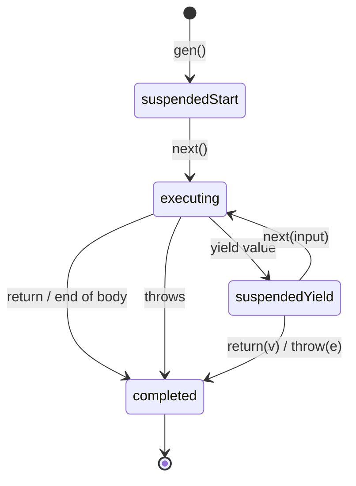
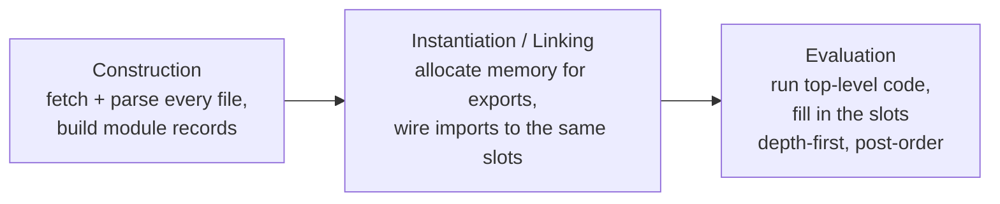
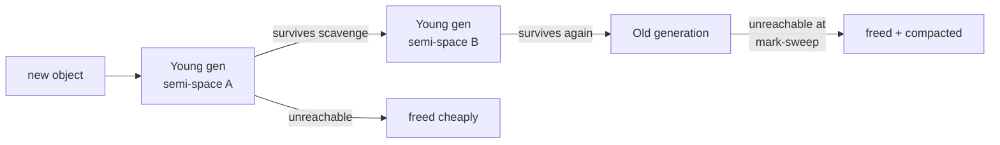
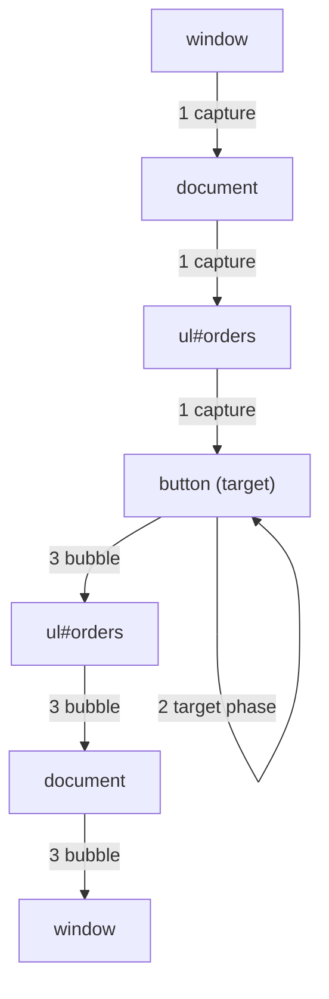
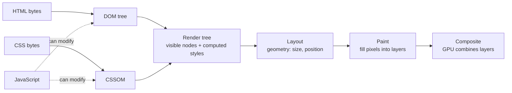
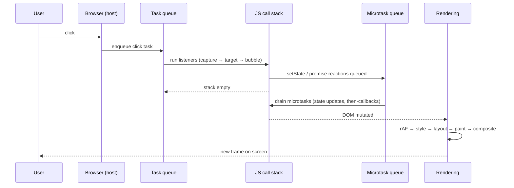

# 02 — JavaScript (Part 2 of 3): Advanced Topics, Browser & Polyfills

> **Parts:** [Part 1 — Overview, Topic Map, Core Internals](./02-javascript-part1.md) · **Part 2 — Advanced Topics, Browser & Polyfills** · [Part 3 — Resources, Practice, Interview Questions & Revision](./02-javascript-part3.md)
>
> Applies to: ECMAScript 2025, current evergreen browsers, Node.js current LTS. Where browser support varies, verify on MDN's compatibility tables.

## Table of Contents

- [3. Detailed Explanations (Part 2)](#3-detailed-explanations-part-2)
  - [3.11 Iterators & Generators](#311-iterators--generators)
  - [3.12 Proxy & Reflect](#312-proxy--reflect)
  - [3.13 Modules: ESM vs CommonJS](#313-modules-esm-vs-commonjs)
  - [3.14 Memory Management & Garbage Collection](#314-memory-management--garbage-collection)
  - [3.15 Functional Utilities: Currying, Compose, Memoize](#315-functional-utilities-currying-compose-memoize)
  - [3.16 Debounce & Throttle](#316-debounce--throttle)
  - [3.17 Copying, Deep Clone & Immutability](#317-copying-deep-clone--immutability)
  - [3.18 ES2015 → ES2025 Feature Map](#318-es2015--es2025-feature-map)
  - [3.19 Error Handling](#319-error-handling)
  - [3.20 Web APIs Worth Knowing Deeply](#320-web-apis-worth-knowing-deeply)
  - [3.21 DOM Events & Event Delegation](#321-dom-events--event-delegation)
  - [3.22 Browser Rendering Basics](#322-browser-rendering-basics)
- [4. Code Examples: Polyfills & Utilities](#4-code-examples-polyfills--utilities)
- [5. Diagrams Index](#5-diagrams-index)
- [Next: Part 3](#next-part-3)

---

## 3. Detailed Explanations (Part 2)

### 3.11 Iterators & Generators

**Explanation.** The **iteration protocols** are what make `for...of`, spread, destructuring, `Array.from`, `Promise.all`, `Map`/`Set` constructors work on any object:

- **Iterable:** has a `[Symbol.iterator]()` method returning an iterator.
- **Iterator:** has `next()` returning `{ value, done }`; optionally `return()` (called on early exit like `break`/`throw`) for cleanup.
- **Async iterable:** `[Symbol.asyncIterator]()` whose `next()` returns a promise; consumed by `for await...of`.

**Generators** (`function*`) are functions that can pause at `yield` and resume later. Calling one returns a generator object (both iterator and iterable) without running the body. Under the hood the engine keeps the function's execution context suspended on the heap instead of the stack.



```ts
// Lazy, infinite sequences — values computed on demand
function* idGenerator(prefix: string): Generator<string, never, void> {
  let n = 1;
  while (true) yield `${prefix}-${String(n++).padStart(4, "0")}`;
}

function* take<T>(iterable: Iterable<T>, count: number): Generator<T, void, void> {
  if (count <= 0) return;
  let i = 0;
  for (const item of iterable) {
    yield item;
    if (++i >= count) return; // triggers the source iterator's return() → cleanup
  }
}

console.log([...take(idGenerator("INV"), 3)]); // ["INV-0001", "INV-0002", "INV-0003"]
```

```ts
// Async generator: stream every item across a cursor-paginated API
interface Page<T> { items: T[]; nextCursor: string | null }

export async function* paginate<T>(
  fetchPage: (cursor: string | null) => Promise<Page<T>>
): AsyncGenerator<T, void, undefined> {
  let cursor: string | null = null;
  do {
    const page = await fetchPage(cursor);
    yield* page.items;          // delegate: yield each item individually
    cursor = page.nextCursor;
  } while (cursor !== null);
}

// Usage — the consumer controls the pace; breaking early stops further fetches.
async function findFirstOverdueInvoice() {
  const fetchInvoices = async (cursor: string | null): Promise<Page<{ id: string; overdue: boolean }>> => {
    const res = await fetch(`/api/invoices?cursor=${cursor ?? ""}`);
    return res.json();
  };
  for await (const invoice of paginate(fetchInvoices)) {
    if (invoice.overdue) return invoice; // remaining pages are never fetched
  }
  return null;
}
```

**Two-way communication.** `gen.next(x)` makes the paused `yield` expression evaluate to `x`. That's how the async/await runner in [Part 1 §3.9](./02-javascript-part1.md#39-asyncawait-internals) injects resolved values.

**Pitfalls**

- ⚠️ The argument to the *first* `next()` is discarded (no `yield` is waiting yet).
- ⚠️ Generators are single-use: once completed, iterating again yields nothing.
- ⚠️ Arrays created via spread of an infinite generator hang — always bound with `take`.

**Trade-offs.** Generators give lazy evaluation and natural backpressure (pull-based), but are slower than plain loops in hot paths and less familiar to many teams. ES2025 **iterator helpers** (`Iterator.prototype.map/filter/take/drop/toArray`, …) cover many hand-written `take`/`map` utilities — verify runtime support on MDN before relying on them.

---

### 3.12 Proxy & Reflect

**Explanation.** A `Proxy` wraps a target object and intercepts fundamental operations via *traps* (`get`, `set`, `has`, `deleteProperty`, `apply`, `construct`, `ownKeys`, …). `Reflect` exposes the default behavior of each operation as a function with the same signature — use it inside traps to forward correctly.

**Under the hood.** Every object operation in the spec goes through internal methods (`[[Get]]`, `[[Set]]`, …). A Proxy is an "exotic object" whose internal methods call your traps. The engine enforces **invariants** (e.g. a `get` trap can't report a different value for a non-configurable, non-writable property) and throws `TypeError` on violations.

```ts
// Validation proxy for a settings object
interface Settings { theme: "light" | "dark"; pageSize: number }

const validators: { [K in keyof Settings]: (v: unknown) => v is Settings[K] } = {
  theme: (v): v is Settings["theme"] => v === "light" || v === "dark",
  pageSize: (v): v is number => Number.isInteger(v) && (v as number) > 0 && (v as number) <= 100,
};

export function createSettings(initial: Settings): Settings {
  return new Proxy(initial, {
    set(target, prop, value, receiver) {
      if (prop in validators && !validators[prop as keyof Settings](value)) {
        throw new TypeError(`Invalid value for ${String(prop)}: ${JSON.stringify(value)}`);
      }
      // Reflect.set respects setters/receivers; returning its boolean satisfies the trap contract
      return Reflect.set(target, prop, value, receiver);
    },
  });
}

const settings = createSettings({ theme: "light", pageSize: 20 });
settings.pageSize = 50;      // ok
// settings.pageSize = 500;  // TypeError: Invalid value for pageSize: 500
```

```ts
// A tiny reactive store — the core idea behind Vue 3's reactivity and MobX-style libs
type Listener = (key: PropertyKey, value: unknown) => void;

export function reactive<T extends object>(target: T, onChange: Listener): T {
  return new Proxy(target, {
    get(obj, key, receiver) {
      const value = Reflect.get(obj, key, receiver);
      // Wrap nested objects lazily so deep mutations are observed too
      return value !== null && typeof value === "object" ? reactive(value, onChange) : value;
    },
    set(obj, key, value, receiver) {
      const ok = Reflect.set(obj, key, value, receiver);
      if (ok) onChange(key, value);
      return ok;
    },
  });
}

const state = reactive({ cart: { items: 0 } }, (k, v) => console.log(`changed ${String(k)} →`, v));
state.cart.items++; // "changed items → 1"
```

**Pitfalls**

- ⚠️ **Private fields break through proxies.** A method that reads `this.#secret` called on a proxy has `this === proxy`, which doesn't have the private slot → `TypeError`. Same for built-ins with internal slots (`Map`, `Set`, `Date`): `new Proxy(new Map(), {}).get("x")` throws. Fix by binding methods to the target in the `get` trap.
- ⚠️ Identity: `proxy !== target`. Code that uses objects as `WeakMap` keys or `===` may break.
- ⚠️ The reactive example creates a new proxy on every nested read; real libraries cache proxies in a `WeakMap<target, proxy>`.
- ⚠️ Performance: proxied property access is significantly slower than plain access. Don't proxy hot data structures.

---

### 3.13 Modules: ESM vs CommonJS

**Explanation.** JavaScript has two module systems you'll meet daily.

| Aspect | ES Modules (ESM) | CommonJS (CJS) |
|--------|------------------|----------------|
| Syntax | `import` / `export` | `require()` / `module.exports` |
| Resolution & loading | **Static**: the graph is parsed and linked before any code runs; loads can be async | **Dynamic**: `require` is a synchronous function call executed at runtime |
| Bindings | **Live bindings**: importers see the exporter's current value | A copy of whatever `module.exports` held at the time (object reference shared, primitives copied when destructured) |
| `this` at top level | `undefined` | `module.exports` |
| Strict mode | Always | Only with `"use strict"` |
| Top-level `await` | Supported | Not supported |
| Tree shaking | Possible (static structure) | Very limited |
| File/global helpers | `import.meta.url`, `import.meta.dirname`/`filename` (recent Node) | `__dirname`, `__filename`, `require.resolve` |
| Node default | `.mjs`, or `.js` with `"type": "module"` | `.cjs`, or `.js` without `"type": "module"` |

**ESM's three phases** (from Lin Clark's "ES modules: A cartoon deep-dive"):



```ts
// counter.ts (ESM)
export let count = 0;
export function increment(): void { count++; }

// main.ts
import { count, increment } from "./counter.js";
increment();
console.log(count); // 1 — live binding to the exporter's slot
// count = 5;       // TypeError: imported bindings are read-only for the importer
```

```js
// counter.cjs
let count = 0;
module.exports = { count, increment: () => { count++; } };

// main.cjs
const { count, increment } = require("./counter.cjs");
increment();
console.log(count); // 0 — `count` was copied into the exports object at require time
```

**Cycles.** In ESM, a cycle works as long as nobody *reads* a binding before it's initialized (otherwise TDZ `ReferenceError`). In CJS, a cycle returns the *partially filled* `module.exports` of the module still executing — often `{}` — producing `undefined is not a function` bugs.

**Interop (Node.js)**

- ESM importing CJS: `import pkg from "./legacy.cjs"` gives `module.exports` as the default export; named imports work only when Node can statically detect them.
- CJS requiring ESM: historically required `await import()`. Recent Node versions support `require()` of ES modules that don't use top-level `await` — verify on the Node.js docs for your version.
- **Dual-package hazard:** shipping both ESM and CJS builds can load the library twice (two copies of state, failing `instanceof`). Use the `"exports"` field with conditions and keep state in one format.

```json
{
  "name": "@acme/money",
  "type": "module",
  "exports": {
    ".": {
      "types": "./dist/index.d.ts",
      "import": "./dist/index.js",
      "require": "./dist/index.cjs"
    }
  }
}
```

**Dynamic `import()`** returns a promise for the module namespace and works in both systems — the basis for code splitting (React `lazy`, Next.js `dynamic`).

> 💡 Interview Tip: "Why can bundlers tree-shake ESM but not CJS?" — because ESM imports/exports are declarations that can be analyzed without executing code; `require()` can be called conditionally with computed strings.

See [06-nodejs.md](./06-nodejs.md) for Node module resolution and [03-typescript.md](./03-typescript.md) for `module`/`moduleResolution` tsconfig settings.

---

### 3.14 Memory Management & Garbage Collection

**Explanation.** JS allocates memory automatically and frees it when values become **unreachable** from the *roots* (the global object, the current call stack, active closures' environments, handles held by the host such as registered event listeners and timers).

**Under the hood (V8).** V8 uses a **generational** collector based on the observation that most objects die young:

| Generation | Algorithm | Characteristics |
|------------|-----------|----------------|
| **Young generation** (nursery + intermediate) | *Scavenger* — semi-space copying: live objects copied to the other half; survivors of two collections promoted | Very fast, frequent, short pauses; cost proportional to *live* objects |
| **Old generation** | *Mark-Sweep-Compact*: mark reachable objects from roots, sweep dead ones, compact to reduce fragmentation | Less frequent; V8's Orinoco project made marking incremental and concurrent, and sweeping/compaction parallel, to cut main-thread pauses |



**Common leak patterns (browser + Node)**

| Leak | Why it leaks | Fix |
|------|--------------|-----|
| Forgotten listeners | The host holds the listener → closure → everything it captured | `removeEventListener`, `{ signal }` with `AbortController`, `{ once: true }` |
| Forgotten timers | `setInterval` callback stays referenced until cleared | `clearInterval` on teardown (React effect cleanup) |
| Detached DOM nodes | JS still references a node removed from the document | Null out references; use `WeakMap` keyed by node |
| Unbounded caches / maps | `Map` keys keep objects alive forever | LRU with max size, TTL, or `WeakMap` when keys are objects |
| Closures capturing large scopes | Shared Context object (see [Part 1 §3.4](./02-javascript-part1.md#34-closures)) | Capture only what's needed |
| Global accumulation | Module-level arrays that only grow (e.g. request logs in Node) | Bound size; flush to external storage |

```ts
// ✅ One AbortController tears down every listener registered with its signal
export function mountSearchWidget(root: HTMLElement): () => void {
  const controller = new AbortController();
  const { signal } = controller;

  root.querySelector("input")?.addEventListener("input", (e) => {
    console.log((e.target as HTMLInputElement).value);
  }, { signal });

  window.addEventListener("resize", () => console.log("resize"), { signal });

  return () => controller.abort(); // unmount: all listeners removed at once
}
```

**Finding a leak in Chrome DevTools (Memory panel):**

1. Take heap snapshot #1.
2. Perform the suspect action several times (open/close a modal 10×).
3. Force GC (trash-can icon), take snapshot #2.
4. Use the **Comparison** view; sort by `# Delta` / retained size.
5. Inspect the **Retainers** path of objects that should be gone — it shows the chain from a root that keeps them alive.
6. Filter by "Detached" to find detached DOM trees.

**`WeakMap`, `WeakSet`, `WeakRef`, `FinalizationRegistry`**

- `WeakMap`/`WeakSet` keys don't keep their target alive — ideal for per-object metadata or caches keyed by DOM nodes/objects. Not iterable (because contents depend on GC timing).
- `WeakRef` / `FinalizationRegistry` (ES2021) expose GC timing. The spec gives **no guarantees** about when or whether finalizers run. Use them only for optimization (caches), never for correctness (e.g. closing files).

---

### 3.15 Functional Utilities: Currying, Compose, Memoize

**Currying** transforms `f(a, b, c)` into `f(a)(b)(c)`. **Partial application** fixes some arguments and returns a function for the rest. In practice, partial application is more common (`bind`, factory functions); currying shows up in interview questions and point-free libraries.

```ts
// Curry with arity detection via fn.length (doesn't count rest params or params with defaults)
export function curry(fn: (...args: any[]) => unknown) {
  return function curried(...args: unknown[]): unknown {
    return args.length >= fn.length
      ? fn(...args)
      : (...more: unknown[]) => curried(...args, ...more);
  };
}

const priceWithTax = (rate: number, discount: number, price: number) =>
  Math.round(price * (1 - discount) * (1 + rate) * 100) / 100;

const curried = curry(priceWithTax) as (r: number) => (d: number) => (p: number) => number;
const indiaGST = curried(0.18);
const saleIndia = indiaGST(0.1);
console.log(saleIndia(1000)); // 1062
```

(Fully typing a generic `curry` requires recursive conditional types — that's an exercise in [03-typescript.md](./03-typescript.md).)

```ts
// pipe: left-to-right composition (compose is the same, right-to-left)
export const pipe =
  <T>(...fns: Array<(x: T) => T>) =>
  (input: T): T =>
    fns.reduce((acc, fn) => fn(acc), input);

const normalizeEmail = pipe<string>(
  (s) => s.trim(),
  (s) => s.toLowerCase(),
  (s) => s.replace(/\+.*(?=@)/, "") // strip "+tag" aliases
);
console.log(normalizeEmail("  Ali+Jobs@Example.COM ")); // "ali@example.com"
```

```ts
// memoize with a pluggable key resolver and optional max size (simple LRU via Map ordering)
export function memoize<A extends unknown[], R>(
  fn: (...args: A) => R,
  { key = (...args: A) => JSON.stringify(args), maxSize = 1000 }: {
    key?: (...args: A) => string;
    maxSize?: number;
  } = {}
): (...args: A) => R {
  const cache = new Map<string, R>();
  return (...args: A): R => {
    const k = key(...args);
    if (cache.has(k)) {
      const hit = cache.get(k)!;
      cache.delete(k);  // refresh recency
      cache.set(k, hit);
      return hit;
    }
    const result = fn(...args);
    cache.set(k, result);
    if (cache.size > maxSize) cache.delete(cache.keys().next().value!); // evict oldest
    return result;
  };
}
```

**Pitfalls**

- ⚠️ `JSON.stringify` keys: `{a:1,b:2}` and `{b:2,a:1}` produce different keys; functions/`undefined` are dropped; it's slow for large args.
- ⚠️ Memoizing an async function caches the *promise*, including rejected ones — evict on rejection.
- ⚠️ Unbounded memo caches are memory leaks (see §3.14).

---

### 3.16 Debounce & Throttle

**Explanation.**

- **Debounce:** run the function only after calls have *stopped* for `wait` ms. Use for search-as-you-type, autosave, resize-end.
- **Throttle:** run the function at most once per `wait` ms while calls continue. Use for scroll handlers, mousemove, rate-limited API calls.

```
Events:    x x x x x . . . . . x x . . . . .
            (wait = 3 dots)
Debounce:  . . . . . . . . X . . . . . X . .   (fires after quiet period)
Throttle:  X . . X . . X . . . X . . X . . .   (fires at a steady max rate)
```

```ts
type Timer = ReturnType<typeof setTimeout>;

export interface Debounced<A extends unknown[]> {
  (...args: A): void;
  cancel(): void;
  flush(): void;
}

export function debounce<A extends unknown[]>(
  fn: (...args: A) => void,
  wait: number,
  { leading = false, trailing = true }: { leading?: boolean; trailing?: boolean } = {}
): Debounced<A> {
  let timer: Timer | undefined;
  let pendingArgs: A | undefined;

  const invokePending = () => {
    if (!pendingArgs) return;
    const args = pendingArgs;
    pendingArgs = undefined;
    fn(...args);
  };

  const debounced = ((...args: A) => {
    const isBurstStart = timer === undefined;
    pendingArgs = args;
    if (timer !== undefined) clearTimeout(timer);
    if (leading && isBurstStart) invokePending(); // fire at the start of a burst
    timer = setTimeout(() => {
      timer = undefined;
      if (trailing) invokePending();               // fire at the end of a burst
      else pendingArgs = undefined;
    }, wait);
  }) as Debounced<A>;

  debounced.cancel = () => {
    if (timer !== undefined) clearTimeout(timer);
    timer = undefined;
    pendingArgs = undefined;
  };

  debounced.flush = () => {
    if (timer === undefined) return;
    clearTimeout(timer);
    timer = undefined;
    invokePending();
  };

  return debounced;
}
```

```ts
// Throttle with leading + trailing behavior (the most common expectation in interviews)
export function throttle<A extends unknown[]>(fn: (...args: A) => void, wait: number) {
  let lastRun = -Infinity;
  let timer: Timer | undefined;
  let pendingArgs: A | undefined;

  const throttled = (...args: A): void => {
    const elapsed = Date.now() - lastRun;
    if (elapsed >= wait) {
      lastRun = Date.now();
      fn(...args);                        // leading edge
      return;
    }
    pendingArgs = args;                   // remember the latest call
    timer ??= setTimeout(() => {
      timer = undefined;
      lastRun = Date.now();
      const latest = pendingArgs!;
      pendingArgs = undefined;
      fn(...latest);                      // trailing edge with the latest args
    }, wait - elapsed);
  };

  throttled.cancel = () => {
    if (timer !== undefined) clearTimeout(timer);
    timer = undefined;
    pendingArgs = undefined;
  };

  return throttled;
}
```

```ts
// Usage: search box that doesn't hammer the API, and cancels stale requests
const input = document.querySelector<HTMLInputElement>("#search")!;
let inflight: AbortController | undefined;

const search = debounce(async (query: string) => {
  inflight?.abort();                         // cancel the previous request
  inflight = new AbortController();
  try {
    const res = await fetch(`/api/search?q=${encodeURIComponent(query)}`, { signal: inflight.signal });
    console.log(await res.json());
  } catch (err) {
    if ((err as Error).name !== "AbortError") throw err;
  }
}, 300);

input.addEventListener("input", () => search(input.value));
```

**Pitfalls**

- ⚠️ Creating a new debounced function on every render (React) resets its timer each time — it never fires. Keep it stable with `useMemo`/`useRef` and cancel on unmount ([04-react.md](./04-react.md)).
- ⚠️ Debouncing doesn't solve out-of-order responses; abort or ignore stale responses as above.
- ⚠️ These implementations drop `this`. If you must preserve it, use a `function` wrapper and `fn.apply(this, args)`.

**Trade-off:** For scroll-linked visuals, prefer `requestAnimationFrame`-based throttling (once per frame) over a time-based throttle.

---

### 3.17 Copying, Deep Clone & Immutability

| Technique | Depth | Handles `Date`/`Map`/`Set` | Cycles | Functions | Prototype/class | Notes |
|-----------|-------|:--:|:--:|:--:|:--:|-------|
| `{ ...obj }`, `Object.assign` | Shallow | refs copied | n/a | refs copied | Lost (spread) / kept target's | Copies own enumerable props; getters are *invoked* |
| `JSON.parse(JSON.stringify(x))` | Deep | ❌ `Date`→string, `Map`→`{}` | ❌ throws | ❌ dropped | ❌ lost | Drops `undefined`; `NaN`/`Infinity`→`null`; `BigInt` throws |
| `structuredClone(x)` | Deep | ✅ | ✅ | ❌ throws `DataCloneError` | ❌ lost (plain objects) | Also handles typed arrays, `Blob`, `Error` types; drops getters/setters and non-enumerables |
| Custom deep clone | Deep | Your choice | ✅ via `WeakMap` | Your choice | ✅ can preserve | Most control, most code |
| Lodash `cloneDeep` | Deep | ✅ | ✅ | Returns `{}` for functions | Partial | Battle-tested, adds a dependency |

```ts
// Custom deep clone: cycles, Date, RegExp, Map, Set, typed arrays, prototypes, property descriptors
export function deepClone<T>(value: T, seen = new WeakMap<object, unknown>()): T {
  if (value === null || typeof value !== "object") return value; // primitives & functions by reference

  const source = value as unknown as object;
  if (seen.has(source)) return seen.get(source) as T;

  if (source instanceof Date) return new Date(source.getTime()) as T;
  if (source instanceof RegExp) return new RegExp(source.source, source.flags) as T;

  if (source instanceof Map) {
    const out = new Map();
    seen.set(source, out);
    source.forEach((v, k) => out.set(deepClone(k, seen), deepClone(v, seen)));
    return out as T;
  }

  if (source instanceof Set) {
    const out = new Set();
    seen.set(source, out);
    source.forEach((v) => out.add(deepClone(v, seen)));
    return out as T;
  }

  if (ArrayBuffer.isView(source) && !(source instanceof DataView)) {
    return (source as unknown as { slice(): unknown }).slice() as T; // typed arrays copy their buffer
  }

  const out: object = Array.isArray(source) ? [] : Object.create(Object.getPrototypeOf(source));
  seen.set(source, out);

  for (const key of Reflect.ownKeys(source)) {                // includes symbols & non-enumerables
    const desc = Object.getOwnPropertyDescriptor(source, key)!;
    if ("value" in desc) desc.value = deepClone(desc.value, seen);
    Object.defineProperty(out, key, desc);                    // preserves getters/setters & flags
  }
  return out as T;
}

// Quick check
const original = { createdAt: new Date(0), tags: new Set(["a"]), self: null as unknown };
original.self = original;
const copy = deepClone(original);
console.log(copy.self === copy, copy.createdAt instanceof Date, copy.tags.has("a")); // true true true
```

**Immutability**

- `Object.freeze(obj)` is **shallow**: nested objects stay mutable. Writes to frozen props fail silently in sloppy mode and throw in strict mode.
- `const` prevents *rebinding*, not mutation.
- ES2023 added non-mutating array methods — prefer them in React state updates:

| Mutating | Non-mutating (ES2023) |
|----------|----------------------|
| `arr.sort()` | `arr.toSorted()` |
| `arr.reverse()` | `arr.toReversed()` |
| `arr.splice(i, 1)` | `arr.toSpliced(i, 1)` |
| `arr[i] = v` | `arr.with(i, v)` |

```ts
export function deepFreeze<T>(obj: T): Readonly<T> {
  if (obj !== null && typeof obj === "object" && !Object.isFrozen(obj)) {
    Object.freeze(obj);
    for (const key of Reflect.ownKeys(obj)) deepFreeze((obj as Record<PropertyKey, unknown>)[key]);
  }
  return obj;
}
```

**Trade-offs.** Immutable updates make change detection cheap (`===` reference checks — what React and Redux rely on) at the cost of allocation. For large, frequently updated structures, structural sharing (Immer, persistent data structures) keeps that cost low.

---

### 3.18 ES2015 → ES2025 Feature Map

Know roughly *when* features landed — it signals you track the language, and it matters for transpilation targets.

| Year | Notable features |
|------|------------------|
| **ES2015 (ES6)** | `let`/`const`, arrow functions, classes, template literals, destructuring, default/rest/spread params, `Promise`, `Map`/`Set`/`WeakMap`/`WeakSet`, `Symbol`, iterators & generators, modules, `Proxy`/`Reflect`, typed arrays |
| **ES2016** | `Array.prototype.includes`, exponent operator `**` |
| **ES2017** | `async`/`await`, `Object.values`/`entries`, `Object.getOwnPropertyDescriptors`, `padStart`/`padEnd`, `SharedArrayBuffer`/`Atomics` |
| **ES2018** | Async iteration (`for await`), object rest/spread, `Promise.prototype.finally`, RegExp named groups, lookbehind, `s` (dotAll) flag |
| **ES2019** | `Array.prototype.flat`/`flatMap`, `Object.fromEntries`, `trimStart`/`trimEnd`, optional `catch` binding, stable `Array.prototype.sort` |
| **ES2020** | Optional chaining `?.`, nullish coalescing `??`, `BigInt`, `Promise.allSettled`, `globalThis`, dynamic `import()`, `String.prototype.matchAll`, `import.meta` |
| **ES2021** | `Promise.any` + `AggregateError`, logical assignment (`&&=`, `\|\|=`, `??=`), numeric separators (`1_000`), `replaceAll`, `WeakRef`/`FinalizationRegistry` |
| **ES2022** | Public & private class fields/methods (`#x`), static blocks, `#x in obj`, top-level `await`, `Array.prototype.at`, `Object.hasOwn`, `Error` `cause`, RegExp `d` flag |
| **ES2023** | `findLast`/`findLastIndex`, `toSorted`/`toReversed`/`toSpliced`/`with`, hashbang grammar, symbols as `WeakMap` keys |
| **ES2024** | `Object.groupBy`/`Map.groupBy`, `Promise.withResolvers`, resizable `ArrayBuffer` & `transfer`, `String.prototype.isWellFormed`/`toWellFormed`, `Atomics.waitAsync`, RegExp `v` flag |
| **ES2025** | Iterator helpers, new `Set` methods (`union`, `intersection`, `difference`, …), `Promise.try`, `RegExp.escape`, import attributes & JSON modules, RegExp modifiers, duplicate named capture groups, `Float16Array` |
| **Later** | Check the TC39 "finished proposals" list (github.com/tc39/proposals) for features that reached stage 4 after ES2025 |

```ts
// A few modern features doing real work
interface Txn { id: string; userId: string; amount: number; refundedAt?: Date }

declare const txns: Txn[];

const byUser = Object.groupBy(txns, (t) => t.userId);         // ES2024
const latest = txns.findLast((t) => t.amount > 0);            // ES2023
const sorted = txns.toSorted((a, b) => b.amount - a.amount);  // ES2023, no mutation
const refundedOn = latest?.refundedAt?.toISOString() ?? "n/a";// ES2020
const { promise, resolve } = Promise.withResolvers<void>();   // ES2024
```

> ⚠️ Pitfall: Language features ≠ runtime availability. Check your `tsconfig` `target`/`lib` ([03](./03-typescript.md)), your browserslist, and your Node version before using ES2024+ APIs; syntax can be transpiled, but built-ins like `Object.groupBy` need polyfills.

---

### 3.19 Error Handling

**Explanation.** JS throws any value, but you should only throw `Error` instances (they carry `stack`). Built-ins: `Error`, `TypeError`, `RangeError`, `ReferenceError`, `SyntaxError`, `URIError`, `EvalError`, `AggregateError`.

```ts
// A typed error hierarchy for an API layer
export class AppError extends Error {
  constructor(
    message: string,
    public readonly code: string,
    public readonly status: number,
    options?: { cause?: unknown }
  ) {
    super(message, options);           // ES2022 `cause` preserves the original error
    this.name = new.target.name;       // "NotFoundError", etc. — survives minification of subclasses
  }
}

export class NotFoundError extends AppError {
  constructor(resource: string, id: string) {
    super(`${resource} ${id} not found`, "NOT_FOUND", 404);
  }
}

export class UpstreamError extends AppError {
  constructor(service: string, cause: unknown) {
    super(`${service} failed`, "UPSTREAM_FAILURE", 502, { cause });
  }
}

async function getInvoice(id: string) {
  try {
    const res = await fetch(`https://billing.internal/invoices/${id}`);
    if (res.status === 404) throw new NotFoundError("Invoice", id);
    if (!res.ok) throw new UpstreamError("billing", new Error(`HTTP ${res.status}`));
    return await res.json();
  } catch (err) {
    if (err instanceof AppError) throw err;   // already classified
    throw new UpstreamError("billing", err);  // network failure, JSON parse error, etc.
  }
}
```

**Semantics worth knowing**

- **`finally` always runs**, and a `return` inside `finally` *overrides* any `return` or `throw` from `try`/`catch` (swallowing errors). Avoid `return` in `finally`.
- **Async errors** only reach a `try/catch` if you `await` inside it (see [Part 1 §3.9](./02-javascript-part1.md#39-asyncawait-internals)).
- **Errors in callbacks** (`setTimeout`, event listeners) can't be caught by a `try/catch` around the registration — the callback runs later on a fresh stack.
- **Global handlers:** browser `window.onerror` / `"error"` and `"unhandledrejection"` events; Node `process.on("uncaughtException")` / `"unhandledRejection"` — log and exit, don't keep serving in an unknown state ([06](./06-nodejs.md)).
- **`instanceof` across realms/packages** can fail; checking `err.name` or a `code` property is more robust at boundaries.
- **`fetch` doesn't reject on HTTP errors** — only on network failures/aborts. Always check `res.ok`.

**Trade-offs: exceptions vs result types**

| | Throwing | Returning `Result<T, E>` (`{ ok: true, value } \| { ok: false, error }`) |
|---|---|---|
| Pros | Idiomatic; propagates automatically; stack traces | Errors are visible in the type signature; forces handling |
| Cons | Not in TS signatures; easy to forget handling | Verbose; every caller must unwrap; mixes poorly with libraries that throw |
| Good for | Unexpected/programmer errors, framework boundaries | Expected domain failures (validation, "card declined") |

---

### 3.20 Web APIs Worth Knowing Deeply

**`fetch` + `AbortController`**

```ts
export class HttpError extends Error {
  constructor(public readonly status: number, public readonly body: string) {
    super(`HTTP ${status}`);
    this.name = "HttpError";
  }
}

export async function fetchJson<T>(
  url: string,
  { timeoutMs = 8_000, signal, ...init }: RequestInit & { timeoutMs?: number } = {}
): Promise<T> {
  const timeout = AbortSignal.timeout(timeoutMs);                 // rejects with "TimeoutError"
  const combined = signal ? AbortSignal.any([signal, timeout]) : timeout; // caller abort OR timeout
  const res = await fetch(url, { ...init, signal: combined });
  if (!res.ok) throw new HttpError(res.status, await res.text());
  return (await res.json()) as T;
}
```

`AbortSignal.timeout` and `AbortSignal.any` are supported in current browsers and Node 20+; verify on MDN for older targets.

**Storage options**

| Mechanism | Capacity (approx.) | API | Scope | Sent to server? | Use for |
|-----------|-------------------|-----|-------|:--:|---------|
| Cookies | ~4 KB each | `document.cookie` / `Set-Cookie` | Domain/path; can be `HttpOnly` | ✅ every matching request | Session IDs (with `HttpOnly; Secure; SameSite`) |
| `localStorage` | ~5 MB per origin (browser-dependent) | Sync, strings only | Origin, persistent | ❌ | Non-sensitive preferences |
| `sessionStorage` | ~5 MB | Sync, strings only | Origin + tab | ❌ | Per-tab wizard state |
| IndexedDB | Large (quota-based) | Async, structured data | Origin | ❌ | Offline data, caches |
| Cache API | Quota-based | Async, Request/Response pairs | Origin | ❌ | Service Worker caching |

> ⚠️ Pitfall: Any JS on the page (including an XSS payload or a compromised npm dependency) can read `localStorage`. Don't store long-lived auth tokens there. See [06-nodejs.md](./06-nodejs.md) for token storage trade-offs.

**Observers**

```ts
// Lazy-load images when they approach the viewport
export function lazyLoadImages(root: ParentNode = document): IntersectionObserver {
  const io = new IntersectionObserver(
    (entries, observer) => {
      for (const entry of entries) {
        if (!entry.isIntersecting) continue;
        const img = entry.target as HTMLImageElement;
        img.src = img.dataset.src!;
        observer.unobserve(img); // stop watching once loaded
      }
    },
    { rootMargin: "200px" } // start loading 200px before it's visible
  );
  root.querySelectorAll<HTMLImageElement>("img[data-src]").forEach((img) => io.observe(img));
  return io;
}
```

| Observer | Fires when | Replaces |
|----------|-----------|----------|
| `IntersectionObserver` | Element visibility changes relative to a root | Scroll listeners + `getBoundingClientRect` polling |
| `ResizeObserver` | Element's size changes | `window.resize` + measuring |
| `MutationObserver` | DOM subtree changes (callbacks are microtasks) | Deprecated mutation events |
| `PerformanceObserver` | Performance entries (LCP, long tasks, …) | Polling `performance` |

**Web Workers** run JS on a separate thread with no DOM access. Communication via `postMessage` uses the **structured clone** algorithm (copying), or **transferables** (`ArrayBuffer`, `MessagePort`, `OffscreenCanvas`) for zero-copy ownership transfer.

```ts
// main.ts
const worker = new Worker(new URL("./csv-worker.ts", import.meta.url), { type: "module" });
worker.postMessage({ csv: "id,amount\n1,10\n2,32" });
worker.onmessage = (e: MessageEvent<{ total: number }>) => console.log("total", e.data.total);

// csv-worker.ts — type-check worker files with "lib": ["ES2022", "WebWorker"], not "DOM"
self.onmessage = (e: MessageEvent<{ csv: string }>) => {
  const total = e.data.csv
    .split("\n")
    .slice(1)
    .reduce((sum, line) => sum + Number(line.split(",")[1]), 0);
  self.postMessage({ total });
};
```

Others to recognize: `BroadcastChannel` (cross-tab messaging), `Service Worker` (network proxy for offline/PWA), `requestIdleCallback`, `navigator.sendBeacon` (fire-and-forget analytics on unload), `Clipboard`, `Notifications`.

---

### 3.21 DOM Events & Event Delegation

**Propagation phases.** A dispatched event travels **capture** (window → target's parent), **target**, then **bubble** (target's parent → window).



| API | Effect |
|-----|--------|
| `addEventListener(type, fn, { capture: true })` | Listen during capture instead of bubble |
| `{ once: true }` | Auto-remove after first call |
| `{ passive: true }` | Promise not to call `preventDefault` → browser can scroll without waiting (important for `touchstart`/`wheel`) |
| `{ signal }` | Remove when the `AbortSignal` aborts |
| `event.stopPropagation()` | Stop further propagation (other listeners on the *same* element still run) |
| `event.stopImmediatePropagation()` | Also stop remaining listeners on the current element |
| `event.preventDefault()` | Cancel the default action (link navigation, form submit); doesn't stop propagation |
| `event.target` vs `event.currentTarget` | Element that originated the event vs element whose listener is running |

**Events that don't bubble:** `focus`/`blur` (use `focusin`/`focusout`), `mouseenter`/`mouseleave` (use `mouseover`/`mouseout`), `load`, `scroll` on elements (does bubble on `document` to `window` only).

**Event delegation** — one listener on a stable ancestor handles events for many (including future) children:

```ts
interface OrderActions {
  cancel(orderId: string): void;
  reorder(orderId: string): void;
}

export function bindOrderList(list: HTMLUListElement, actions: OrderActions): () => void {
  const onClick = (event: MouseEvent) => {
    const button = (event.target as Element).closest<HTMLButtonElement>("button[data-action]");
    if (!button || !list.contains(button)) return;          // click wasn't on an action button in this list

    const orderId = button.closest<HTMLLIElement>("li[data-order-id]")?.dataset.orderId;
    if (!orderId) return;

    const action = button.dataset.action as keyof OrderActions;
    if (action in actions) actions[action](orderId);
  };

  list.addEventListener("click", onClick);
  return () => list.removeEventListener("click", onClick);
}

// <ul id="orders">
//   <li data-order-id="ord_123">… <button data-action="cancel">Cancel</button></li>
// </ul>
```

**Why delegation:** fewer listeners (memory, setup time), works for dynamically added rows, single teardown. **Trade-offs:** handler logic must filter targets; doesn't work for non-bubbling events without their bubbling equivalents; `stopPropagation` in a child silently breaks it.

> 💡 Interview Tip: React uses delegation — since React 17 it attaches listeners at the **root container** (not `document`) and dispatches its synthetic events from there. Mentioning this connects DOM knowledge to [04-react.md](./04-react.md).

---

### 3.22 Browser Rendering Basics

**The critical rendering path:**



**Blocking behavior**

| Resource | Blocks parsing? | Blocks rendering? | Notes |
|----------|:--:|:--:|------|
| CSS in `<head>` | No | **Yes** | Browser won't paint without CSSOM (avoids flash of unstyled content) |
| `<script>` (classic) | **Yes** | Yes (indirectly) | Must wait for preceding CSS too, since JS may read styles |
| `<script async>` | No (downloads in parallel) | Executes as soon as downloaded, order not guaranteed | Independent scripts: analytics |
| `<script defer>` | No | Executes after parsing, in order, before `DOMContentLoaded` | App scripts |
| `<script type="module">` | No | Deferred by default | Supports `async` attribute too |

**Reflow (layout) vs repaint vs composite**

| Change | Triggers | Cost |
|--------|----------|------|
| `width`, `height`, `top`, `margin`, font size, adding DOM nodes | Layout → Paint → Composite | Highest |
| `color`, `background`, `box-shadow` | Paint → Composite | Medium |
| `transform`, `opacity` (on a composited layer) | Composite only | Lowest — runs on the compositor thread |

**Layout thrashing** happens when you interleave DOM writes and layout reads, forcing synchronous layout on every read:

```ts
const cards = Array.from(document.querySelectorAll<HTMLElement>(".card"));

// ❌ read → write → read → write: forces layout on every iteration
cards.forEach((card) => {
  const width = card.offsetWidth;           // read (forces layout if dirty)
  card.style.height = `${width * 0.75}px`;  // write (dirties layout)
});

// ✅ batch reads, then batch writes (one layout)
const widths = cards.map((card) => card.offsetWidth);
requestAnimationFrame(() => {
  cards.forEach((card, i) => { card.style.height = `${widths[i] * 0.75}px`; });
});
```

Properties that force layout when read include `offsetWidth/Height/Top/Left`, `clientWidth`, `scrollTop`, `getBoundingClientRect()`, `getComputedStyle()` (for layout-dependent values).

**Trade-offs.** `will-change: transform` promotes an element to its own layer for smoother animation, but each layer costs GPU memory — apply it just before animating, not globally. Core Web Vitals (LCP, INP, CLS) and how Next.js helps are covered in [05-nextjs.md](./05-nextjs.md); the end-to-end "what happens when you type a URL" walkthrough lives in [09-system-design.md](./09-system-design.md).

---

## 4. Code Examples: Polyfills & Utilities

All examples are written as standalone functions or prototype extensions with names prefixed `my` so they don't clobber built-ins. Each is runnable in Node (≥ 20) or a browser console after compiling with `tsc` (or running with `tsx`).

### 4.1 `call`, `apply`, `bind`

```ts
declare global {
  interface Function {
    myCall<T>(this: (...args: any[]) => T, thisArg: unknown, ...args: unknown[]): T;
    myApply<T>(this: (...args: any[]) => T, thisArg: unknown, args?: ArrayLike<unknown> | null): T;
    myBind(this: Function, thisArg: unknown, ...bound: unknown[]): (...args: unknown[]) => any;
  }
}

Function.prototype.myCall = function (thisArg, ...args) {
  // Sloppy-mode semantics: null/undefined → globalThis, primitives boxed.
  // (Native call passes thisArg as-is to strict functions — a polyfill can't fully emulate that.)
  const ctx = (thisArg == null ? globalThis : Object(thisArg)) as Record<symbol, unknown>;
  const key = Symbol("fn");                // unique key: no collision with existing props
  ctx[key] = this;
  try {
    return (ctx[key] as Function)(...args); // implicit binding: this === ctx
  } finally {
    delete ctx[key];
  }
};

Function.prototype.myApply = function (thisArg, args) {
  return this.myCall(thisArg, ...(args ? Array.from(args) : []));
};

Function.prototype.myBind = function (thisArg, ...bound) {
  const target = this;
  if (typeof target !== "function") throw new TypeError("Bind must be called on a function");

  function boundFn(this: unknown, ...args: unknown[]) {
    // Called with `new`? Then ignore thisArg and construct the target (new beats bind).
    if (new.target) return Reflect.construct(target, [...bound, ...args], new.target);
    return target.apply(thisArg, [...bound, ...args]);
  }
  // Keep `instanceof` working for instances created via `new boundFn()`
  if (target.prototype) boundFn.prototype = Object.create(target.prototype);
  return boundFn;
};

export {};

// --- tests ---
const invoice = { prefix: "INV" };
function format(this: { prefix: string }, n: number, year: number) {
  return `${this.prefix}-${year}-${n}`;
}
console.log(format.myCall(invoice, 7, 2026));          // INV-2026-7
console.log(format.myApply(invoice, [8, 2026]));       // INV-2026-8
const formatFor2026 = format.myBind(invoice, 9);
console.log(formatFor2026(2026));                      // INV-2026-9
```

### 4.2 `map`, `filter`, `reduce`, `flat`

```ts
declare global {
  interface Array<T> {
    myMap<U>(cb: (value: T, index: number, array: T[]) => U, thisArg?: unknown): U[];
    myFilter(cb: (value: T, index: number, array: T[]) => unknown, thisArg?: unknown): T[];
    myReduce<U>(cb: (acc: U, value: T, index: number, array: T[]) => U, initial?: U): U;
    myFlat(depth?: number): unknown[];
  }
}

Array.prototype.myMap = function <T, U>(this: T[], cb: (v: T, i: number, a: T[]) => U, thisArg?: unknown): U[] {
  if (typeof cb !== "function") throw new TypeError(`${cb} is not a function`);
  const len = this.length;
  const result = new Array<U>(len);          // preserves holes: [1,,3].map(f) → [f(1), empty, f(3)]
  for (let i = 0; i < len; i++) {
    if (i in this) result[i] = cb.call(thisArg, this[i], i, this);
  }
  return result;
};

Array.prototype.myFilter = function <T>(this: T[], cb: (v: T, i: number, a: T[]) => unknown, thisArg?: unknown): T[] {
  if (typeof cb !== "function") throw new TypeError(`${cb} is not a function`);
  const result: T[] = [];
  for (let i = 0; i < this.length; i++) {
    if (i in this && cb.call(thisArg, this[i], i, this)) result.push(this[i]);
  }
  return result;
};

Array.prototype.myReduce = function <T, U>(
  this: T[],
  cb: (acc: U, v: T, i: number, a: T[]) => U,
  ...rest: [U?]
): U {
  if (typeof cb !== "function") throw new TypeError(`${cb} is not a function`);
  const len = this.length;
  let i = 0;
  let acc: U;

  if (rest.length > 0) {
    acc = rest[0] as U;                       // initial provided (even if it's undefined)
  } else {
    while (i < len && !(i in this)) i++;      // skip holes to find the first real element
    if (i >= len) throw new TypeError("Reduce of empty array with no initial value");
    acc = this[i++] as unknown as U;
  }

  for (; i < len; i++) {
    if (i in this) acc = cb(acc, this[i], i, this);
  }
  return acc;
};

Array.prototype.myFlat = function (this: unknown[], depth = 1): unknown[] {
  const result: unknown[] = [];
  const walk = (arr: unknown[], d: number) => {
    for (let i = 0; i < arr.length; i++) {
      if (!(i in arr)) continue;              // flat() removes holes
      const item = arr[i];
      if (Array.isArray(item) && d > 0) walk(item, d - 1);
      else result.push(item);
    }
  };
  walk(this, Math.floor(depth));
  return result;
};

export {};

// --- tests ---
console.log([1, 2, 3].myMap((x) => x * 2));                     // [2, 4, 6]
console.log([5, 12, 8].myFilter((x) => x > 6));                 // [12, 8]
console.log([1, 2, 3, 4].myReduce((sum, x) => sum + x, 0));     // 10
console.log([1, [2, [3, [4]]]].myFlat(Infinity));               // [1, 2, 3, 4]
// [].myReduce((a, b) => a + b);                                // TypeError, like the native one
```

> ⚠️ Pitfall: The `rest.length` check matters: `arr.reduce(fn, undefined)` *does* pass an initial value. Checking `initial === undefined` is a common interview bug.

### 4.3 Promise combinators

```ts
export function promiseAll<T>(iterable: Iterable<T | PromiseLike<T>>): Promise<Awaited<T>[]> {
  return new Promise((resolve, reject) => {
    const items = Array.from(iterable);
    const results = new Array<Awaited<T>>(items.length);
    let remaining = items.length;
    if (remaining === 0) return resolve(results);       // empty input resolves immediately

    items.forEach((item, index) => {
      Promise.resolve(item).then((value) => {           // wrap non-promises too
        results[index] = value as Awaited<T>;           // keep input order, not completion order
        if (--remaining === 0) resolve(results);
      }, reject);                                       // first rejection wins (fail-fast)
    });
  });
}

export function promiseAllSettled<T>(iterable: Iterable<T | PromiseLike<T>>): Promise<PromiseSettledResult<Awaited<T>>[]> {
  return promiseAll(
    Array.from(iterable, (item) =>
      Promise.resolve(item).then(
        (value) => ({ status: "fulfilled", value: value as Awaited<T> }) as const,
        (reason: unknown) => ({ status: "rejected", reason }) as const
      )
    )
  );
}

export function promiseRace<T>(iterable: Iterable<T | PromiseLike<T>>): Promise<Awaited<T>> {
  return new Promise((resolve, reject) => {
    for (const item of iterable) {
      Promise.resolve(item).then((v) => resolve(v as Awaited<T>), reject); // first to settle wins
    }
    // Empty iterable → stays pending forever (same as native)
  });
}

export function promiseAny<T>(iterable: Iterable<T | PromiseLike<T>>): Promise<Awaited<T>> {
  return new Promise((resolve, reject) => {
    const items = Array.from(iterable);
    const errors: unknown[] = new Array(items.length);
    let remaining = items.length;
    if (remaining === 0) return reject(new AggregateError([], "All promises were rejected"));

    items.forEach((item, index) => {
      Promise.resolve(item).then((v) => resolve(v as Awaited<T>), (err) => {
        errors[index] = err;
        if (--remaining === 0) reject(new AggregateError(errors, "All promises were rejected"));
      });
    });
  });
}

// --- tests ---
const delay = <T>(ms: number, value: T, fail = false) =>
  new Promise<T>((res, rej) => setTimeout(() => (fail ? rej(new Error(String(value))) : res(value)), ms));

promiseAll<string | number>([delay(30, "a"), delay(10, "b"), 42]).then(console.log); // ["a", "b", 42]
promiseAllSettled([delay(10, "ok"), delay(5, "bad", true)]).then(console.log);
promiseRace([delay(30, "slow"), delay(10, "fast")]).then(console.log);    // "fast"
promiseAny([delay(10, "x", true), delay(20, "y")]).then(console.log);     // "y"
```

| Combinator | Resolves when | Rejects when | Empty input |
|------------|--------------|--------------|-------------|
| `all` | All fulfill (array in input order) | First rejection | Resolves `[]` |
| `allSettled` | All settle | Never | Resolves `[]` |
| `race` | First settles (fulfilled) | First settles (rejected) | Pending forever |
| `any` | First fulfills | All reject (`AggregateError`) | Rejects `AggregateError` |

### 4.4 A minimal Promise (Promises/A+ style)

```ts
type Settled = "fulfilled" | "rejected";
type Executor<T> = (resolve: (value: T | PromiseLike<T>) => void, reject: (reason?: unknown) => void) => void;

export class MyPromise<T> {
  #state: "pending" | Settled = "pending";
  #value: unknown;
  #reactions: Array<() => void> = [];

  constructor(executor: Executor<T>) {
    let called = false; // resolve/reject may only take effect once
    const resolve = (v: T | PromiseLike<T>) => { if (!called) { called = true; this.#resolve(v); } };
    const reject = (r?: unknown) => { if (!called) { called = true; this.#settle("rejected", r); } };
    try {
      executor(resolve, reject);         // runs synchronously
    } catch (err) {
      reject(err);                       // a throwing executor rejects the promise
    }
  }

  #resolve(value: unknown): void {
    if (value === this) return this.#settle("rejected", new TypeError("Chaining cycle detected"));

    if (value !== null && (typeof value === "object" || typeof value === "function")) {
      let then: unknown;
      try {
        then = (value as { then?: unknown }).then;   // read `then` exactly once
      } catch (err) {
        return this.#settle("rejected", err);
      }
      if (typeof then === "function") {
        // Adopt the thenable's state — in a separate job, which is why it costs extra ticks
        const thenFn = then; // const keeps the narrowed type inside the callback
        let called = false;
        queueMicrotask(() => {
          try {
            thenFn.call(
              value,
              (v: unknown) => { if (!called) { called = true; this.#resolve(v); } },
              (r: unknown) => { if (!called) { called = true; this.#settle("rejected", r); } }
            );
          } catch (err) {
            if (!called) { called = true; this.#settle("rejected", err); }
          }
        });
        return;
      }
    }
    this.#settle("fulfilled", value);
  }

  #settle(state: Settled, value: unknown): void {
    if (this.#state !== "pending") return;
    this.#state = state;
    this.#value = value;
    this.#reactions.forEach((reaction) => queueMicrotask(reaction));
    this.#reactions = [];
  }

  then<R1 = T, R2 = never>(
    onFulfilled?: ((value: T) => R1 | PromiseLike<R1>) | null,
    onRejected?: ((reason: unknown) => R2 | PromiseLike<R2>) | null
  ): MyPromise<R1 | R2> {
    return new MyPromise<R1 | R2>((resolve, reject) => {
      const reaction = () => {
        const handler = this.#state === "fulfilled" ? onFulfilled : onRejected;
        if (typeof handler !== "function") {
          // Pass-through: no handler for this outcome
          return this.#state === "fulfilled" ? resolve(this.#value as R1) : reject(this.#value);
        }
        try {
          resolve(handler(this.#value as T));
        } catch (err) {
          reject(err);
        }
      };
      if (this.#state === "pending") this.#reactions.push(reaction);
      else queueMicrotask(reaction);     // handlers are always async
    });
  }

  catch<R = never>(onRejected?: ((reason: unknown) => R | PromiseLike<R>) | null): MyPromise<T | R> {
    return this.then(undefined, onRejected);
  }

  finally(onFinally?: (() => void) | null): MyPromise<T> {
    return this.then(
      (value) => MyPromise.resolve(onFinally?.()).then(() => value),
      (reason) => MyPromise.resolve(onFinally?.()).then(() => { throw reason; })
    );
  }

  static resolve<U>(value: U | PromiseLike<U>): MyPromise<Awaited<U>> {
    if (value instanceof MyPromise) return value as MyPromise<Awaited<U>>;
    return new MyPromise<Awaited<U>>((resolve) => resolve(value as Awaited<U>));
  }

  static reject<U = never>(reason?: unknown): MyPromise<U> {
    return new MyPromise<U>((_, reject) => reject(reason));
  }
}

// --- tests ---
new MyPromise<number>((resolve) => setTimeout(() => resolve(21), 10))
  .then((n) => n * 2)
  .then((n) => { if (n > 40) throw new Error(`too big: ${n}`); return n; })
  .catch((e) => (e as Error).message)
  .finally(() => console.log("done"))
  .then(console.log); // "done", then "too big: 42"

// Interop: native await works on MyPromise because it's a thenable
(async () => console.log(await MyPromise.resolve("awaited")))(); // "awaited"
```

### 4.5 `promisify` and `sleep`

```ts
type NodeCallback<T> = (err: Error | null, result?: T) => void;

export function promisify<A extends unknown[], T>(
  fn: (...args: [...A, NodeCallback<T>]) => void
): (...args: A) => Promise<T> {
  return (...args: A) =>
    new Promise<T>((resolve, reject) => {
      fn(...args, (err, result) => (err ? reject(err) : resolve(result as T)));
    });
}

export const sleep = (ms: number, signal?: AbortSignal) =>
  new Promise<void>((resolve, reject) => {
    if (signal?.aborted) return reject(signal.reason);
    const id = setTimeout(resolve, ms);
    signal?.addEventListener("abort", () => { clearTimeout(id); reject(signal.reason); }, { once: true });
  });
```

More implementation questions (LRU cache, event emitter, deep equal, retry with backoff, concurrency-limited promise pool, pub/sub) are in [14-js-logical-interview-questions.md](./14-js-logical-interview-questions.md) so they aren't duplicated here.

---

## 5. Diagrams Index

Every diagram in the JavaScript file, for quick visual revision:

| Concept | Location |
|---------|----------|
| Call stack push/pop sequence | [Part 1 §3.1](./02-javascript-part1.md#31-execution-context--the-call-stack) |
| Scope chain | [Part 1 §3.3](./02-javascript-part1.md#33-scope--the-scope-chain) |
| Closures sharing a Context object | [Part 1 §3.4](./02-javascript-part1.md#34-closures) |
| `this` decision tree | [Part 1 §3.5](./02-javascript-part1.md#35-this-binding) |
| Prototype chains for `class extends` | [Part 1 §3.6](./02-javascript-part1.md#36-prototypes--inheritance) |
| Browser event loop | [Part 1 §3.7](./02-javascript-part1.md#37-the-event-loop-browser) |
| Promise state machine | [Part 1 §3.8](./02-javascript-part1.md#38-promises-internals) |
| Generator state machine | [§3.11](#311-iterators--generators) |
| ESM loading phases | [§3.13](#313-modules-esm-vs-commonjs) |
| V8 generational GC | [§3.14](#314-memory-management--garbage-collection) |
| Debounce vs throttle timeline | [§3.16](#316-debounce--throttle) |
| Event propagation phases | [§3.21](#321-dom-events--event-delegation) |
| Critical rendering path | [§3.22](#322-browser-rendering-basics) |

One more that ties it all together — what happens between a user click and pixels on screen:



---

## Next: Part 3

➡️ [02-javascript-part3.md](./02-javascript-part3.md) — resources, learning path, hands-on practice, 35 interview questions with model answers, common mistakes and the quick revision sheet.
