# 02 — JavaScript (Part 3 of 3): Resources, Practice, Interview Questions & Revision

> **Parts:** [Part 1 — Overview, Topic Map, Core Internals](./02-javascript-part1.md) · [Part 2 — Advanced Topics, Browser & Polyfills](./02-javascript-part2.md) · **Part 3 — Resources, Practice, Interview Questions & Revision**

## Table of Contents

- [6. Resources](#6-resources)
- [7. How to Learn It](#7-how-to-learn-it)
- [8. Hands-on Practice](#8-hands-on-practice)
- [9. Interview Questions](#9-interview-questions)
  - [Basic](#basic)
  - [Intermediate](#intermediate)
  - [Advanced](#advanced)
  - [Tricky](#tricky)
- [10. Common Mistakes & Red Flags](#10-common-mistakes--red-flags)
- [11. Quick Revision Summary](#11-quick-revision-summary)
- [Next Steps](#next-steps)

---

## 6. Resources

| Subtopic | Resource | Type | Where to find it | Free/Paid | Why it's good |
|----------|----------|------|------------------|:---------:|---------------|
| Everything (reference) | MDN JavaScript Guide & Reference | docs | developer.mozilla.org/en-US/docs/Web/JavaScript | Free | Authoritative, with browser-compat tables |
| Everything (tutorial) | The Modern JavaScript Tutorial | docs | javascript.info | Free | Deepest free tutorial; strong on prototypes, async, event loop |
| Language spec | ECMAScript Language Specification | docs | tc39.es/ecma262 | Free | Settle arguments: TDZ, `this`, coercion algorithms |
| Scope, closures, `this`, prototypes | *You Don't Know JS Yet* (2nd ed.) + 1st-ed. *this & Object Prototypes* | book | github.com/getify/You-Dont-Know-JS | Free online / Paid print | Rigorous mental models from first principles |
| Modern language overview | *JavaScript for Impatient Programmers* & *Deep JavaScript* — Axel Rauschmayer | book | exploringjs.com | Free online / Paid | Precise, up-to-date coverage of ES features and internals |
| Event loop (visual) | "What the heck is the event loop anyway?" — Philip Roberts, JSConf EU 2014 | video | YouTube (search the title) | Free | The classic mental model |
| Event loop (rendering) | "In The Loop" — Jake Archibald, JSConf.Asia 2018 | video | YouTube (search the title) | Free | Tasks vs microtasks vs rAF vs rendering, precisely |
| Event loop (article) | "Tasks, microtasks, queues and schedules" — Jake Archibald | blog | jakearchibald.com | Free | Interactive step-through of ordering puzzles |
| Event loop (sandbox) | Loupe — Philip Roberts | tool | latentflip.com/loupe | Free | Visualize stack/queues for your own snippets |
| Async internals | "Faster async functions and promises" | blog | v8.dev/blog/fast-async | Free | Why `await` costs one tick now; spec change history |
| Promises spec | Promises/A+ | docs | promisesaplus.com | Free | The contract your Promise polyfill must satisfy |
| Visual explanations | "JavaScript Visualized" series — Lydia Hallie | blog | dev.to/lydiahallie | Free | Animated explanations of event loop, hoisting, scope, prototypes |
| Engine internals | "JavaScript engine fundamentals: Shapes and Inline Caches" — Mathias Bynens & Benedikt Meurer | blog | mathiasbynens.be/notes/shapes-ics | Free | Hidden classes & inline caches explained by V8 engineers |
| Garbage collection | "Trash talk: the Orinoco garbage collector" | blog | v8.dev/blog/trash-talk | Free | Generational, incremental, concurrent GC in V8 |
| Memory debugging | Chrome DevTools — "Fix memory problems" | docs | developer.chrome.com/docs/devtools (Memory section) | Free | Heap snapshots, allocation timelines, detached nodes |
| Modules | "ES modules: A cartoon deep-dive" — Lin Clark | blog | hacks.mozilla.org (search the title) | Free | Construction → linking → evaluation, live bindings |
| Modules (Node) | Node.js docs: "Modules: ECMAScript modules", "Modules: CommonJS modules", "Packages" | docs | nodejs.org/docs/latest/api | Free | Interop rules, `exports` field, conditional exports |
| ES feature history | TC39 finished proposals | repo | github.com/tc39/proposals (finished-proposals.md) | Free | Which feature landed in which year |
| Rendering | "Inside look at modern web browser" (4-part series) — Mariko Kosaka | blog | developer.chrome.com/blog (search the title) | Free | Browser processes, rendering pipeline, compositing |
| Rendering performance | web.dev performance articles (search "critical rendering path", "avoid large, complex layouts and layout thrashing") | docs | web.dev | Free | Practical guidance from the Chrome team |
| DOM events | MDN "Introduction to events" & "Event bubbling"; javascript.info "Bubbling and capturing", "Event delegation" | docs | MDN; javascript.info | Free | Clear propagation explanations with demos |
| Polyfills & utilities practice | BigFrontEnd.dev — JavaScript coding questions | practice | bigfrontend.dev | Free (mostly) | Interview-style implementation tasks with tests |
| Polyfills & utilities practice | GreatFrontEnd — JavaScript questions | practice | greatfrontend.com | Free tier + Paid | Curated by ex-FAANG front-end interviewers, with solutions |
| Output puzzles | "JavaScript Questions" — Lydia Hallie | repo | github.com/lydiahallie/javascript-questions | Free | 150+ multiple-choice puzzles with explanations |
| Quick refreshers | Fireship "JavaScript in 100 seconds", "The Async Await Episode I Promised" | video | YouTube "Fireship" | Free | Fast orientation before deep dives |
| Book (practical) | *Eloquent JavaScript* — Marijn Haverbeke | book | eloquentjavascript.net | Free online / Paid | Good for filling fundamentals gaps quickly |

---

## 7. How to Learn It

Total: **~47 hours** (matches the [syllabus](./01-fullstack-syllabus.md#1-javascript)). Halve it for areas you're already strong in.

| Step | What to do | Time |
|------|-----------|:----:|
| **0. Self-assess** | Tick the [Topic Map](./02-javascript-part1.md#2-topic-map). Try answering the 8 Basic questions below out loud without notes. | 1 h |
| **1. Read — core** | Part 1 of this doc, then javascript.info chapters on closures, `this`, prototypes, promises, event loop. Write down every claim you couldn't have explained before. | 8 h |
| **2. Watch** | Philip Roberts + Jake Archibald talks. Then read "Tasks, microtasks, queues and schedules" and replay your own snippets in Loupe. | 2 h |
| **3. Build — polyfills** | Without looking, implement every polyfill in [Part 2 §4](./02-javascript-part2.md#4-code-examples-polyfills--utilities). Compare with the reference, note each edge case you missed. | 8 h |
| **4. Read — advanced** | Part 2 §3.11–§3.22; the V8 shapes and GC posts; Lin Clark's modules post. | 6 h |
| **5. Build — projects** | Exercises 4–8 in [Hands-on Practice](#8-hands-on-practice). | 12 h |
| **6. Practice — questions** | Answer all [Interview Questions](#9-interview-questions) out loud, timed (2–3 min each). Then do 30 output puzzles from [14](./14-js-logical-interview-questions.md). | 7 h |
| **7. Revise** | [Quick Revision Summary](#11-quick-revision-summary) at +1 day, +1 week and the day before the interview. Redo any polyfill you got wrong. | 3 h |

```mermaid
gantt
    title JavaScript track (~47 h, e.g. 2 h/day ≈ 3.5 weeks, or 5 h/day ≈ 10 days)
    dateFormat  X
    axisFormat  %s h
    section Learn
    Self-assess            :0, 1
    Read core (Part 1)     :1, 9
    Watch talks            :9, 11
    section Build
    Polyfills from memory  :11, 19
    Read advanced (Part 2) :19, 25
    Projects               :25, 37
    section Practice
    Interview Qs + puzzles :37, 44
    Revision cycles        :44, 47
```



> 💡 Interview Tip: For every concept, prepare a 30-second answer, a 2-minute answer with a code example, and one "under the hood" fact. Interviewers often ask you to go one level deeper — have that level ready.

---

## 8. Hands-on Practice

| # | Exercise | Level | Acceptance criteria |
|---|----------|:-----:|---------------------|
| 1 | **Polyfill pack** — implement `call`, `apply`, `bind`, `map`, `filter`, `reduce`, `flat` | 🟢 Easy | Matches native behavior for: sparse arrays, `thisArg`, `reduce` on empty array (throws) and with explicit `undefined` initial value, `bind` + `new`. Tests written with Vitest or `node:test`. |
| 2 | **Event loop predictor** — write 10 snippets mixing `setTimeout`, `Promise.then`, `queueMicrotask`, `async/await`, `requestAnimationFrame` | 🟢 Easy | For each, a written prediction with queue states, verified in the browser. ≥ 9/10 correct before moving on. |
| 3 | **Debounced search box** (vanilla TS) | 🟢 Easy | 300 ms debounce; stale requests aborted with `AbortController`; loading & error states; no listener leaks after `destroy()` (verify with DevTools "Event Listeners" panel). |
| 4 | **Promise from scratch** — `MyPromise` with `then`/`catch`/`finally`/`resolve`/`reject` + `all`/`allSettled`/`race`/`any` | 🟡 Medium | Passes the hand-written tests in Part 2 §4.4; handlers always async; adopting thenables works; works with native `await`. Stretch: run the `promises-aplus-tests` npm suite against it. |
| 5 | **Deep clone & deep equal** | 🟡 Medium | Handles cycles, `Date`, `RegExp`, `Map`, `Set`, typed arrays, symbol keys, class instances (prototype preserved). Property-based tests with `fast-check` comparing `deepEqual(x, deepClone(x))`. |
| 6 | **Paginated async iterator + concurrency limiter** | 🟡 Medium | `paginate()` async generator over a mock API; `mapWithConcurrency(items, 3, fn)` never runs more than 3 tasks at once (assert with a counter); breaking out of `for await` stops further fetches. |
| 7 | **Reactive store with Proxy** | 🔴 Hard | `reactive(obj)` + `effect(fn)` that re-runs `fn` only when properties it *read* change (dependency tracking via `get` trap); proxies cached in a `WeakMap`; nested objects supported; no re-run on unrelated keys. |
| 8 | **Leak hunt** | 🔴 Hard | Build a small SPA page with 3 planted leaks (listener, interval, detached DOM node). Use heap-snapshot comparison to find each one; write a short report with retainer paths and fixes. |
| 9 | **Chunked CSV processor** | 🔴 Hard | Parse a 200k-row CSV in the browser: (a) on the main thread in chunks yielding to the event loop (UI stays interactive — measure with the Performance panel, no long tasks > 50 ms), (b) in a Web Worker with transferable `ArrayBuffer`. Compare timings in a short write-up. |
| 10 | **Dual ESM/CJS package** | 🟡 Medium | A tiny library published to a local folder with `exports` conditions; importable from an ESM and a CJS consumer; types resolve in both; no dual-package state duplication (state lives in one file). |

---

## 9. Interview Questions

Each question has a model answer, likely follow-ups, and what separates a great answer. Practice answering *before* reading.

### Basic

#### Q1. What are the differences between `var`, `let`, and `const`?

**Model answer.** `var` is function-scoped, hoisted and initialized to `undefined`, can be redeclared, and at the top level of a script creates a property on `globalThis`. `let` and `const` are block-scoped, hoisted but uninitialized until their declaration runs (accessing them earlier throws — the temporal dead zone), and can't be redeclared in the same scope. `const` additionally prevents reassignment of the binding — not mutation of the object it points to. In `for` loops, `let` creates a fresh binding per iteration, which is why closures in loops behave intuitively with `let`.

**Follow-ups:** Are `let`/`const` hoisted? What does `typeof x` do in the TDZ? How do you make an object truly immutable?

**Great answer includes:** TDZ explanation; per-iteration binding; `const` ≠ immutable (`Object.freeze` is shallow); global-object difference.

#### Q2. What is a closure? Give a practical use.

**Model answer.** A closure is a function bundled with references to the variables of the scope where it was created. Technically the function object keeps a pointer to its defining environment record, so those bindings stay alive as long as the function is reachable. Practical uses: private state (factory functions, the module pattern), function factories (`createLogger(prefix)`), memoization caches, `debounce`/`throttle` timers, and event handlers that need context. In React, every hook callback is a closure over that render's props and state.

**Follow-ups:** Can closures cause memory leaks? What's a stale closure? How do closures interact with loops?

**Great answer includes:** Mechanism (environment reference, not a copy of values); live bindings (closures see updates); memory implications; one real example from their work.

#### Q3. Explain `==`, `===`, and `Object.is`.

**Model answer.** `===` compares without type conversion. `==` applies the abstract equality algorithm: `null` and `undefined` equal each other and nothing else; numbers vs strings convert the string to a number; booleans convert to numbers first; objects are converted to primitives. `Object.is` is like `===` except `Object.is(NaN, NaN)` is `true` and `Object.is(0, -0)` is `false`. React uses `Object.is` to decide whether state or dependencies changed.

**Follow-ups:** Why is `[] == false` true? What does `includes` use (SameValueZero)? When is `== null` acceptable?

**Great answer includes:** The boolean-to-number step; the `x == null` idiom as the one widely accepted use of `==`; the React connection.

#### Q4. How is `this` determined?

**Model answer.** By the call site, using four rules in precedence order: `new` binds the new object; `call`/`apply`/`bind` bind an explicit value; calling as `obj.method()` binds `obj`; otherwise default binding — `undefined` in strict mode, `globalThis` in sloppy mode. Arrow functions don't have their own `this`; they use the enclosing scope's `this` and ignore `call`/`bind`. The common bug is extracting a method (`const fn = obj.method` or passing it as a callback), which loses the implicit binding.

**Follow-ups:** What happens with `bind` then `new`? `bind` twice? `this` inside a class field arrow function? Inside `setTimeout`?

**Great answer includes:** Precedence order; strict vs sloppy default; arrow functions are lexical; concrete fix options (arrow wrapper, `bind`, class-field arrow) and their trade-offs.

#### Q5. What is hoisting?

**Model answer.** During the creation phase of an execution context the engine registers all declarations in the scope before running any code. `var` bindings are initialized to `undefined`, function declarations are initialized to the full function (so they can be called before their line), and `let`/`const`/`class` are registered but left uninitialized, producing a `ReferenceError` if accessed before their declaration (the TDZ). Nothing is physically moved.

**Follow-ups:** Function expression vs declaration hoisting? Hoisting in default parameters? Imports?

**Great answer includes:** Creation vs execution phase framing; the TDZ is temporal (timing), illustrated with a function called after the declaration.

#### Q6. Explain event bubbling, capturing, and event delegation.

**Model answer.** A DOM event travels from `window` down to the target (capture phase), fires on the target, then travels back up (bubble phase). Listeners run in bubble phase by default; `{ capture: true }` registers for capture. Event delegation attaches a single listener to an ancestor and uses `event.target.closest(selector)` to figure out which child was interacted with. It reduces the number of listeners, automatically covers dynamically added elements, and simplifies teardown.

**Follow-ups:** `target` vs `currentTarget`? Which events don't bubble? `stopPropagation` vs `preventDefault`? How does React use delegation?

**Great answer includes:** `closest` + containment check; non-bubbling events (`focus` → `focusin`); React 17+ attaching to the root container.

#### Q7. What is the difference between `null` and `undefined`? Why is `typeof null === "object"`?

**Model answer.** `undefined` means "not assigned" — uninitialized variables, missing properties, missing arguments, functions without `return`. `null` is an intentional "no value" set by the programmer. `typeof null === "object"` is a bug from the first JS implementation (values were tagged and `null`'s tag matched objects) that can't be fixed without breaking the web. Check with `=== null`. `??` and `?.` treat both as "nullish".

**Follow-ups:** How does JSON handle `undefined`? Default parameters with `null` vs `undefined`?

**Great answer includes:** Default params only apply for `undefined`; `JSON.stringify` drops `undefined` properties but keeps `null`.

#### Q8. How do arrow functions differ from regular functions?

**Model answer.** Arrow functions have no own `this`, `arguments`, `super` or `new.target` — all are lexical. They can't be used as constructors (no `[[Construct]]`, no `prototype`), can't be generators, and their `this` can't be changed with `call`/`apply`/`bind`. They're ideal for callbacks that need the outer `this`; regular functions are needed for object methods that rely on dynamic `this`, constructors, and generators.

**Follow-ups:** Why is an arrow function a bad object-literal method? Performance difference of arrow class fields?

**Great answer includes:** No `[[Construct]]`; per-instance cost of arrow class fields and that they can't be called via `super`.

### Intermediate

#### Q9. Explain the event loop. What's the difference between microtasks and macrotasks?

**Model answer.** JS runs on a single thread with a call stack. The host provides async capabilities and queues callbacks. Each loop iteration runs one task (macrotask: timers, I/O, UI events, `MessageChannel`), then drains the entire microtask queue (promise reactions, `queueMicrotask`, `MutationObserver`) — including microtasks queued during draining — and then the browser may render (rAF callbacks, style, layout, paint). So microtasks always run before the next task and before rendering. That's why a resolved promise's `then` runs before a `setTimeout(fn, 0)` scheduled earlier.

**Follow-ups:** Where does rendering happen? What's microtask starvation? How is Node different (`nextTick`, phases)? Where do `await` continuations go?

**Great answer includes:** One-task-then-drain-all-microtasks rule; rendering step position; a worked example with queue states; a pointer to Node differences ([06](./06-nodejs.md)).

#### Q10. Compare `Promise.all`, `allSettled`, `race`, and `any`.

**Model answer.** `all` resolves with an array of values in input order when all fulfill, and rejects with the first rejection (fail-fast). `allSettled` waits for all and never rejects, returning `{status, value|reason}` objects. `race` settles with the first promise to settle, whether fulfilled or rejected — useful for timeouts. `any` resolves with the first fulfillment and rejects with an `AggregateError` only if all reject — useful for redundant sources. In none of these are the "losing" operations cancelled; use `AbortController` for that.

**Follow-ups:** Implement `Promise.all`. Behavior on empty input? How would you limit concurrency to N?

**Great answer includes:** Empty-input behavior (`race` pending forever, `any` rejects); order preservation; non-cancellation; concurrency-limiting pattern.

#### Q11. What does the `new` keyword do?

**Model answer.** It creates a new object whose `[[Prototype]]` is the constructor's `prototype` property, calls the constructor with `this` bound to that object, and returns the object — unless the constructor explicitly returns another object, in which case that's returned instead. For derived classes, the object is actually created by the base constructor when `super()` runs, which is why `this` is unusable before `super()`.

**Follow-ups:** Implement `myNew`. What if the constructor returns a primitive? Why can't arrow functions be constructors?

**Great answer includes:** The return-override rule; derived-class `super()` detail; working implementation.

#### Q12. How does prototypal inheritance work, and how does `class` relate to it?

**Model answer.** Objects link to a prototype object; property reads walk this chain until found or `null`. Writes create own properties, shadowing inherited ones. `class` is syntax over this model: methods go on `Class.prototype`, instances link to it, and `extends` sets up two chains — `Child.prototype → Parent.prototype` for instance methods and `Child → Parent` for static methods. But `class` adds real semantics: strict mode, non-enumerable methods, TDZ, must be called with `new`, `super`, and private fields that aren't on the prototype chain at all.

**Follow-ups:** `__proto__` vs `prototype`? How does `instanceof` work? Why might `instanceof` fail?

**Great answer includes:** Both chains from `extends`; differences between class and constructor functions; realm/duplicate-package `instanceof` failure.

#### Q13. Debounce vs throttle — when do you use each? Implement debounce.

**Model answer.** Debounce delays execution until calls stop for N ms — search input, autosave, window resize end. Throttle guarantees at most one execution per N ms during continuous calls — scroll position tracking, drag handlers, rate-limited analytics. Implementation of debounce: keep a timer in a closure; every call clears the previous timer and sets a new one with the latest arguments. Production versions add `leading`/`trailing` options, `cancel`, and `flush` (see [Part 2 §3.16](./02-javascript-part2.md#316-debounce--throttle)).

**Follow-ups:** Leading-edge debounce? Why does a debounced handler never fire in a React component? How to throttle per animation frame?

**Great answer includes:** Correct implementation with cleanup; React stability issue (`useMemo`/`useRef` + cancel on unmount); aborting stale requests is a separate concern.

#### Q14. Explain `call`, `apply`, and `bind`. Implement `bind`.

**Model answer.** All three set `this` explicitly. `call(thisArg, a, b)` and `apply(thisArg, [a, b])` invoke immediately; `bind(thisArg, a)` returns a new function with `this` and leading arguments fixed permanently. A `bind` implementation returns a function that calls `target.apply(thisArg, [...boundArgs, ...args])`, and — to be correct — detects `new` (via `new.target`) and constructs the target instead of using `thisArg`, since `new` overrides bound `this`.

**Follow-ups:** What does `fn.bind(a).bind(b)` do? How does `call` work internally (temporary method on the object)?

**Great answer includes:** The `new` case; argument concatenation; using a `Symbol` key in `call` to avoid collisions.

#### Q15. What's the difference between ES Modules and CommonJS?

**Model answer.** ESM is static: imports are declarations resolved and linked before any code runs, enabling tree shaking and async loading; exports are live bindings; modules are always strict; top-level `await` is supported. CommonJS is dynamic: `require` is a synchronous runtime call, exports are whatever object `module.exports` holds (destructured primitives are copies), and cycles return partially-initialized exports. In Node, file extension and the `"type"` field decide the format, and interop has rules — ESM can import CJS as a default export, and recent Node versions can `require()` synchronous ESM.

**Follow-ups:** What's the dual-package hazard? How do cycles behave? Why can't you tree-shake CJS?

**Great answer includes:** Live bindings demo; linking phase; dual-package hazard; `exports` conditions.

#### Q16. Shallow copy vs deep copy — what are the limits of `structuredClone` and `JSON` cloning?

**Model answer.** Spread/`Object.assign` copy only the top level; nested objects are shared. `JSON.parse(JSON.stringify(x))` deep-copies only JSON-safe data: it turns `Date` into strings, drops `undefined` and functions, turns `Map`/`Set` into `{}`, `NaN` into `null`, and throws on cycles and `BigInt`. `structuredClone` handles `Date`, `Map`, `Set`, `RegExp`, typed arrays and cycles, but throws on functions and DOM nodes, and loses prototypes (class instances become plain objects), getters/setters and non-enumerable properties. For full control you write a recursive clone with a `WeakMap` for cycles.

**Follow-ups:** How would you clone class instances? How does Immer avoid deep cloning?

**Great answer includes:** The concrete failure list; cycle handling via `WeakMap`; structural sharing as the alternative to cloning.

#### Q17. How does async/await work under the hood? How should errors be handled?

**Model answer.** An async function returns a promise. It runs synchronously until the first `await`; `await x` converts `x` to a promise, registers a continuation, and suspends the function — its context is saved on the heap like a generator's. When the promise settles, the continuation is queued as a microtask, which resumes the function with the value or throws the rejection at the `await` site. Errors are handled with `try/catch` around `await`, or `.catch` on the returned promise. Gotchas: `return promise` inside `try` bypasses the `catch` (use `return await`), `forEach` doesn't await, and accidental sequential awaits waste time — use `Promise.all`.

**Follow-ups:** Rewrite an async function with generators. How many ticks does `await` take? What happens to an unhandled rejection in Node?

**Great answer includes:** Generator + runner model; `return await` in try/catch; parallel vs sequential; unhandled-rejection behavior (Node crashes by default since v15).

#### Q18. What causes memory leaks in a long-lived SPA and how do you find them?

**Model answer.** Leaks are objects that stay reachable but are no longer needed: listeners on `window`/`document` not removed on unmount, intervals not cleared, closures capturing large data, detached DOM nodes still referenced in JS, unbounded caches/maps, and subscriptions (WebSockets, stores) not closed. To find them: reproduce the action repeatedly, take heap snapshots before and after, use the Comparison view, inspect retainer paths of growing objects, and filter for detached nodes. Fixes include cleanup functions, `AbortController` signals for listeners, `WeakMap` for object-keyed metadata, and bounded caches.

**Follow-ups:** How is GC done in V8? Do `WeakRef`s help? How do React effects relate?

**Great answer includes:** Specific DevTools workflow (snapshot → action ×N → snapshot → compare → retainers); the `{ signal }` listener pattern.

### Advanced

#### Q19. Why does `for (var i…) setTimeout(() => log(i))` log the same number, and what exactly does `let` change at the spec level?

**Model answer.** With `var`, there's one binding `i` in the function scope; all callbacks close over it and run after the loop finishes, so they all read the final value. With `let`, the spec's `CreatePerIterationEnvironment` creates a new declarative environment for each iteration and copies the current value of `i` into it before the increment, so each callback closes over a different binding. Pre-ES6 fixes were IIFEs or passing `i` as a `setTimeout` extra argument.

**Follow-ups:** What about `for (const x of arr)`? What does `for (let i = 0; …; i++)` do with closures created in the *initializer*?

**Great answer includes:** Per-iteration environment copying; why the increment happens on the new copy; alternative fixes.

#### Q20. What is microtask starvation, and how do you keep the UI responsive during heavy work?

**Model answer.** Because the microtask checkpoint drains until empty, code that keeps queueing microtasks (recursive `.then`/`queueMicrotask`) never lets the loop reach rendering or the next task — the page freezes just like a `while(true)`. Long synchronous work has the same effect. To stay responsive, split work into chunks separated by *task* boundaries (`setTimeout`, `MessageChannel`, `scheduler.yield()` where supported), keep chunks under ~50 ms (the long-task threshold that hurts INP), or move CPU work to a Web Worker. In React, `useTransition` / `useDeferredValue` let the scheduler interrupt low-priority rendering.

**Follow-ups:** Why not chunk with `await Promise.resolve()`? How do you measure long tasks?

**Great answer includes:** Microtask yields don't yield to rendering; 50 ms long-task threshold; Worker + transferables; connection to INP.

#### Q21. Implement `Promise.all`. Then: how would you implement a Promise itself?

**Model answer.** `Promise.all`: convert the iterable to an array; if empty resolve `[]`; wrap each item with `Promise.resolve`; on each fulfillment store the value at its index and decrement a counter, resolving when it hits zero; pass `reject` directly so the first rejection wins (code in [Part 2 §4.3](./02-javascript-part2.md#43-promise-combinators)). A Promise is a state machine with a reactions list: the constructor runs the executor synchronously with one-shot `resolve`/`reject`; `then` returns a new promise and registers a reaction that runs the appropriate handler as a microtask, resolving the child with the handler's result or rejecting with what it throws; resolving with a thenable adopts its state in a separate job; missing handlers pass values/reasons through.

**Follow-ups:** Why must handlers be async even for settled promises? How do you detect chaining cycles?

**Great answer includes:** Index-based result placement; empty input; one-shot resolve; thenable adoption; async handler invariant ("Zalgo" avoidance).

#### Q22. How do engines like V8 make property access fast, and what code patterns deoptimize it?

**Model answer.** Objects get hidden classes (shapes) describing property names and offsets; objects built the same way share shapes, forming transition chains as properties are added. Each property-access site has an inline cache that remembers shape → offset. Monomorphic sites (one shape) are fastest; polymorphic (a few shapes) are slower; megamorphic sites fall back to generic lookups. Deoptimizers: adding properties in different orders, adding properties after construction, `delete` (often converts to dictionary mode), changing a property's type wildly in hot code, and `Object.setPrototypeOf` on live objects.

**Follow-ups:** How does this affect arrays (elements kinds, holes)? Should you micro-optimize for it?

**Great answer includes:** Shapes + inline caches + mono/poly/megamorphic; practical advice (initialize all fields in constructors, avoid `delete`, prefer `Map` for dynamic keys); "measure before optimizing".

#### Q23. Describe how V8's garbage collector works.

**Model answer.** It's generational. New objects go to the young generation, collected by a scavenger that copies live objects between two semi-spaces — fast because cost is proportional to live objects and most die young. Objects surviving two scavenges are promoted to the old generation, collected by mark-sweep-compact: mark everything reachable from roots, sweep unmarked memory, compact to reduce fragmentation. V8's Orinoco work made marking incremental and concurrent and sweeping/compaction parallel, reducing main-thread pause times. Reachability, not reference counting, decides liveness, so cycles are collected.

**Follow-ups:** What are GC roots? Why might Node's memory look high but stable? What's `--max-old-space-size`?

**Great answer includes:** Generational hypothesis; scavenger vs mark-compact; roots; cycles are fine; link to Node heap tuning ([06](./06-nodejs.md)).

#### Q24. When would you use a Proxy, and what are its limitations?

**Model answer.** Proxies intercept fundamental operations, enabling validation layers, reactive state (Vue 3, MobX, Valtio), access logging, default values, API clients that map property access to endpoints, and negative array indices. Limitations: proxies are slower than direct access; identity differs from the target; methods using private fields (`#x`) or built-ins with internal slots (`Map`, `Set`, `Date`) throw when called with the proxy as `this` unless you bind them; traps must respect invariants for non-configurable properties; and they can't be polyfilled for old engines.

**Follow-ups:** Why use `Reflect` inside traps? How would you build dependency tracking?

**Great answer includes:** Receiver forwarding with `Reflect`; private-field/internal-slot pitfall; caching proxies in a `WeakMap`.

#### Q25. Walk me through the critical rendering path and how `async`/`defer` affect it.

**Model answer.** The browser parses HTML into the DOM and CSS into the CSSOM, combines them into a render tree of visible nodes with computed styles, computes layout (geometry), paints into layers, and composites them on the GPU. CSS is render-blocking. Classic scripts block parsing (and wait for preceding CSS). `async` scripts download in parallel and execute as soon as ready, out of order — fine for independent scripts. `defer` scripts download in parallel and execute in order after parsing, before `DOMContentLoaded` — right for app code. Module scripts are deferred by default. After load, changing geometry triggers layout + paint; changing colors triggers paint; `transform`/`opacity` can be composite-only. Interleaving DOM reads and writes causes layout thrashing.

**Follow-ups:** What's FOUC and why does CSS block rendering? How do you preload the LCP image? What triggers forced synchronous layout?

**Great answer includes:** Blocking table; layout vs paint vs composite; batching reads/writes; connection to Core Web Vitals ([05](./05-nextjs.md)).

#### Q26. How do you cancel an async operation in JavaScript?

**Model answer.** Promises themselves aren't cancellable. The standard mechanism is `AbortController`: pass its `signal` to `fetch`, `addEventListener`, streams, many Node APIs, and your own functions; call `abort()` to reject with an `AbortError` (or a custom reason). `AbortSignal.timeout(ms)` creates a timeout signal and `AbortSignal.any([...])` combines signals. For your own async functions, check `signal.aborted` / `signal.throwIfAborted()` between steps and listen for `abort` to clean up timers. In React effects, abort in the cleanup function to avoid race conditions where an old response overwrites newer state.

**Follow-ups:** How do you distinguish aborts from real errors? What happens to the server when the client aborts?

**Great answer includes:** `err.name === "AbortError"` / `"TimeoutError"` handling; `AbortSignal.any`; server-side work continues unless the server also listens for client disconnect.

#### Q27. How do circular imports behave in ESM vs CommonJS?

**Model answer.** In CommonJS, when A requires B and B requires A, B receives A's *partially populated* `module.exports` (whatever A had assigned before the `require` call), so destructured functions can be `undefined`. In ESM, linking connects bindings before evaluation, so cycles are fine as long as no module *reads* an imported binding before the exporting module has evaluated it; otherwise you get a TDZ `ReferenceError` (for `let`/`const`/`class`) — function declarations are initialized at linking, so they're usable early. Fix cycles by extracting shared code into a third module or deferring access to call time.

**Follow-ups:** How do bundlers report cycles? Why do barrel files (`index.ts` re-exports) cause cycles?

**Great answer includes:** Partially-filled exports in CJS; TDZ in ESM; function declarations' early availability; barrel-file warning.

### Tricky

#### Q28. What does this log?

```js
const p1 = new Promise((resolve) => resolve(Promise.resolve("A")));
const p2 = Promise.resolve("B");
p1.then(console.log);
p2.then(console.log);
```

**Answer:** `B` then `A`. Resolving `p1` with a native promise doesn't fulfill it immediately: the spec queues a job that calls the inner promise's `then`, and that `then`'s reaction is another job, so `p1` settles two microtask ticks later than `p2`.

**Follow-ups:** What if `p1 = Promise.resolve(Promise.resolve("A"))`? (Then `Promise.resolve` returns the same promise unchanged, so `A` logs first.)

**Great answer includes:** Thenable-adoption job; the `Promise.resolve` identity shortcut contrast.

#### Q29. Why is `[] == ![]` true?

**Answer:** `![]` is evaluated first: `[]` is truthy (all objects are), so `![]` is `false`. Now `[] == false`: the boolean converts to `0`; the array goes through ToPrimitive → `""` → `0`. `0 == 0` is `true`.

**Follow-ups:** `[] + {}`? `{} + []` at the start of a statement (the `{}` is parsed as a block, so it's `+[]` → `0`)?

**Great answer includes:** Operator precedence; boolean-to-number step; ToPrimitive via `toString`.

#### Q30. What does this log?

```js
const counter = {
  count: 0,
  incArrow: () => ++this.count,
  incLater() { setTimeout(function () { console.log(this === counter); }, 0); },
};
console.log(counter.incArrow());
counter.incLater();
```

**Answer:** In an ES module (or strict script at top level), the arrow's `this` is `undefined` → `TypeError: Cannot read properties of undefined`. In a sloppy non-module script, `this` is `globalThis`, `globalThis.count` is `undefined`, so `++` gives `NaN`. `incLater` logs `false` — the regular function passed to `setTimeout` is called with default binding (in browsers, `setTimeout` calls it with `this === window`).

**Follow-ups:** How do you fix both?

**Great answer includes:** Arrow functions don't take `this` from the object literal; module vs script top-level `this`; fix with method shorthand and an arrow inside `setTimeout`.

#### Q31. What does this return?

```js
function save() {
  try {
    throw new Error("disk full");
  } catch (e) {
    return "catch";
  } finally {
    return "finally";
  }
}
```

**Answer:** `"finally"`. A `return` in `finally` overrides the completion of `try`/`catch` — including thrown errors, which would be silently swallowed if the catch weren't there.

**Great answer includes:** Why linters flag `no-unsafe-finally`; `finally` without `return` preserves the original result.

#### Q32. What's the difference here?

```js
console.log(typeof notDeclaredAnywhere);
console.log(typeof declaredLater);
let declaredLater = 1;
```

**Answer:** The first logs `"undefined"` — `typeof` is special-cased to not throw for unresolvable references. The second throws `ReferenceError`: `declaredLater` *is* resolvable (the binding exists from scope entry) but is in its TDZ.

**Great answer includes:** Unresolvable reference vs uninitialized binding.

#### Q33. Why doesn't this wait for the saves?

```js
async function saveAll(items) {
  items.forEach(async (item) => { await db.save(item); });
  console.log("all saved");
}
```

**Answer:** `forEach` calls the async callback, receives a promise and ignores it. The loop finishes synchronously, `"all saved"` logs immediately, and any rejection becomes an unhandled rejection. Use `for...of` with `await` for sequential, or `await Promise.all(items.map(db.save))` for parallel (or a concurrency limiter for large arrays).

**Great answer includes:** Unhandled rejections; choosing sequential vs parallel vs limited concurrency.

#### Q34. Why is `0.1 + 0.2 !== 0.3`, and how should you compare or handle money?

**Answer:** Numbers are IEEE-754 double-precision binary floats; `0.1` and `0.2` have no exact binary representation, so the sum is `0.30000000000000004`. Compare with a tolerance (`Math.abs(a - b) < Number.EPSILON * scale`) for measurements. For money, store integer minor units (cents/paisa) or use a decimal library; format with `Intl.NumberFormat`. Integers are exact only up to `Number.MAX_SAFE_INTEGER` (2⁵³ − 1); beyond that use `BigInt` (e.g. for 64-bit IDs from a database — serialize them as strings in JSON).

**Great answer includes:** IEEE-754; integer minor units; `MAX_SAFE_INTEGER` and the 64-bit ID problem.

#### Q35. What does `["1", "2", "3"].map(parseInt)` return?

**Answer:** `[1, NaN, NaN]`. `map` passes `(value, index, array)`, so the calls are `parseInt("1", 0)` (radix 0 → treated as 10 → `1`), `parseInt("2", 1)` (radix 1 is invalid → `NaN`), `parseInt("3", 2)` ("3" isn't a binary digit → `NaN`). Use `.map(Number)` or `.map((s) => parseInt(s, 10))`.

**Great answer includes:** The callback signature mismatch as a general lesson for point-free style.

> More than 100 puzzles of this kind, organized by concept, are in [14-js-logical-interview-questions.md](./14-js-logical-interview-questions.md).

---

## 10. Common Mistakes & Red Flags

| Red flag | Why interviewers care | What to do instead |
|----------|----------------------|--------------------|
| "Hoisting moves declarations to the top" | Shows a memorized metaphor, not the model | Explain creation vs execution phase and the TDZ |
| Saying JavaScript is "multithreaded because of async" | Confuses the host's concurrency with JS execution | "Single-threaded JS + host-provided async + event loop; Workers are separate threads" |
| Not knowing microtasks run before rendering | Can't reason about UI jank or ordering | Use the one-task → drain microtasks → render model |
| Guessing event-loop puzzles instead of tracing | Interviewers want a method | Write out stack / microtask / task queue columns step by step |
| Using `async` inside `forEach` in live coding | Classic correctness bug | `for...of` or `Promise.all` |
| `catch` that swallows errors (`catch (e) {}`) | Hides production failures | Log with context, rethrow, or convert to a typed error |
| `JSON.parse(JSON.stringify())` as "deep clone" without caveats | Data-loss bugs (`Date`, `Map`, `undefined`) | `structuredClone` with known limits, or explain trade-offs |
| Polyfills that ignore edge cases (`reduce` without initial value, sparse arrays, `bind` + `new`) | Shows shallow understanding of the spec | Mention edge cases even if you skip implementing some |
| Mutating arrays/objects in state updates | Breaks referential-equality change detection | Non-mutating methods, spread, Immer |
| Storing JWTs in `localStorage` without discussing XSS | Security blind spot | Discuss `HttpOnly` cookies vs in-memory tokens ([06](./06-nodejs.md)) |
| Can't explain *why* a pattern is used (e.g. delegation) | Senior roles need trade-off reasoning | Always pair "what" with "why" and "when not" |
| Over-engineering in live coding (classes, abstractions) before a working solution | Signals poor prioritization | Working → correct → clean → optimized |

---

## 11. Quick Revision Summary

### One-page recap

**Execution & scope**
- EC = Environment Records (`let/const/class` + `var` + `this`) + outer pointer. Creation phase registers declarations; execution phase runs.
- `var` → `undefined`; functions → full value; `let/const/class` → TDZ until the declaration runs.
- Scope is lexical. Top-level `let/const` don't become `globalThis` properties.

**Closures**
- Function keeps a reference to its defining environment → bindings are live, not copied.
- `let` in `for` = new binding per iteration. Shared V8 Context can retain large objects.

**`this`**
- `new` > `call/apply/bind` > `obj.method()` > default (`undefined` strict / `globalThis` sloppy). Arrow = lexical, unchangeable.
- Extracted methods lose `this`. `bind` is permanent; `new` beats `bind`.

**Prototypes**
- Reads walk `[[Prototype]]`; writes create own props. `new`: create with proto → call → return object unless constructor returns an object.
- `extends`: `Child.prototype → Parent.prototype` and `Child → Parent`. Keep object shapes consistent; avoid `delete` in hot code.

**Event loop (browser)**
- One task → drain **all** microtasks → maybe render (rAF → style → layout → paint → composite) → repeat.
- Microtasks: promise reactions, `await` continuations, `queueMicrotask`, `MutationObserver`. Tasks: timers, events, `MessageChannel`.
- Async function body is sync until the first `await`. Yield to rendering with *tasks*, not microtasks.

**Promises & async**
- Executor is sync; `then` returns a new promise; handlers are always async; missing handlers pass through; `finally` is transparent.
- Resolving with a thenable costs extra ticks. `all` fail-fast, `allSettled` never rejects, `race` first settle, `any` first fulfill / `AggregateError`.
- `return await` inside `try`; parallelize independent awaits; `forEach` doesn't await; cancel with `AbortController`.

**Coercion**
- `==`: `null == undefined` only; booleans → numbers first; objects → ToPrimitive. `Object.is` for `NaN`/`-0`. React uses `Object.is`.

**Advanced**
- Generators: pausable functions; iteration protocols power `for...of`/spread. Async generators for paginated streams.
- Proxy + `Reflect` for interception; breaks with `#private` and internal slots.
- ESM: static, live bindings, tree-shakable, TLA. CJS: dynamic, copied values, partial exports in cycles.
- GC: reachability from roots; generational (scavenger + mark-sweep-compact). Leaks = listeners, timers, detached DOM, caches, closures.
- Clone: spread (shallow) < JSON (lossy) < `structuredClone` (no functions/prototypes) < custom.
- Rendering: CSS blocks render; classic scripts block parsing; `defer` for app code; batch DOM reads before writes; animate `transform`/`opacity`.

### Last-day checklist

- [ ] I can trace the [event loop worked example](./02-javascript-part1.md#37-the-event-loop-browser) and the thenable puzzle (Q28) without notes.
- [ ] I can write `bind` (with `new` support), `Promise.all`, `debounce` (with cancel), and `deepClone` (with cycles) in under 10 minutes each.
- [ ] I can explain closures in terms of environment records and give a memory-leak example.
- [ ] I can state the 4 `this` rules in precedence order and fix a lost-binding bug three ways.
- [ ] I can draw the prototype chains created by `class Child extends Parent`.
- [ ] I can explain ESM vs CJS including live bindings and cycles.
- [ ] I can explain the critical rendering path, `async` vs `defer`, and layout thrashing with a fix.
- [ ] I can describe a heap-snapshot workflow for finding a leak.
- [ ] I've done 20+ output puzzles from [14](./14-js-logical-interview-questions.md) in the last week with ≥ 90% accuracy.

---

## Next Steps

- Update your row for JavaScript in the [Progress Tracker](./00-README.md#progress-tracker).
- Keep doing 5 output puzzles a day from [14-js-logical-interview-questions.md](./14-js-logical-interview-questions.md).
- ➡️ Continue to [03-typescript.md](./03-typescript.md)
