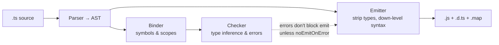
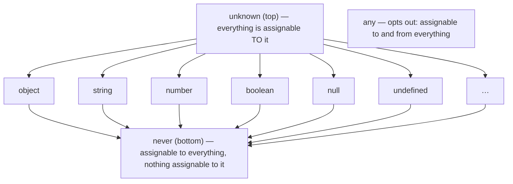
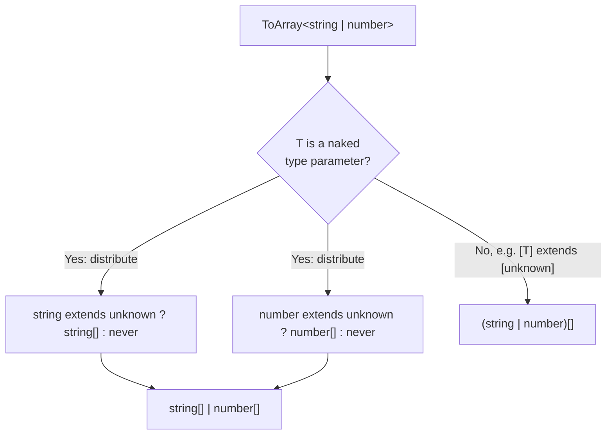

# 03 — TypeScript (Part 1 of 3): The Type System

> **Parts:** **Part 1 — Overview, Topic Map, Type System** · [Part 2 — tsconfig, Typing React/Node/Next, Zod & Code Examples](./03-typescript-part2.md) · [Part 3 — Resources, Practice, Interview Questions & Revision](./03-typescript-part3.md)
>
> Applies to: TypeScript 5.x (examples verified with 5.9). TypeScript 6.0 is planned as a transition release toward the native (Go-based) TypeScript 7 compiler and deprecates several legacy options — check the release notes on typescriptlang.org for the version you use. JavaScript runtime semantics are in [02-javascript.md](./02-javascript.md).

## Table of Contents

- [1. Overview](#1-overview)
- [2. Topic Map](#2-topic-map)
- [3. Detailed Explanations (Part 1)](#3-detailed-explanations-part-1)
  - [3.1 How TypeScript Works: Erasure, Structural Typing, Soundness](#31-how-typescript-works-erasure-structural-typing-soundness)
  - [3.2 Inference, Widening & Literal Types](#32-inference-widening--literal-types)
  - [3.3 Top & Bottom Types: `any`, `unknown`, `never`, `void`](#33-top--bottom-types-any-unknown-never-void)
  - [3.4 Narrowing & Type Guards](#34-narrowing--type-guards)
  - [3.5 Discriminated Unions & Exhaustiveness](#35-discriminated-unions--exhaustiveness)
  - [3.6 Generics](#36-generics)
  - [3.7 `interface` vs `type`, Declaration Merging, Module Augmentation](#37-interface-vs-type-declaration-merging-module-augmentation)
  - [3.8 Utility Types (and How They're Built)](#38-utility-types-and-how-theyre-built)
  - [3.9 Mapped Types](#39-mapped-types)
  - [3.10 Conditional Types & `infer`](#310-conditional-types--infer)
  - [3.11 Template Literal Types](#311-template-literal-types)
  - [3.12 `satisfies`, `as const`, Assertions](#312-satisfies-as-const-assertions)
  - [3.13 Functions: Overloads, `this`, Variance](#313-functions-overloads-this-variance)
  - [3.14 Enums, Classes & Branded Types](#314-enums-classes--branded-types)
- [Next: Part 2](#next-part-2)

---

## 1. Overview

**What it is.** TypeScript is a statically typed superset of JavaScript. Its compiler (`tsc`) does two separate jobs: **type checking** and **emitting JavaScript** (by erasing types and optionally down-levelling syntax). Types don't exist at runtime.

**Why interviewers care.** At 3+ years, TypeScript is assumed. What's being tested is whether you use the type system to *design* code — making invalid states unrepresentable, typing boundaries correctly, and knowing where the types lie to you:

| Interview signal | What it shows |
|------------------|---------------|
| Models API state as a discriminated union instead of `isLoading`/`error`/`data` booleans | Uses types to prevent impossible states |
| Validates untrusted input with Zod instead of `as User` | Knows types are erased; respects trust boundaries |
| Writes a generic `useFetch<T>` or `groupBy<T, K>` with correct constraints | Can design reusable APIs |
| Explains why `Omit` on a union "loses" members | Understands distributive conditional types |
| Knows what `strict`, `noUncheckedIndexedAccess`, `moduleResolution: bundler` do | Can own a project's configuration |

**Depth expected at 3+ years.**

- Fluent with generics, narrowing, discriminated unions and utility types in everyday code.
- Can *read and write* mapped and conditional types, including `infer`, and explain distribution.
- Knows the unsound corners (type assertions, `any`, index access, bivariant methods) and how config flags close some of them.
- Can configure `tsconfig` for a Node ESM service and a Next.js app, and explain each important flag.
- Type-level puzzles (type-challenges "medium") are a bonus, not a requirement — but explaining *how* a utility type works is expected.

> 💡 Interview Tip: When asked "why TypeScript?", go beyond "catches bugs". Mention refactoring confidence, types as documentation, editor tooling, and the cost: build complexity, false confidence at runtime boundaries, and type-level complexity that can hurt readability.

---

## 2. Topic Map

Legend: 🟢 fundamentals · 🟡 intermediate · 🔴 advanced · ⭐ interview favorite

**Part 1 — Type system (this file)**

- [ ] 🟢⭐ Type erasure; compile-time vs runtime
- [ ] 🟢⭐ Structural typing; excess property checks on fresh object literals
- [ ] 🟡 Soundness holes: assertions, `any`, index access, method bivariance
- [ ] 🟢 Inference, contextual typing, literal widening, `const` vs `let`
- [ ] 🟢⭐ `any` vs `unknown` vs `never`; `void`
- [ ] 🟢⭐ Narrowing: `typeof`, `instanceof`, `in`, equality, truthiness, control-flow analysis
- [ ] 🟡⭐ User-defined type predicates, assertion functions, inferred predicates (5.5)
- [ ] 🟡⭐ Discriminated unions, exhaustive `switch` with `never`
- [ ] 🟡⭐ Generics: constraints, defaults, inference sites, `const` type parameters, `NoInfer`
- [ ] 🟢⭐ `interface` vs `type`
- [ ] 🟡 Declaration merging, module augmentation, `declare global`
- [ ] 🟢⭐ Built-in utility types (`Partial`, `Required`, `Readonly`, `Pick`, `Omit`, `Record`, `Exclude`, `Extract`, `NonNullable`, `ReturnType`, `Parameters`, `Awaited`, …)
- [ ] 🟡⭐ Mapped types, modifiers (`-readonly`, `-?`), key remapping with `as`
- [ ] 🔴⭐ Conditional types, distribution over unions, `infer`
- [ ] 🔴 Recursive types (`DeepPartial`, `Paths`)
- [ ] 🟡 Template literal types, intrinsic string types (`Uppercase`, `Capitalize`, …)
- [ ] 🟡⭐ `satisfies`, `as const`, `as` vs annotations, non-null `!`
- [ ] 🟡 Function overloads, `this` parameters, variance (`in`/`out`)
- [ ] 🟡 Enums vs union literals vs `as const` objects
- [ ] 🟡 `private` vs `#private`, parameter properties, abstract classes
- [ ] 🔴 Branded / nominal types

**Part 2 — Applied TypeScript ([link](./03-typescript-part2.md))**

- [ ] 🟡⭐ tsconfig deep dive: `strict` family, extra strictness flags, `target`/`lib`, `module`/`moduleResolution`, `isolatedModules`, `verbatimModuleSyntax`, `noEmit`, project references
- [ ] 🟡⭐ Typing React: props, children, events, refs, generic & polymorphic components, hooks, context
- [ ] 🟡 Typing Node/Express: handlers, middleware, `req.user` augmentation, env vars, typed errors
- [ ] 🟡 Typing Next.js App Router: pages, layouts, route handlers, Server Actions
- [ ] 🟡⭐ Runtime validation with Zod: schemas, `z.infer`, parse at boundaries, env validation
- [ ] 🔴 type-challenges practice set

---

## 3. Detailed Explanations (Part 1)

All type-level examples use these two helpers to assert results at compile time (a `false` makes `tsc` fail):

```ts
// Exact type equality (handles any/unknown/never correctly, unlike `A extends B`)
export type Equal<X, Y> =
  (<T>() => T extends X ? 1 : 2) extends (<T>() => T extends Y ? 1 : 2) ? true : false;
export type Expect<T extends true> = T;
```

### 3.1 How TypeScript Works: Erasure, Structural Typing, Soundness

**Erasure.** Types are removed during emit. Consequences:

- You can't `if (x instanceof User)` when `User` is an `interface` or `type` — there is nothing at runtime. Classes work because they're also values.
- Data from `JSON.parse`, `fetch`, `req.body`, `localStorage`, environment variables is **untyped at runtime** no matter what you annotate. Validate it (Zod, [Part 2](./03-typescript-part2.md#319-runtime-validation-with-zod)).
- Generics have no runtime presence: `function parse<T>(s: string): T` can't check anything about `T`.



> ⚠️ Pitfall: Type errors don't stop emit by default. Many toolchains (esbuild, SWC, Babel, Vite, Next.js's compiler, Node's type stripping) **only strip types and never type-check**. CI must run `tsc --noEmit` separately.

**Structural typing.** Compatibility is decided by *shape*, not by name or declaration. If `B` has at least the members `A` requires (with compatible types), `B` is assignable to `A`.

```ts
interface Point2D { x: number; y: number }
interface Pixel { x: number; y: number; color: string }

const pixel: Pixel = { x: 1, y: 2, color: "red" };
const p: Point2D = pixel;            // ✅ extra property is fine: Pixel is structurally a Point2D

// Excess property checks apply only to *fresh* object literals:
// const q: Point2D = { x: 1, y: 2, color: "red" }; // ❌ Object literal may only specify known properties
```

**Why excess property checks exist.** A fresh literal can't be referenced elsewhere, so an extra property is almost certainly a typo (`{ colour: "red" }` passed to an options object). Once the object is stored in a variable, structural rules apply.

**Soundness.** TypeScript is intentionally *unsound* in places for ergonomics. Know where:

| Hole | Example | Mitigation |
|------|---------|-----------|
| `any` | Disables checking and spreads silently | `unknown`, `noImplicitAny`, lint `no-explicit-any` |
| Type assertions | `JSON.parse(s) as User` | Runtime validation |
| Index access | `arr[10]` typed as `T`, not `T \| undefined` | `noUncheckedIndexedAccess` |
| Method bivariance | Method-shorthand parameters are checked bivariantly | Use function-property syntax `fn: (x: T) => void` |
| Array covariance | `const a: Animal[] = dogs; a.push(cat)` compiles | `readonly` arrays for inputs |
| Optional vs `undefined` | `{ a?: string }` accepts `{ a: undefined }` | `exactOptionalPropertyTypes` |

---

### 3.2 Inference, Widening & Literal Types

**Inference** fills in types from initializers, return statements and *context* (e.g. callback parameters get their types from the function they're passed to — "contextual typing").

**Widening.** Literal types widen to their base type when the binding is mutable:

```ts
const status = "active";      // type: "active"  (const can't change)
let mode = "active";          // type: string    (let can be reassigned)

const config = { mode: "dark", retries: 3 };
//    ^? { mode: string; retries: number } — object properties are mutable, so they widen

const frozen = { mode: "dark", retries: 3 } as const;
//    ^? { readonly mode: "dark"; readonly retries: 3 }

const tuple = [200, "OK"] as const;   // readonly [200, "OK"], not (string | number)[]
```

```ts
// Contextual typing: `e` is inferred as MouseEvent from addEventListener's overloads
document.addEventListener("click", (e) => console.log(e.clientX));

// Return type inference across branches → union
function parsePort(raw: string | undefined) {
  if (!raw) return null;
  const n = Number(raw);
  return Number.isInteger(n) ? n : null;
}
// ReturnType<typeof parsePort> is number | null
```

**Best common type & unions.** `[1, "a"]` infers `(string | number)[]`. Inference never invents a supertype that isn't one of the candidates.

**When to annotate:** function *parameters* (always — they're not inferred from usage), exported function *return types* (stable public API, faster checking, clearer errors), and empty collections (`const ids: string[] = []`). Let locals infer.

> ⚠️ Pitfall: A bare `const items = []` is an "evolving array" whose type is pieced together from later `push` calls — fine locally, confusing when it escapes. Inside an object literal, `{ items: [] }` infers `never[]` under `strict`, so nothing can be pushed later. Annotate empty collections.

---

### 3.3 Top & Bottom Types: `any`, `unknown`, `never`, `void`



| Type | Assign *to* it | Use it (call, access) | Meaning | Use for |
|------|---------------|----------------------|---------|---------|
| `any` | Anything | Anything (unchecked) | "Turn the checker off" | Migration escape hatch only |
| `unknown` | Anything | Nothing until narrowed | "Some value, type not known yet" | Untrusted input, `catch` variables, generic containers |
| `never` | Nothing (except `never`) | Anything (unreachable) | "This can't happen" | Exhaustiveness, functions that throw, filtering in conditional types |
| `void` | `undefined` (and functions returning anything, contextually) | — | "Return value should be ignored" | Callback return types |

```ts
// unknown forces narrowing before use
function getErrorMessage(err: unknown): string {
  if (err instanceof Error) return err.message;
  if (typeof err === "string") return err;
  return JSON.stringify(err);
}

try {
  JSON.parse("{bad json");
} catch (err) {               // `err` is unknown with useUnknownInCatchVariables (part of strict)
  console.error(getErrorMessage(err));
}

// never: a function that never returns
function fail(message: string): never {
  throw new Error(message);
}

// never in unions disappears: string | never === string
type T1 = string | never;   // string
type T2 = string & never;   // never
```

**`void` callbacks.** A function type returning `void` accepts functions returning anything — so `arr.forEach((x) => list.push(x))` type-checks even though `push` returns a number. But a *declared* function with return type `void` can't return a value.

> 💡 Interview Tip: "`unknown` is the type-safe counterpart of `any`" is the expected one-liner. Add: `any` is contagious (`any.foo.bar` is `any`), while `unknown` is a dead end until you prove something about it.

---

### 3.4 Narrowing & Type Guards

**Control-flow analysis.** The checker tracks the type of each variable at each point in the code, narrowing after checks and widening at joins.

| Guard | Narrows | Example |
|-------|---------|---------|
| `typeof x === "string"` | Primitives, `"function"`, `"object"` (includes `null`!) | `typeof v === "object" && v !== null` |
| `x instanceof Date` | Class instances (runtime prototype check) | Errors, `Date`, custom classes |
| `"prop" in x` | Union members by property presence | `"email" in contact` |
| `x === "a"`, `x == null` | Literal unions, nullish | `if (status === "error")` |
| Truthiness `if (x)` | Removes `null`/`undefined`/`false`/`0`/`""` | ⚠️ also removes `0` and `""` |
| `Array.isArray(x)` | Arrays | Overloaded inputs |
| User-defined predicate `x is T` | Anything you can check | `isUser(x)` |
| Assertion function `asserts x is T` | Narrows *after* the call | `assertIsDefined(x)` |

```ts
interface User { id: string; email: string; role: "admin" | "member" }

// User-defined type predicate
export function isUser(value: unknown): value is User {
  return (
    typeof value === "object" &&
    value !== null &&
    typeof (value as Record<string, unknown>).id === "string" &&
    typeof (value as Record<string, unknown>).email === "string" &&
    ["admin", "member"].includes((value as Record<string, unknown>).role as string)
  );
}

// Assertion function: throws or narrows for the rest of the scope
export function assertDefined<T>(value: T, name: string): asserts value is NonNullable<T> {
  if (value === null || value === undefined) throw new Error(`${name} is required`);
}

function handle(payload: unknown, maybeId: string | undefined) {
  if (!isUser(payload)) throw new Error("Invalid user payload");
  payload.email;           // payload: User

  assertDefined(maybeId, "id");
  maybeId.toUpperCase();   // maybeId: string
}
```

**Inferred type predicates (TS 5.5).** TypeScript now infers `x is T` for simple arrow functions, so `filter` narrows without a manual predicate:

```ts
const maybeIds: (string | undefined)[] = ["a", undefined, "b"];
const ids = maybeIds.filter((id) => id !== undefined); // string[] in TS 5.5+ (was (string | undefined)[])
```

**Pitfalls**

- ⚠️ A hand-written predicate is a **promise you make to the compiler**. If the implementation is wrong, the types are wrong everywhere it's used. For non-trivial shapes, generate guards from a schema (Zod's `safeParse`).
- ⚠️ Narrowing doesn't survive callbacks for `let` variables (they might be reassigned before the callback runs). Copy to a `const` first.
- ⚠️ Narrowing of a property (`if (order.coupon) { applyDiscounts(order); order.coupon.code }`) is *not* invalidated by intervening function calls, even though `applyDiscounts` could set `order.coupon = undefined`. Another deliberate unsoundness — copy to a `const` if it matters.

---

### 3.5 Discriminated Unions & Exhaustiveness

**Explanation.** A union of object types that share a literal-typed **discriminant** property (`kind`, `type`, `status`). Checking the discriminant narrows to exactly one member. This is TypeScript's version of algebraic data types — the single most useful modeling tool in the language.

```ts
// ❌ Booleans allow impossible states: isLoading && error && data all at once
interface RequestStateBad<T> {
  isLoading: boolean;
  error?: Error;
  data?: T;
}

// ✅ Each state carries exactly the data that exists in that state
type RequestState<T> =
  | { status: "idle" }
  | { status: "loading" }
  | { status: "success"; data: T; fetchedAt: Date }
  | { status: "error"; error: Error; retryCount: number };

function assertNever(value: never): never {
  throw new Error(`Unhandled case: ${JSON.stringify(value)}`);
}

export function renderStatus(state: RequestState<{ name: string }[]>): string {
  switch (state.status) {
    case "idle":
      return "Search for a user";
    case "loading":
      return "Loading…";
    case "success":
      return `${state.data.length} users (as of ${state.fetchedAt.toLocaleTimeString()})`;
    case "error":
      return `Failed after ${state.retryCount} retries: ${state.error.message}`;
    default:
      // If someone adds { status: "cancelled" } and forgets this switch,
      // `state` is no longer `never` here → compile error.
      return assertNever(state);
  }
}
```

```ts
// Reducers are a natural fit
type CartAction =
  | { type: "add"; productId: string; qty: number }
  | { type: "remove"; productId: string }
  | { type: "clear" };

type Cart = ReadonlyMap<string, number>;

export function cartReducer(cart: Cart, action: CartAction): Cart {
  switch (action.type) {
    case "add": {
      const next = new Map(cart);
      next.set(action.productId, (cart.get(action.productId) ?? 0) + action.qty);
      return next;
    }
    case "remove": {
      const next = new Map(cart);
      next.delete(action.productId);
      return next;
    }
    case "clear":
      return new Map();
  }
  // With all cases returning, TS knows this point is unreachable (no default needed when
  // the function has an explicit return type and noImplicitReturns is on).
}
```

**Trade-offs.** Discriminated unions are explicit and exhaustive but verbose when many states share fields; factor shared fields into an intersection (`Base & ({ kind: "a" } | { kind: "b" })`). Destructuring the discriminant into a separate variable used to break narrowing; since TS 4.6, destructured discriminants narrow correctly when destructured from a `const` parameter.

---

### 3.6 Generics

**Explanation.** Generics are type parameters — they let a function/type/class work over many types while preserving the relationship between inputs and outputs.

```ts
// ❌ any loses the relationship between input and output
function firstBad(arr: any[]): any { return arr[0]; }

// ✅ Generic preserves it
function first<T>(arr: readonly T[]): T | undefined { return arr[0]; }
const n = first([1, 2, 3]);       // number | undefined
```

**Constraints (`extends`)** restrict what `T` can be and let you use its members:

```ts
// groupBy with a key constrained to properties whose values can be object keys
export function groupBy<T, K extends PropertyKey>(
  items: readonly T[],
  getKey: (item: T) => K
): Record<K, T[]> {
  const out = {} as Record<K, T[]>;
  for (const item of items) {
    const key = getKey(item);
    (out[key] ??= []).push(item);
  }
  return out;
}

const orders = [
  { id: "o1", status: "paid" as const, total: 40 },
  { id: "o2", status: "refunded" as const, total: 15 },
  { id: "o3", status: "paid" as const, total: 22 },
];
const byStatus = groupBy(orders, (o) => o.status);
//    ^? Record<"paid" | "refunded", { id: string; status: "paid" | "refunded"; total: number }[]>
```

```ts
// keyof constraint: type-safe property access
export function pluck<T, K extends keyof T>(items: readonly T[], key: K): T[K][] {
  return items.map((item) => item[key]);
}
const totals = pluck(orders, "total");   // number[]
// pluck(orders, "price");               // ❌ "price" is not assignable to "id" | "status" | "total"
```

**Defaults** — `interface ApiResponse<T = unknown> { data: T }`.

**Inference sites.** TS infers type arguments from *arguments*, not from the expected return type. If `T` appears only in the return type, callers must specify it — a hint that the function is really doing an unchecked cast:

```ts
// ⚠️ T only in the return position = an assertion in disguise
async function getJson<T>(url: string): Promise<T> {
  const res = await fetch(url);
  return res.json() as Promise<T>; // nothing checks that the payload is a T
}
// Prefer passing a schema so T is inferred AND checked — see Zod in Part 2.
```

**`const` type parameters (TS 5.0)** infer literal types as if the caller wrote `as const`:

```ts
function defineRoutes<const T extends readonly string[]>(routes: T): T { return routes; }
const routes = defineRoutes(["/", "/about", "/blog"]);
//    ^? readonly ["/", "/about", "/blog"]   (without `const`: string[])
```

**`NoInfer<T>` (TS 5.4)** blocks a position from contributing to inference:

```ts
function createFSM<S extends string>(states: S[], initial: NoInfer<S>) { return { states, initial }; }
createFSM(["idle", "running"], "idle");
// createFSM(["idle", "running"], "paused"); // ❌ without NoInfer, S would widen to include "paused"
```

**Pitfalls**

- ⚠️ Unnecessary generics: `function log<T>(x: T): void` — `T` appears once, so `unknown` is clearer. Rule of thumb: a type parameter should appear at least twice (relating two positions).
- ⚠️ `<T>` in a `.tsx` arrow function is parsed as JSX. Write `<T,>(x: T) => x` or `<T extends unknown>`.
- ⚠️ Over-constraining: `T extends object` excludes primitives you may want; `T extends {}` excludes only `null`/`undefined`.

---

### 3.7 `interface` vs `type`, Declaration Merging, Module Augmentation

| | `interface` | `type` alias |
|---|---|---|
| Object shapes | ✅ | ✅ |
| Unions, intersections of non-objects, tuples, primitives, mapped & conditional types | ❌ | ✅ |
| Declaration merging (reopen and add members) | ✅ | ❌ (duplicate identifier) |
| `extends` | ✅ — reports conflicts as errors | `&` intersection — conflicts silently become `never` |
| Checker performance on large hierarchies | Cached by name; generally faster for `extends` chains | Intersections re-computed |
| Error messages | Show the interface name | Can show the expanded structure |

**Practical rule:** `interface` for object shapes that might be extended or augmented (public library types, props); `type` for unions, function types, mapped/conditional types and everything else. Consistency within a codebase matters more than the choice.

```ts
// extends vs & on conflict
interface A { id: string }
// interface B extends A { id: number }   // ❌ error: Interface 'B' incorrectly extends 'A'
type C = A & { id: number };              // ✅ compiles… but C["id"] is string & number = never
```

**Declaration merging.** Multiple `interface` declarations with the same name in the same scope merge their members. Also merge: namespaces with functions/classes/enums (to add static members).

**Module augmentation & `declare global`.** Add members to types declared by a library or the global scope:

```ts
// types/express.d.ts — add `user` to Express's Request (see Part 2 for the middleware)
import "express";

declare module "express-serve-static-core" {
  interface Request {
    user?: { id: string; role: "admin" | "member" };
  }
}
```

```ts
// types/env.d.ts — type process.env (the values are still unvalidated strings at runtime!)
declare global {
  namespace NodeJS {
    interface ProcessEnv {
      DATABASE_URL: string;
      NODE_ENV: "development" | "test" | "production";
    }
  }
}
export {}; // makes this file a module so `declare global` is allowed
```

```ts
// Augmenting a global built-in, e.g. to type a property your app sets on window
declare global {
  interface Window {
    __APP_CONFIG__?: { apiUrl: string; release: string };
  }
}
export {};
```

> ⚠️ Pitfall: A `.d.ts` file *without* any top-level `import`/`export` is a global script; *with* one, it's a module, and plain declarations inside are module-scoped. Mixing these up is the #1 reason augmentations "don't work".

---

### 3.8 Utility Types (and How They're Built)

Interviewers often ask you to implement a built-in. Know the one-line definitions:

| Utility | What it does | Implementation |
|---------|-------------|----------------|
| `Partial<T>` | All props optional | `{ [K in keyof T]?: T[K] }` |
| `Required<T>` | All props required | `{ [K in keyof T]-?: T[K] }` |
| `Readonly<T>` | All props readonly | `{ readonly [K in keyof T]: T[K] }` |
| `Pick<T, K>` | Keep keys `K` | `{ [P in K]: T[P] }` with `K extends keyof T` |
| `Record<K, V>` | Object with keys `K` | `{ [P in K]: V }` with `K extends keyof any` |
| `Exclude<U, E>` | Remove union members assignable to `E` | `U extends E ? never : U` (distributive) |
| `Extract<U, E>` | Keep union members assignable to `E` | `U extends E ? U : never` |
| `Omit<T, K>` | Drop keys `K` | `Pick<T, Exclude<keyof T, K>>` with `K extends keyof any` |
| `NonNullable<T>` | Remove `null`/`undefined` | `T & {}` |
| `ReturnType<F>` | Function's return | `F extends (...args: any) => infer R ? R : any` |
| `Parameters<F>` | Function's params tuple | `F extends (...args: infer P) => any ? P : never` |
| `ConstructorParameters<C>`, `InstanceType<C>` | Class ctor params / instance | Same idea with `abstract new (...args: any) => …` |
| `Awaited<T>` | Recursively unwrap promises/thenables | Recursive conditional on `then`'s callback type |
| `NoInfer<T>` | Block inference | Compiler intrinsic |
| `Uppercase`, `Lowercase`, `Capitalize`, `Uncapitalize` | String literal transforms | Compiler intrinsics |

```ts
import type { Equal, Expect } from "./type-test-helpers";

type MyPartial<T> = { [K in keyof T]?: T[K] };
type MyPick<T, K extends keyof T> = { [P in K]: T[P] };
type MyExclude<U, E> = U extends E ? never : U;
type MyOmit<T, K extends PropertyKey> = MyPick<T, MyExclude<keyof T, K>>;
type MyReturnType<F> = F extends (...args: any[]) => infer R ? R : never;
type MyAwaited<T> = T extends PromiseLike<infer V> ? MyAwaited<V> : T;

interface Product { id: string; name: string; price: number }

type _tests = [
  Expect<Equal<MyPick<Product, "id" | "price">, { id: string; price: number }>>,
  Expect<Equal<MyOmit<Product, "price">, { id: string; name: string }>>,
  Expect<Equal<MyExclude<"a" | "b" | "c", "a">, "b" | "c">>,
  Expect<Equal<MyReturnType<() => Promise<number>>, Promise<number>>>,
  Expect<Equal<MyAwaited<Promise<Promise<string>>>, string>>,
];
```

**The `Omit` on unions surprise**

```ts
type Shape =
  | { kind: "circle"; radius: number; id: string }
  | { kind: "square"; side: number; id: string };

type NoId = Omit<Shape, "id">;
// ❌ { kind: "circle" | "square" } — `keyof (A | B)` is only the *common* keys,
//    and Pick isn't distributive, so the union collapses.

// ✅ Distributive Omit: a conditional type on a naked type parameter distributes over unions
type DistributiveOmit<T, K extends PropertyKey> = T extends unknown ? Omit<T, K> : never;
type NoId2 = DistributiveOmit<Shape, "id">;
// { kind: "circle"; radius: number } | { kind: "square"; side: number }
```

> 💡 Interview Tip: Explaining *why* `Omit` collapses unions (keyof of a union = intersection of keys; mapped types over `keyof T` aren't distributive unless `T` is a naked type parameter in a homomorphic mapped type or conditional) is a strong senior signal.

---

### 3.9 Mapped Types

**Explanation.** A mapped type iterates over a union of keys to build an object type: `{ [K in Keys]: ValueType }`. When the keys come from `keyof T` ("homomorphic" mapped types), modifiers (`readonly`, `?`) are preserved from `T` and the mapping distributes over unions and preserves arrays/tuples.

```ts
// Modifiers: + adds (default), - removes
type Mutable<T> = { -readonly [K in keyof T]: T[K] };
type Concrete<T> = { [K in keyof T]-?: T[K] };

// Key remapping with `as` (TS 4.1)
type Getters<T> = {
  [K in keyof T as `get${Capitalize<string & K>}`]: () => T[K];
};
interface Profile { name: string; age: number }
type ProfileGetters = Getters<Profile>;
// { getName: () => string; getAge: () => number }

// Filtering keys: remap to `never` to drop
type PickByValue<T, V> = { [K in keyof T as T[K] extends V ? K : never]: T[K] };
type NumericFields = PickByValue<Profile & { score: number; email: string }, number>;
// { age: number; score: number }

// Building an event-handler map from a union of event names
type EventName = "click" | "submit" | "keydown";
type Handlers = { [E in EventName as `on${Capitalize<E>}`]?: (event: Event) => void };
// { onClick?: …; onSubmit?: …; onKeydown?: … }
```

```ts
// Recursive mapped type: DeepPartial for PATCH payloads / test fixtures
export type DeepPartial<T> = T extends (...args: any[]) => any
  ? T
  : T extends readonly (infer U)[]
    ? readonly DeepPartial<U>[]
    : T extends object
      ? { [K in keyof T]?: DeepPartial<T[K]> }
      : T;

export type DeepReadonly<T> = T extends (...args: any[]) => any
  ? T
  : T extends object
    ? { readonly [K in keyof T]: DeepReadonly<T[K]> }
    : T;
```

**Pitfalls**

- ⚠️ `keyof T` includes `number` and `symbol` keys; template literals need `string & K` to exclude them.
- ⚠️ Deep recursive types on huge object graphs (e.g. a Prisma client type) can hit "Type instantiation is excessively deep" or slow the editor. Bound the depth or apply to smaller types.

---

### 3.10 Conditional Types & `infer`

**Explanation.** `T extends U ? X : Y` selects a type based on assignability. Two behaviors make them powerful:

1. **Distribution:** when `T` is a *naked* type parameter and is instantiated with a union, the conditional is applied to each member separately and the results are unioned.
2. **`infer`:** declares a type variable inside the `extends` clause that TS infers by pattern-matching.

```ts
import type { Equal, Expect } from "./type-test-helpers";

// Distribution
type ToArray<T> = T extends unknown ? T[] : never;
type A1 = ToArray<string | number>;           // string[] | number[]

// Prevent distribution by wrapping both sides in a tuple
type ToArrayNonDist<T> = [T] extends [unknown] ? T[] : never;
type A2 = ToArrayNonDist<string | number>;    // (string | number)[]

// never is the empty union → distributes to never
type A3 = ToArray<never>;                      // never
type IsNever<T> = [T] extends [never] ? true : false; // the correct way to test for never

// infer: pattern matching on structure
type ElementType<T> = T extends readonly (infer E)[] ? E : never;
type FirstArg<F> = F extends (first: infer A, ...rest: any[]) => any ? A : never;
type PromiseValue<T> = T extends Promise<infer V> ? V : T;

// infer with constraints (TS 4.7): only match if the inferred type is a string
type FirstString<T> = T extends [infer S extends string, ...unknown[]] ? S : never;

// Recursive: split a dotted path into a tuple
type Split<S extends string, D extends string> =
  S extends `${infer Head}${D}${infer Tail}` ? [Head, ...Split<Tail, D>] : [S];

type _tests = [
  Expect<Equal<A1, string[] | number[]>>,
  Expect<Equal<A2, (string | number)[]>>,
  Expect<Equal<A3, never>>,
  Expect<Equal<IsNever<never>, true>>,
  Expect<Equal<ElementType<readonly ["a", "b"]>, "a" | "b">>,
  Expect<Equal<FirstArg<(id: string, opts: object) => void>, string>>,
  Expect<Equal<FirstString<["x", 1]>, "x">>,
  Expect<Equal<FirstString<[1, "x"]>, never>>,
  Expect<Equal<Split<"user.address.city", ".">, ["user", "address", "city"]>>,
];
```



**A realistic use: typed object paths** (used by form libraries like React Hook Form for `register("address.city")`):

```ts
type Primitive = string | number | boolean | bigint | symbol | null | undefined | Date;

export type Paths<T> = T extends Primitive
  ? never
  : {
      [K in keyof T & string]: T[K] extends Primitive ? K : K | `${K}.${Paths<T[K]>}`;
    }[keyof T & string];

export type PathValue<T, P extends string> =
  P extends `${infer Head}.${infer Rest}`
    ? Head extends keyof T ? PathValue<T[Head], Rest> : never
    : P extends keyof T ? T[P] : never;

interface CheckoutForm {
  email: string;
  address: { city: string; zip: string; geo: { lat: number; lng: number } };
}

type FormPath = Paths<CheckoutForm>;
// "email" | "address" | "address.city" | "address.zip" | "address.geo" | "address.geo.lat" | "address.geo.lng"

export function getField<T, P extends Paths<T>>(obj: T, path: P): PathValue<T, P> {
  return path.split(".").reduce<any>((acc, key) => acc?.[key], obj);
}
```

> ⚠️ Pitfall: Conditional types on *unresolved* generic parameters are deferred — inside a generic function, `T extends string ? A : B` stays unevaluated, so you often can't return a value of that type without a cast. Overloads are frequently simpler.

---

### 3.11 Template Literal Types

**Explanation.** String literal types can be built with template syntax, combined with unions (producing the cross product), and parsed with `infer`.

```ts
type Locale = "en" | "fr";
type Namespace = "common" | "checkout";
type TranslationKey = `${Locale}:${Namespace}`;
// "en:common" | "en:checkout" | "fr:common" | "fr:checkout"

type CssLength = `${number}${"px" | "rem" | "%"}`;
const gap: CssLength = "1.5rem";       // ✅
// const bad: CssLength = "1.5em";     // ❌

// Extract route params from a path pattern — the idea behind typed routers
type RouteParams<Path extends string> =
  Path extends `${string}:${infer Param}/${infer Rest}`
    ? { [K in Param | keyof RouteParams<`/${Rest}`>]: string }
    : Path extends `${string}:${infer Param}`
      ? { [K in Param]: string }
      : {};

type P = RouteParams<"/orgs/:orgId/projects/:projectId">;
// { orgId: string; projectId: string }

export function buildPath<Path extends string>(path: Path, params: RouteParams<Path>): string {
  const values = params as Record<string, string | undefined>;
  return path.replace(/:(\w+)/g, (_, key: string) => {
    const value = values[key];
    if (value === undefined) throw new Error(`Missing route param: ${key}`);
    return encodeURIComponent(value);
  });
}
buildPath("/orgs/:orgId/projects/:projectId", { orgId: "acme", projectId: "42" }); // ✅
// buildPath("/orgs/:orgId", { org: "acme" });                                   // ❌ missing orgId
```

**Trade-offs.** Template literal types give great DX for string-based APIs (routes, i18n keys, CSS tokens, event names) but large cross products (e.g. 4 unions × 50 members) can explode type-checking time. Keep unions small or generate types with codegen.

---

### 3.12 `satisfies`, `as const`, Assertions

| Syntax | Effect on the variable's type | Checks | Use for |
|--------|------------------------------|--------|---------|
| `const x: T = v` (annotation) | `x` is **`T`** (literal info lost) | `v` must be assignable to `T` | Variables whose type *is* `T` |
| `const x = v as T` (assertion) | `x` is `T` | Only that `v` and `T` "sufficiently overlap" — **unsafe** | Rare escape hatch when you know more than TS |
| `const x = v satisfies T` (TS 4.9) | `x` keeps the **inferred** type of `v` | `v` must be assignable to `T` | Validating config objects while keeping literal keys/values |
| `as const` | Deeply readonly, literal types | — | Constant tables, tuples, enum-like objects |
| `x!` (non-null) | Removes `null`/`undefined` | None — **unsafe** | After checks TS can't follow; prefer a guard |

```ts
type Theme = Record<string, { bg: string; fg: string }>;

// ❌ Annotation: keys widen to `string`, so typos aren't caught on access
const themeA: Theme = { light: { bg: "#fff", fg: "#111" }, dark: { bg: "#111", fg: "#eee" } };
themeA.drak;                 // no error — Theme allows any string key

// ✅ satisfies: validated against Theme, but keeps the exact keys
const themeB = {
  light: { bg: "#fff", fg: "#111" },
  dark: { bg: "#111", fg: "#eee" },
} satisfies Theme;
// themeB.drak;              // ❌ Property 'drak' does not exist
type ThemeName = keyof typeof themeB; // "light" | "dark"

// as const + satisfies: literal values AND validation
const ROLES = ["admin", "editor", "viewer"] as const satisfies readonly string[];
type Role = (typeof ROLES)[number]; // "admin" | "editor" | "viewer"
```

> ⚠️ Pitfall: `as` is allowed between types that are *comparable* (one assignable to the other). `"hello" as number` errors, but `({} as User)` compiles — producing an object that claims to have fields it doesn't. Double assertions (`x as unknown as T`) are a code-review red flag.

---

### 3.13 Functions: Overloads, `this`, Variance

**Overloads** describe multiple call signatures; the implementation signature is hidden from callers and must be compatible with all overloads.

```ts
// Return type depends on input — overloads are clearer than a conditional return type here
export function parseDate(input: string): Date;
export function parseDate(input: number): Date;
export function parseDate(input: null | undefined): null;
export function parseDate(input: string | number | null | undefined): Date | null {
  if (input == null) return null;
  const d = new Date(input);
  if (Number.isNaN(d.getTime())) throw new RangeError(`Invalid date: ${input}`);
  return d;
}

const d1 = parseDate("2026-10-14"); // Date
const d2 = parseDate(null);         // null
```

**`this` parameters** are fake first parameters that type `this` (erased at emit):

```ts
function onButtonClick(this: HTMLButtonElement, _e: MouseEvent) {
  this.disabled = true;
}
document.querySelector("button")?.addEventListener("click", onButtonClick);
```

**Variance** describes how subtyping of `T` relates to subtyping of `Box<T>`:

| Variance | Rule (Dog ⊂ Animal) | Where it appears |
|----------|--------------------|------------------|
| Covariant | `Box<Dog>` ⊂ `Box<Animal>` | Return types, readonly properties |
| Contravariant | `Fn<Animal>` ⊂ `Fn<Dog>` | Parameter types (with `strictFunctionTypes`) |
| Invariant | Neither | Mutable properties used in both positions |
| Bivariant | Both (unsound) | **Method-shorthand** parameters, even under `strict` |

```ts
interface Animal { name: string }
interface Dog extends Animal { bark(): void }

type Handler<T> = (value: T) => void;
const handleAnimal: Handler<Animal> = (a) => console.log(a.name);
const handleDog: Handler<Dog> = handleAnimal;   // ✅ contravariance: an Animal handler can handle Dogs
// const bad: Handler<Animal> = (d: Dog) => d.bark(); // ❌ under strictFunctionTypes

// Method shorthand is checked bivariantly (to keep things like Array<T>.push usable):
interface EmitterMethod { emit(value: Animal): void }       // bivariant
interface EmitterProp { emit: (value: Animal) => void }    // contravariant (stricter)
```

**Explicit variance annotations (TS 4.7):** `interface Producer<out T>`, `interface Consumer<in T>` document intent and can speed up checking of complex generic types.

---

### 3.14 Enums, Classes & Branded Types

**Enums vs alternatives**

| Option | Runtime cost | Type | Notes |
|--------|-------------|------|-------|
| `enum Status { Active, Inactive }` (numeric) | Emits an object with reverse mapping | Nominal-ish | Any `number` was assignable before TS 5.0; reverse mapping surprises |
| `enum Status { Active = "active" }` (string) | Emits an object | Nominal: `"active"` literal is **not** assignable to `Status.Active` | Awkward with API data |
| `const enum` | Inlined, no object | — | Breaks with `isolatedModules` / single-file transpilers across files; avoid in libraries |
| Union of literals `type Status = "active" \| "inactive"` | None | Structural | Simplest; no runtime list of values |
| `as const` object + derived union | A plain object | Structural | Runtime values **and** a type — the most common modern choice |

```ts
export const ORDER_STATUS = {
  Pending: "pending",
  Paid: "paid",
  Shipped: "shipped",
} as const;

export type OrderStatus = (typeof ORDER_STATUS)[keyof typeof ORDER_STATUS]; // "pending" | "paid" | "shipped"

const allStatuses = Object.values(ORDER_STATUS); // runtime list for dropdowns/validation
```

> 💡 Interview Tip: Node's built-in type stripping and the `erasableSyntaxOnly` flag (TS 5.8) reject syntax that needs code generation — `enum`, `namespace` with values, parameter properties. That's a practical reason teams are moving away from enums.

**Classes in TS**

```ts
export abstract class PaymentProvider {
  // `private` is compile-time only; `#secret` is enforced at runtime by JS
  readonly #apiKey: string;

  // Parameter property: declares and assigns `name` (not erasable syntax — see tip above)
  constructor(protected readonly name: string, apiKey: string) {
    this.#apiKey = apiKey;
  }

  protected authHeader(): Record<string, string> {
    return { Authorization: `Bearer ${this.#apiKey}` };
  }

  abstract charge(amountMinor: number, currency: string): Promise<{ id: string }>;
}

export class StripeProvider extends PaymentProvider {
  constructor(apiKey: string) { super("stripe", apiKey); }

  override async charge(amountMinor: number, currency: string) { // `override` checked with noImplicitOverride
    const res = await fetch("https://api.stripe.com/v1/payment_intents", {
      method: "POST",
      headers: { ...this.authHeader(), "Content-Type": "application/x-www-form-urlencoded" },
      body: new URLSearchParams({ amount: String(amountMinor), currency }),
    });
    if (!res.ok) throw new Error(`Stripe error ${res.status}`);
    return (await res.json()) as { id: string };
  }
}
```

| | `private` | `#private` |
|---|---|---|
| Enforced | Compile time only (accessible via `obj["field"]` or in JS) | Runtime (true privacy) |
| Works with Proxies | Yes | No ([02 Part 2](./02-javascript-part2.md#312-proxy--reflect)) |
| Subclass access | No (`protected` for that) | No |

**Branded (nominal) types.** Structural typing means `UserId` and `OrderId` (both `string`) are interchangeable. Brands make them distinct with zero runtime cost:

```ts
declare const brand: unique symbol;
type Brand<T, B extends string> = T & { readonly [brand]: B };

export type UserId = Brand<string, "UserId">;
export type OrderId = Brand<string, "OrderId">;
export type Cents = Brand<number, "Cents">;

// The only way to create one is through a function that validates
export const UserId = (raw: string): UserId => {
  if (!/^usr_[a-z0-9]{8,}$/.test(raw)) throw new Error(`Invalid user id: ${raw}`);
  return raw as UserId;
};
export const toCents = (amount: number): Cents => Math.round(amount * 100) as Cents;

declare function getOrdersForUser(id: UserId): Promise<OrderId[]>;
const uid = UserId("usr_ab12cd34");
getOrdersForUser(uid);                    // ✅
// getOrdersForUser("ord_123");           // ❌ string is not assignable to UserId
// getOrdersForUser(orderId);             // ❌ OrderId is not assignable to UserId
```

Zod supports brands directly (`z.string().brand<"UserId">()`) — see [Part 2](./03-typescript-part2.md#319-runtime-validation-with-zod).

---

## Next: Part 2

➡️ [03-typescript-part2.md](./03-typescript-part2.md) — tsconfig deep dive, typing React / Node / Express / Next.js, Zod runtime validation, and a set of production-grade typed utilities.
