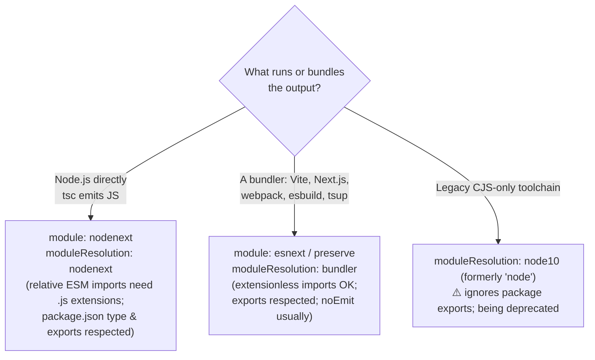
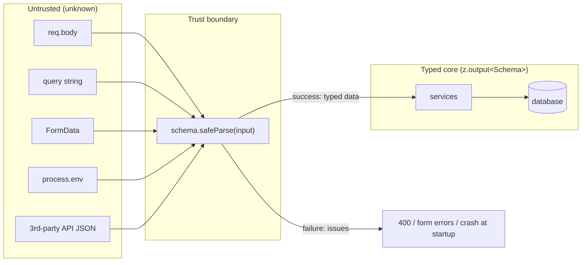
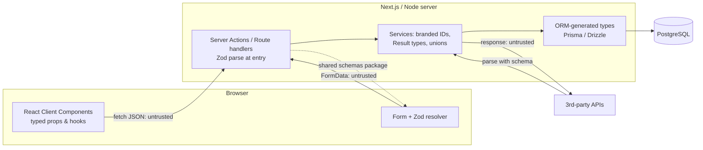

# 03 — TypeScript (Part 2 of 3): tsconfig, Typing React/Node/Next, Zod & Code Examples

> **Parts:** [Part 1 — Overview, Topic Map, Type System](./03-typescript-part1.md) · **Part 2 — tsconfig, Typing React/Node/Next, Zod & Code Examples** · [Part 3 — Resources, Practice, Interview Questions & Revision](./03-typescript-part3.md)
>
> Applies to: TypeScript 5.x (verified with 5.9), `@types/react` 19, Express 5 with `@types/express` 5, Next.js 15+ App Router, Zod 4. Framework typings change between majors — check each library's docs for your installed version.

## Table of Contents

- [3. Detailed Explanations (Part 2)](#3-detailed-explanations-part-2)
  - [3.15 tsconfig Deep Dive](#315-tsconfig-deep-dive)
  - [3.16 Typing React](#316-typing-react)
  - [3.17 Typing Node.js & Express](#317-typing-nodejs--express)
  - [3.18 Typing Next.js (App Router)](#318-typing-nextjs-app-router)
  - [3.19 Runtime Validation with Zod](#319-runtime-validation-with-zod)
  - [3.20 type-challenges: A Curated Path](#320-type-challenges-a-curated-path)
- [4. Code Examples: Typed Utilities](#4-code-examples-typed-utilities)
- [5. Diagrams Index](#5-diagrams-index)
- [Next: Part 3](#next-part-3)

---

## 3. Detailed Explanations (Part 2)

### 3.15 tsconfig Deep Dive

**Mental model.** A tsconfig answers four questions: *which files* (`include`/`exclude`/`files`), *how strict* (`strict` and friends), *what runtime* (`target`, `lib`, `types`), and *what module system* (`module`, `moduleResolution`), plus *what to output* (`outDir`, `declaration`, `noEmit`).

#### The `strict` family

`"strict": true` turns on all of these (and any future additions to the family):

| Flag | Catches |
|------|---------|
| `strictNullChecks` | `null`/`undefined` aren't assignable to other types — the single most valuable flag |
| `noImplicitAny` | Parameters/variables whose type would silently be `any` |
| `strictFunctionTypes` | Contravariant checking of function-typed parameters (not methods) |
| `strictBindCallApply` | Correct types for `bind`/`call`/`apply` arguments |
| `strictPropertyInitialization` | Class properties not initialized in the constructor |
| `noImplicitThis` | `this` with an implicit `any` type |
| `useUnknownInCatchVariables` | `catch (e)` gives `unknown` instead of `any` |
| `alwaysStrict` | Emits `"use strict"` and parses in strict mode |
| `strictBuiltinIteratorReturn` (5.6) | Built-in iterators' `TReturn` is `undefined` instead of `any` |

#### Extra strictness worth enabling (not in `strict`)

| Flag | Effect | Cost |
|------|--------|------|
| `noUncheckedIndexedAccess` | `arr[i]` and `record[key]` include `\| undefined` | More narrowing in loops; catches real bugs |
| `exactOptionalPropertyTypes` | `{ a?: string }` no longer accepts `{ a: undefined }` | Friction with libraries that pass `undefined` explicitly |
| `noImplicitOverride` | Requires `override` on overridden methods | Small; prevents accidental overrides when base classes change |
| `noFallthroughCasesInSwitch` | Errors on non-empty fallthrough cases | None |
| `noImplicitReturns` | All code paths must return | None |
| `noPropertyAccessFromIndexSignature` | Forces `obj["key"]` for index-signature props | Makes "maybe missing" keys visible |

#### Target, lib, types

| Option | Controls | Typical values |
|--------|----------|----------------|
| `target` | Which syntax is down-levelled at emit (e.g. optional chaining → ternaries for ES2019) | Match your *lowest* runtime: `ES2022`/`ES2023` for current Node LTS; Next.js handles browsers itself |
| `lib` | Which built-in type declarations exist (`Promise.withResolvers`, `Object.groupBy`, DOM) | Defaults from `target`; add `"DOM"`, `"DOM.Iterable"` for browsers; `"WebWorker"` for workers |
| `types` | Which `@types/*` packages are auto-included globally | Restrict to avoid conflicts, e.g. `["node", "vitest/globals"]` |

> ⚠️ Pitfall: `lib` only affects *types*. Adding `"ES2024"` lets you write `Object.groupBy` without errors, but if the runtime lacks it, you'll crash — TS doesn't polyfill.

#### `module` & `moduleResolution`



| Option | What it does |
|--------|--------------|
| `module` | Output module format *and* the module semantics TS assumes (`nodenext` follows Node's per-file ESM/CJS rules based on extension and `"type"`) |
| `moduleResolution` | How `import "x"` is resolved to a file (respecting `exports`, `imports`, extensions) |
| `isolatedModules` | Errors on constructs a single-file transpiler (esbuild/SWC/Babel) can't handle, e.g. re-exporting a type without `export type` |
| `verbatimModuleSyntax` (5.0) | Imports/exports are emitted exactly as written except those marked `type`; forces `import type` for type-only imports. Replaces `importsNotUsedAsValues`/`preserveValueImports` |
| `esModuleInterop` / `allowSyntheticDefaultImports` | Allow `import express from "express"` for CJS modules (default-import interop) |
| `resolveJsonModule` | `import data from "./data.json"` |
| `allowImportingTsExtensions` (needs `noEmit` or `emitDeclarationOnly`) | `import "./x.ts"` — for runtimes that run TS directly |
| `rewriteRelativeImportExtensions` (5.7) | Rewrites `./x.ts` → `./x.js` at emit |
| `erasableSyntaxOnly` (5.8) | Errors on syntax that isn't just type annotations (`enum`, parameter properties, value `namespace`) — for Node's built-in type stripping |
| `paths` / `baseUrl` | Import aliases (`@/lib/db`). **Only affects type resolution** — the bundler/runtime needs matching config (Next.js reads `paths` automatically; plain Node needs `imports` in package.json or a loader) |

#### Output & project structure

| Option | Use |
|--------|-----|
| `noEmit` | Type-check only (Next.js, Vite — the bundler emits) |
| `outDir` / `rootDir` | Where JS goes / what the source root is (keeps `dist/` structure clean) |
| `declaration` / `declarationMap` | Emit `.d.ts` (+ maps for "go to definition" into source) — libraries |
| `sourceMap` | Debuggable stack traces in Node (`node --enable-source-maps`) |
| `incremental` / `tsBuildInfoFile` | Cache type-check results between runs |
| `composite` + `references` | Project references: split a monorepo into separately-built projects; build with `tsc -b` |
| `skipLibCheck` | Skip type-checking `.d.ts` files. Much faster; risk is missing conflicts between `@types` packages. Almost universally enabled |

#### Two reference configs

```jsonc
// tsconfig.json — Node.js ESM API service compiled by tsc (package.json has "type": "module")
{
  "compilerOptions": {
    "target": "ES2023",
    "lib": ["ES2023"],
    "module": "nodenext",
    "moduleResolution": "nodenext",
    "outDir": "dist",
    "rootDir": "src",
    "types": ["node"],

    "strict": true,
    "noUncheckedIndexedAccess": true,
    "noImplicitOverride": true,
    "noFallthroughCasesInSwitch": true,

    "verbatimModuleSyntax": true,
    "isolatedModules": true,
    "resolveJsonModule": true,
    "skipLibCheck": true,
    "sourceMap": true
  },
  "include": ["src"]
}
```

```jsonc
// tsconfig.json — Next.js App Router app (the shape create-next-app generates, plus extra strictness).
// Let Next manage fields it rewrites (e.g. "jsx", "plugins", "include" of generated types).
{
  "compilerOptions": {
    "target": "ES2017",
    "lib": ["dom", "dom.iterable", "esnext"],
    "allowJs": true,
    "skipLibCheck": true,
    "strict": true,
    "noUncheckedIndexedAccess": true,
    "noEmit": true,
    "esModuleInterop": true,
    "module": "esnext",
    "moduleResolution": "bundler",
    "resolveJsonModule": true,
    "isolatedModules": true,
    "jsx": "preserve",
    "incremental": true,
    "plugins": [{ "name": "next" }],
    "paths": { "@/*": ["./src/*"] }
  },
  "include": ["next-env.d.ts", "**/*.ts", "**/*.tsx", ".next/types/**/*.ts"],
  "exclude": ["node_modules"]
}
```

> 💡 Interview Tip: Be able to say *why* each line exists. "`moduleResolution: bundler` because Next's bundler resolves imports, not Node; `noEmit` because Next compiles with SWC; `isolatedModules` because SWC transpiles each file independently."

---

### 3.16 Typing React

> Applies to `@types/react` 19. In React 19, `ref` is a regular prop for function components (no `forwardRef` needed), `useRef` requires an argument, and some types were renamed (e.g. `ElementRef` → `ComponentRef`). See [04-react.md](./04-react.md) for runtime behavior.

**Props, children, and native element props**

```tsx
import type { ComponentProps, ReactNode } from "react";

// Extend native button props so consumers get onClick, disabled, aria-*, type, ref (React 19)…
interface ButtonProps extends ComponentProps<"button"> {
  variant?: "primary" | "ghost";
  loading?: boolean;
  icon?: ReactNode; // ReactNode = anything renderable: elements, strings, numbers, null, arrays…
}

export function Button({ variant = "primary", loading = false, icon, children, disabled, ...rest }: ButtonProps) {
  return (
    <button {...rest} disabled={disabled || loading} data-variant={variant} aria-busy={loading}>
      {icon}
      {children}
    </button>
  );
}
```

| Type | Use for |
|------|---------|
| `ReactNode` | `children` and any "renderable" prop |
| `ReactElement` | When you need an element specifically (e.g. to `cloneElement`) |
| `ComponentProps<"input">` / `ComponentProps<typeof Button>` | Reuse props of an element or component |
| `ComponentPropsWithoutRef<"div">` | When you explicitly don't want `ref` in the props |
| `PropsWithChildren<P>` | Add optional `children?: ReactNode` to `P` |
| `CSSProperties` | `style` objects |
| `Dispatch<SetStateAction<T>>` | Typing a passed-down `setState` |

**Events** — let inference do the work inline; name the type when extracting the handler:

```tsx
import { useState, type ChangeEvent } from "react";

export function EmailField() {
  const [email, setEmail] = useState("");                              // inferred: string

  const handleChange = (e: ChangeEvent<HTMLInputElement>) => setEmail(e.target.value);

  return (
    <form
      onSubmit={(e) => {                                               // contextually typed
        e.preventDefault();
        const data = new FormData(e.currentTarget);                    // currentTarget: HTMLFormElement
        console.log(data.get("email"));
      }}
    >
      <input name="email" value={email} onChange={handleChange} />
    </form>
  );
}
```

**Hooks**

```tsx
import { createContext, useContext, useReducer, useRef, useState, type ReactNode } from "react";

interface User { id: string; name: string }

export function Profile() {
  const [user, setUser] = useState<User | null>(null);  // annotate when the initial value is narrower
  const inputRef = useRef<HTMLInputElement>(null);      // RefObject<HTMLInputElement | null>
  const timerRef = useRef<number | undefined>(undefined); // mutable box for non-DOM values

  return (
    <>
      <input ref={inputRef} onFocus={() => setUser({ id: "1", name: "Ali" })} />
      <button onClick={() => inputRef.current?.focus()}>Focus</button>
      {user?.name}
    </>
  );
}

// useReducer with a discriminated-union action type (see Part 1 §3.5)
type CounterAction = { type: "inc"; by: number } | { type: "reset" };
function counter(state: number, action: CounterAction): number {
  switch (action.type) {
    case "inc": return state + action.by;
    case "reset": return 0;
  }
}
export function Counter() {
  const [count, dispatch] = useReducer(counter, 0);
  return <button onClick={() => dispatch({ type: "inc", by: 1 })}>{count}</button>;
}

// Context without a fake default: undefined + a guarded hook
interface AuthContextValue { user: User | null; signOut: () => Promise<void> }
const AuthContext = createContext<AuthContextValue | undefined>(undefined);

export function AuthProvider({ value, children }: { value: AuthContextValue; children: ReactNode }) {
  return <AuthContext value={value}>{children}</AuthContext>; // React 19: <Context> as provider
}

export function useAuth(): AuthContextValue {
  const ctx = useContext(AuthContext);
  if (!ctx) throw new Error("useAuth must be used inside <AuthProvider>");
  return ctx;                                           // narrowed: no `| undefined` for consumers
}
```

**Generic components** — the type parameter flows from props to callbacks:

```tsx
interface SelectProps<T> {
  options: readonly T[];
  value: T | null;
  onChange: (value: T) => void;
  getLabel: (option: T) => string;
  getKey: (option: T) => string;
}

export function Select<T>({ options, value, onChange, getLabel, getKey }: SelectProps<T>) {
  return (
    <select
      value={value ? getKey(value) : ""}
      onChange={(e) => {
        const next = options.find((o) => getKey(o) === e.target.value);
        if (next) onChange(next);
      }}
    >
      <option value="" disabled>Choose…</option>
      {options.map((o) => (
        <option key={getKey(o)} value={getKey(o)}>{getLabel(o)}</option>
      ))}
    </select>
  );
}

// Usage: T is inferred as { code: string; name: string } — onChange receives that type
const countries = [{ code: "PK", name: "Pakistan" }, { code: "DE", name: "Germany" }] as const;
export const CountryPicker = () => (
  <Select options={countries} value={null} getKey={(c) => c.code} getLabel={(c) => c.name}
          onChange={(c) => console.log(c.code)} />
);
```

**Polymorphic `as` prop**

```tsx
import type { ComponentPropsWithoutRef, ElementType } from "react";

type PolymorphicProps<E extends ElementType, Own = object> = Own & { as?: E } &
  Omit<ComponentPropsWithoutRef<E>, keyof Own | "as">;

type TextOwnProps = { tone?: "default" | "muted" };

export function Text<E extends ElementType = "span">({ as, tone = "default", ...rest }: PolymorphicProps<E, TextOwnProps>) {
  const Component: ElementType = as ?? "span";
  return <Component data-tone={tone} {...rest} />;
}

export const Examples = () => (
  <>
    <Text>Inline</Text>
    <Text as="a" href="/pricing">Link — href is allowed because E = "a"</Text>
    <Text as="label" htmlFor="email" tone="muted">Label</Text>
    {/* <Text as="span" href="/x" />  ❌ href doesn't exist on span */}
  </>
);
```

> ⚠️ Pitfall: Typing every component as `React.FC<Props>` is fine in React 18+ (it no longer adds implicit `children`), but it doesn't support generic components. A plain function with typed props works everywhere.

---

### 3.17 Typing Node.js & Express

> Applies to Express 5 (`express@5`, `@types/express@5`). Express 5 forwards rejected promises from async handlers to the error middleware automatically; Express 4 did not. Node runtime details are in [06-nodejs.md](./06-nodejs.md).

**Validated, typed environment** — parse once at startup, crash early:

```ts
// src/env.ts
import { z } from "zod";

const EnvSchema = z.object({
  NODE_ENV: z.enum(["development", "test", "production"]).default("development"),
  PORT: z.coerce.number().int().positive().default(3000),  // env vars are strings → coerce
  DATABASE_URL: z.url(),
  JWT_SECRET: z.string().min(32, "JWT_SECRET must be at least 32 chars"),
  CORS_ORIGINS: z
    .string()
    .default("")
    .transform((s) => s.split(",").map((o) => o.trim()).filter(Boolean)),
});

const parsed = EnvSchema.safeParse(process.env);
if (!parsed.success) {
  console.error("❌ Invalid environment:", parsed.error.issues.map((i) => `${i.path.join(".")}: ${i.message}`));
  process.exit(1);
}

export const env = parsed.data;
//           ^? { NODE_ENV: "development" | "test" | "production"; PORT: number; DATABASE_URL: string; JWT_SECRET: string; CORS_ORIGINS: string[] }
```

**Typed request handlers, validation middleware, `req.user`**

```ts
// src/types/express.d.ts
import "express";

declare module "express-serve-static-core" {
  interface Request {
    user?: { id: string; role: "admin" | "member" };
  }
}
```

```ts
// src/http/validate.ts
import type { RequestHandler } from "express";
import type { ParamsDictionary } from "express-serve-static-core";
import { z } from "zod";

// Generic middleware: after it runs, req.body has the schema's *output* type
export function validateBody<S extends z.ZodType>(
  schema: S
): RequestHandler<ParamsDictionary, unknown, z.output<S>> {
  return (req, res, next) => {
    const result = schema.safeParse(req.body);
    if (!result.success) {
      res.status(400).json({ error: "ValidationError", issues: result.error.issues });
      return;
    }
    req.body = result.data;
    next();
  };
}
```

```ts
// src/http/orders.ts
import express, { type ErrorRequestHandler, type Request, type Response } from "express";
import { z } from "zod";
import { validateBody } from "./validate.js";

const CreateOrderBody = z.object({
  items: z.array(z.object({ productId: z.string().min(1), qty: z.number().int().positive() })).min(1),
  couponCode: z.string().optional(),
});
type CreateOrderBody = z.infer<typeof CreateOrderBody>;

interface OrderDto { id: string; itemCount: number; status: "pending" }
interface ErrorBody { error: string; message?: string }

export class HttpError extends Error {
  constructor(public readonly status: number, message: string) { super(message); this.name = "HttpError"; }
}

export const ordersRouter = express.Router();

// Request<Params, ResBody, ReqBody, Query>
ordersRouter.post(
  "/orders",
  validateBody(CreateOrderBody),
  async (req: Request<{}, OrderDto | ErrorBody, CreateOrderBody>, res: Response<OrderDto | ErrorBody>) => {
    if (!req.user) throw new HttpError(401, "Sign in required");   // Express 5 forwards this to the error handler
    const order: OrderDto = { id: crypto.randomUUID(), itemCount: req.body.items.length, status: "pending" };
    res.status(201).json(order);
  }
);

ordersRouter.get("/orders/:id", (req: Request<{ id: string }>, res: Response<OrderDto | ErrorBody>) => {
  res.json({ id: req.params.id, itemCount: 0, status: "pending" });  // req.params.id: string
});

export const errorHandler: ErrorRequestHandler = (err: unknown, _req, res, _next) => {
  const status = err instanceof HttpError ? err.status : 500;
  const message = err instanceof Error && status < 500 ? err.message : "Internal Server Error";
  res.status(status).json({ error: status < 500 ? "ClientError" : "ServerError", message });
};
```

**Other Node typing essentials**

- `@types/node` version should match your Node major.
- Use `node:` prefixed imports (`import { readFile } from "node:fs/promises"`) — clearer, and they can't be shadowed by npm packages.
- Type `EventEmitter` events with the generic form available in recent `@types/node` (`new EventEmitter<{ ready: [port: number] }>()`), or use the typed emitter in [§4](#4-code-examples-typed-utilities).
- Running TS directly: `tsx` / `ts-node` for development, or Node's built-in type stripping (enabled by default in recent Node versions — verify for your version; requires erasable syntax only). Build with `tsc` (or `tsup`/esbuild + `tsc --noEmit`) for production.

---

### 3.18 Typing Next.js (App Router)

> Applies to Next.js 15+. Since Next 15, `params` and `searchParams` passed to pages, layouts, route handlers and `generateMetadata` are **Promises**. Newer versions also generate global helper types (e.g. `PageProps<"/blog/[slug]">`) during `next dev`/`next build`/`next typegen` — verify availability for your version on nextjs.org/docs. Runtime behavior is in [05-nextjs.md](./05-nextjs.md).

```tsx
// app/blog/[slug]/page.tsx
import type { Metadata } from "next";
import { notFound } from "next/navigation";

type Params = Promise<{ slug: string }>;
type SearchParams = Promise<Record<string, string | string[] | undefined>>;

interface Post { slug: string; title: string; body: string }
declare function getPost(slug: string): Promise<Post | null>;

export async function generateMetadata({ params }: { params: Params }): Promise<Metadata> {
  const { slug } = await params;
  const post = await getPost(slug);
  return { title: post?.title ?? "Not found" };
}

export default async function BlogPostPage({ params, searchParams }: { params: Params; searchParams: SearchParams }) {
  const [{ slug }, query] = await Promise.all([params, searchParams]);
  const post = await getPost(slug);
  if (!post) notFound();                     // return type `never` → post is narrowed to Post below

  const preview = query.preview === "1";
  return (
    <article>
      <h1>{post.title}{preview && " (preview)"}</h1>
      <p>{post.body}</p>
    </article>
  );
}
```

```ts
// app/api/orders/[id]/route.ts — route handler
import { NextResponse, type NextRequest } from "next/server";

export async function GET(_request: NextRequest, { params }: { params: Promise<{ id: string }> }) {
  const { id } = await params;
  return NextResponse.json({ id, status: "pending" as const });
}
```

```ts
// app/actions/subscribe.ts — Server Action typed for useActionState
"use server";

import { z } from "zod";

const SubscribeSchema = z.object({ email: z.email() });

export type SubscribeState =
  | { status: "idle" }
  | { status: "error"; fieldErrors: Partial<Record<"email", string[]>> }
  | { status: "success"; email: string };

export async function subscribe(_prev: SubscribeState, formData: FormData): Promise<SubscribeState> {
  // FormData values are `FormDataEntryValue | null` — never trust them, always validate
  const result = SubscribeSchema.safeParse({ email: formData.get("email") });
  if (!result.success) {
    return { status: "error", fieldErrors: z.flattenError(result.error).fieldErrors };
  }
  // await db.subscriber.create({ data: { email: result.data.email } });
  return { status: "success", email: result.data.email };
}
```

```tsx
// app/newsletter/form.tsx — Client Component consuming the action
"use client";

import { useActionState } from "react";
import { subscribe, type SubscribeState } from "../actions/subscribe";

const initial: SubscribeState = { status: "idle" };

export function NewsletterForm() {
  const [state, formAction, pending] = useActionState(subscribe, initial);
  return (
    <form action={formAction}>
      <input name="email" type="email" required />
      <button disabled={pending}>Subscribe</button>
      {state.status === "error" && <p role="alert">{state.fieldErrors.email?.[0]}</p>}
      {state.status === "success" && <p>Subscribed {state.email}</p>}
    </form>
  );
}
```

> ⚠️ Pitfall: Props passed from Server Components to Client Components must be serializable (no functions except Server Actions, no class instances, no `Map`/`Set` in older versions — check the docs' list of supported types). TypeScript won't catch this for you.

---

### 3.19 Runtime Validation with Zod

> Applies to Zod 4. Key differences from Zod 3 are noted in the table below.

**Why.** Types are erased ([Part 1 §3.1](./03-typescript-part1.md#31-how-typescript-works-erasure-structural-typing-soundness)). Every value crossing a trust boundary — HTTP bodies, query strings, form data, env vars, `JSON.parse`, third-party API responses, `localStorage`, webhook payloads, LLM output — must be **parsed**, not asserted. A schema gives you both the runtime check and the static type from one source of truth.



```ts
import { z } from "zod";

// Schemas compose like types
export const Money = z.object({
  amountMinor: z.number().int().nonnegative(),       // store money as integer minor units
  currency: z.enum(["USD", "EUR", "PKR"]),
});

export const UserId = z.string().regex(/^usr_[a-z0-9]{8,}$/).brand<"UserId">();

export const LineItem = z.object({
  sku: z.string().min(1),
  qty: z.number().int().min(1).max(100),
  unitPrice: Money,
});

// Discriminated union → exact narrowing after parse
export const PaymentMethod = z.discriminatedUnion("type", [
  z.object({ type: z.literal("card"), last4: z.string().length(4), brand: z.enum(["visa", "mastercard"]) }),
  z.object({ type: z.literal("bank_transfer"), iban: z.string().min(15) }),
]);

export const CreateOrder = z
  .object({
    userId: UserId,
    items: z.array(LineItem).min(1),
    payment: PaymentMethod,
    // Transform: input is an ISO string, output is a Date
    deliverBy: z.iso.datetime().transform((s) => new Date(s)).optional(),
    notes: z.string().max(500).trim().optional(),
  })
  .refine((o) => new Set(o.items.map((i) => i.unitPrice.currency)).size === 1, {
    error: "All items must use the same currency",
    path: ["items"],
  });

export type CreateOrderInput = z.input<typeof CreateOrder>;   // what clients send (deliverBy: string)
export type CreateOrder = z.output<typeof CreateOrder>;       // what your code receives (deliverBy: Date)
// z.infer<T> is an alias for z.output<T>

// parse throws a ZodError; safeParse returns a discriminated union (no exceptions)
const result = CreateOrder.safeParse(JSON.parse('{"userId":"usr_12345678","items":[],"payment":{"type":"card"}}'));
if (!result.success) {
  for (const issue of result.error.issues) console.log(issue.path.join("."), "→", issue.message);
} else {
  result.data.payment; // narrowed via discriminatedUnion after checking .type
}
```

**Zod 3 → Zod 4 differences you'll meet**

| Zod 3 | Zod 4 |
|-------|-------|
| `z.string().email()`, `.url()`, `.uuid()` | Top-level `z.email()`, `z.url()`, `z.uuid()` (method forms still exist but are deprecated) |
| `z.string().datetime()` | `z.iso.datetime()` |
| `{ message: "…" }` option | `{ error: "…" }` (or a function) |
| `error.flatten()` / `error.format()` | `z.flattenError(error)` / `z.treeifyError(error)` |
| `z.ZodTypeAny` as a generic bound | `z.ZodType` |

**Patterns**

| Pattern | How |
|---------|-----|
| Share schemas between client & server | Put them in a `schemas/` module (or a monorepo package) imported by forms (React Hook Form + `@hookform/resolvers/zod`), Server Actions and API handlers |
| Validate third-party responses | `const data = Schema.parse(await res.json())` — fail loudly at the edge, not deep in your UI |
| Coercion for query strings / env | `z.coerce.number()`, `z.stringbool()` (Zod 4) |
| Partial updates (PATCH) | `Schema.partial()` / `Schema.pick({...})` / `Schema.omit({...})` |
| Strip vs reject unknown keys | Default strips unknown keys; `z.strictObject()` rejects them; `z.looseObject()` passes them through |
| Generate JSON Schema / OpenAPI | `z.toJSONSchema(schema)` (Zod 4) or community OpenAPI generators |

**Trade-offs & alternatives.** Zod is the most widely used and has great ergonomics, but its bundle size and type-checking cost on very large schemas can matter. Valibot (modular, tiny bundles), ArkType (TS-like syntax, fast), and TypeBox (JSON-Schema-first) are alternatives. Many libraries (tRPC, React Hook Form resolvers, TanStack Form) accept any validator implementing the **Standard Schema** interface, so the choice is less of a lock-in than it used to be.

---

### 3.20 type-challenges: A Curated Path

The [type-challenges](https://github.com/type-challenges/type-challenges) repo has graded type-level puzzles. Interviews rarely go beyond "medium", and the goal is fluency with mapped types, conditional types, `infer` and recursion — not trivia.

| Stage | Challenges (by name in the repo) | Concepts drilled |
|-------|----------------------------------|------------------|
| Warm-up (easy) | Pick, Readonly, Tuple to Object, First of Array, Length of Tuple, Exclude, Awaited, If, Concat, Includes, Push, Unshift, Parameters | Mapped types, indexed access, `infer`, tuples |
| Core (medium) | Get Return Type, Omit, Readonly 2, Deep Readonly, Tuple to Union, Last of Array, Pop, Trim Left, Trim, Capitalize, Replace, Flatten, Append to object, Merge, IsNever, PickByType, StartsWith, Mutable | Key remapping, template literals, recursion, distribution |
| Stretch (medium) | Chainable Options, Promise.all, Permutation, IsUnion, KebabCase, Diff, ObjectEntries | Accumulators, distribution tricks, complex inference |

**Worked solutions** (try first!):

```ts
import type { Equal, Expect } from "./type-test-helpers";

type First<T extends readonly unknown[]> = T extends readonly [infer H, ...unknown[]] ? H : never;
type Last<T extends readonly unknown[]> = T extends readonly [...unknown[], infer L] ? L : never;
type TupleToUnion<T extends readonly unknown[]> = T[number];
type TupleToObject<T extends readonly PropertyKey[]> = { [K in T[number]]: K };
type Includes<T extends readonly unknown[], U> =
  T extends readonly [infer H, ...infer R] ? (Equal<H, U> extends true ? true : Includes<R, U>) : false;
type TrimLeft<S extends string> = S extends `${" " | "\n" | "\t"}${infer R}` ? TrimLeft<R> : S;
type Trim<S extends string> = S extends `${" " | "\n" | "\t"}${infer R}` | `${infer R}${" " | "\n" | "\t"}` ? Trim<R> : S;
type Replace<S extends string, From extends string, To extends string> =
  From extends "" ? S : S extends `${infer A}${From}${infer B}` ? `${A}${To}${B}` : S;
type Flatten<T extends readonly unknown[]> =
  T extends readonly [infer H, ...infer R]
    ? H extends readonly unknown[] ? [...Flatten<H>, ...Flatten<R>] : [H, ...Flatten<R>]
    : [];
type Merge<A, B> = { [K in keyof A | keyof B]: K extends keyof B ? B[K] : K extends keyof A ? A[K] : never };
type IsUnion<T, Copy = T> = [T] extends [never] ? false : T extends unknown ? ([Copy] extends [T] ? false : true) : never;

type _tests = [
  Expect<Equal<First<[3, 2, 1]>, 3>>,
  Expect<Equal<First<[]>, never>>,
  Expect<Equal<Last<[1, 2, 3]>, 3>>,
  Expect<Equal<TupleToUnion<["a", "b"]>, "a" | "b">>,
  Expect<Equal<TupleToObject<["id", "name"]>, { id: "id"; name: "name" }>>,
  Expect<Equal<Includes<[1, 2, 3], 2>, true>>,
  Expect<Equal<Includes<[boolean], false>, false>>,
  Expect<Equal<TrimLeft<"  hi">, "hi">>,
  Expect<Equal<Trim<"  hi \n">, "hi">>,
  Expect<Equal<Replace<"foobarbar", "bar", "baz">, "foobazbar">>,
  Expect<Equal<Flatten<[1, [2, [3, [4]]]]>, [1, 2, 3, 4]>>,
  Expect<Equal<Merge<{ a: 1; b: 2 }, { b: "x"; c: 3 }>, { a: 1; b: "x"; c: 3 }>>,
  Expect<Equal<IsUnion<"a" | "b">, true>>,
  Expect<Equal<IsUnion<string>, false>>,
];
```

> 💡 Interview Tip: For `IsUnion`, the trick is that distribution splits `T` into members while `Copy` keeps the whole union; a single member never "contains" the whole union unless the union has one member. Explaining a trick like this matters more than memorizing it.

---

## 4. Code Examples: Typed Utilities

Production-style utilities that come up in interviews and real codebases.

### 4.1 Typed event emitter

```ts
// Event map: event name → payload type
export class TypedEmitter<Events extends Record<keyof Events, unknown>> {
  #listeners: { [K in keyof Events]?: Set<(payload: Events[K]) => void> } = {};

  on<K extends keyof Events>(event: K, listener: (payload: Events[K]) => void): () => void {
    (this.#listeners[event] ??= new Set()).add(listener);
    return () => this.off(event, listener);            // unsubscribe function
  }

  once<K extends keyof Events>(event: K, listener: (payload: Events[K]) => void): () => void {
    const off = this.on(event, (payload) => { off(); listener(payload); });
    return off;
  }

  off<K extends keyof Events>(event: K, listener: (payload: Events[K]) => void): void {
    this.#listeners[event]?.delete(listener);
  }

  emit<K extends keyof Events>(event: K, payload: Events[K]): void {
    // Copy so listeners that unsubscribe during emit don't affect this iteration
    [...(this.#listeners[event] ?? [])].forEach((fn) => fn(payload));
  }
}

interface CheckoutEvents {
  "cart:updated": { itemCount: number };
  "payment:failed": { orderId: string; reason: string };
  "checkout:completed": { orderId: string; totalMinor: number };
}

const bus = new TypedEmitter<CheckoutEvents>();
const off = bus.on("payment:failed", ({ orderId, reason }) => console.warn(orderId, reason));
bus.emit("payment:failed", { orderId: "ord_1", reason: "card_declined" });
// bus.emit("payment:failed", { orderId: "ord_1" });  // ❌ missing `reason`
// bus.emit("payment:faild", {});                     // ❌ unknown event name
off();
```

### 4.2 `Result` type + schema-validated fetch client

```ts
import { z } from "zod";

export type Result<T, E = Error> = { ok: true; value: T } | { ok: false; error: E };
export const Ok = <T>(value: T): Result<T, never> => ({ ok: true, value });
export const Err = <E>(error: E): Result<never, E> => ({ ok: false, error });

export type ApiError =
  | { kind: "network"; cause: unknown }
  | { kind: "http"; status: number; body: string }
  | { kind: "invalid_response"; issues: z.core.$ZodIssue[] };

export async function apiGet<S extends z.ZodType>(
  url: string,
  schema: S,
  init?: RequestInit
): Promise<Result<z.output<S>, ApiError>> {
  let res: Response;
  try {
    res = await fetch(url, init);
  } catch (cause) {
    return Err({ kind: "network", cause });
  }
  if (!res.ok) return Err({ kind: "http", status: res.status, body: await res.text() });

  const parsed = schema.safeParse(await res.json());
  return parsed.success ? Ok(parsed.data) : Err({ kind: "invalid_response", issues: parsed.error.issues });
}

// Usage: T is inferred from the schema — no `as`, no manual generic
const Repo = z.object({ full_name: z.string(), stargazers_count: z.number() });

export async function printStars() {
  const result = await apiGet("https://api.github.com/repos/microsoft/TypeScript", Repo);
  if (!result.ok) {
    switch (result.error.kind) {
      case "network": return console.error("offline?");
      case "http": return console.error("HTTP", result.error.status);
      case "invalid_response": return console.error("schema drift", result.error.issues);
    }
  }
  console.log(`${result.value.full_name}: ${result.value.stargazers_count}★`);
}
```

### 4.3 Typed `curry` (the exercise from [02 Part 2 §3.15](./02-javascript-part2.md#315-functional-utilities-currying-compose-memoize))

```ts
import type { Equal, Expect } from "./type-test-helpers";

// One argument at a time; recursion over the parameter tuple
type Curried<A extends unknown[], R> =
  A extends [infer Head, ...infer Tail] ? (arg: Head) => Tail extends [] ? R : Curried<Tail, R> : () => R;

export function curry<A extends unknown[], R>(fn: (...args: A) => R): Curried<A, R> {
  const collect = (args: unknown[]): unknown =>
    args.length >= fn.length ? fn(...(args as A)) : (next: unknown) => collect([...args, next]);
  return (fn.length === 0 ? () => fn(...([] as unknown as A)) : (arg: unknown) => collect([arg])) as Curried<A, R>;
}

const price = (rate: number, discount: number, amount: number) => amount * (1 - discount) * (1 + rate);
const curriedPrice = curry(price);
const total = curriedPrice(0.18)(0.1)(1000);   // number — each step is type-checked
// curriedPrice("0.18");                       // ❌ string is not assignable to number

type _tests = [Expect<Equal<typeof curriedPrice, (arg: number) => (arg: number) => (arg: number) => number>>];
```

### 4.4 Exhaustive lookup tables with `satisfies`

```ts
type PlanId = "free" | "pro" | "team";

// Adding a new PlanId without adding a row here is a compile error; values keep literal types
export const PLAN_LIMITS = {
  free: { projects: 3, seats: 1, priceMinor: 0 },
  pro: { projects: 50, seats: 1, priceMinor: 1_200 },
  team: { projects: Infinity, seats: 25, priceMinor: 4_900 },
} as const satisfies Record<PlanId, { projects: number; seats: number; priceMinor: number }>;

export function canCreateProject(plan: PlanId, current: number): boolean {
  return current < PLAN_LIMITS[plan].projects;
}
```

### 4.5 Typed `Object.keys` / `entries` (and why the built-ins return `string`)

```ts
// (uses PLAN_LIMITS from §4.4)
// Object.keys returns string[] on purpose: structural typing means an object typed as
// { a: number } may have *more* keys at runtime. These helpers are fine when you control the object.
export const typedKeys = <T extends object>(obj: T) => Object.keys(obj) as Array<keyof T & string>;
export const typedEntries = <T extends object>(obj: T) =>
  Object.entries(obj) as Array<{ [K in keyof T & string]: [K, T[K]] }[keyof T & string]>;

for (const [plan, limits] of typedEntries(PLAN_LIMITS)) {
  console.log(plan, limits.seats);  // plan: PlanId, limits: the exact row type
}
```

> 💡 Interview Tip: "Why does `Object.keys` return `string[]`?" is a classic. Answer: because types are structural (open), so TS can't promise the runtime object has *only* the declared keys.

---

## 5. Diagrams Index

| Concept | Location |
|---------|----------|
| Compiler pipeline (parse → bind → check → emit) | [Part 1 §3.1](./03-typescript-part1.md#31-how-typescript-works-erasure-structural-typing-soundness) |
| Type hierarchy (`unknown` → … → `never`, `any` aside) | [Part 1 §3.3](./03-typescript-part1.md#33-top--bottom-types-any-unknown-never-void) |
| Distributive conditional types | [Part 1 §3.10](./03-typescript-part1.md#310-conditional-types--infer) |
| Choosing `module` / `moduleResolution` | [§3.15](#315-tsconfig-deep-dive) |
| Trust boundary & runtime validation | [§3.19](#319-runtime-validation-with-zod) |

Where TypeScript sits in a full stack app — the types are only as good as the boundaries:



---

## Next: Part 3

➡️ [03-typescript-part3.md](./03-typescript-part3.md) — resources, learning path, practice projects, 32 interview questions with model answers, common mistakes and the quick revision sheet.
