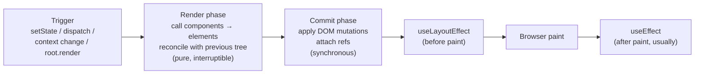
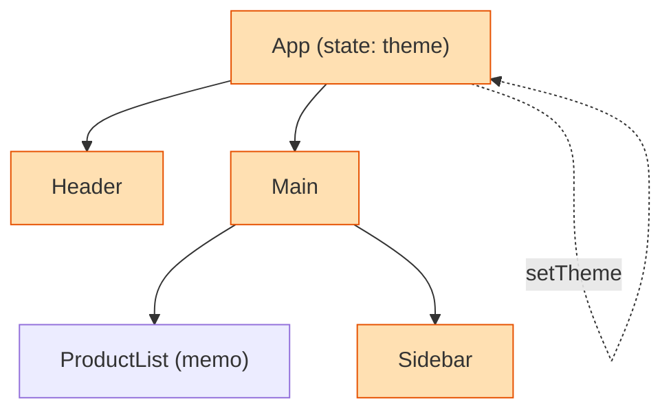
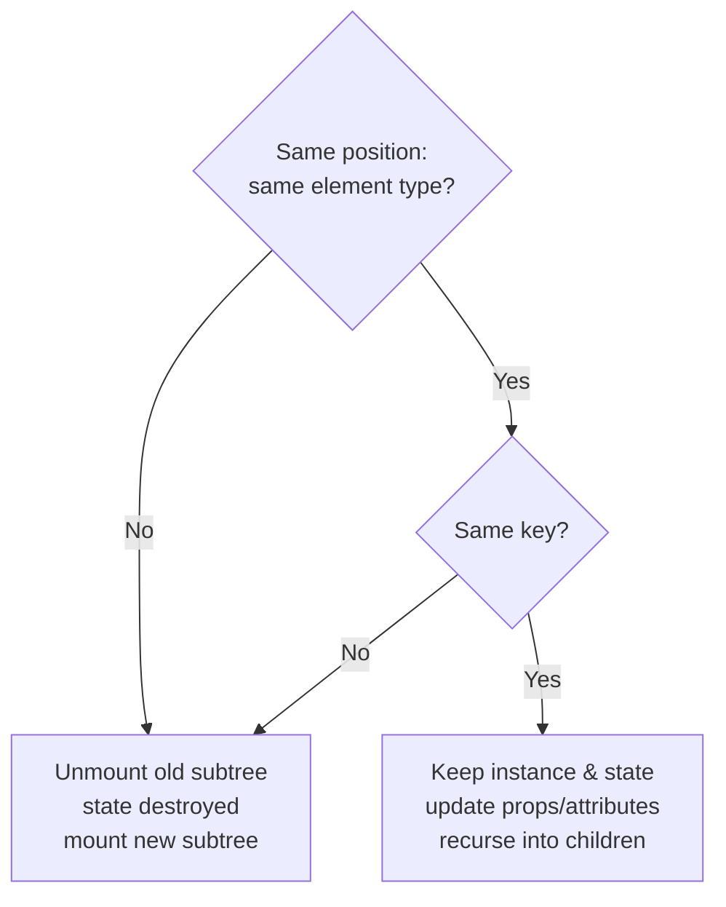
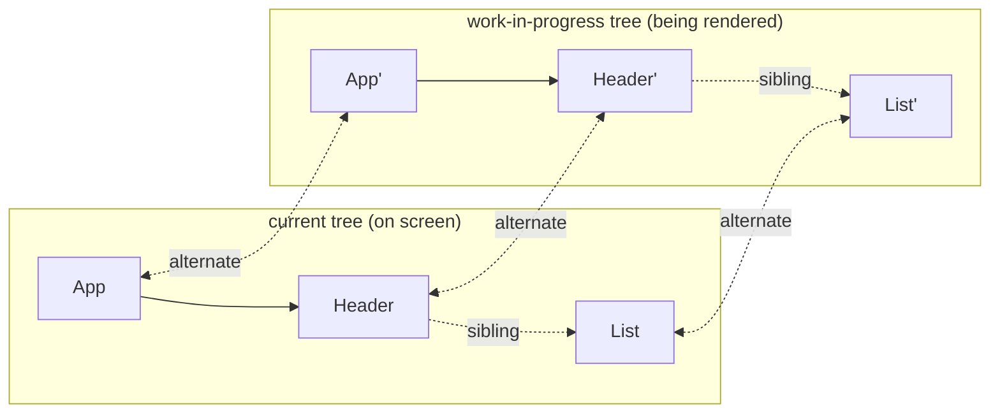
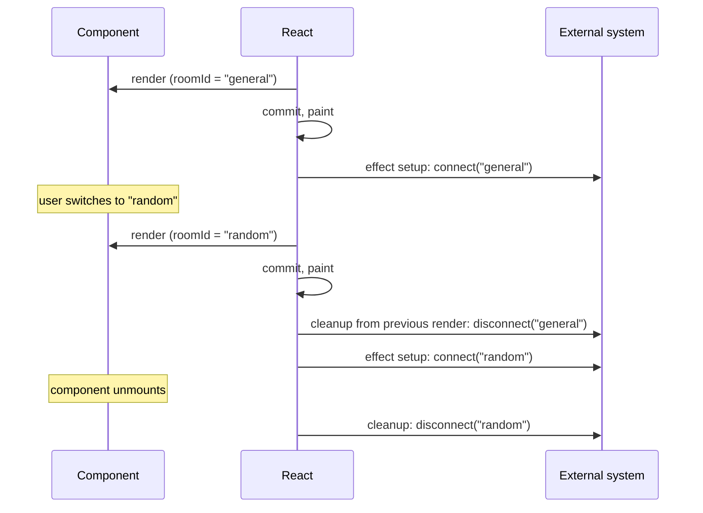

# 04 — React (Part 1 of 4): Rendering, Reconciliation & Hooks

> **Parts:** **Part 1 — Overview, Topic Map, Rendering & Hooks** · [Part 2 — State, Performance, React 19, Patterns & Testing](./04-react-part2.md) · [Part 3 — Machine Coding Round](./04-react-part3.md) · [Part 4 — Resources, Practice, Interview Questions & Revision](./04-react-part4.md)
>
> Applies to: React 19 (19.x). Features added in minor releases are marked; verify on react.dev/blog for your version. TypeScript typing of components is in [03-typescript Part 2](./03-typescript-part2.md#316-typing-react); Next.js-specific Server Component behavior is in [05-nextjs.md](./05-nextjs.md).

## Table of Contents

- [1. Overview](#1-overview)
- [2. Topic Map](#2-topic-map)
- [3. Detailed Explanations (Part 1)](#3-detailed-explanations-part-1)
  - [3.1 The Rendering Model: Trigger → Render → Commit](#31-the-rendering-model-trigger--render--commit)
  - [3.2 What Causes a Re-render (and What Doesn't)](#32-what-causes-a-re-render-and-what-doesnt)
  - [3.3 Reconciliation, the Virtual DOM & Keys](#33-reconciliation-the-virtual-dom--keys)
  - [3.4 Fiber, Lanes & Concurrent Rendering](#34-fiber-lanes--concurrent-rendering)
  - [3.5 `useState`: Snapshots, Batching & Updaters](#35-usestate-snapshots-batching--updaters)
  - [3.6 `useEffect`: Synchronization, Cleanup & Races](#36-useeffect-synchronization-cleanup--races)
  - [3.7 You Might Not Need an Effect](#37-you-might-not-need-an-effect)
  - [3.8 `useRef`, `useLayoutEffect`, `useImperativeHandle`](#38-useref-uselayouteffect-useimperativehandle)
  - [3.9 `useReducer` & `useContext`](#39-usereducer--usecontext)
  - [3.10 `useMemo`, `useCallback`](#310-usememo-usecallback)
  - [3.11 `useId`, `useSyncExternalStore`, `useEffectEvent`](#311-useid-usesyncexternalstore-useeffectevent)
  - [3.12 Rules of Hooks & How Hooks Are Stored](#312-rules-of-hooks--how-hooks-are-stored)
  - [3.13 Custom Hooks](#313-custom-hooks)
- [Next: Part 2](#next-part-2)

---

## 1. Overview

**What it is.** React is a library for building UIs as a function of state: `UI = f(state)`. You describe *what* the UI should look like for a given state; React figures out *how* to update the DOM (or native views) efficiently.

**Why interviewers care.** React is the most common front-end round for full stack roles, and it's where seniority shows most clearly. Juniors know the APIs; seniors know the *model*:

| Junior answer | Senior answer |
|---------------|---------------|
| "`useEffect` runs after render" | "Effects synchronize a component with an external system; they run after commit, clean up before re-running and on unmount, and most data derivation shouldn't be in one" |
| "Use `useMemo` for performance" | "Memoization trades memory and comparison cost for skipped work; I profile first, and with the React Compiler most manual memoization is unnecessary" |
| "Keys help React find items" | "Keys give elements identity across renders; changing a key remounts and resets state, and index keys break state for reorderable lists" |
| "Context is for global state" | "Context is dependency injection; every consumer re-renders when the value changes, so frequently-changing state belongs in a store with selectors" |

**Depth expected at 3+ years.**

- Explain the render/commit model, when components re-render, and how reconciliation uses element type and keys.
- Use every built-in hook correctly, including cleanup, dependency arrays, and stale-closure pitfalls.
- Choose state tools deliberately: local state vs context vs a client store vs a server-cache library.
- Diagnose performance with the Profiler, then apply memoization, code splitting, virtualization, or transitions.
- Know React 18/19 concurrent features, Suspense, Server Components, and Actions at a conceptual and practical level.
- Build accessible UI components under time pressure in a machine-coding round ([Part 3](./04-react-part3.md)).

> 💡 Interview Tip: When answering any React question, anchor it in the render → commit model. "This happens during render, so it must be pure" or "this runs after commit, so the DOM exists" signals real understanding.

---

## 2. Topic Map

Legend: 🟢 fundamentals · 🟡 intermediate · 🔴 advanced · ⭐ interview favorite

**Part 1 — Rendering & hooks (this file)**

- [ ] 🟢⭐ Trigger → render → commit; purity of render
- [ ] 🟢⭐ What triggers re-renders: state, parent render, context — and *not* props changes alone
- [ ] 🟡⭐ Reconciliation: element type, position, keys; resetting state with `key`
- [ ] 🔴 Fiber: work units, double buffering, interruptible render, lanes
- [ ] 🟢⭐ `useState`: state as a snapshot, automatic batching, updater functions, lazy init
- [ ] 🟡⭐ `useEffect`: dependencies, cleanup, Strict Mode double-invoke, race conditions
- [ ] 🟡⭐ "You Might Not Need an Effect": derived state, event handlers, `key` resets
- [ ] 🟡 `useRef` (mutable box vs DOM ref), `useLayoutEffect`, `useImperativeHandle`, ref callbacks with cleanup (19)
- [ ] 🟡 `useReducer`, `useContext` and context re-render cost
- [ ] 🟡⭐ `useMemo` / `useCallback`: when they help, when they don't
- [ ] 🟡 `useId`, `useSyncExternalStore` (tearing), `useEffectEvent` (19.2)
- [ ] 🟡 Rules of Hooks and why they exist (hooks stored as a linked list)
- [ ] 🟡⭐ Custom hooks: design, composition, testing

**Part 2 — State, performance, modern React ([link](./04-react-part2.md))**

- [ ] 🟡⭐ State management: colocation, lifting, Context, Redux Toolkit, Zustand, TanStack Query
- [ ] 🟡⭐ Performance: Profiler, `memo`, React Compiler, code splitting, virtualization
- [ ] 🔴⭐ Concurrent features: Suspense, `useTransition`, `useDeferredValue`
- [ ] 🔴⭐ React 19: Actions, `useActionState`, `useFormStatus`, `useOptimistic`, `use`, ref as prop, metadata
- [ ] 🔴⭐ Server Components & Server Functions (concepts)
- [ ] 🟡 Forms: controlled vs uncontrolled, React Hook Form + Zod
- [ ] 🟡 Error boundaries
- [ ] 🟡 Accessibility in React
- [ ] 🟡⭐ Patterns: compound components, render props, HOCs, headless components, controlled/uncontrolled
- [ ] 🟡⭐ Testing with React Testing Library + Vitest; MSW

**Part 3 — Machine coding ([link](./04-react-part3.md))**

- [ ] ⭐ Strategy & time-boxing
- [ ] ⭐ Autocomplete · Infinite scroll · Modal · Star rating · Todo · Tabs · Pagination

---

## 3. Detailed Explanations (Part 1)

### 3.1 The Rendering Model: Trigger → Render → Commit

**Explanation.** Every UI update goes through three steps:

1. **Trigger** — initial `root.render()`, or a state update (`setState`, `dispatch`, a store notifying `useSyncExternalStore`, a context value change).
2. **Render** — React calls your component functions to compute the new element tree, and diffs it against the previous one (reconciliation). **No DOM changes happen here.** This phase must be **pure**: same props/state → same output, no side effects. In concurrent mode it may be paused, restarted, or thrown away.
3. **Commit** — React applies the minimal set of DOM mutations, attaches refs, runs layout effects synchronously, lets the browser paint, then runs passive effects (`useEffect`).



```tsx
// Render must be pure. ❌ Side effects during render:
let renderCount = 0;
function BadCounter({ items }: { items: string[] }) {
  renderCount++;                    // mutates module state during render
  items.sort();                     // mutates a prop (owned by the parent!)
  document.title = `${items.length}`; // touches the DOM during render
  return <ul>{items.map((i) => <li key={i}>{i}</li>)}</ul>;
}

// ✅ Pure render; side effects in an effect; no prop mutation
import { useEffect } from "react";
function GoodCounter({ items }: { items: string[] }) {
  const sorted = items.toSorted();  // new array (ES2023)
  useEffect(() => { document.title = `${items.length} items`; }, [items.length]);
  return <ul>{sorted.map((i) => <li key={i}>{i}</li>)}</ul>;
}
```

**Strict Mode (development only)** double-invokes component bodies, initializers, and updater functions, and runs every effect's setup → cleanup → setup once on mount (and in React 19, ref callbacks too). It exists to surface impure renders and missing cleanups *before* concurrent features expose them in production.

> ⚠️ Pitfall: "My effect runs twice, so I disabled Strict Mode." The double run is a *symptom detector*. If running setup → cleanup → setup breaks your feature, your cleanup is incomplete — the same bug will appear in production with fast navigation or Suspense re-mounts.

---

### 3.2 What Causes a Re-render (and What Doesn't)

**A component re-renders when:**

| Cause | Notes |
|-------|-------|
| Its own state changes | Bailed out if the new value is `Object.is`-equal to the current one |
| Its parent re-renders | **By default, all children re-render**, whether or not their props changed |
| A context it reads changes | Every consumer of that context re-renders (value compared with `Object.is`) |
| An external store it subscribes to (via `useSyncExternalStore`) changes | Redux, Zustand, etc. use this under the hood |

**What does *not* cause a re-render on its own:** "props changing". Props only change *because* the parent re-rendered. Mutating an object in place doesn't re-render anything (and breaks memoization).



*When `App`'s state changes, `Header`, `Main`, and `Sidebar` re-render (orange). `ProductList` is skipped only if it's wrapped in `memo` **and** its props are referentially equal.*

**Composition beats memoization.** Moving state down, or passing components as `children`, avoids re-renders without any memo:

```tsx
import { useState, type ReactNode } from "react";

// ❌ Typing in the search box re-renders ExpensiveDashboard on every keystroke
function PageBad() {
  const [query, setQuery] = useState("");
  return (
    <>
      <input value={query} onChange={(e) => setQuery(e.target.value)} />
      <ExpensiveDashboard />
    </>
  );
}

// ✅ Move state down: only SearchBox re-renders
function SearchBox() {
  const [query, setQuery] = useState("");
  return <input value={query} onChange={(e) => setQuery(e.target.value)} />;
}
function PageGood() {
  return (
    <>
      <SearchBox />
      <ExpensiveDashboard />
    </>
  );
}

// ✅ Children-as-props: `children` elements are created by the *parent*, so when
//    ScrollTracker's state changes, the `children` element is the same object → not re-rendered
function ScrollTracker({ children }: { children: ReactNode }) {
  const [y, setY] = useState(0);
  return (
    <div onScroll={(e) => setY(e.currentTarget.scrollTop)} style={{ overflow: "auto", height: 400 }}>
      <small>scrolled {y}px</small>
      {children}
    </div>
  );
}
const PageWithTracker = () => <ScrollTracker><ExpensiveDashboard /></ScrollTracker>;

function ExpensiveDashboard() { return <div>charts…</div>; }
```

> 💡 Interview Tip: "Re-rendering is not the same as updating the DOM." A re-render that produces the same output results in zero DOM mutations. Re-renders are only a problem when the *render work itself* is expensive or happens at high frequency.

---

### 3.3 Reconciliation, the Virtual DOM & Keys

**Explanation.** JSX compiles to `jsx(type, props)` calls that produce plain objects ("React elements") — the "virtual DOM" is just this tree of objects. On each render React compares the new tree with the previous one. A general tree diff is O(n³); React uses two heuristics to make it O(n):

1. **Different element type at the same position → tear down and rebuild.** `<div>` → `<section>`, or `<Profile>` → `<Settings>`, unmounts the old subtree (destroying its state and DOM) and mounts a new one.
2. **Same type at the same position → update in place.** For DOM elements, React updates changed attributes; for components, React keeps the instance (and its state) and re-renders with new props.
3. **Lists are matched by `key`**, not position, so React can move, insert, and remove items while preserving each item's state and DOM.



**State is tied to position in the tree, not to the component definition.**

```tsx
import { useState } from "react";

function Counter({ label }: { label: string }) {
  const [count, setCount] = useState(0);
  return <button onClick={() => setCount((c) => c + 1)}>{label}: {count}</button>;
}

export function Scoreboard({ isPlayerA }: { isPlayerA: boolean }) {
  // ❌ Same type at the same position → React keeps ONE Counter instance;
  //    switching players keeps the old count.
  return isPlayerA ? <Counter label="A" /> : <Counter label="B" />;
}

export function ScoreboardFixed({ isPlayerA }: { isPlayerA: boolean }) {
  // ✅ Different keys → different identities → state resets on switch
  return isPlayerA ? <Counter key="A" label="A" /> : <Counter key="B" label="B" />;
}
```

**Why index keys break**

```tsx
import { useState } from "react";

interface Todo { id: string; text: string }

export function TodoList() {
  const [todos, setTodos] = useState<Todo[]>([
    { id: "t1", text: "Write tests" },
    { id: "t2", text: "Ship" },
  ]);
  const prepend = () => setTodos((t) => [{ id: crypto.randomUUID(), text: "New" }, ...t]);

  return (
    <>
      <button onClick={prepend}>Add to top</button>
      <ul>
        {todos.map((todo, index) => (
          // ❌ key={index}: after prepending, the <input> that held "Write tests"'s draft
          //    now belongs to "New" — uncontrolled DOM state and component state shift by one.
          // ✅ key={todo.id}: identity follows the data.
          <li key={todo.id}>
            {todo.text} <input placeholder="notes" />
          </li>
        ))}
      </ul>
    </>
  );
}
```

| Key choice | OK when | Breaks when |
|-----------|---------|-------------|
| Stable ID from data | Always the right default | — |
| Array index | List is static: never reordered, filtered, or prepended to | Items have state (inputs, focus, animation) and the order changes |
| `Math.random()` / `crypto.randomUUID()` in render | Never | Every render remounts every item (state lost, slow) |

> ⚠️ Pitfall: Keys only need to be unique among **siblings**, not globally. And `key` isn't passed as a prop — if the child needs the ID, pass it separately.

---

### 3.4 Fiber, Lanes & Concurrent Rendering

**Explanation.** *Fiber* is React's internal reconciler (since React 16). Each component instance/DOM node has a **fiber**: a plain object holding its type, props, state (the hooks list), effects, and pointers to child, sibling, and parent (`return`). This turns the recursive tree walk into a loop over a linked list that React can **pause and resume**.



**Key ideas**

| Concept | What it means |
|---------|---------------|
| **Unit of work** | Rendering = calling `beginWork`/`completeWork` on one fiber at a time. Between units, React can check whether to yield to the browser. |
| **Double buffering** | React builds a *work-in-progress* tree alongside the *current* tree. On commit, the pointers swap. An abandoned render just discards the WIP tree — nothing on screen changed. |
| **Two phases** | Render phase: interruptible, no side effects, may run more than once. Commit phase: synchronous and uninterruptible, so the DOM is never left half-updated. |
| **Lanes** | A bitmask priority model. Updates are assigned lanes: discrete input (click, keypress) is high priority; `startTransition` updates are low priority; data loading is lower still. React processes higher lanes first and can interrupt low-priority work when urgent work arrives. |
| **Scheduler** | React's own cooperative scheduler yields roughly every few milliseconds (using `MessageChannel` tasks) so input and painting aren't blocked by long renders — see the event loop in [02 Part 1 §3.7](./02-javascript-part1.md#37-the-event-loop-browser). |

**Why this matters to you**

- It's why render must be pure: React may call your component, throw the result away, and call it again.
- It enables `useTransition`, `useDeferredValue`, Suspense, and selective hydration ([Part 2](./04-react-part2.md#33-concurrent-rendering-suspense-transitions)).
- Concurrent rendering is **opt-in per update**: without transitions/Suspense, updates are processed synchronously like before.

> 💡 Interview Tip: If asked "what is Fiber?", cover three points: (1) a data structure per node forming a linked tree, (2) incremental, interruptible rendering with a WIP tree, (3) priority lanes enabling concurrent features. That's a complete senior answer.

---

### 3.5 `useState`: Snapshots, Batching & Updaters

**State is a snapshot.** During a render, `count` is a constant. `setCount` doesn't change the variable — it schedules a re-render with a new value.

```tsx
import { useState } from "react";

export function Snapshot() {
  const [count, setCount] = useState(0);

  const incrementThrice = () => {
    setCount(count + 1); // count is 0 in this render → schedules 1
    setCount(count + 1); // still 0 → schedules 1
    setCount(count + 1); // still 0 → schedules 1
    // Result: 1
  };

  const incrementThriceCorrect = () => {
    setCount((c) => c + 1); // updater functions are queued and applied in order
    setCount((c) => c + 1);
    setCount((c) => c + 1);
    // Result: 3
  };

  const logAfterSet = () => {
    setCount(count + 1);
    console.log(count); // logs the OLD value — the snapshot of this render
  };

  return (
    <>
      <p>{count}</p>
      <button onClick={incrementThrice}>+3 (broken)</button>
      <button onClick={incrementThriceCorrect}>+3</button>
      <button onClick={logAfterSet}>log</button>
    </>
  );
}
```

**Automatic batching (React 18+).** Multiple state updates in the same tick — in event handlers, promises, timeouts, native listeners — are batched into a single re-render. Before React 18, only React event handlers were batched. Opt out (rarely needed) with `flushSync` from `react-dom`.

**Lazy initialization.** `useState(expensive())` calls `expensive` on *every* render (the result is just ignored after the first). Pass a function instead:

```tsx
import { useState } from "react";

type Draft = { title: string; body: string };

function readDraft(): Draft {
  const raw = localStorage.getItem("draft");
  return raw ? (JSON.parse(raw) as Draft) : { title: "", body: "" };
}

export function Editor() {
  const [draft, setDraft] = useState(readDraft);          // ✅ called once on mount
  // const [draft, setDraft] = useState(readDraft());     // ❌ parses JSON on every render

  // Objects: replace, don't mutate. Mutating + setting the same reference bails out.
  const setTitle = (title: string) => setDraft((d) => ({ ...d, title }));

  return <input value={draft.title} onChange={(e) => setTitle(e.target.value)} />;
}
```

**Bail-out.** If the new state is `Object.is`-equal to the current state, React skips re-rendering children (it may still call the component once before bailing out).

**Pitfalls**

- ⚠️ Storing derived data in state (e.g. `fullName` from `first` + `last`) creates sync bugs. Compute it during render.
- ⚠️ Initializing state from props (`useState(props.value)`) only reads the prop on mount. If you need it to follow the prop, it's not state — or reset via `key`.
- ⚠️ Deeply nested state makes immutable updates painful. Flatten it, use `useReducer`, or use Immer (`use-immer`).

---

### 3.6 `useEffect`: Synchronization, Cleanup & Races

**Mental model.** An effect **synchronizes** your component with an external system (network, subscription, timer, DOM API, third-party widget). Think "start syncing / stop syncing", not "lifecycle methods".



**Dependencies.** The effect re-runs after a commit in which any dependency changed (compared with `Object.is`).

| Deps | Runs |
|------|------|
| none | After every commit |
| `[]` | After mount only (and cleanup on unmount) |
| `[a, b]` | After mount and whenever `a` or `b` changed |

Dependencies aren't something you *choose*: every reactive value (props, state, values derived from them) read inside the effect must be listed. The `react-hooks/exhaustive-deps` lint rule enforces this. If an effect re-runs too often, change the code so it reads fewer reactive values — don't lie to the linter.

**Data fetching race condition — the classic bug**

```tsx
import { useEffect, useState } from "react";

interface User { id: string; name: string }

// ❌ If userId changes quickly A → B, the response for A may arrive *after* B and overwrite it.
export function ProfileBad({ userId }: { userId: string }) {
  const [user, setUser] = useState<User | null>(null);
  useEffect(() => {
    fetch(`/api/users/${userId}`).then((r) => r.json()).then(setUser);
  }, [userId]);
  return <h1>{user?.name}</h1>;
}

// ✅ Abort the stale request in cleanup (also stops wasted bandwidth)
export function Profile({ userId }: { userId: string }) {
  const [user, setUser] = useState<User | null>(null);
  const [error, setError] = useState<Error | null>(null);

  useEffect(() => {
    const controller = new AbortController();
    setError(null);

    fetch(`/api/users/${userId}`, { signal: controller.signal })
      .then((r) => {
        if (!r.ok) throw new Error(`HTTP ${r.status}`);
        return r.json() as Promise<User>;
      })
      .then(setUser)
      .catch((err: Error) => {
        if (err.name !== "AbortError") setError(err);
      });

    return () => controller.abort(); // runs before the next effect and on unmount
  }, [userId]);

  if (error) return <p role="alert">{error.message}</p>;
  return <h1>{user?.name ?? "Loading…"}</h1>;
}
```

> 💡 Interview Tip: After writing an effect-based fetch, say: "In production I'd use TanStack Query or the framework's data layer — it handles caching, deduping, races, retries and revalidation." Then explain *why* the raw version above is still worth understanding. See [Part 2 §3.1](./04-react-part2.md#31-state-management-choosing-the-right-tool).

**Subscriptions and timers**

```tsx
import { useEffect, useState } from "react";

export function useOnlineStatus(): boolean {
  const [online, setOnline] = useState(() => navigator.onLine);
  useEffect(() => {
    const update = () => setOnline(navigator.onLine);
    window.addEventListener("online", update);
    window.addEventListener("offline", update);
    return () => {
      window.removeEventListener("online", update);
      window.removeEventListener("offline", update);
    };
  }, []);
  return online;
}

// Restart by changing the key from the parent: <Countdown key={round} seconds={30} />
export function Countdown({ seconds }: { seconds: number }) {
  const [left, setLeft] = useState(seconds);
  const done = left === 0;

  useEffect(() => {
    if (done) return;                                   // stop ticking at zero
    const id = setInterval(() => setLeft((s) => Math.max(s - 1, 0)), 1000); // updater → no stale `left`
    return () => clearInterval(id);
  }, [done]);

  return <span>{left}s</span>;
}
```

**Stale closures.** An effect (or interval callback) captures values from the render in which it was created ([02 Part 1 §3.4](./02-javascript-part1.md#34-closures)). If it reads `count` but `count` isn't a dependency, it sees the initial value forever. Fixes: list the dependency, use an updater function, store the latest value in a ref, or use `useEffectEvent` ([§3.11](#311-useid-usesyncexternalstore-useeffectevent)).

---

### 3.7 You Might Not Need an Effect

Effects are an escape hatch for syncing with things *outside* React. Using them to sync React state with other React state causes extra renders, flicker, and bugs. The react.dev guide of this name is essential reading; the key cases:

| Situation | ❌ With an effect | ✅ Without |
|-----------|------------------|-----------|
| Derived data (filtered list, full name, totals) | `useEffect(() => setFiltered(items.filter(...)), [items, q])` | Compute during render (wrap in `useMemo` only if expensive) |
| Reset state when a prop changes | `useEffect(() => setDraft(""), [userId])` | `<Editor key={userId} />` |
| Adjust part of state when a prop changes | Effect that sets state | Compute from props, or store the previous prop and adjust during render (rare) |
| Respond to a user event (submit, buy) | Set a flag, then an effect sends the request | Do it in the event handler |
| Notify parent of a change | Effect calling `onChange(value)` after state changes | Call `onChange` in the same handler that sets state |
| Chains of effects updating state | Effect A sets X → effect B sets Y → … | Compute everything in the event handler or a reducer |
| Fetch data | Raw effect (OK for learning) | Framework data fetching, TanStack Query, or `use` with a cached promise |
| App initialization once | Effect with `[]` (runs twice in dev) | Module-level code or a guarded top-level flag |

```tsx
import { useMemo, useState } from "react";

interface Product { id: string; name: string; price: number; inStock: boolean }

// ❌ Redundant state + effect = an extra render and a frame showing stale data
//    const [visible, setVisible] = useState<Product[]>([]);
//    useEffect(() => setVisible(products.filter(...)), [products, query, onlyInStock]);

// ✅ Derive during render
export function ProductSearch({ products }: { products: Product[] }) {
  const [query, setQuery] = useState("");
  const [onlyInStock, setOnlyInStock] = useState(false);

  const visible = useMemo(() => {
    const q = query.trim().toLowerCase();
    return products.filter((p) => (!onlyInStock || p.inStock) && p.name.toLowerCase().includes(q));
  }, [products, query, onlyInStock]); // memo only because `products` may be large

  const total = visible.reduce((sum, p) => sum + p.price, 0); // cheap → no memo

  return (
    <>
      <input value={query} onChange={(e) => setQuery(e.target.value)} />
      <label><input type="checkbox" checked={onlyInStock} onChange={(e) => setOnlyInStock(e.target.checked)} /> In stock</label>
      <p>{visible.length} products, total ${total.toFixed(2)}</p>
    </>
  );
}
```

---

### 3.8 `useRef`, `useLayoutEffect`, `useImperativeHandle`

**`useRef`** returns a stable mutable object `{ current }` that persists across renders. Changing `.current` does **not** trigger a re-render. Two uses:

1. **DOM references** — `<input ref={inputRef} />`; React sets `.current` during commit and resets it to `null` on unmount.
2. **Instance variables** — timer IDs, the latest value of a prop for use in callbacks, previous values, "is mounted" flags, abort controllers.

```tsx
import { useEffect, useRef } from "react";

export function usePrevious<T>(value: T): T | undefined {
  const ref = useRef<T | undefined>(undefined);
  useEffect(() => { ref.current = value; }, [value]); // updated after commit
  return ref.current;                                 // during render: the previous value
}
```

> ⚠️ Pitfall: Don't read or write `ref.current` during render (except lazy init). Refs aren't part of the render snapshot, so reading them makes output depend on something React doesn't track — and the React Compiler assumes you don't.

**Ref callbacks** — `ref={(node) => { … }}` run when the node attaches. In React 19 a ref callback can **return a cleanup function**, called when the node detaches (previously React called the callback with `null`).

```tsx
export function AutoMeasure({ onSize }: { onSize: (w: number, h: number) => void }) {
  return (
    <div
      ref={(node) => {
        if (!node) return;
        const ro = new ResizeObserver(([entry]) => {
          if (entry) onSize(entry.contentRect.width, entry.contentRect.height);
        });
        ro.observe(node);
        return () => ro.disconnect(); // React 19 ref cleanup
      }}
    >
      Resize me
    </div>
  );
}
```

**`useLayoutEffect`** runs synchronously after DOM mutations but **before the browser paints**. Use it when you must measure layout and then synchronously re-render to avoid a visible flicker (tooltips positioning, scroll restoration). It blocks painting, so prefer `useEffect` otherwise. It doesn't run on the server (React warns during SSR in older versions).

```tsx
import { useLayoutEffect, useRef, useState, type ReactNode } from "react";

export function Tooltip({ anchor, children }: { anchor: DOMRect; children: ReactNode }) {
  const ref = useRef<HTMLDivElement>(null);
  const [top, setTop] = useState(anchor.bottom);

  useLayoutEffect(() => {
    const height = ref.current?.getBoundingClientRect().height ?? 0;
    // Flip above the anchor if it would overflow — before the user sees the wrong position
    setTop(anchor.bottom + height > window.innerHeight ? anchor.top - height : anchor.bottom);
  }, [anchor]);

  return <div ref={ref} role="tooltip" style={{ position: "fixed", top, left: anchor.left }}>{children}</div>;
}
```

**`useImperativeHandle`** customizes what a parent receives through a ref — expose a small imperative API (`focus`, `scrollToBottom`) instead of the raw DOM node. In React 19, `ref` is a normal prop for function components:

```tsx
import { useImperativeHandle, useRef, type Ref } from "react";

export interface ChatLogHandle { scrollToBottom(): void }

export function ChatLog({ messages, ref }: { messages: string[]; ref?: Ref<ChatLogHandle> }) {
  const listRef = useRef<HTMLUListElement>(null);
  useImperativeHandle(ref, () => ({
    scrollToBottom() {
      listRef.current?.lastElementChild?.scrollIntoView({ behavior: "smooth" });
    },
  }), []);
  return <ul ref={listRef}>{messages.map((m, i) => <li key={i}>{m}</li>)}</ul>;
}
```

---

### 3.9 `useReducer` & `useContext`

**`useReducer`** centralizes state transitions in a pure function `(state, action) => newState`. Prefer it over multiple `useState`s when:

- the next state depends on the previous state in non-trivial ways,
- several values change together (form + status + errors),
- you want to test transition logic without rendering,
- you want to pass `dispatch` (stable identity) down instead of many callbacks.

```tsx
import { useReducer } from "react";

type FetchState<T> =
  | { status: "idle" }
  | { status: "loading" }
  | { status: "success"; data: T }
  | { status: "error"; error: string };

type FetchAction<T> =
  | { type: "start" }
  | { type: "resolve"; data: T }
  | { type: "reject"; error: string };

function fetchReducer<T>(state: FetchState<T>, action: FetchAction<T>): FetchState<T> {
  switch (action.type) {
    case "start": return { status: "loading" };
    case "resolve": return { status: "success", data: action.data };
    case "reject": return { status: "error", error: action.error };
  }
}

export function useFetchState<T>() {
  return useReducer(fetchReducer<T>, { status: "idle" } as FetchState<T>);
}
```

**`useContext`** reads the nearest provider's value above in the tree. Context is **dependency injection**, not a state manager: it passes a value down without prop drilling. Every component that reads a context re-renders when the provider's `value` changes (by `Object.is`), and `memo` doesn't stop it.

```tsx
import { createContext, useCallback, useContext, useMemo, useState, type ReactNode } from "react";

interface Toast { id: number; message: string }
interface ToastApi { show(message: string): void; dismiss(id: number): void }

// Split contexts: components that only *trigger* toasts don't re-render when the list changes
const ToastListContext = createContext<Toast[]>([]);
const ToastApiContext = createContext<ToastApi | null>(null);

export function ToastProvider({ children }: { children: ReactNode }) {
  const [toasts, setToasts] = useState<Toast[]>([]);

  const dismiss = useCallback((id: number) => setToasts((t) => t.filter((x) => x.id !== id)), []);
  const show = useCallback((message: string) => {
    const id = Date.now();
    setToasts((t) => [...t, { id, message }]);
    setTimeout(() => dismiss(id), 4000);
  }, [dismiss]);

  // ❌ value={{ show, dismiss }} would be a new object every render → all consumers re-render
  const api = useMemo(() => ({ show, dismiss }), [show, dismiss]);

  return (
    <ToastApiContext value={api}>
      <ToastListContext value={toasts}>{children}</ToastListContext>
    </ToastApiContext>
  );
}

export function useToast(): ToastApi {
  const api = useContext(ToastApiContext);
  if (!api) throw new Error("useToast must be used within <ToastProvider>");
  return api;
}

export function ToastViewport() {
  const toasts = useContext(ToastListContext);
  return <div role="status" aria-live="polite">{toasts.map((t) => <p key={t.id}>{t.message}</p>)}</div>;
}
```

| Context is good for | Context is bad for |
|---------------------|-------------------|
| Theme, locale, auth user, feature flags, DI of services/clients | High-frequency values (mouse position, form input, timers) read by many components |
| Compound component state ([Part 2](./04-react-part2.md#39-component-patterns)) | Large objects where consumers only need a slice — no selectors |
| Values that change rarely | Server data (use a server-cache library) |

---

### 3.10 `useMemo`, `useCallback`

**What they do.** `useMemo(fn, deps)` caches a computed value; `useCallback(fn, deps)` caches a function identity (`useCallback(fn, deps)` ≡ `useMemo(() => fn, deps)`). Both recompute only when deps change.

**When they help — only in three situations:**

1. **Expensive computation** in render (measure: > ~1 ms in the Profiler, or large data).
2. **Referential stability for a memoized child** — passing an object/function to a `memo` component; without stable identity, `memo`'s shallow compare always fails.
3. **Referential stability for another hook's dependencies** — an object used in a `useEffect` dep array, a value passed into context.

```tsx
import { memo, useCallback, useMemo, useState } from "react";

interface Row { id: string; name: string; score: number }

const Table = memo(function Table({ rows, onSelect }: { rows: Row[]; onSelect: (id: string) => void }) {
  return <ul>{rows.map((r) => <li key={r.id} onClick={() => onSelect(r.id)}>{r.name} — {r.score}</li>)}</ul>;
});

export function Leaderboard({ rows }: { rows: Row[] }) {
  const [selected, setSelected] = useState<string | null>(null);
  const [darkMode, setDarkMode] = useState(false);

  // Both are needed for memo(Table) to skip re-rendering when only darkMode changes:
  const sorted = useMemo(() => rows.toSorted((a, b) => b.score - a.score), [rows]);
  const handleSelect = useCallback((id: string) => setSelected(id), []);

  return (
    <div data-theme={darkMode ? "dark" : "light"}>
      <button onClick={() => setDarkMode((d) => !d)}>Toggle theme</button>
      <p>Selected: {selected ?? "none"}</p>
      <Table rows={sorted} onSelect={handleSelect} />
    </div>
  );
}
```

**When they don't help (or hurt)**

- Memoizing cheap values: the comparison + memory costs more than recomputing.
- Passing memoized callbacks to non-memoized children or native elements: nothing checks identity.
- Deps that change every render (an inline object in the deps array) — the memo never hits.
- `useMemo` is a performance hint, not a semantic guarantee — React may discard the cache (e.g. offscreen). Don't rely on it for correctness.

> 💡 Interview Tip: Mention the **React Compiler** (stable since late 2025 — verify current status on react.dev): it automatically memoizes components and values at build time, which removes most hand-written `useMemo`/`useCallback`/`memo`. It requires code that follows the Rules of React (pure render, no ref reads in render, no mutation of props/state). See [Part 2 §3.2](./04-react-part2.md#32-performance).

---

### 3.11 `useId`, `useSyncExternalStore`, `useEffectEvent`

**`useId`** generates a unique, stable ID that matches between server and client rendering — for accessibility attributes, not list keys.

```tsx
import { useId } from "react";

export function EmailField({ error }: { error?: string }) {
  const id = useId();
  return (
    <>
      <label htmlFor={`${id}-email`}>Email</label>
      <input id={`${id}-email`} type="email" aria-invalid={!!error} aria-describedby={error ? `${id}-err` : undefined} />
      {error && <p id={`${id}-err`}>{error}</p>}
    </>
  );
}
```

**`useSyncExternalStore(subscribe, getSnapshot, getServerSnapshot?)`** subscribes to a store outside React (browser APIs, Redux, Zustand, your own module). It prevents **tearing** — in concurrent rendering, different components reading a mutable store at different times during one render could show inconsistent values; this hook forces a consistent snapshot.

```tsx
import { useSyncExternalStore } from "react";

// A tiny external store
type Listener = () => void;
function createStore<T>(initial: T) {
  let state = initial;
  const listeners = new Set<Listener>();
  return {
    get: () => state,
    set: (next: T | ((prev: T) => T)) => {
      state = typeof next === "function" ? (next as (p: T) => T)(state) : next;
      listeners.forEach((l) => l());
    },
    subscribe: (l: Listener) => { listeners.add(l); return () => listeners.delete(l); },
  };
}

export const cartStore = createStore<{ items: string[] }>({ items: [] });

export function useCartCount(): number {
  // getSnapshot must return the same value for an unchanged store (here: a number) —
  // returning a fresh object each call causes an infinite re-render loop.
  return useSyncExternalStore(cartStore.subscribe, () => cartStore.get().items.length, () => 0);
}

// Browser API example: window width
export function useWindowWidth(): number {
  return useSyncExternalStore(
    (cb) => { window.addEventListener("resize", cb); return () => window.removeEventListener("resize", cb); },
    () => window.innerWidth,
    () => 1024 // server snapshot
  );
}
```

**`useEffectEvent` (stable in React 19.2 — verify for your version)** extracts non-reactive logic from an effect. The returned function always sees the latest props/state but isn't a dependency, so the effect doesn't re-run when those values change.

```tsx
import { useEffect, useEffectEvent } from "react";

declare function connect(roomId: string): { on(e: "message", cb: (m: string) => void): void; close(): void };
declare function playSound(): void;

export function ChatRoom({ roomId, muted }: { roomId: string; muted: boolean }) {
  // Reads `muted` (latest value) without making the effect depend on it
  const onMessage = useEffectEvent((message: string) => {
    if (!muted) playSound();
    console.log(message);
  });

  useEffect(() => {
    const conn = connect(roomId);
    conn.on("message", onMessage);
    return () => conn.close();
  }, [roomId]); // toggling `muted` no longer reconnects
}
```

Before `useEffectEvent`, the workaround was storing the latest callback in a ref ("latest ref pattern").

---

### 3.12 Rules of Hooks & How Hooks Are Stored

**The rules**

1. Only call hooks **at the top level** of a component or custom hook — not in conditions, loops, nested functions, or after an early `return`.
2. Only call hooks from **React function components or custom hooks** (names starting with `use`).

(`use` from React 19 is the exception to rule 1 — it can be called conditionally, see [Part 2](./04-react-part2.md#34-react-19-actions-use--friends).)

**Why.** Each fiber stores its hooks as a **linked list in call order**. React doesn't know hooks by name; on every render it walks the list in order, matching the 1st `useState` call to the 1st stored state cell, and so on. A conditional hook shifts every subsequent hook by one slot.

```
Render 1 (isLoggedIn = true)        Render 2 (isLoggedIn = false)
fiber.memoizedState:                walking the same list:
  [0] useState → "Ali"                [0] useState → "Ali"      ✓
  [1] useEffect (subscribe)           [1] useState("dark")  ✗ reads the effect's slot!
  [2] useState → "dark"               ... React throws "Rendered fewer hooks than expected"
```

```tsx
import { useEffect, useState } from "react";

// ❌ Conditional hook
function BadGreeting({ user }: { user: { name: string } | null }) {
  if (!user) return <p>Sign in</p>;            // early return BEFORE a hook
  const [greeting] = useState(`Hi ${user.name}`);
  return <p>{greeting}</p>;
}

// ✅ Hooks first, conditions after (or split into two components)
function Greeting({ user }: { user: { name: string } | null }) {
  const [dismissed, setDismissed] = useState(false);
  useEffect(() => { if (user) console.log("greeted", user.name); }, [user]);
  if (!user || dismissed) return <p>Sign in</p>;
  return <p onClick={() => setDismissed(true)}>Hi {user.name}</p>;
}
```

---

### 3.13 Custom Hooks

**What they are.** Functions starting with `use` that call other hooks. They share **stateful logic**, not state — each call gets its own independent state.

**Design guidelines**

| Guideline | Why |
|-----------|-----|
| Name after the *purpose* (`useOnlineStatus`, `useCart`), not the lifecycle (`useMount`) | Hooks describe what, not when |
| Return a tuple for 1–2 values (`[value, setValue]`), an object for more | Tuples rename easily; objects are self-documenting |
| Accept options objects; keep returned functions stable (`useCallback`) | Consumers can safely use them in deps |
| Don't hide effects that surprise callers | Hooks with network side effects should be obvious from the name |
| Test with `renderHook` from RTL | Isolate logic from UI |

```tsx
import { useEffect, useState } from "react";

// useDebouncedValue: debounce a *value* (great for search inputs feeding queries)
export function useDebouncedValue<T>(value: T, delayMs = 300): T {
  const [debounced, setDebounced] = useState(value);
  useEffect(() => {
    const id = setTimeout(() => setDebounced(value), delayMs);
    return () => clearTimeout(id); // each change cancels the previous timer
  }, [value, delayMs]);
  return debounced;
}
```

```tsx
import { useCallback, useMemo, useState, useSyncExternalStore } from "react";

// useLocalStorage: synced across components AND browser tabs via the "storage" event
export function useLocalStorage<T>(key: string, initial: T): [T, (next: T) => void] {
  const [fallback] = useState(initial); // freeze the initial value so it's a stable dependency

  const subscribe = useCallback((onChange: () => void) => {
    const handler = (e: StorageEvent) => { if (e.key === key) onChange(); };
    window.addEventListener("storage", handler);          // other tabs
    window.addEventListener(`local-storage:${key}`, onChange); // this tab
    return () => {
      window.removeEventListener("storage", handler);
      window.removeEventListener(`local-storage:${key}`, onChange);
    };
  }, [key]);

  // Snapshot is the raw string so it's referentially stable between calls
  const raw = useSyncExternalStore(subscribe, () => localStorage.getItem(key), () => null);
  // Parse only when the string changes, so object values keep a stable identity between renders
  const value = useMemo(() => (raw === null ? fallback : (JSON.parse(raw) as T)), [raw, fallback]);

  const setValue = useCallback((next: T) => {
    localStorage.setItem(key, JSON.stringify(next));
    window.dispatchEvent(new Event(`local-storage:${key}`));
  }, [key]);

  return [value, setValue];
}
```

```tsx
import { useEffect, useState } from "react";

// useMediaQuery
export function useMediaQuery(query: string): boolean {
  const [matches, setMatches] = useState(() => window.matchMedia(query).matches);
  useEffect(() => {
    const mql = window.matchMedia(query);
    const onChange = () => setMatches(mql.matches);
    onChange();
    mql.addEventListener("change", onChange);
    return () => mql.removeEventListener("change", onChange);
  }, [query]);
  return matches;
}
```

Testing custom hooks:

```tsx
// useDebouncedValue.test.tsx — Vitest + React Testing Library
import { act, renderHook } from "@testing-library/react";
import { afterEach, beforeEach, expect, test, vi } from "vitest";
import { useDebouncedValue } from "./useDebouncedValue";

beforeEach(() => vi.useFakeTimers());
afterEach(() => vi.useRealTimers());

test("only emits the last value after the delay", () => {
  const { result, rerender } = renderHook(({ v }) => useDebouncedValue(v, 300), { initialProps: { v: "a" } });
  rerender({ v: "ab" });
  rerender({ v: "abc" });
  expect(result.current).toBe("a");          // not yet
  act(() => { vi.advanceTimersByTime(300); });
  expect(result.current).toBe("abc");        // only the last value
});
```

---

## Next: Part 2

➡️ [04-react-part2.md](./04-react-part2.md) — state management (Context, Redux Toolkit, Zustand, TanStack Query), performance, Suspense & transitions, React 19 Actions and `use`, Server Components, forms, error boundaries, accessibility, component patterns and testing.
