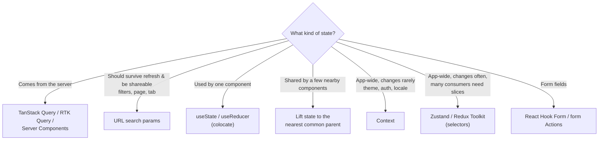
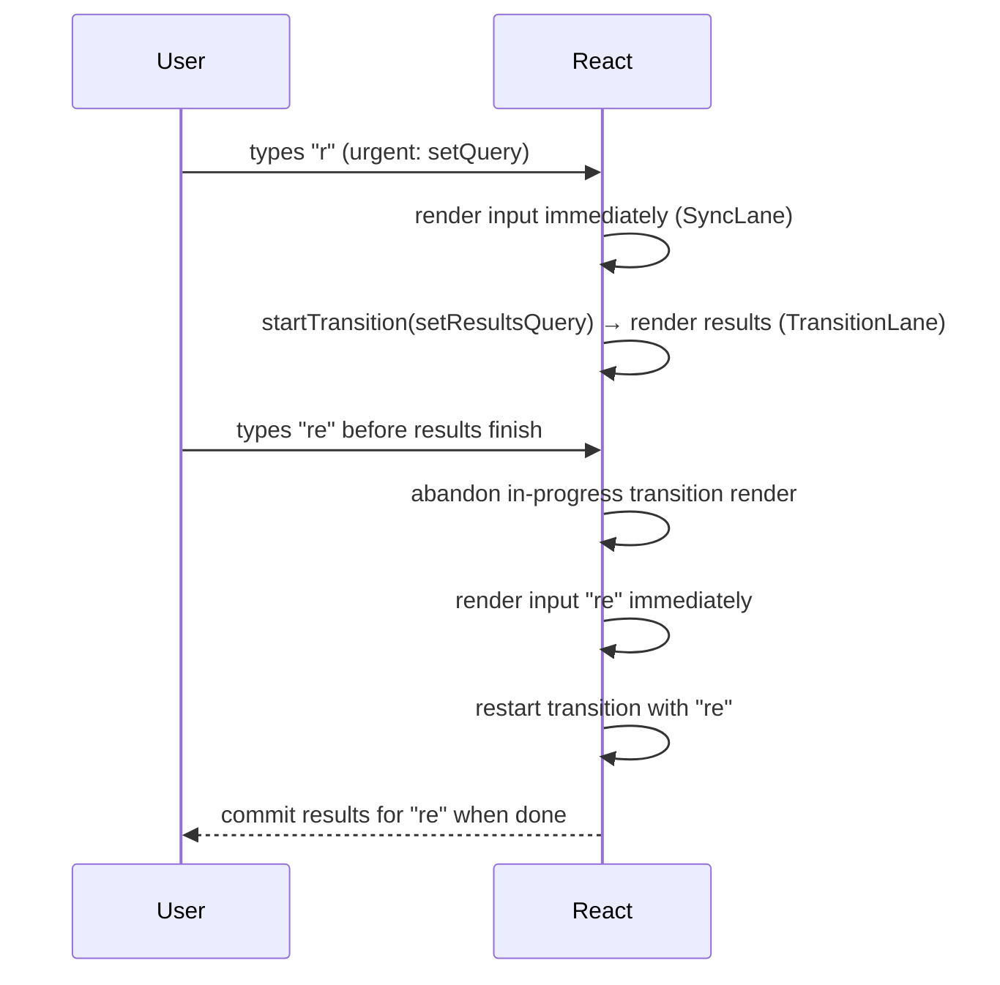
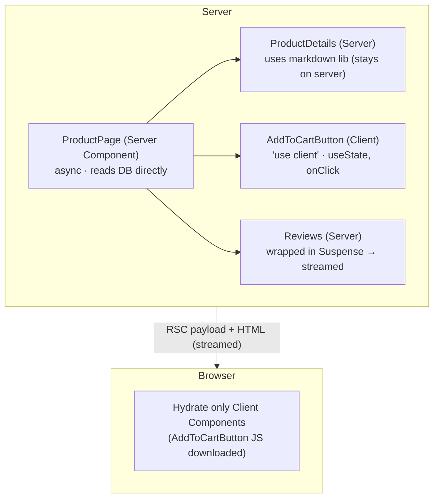
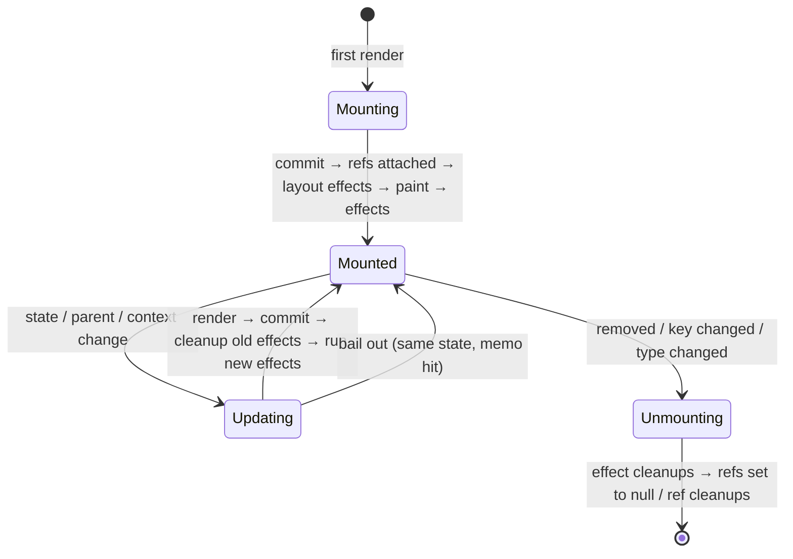

# 04 — React (Part 2 of 4): State, Performance, React 19, Patterns & Testing

> **Parts:** [Part 1 — Overview, Topic Map, Rendering & Hooks](./04-react-part1.md) · **Part 2 — State, Performance, React 19, Patterns & Testing** · [Part 3 — Machine Coding Round](./04-react-part3.md) · [Part 4 — Resources, Practice, Interview Questions & Revision](./04-react-part4.md)
>
> Applies to: React 19.x, TanStack Query v5, Redux Toolkit 2 / React Redux 9, Zustand 5, React Hook Form 7, React Testing Library 16, Vitest, MSW 2. Library APIs change between majors — verify on each library's docs.

## Table of Contents

- [3. Detailed Explanations (Part 2)](#3-detailed-explanations-part-2)
  - [3.1 State Management: Choosing the Right Tool](#31-state-management-choosing-the-right-tool)
  - [3.2 Performance](#32-performance)
  - [3.3 Concurrent Rendering, Suspense, Transitions](#33-concurrent-rendering-suspense-transitions)
  - [3.4 React 19: Actions, `use` & Friends](#34-react-19-actions-use--friends)
  - [3.5 Server Components & Server Functions](#35-server-components--server-functions)
  - [3.6 Forms](#36-forms)
  - [3.7 Error Boundaries](#37-error-boundaries)
  - [3.8 Accessibility in React](#38-accessibility-in-react)
  - [3.9 Component Patterns](#39-component-patterns)
  - [3.10 Testing React](#310-testing-react)
- [4. Diagrams Index](#4-diagrams-index)
- [Next: Part 3](#next-part-3)

---

## 3. Detailed Explanations (Part 2)

### 3.1 State Management: Choosing the Right Tool

**The most important distinction: server state vs client state.**

| | Server state | Client (UI) state |
|---|---|---|
| Source of truth | The backend | The browser |
| Examples | Products, user profile, orders, search results | Modal open, selected tab, form drafts, theme, wizard step |
| Concerns | Caching, staleness, deduping, refetching, invalidation, pagination, optimistic updates, races | Sharing between components, persistence |
| Tool | **TanStack Query**, RTK Query, SWR, framework loaders/RSC | `useState`/`useReducer`, Context, Zustand, Redux, URL |

Most "we need Redux" problems are actually server-state problems. Once server data lives in a query cache, the remaining client state is usually small.



**Comparison**

| Tool | Model | Re-render control | Boilerplate | DevTools | Best for |
|------|-------|-------------------|:-----------:|:--------:|----------|
| Context + `useReducer` | Provider value | None — all consumers re-render | Low | React DevTools | Low-frequency app-wide values, DI |
| **Zustand** | Hook-based store, mutable-style `set` | Selectors (subscribe to slices) | Very low | Redux DevTools via middleware | Most client-state needs in mid-size apps |
| **Redux Toolkit** | Single store, slices, reducers, actions | Selectors | Medium | Excellent (time travel) | Large teams, complex event-driven state, strict conventions |
| Jotai / Recoil-style atoms | Atom graph | Per-atom | Low | Yes | Fine-grained derived state |
| **TanStack Query** | Server-state cache keyed by query keys | Per-query, tracked properties | Low | Excellent | Any server data |

#### TanStack Query (v5)

```tsx
import {
  QueryClient, QueryClientProvider, useMutation, useQuery, useQueryClient,
} from "@tanstack/react-query";
import type { ReactNode } from "react";

interface Todo { id: string; title: string; done: boolean }

const api = {
  list: async (filter: "all" | "open"): Promise<Todo[]> => {
    const res = await fetch(`/api/todos?filter=${filter}`);
    if (!res.ok) throw new Error(`HTTP ${res.status}`);
    return res.json();
  },
  toggle: async (todo: Todo): Promise<Todo> => {
    const res = await fetch(`/api/todos/${todo.id}`, {
      method: "PATCH",
      headers: { "Content-Type": "application/json" },
      body: JSON.stringify({ done: !todo.done }),
    });
    if (!res.ok) throw new Error(`HTTP ${res.status}`);
    return res.json();
  },
};

// Query key factory: one place to define keys → consistent invalidation
export const todoKeys = {
  all: ["todos"] as const,
  list: (filter: "all" | "open") => [...todoKeys.all, "list", filter] as const,
};

const queryClient = new QueryClient({
  defaultOptions: { queries: { staleTime: 30_000, retry: 2 } },
});

export function AppProviders({ children }: { children: ReactNode }) {
  return <QueryClientProvider client={queryClient}>{children}</QueryClientProvider>;
}

export function TodoList({ filter }: { filter: "all" | "open" }) {
  const qc = useQueryClient();
  const { data, isPending, isError, error, isFetching } = useQuery({
    queryKey: todoKeys.list(filter),    // filter is part of the key → separate cache entries
    queryFn: () => api.list(filter),
  });

  const toggle = useMutation({
    mutationFn: api.toggle,
    // Optimistic update with rollback
    onMutate: async (todo) => {
      const key = todoKeys.list(filter);
      await qc.cancelQueries({ queryKey: key });               // don't let an in-flight refetch overwrite us
      const previous = qc.getQueryData<Todo[]>(key);
      qc.setQueryData<Todo[]>(key, (old) => old?.map((t) => (t.id === todo.id ? { ...t, done: !t.done } : t)));
      return { previous, key };
    },
    onError: (_err, _todo, context) => {
      if (context?.previous) qc.setQueryData(context.key, context.previous); // rollback
    },
    onSettled: () => qc.invalidateQueries({ queryKey: todoKeys.all }),        // refetch the truth
  });

  if (isPending) return <p>Loading…</p>;
  if (isError) return <p role="alert">{error.message}</p>;

  return (
    <ul aria-busy={isFetching}>
      {data.map((t) => (
        <li key={t.id}>
          <label>
            <input type="checkbox" checked={t.done} onChange={() => toggle.mutate(t)} /> {t.title}
          </label>
        </li>
      ))}
    </ul>
  );
}
```

| TanStack Query concept | Meaning |
|------------------------|---------|
| `queryKey` | Cache identity; include every variable the query depends on |
| `staleTime` | How long data is considered fresh (no background refetch). Default `0` |
| `gcTime` (was `cacheTime` in v4) | How long *unused* data stays in memory. Default 5 min |
| Refetch triggers | Mount, window focus, reconnect, interval — only when stale |
| `isPending` vs `isFetching` | No data yet vs any request in flight (including background refetch) |
| Deduping | Concurrent components using the same key share one request |
| `invalidateQueries` | Mark matching queries stale and refetch active ones |
| `useInfiniteQuery` | Cursor pagination with `initialPageParam` + `getNextPageParam` ([Part 3](./04-react-part3.md#32-infinite-scroll)) |

#### Zustand (v5)

```tsx
import { create } from "zustand";
import { persist } from "zustand/middleware";
import { useShallow } from "zustand/react/shallow";

interface CartItem { sku: string; qty: number; priceMinor: number }
interface CartState {
  items: Record<string, CartItem>;
  add: (sku: string, priceMinor: number) => void;
  remove: (sku: string) => void;
  clear: () => void;
}

export const useCart = create<CartState>()(
  persist(
    (set) => ({
      items: {},
      add: (sku, priceMinor) =>
        set((s) => {
          const existing = s.items[sku];
          return { items: { ...s.items, [sku]: { sku, priceMinor, qty: (existing?.qty ?? 0) + 1 } } };
        }),
      remove: (sku) =>
        set((s) => {
          const { [sku]: _removed, ...rest } = s.items;
          return { items: rest };
        }),
      clear: () => set({ items: {} }),
    }),
    { name: "cart" } // localStorage key
  )
);

// Selectors: a component re-renders only when ITS slice changes
export function CartBadge() {
  const count = useCart((s) => Object.values(s.items).reduce((n, i) => n + i.qty, 0)); // returns a number → stable
  return <span aria-label={`${count} items in cart`}>{count}</span>;
}

export function CartActions() {
  // Selecting several values as an object creates a new object each time → wrap with useShallow
  const { add, clear } = useCart(useShallow((s) => ({ add: s.add, clear: s.clear })));
  return (
    <>
      <button onClick={() => add("sku_42", 1999)}>Add</button>
      <button onClick={clear}>Clear</button>
    </>
  );
}
```

> ⚠️ Pitfall: In Zustand v5, a selector that returns a new object/array on every call (`(s) => ({ a: s.a })`, `(s) => s.items.filter(...)`) can cause an infinite render loop. Return primitives, use `useShallow`, or memoize the derived value.

#### Redux Toolkit (RTK 2 + React Redux 9)

```tsx
import { configureStore, createSlice, type PayloadAction } from "@reduxjs/toolkit";
import { Provider, useDispatch, useSelector } from "react-redux";
import type { ReactNode } from "react";

interface FiltersState { status: "all" | "open" | "done"; search: string }

const filtersSlice = createSlice({
  name: "filters",
  initialState: { status: "all", search: "" } as FiltersState,
  reducers: {
    // Immer under the hood: "mutating" syntax produces an immutable update
    setStatus(state, action: PayloadAction<FiltersState["status"]>) { state.status = action.payload; },
    setSearch(state, action: PayloadAction<string>) { state.search = action.payload; },
  },
});

export const { setStatus, setSearch } = filtersSlice.actions;

export const store = configureStore({ reducer: { filters: filtersSlice.reducer } });
export type RootState = ReturnType<typeof store.getState>;
export type AppDispatch = typeof store.dispatch;

export const useAppDispatch = useDispatch.withTypes<AppDispatch>();
export const useAppSelector = useSelector.withTypes<RootState>();

export function StatusFilter() {
  const status = useAppSelector((s) => s.filters.status);
  const dispatch = useAppDispatch();
  return (
    <select value={status} onChange={(e) => dispatch(setStatus(e.target.value as FiltersState["status"]))}>
      <option value="all">All</option><option value="open">Open</option><option value="done">Done</option>
    </select>
  );
}

export const ReduxRoot = ({ children }: { children: ReactNode }) => <Provider store={store}>{children}</Provider>;
```

RTK also ships **RTK Query** (`createApi` with `providesTags`/`invalidatesTags`) — the Redux-native alternative to TanStack Query. If a codebase already uses Redux, RTK Query avoids a second cache.

> 💡 Interview Tip: "Which state library?" has no single right answer. A strong answer: separate server state first; keep the rest local; reach for Zustand when sharing gets awkward; choose Redux Toolkit when the team needs strict conventions, middleware, and time-travel debugging at scale.

---

### 3.2 Performance

**Process: measure → find the cause → apply the smallest fix → measure again.**

1. **React DevTools Profiler**: record an interaction; look at the flame graph for components with long render times and the "Why did this render?" info (enable "Record why each component rendered").
2. **Chrome Performance panel**: long tasks (> 50 ms), layout/paint costs, scripting time — the browser side of the picture ([02 Part 2 §3.22](./02-javascript-part2.md#322-browser-rendering-basics)).
3. **Field data**: Core Web Vitals (INP especially) — see [05-nextjs.md](./05-nextjs.md).

**The toolbox, cheapest first**

| Problem | Fix |
|---------|-----|
| State too high → large subtree re-renders on every keystroke | Move state down; pass expensive parts as `children` ([Part 1 §3.2](./04-react-part1.md#32-what-causes-a-re-render-and-what-doesnt)) |
| Context with frequently changing value | Split contexts; memoize the value; move to a store with selectors |
| Expensive child re-rendering with unchanged props | `memo(Child)` + stable props (`useMemo`/`useCallback`) — or the React Compiler |
| Expensive computation in render | `useMemo`, or move to a Web Worker |
| Long lists (1000s of rows) | **Virtualization** (TanStack Virtual, react-window) |
| Big JS bundle → slow load | **Code splitting** with `lazy` + `Suspense`, route-level splitting, dynamic `import()` |
| Typing feels laggy because results re-render | `useDeferredValue` / `useTransition` ([§3.3](#33-concurrent-rendering-suspense-transitions)) |
| Layout thrashing / heavy animation | CSS transforms, `requestAnimationFrame`, avoid layout reads in loops |
| Request waterfalls | Fetch in parallel, prefetch, move fetching to the server/route level |

**`memo`** wraps a component so it skips re-rendering when props are shallowly equal (`Object.is` per prop). An optional second argument is a custom comparator — rarely worth it.

**The React Compiler** (a Babel/SWC plugin) analyzes components and hooks at build time and inserts fine-grained memoization automatically — effectively `memo`/`useMemo`/`useCallback` everywhere it's safe. It requires code that follows the Rules of React; the `eslint-plugin-react-hooks` compiler-related rules flag violations. With the compiler enabled, most manual memoization becomes unnecessary (it remains useful as an escape hatch). Verify the current release status and setup for your framework on react.dev.

**Code splitting**

```tsx
import { lazy, Suspense, useState } from "react";

// The chart library (often hundreds of KB) is only downloaded when the tab is opened
const AnalyticsChart = lazy(() => import("./AnalyticsChart"));

export function Dashboard() {
  const [showChart, setShowChart] = useState(false);
  return (
    <>
      <button onClick={() => setShowChart(true)}>Show analytics</button>
      {showChart && (
        <Suspense fallback={<p>Loading chart…</p>}>
          <AnalyticsChart />
        </Suspense>
      )}
    </>
  );
}
```

`lazy` requires a module with a **default export** of a component. Preload on intent (hover/focus) by calling the `import()` early.

**Virtualization** renders only the visible rows plus a small overscan, keeping DOM size constant:

```tsx
import { useVirtualizer } from "@tanstack/react-virtual";
import { useRef } from "react";

export function VirtualList({ rows }: { rows: { id: string; label: string }[] }) {
  const parentRef = useRef<HTMLDivElement>(null);
  const virtualizer = useVirtualizer({
    count: rows.length,
    getScrollElement: () => parentRef.current,
    estimateSize: () => 40, // px; measured automatically if you pass measureElement
    overscan: 8,
  });

  return (
    <div ref={parentRef} style={{ height: 480, overflow: "auto" }}>
      <div style={{ height: virtualizer.getTotalSize(), position: "relative" }}>
        {virtualizer.getVirtualItems().map((item) => {
          const row = rows[item.index]!;
          return (
            <div
              key={row.id}
              style={{ position: "absolute", top: 0, left: 0, right: 0, height: item.size, transform: `translateY(${item.start}px)` }}
            >
              {row.label}
            </div>
          );
        })}
      </div>
    </div>
  );
}
```

**Trade-offs of virtualization:** breaks browser find-in-page (Ctrl+F) for off-screen rows, complicates accessibility (screen readers see only rendered rows; add `aria-rowcount`/`aria-rowindex` for grids), and variable-height rows need measurement. For a few hundred simple rows, `content-visibility: auto` in CSS may be enough.

---

### 3.3 Concurrent Rendering, Suspense, Transitions

**Suspense** lets a component "wait" for something (code via `lazy`, data via `use` or a Suspense-enabled library) and declaratively shows the nearest `<Suspense fallback>` until it's ready. Suspense boundaries also define **streaming** units on the server ([05-nextjs.md](./05-nextjs.md)).

**Transitions** mark a state update as non-urgent. React renders it in the background on a low-priority lane; urgent updates (typing, clicking) interrupt it; and if the transition would suspend, React **keeps showing the old UI** instead of flashing a fallback.



```tsx
import { memo, useDeferredValue, useState, useTransition } from "react";

const SlowResults = memo(function SlowResults({ query }: { query: string }) {
  const items = Array.from({ length: 3000 }, (_, i) => `${query} result ${i}`); // deliberately heavy
  return <ul>{items.map((i) => <li key={i}>{i}</li>)}</ul>;
});

// Option 1: useDeferredValue — when you don't own the state update (e.g. value from props)
export function SearchDeferred() {
  const [query, setQuery] = useState("");
  const deferredQuery = useDeferredValue(query);           // lags behind during heavy renders
  const isStale = query !== deferredQuery;
  return (
    <>
      <input value={query} onChange={(e) => setQuery(e.target.value)} />
      <div style={{ opacity: isStale ? 0.6 : 1 }}>
        <SlowResults query={deferredQuery} />              {/* memo is required for the benefit */}
      </div>
    </>
  );
}

// Option 2: useTransition — when you own the update; also gives isPending
export function TabsWithTransition() {
  const [tab, setTab] = useState<"posts" | "about">("about");
  const [isPending, startTransition] = useTransition();
  return (
    <>
      <button onClick={() => startTransition(() => setTab("posts"))}>Posts {isPending && "…"}</button>
      <button onClick={() => startTransition(() => setTab("about"))}>About</button>
      {tab === "posts" ? <SlowResults query="post" /> : <p>About us</p>}
    </>
  );
}
```

| | `useTransition` | `useDeferredValue` |
|---|---|---|
| You control | The state setter | Only the value |
| Gives | `isPending`, `startTransition` | A lagging copy of the value (`initialValue` option in 19) |
| Typical use | Tab switches, navigation, filters, async Actions | Expensive child rendering from a fast-changing input |

> ⚠️ Pitfall: Transitions don't make slow code faster; they keep the UI responsive while slow rendering happens. Controlled input values must **not** be updated inside a transition (the input would lag) — update the input urgently, and the expensive part in the transition.

---

### 3.4 React 19: Actions, `use` & Friends

> React 19 was released in December 2024; minor releases (19.1, 19.2) added more (e.g. `<Activity>`, `useEffectEvent` in 19.2). Verify specifics on react.dev/blog.

| Feature | What it does |
|---------|--------------|
| **Actions** | Functions (possibly async) passed to transitions or to `<form action={fn}>` / `formAction`. React tracks pending state, errors and optimistic updates for you |
| `useActionState(action, initialState)` | Returns `[state, dispatchAction, isPending]`; the action receives `(prevState, payload)` and returns the next state |
| `useFormStatus()` (from `react-dom`) | Read the parent `<form>`'s `{ pending, data, method, action }` from a child (e.g. a submit button) without prop drilling |
| `useOptimistic(state, updateFn)` | Show an optimistic value while an Action is in flight; automatically reverts to the real state when it settles |
| `use(resource)` | Read a **promise** (suspends until resolved) or a **context**. Unlike hooks, can be called conditionally |
| `ref` as a prop | Function components accept `ref` directly; `forwardRef` is no longer needed (and is slated for deprecation) |
| Ref cleanup functions | Ref callbacks may return a cleanup ([Part 1 §3.8](./04-react-part1.md#38-useref-uselayouteffect-useimperativehandle)) |
| `<Context>` as provider | `<ThemeContext value={…}>` instead of `<ThemeContext.Provider>` |
| Document metadata | `<title>`, `<meta>`, `<link>` rendered anywhere are hoisted into `<head>` |
| Stylesheet & resource APIs | `<link rel="stylesheet" precedence>`; `preload`, `preinit`, `prefetchDNS`, `preconnect` from `react-dom` |
| Async transitions | `startTransition(async () => { … })` — async functions supported |
| Better hydration errors, custom elements support | Single diff-style hydration mismatch error; full Web Components props support |
| `<Activity mode="visible" \| "hidden">` (19.2) | Hide UI while preserving its state (pre-render offscreen, keep tabs alive) |

**A form with Actions, pending state, and optimistic UI**

```tsx
import { useActionState, useOptimistic } from "react";
import { useFormStatus } from "react-dom";

interface Comment { id: string; text: string; pending?: boolean }

async function postComment(text: string): Promise<Comment> {
  const res = await fetch("/api/comments", { method: "POST", body: JSON.stringify({ text }) });
  if (!res.ok) throw new Error("Could not post comment");
  return res.json();
}

function SubmitButton() {
  const { pending } = useFormStatus(); // reads the enclosing <form>'s status
  return <button disabled={pending}>{pending ? "Posting…" : "Post"}</button>;
}

type State = { comments: Comment[]; error: string | null };

export function Comments({ initial }: { initial: Comment[] }) {
  const [state, formAction, isPending] = useActionState<State, FormData>(
    async (prev, formData) => {
      const text = String(formData.get("text") ?? "").trim();
      if (!text) return { ...prev, error: "Comment can't be empty" };
      addOptimistic({ id: crypto.randomUUID(), text, pending: true }); // shown immediately
      try {
        const saved = await postComment(text);
        return { comments: [...prev.comments, saved], error: null };
      } catch (e) {
        return { ...prev, error: (e as Error).message };           // optimistic item disappears
      }
    },
    { comments: initial, error: null }
  );

  const [optimistic, addOptimistic] = useOptimistic(
    state.comments,
    (current: Comment[], next: Comment) => [...current, next]
  );

  return (
    <section aria-busy={isPending}>
      <ul>
        {optimistic.map((c) => (
          <li key={c.id} style={{ opacity: c.pending ? 0.5 : 1 }}>{c.text}</li>
        ))}
      </ul>
      {/* React resets uncontrolled form fields after a successful action */}
      <form action={formAction}>
        <input name="text" aria-label="Comment" />
        <SubmitButton />
      </form>
      {state.error && <p role="alert">{state.error}</p>}
    </section>
  );
}
```

**`use` with promises**

```tsx
import { Suspense, use } from "react";

interface Invoice { id: string; totalMinor: number }

// The promise must be created OUTSIDE render (in a Server Component, a loader, or a cache).
// Creating it inside a Client Component's render makes a new promise each render → suspends forever.
function InvoiceDetails({ invoicePromise }: { invoicePromise: Promise<Invoice> }) {
  const invoice = use(invoicePromise);      // suspends until resolved; throws to error boundary on rejection
  return <p>{invoice.id}: {(invoice.totalMinor / 100).toFixed(2)}</p>;
}

export function InvoicePage({ invoicePromise }: { invoicePromise: Promise<Invoice> }) {
  return (
    <Suspense fallback={<p>Loading invoice…</p>}>
      <InvoiceDetails invoicePromise={invoicePromise} />
    </Suspense>
  );
}
```

---

### 3.5 Server Components & Server Functions

> Server Components are a React feature implemented by frameworks (Next.js App Router being the main one). Framework specifics — caching, routing, streaming — are in [05-nextjs.md](./05-nextjs.md). This section covers the React-level model.

**Explanation.** React Server Components (RSC) run **only on the server** (at build time or per request). They can be `async`, read databases and files directly, and keep secrets and heavy dependencies off the client — their code is never sent to the browser. They render to an **RSC payload** (a serialized description of the tree) that the client merges into the UI. **Client Components** (marked by `"use client"` at the top of a module) are the familiar interactive components: they're pre-rendered to HTML on the server and hydrated in the browser.



| | Server Component | Client Component |
|---|---|---|
| Runs | Server only | Server (SSR HTML) + browser |
| `async` component | ✅ | ❌ (use `use` / libraries) |
| State, effects, event handlers, browser APIs | ❌ | ✅ |
| Direct DB / filesystem / secrets | ✅ | ❌ |
| Bundle impact | Zero JS shipped | Code shipped & hydrated |
| Can import | Server and Client Components | Only Client Components (and shared code) |

**The boundary rules**

- `"use client"` marks a module as an entry point into client code; everything it imports becomes client code too. Put it as low in the tree as possible (on leaves like buttons), not on layouts.
- A Server Component can render a Client Component and pass it **serializable props** (primitives, plain objects/arrays, `Date`, `Map`/`Set`, promises, JSX, Server Functions — check the docs' list). Plain functions and class instances can't cross.
- A Client Component can't import a Server Component, but it can **receive one as `children`** or another JSX prop — the composition pattern.
- **Server Functions** (`"use server"`) are async functions that run on the server but can be called from the client (as form actions or directly). The framework creates an RPC endpoint for each. Treat them like public API endpoints: **authenticate, authorize and validate input every time.**

```tsx
// ProductPage.tsx — Server Component (no directive needed in an RSC framework)
import { AddToCartButton } from "./AddToCartButton";

declare const db: { product: { findUnique(q: { where: { id: string } }): Promise<{ id: string; name: string; priceMinor: number } | null> } };

export default async function ProductPage({ id }: { id: string }) {
  const product = await db.product.findUnique({ where: { id } }); // direct DB access, no API layer
  if (!product) return <p>Not found</p>;
  return (
    <main>
      <h1>{product.name}</h1>
      <AddToCartButton productId={product.id} />  {/* only serializable props */}
    </main>
  );
}
```

```tsx
// AddToCartButton.tsx
"use client";
import { useState } from "react";

export function AddToCartButton({ productId }: { productId: string }) {
  const [added, setAdded] = useState(false);
  return <button onClick={() => setAdded(true)}>{added ? "Added ✓" : `Add ${productId}`}</button>;
}
```

> ⚠️ Pitfall: "Server Components replace SSR" — no. SSR renders components (including Client Components) to HTML for the first load. RSC is about *which components ever ship JS*. Next.js uses both together.

---

### 3.6 Forms

| Approach | How | Pros | Cons |
|----------|-----|------|------|
| **Controlled** | `value` + `onChange` in state | Instant validation, conditional UI, formatting as you type | Re-render per keystroke; boilerplate for big forms |
| **Uncontrolled** | `defaultValue` + read via `FormData` or refs on submit | Fast, simple, works with native validation and Actions | Harder to react to every change |
| **React Hook Form** | Uncontrolled inputs registered with the library | Minimal re-renders, schema validation, field arrays | Library API to learn |
| **React 19 form Actions** | `<form action={fn}>` + `useActionState` | Progressive enhancement with Server Functions, pending state built in | Less suited to complex client-side validation UX |

```tsx
import { zodResolver } from "@hookform/resolvers/zod";
import { useForm } from "react-hook-form";
import { z } from "zod";

const SignupSchema = z
  .object({
    email: z.email("Enter a valid email"),
    password: z.string().min(12, "At least 12 characters"),
    confirm: z.string(),
  })
  .refine((v) => v.password === v.confirm, { path: ["confirm"], error: "Passwords don't match" });

type SignupValues = z.infer<typeof SignupSchema>;

export function SignupForm({ onSubmit }: { onSubmit: (v: SignupValues) => Promise<void> }) {
  const { register, handleSubmit, formState: { errors, isSubmitting } } = useForm<SignupValues>({
    resolver: zodResolver(SignupSchema),
    mode: "onBlur",
  });

  return (
    <form onSubmit={handleSubmit(onSubmit)} noValidate>
      <label htmlFor="email">Email</label>
      <input id="email" type="email" aria-invalid={!!errors.email} {...register("email")} />
      {errors.email && <p role="alert">{errors.email.message}</p>}

      <label htmlFor="password">Password</label>
      <input id="password" type="password" aria-invalid={!!errors.password} {...register("password")} />
      {errors.password && <p role="alert">{errors.password.message}</p>}

      <label htmlFor="confirm">Confirm password</label>
      <input id="confirm" type="password" aria-invalid={!!errors.confirm} {...register("confirm")} />
      {errors.confirm && <p role="alert">{errors.confirm.message}</p>}

      <button disabled={isSubmitting}>{isSubmitting ? "Creating…" : "Create account"}</button>
    </form>
  );
}
```

> ⚠️ Pitfall: Switching an input between uncontrolled (`value={undefined}`) and controlled triggers a React warning and odd behavior. Initialize controlled values to `""`, not `undefined`.

The same Zod schema can validate on the server (Server Action / API) — share it ([03 Part 2 §3.19](./03-typescript-part2.md#319-runtime-validation-with-zod)).

---

### 3.7 Error Boundaries

**Explanation.** An error boundary catches errors thrown **during rendering, in lifecycle methods, and in constructors** of its descendants, and renders a fallback instead of unmounting the whole app. They're still class components (there's no hook equivalent); most teams use `react-error-boundary`.

**They do NOT catch:** errors in event handlers (use `try/catch`), async code outside render (`setTimeout`, promise callbacks — unless you rethrow into render, e.g. via `use` or by setting error state), server-side rendering errors, or errors thrown in the boundary itself.

```tsx
import { Component, type ErrorInfo, type ReactNode } from "react";

interface Props { fallback: (error: Error, reset: () => void) => ReactNode; children: ReactNode; onError?: (e: Error, info: ErrorInfo) => void }
interface State { error: Error | null }

export class ErrorBoundary extends Component<Props, State> {
  state: State = { error: null };

  static getDerivedStateFromError(error: Error): State {
    return { error }; // render phase: switch to fallback
  }

  componentDidCatch(error: Error, info: ErrorInfo) {
    this.props.onError?.(error, info); // commit phase: report (Sentry etc.), info.componentStack
  }

  reset = () => this.setState({ error: null });

  render() {
    return this.state.error ? this.props.fallback(this.state.error, this.reset) : this.props.children;
  }
}

// Usage: granular boundaries so one broken widget doesn't blank the page
export const Widget = ({ children }: { children: ReactNode }) => (
  <ErrorBoundary
    fallback={(error, reset) => (
      <div role="alert">
        <p>Something went wrong: {error.message}</p>
        <button onClick={reset}>Try again</button>
      </div>
    )}
    onError={(e) => console.error("report to monitoring", e)}
  >
    {children}
  </ErrorBoundary>
);
```

**Placement strategy:** one at the root (last resort "something went wrong" page), one per route/layout, and around independent widgets (charts, third-party embeds). Pair with Suspense: `<ErrorBoundary><Suspense>…</Suspense></ErrorBoundary>` handles both loading and failure of a data-driven section. React 19 also added root options `onCaughtError` / `onUncaughtError` / `onRecoverableError` on `createRoot` for centralized reporting.

---

### 3.8 Accessibility in React

Accessibility is routinely evaluated in machine-coding rounds. The essentials:

| Practice | Why / how |
|----------|-----------|
| **Semantic HTML first** | `<button>` not `<div onClick>` (keyboard, focus, role for free); `<a href>` for navigation; `<label htmlFor>`; headings in order; `<nav>`, `<main>`, `<ul>` |
| **Keyboard support** | Everything clickable is focusable and operable with Enter/Space; composite widgets (tabs, listbox, menu) use arrow keys and roving `tabIndex` |
| **Focus management** | Move focus into dialogs, trap it, restore it on close; move focus to new content after route change or errors |
| **ARIA only when HTML can't** | Follow WAI-ARIA Authoring Practices patterns (combobox, tabs, dialog); "no ARIA is better than bad ARIA" |
| **Accessible names** | Icon buttons need `aria-label`; inputs need labels; images need `alt` (empty `alt=""` for decorative) |
| **Live regions** | Announce async results/errors: `role="status"` (polite) / `role="alert"` (assertive) |
| **State attributes** | `aria-expanded`, `aria-selected`, `aria-checked`, `aria-invalid`, `aria-busy`, `aria-current="page"` |
| **Don't rely on color alone**; respect `prefers-reduced-motion` | WCAG contrast; reduce animations when requested |
| **Test it** | Keyboard-only walk-through, screen reader spot check (VoiceOver/NVDA), axe DevTools, RTL `getByRole` queries (which fail if roles/names are missing) |

```tsx
// ❌ Inaccessible "button": not focusable, no role, no keyboard
const Bad = ({ onDelete }: { onDelete: () => void }) => <div className="icon-btn" onClick={onDelete}>🗑</div>;

// ✅ Native button with an accessible name
const Good = ({ onDelete }: { onDelete: () => void }) => (
  <button type="button" aria-label="Delete invoice" onClick={onDelete}>🗑</button>
);
```

All components in [Part 3](./04-react-part3.md) implement the relevant ARIA patterns.

---

### 3.9 Component Patterns

| Pattern | Idea | Use when | Modern status |
|---------|------|----------|---------------|
| **Composition / children** | Pass elements as props | Layouts, slots, avoiding prop drilling | ✅ Default tool |
| **Compound components** | Parent shares implicit state via context with child components (`<Tabs><Tabs.List>…`) | Flexible, related UI parts (tabs, accordions, menus, selects) | ✅ Very common in design systems |
| **Custom hooks / headless** | Logic in a hook, consumer renders markup (`useCombobox`, TanStack Table) | Reusable behavior with fully custom UI | ✅ Preferred for logic reuse |
| **Controlled / uncontrolled** | Component works both with `value`+`onChange` and with internal state + `defaultValue` | Reusable inputs | ✅ Expected in libraries |
| **Render props** | Pass a function that returns UI (`<DataLoader render={(data) => …}/>`) | Inversion of control for rendering | ⚠️ Mostly replaced by hooks; still used for virtualization/slots |
| **Higher-order components** | `withAuth(Component)` returns an enhanced component | Cross-cutting concerns in legacy code | ⚠️ Mostly replaced by hooks; wrapper hell, prop collisions |
| **Provider pattern** | Context providers at the top | DI of clients, theme, auth | ✅ |
| **Container / presentational** | Split data fetching from display | Testing, Storybook | ⚠️ Hooks and RSC blur the need; still a useful mental split |

**Controlled/uncontrolled hook** — the core of most reusable inputs:

```tsx
import { useCallback, useState } from "react";

export function useControllableState<T>({
  value, defaultValue, onChange,
}: { value?: T; defaultValue: T; onChange?: (v: T) => void }): [T, (v: T) => void] {
  const [internal, setInternal] = useState(defaultValue);
  const isControlled = value !== undefined;
  const current = isControlled ? value : internal;

  const setValue = useCallback((next: T) => {
    if (!isControlled) setInternal(next);
    onChange?.(next);
  }, [isControlled, onChange]);

  return [current, setValue];
}

// A Toggle usable both ways:
//   <Toggle defaultChecked />                         (uncontrolled)
//   <Toggle checked={on} onCheckedChange={setOn} />   (controlled)
export function Toggle({ checked, defaultChecked = false, onCheckedChange, label = "Toggle" }: {
  checked?: boolean; defaultChecked?: boolean; onCheckedChange?: (v: boolean) => void; label?: string;
}) {
  const [on, setOn] = useControllableState({ value: checked, defaultValue: defaultChecked, onChange: onCheckedChange });
  return <button role="switch" aria-checked={on} aria-label={label} onClick={() => setOn(!on)}>{on ? "On" : "Off"}</button>;
}
```

**HOC vs hook (same concern)**

```tsx
import type { ComponentType } from "react";

interface User { id: string; name: string }
declare function useCurrentUser(): User | null;

// HOC (legacy style): wraps, injects a prop, hides where it comes from
export function withUser<P extends { user: User }>(Wrapped: ComponentType<P>) {
  return function WithUser(props: Omit<P, "user">) {
    const user = useCurrentUser();
    if (!user) return <p>Please sign in</p>;
    return <Wrapped {...(props as P)} user={user} />;
  };
}

// Hook (modern): explicit, composable, no extra tree level
export function Greeting() {
  const user = useCurrentUser();
  return user ? <p>Hi {user.name}</p> : <p>Please sign in</p>;
}
```

The compound-components pattern is implemented in full in [Part 3 — Tabs](./04-react-part3.md#36-tabs-compound-components).

---

### 3.10 Testing React

**Philosophy (React Testing Library).** "The more your tests resemble the way your software is used, the more confidence they can give you." Test behavior through the DOM — what the user sees and does — not implementation details (state variables, hook calls, component instances).

**Query priority:** `getByRole` (with `name`) → `getByLabelText` → `getByPlaceholderText` → `getByText` → `getByDisplayValue` → `getByAltText`/`getByTitle` → `getByTestId` (last resort).

| Variant | Returns | Use |
|---------|---------|-----|
| `getBy…` | Element or throws | Element should be there now |
| `queryBy…` | Element or `null` | Asserting absence |
| `findBy…` | Promise (retries until timeout) | Element appears asynchronously |
| `…AllBy…` | Arrays | Multiple matches |

```tsx
// Counter.test.tsx — Vitest + RTL + user-event
import { render, screen } from "@testing-library/react";
import userEvent from "@testing-library/user-event";
import { expect, test } from "vitest";
import { Snapshot } from "./Snapshot"; // the +3 counter from Part 1 §3.5

test("updater functions apply in order", async () => {
  const user = userEvent.setup();               // realistic events: pointerdown, mousedown, focus, click…
  render(<Snapshot />);

  await user.click(screen.getByRole("button", { name: "+3" }));
  expect(screen.getByText("3")).toBeInTheDocument();

  await user.click(screen.getByRole("button", { name: "+3 (broken)" }));
  expect(screen.getByText("4")).toBeInTheDocument(); // stale snapshot → only +1
});
```

**Network mocking with MSW** — intercept at the network layer so components use their real fetching code:

```tsx
// TodoList.test.tsx
import { QueryClient, QueryClientProvider } from "@tanstack/react-query";
import { render, screen } from "@testing-library/react";
import { http, HttpResponse } from "msw";
import { setupServer } from "msw/node";
import { afterAll, afterEach, beforeAll, expect, test } from "vitest";
import { TodoList } from "./TodoList";

const server = setupServer(
  http.get("*/api/todos", () => HttpResponse.json([{ id: "1", title: "Write tests", done: false }]))
);
beforeAll(() => server.listen({ onUnhandledRequest: "error" }));
afterEach(() => server.resetHandlers());
afterAll(() => server.close());

function renderWithClient(ui: React.ReactElement) {
  const client = new QueryClient({ defaultOptions: { queries: { retry: false } } }); // fresh cache per test
  return render(<QueryClientProvider client={client}>{ui}</QueryClientProvider>);
}

test("renders todos from the API", async () => {
  renderWithClient(<TodoList filter="all" />);
  expect(await screen.findByRole("checkbox", { name: "Write tests" })).not.toBeChecked();
});

test("shows an error state", async () => {
  server.use(http.get("*/api/todos", () => new HttpResponse(null, { status: 500 })));
  renderWithClient(<TodoList filter="all" />);
  expect(await screen.findByRole("alert")).toHaveTextContent("HTTP 500");
});
```

**What to test at each level** — component tests (RTL) for behavior and accessibility, hook tests (`renderHook`) for complex logic, E2E (Playwright) for critical flows (login, checkout). The full testing strategy is in [08-engineering-practices.md](./08-engineering-practices.md).

> ⚠️ Pitfall: Wrapping everything in `act()` manually, testing `useState` values, or snapshot-testing whole pages. RTL's async utilities already wrap in `act`; snapshots of large trees break on every change and catch little.

---

## 4. Diagrams Index

| Concept | Location |
|---------|----------|
| Trigger → render → commit → effects | [Part 1 §3.1](./04-react-part1.md#31-the-rendering-model-trigger--render--commit) |
| Which components re-render | [Part 1 §3.2](./04-react-part1.md#32-what-causes-a-re-render-and-what-doesnt) |
| Reconciliation decision | [Part 1 §3.3](./04-react-part1.md#33-reconciliation-the-virtual-dom--keys) |
| Fiber current/WIP trees | [Part 1 §3.4](./04-react-part1.md#34-fiber-lanes--concurrent-rendering) |
| Effect setup/cleanup sequence | [Part 1 §3.6](./04-react-part1.md#36-useeffect-synchronization-cleanup--races) |
| Choosing a state tool | [§3.1](#31-state-management-choosing-the-right-tool) |
| Transition interruption | [§3.3](#33-concurrent-rendering-suspense-transitions) |
| Server vs Client Components | [§3.5](#35-server-components--server-functions) |

The full lifecycle of a component, in one picture:



---

## Next: Part 3

➡️ [04-react-part3.md](./04-react-part3.md) — machine coding round strategy and seven complete, accessible, tested components: autocomplete, infinite scroll, modal, star rating, todo app, tabs, pagination.
