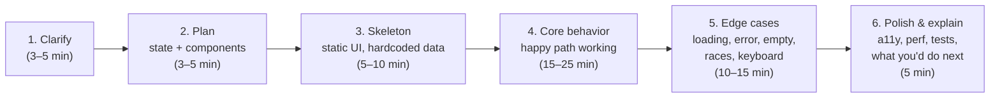
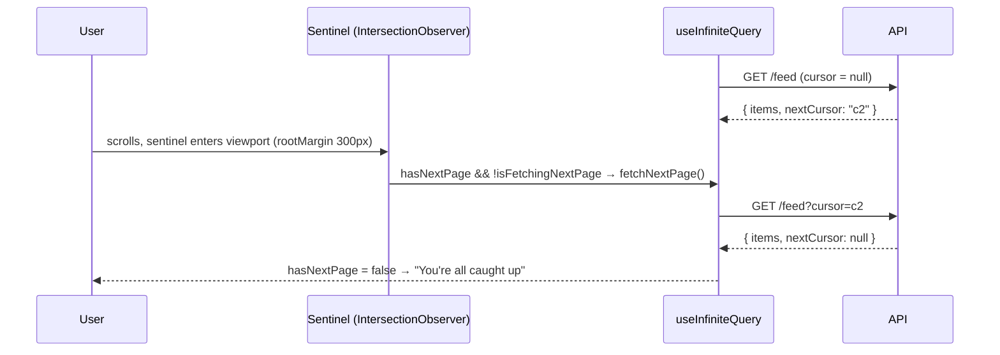
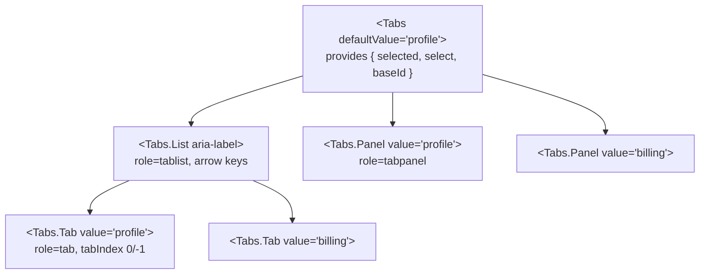

# 04 — React (Part 3 of 4): Machine Coding Round

> **Parts:** [Part 1 — Overview, Topic Map, Rendering & Hooks](./04-react-part1.md) · [Part 2 — State, Performance, React 19, Patterns & Testing](./04-react-part2.md) · **Part 3 — Machine Coding Round** · [Part 4 — Resources, Practice, Interview Questions & Revision](./04-react-part4.md)
>
> Applies to: React 19, TypeScript 5, TanStack Query v5. Every component here is self-contained, typed, accessible (WAI-ARIA Authoring Practices patterns), and comes with React Testing Library + Vitest tests. General live-coding strategy (DSA, thinking aloud) is in [13-coding-round-practice.md](./13-coding-round-practice.md).

## Table of Contents

- [3.0 Strategy & Time-Boxing](#30-strategy--time-boxing)
- [3.1 Autocomplete / Typeahead](#31-autocomplete--typeahead)
- [3.2 Infinite Scroll](#32-infinite-scroll)
- [3.3 Modal Dialog](#33-modal-dialog)
- [3.4 Star Rating](#34-star-rating)
- [3.5 Todo App](#35-todo-app)
- [3.6 Tabs (Compound Components)](#36-tabs-compound-components)
- [3.7 Pagination](#37-pagination)
- [3.8 More Builds to Practice](#38-more-builds-to-practice)
- [Test Setup](#test-setup)
- [Next: Part 4](#next-part-4)

---

## 3.0 Strategy & Time-Boxing

Machine-coding rounds are usually 45–90 minutes: "build an autocomplete that calls this API". Interviewers evaluate **working functionality first**, then code quality, edge cases, accessibility, and how you communicate.



**1. Clarify** — ask before coding:

| Area | Questions |
|------|-----------|
| Scope | Which features are must-have vs nice-to-have? Mobile? |
| Data | What does the API return? Pagination? Latency/failure modes? Can I mock it? |
| Behavior | Debounce? Min characters? What happens on Enter/Escape/blur? |
| Constraints | Libraries allowed (TanStack Query, a UI kit)? TypeScript? Styling expectations? |
| Quality bar | Should I write tests? Accessibility requirements? |

**2. Plan out loud** — name the state and where it lives, the component tree, and data flow. Sketch it in a comment:

```ts
// State: query (input), debouncedQuery, results, status, activeIndex, isOpen
// Derived: showList = isOpen && results.length > 0
// Components: <Autocomplete> (input + listbox), <Highlight>
// Effects: fetch on debouncedQuery change, abort stale requests
```

**3–4. Build incrementally**, keeping the app runnable after every step. Commit to a working happy path before polishing.

**5. Edge cases checklist** — the difference between "passed" and "strong hire":

- [ ] Loading, error, and empty states
- [ ] Race conditions (stale responses), aborting requests, unmount during fetch
- [ ] Debouncing/throttling where input is fast
- [ ] Keyboard support and focus management
- [ ] ARIA roles/states for the widget pattern; labels for inputs
- [ ] Stable keys; no state derived via effects
- [ ] Large data (virtualize? paginate?)
- [ ] Cleanup of listeners, timers, observers

**6. Close strong** — summarize what's done, known gaps, and what you'd do with more time (tests, caching, virtualization, design-system integration).

> 💡 Interview Tip: Talk while you type, but don't narrate syntax. Narrate *decisions*: "I'm keeping `activeIndex` as state rather than deriving it, because keyboard navigation changes it independently of the results."

> ⚠️ Pitfall: Spending 20 minutes on CSS. Use minimal inline styles or plain classes unless styling is the explicit focus. Correct behavior and clean state beat pixel perfection.

---

## 3.1 Autocomplete / Typeahead

**Requirements:** debounced search, abort stale requests, cache results, keyboard navigation (↑/↓/Enter/Escape), highlight matches, loading/error/empty states, ARIA combobox pattern.

**State design**

| State | Why it's state |
|-------|----------------|
| `query` | Controlled input value |
| `items`, `status` | Async result of the debounced query |
| `open` | User can close the list independently of results (Escape, blur, selection) |
| `activeIndex` | Keyboard highlight, independent of results |
| *(ref)* `cache` | Persist results across renders without re-rendering |

```tsx
// Autocomplete.tsx
import { useEffect, useId, useRef, useState, type KeyboardEvent } from "react";

function useDebouncedValue<T>(value: T, delayMs: number): T {
  const [debounced, setDebounced] = useState(value);
  useEffect(() => {
    const id = setTimeout(() => setDebounced(value), delayMs);
    return () => clearTimeout(id);
  }, [value, delayMs]);
  return debounced;
}

const escapeRegExp = (s: string) => s.replace(/[.*+?^${}()|[\]\\]/g, "\\$&");

function Highlight({ text, query }: { text: string; query: string }) {
  if (!query) return <>{text}</>;
  const parts = text.split(new RegExp(`(${escapeRegExp(query)})`, "ig"));
  return <>{parts.map((part, i) => (part.toLowerCase() === query.toLowerCase() ? <mark key={i}>{part}</mark> : part))}</>;
}

export interface AutocompleteProps<T> {
  label: string;
  /** Must be referentially stable (define outside the component or wrap in useCallback). */
  fetchSuggestions: (query: string, signal: AbortSignal) => Promise<T[]>;
  getLabel: (item: T) => string;
  getKey: (item: T) => string;
  onSelect: (item: T) => void;
  debounceMs?: number;
  minChars?: number;
}

type Status = "idle" | "loading" | "error";

export function Autocomplete<T>({
  label, fetchSuggestions, getLabel, getKey, onSelect, debounceMs = 250, minChars = 1,
}: AutocompleteProps<T>) {
  const id = useId();
  const inputId = `${id}-input`;
  const listId = `${id}-listbox`;
  const optionId = (i: number) => `${id}-option-${i}`;

  const [query, setQuery] = useState("");
  const [items, setItems] = useState<T[]>([]);
  const [status, setStatus] = useState<Status>("idle");
  const [open, setOpen] = useState(false);
  const [activeIndex, setActiveIndex] = useState(-1);
  const cache = useRef(new Map<string, T[]>());

  const debouncedQuery = useDebouncedValue(query.trim(), debounceMs);
  const tooShort = debouncedQuery.length < minChars;

  useEffect(() => {
    if (tooShort) return;
    const cached = cache.current.get(debouncedQuery);
    if (cached) {
      setItems(cached);
      setStatus("idle");
      setActiveIndex(-1);
      return;
    }
    const controller = new AbortController();
    setStatus("loading");
    fetchSuggestions(debouncedQuery, controller.signal)
      .then((results) => {
        cache.current.set(debouncedQuery, results);
        setItems(results);
        setStatus("idle");
        setActiveIndex(-1);
      })
      .catch((err: unknown) => {
        if ((err as Error).name !== "AbortError") setStatus("error");
      });
    return () => controller.abort(); // a newer query (or unmount) cancels this one
  }, [debouncedQuery, tooShort, fetchSuggestions]);

  const visibleItems = tooShort ? [] : items; // derived, not synced with an effect
  const showList = open && visibleItems.length > 0;

  const select = (item: T) => {
    setQuery(getLabel(item));
    setOpen(false);
    setActiveIndex(-1);
    onSelect(item);
  };

  const onKeyDown = (e: KeyboardEvent<HTMLInputElement>) => {
    switch (e.key) {
      case "ArrowDown":
        e.preventDefault();
        setOpen(true);
        setActiveIndex((i) => (visibleItems.length ? (i + 1) % visibleItems.length : -1));
        break;
      case "ArrowUp":
        e.preventDefault();
        setActiveIndex((i) => (visibleItems.length ? (i <= 0 ? visibleItems.length - 1 : i - 1) : -1));
        break;
      case "Enter": {
        const item = visibleItems[activeIndex];
        if (showList && item) {
          e.preventDefault();
          select(item);
        }
        break;
      }
      case "Escape":
        if (open) setOpen(false);
        else setQuery("");
        setActiveIndex(-1);
        break;
    }
  };

  const statusMessage =
    status === "loading" ? "Loading suggestions…"
    : status === "error" ? "Couldn't load suggestions. Try again."
    : showList ? `${visibleItems.length} suggestion${visibleItems.length === 1 ? "" : "s"} available`
    : !tooShort && open && items.length === 0 ? "No results"
    : "";

  return (
    <div className="autocomplete">
      <label htmlFor={inputId}>{label}</label>
      <input
        id={inputId}
        type="text"
        role="combobox"
        aria-autocomplete="list"
        aria-expanded={showList}
        aria-controls={listId}
        aria-activedescendant={showList && activeIndex >= 0 ? optionId(activeIndex) : undefined}
        autoComplete="off"
        value={query}
        onChange={(e) => { setQuery(e.target.value); setOpen(true); }}
        onKeyDown={onKeyDown}
        onBlur={() => setOpen(false)}
      />
      {showList && (
        <ul id={listId} role="listbox" aria-label={label}>
          {visibleItems.map((item, i) => (
            <li
              key={getKey(item)}
              id={optionId(i)}
              role="option"
              aria-selected={i === activeIndex}
              onMouseEnter={() => setActiveIndex(i)}
              onMouseDown={(e) => e.preventDefault()} // keep focus in the input (prevents blur before click)
              onClick={() => select(item)}
              style={{ background: i === activeIndex ? "#e8f0fe" : undefined, cursor: "pointer" }}
            >
              <Highlight text={getLabel(item)} query={debouncedQuery} />
            </li>
          ))}
        </ul>
      )}
      <div role="status" aria-live="polite" className="visually-hidden">{statusMessage}</div>
    </div>
  );
}
```

```tsx
// Usage
interface Country { code: string; name: string }

async function searchCountries(q: string, signal: AbortSignal): Promise<Country[]> {
  const res = await fetch(`/api/countries?q=${encodeURIComponent(q)}`, { signal });
  if (!res.ok) throw new Error(`HTTP ${res.status}`);
  return res.json();
}

export const CountrySearch = () => (
  <Autocomplete<Country>
    label="Country"
    fetchSuggestions={searchCountries}           // module-level → stable identity
    getLabel={(c) => c.name}
    getKey={(c) => c.code}
    onSelect={(c) => console.log("selected", c.code)}
  />
);
```

```tsx
// Autocomplete.test.tsx
import { render, screen } from "@testing-library/react";
import userEvent from "@testing-library/user-event";
import { expect, test, vi } from "vitest";
import { Autocomplete } from "./Autocomplete";

interface Country { code: string; name: string }
const COUNTRIES: Country[] = [
  { code: "PK", name: "Pakistan" }, { code: "PA", name: "Panama" }, { code: "DE", name: "Germany" },
];

function setup() {
  const fetchSuggestions = vi.fn(async (q: string) =>
    COUNTRIES.filter((c) => c.name.toLowerCase().includes(q.toLowerCase()))
  );
  const onSelect = vi.fn();
  render(
    <Autocomplete<Country> label="Country" fetchSuggestions={fetchSuggestions}
      getLabel={(c) => c.name} getKey={(c) => c.code} onSelect={onSelect} debounceMs={50} />
  );
  return { fetchSuggestions, onSelect, user: userEvent.setup() };
}

test("debounces: one request for a burst of typing", async () => {
  const { user, fetchSuggestions } = setup();
  await user.type(screen.getByRole("combobox", { name: "Country" }), "pa");
  expect(await screen.findAllByRole("option")).toHaveLength(2);
  expect(fetchSuggestions).toHaveBeenCalledTimes(1);
  expect(fetchSuggestions).toHaveBeenCalledWith("pa", expect.any(AbortSignal));
});

test("keyboard: ArrowDown + Enter selects the highlighted option", async () => {
  const { user, onSelect } = setup();
  const input = screen.getByRole("combobox", { name: "Country" });
  await user.type(input, "pa");
  await screen.findAllByRole("option");

  await user.keyboard("{ArrowDown}{ArrowDown}");
  expect(screen.getByRole("option", { name: "Panama" })).toHaveAttribute("aria-selected", "true");

  await user.keyboard("{Enter}");
  expect(onSelect).toHaveBeenCalledWith({ code: "PA", name: "Panama" });
  expect(input).toHaveValue("Panama");
  expect(screen.queryByRole("listbox")).not.toBeInTheDocument();
});

test("Escape closes the list; caches repeated queries", async () => {
  const { user, fetchSuggestions } = setup();
  const input = screen.getByRole("combobox", { name: "Country" });
  await user.type(input, "ger");
  await screen.findByRole("option", { name: "Germany" });
  await user.keyboard("{Escape}");
  expect(screen.queryByRole("listbox")).not.toBeInTheDocument();

  await user.clear(input);
  await user.type(input, "ger");
  await screen.findByRole("option", { name: "Germany" });
  expect(fetchSuggestions.mock.calls.filter(([q]) => q === "ger")).toHaveLength(1); // served from cache
});
```

**Discussion points:** caching strategy (LRU, TTL, or TanStack Query with `queryKey: ["countries", q]` and `placeholderData: keepPreviousData`); server-side rate limits; minimum characters; whether to select on Tab; mobile virtual keyboards; virtualizing very long result lists.

---

## 3.2 Infinite Scroll

**Requirements:** load the next page when the user nears the bottom, show loading/error/end states, never request the same page twice, keyboard-accessible fallback.



```tsx
// InfiniteFeed.tsx
import { useInfiniteQuery } from "@tanstack/react-query";
import { useEffect, useRef } from "react";

export interface Post { id: string; title: string }
export interface FeedPage { items: Post[]; nextCursor: string | null }

export async function fetchFeedPage(cursor: string | null, signal: AbortSignal): Promise<FeedPage> {
  const url = new URL("/api/feed", window.location.origin);
  if (cursor) url.searchParams.set("cursor", cursor);
  const res = await fetch(url, { signal });
  if (!res.ok) throw new Error(`HTTP ${res.status}`);
  return res.json();
}

export function InfiniteFeed({ fetchPage = fetchFeedPage }: { fetchPage?: typeof fetchFeedPage }) {
  const { data, error, status, fetchNextPage, hasNextPage, isFetchingNextPage } = useInfiniteQuery({
    queryKey: ["feed"],
    queryFn: ({ pageParam, signal }) => fetchPage(pageParam, signal),
    initialPageParam: null as string | null,
    getNextPageParam: (lastPage) => lastPage.nextCursor, // null → no more pages
  });

  const sentinelRef = useRef<HTMLDivElement>(null);

  useEffect(() => {
    const node = sentinelRef.current;
    if (!node || !hasNextPage) return;
    const observer = new IntersectionObserver(
      ([entry]) => {
        // Guard prevents duplicate requests while one is in flight
        if (entry?.isIntersecting && !isFetchingNextPage) void fetchNextPage();
      },
      { rootMargin: "300px" } // start loading before the user hits the bottom
    );
    observer.observe(node);
    return () => observer.disconnect();
  }, [hasNextPage, isFetchingNextPage, fetchNextPage]);

  if (status === "pending") return <p>Loading…</p>;
  if (status === "error") return <p role="alert">Couldn't load the feed: {error.message}</p>;

  const posts = data.pages.flatMap((p) => p.items);

  return (
    <section aria-label="Feed" aria-busy={isFetchingNextPage}>
      <ul>
        {posts.map((post) => <li key={post.id}>{post.title}</li>)}
      </ul>

      <div ref={sentinelRef} aria-hidden="true" />

      {hasNextPage ? (
        // Fallback for keyboard/screen-reader users and environments without IntersectionObserver
        <button onClick={() => fetchNextPage()} disabled={isFetchingNextPage}>
          {isFetchingNextPage ? "Loading more…" : "Load more"}
        </button>
      ) : (
        <p>You're all caught up.</p>
      )}
    </section>
  );
}
```

```tsx
// InfiniteFeed.test.tsx
import { QueryClient, QueryClientProvider } from "@tanstack/react-query";
import { render, screen } from "@testing-library/react";
import userEvent from "@testing-library/user-event";
import { beforeAll, expect, test, vi } from "vitest";
import { InfiniteFeed, type FeedPage } from "./InfiniteFeed";

beforeAll(() => {
  // jsdom has no IntersectionObserver; the "Load more" button path is what we test
  vi.stubGlobal("IntersectionObserver", class { observe() {} disconnect() {} unobserve() {} });
});

test("loads pages until nextCursor is null", async () => {
  const pages: Record<string, FeedPage> = {
    start: { items: [{ id: "1", title: "First post" }], nextCursor: "c2" },
    c2: { items: [{ id: "2", title: "Second post" }], nextCursor: null },
  };
  const fetchPage = vi.fn(async (cursor: string | null) => pages[cursor ?? "start"]!);
  const client = new QueryClient({ defaultOptions: { queries: { retry: false } } });
  const user = userEvent.setup();

  render(<QueryClientProvider client={client}><InfiniteFeed fetchPage={fetchPage} /></QueryClientProvider>);

  expect(await screen.findByText("First post")).toBeInTheDocument();
  await user.click(screen.getByRole("button", { name: "Load more" }));
  expect(await screen.findByText("Second post")).toBeInTheDocument();
  expect(screen.getByText("You're all caught up.")).toBeInTheDocument();
  expect(fetchPage).toHaveBeenCalledTimes(2);
});
```

**Discussion points:** cursor vs offset pagination (duplicates/skips when items are inserted — see [07-databases-and-apis.md](./07-databases-and-apis.md)); virtualizing after thousands of items ([Part 2 §3.2](./04-react-part2.md#32-performance)); restoring scroll position on back navigation; `maxPages` in TanStack Query to cap memory; announcing new content for screen readers.

---

## 3.3 Modal Dialog

**Requirements:** open/close, Escape closes, click on backdrop closes, focus moves into the dialog, Tab is trapped inside, focus returns to the trigger on close, background scroll locked, `role="dialog"` + `aria-modal` + labelled title, rendered in a portal.

**Two implementations.** In production, prefer the native `<dialog>` element with `showModal()` — the browser provides the top layer, focus trapping (background becomes inert), Escape handling, and focus restoration. Interviewers often ask for the custom version to see that you understand those mechanics, so both are shown.

```tsx
// NativeModal.tsx — production choice
import { useEffect, useId, useRef, type ReactNode } from "react";

export function NativeModal({ open, onClose, title, children }: {
  open: boolean; onClose: () => void; title: string; children: ReactNode;
}) {
  const ref = useRef<HTMLDialogElement>(null);
  const titleId = useId();

  useEffect(() => {
    const dialog = ref.current;
    if (!dialog) return;
    if (open && !dialog.open) dialog.showModal();   // top layer + inert background + focus
    if (!open && dialog.open) dialog.close();
  }, [open]);

  return (
    <dialog
      ref={ref}
      aria-labelledby={titleId}
      onClose={onClose}                               // fires for Escape and dialog.close()
      onClick={(e) => { if (e.target === e.currentTarget) onClose(); }} // click on ::backdrop area
      style={{ padding: 0 }}
    >
      <div style={{ padding: 24 }}>
        <h2 id={titleId}>{title}</h2>
        {children}
        <button onClick={onClose}>Close</button>
      </div>
    </dialog>
  );
}
```

```tsx
// Modal.tsx — custom implementation (what interviewers usually want to see)
import { useEffect, useId, useRef, type ReactNode } from "react";
import { createPortal } from "react-dom";

const FOCUSABLE =
  'a[href], button:not([disabled]), input:not([disabled]), select:not([disabled]), textarea:not([disabled]), [tabindex]:not([tabindex="-1"])';

export function Modal({ open, onClose, title, children }: {
  open: boolean; onClose: () => void; title: string; children: ReactNode;
}) {
  const panelRef = useRef<HTMLDivElement>(null);
  const titleId = useId();

  // Latest-callback ref: the effect below must not re-run (and re-steal focus)
  // every time the parent passes a new inline onClose.
  const onCloseRef = useRef(onClose);
  useEffect(() => { onCloseRef.current = onClose; });

  useEffect(() => {
    if (!open) return;
    const panel = panelRef.current;
    if (!panel) return;

    const previouslyFocused = document.activeElement as HTMLElement | null;
    const getFocusable = () => Array.from(panel.querySelectorAll<HTMLElement>(FOCUSABLE));
    (getFocusable()[0] ?? panel).focus();                       // 1. move focus in

    const onKeyDown = (e: KeyboardEvent) => {
      if (e.key === "Escape") { e.preventDefault(); onCloseRef.current(); return; } // 2. Escape closes
      if (e.key !== "Tab") return;
      const focusable = getFocusable();                         // 3. trap Tab / Shift+Tab
      const first = focusable[0];
      const last = focusable[focusable.length - 1];
      if (!first || !last) { e.preventDefault(); return; }
      if (e.shiftKey && document.activeElement === first) { e.preventDefault(); last.focus(); }
      else if (!e.shiftKey && document.activeElement === last) { e.preventDefault(); first.focus(); }
    };
    document.addEventListener("keydown", onKeyDown);

    const previousOverflow = document.body.style.overflow;      // 4. lock background scroll
    document.body.style.overflow = "hidden";

    return () => {
      document.removeEventListener("keydown", onKeyDown);
      document.body.style.overflow = previousOverflow;
      previouslyFocused?.focus();                               // 5. restore focus
    };
  }, [open]);

  if (!open) return null;

  return createPortal(                                          // 6. escape parent overflow/z-index
    <div
      data-testid="modal-backdrop"
      onMouseDown={(e) => { if (e.target === e.currentTarget) onCloseRef.current(); }}
      style={{ position: "fixed", inset: 0, background: "rgb(0 0 0 / 0.5)", display: "grid", placeItems: "center" }}
    >
      <div ref={panelRef} role="dialog" aria-modal="true" aria-labelledby={titleId} tabIndex={-1}
           style={{ background: "white", padding: 24, borderRadius: 8, minWidth: 320 }}>
        <h2 id={titleId}>{title}</h2>
        {children}
        <button type="button" onClick={() => onCloseRef.current()}>Close</button>
      </div>
    </div>,
    document.body
  );
}
```

```tsx
// Modal.test.tsx
import { render, screen } from "@testing-library/react";
import userEvent from "@testing-library/user-event";
import { useState } from "react";
import { expect, test } from "vitest";
import { Modal } from "./Modal";

function Harness() {
  const [open, setOpen] = useState(false);
  return (
    <>
      <button onClick={() => setOpen(true)}>Delete account</button>
      <Modal open={open} onClose={() => setOpen(false)} title="Are you sure?">
        <input aria-label="Type DELETE to confirm" />
      </Modal>
    </>
  );
}

test("moves focus in, traps Tab, closes on Escape, restores focus", async () => {
  const user = userEvent.setup();
  render(<Harness />);
  const trigger = screen.getByRole("button", { name: "Delete account" });

  await user.click(trigger);
  const dialog = screen.getByRole("dialog", { name: "Are you sure?" });
  const input = screen.getByRole("textbox", { name: "Type DELETE to confirm" });
  const close = screen.getByRole("button", { name: "Close" });
  expect(dialog).toHaveAttribute("aria-modal", "true");
  expect(input).toHaveFocus();

  await user.tab();
  expect(close).toHaveFocus();
  await user.tab();                       // wraps around
  expect(input).toHaveFocus();
  await user.tab({ shift: true });        // and backwards
  expect(close).toHaveFocus();

  await user.keyboard("{Escape}");
  expect(screen.queryByRole("dialog")).not.toBeInTheDocument();
  expect(trigger).toHaveFocus();
});

test("clicking the backdrop closes; clicking inside doesn't", async () => {
  const user = userEvent.setup();
  render(<Harness />);
  await user.click(screen.getByRole("button", { name: "Delete account" }));
  await user.click(screen.getByRole("heading", { name: "Are you sure?" }));
  expect(screen.getByRole("dialog")).toBeInTheDocument();
  await user.click(screen.getByTestId("modal-backdrop"));
  expect(screen.queryByRole("dialog")).not.toBeInTheDocument();
});
```

**Discussion points:** making the rest of the page `inert` (the `inert` attribute on the app root) for screen readers; stacking multiple modals; animations with exit transitions (keep mounted until the animation ends); `scrollbar-gutter: stable` to avoid layout shift when locking scroll; why `onMouseDown` on the backdrop (a drag that starts inside and ends outside shouldn't close it).

---

## 3.4 Star Rating

**Requirements:** select 1–N stars, hover preview, keyboard accessible, works controlled and uncontrolled, read-only mode.

**Accessibility choice:** native radio inputs inside a `fieldset` give the correct semantics ("radio group, 3 of 5"), arrow-key navigation, and form submission for free — no custom key handling needed.

```tsx
// StarRating.tsx
import { useId, useState } from "react";

export interface StarRatingProps {
  label?: string;
  max?: number;
  value?: number;                 // controlled
  defaultValue?: number;          // uncontrolled
  onChange?: (value: number) => void;
  readOnly?: boolean;
  name?: string;                  // for native form submission
}

export function StarRating({
  label = "Rating", max = 5, value, defaultValue = 0, onChange, readOnly = false, name,
}: StarRatingProps) {
  const groupName = useId();
  const [internal, setInternal] = useState(defaultValue);
  const rating = value ?? internal;                 // controlled wins
  const [hovered, setHovered] = useState<number | null>(null);
  const display = hovered ?? rating;

  const choose = (n: number) => {
    if (readOnly) return;
    if (value === undefined) setInternal(n);
    onChange?.(n);
  };

  return (
    <fieldset
      onMouseLeave={() => setHovered(null)}
      style={{ border: 0, padding: 0, display: "inline-flex", gap: 4 }}
      aria-readonly={readOnly || undefined}
    >
      <legend>{label}</legend>
      {Array.from({ length: max }, (_, i) => {
        const n = i + 1;
        const filled = n <= display;
        return (
          <label key={n} onMouseEnter={() => !readOnly && setHovered(n)} style={{ cursor: readOnly ? "default" : "pointer", fontSize: 24 }}>
            <input
              type="radio"
              name={name ?? groupName}
              value={n}
              checked={rating === n}
              onChange={() => choose(n)}
              disabled={readOnly}
              aria-label={`${n} star${n === 1 ? "" : "s"}`}
              style={{ position: "absolute", opacity: 0, width: 1, height: 1 }} // visually hidden, still focusable
            />
            <span aria-hidden="true" style={{ color: filled ? "#f5a623" : "#c4c4c4" }}>{filled ? "★" : "☆"}</span>
          </label>
        );
      })}
    </fieldset>
  );
}
```

```tsx
// StarRating.test.tsx
import { render, screen } from "@testing-library/react";
import userEvent from "@testing-library/user-event";
import { expect, test, vi } from "vitest";
import { StarRating } from "./StarRating";

test("uncontrolled: clicking a star selects it and reports the value", async () => {
  const onChange = vi.fn();
  const user = userEvent.setup();
  render(<StarRating label="Rate your order" onChange={onChange} />);

  expect(screen.getByRole("group", { name: "Rate your order" })).toBeInTheDocument();
  await user.click(screen.getByRole("radio", { name: "4 stars" }));
  expect(onChange).toHaveBeenCalledWith(4);
  expect(screen.getByRole("radio", { name: "4 stars" })).toBeChecked();
});

test("controlled: displays the value from props", () => {
  render(<StarRating value={2} onChange={() => {}} />);
  expect(screen.getByRole("radio", { name: "2 stars" })).toBeChecked();
});

test("read-only: cannot change", async () => {
  const onChange = vi.fn();
  render(<StarRating defaultValue={3} readOnly onChange={onChange} />);
  expect(screen.getByRole("radio", { name: "5 stars" })).toBeDisabled();
  expect(onChange).not.toHaveBeenCalled();
});
```

**Discussion points:** half-star ratings (two radios per star or a slider pattern with `role="slider"`); clearing a rating; showing average ratings read-only with `aria-label="4.3 out of 5"` instead of radios.

---

## 3.5 Todo App

**Requirements:** add, toggle, edit (double-click; Enter saves, Escape cancels), delete, filter (all/active/completed), clear completed, remaining count, persist to `localStorage`.

**Design:** all transitions in a pure reducer (easy to test, no stale closures); filter is UI state; counts are **derived**.

```tsx
// todoReducer.ts
export interface Todo { id: string; text: string; done: boolean }
export type Filter = "all" | "active" | "completed";

export type TodoAction =
  | { type: "add"; text: string }
  | { type: "toggle"; id: string }
  | { type: "edit"; id: string; text: string }
  | { type: "remove"; id: string }
  | { type: "toggleAll" }
  | { type: "clearCompleted" };

export function todoReducer(todos: Todo[], action: TodoAction): Todo[] {
  switch (action.type) {
    case "add": {
      const text = action.text.trim();
      return text ? [...todos, { id: crypto.randomUUID(), text, done: false }] : todos;
    }
    case "toggle":
      return todos.map((t) => (t.id === action.id ? { ...t, done: !t.done } : t));
    case "edit": {
      const text = action.text.trim();
      return text
        ? todos.map((t) => (t.id === action.id ? { ...t, text } : t))
        : todos.filter((t) => t.id !== action.id); // editing to empty deletes (TodoMVC convention)
    }
    case "remove":
      return todos.filter((t) => t.id !== action.id);
    case "toggleAll": {
      const allDone = todos.every((t) => t.done);
      return todos.map((t) => ({ ...t, done: !allDone }));
    }
    case "clearCompleted":
      return todos.filter((t) => !t.done);
  }
}

export const filterTodos = (todos: Todo[], filter: Filter) =>
  filter === "active" ? todos.filter((t) => !t.done) : filter === "completed" ? todos.filter((t) => t.done) : todos;
```

```tsx
// TodoApp.tsx
import { useEffect, useReducer, useState } from "react";
import { filterTodos, todoReducer, type Filter, type Todo } from "./todoReducer";

const STORAGE_KEY = "todos:v1";

function loadTodos(): Todo[] {
  try {
    const raw = localStorage.getItem(STORAGE_KEY);
    return raw ? (JSON.parse(raw) as Todo[]) : [];
  } catch {
    return []; // corrupted storage shouldn't crash the app
  }
}

function TodoItem({ todo, onToggle, onEdit, onRemove }: {
  todo: Todo; onToggle: () => void; onEdit: (text: string) => void; onRemove: () => void;
}) {
  const [editing, setEditing] = useState(false);
  const [draft, setDraft] = useState(todo.text);

  const startEditing = () => { setDraft(todo.text); setEditing(true); };
  const commit = () => { onEdit(draft); setEditing(false); };

  if (editing) {
    return (
      <li>
        <input
          aria-label={`Edit ${todo.text}`}
          value={draft}
          autoFocus
          onChange={(e) => setDraft(e.target.value)}
          onBlur={commit}
          onKeyDown={(e) => {
            if (e.key === "Enter") commit();
            if (e.key === "Escape") setEditing(false); // discard draft
          }}
        />
      </li>
    );
  }

  return (
    <li>
      <label>
        <input type="checkbox" checked={todo.done} onChange={onToggle} />
        <span onDoubleClick={startEditing} style={{ textDecoration: todo.done ? "line-through" : undefined }}>{todo.text}</span>
      </label>
      <button type="button" onClick={startEditing} aria-label={`Edit ${todo.text}`}>✎</button>
      <button type="button" onClick={onRemove} aria-label={`Delete ${todo.text}`}>×</button>
    </li>
  );
}

export function TodoApp() {
  const [todos, dispatch] = useReducer(todoReducer, undefined, loadTodos); // lazy init
  const [filter, setFilter] = useState<Filter>("all");
  const [text, setText] = useState("");

  useEffect(() => {
    localStorage.setItem(STORAGE_KEY, JSON.stringify(todos)); // sync with an external system → effect is right
  }, [todos]);

  const visible = filterTodos(todos, filter);
  const remaining = todos.filter((t) => !t.done).length;

  return (
    <section aria-label="Todos">
      <form onSubmit={(e) => { e.preventDefault(); dispatch({ type: "add", text }); setText(""); }}>
        <input aria-label="New todo" placeholder="What needs to be done?" value={text} onChange={(e) => setText(e.target.value)} />
        <button type="submit">Add</button>
      </form>

      {todos.length > 0 && (
        <button type="button" onClick={() => dispatch({ type: "toggleAll" })}>Toggle all</button>
      )}

      <ul>
        {visible.map((todo) => (
          <TodoItem
            key={todo.id}
            todo={todo}
            onToggle={() => dispatch({ type: "toggle", id: todo.id })}
            onEdit={(t) => dispatch({ type: "edit", id: todo.id, text: t })}
            onRemove={() => dispatch({ type: "remove", id: todo.id })}
          />
        ))}
      </ul>

      <footer>
        <span role="status">{remaining} item{remaining === 1 ? "" : "s"} left</span>
        <div role="group" aria-label="Filter">
          {(["all", "active", "completed"] as const).map((f) => (
            <button key={f} type="button" aria-pressed={filter === f} onClick={() => setFilter(f)}>{f}</button>
          ))}
        </div>
        {todos.length > remaining && (
          <button type="button" onClick={() => dispatch({ type: "clearCompleted" })}>Clear completed</button>
        )}
      </footer>
    </section>
  );
}
```

```tsx
// TodoApp.test.tsx
import { render, screen } from "@testing-library/react";
import userEvent from "@testing-library/user-event";
import { beforeEach, expect, test } from "vitest";
import { TodoApp } from "./TodoApp";
import { todoReducer } from "./todoReducer";

beforeEach(() => localStorage.clear());

test("reducer: editing to empty text deletes the todo", () => {
  const todos = [{ id: "1", text: "Buy milk", done: false }];
  expect(todoReducer(todos, { type: "edit", id: "1", text: "  " })).toEqual([]);
});

test("add, complete, filter, clear, and persist", async () => {
  const user = userEvent.setup();
  const { unmount } = render(<TodoApp />);
  const input = screen.getByRole("textbox", { name: "New todo" });

  await user.type(input, "Write tests{Enter}");
  await user.type(input, "Ship it{Enter}");
  expect(screen.getByRole("status")).toHaveTextContent("2 items left");

  await user.click(screen.getByRole("checkbox", { name: "Write tests" }));
  expect(screen.getByRole("status")).toHaveTextContent("1 item left");

  await user.click(screen.getByRole("button", { name: "completed" }));
  expect(screen.getAllByRole("listitem")).toHaveLength(1);

  await user.click(screen.getByRole("button", { name: "Clear completed" }));
  await user.click(screen.getByRole("button", { name: "all" }));
  expect(screen.getAllByRole("listitem")).toHaveLength(1);

  unmount();
  render(<TodoApp />); // reload from localStorage
  expect(screen.getByRole("checkbox", { name: "Ship it" })).toBeInTheDocument();
});

test("edit with Enter, cancel with Escape", async () => {
  const user = userEvent.setup();
  render(<TodoApp />);
  await user.type(screen.getByRole("textbox", { name: "New todo" }), "Draft{Enter}");

  await user.click(screen.getByRole("button", { name: "Edit Draft" }));
  const editor = screen.getByRole("textbox", { name: "Edit Draft" });
  await user.clear(editor);
  await user.type(editor, "Final{Enter}");
  expect(screen.getByRole("checkbox", { name: "Final" })).toBeInTheDocument();

  await user.click(screen.getByRole("button", { name: "Edit Final" }));
  await user.type(screen.getByRole("textbox", { name: "Edit Final" }), " changed{Escape}");
  expect(screen.getByRole("checkbox", { name: "Final" })).toBeInTheDocument();
});
```

**Discussion points:** filter in the URL (`?filter=active`) for shareable state; syncing across tabs with the `storage` event; optimistic server sync with TanStack Query; why `key={todo.id}` matters for the inline editor's local `draft` state.

---

## 3.6 Tabs (Compound Components)

**Requirements:** `<Tabs>` API that's flexible in markup; ARIA tabs pattern (`tablist`/`tab`/`tabpanel`, `aria-selected`, `aria-controls`, `aria-labelledby`); roving `tabIndex`; ←/→/Home/End keyboard navigation with automatic activation; controlled and uncontrolled.



```tsx
// Tabs.tsx
import { createContext, useContext, useId, useState, type KeyboardEvent, type ReactNode } from "react";

interface TabsContextValue { selected: string; select: (value: string) => void; baseId: string }
const TabsContext = createContext<TabsContextValue | null>(null);

function useTabs(component: string): TabsContextValue {
  const ctx = useContext(TabsContext);
  if (!ctx) throw new Error(`<Tabs.${component}> must be rendered inside <Tabs>`);
  return ctx;
}

const tabId = (base: string, value: string) => `${base}-tab-${value}`;
const panelId = (base: string, value: string) => `${base}-panel-${value}`;

function TabsRoot({ value, defaultValue, onValueChange, children }: {
  value?: string; defaultValue: string; onValueChange?: (value: string) => void; children: ReactNode;
}) {
  const baseId = useId();
  const [internal, setInternal] = useState(defaultValue);
  const selected = value ?? internal;
  const select = (next: string) => {
    if (value === undefined) setInternal(next);
    onValueChange?.(next);
  };
  return <TabsContext value={{ selected, select, baseId }}>{children}</TabsContext>;
}

function TabList({ label, children }: { label: string; children: ReactNode }) {
  const onKeyDown = (e: KeyboardEvent<HTMLDivElement>) => {
    const tabs = Array.from(e.currentTarget.querySelectorAll<HTMLButtonElement>('[role="tab"]:not([disabled])'));
    const current = tabs.indexOf(document.activeElement as HTMLButtonElement);
    if (current === -1) return;
    const nextIndex =
      e.key === "ArrowRight" ? (current + 1) % tabs.length
      : e.key === "ArrowLeft" ? (current - 1 + tabs.length) % tabs.length
      : e.key === "Home" ? 0
      : e.key === "End" ? tabs.length - 1
      : null;
    if (nextIndex === null) return;
    e.preventDefault();
    const next = tabs[nextIndex];
    next?.focus();
    next?.click(); // automatic activation: focusing a tab selects it
  };
  return <div role="tablist" aria-label={label} onKeyDown={onKeyDown}>{children}</div>;
}

function Tab({ value, disabled, children }: { value: string; disabled?: boolean; children: ReactNode }) {
  const { selected, select, baseId } = useTabs("Tab");
  const isSelected = selected === value;
  return (
    <button
      type="button"
      role="tab"
      id={tabId(baseId, value)}
      aria-selected={isSelected}
      aria-controls={panelId(baseId, value)}
      tabIndex={isSelected ? 0 : -1}       // roving tabindex: only the active tab is in the Tab order
      disabled={disabled}
      onClick={() => select(value)}
    >
      {children}
    </button>
  );
}

function TabPanel({ value, children }: { value: string; children: ReactNode }) {
  const { selected, baseId } = useTabs("Panel");
  return (
    <div
      role="tabpanel"
      id={panelId(baseId, value)}
      aria-labelledby={tabId(baseId, value)}
      hidden={selected !== value}           // keep mounted (preserves state); use conditional rendering to unmount
      tabIndex={0}
    >
      {children}
    </div>
  );
}

export const Tabs = Object.assign(TabsRoot, { List: TabList, Tab, Panel: TabPanel });
```

```tsx
// Tabs.test.tsx
import { render, screen } from "@testing-library/react";
import userEvent from "@testing-library/user-event";
import { expect, test } from "vitest";
import { Tabs } from "./Tabs";

const Settings = () => (
  <Tabs defaultValue="profile">
    <Tabs.List label="Settings">
      <Tabs.Tab value="profile">Profile</Tabs.Tab>
      <Tabs.Tab value="billing">Billing</Tabs.Tab>
      <Tabs.Tab value="security">Security</Tabs.Tab>
    </Tabs.List>
    <Tabs.Panel value="profile">Profile form</Tabs.Panel>
    <Tabs.Panel value="billing">Billing details</Tabs.Panel>
    <Tabs.Panel value="security">2FA settings</Tabs.Panel>
  </Tabs>
);

test("click selects a tab and shows its panel", async () => {
  const user = userEvent.setup();
  render(<Settings />);
  await user.click(screen.getByRole("tab", { name: "Billing" }));
  expect(screen.getByRole("tab", { name: "Billing" })).toHaveAttribute("aria-selected", "true");
  expect(screen.getByRole("tabpanel", { name: "Billing" })).toHaveTextContent("Billing details");
  expect(screen.queryByText("Profile form")).not.toBeVisible();
});

test("arrow keys move focus and selection, with wrap-around", async () => {
  const user = userEvent.setup();
  render(<Settings />);
  await user.tab();                                    // focus enters the active tab only
  expect(screen.getByRole("tab", { name: "Profile" })).toHaveFocus();

  await user.keyboard("{ArrowLeft}");                  // wraps to the last tab
  expect(screen.getByRole("tab", { name: "Security" })).toHaveFocus();
  expect(screen.getByRole("tabpanel", { name: "Security" })).toBeVisible();

  await user.keyboard("{Home}");
  expect(screen.getByRole("tab", { name: "Profile" })).toHaveAttribute("aria-selected", "true");
});
```

**Discussion points:** automatic vs manual activation (manual: arrows move focus, Enter/Space selects — better when panels are expensive to render); lazy-rendering panels; syncing the selected tab with the URL; why compound components beat a `tabs={[{label, content}]}` config prop (flexible markup, composition, custom tab content).

---

## 3.7 Pagination

**Requirements:** page numbers with ellipses (`1 … 4 5 6 … 20`), previous/next disabled at bounds, current page marked, controlled by the parent, constant width (no jumping layout).

**Separate the algorithm from the UI** — a pure function is trivial to test exhaustively.

```ts
// getPageItems.ts
export type PageItem = number | "start-ellipsis" | "end-ellipsis";

const range = (from: number, to: number) => Array.from({ length: to - from + 1 }, (_, i) => from + i);

/**
 * Always returns the same number of items once total is large enough
 * (first + last + current + 2·siblings + 2 ellipsis slots), so the control doesn't change width.
 */
export function getPageItems(current: number, total: number, siblings = 1): PageItem[] {
  const slots = siblings * 2 + 5;
  if (total <= slots) return range(1, total);

  const left = Math.max(current - siblings, 1);
  const right = Math.min(current + siblings, total);
  const showStartEllipsis = left > 3;          // at least 2 hidden pages between 1 and `left`
  const showEndEllipsis = right < total - 2;
  const edgeCount = 3 + siblings * 2;

  if (!showStartEllipsis) return [...range(1, edgeCount), "end-ellipsis", total];
  if (!showEndEllipsis) return [1, "start-ellipsis", ...range(total - edgeCount + 1, total)];
  return [1, "start-ellipsis", ...range(left, right), "end-ellipsis", total];
}
```

```tsx
// Pagination.tsx
import { getPageItems } from "./getPageItems";

export function Pagination({ page, totalPages, onPageChange, siblings = 1 }: {
  page: number; totalPages: number; onPageChange: (page: number) => void; siblings?: number;
}) {
  if (totalPages <= 1) return null;
  const items = getPageItems(page, totalPages, siblings);

  return (
    <nav aria-label="Pagination">
      <ul style={{ display: "flex", gap: 4, listStyle: "none", padding: 0 }}>
        <li>
          <button type="button" onClick={() => onPageChange(page - 1)} disabled={page === 1} aria-label="Previous page">‹</button>
        </li>
        {items.map((item) =>
          typeof item === "number" ? (
            <li key={item}>
              <button
                type="button"
                onClick={() => onPageChange(item)}
                aria-current={item === page ? "page" : undefined}
                aria-label={`Page ${item}`}
                style={{ fontWeight: item === page ? 700 : 400 }}
              >
                {item}
              </button>
            </li>
          ) : (
            <li key={item} aria-hidden="true">…</li>
          )
        )}
        <li>
          <button type="button" onClick={() => onPageChange(page + 1)} disabled={page === totalPages} aria-label="Next page">›</button>
        </li>
      </ul>
    </nav>
  );
}
```

```tsx
// Pagination.test.tsx
import { render, screen } from "@testing-library/react";
import userEvent from "@testing-library/user-event";
import { useState } from "react";
import { describe, expect, test } from "vitest";
import { getPageItems } from "./getPageItems";
import { Pagination } from "./Pagination";

describe("getPageItems", () => {
  test.each([
    [1, 5, [1, 2, 3, 4, 5]],
    [1, 10, [1, 2, 3, 4, 5, "end-ellipsis", 10]],
    [4, 10, [1, 2, 3, 4, 5, "end-ellipsis", 10]],
    [5, 10, [1, "start-ellipsis", 4, 5, 6, "end-ellipsis", 10]],
    [7, 10, [1, "start-ellipsis", 6, 7, 8, 9, 10]],
    [10, 10, [1, "start-ellipsis", 6, 7, 8, 9, 10]],
  ])("page %i of %i", (current, total, expected) => {
    expect(getPageItems(current, total)).toEqual(expected);
  });

  test("constant width for every page", () => {
    for (let p = 1; p <= 50; p++) expect(getPageItems(p, 50)).toHaveLength(7);
  });
});

test("navigates and disables bounds", async () => {
  const user = userEvent.setup();
  function Harness() {
    const [page, setPage] = useState(1);
    return <Pagination page={page} totalPages={10} onPageChange={setPage} />;
  }
  render(<Harness />);

  expect(screen.getByRole("button", { name: "Previous page" })).toBeDisabled();
  await user.click(screen.getByRole("button", { name: "Page 5" }));
  expect(screen.getByRole("button", { name: "Page 5" })).toHaveAttribute("aria-current", "page");
  await user.click(screen.getByRole("button", { name: "Page 10" }));
  expect(screen.getByRole("button", { name: "Next page" })).toBeDisabled();
});
```

**Discussion points:** keeping `page` in the URL (`?page=3`) so back/forward and sharing work; server-side vs client-side pagination; cursor-based APIs where "jump to page 37" isn't possible (use "Load more" / infinite scroll instead); `<a href>` links instead of buttons for crawlable pages.

---

## 3.8 More Builds to Practice

Each of these appears frequently. Time-box to 45–60 minutes, then compare against the checklist in [§3.0](#30-strategy--time-boxing).

| Build | Key concepts | Accessibility pattern |
|-------|-------------|----------------------|
| Accordion | Compound components, single vs multiple open | Disclosure: `button[aria-expanded]` + `aria-controls` |
| Dropdown menu | Click-outside, focus management, roving focus | Menu button (`aria-haspopup`, `role="menu"`/`menuitem`) |
| Data table with sort/filter/pagination | Derived state, `useMemo`, URL state, virtualization | `<table>`, `aria-sort` on headers |
| File explorer (nested folders) | Recursive components, tree state (expanded set) | Tree view (`role="tree"`/`treeitem`, `aria-expanded`) |
| OTP input (6 boxes) | Refs array, focus movement, paste handling | Labels per box or a single input with `autocomplete="one-time-code"` |
| Progress bar / stepper | Derived percentage, animations | `role="progressbar"` with `aria-valuenow/min/max` |
| Countdown / stopwatch | Intervals, cleanup, drift correction with timestamps | `role="timer"` |
| Image carousel | Index state, autoplay with pause on hover/focus, preloading | Carousel pattern; pause control required for autoplay |
| Toast notifications | Context + portal, auto-dismiss timers, stacking | `role="status"` / `aria-live` region |
| Kanban board (drag & drop) | Lists state, HTML5 DnD or dnd-kit, keyboard alternatives | Keyboard move buttons; live announcements |
| Chat UI with polling/WebSocket | Effects + cleanup, scroll anchoring, optimistic sends | Log region (`role="log"`) |
| Form wizard | Step state machine, per-step validation, persistence | Focus first error; announce step changes |

---

## Test Setup

All tests in this part run with this setup:

```bash
npm i -D vitest jsdom @testing-library/react @testing-library/user-event @testing-library/jest-dom
npm i react react-dom @tanstack/react-query
```

```ts
// vitest.config.ts
import { defineConfig } from "vitest/config";

export default defineConfig({
  test: {
    environment: "jsdom",
    setupFiles: ["./vitest.setup.ts"],
  },
});
```

```ts
// vitest.setup.ts
import "@testing-library/jest-dom/vitest"; // toBeInTheDocument, toHaveFocus, toBeVisible, …
import { cleanup } from "@testing-library/react";
import { afterEach } from "vitest";

afterEach(() => cleanup()); // unmount between tests (automatic only when vitest `globals: true`)
```

Use the TSX file with `"jsx": "react-jsx"` in tsconfig (Vite's React plugin is optional for these tests — esbuild handles TSX).

---

## Next: Part 4

➡️ [04-react-part4.md](./04-react-part4.md) — resources, learning path, practice projects, 36 interview questions with model answers, red flags, and the quick revision sheet.
