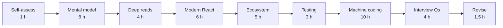

# 04 — React (Part 4 of 4): Resources, Practice, Interview Questions & Revision

> **Parts:** [Part 1 — Overview, Topic Map, Rendering & Hooks](./04-react-part1.md) · [Part 2 — State, Performance, React 19, Patterns & Testing](./04-react-part2.md) · [Part 3 — Machine Coding Round](./04-react-part3.md) · **Part 4 — Resources, Practice, Interview Questions & Revision**
>
> Applies to: React 19 (19.x), TanStack Query v5, React Testing Library 16, Vitest. Verify version-specific details on react.dev/blog.

## Table of Contents

- [6. Resources](#6-resources)
- [7. How to Learn It](#7-how-to-learn-it)
- [8. Hands-on Practice](#8-hands-on-practice)
- [9. Interview Questions](#9-interview-questions)
  - [Basic](#basic)
  - [Intermediate](#intermediate)
  - [Advanced](#advanced)
  - [Tricky](#tricky)
- [10. Common Mistakes & Red Flags](#10-common-mistakes--red-flags)
- [11. Quick Revision Summary](#11-quick-revision-summary)
- [Next Steps](#next-steps)

---

## 6. Resources

| Subtopic | Resource | Type | Where to find it | Free/Paid | Why it's good |
|----------|----------|------|------------------|:---------:|---------------|
| Everything (official) | react.dev "Learn" + "Reference" | docs | react.dev | Free | Rewritten around hooks; the "Escape Hatches" chapter (refs, effects, "You Might Not Need an Effect") is the most interview-relevant material in existence |
| What changed when | React blog: "React 19", "React 19.2", "React Compiler v1.0" posts | docs | react.dev/blog | Free | Authoritative feature lists; read before claiming a feature exists in a version |
| Rendering behavior | "A (Mostly) Complete Guide to React Rendering Behavior" — Mark Erikson | blog | blog.isquaredsoftware.com | Free | The most thorough explanation of when and why components re-render, context and memo |
| Rendering intuition | "Why React Re-Renders" — Josh Comeau | blog | joshwcomeau.com | Free | Visual, short, fixes the "props change causes re-renders" misconception |
| Effects | "A Complete Guide to useEffect" — Dan Abramov | blog | overreacted.io | Free | Snapshot mental model, dependencies as honesty, stale closures |
| Memoization | "Before You memo()" — Dan Abramov | blog | overreacted.io | Free | Two composition fixes (move state down, lift content up) that beat `memo` |
| Server Components | "The Two Reacts" and "React for Two Computers" — Dan Abramov | blog | overreacted.io | Free | Conceptual model of server/client split from a core-team perspective |
| Fiber | "React Fiber Architecture" — Andrew Clark | repo | github.com/acdlite/react-fiber-architecture | Free | Original design notes; dated in details, still right on concepts |
| Fiber | "A Cartoon Intro to Fiber" — Lin Clark (React Conf 2017) | video | YouTube | Free | Best visual explanation of render/commit and interruptibility |
| Server state | TanStack Query docs | docs | tanstack.com/query | Free | Query keys, `staleTime` vs `gcTime`, mutations, optimistic updates |
| Server state | "Practical React Query" series — Dominik Dorfmeister (TkDodo) | blog | tkdodo.eu/blog | Free | Written by the maintainer; best practices you'll be asked about |
| Client state | Zustand docs / README | docs | github.com/pmndrs/zustand | Free | Selectors, `useShallow`, middleware |
| Client state | Redux Toolkit docs | docs | redux-toolkit.js.org | Free | Slices, RTK Query, TypeScript setup with `withTypes` |
| Forms | React Hook Form docs | docs | react-hook-form.com | Free | Uncontrolled-first API, resolvers, `useFieldArray` |
| Testing | Testing Library docs (React + user-event) | docs | testing-library.com | Free | Query priority, async utilities, user-event setup |
| Testing | "Common mistakes with React Testing Library" — Kent C. Dodds | blog | kentcdodds.com/blog | Free | A checklist of what reviewers flag in RTL tests |
| Network mocking | Mock Service Worker docs | docs | mswjs.io | Free | Same handlers for tests, Storybook and dev |
| Accessibility | WAI-ARIA Authoring Practices Guide (APG) | docs | w3.org/WAI/ARIA/apg | Free | Reference keyboard behavior for combobox, tabs, dialog, menu — what Part 3 implements |
| Headless components | React Aria (Adobe) docs and source | docs/repo | react-spectrum.adobe.com/react-aria | Free | Production-grade accessible hooks; read the source to see edge cases handled |
| Patterns | patterns.dev — Lydia Hallie & Addy Osmani | book | patterns.dev | Free | Rendering and component patterns with diagrams |
| Machine coding | GreatFrontEnd "User Interface" questions | practice | greatfrontend.com | Free tier + Paid | Interview-style UI builds with reference solutions |
| Machine coding | BigFrontEnd.dev React questions | practice | bigfrontend.dev | Free tier + Paid | Short React quizzes and builds |
| Structured course | *The Joy of React* — Josh Comeau | course | joyofreact.com | Paid | Mental-model-first course with exercises |
| Structured course | Epic React — Kent C. Dodds | course | epicreact.dev | Paid | Deep workshops on hooks, patterns, performance, testing |
| Video | Jack Herrington | video | YouTube "Jack Herrington" | Free | Practical builds, state management comparisons, React 19 features |
| Tooling | React DevTools (Components + Profiler) | tool | Browser extension stores | Free | "Highlight updates", "Why did this render?", flame graphs |

> 💡 Interview Tip: Cite *ideas* rather than *sources* in interviews: "I treat effects as synchronization with an external system" lands better than "Dan Abramov says…". Knowing where the idea comes from helps you go deeper when asked.

---

## 7. How to Learn It

Total: **~42.5 hours** (matches the [syllabus](./01-fullstack-syllabus.md#3-react)).

| Step | What to do | Time |
|------|-----------|:----:|
| **0. Self-assess** | Tick the [Topic Map](./04-react-part1.md#2-topic-map). Answer the [Tricky](#tricky) questions cold — every wrong answer marks a mental-model gap. | 1 h |
| **1. Model** | react.dev "Describing the UI", "Adding Interactivity", "Managing State", "Escape Hatches" (all subpages), then [Part 1](./04-react-part1.md). Log renders in a sandbox while reading. | 8 h |
| **2. Read deep** | Erikson's rendering guide, Abramov's useEffect guide and "Before You memo()", Lin Clark's Fiber talk. | 4 h |
| **3. Modern React** | [Part 2](./04-react-part2.md) plus react.dev reference pages for `useTransition`, `Suspense`, `useActionState`, `useOptimistic`, `use`, Server Components. Rebuild each Part 2 example from memory. | 6 h |
| **4. Ecosystem** | TanStack Query docs + 4 TkDodo posts; build a list/detail/mutation app. Skim Zustand and RTK docs to compare. | 5 h |
| **5. Test** | Testing Library docs + Kent C. Dodds' common-mistakes post; write tests for 3 of your own components with MSW. | 3 h |
| **6. Machine coding** | All seven builds in [Part 3](./04-react-part3.md), timed to 45–60 min each, then compare with the reference and refactor. | 10 h |
| **7. Interview questions** | Answer every [question](#9-interview-questions) out loud in ≤ 2 minutes, then check against the model answer. | 4 h |
| **8. Revise** | [Quick Revision Summary](#11-quick-revision-summary) at +1 day, +1 week, and the day before; redo one Part 3 build each time. | 1.5 h |



> 💡 Interview Tip: The highest-leverage hours are steps 1 and 6. Most React interview failures are either a wrong mental model ("props changes cause re-renders", "effects are lifecycle methods") or running out of time in the build round.

---

## 8. Hands-on Practice

| # | Exercise | Level | Acceptance criteria |
|---|----------|:-----:|---------------------|
| 1 | **Render log lab** — a 3-level tree with state at the top, a memoized middle, a context consumer at the bottom | 🟢 Easy | You predict, in writing, which components render for 6 different updates, then confirm with `console.log` and the Profiler; you can explain every miss. |
| 2 | **Effect refactor** — take a component with 4+ effects (derived state, event-driven requests, a subscription, a fetch) | 🟢 Easy | Only the subscription and fetch remain as effects; derived values are computed in render; the fetch has an `AbortController` or ignore flag; Strict Mode causes no duplicate side effects visible to the user. |
| 3 | **Custom hooks library** — `useDebouncedValue`, `useLocalStorage` (cross-tab), `useMediaQuery`, `useInterval`, `usePrevious` | 🟡 Medium | Each hook has `renderHook` tests including cleanup on unmount; `useLocalStorage` uses `useSyncExternalStore` and returns a stable value when nothing changed; SSR-safe (no `window` access during render on the server). |
| 4 | **Server-state app** — list, detail and create/update/delete for a REST resource with TanStack Query | 🟡 Medium | Query keys are hierarchical (`["todos", filters]`); mutations invalidate the right keys; one mutation is optimistic with rollback on error; MSW tests cover success and 500 states; no `useEffect` used for fetching. |
| 5 | **Performance clinic** — a 10 000-row table with filter input and row selection | 🟡 Medium | Profiler shows < 16 ms commits while typing; virtualized with TanStack Virtual; filter uses `useDeferredValue` or a transition; you can show one memo that helped (Profiler before/after) and one that didn't. |
| 6 | **React 19 form** — a comment form with `useActionState`, `useFormStatus`, `useOptimistic` | 🟡 Medium | Pending state disables submit; optimistic comment appears instantly and is replaced (or removed with an error) when the action settles; validation errors render per field; works with JavaScript slow-loading (progressive enhancement in a framework that supports it). |
| 7 | **Accessible component kit** — Combobox, Tabs, Dialog, Menu following the APG | 🔴 Hard | Every keyboard interaction listed in the APG pattern works; axe (e.g. `vitest-axe` or the browser extension) reports zero violations; focus is trapped/restored in the dialog; tests query only by role and name. |
| 8 | **Compound + headless component** — a `<Select>` with `Select.Trigger`, `Select.Options`, `Select.Option`, plus a `useSelect` hook | 🔴 Hard | Works controlled and uncontrolled (`value`/`defaultValue`/`onChange`); generic over the option value type; the hook can drive a completely different markup in a second demo. |
| 9 | **Mini state library** — implement `createStore(initial)` with `getState`, `setState`, `subscribe` and a `useStore(selector)` hook | 🔴 Hard | Uses `useSyncExternalStore`; components re-render only when their selected slice changes (proved with a render counter test); no tearing under `startTransition`. |
| 10 | **Machine-coding gauntlet** — the "More Builds" list in [Part 3 §3.8](./04-react-part3.md#38-more-builds-to-practice) | 🟡 Medium | 5 builds, each ≤ 60 min, each with at least 2 RTL tests and keyboard support; record yourself narrating one build and review it. |

---

## 9. Interview Questions

### Basic

#### Q1. Explain how React updates the UI. What is the virtual DOM?

**Model answer.** A state update *triggers* a render. In the *render* phase React calls the affected components to produce a new tree of React elements (plain objects describing the UI) and reconciles it with the previous tree to work out the minimal changes. In the *commit* phase it applies those DOM mutations, attaches refs, runs layout effects, lets the browser paint, and then runs passive effects. "Virtual DOM" is an informal name for the element tree plus the diffing; the real point is that you describe the UI declaratively and React computes the mutations. Render must be pure because it may run more than once or be discarded in concurrent rendering.

**Follow-ups:** Is the virtual DOM "fast"? What happens if render has a side effect?

**Great answer includes:** The three phases; render purity; "virtual DOM isn't free — it's a way to make declarative updates *fast enough*, and React skips work through bailouts, keys and memoization".

#### Q2. Why do lists need keys? What's wrong with using the index?

**Model answer.** Keys give children a stable identity across renders so React can match old and new items: move the DOM node and keep its state instead of recreating it. With index keys, if you insert at the top or reorder, every item's key now points to a different item, so React reuses the wrong component instance: input values, focus, local state and animations attach to the wrong rows. Index keys are acceptable only for static lists that never reorder, insert or filter. Keys must be unique among siblings and stable — never `Math.random()`, which remounts every item on every render.

**Follow-ups:** How can you use `key` deliberately to reset state? What's the cost of a changing key?

**Great answer includes:** A concrete bug (an input that "moves" to a different row); `key={userId}` to reset a form; remount = lost state + effects re-run.

#### Q3. Controlled vs uncontrolled components — when do you use each?

**Model answer.** A controlled input's value lives in React state (`value` + `onChange`), so React is the source of truth — good for instant validation, formatting, conditional UI and syncing values between fields. An uncontrolled input keeps its value in the DOM (`defaultValue`, read via a ref or `FormData` on submit) — less code and fewer renders, and it's what React Hook Form and React 19 form Actions build on. For reusable components, I support both: `value`/`onChange` when provided, internal state otherwise (`useControllableState`, see [Part 2 §3.9](./04-react-part2.md#39-component-patterns)).

**Follow-ups:** What does the "changing an uncontrolled input to be controlled" warning mean? How does React Hook Form avoid re-renders?

**Great answer includes:** `value={undefined}` flipping modes; uncontrolled + `FormData` with Actions; the dual-mode component pattern.

#### Q4. Why does `console.log(count)` right after `setCount(count + 1)` print the old value?

**Model answer.** State is a snapshot per render. `count` is a constant captured by this render's closure; `setCount` doesn't mutate it, it schedules a re-render in which `useState` returns the new value. Updates are also batched — React 18+ batches every update in the same event (including in promises and timeouts) into one render. If you need the next value, compute it first (`const next = count + 1; setCount(next); use(next)`), or use an updater (`setCount(c => c + 1)`) when the update depends on the previous state.

**Follow-ups:** How do you read the value after the DOM updates? What's `flushSync` for?

**Great answer includes:** Snapshot + closure explanation; automatic batching; updater functions for sequential updates; `flushSync` as a rare escape hatch (e.g. scroll to a newly added item).

#### Q5. When does `useEffect` run, and what is the cleanup for?

**Model answer.** After the commit, once the browser has painted (passive effects). It runs after the first render, then again after any render where a dependency changed (compared with `Object.is`). Before re-running, React runs the previous cleanup; it also runs the cleanup on unmount. Cleanup undoes what setup did — unsubscribe, clear timers, abort requests, disconnect observers. Think of an effect not as a lifecycle method but as "keep this external system in sync with these values"; Strict Mode runs setup → cleanup → setup on mount in development to prove that the cleanup is correct.

**Follow-ups:** Effect with no dependency array vs `[]`? What does Strict Mode double-invoke exactly?

**Great answer includes:** Order (after paint; cleanup before next setup); `Object.is` comparison; the synchronization mental model; Strict Mode as a correctness check.

#### Q6. What causes a component to re-render?

**Model answer.** Three things: its own state changes (`useState`/`useReducer`, or an external store via `useSyncExternalStore`), a context it reads changes, or its parent re-renders. Props changing is not a cause by itself — the parent re-rendering is, and by default every child re-renders regardless of whether its props changed. `memo` adds a shallow props comparison to skip that. Setting state to the same value (by `Object.is`) bails out.

**Follow-ups:** If a parent re-renders, do all descendants re-render? Does a re-render mean the DOM changes?

**Great answer includes:** "Props changes don't cause renders"; render ≠ DOM update; children-as-props escape the parent's re-render (the element was created by the grandparent).

#### Q7. What are the Rules of Hooks and why do they exist?

**Model answer.** Call hooks only at the top level of a component or custom hook — not in conditions, loops, nested functions or after an early return — and only from React functions. React stores a component's hook state as an ordered list on its fiber and matches each call to its slot *by call order*. If the order changes between renders, state is read from the wrong slot. The ESLint plugin enforces the rules; the exception is `use`, which can be called conditionally because it doesn't store state in a slot.

**Follow-ups:** How would you conditionally subscribe? Why can `use` be conditional?

**Great answer includes:** Linked-list/call-order explanation; moving the condition inside the hook; `use` exception.

#### Q8. `useRef` vs `useState` — when do you use each?

**Model answer.** Both persist across renders. Updating state schedules a re-render; mutating `ref.current` doesn't. Use state for anything that affects what's rendered; use a ref for values that render doesn't read — DOM nodes, timer IDs, the latest callback, previous values, an `AbortController`. Don't read or write `ref.current` during render (except lazy initialization), because render must be pure and refs aren't tracked.

**Follow-ups:** How do you store the "latest" callback for a subscription? What's a ref callback?

**Great answer includes:** Re-render difference; "don't read refs during render"; React 19 ref callbacks can return a cleanup; ref is a normal prop in 19.

#### Q9. How do you share state between two sibling components?

**Model answer.** Lift it to their closest common parent and pass the value and a setter (or an intent-named callback like `onSelect`) down. If it's needed far away or by many components, use context for dependency injection, or a store with selectors if it changes often. If it's server data, it shouldn't be "shared state" at all — both components use the same TanStack Query key and share the cache. I keep state as low as possible and lift only when needed.

**Follow-ups:** What's prop drilling, and when is it actually fine? When is context the wrong choice?

**Great answer includes:** Lifting first; composition (`children`) to avoid drilling; server-state vs client-state distinction.

### Intermediate

#### Q10. When do `useMemo` and `useCallback` actually help?

**Model answer.** Three cases: (1) a genuinely expensive computation (measured, e.g. > 1 ms, on large data) whose inputs rarely change; (2) preserving the referential identity of an object or function passed to a `memo` child so its shallow comparison succeeds; (3) keeping a value stable because it's a dependency of an effect or another hook. Elsewhere they're cost without benefit: an extra comparison, memory, and noise — and a single unstable prop defeats a whole memo chain. Before memoizing, I try composition: move state down, or lift content up as `children`. With the React Compiler enabled, most manual memoization becomes unnecessary because the compiler memoizes automatically.

**Follow-ups:** Is `useCallback(fn, [])` with stale state a bug? How do you prove a memo helped?

**Great answer includes:** The three legitimate uses; Profiler before/after; composition alternatives; Compiler awareness.

#### Q11. You wrapped a child in `memo` but it still re-renders. Why?

**Model answer.** `memo` compares each prop with `Object.is`. Typical culprits: an inline object/array/function prop (`style={{…}}`, `onClick={() => …}`) created every render; JSX passed as `children` (a new element object every render); the child reading a context that changed; or the child's own state/store subscription changing. Fix by stabilizing the props (`useMemo`/`useCallback`, or hoisting constants), passing primitives, restructuring so the memo isn't needed, or enabling the Compiler. Use the DevTools "why did this render" setting to see which prop changed.

**Follow-ups:** When would you write a custom `arePropsEqual`? Why is that dangerous?

**Great answer includes:** `children` is a prop; context bypasses memo; custom comparators that ignore functions cause stale-closure bugs.

#### Q12. What's the performance problem with context, and how do you fix it?

**Model answer.** When a provider's `value` changes (by `Object.is`), every component that reads that context re-renders, and `memo` doesn't stop it. Two common causes: an inline `value={{ user, setUser }}` that's a new object on every provider render, and putting fast-changing state in a widely used context. Fixes: memoize the value; split contexts by update frequency (or split state and dispatch — `dispatch` is stable); keep the provider in a component that only re-renders when its state changes; and for high-frequency or large global state use a store with selectors (Zustand, Redux, or `useSyncExternalStore`) so components subscribe to slices.

**Follow-ups:** Why does Redux not have this problem? Is context a state manager?

**Great answer includes:** "Context is dependency injection, not state management"; splitting; selector-based subscriptions.

#### Q13. How do you fetch data in an effect without race conditions?

**Model answer.** If a dependency (say `userId`) changes while a request is in flight, the older response can arrive last and overwrite the newer one. In the effect's cleanup, abort the request with an `AbortController` (also saves bandwidth) or set an `ignore` flag that the response handler checks. Also handle loading and error states and the abort error. In production I'd rather use TanStack Query or framework data loading (RSC, loaders), which handle races, caching, deduplication, retries and refetching for you.

```tsx
useEffect(() => {
  const controller = new AbortController();
  fetch(`/api/users/${userId}`, { signal: controller.signal })
    .then((r) => r.json())
    .then(setUser)
    .catch((e: unknown) => {
      if (!(e instanceof DOMException && e.name === "AbortError")) setError(e);
    });
  return () => controller.abort();
}, [userId]);
```

**Follow-ups:** Why does Strict Mode send two requests? What's a request waterfall and how do you avoid it?

**Great answer includes:** Abort/ignore in cleanup; Strict Mode shows the cleanup works; preference for a data library; waterfalls from nested fetching components.

#### Q14. Give examples of effects you'd delete.

**Model answer.** (1) Derived state: `useEffect(() => setFullName(first + " " + last))` → compute `const fullName = …` during render (with `useMemo` if expensive). (2) Resetting state when a prop changes → give the component a `key`. (3) Responding to a user action: posting analytics or a request in an effect triggered by a state flag → do it in the event handler. (4) Chains of effects that set state that triggers other effects → compute the next state in one handler. (5) Notifying a parent of a state change via effect → call the parent's callback in the same handler that sets state. The rule: effects are for synchronizing with *external* systems; if there's no external system, you probably don't need one.

**Follow-ups:** How do you adjust state when a prop changes without a key? What's left as legitimate effects?

**Great answer includes:** The "external system" test; key reset; extra render + flicker cost of derived-state effects; legitimate cases (subscriptions, non-React widgets, fetching without a library).

#### Q15. What does Strict Mode do in development?

**Model answer.** It double-invokes things that must be pure — component bodies, `useState`/`useMemo`/`useReducer` initializers and updaters — to surface impure render logic; it runs an extra setup → cleanup → setup cycle for effects (and, in React 19, ref callbacks) on mount to catch missing cleanups; and it warns about deprecated APIs. React 19 reuses the memoized results from the first render on the double render. None of this happens in production. If your app breaks under Strict Mode, it has a real bug that would show up with Fast Refresh, `<Activity>`/offscreen, or remounts.

**Follow-ups:** How do you stop "my effect fires twice"? Should you disable Strict Mode?

**Great answer includes:** What is double-invoked; why (future reusable state, Activity); fix the cleanup, don't use a "has run" ref.

#### Q16. Server state vs client state — why use TanStack Query? `staleTime` vs `gcTime`?

**Model answer.** Server state is a cache of data owned elsewhere: it can be stale, shared across components, needs refetching, deduplication and invalidation. Client state (open menus, form drafts, selected tabs) is owned by the UI. Putting server data in Redux or `useState` makes you re-implement caching, races, retries and invalidation. TanStack Query does this keyed by query keys. `staleTime` (default 0) is how long data is considered fresh — fresh data is served without a background refetch. `gcTime` (default 5 minutes) is how long *unused* (no observers) cache entries are kept before garbage collection. For a mostly-static list I'd raise `staleTime`; after a mutation I invalidate the affected keys.

**Follow-ups:** What triggers a refetch? How do you implement an optimistic update with rollback?

**Great answer includes:** The two-kinds-of-state framing; correct defaults; refetch triggers (mount, window focus, reconnect when stale); `onMutate`/`onError`/`onSettled` or the v5 `variables` approach.

#### Q17. What don't error boundaries catch, and how do you handle those?

**Model answer.** Boundaries catch errors thrown during render, in lifecycle methods, and in constructors of their subtree — including rejected promises passed to `use` and, in React 19, errors thrown inside transitions/Actions. They don't catch errors in event handlers, in async code you started yourself (timeouts, promise callbacks outside render/transitions), during server rendering, or inside the boundary itself. For handlers and async code, use `try/catch` and set error state (or rethrow during render via state to reach a boundary). Report errors via `componentDidCatch` or React 19's root options (`onCaughtError`, `onUncaughtError`, `onRecoverableError`). Place boundaries by feature so one widget failing doesn't blank the page, with a reset (`key` or a retry button).

**Follow-ups:** Why are boundaries still class components? How do you reset a boundary on navigation?

**Great answer includes:** Precise catch list; granular placement; reset strategy; reporting hooks.

#### Q18. `useLayoutEffect` vs `useEffect`?

**Model answer.** `useLayoutEffect` runs synchronously after DOM mutations but *before* the browser paints; state updates inside it are processed before paint. Use it when you must measure layout and adjust before the user sees anything — tooltip positioning, scroll restoration, avoiding a flash. `useEffect` runs after paint and doesn't block it, so it's the default. Overusing layout effects blocks painting and hurts responsiveness. On the server neither runs.

**Follow-ups:** What's the visual bug you're preventing? What's the ordering between parent and child layout effects?

**Great answer includes:** Before vs after paint; a concrete flicker example; child-before-parent ordering; performance cost.

#### Q19. How do you design a good custom hook?

**Model answer.** A custom hook shares *logic*, not state — each call has its own state. Good hooks have a single purpose and a name describing *what* (`useOnlineStatus`, not `useMount`); accept primitive inputs where possible; return stable values (memoize objects/functions they return); clean up everything they set up; and are SSR-safe. Avoid "lifecycle" hooks like `useMount` that hide dependencies. Test them with `renderHook`, or better, through a component that uses them.

**Follow-ups:** How do you share state across hook calls? When should a hook return a tuple vs an object?

**Great answer includes:** Logic-not-state; stability of return values; tuple for 2 positional values, object for more; external store for shared state.

#### Q20. How do you test React components? What's your query priority?

**Model answer.** Test behavior the way a user experiences it: render, interact with `user-event`, assert on what's visible — not internal state or implementation details. Query by role and accessible name first (`getByRole("button", { name: "Save" })`), then label, text, and test IDs as a last resort; this doubles as an accessibility check. Use `findBy…` for async appearance and `queryBy…` to assert absence. Mock the network with MSW rather than mocking fetch or the data hook, and give each test a fresh QueryClient. Keep a few E2E tests (Playwright) for critical flows.

**Follow-ups:** Why avoid snapshot tests of whole components? What does `act` do, and why rarely call it directly?

**Great answer includes:** Query priority; user-event `setup()`; MSW; avoiding implementation details; where RTL stops and E2E starts.

### Advanced

#### Q21. What is Fiber, and what does it enable?

**Model answer.** Fiber is the reconciler architecture introduced in React 16. Each element instance is a fiber node — a unit of work linked to its child, sibling and parent, holding hooks state, props and effect flags. Because work is a linked list rather than a recursive call stack, React can do rendering in small chunks, yield to the browser, pause, resume, abort, and prioritize. Updates are assigned *lanes* (a bitmask of priorities: sync/discrete input, continuous input, default, transition, idle…). React keeps two trees — `current` (on screen) and `workInProgress` — and swaps them on commit (double buffering). Render is interruptible; commit is always synchronous so the UI is never half-updated. This is the foundation for transitions, Suspense, streaming SSR and selective hydration.

**Follow-ups:** Why must render be pure in this model? What's a "lane"?

**Great answer includes:** Linked fibers + yielding; lanes; double buffering; interruptible render vs atomic commit; the features it unlocks.

#### Q22. `useTransition` vs `useDeferredValue` — when do you use each?

**Model answer.** Both mark work as non-urgent so urgent updates (typing) stay responsive and the low-priority render can be interrupted. `useTransition` wraps the *state update* you own: `startTransition(() => setTab(next))`, and gives you `isPending`. In React 19 it accepts async functions (Actions). `useDeferredValue` wraps a *value* you receive (e.g. a prop or a query string you don't control): React renders with the old value first, then re-renders in the background with the new one. Neither debounces — they don't reduce work, they make it interruptible. For network requests you still want debouncing or caching.

**Follow-ups:** Why can't you use a transition for a controlled input's value? How does a transition interact with Suspense?

**Great answer includes:** Update vs value; `isPending` / comparing value vs deferred value for stale UI; transitions avoid replacing already-shown content with a fallback; not a debounce.

#### Q23. How does Suspense work?

**Model answer.** A component that isn't ready *suspends* (in user code, via `use(promise)`, `lazy`, or a Suspense-enabled library/framework). React stops rendering that subtree, shows the nearest `<Suspense>` fallback, and retries when the promise resolves. Boundaries define loading states declaratively and can be nested to reveal content progressively. If the suspension happens during a transition, React keeps showing the previous UI instead of the fallback. On the server, Suspense enables streaming HTML: the shell is sent first and boundaries stream in as their data resolves, and selective hydration prioritizes what the user interacts with. Promises passed to `use` must be cached/stable — creating a new one every render suspends forever.

**Follow-ups:** How do you avoid a waterfall between nested boundaries? What triggers the fallback again after first load?

**Great answer includes:** Suspend → fallback → retry; transitions keep old UI; streaming SSR; stable promises; starting fetches early (in parallel) to avoid waterfalls.

#### Q24. Server Components vs SSR — what's the difference?

**Model answer.** SSR renders Client Components to HTML on the server for a fast first paint, then ships all their JavaScript and hydrates them. Server Components run only on the server (at request or build time); their code is never sent to the browser, they can read data directly (DB, filesystem, secrets) and be async, and their output is serialized into the RSC payload that the client merges into the tree. They can't use state, effects or browser APIs. A framework (e.g. Next.js App Router) typically uses both: RSC to produce the tree, SSR to turn it into HTML, and hydration for the Client Component islands. The win is less client JS and colocated data fetching; the cost is a server/client boundary to design — props across it must be serializable, and `"use client"` marks the entry into client code.

**Follow-ups:** Can a Client Component render a Server Component? What are Server Functions?

**Great answer includes:** RSC ≠ SSR; serialization boundary; passing Server Components as `children` to Client Components; `"use server"` functions as RPC that must be authorized and validated. Next.js specifics are in [05-nextjs.md](./05-nextjs.md).

#### Q25. Walk me through React 19 Actions and the hooks around them.

**Model answer.** An Action is an async function run inside a transition — passed to `startTransition`, to `<form action={fn}>`, or created by `useActionState`. React tracks the pending state, sequences multiple submissions, surfaces thrown errors to error boundaries, and resets uncontrolled forms after a successful form action. `useActionState(action, initialState)` returns `[state, dispatch, isPending]`, where the action receives the previous state and the `FormData` — ideal for validation errors from the server. `useFormStatus()` reads the pending status of the parent `<form>` from inside a child (e.g. a submit button). `useOptimistic(state, reducer)` shows a temporary value while an Action is pending and automatically falls back to the real state when it settles. With Server Functions, forms can work before JavaScript loads.

**Follow-ups:** Why must `useFormStatus` be in a child of the form? What happens to optimistic state on error?

**Great answer includes:** Actions = async transitions; the three hooks' signatures; automatic revert of optimistic state; progressive enhancement; validation on the server.

#### Q26. What is tearing, and how does `useSyncExternalStore` prevent it?

**Model answer.** In concurrent rendering, React may yield in the middle of rendering a tree. If an external mutable store changes during that pause, components rendered before and after read different values, and the UI shows an inconsistent ("torn") state. `useSyncExternalStore(subscribe, getSnapshot, getServerSnapshot?)` lets React read a snapshot, detect that it changed during render, and re-render synchronously so everything is consistent. `getSnapshot` must return a cached value (same reference if unchanged) or it loops. The trade-off: updates from the store can't be non-blocking transitions. Store libraries like Zustand and React Redux use it internally.

**Follow-ups:** Why does `getSnapshot` returning a new object cause an infinite loop? When do you need `getServerSnapshot`?

**Great answer includes:** Concurrent yielding as the cause; immutable snapshots; selectors; SSR snapshot for hydration.

#### Q27. What does the React Compiler do, and what are its limits?

**Model answer.** It's a build-time compiler (Babel plugin, with integrations for Next.js, Vite and others) that analyzes components and hooks and automatically memoizes values, callbacks and JSX at a fine granularity, so re-renders skip unchanged work without manual `useMemo`/`useCallback`/`memo`. It relies on the Rules of React — pure render, no mutation of props/state, hooks rules; when it detects a violation it skips that component rather than miscompiling it, and the ESLint rules surface those violations. It doesn't fix expensive algorithms, network waterfalls or giant lists — those still need design changes. v1.0 was declared stable in late 2025; verify the current version and setup on react.dev.

**Follow-ups:** Should you remove existing `useMemo` calls? How do you adopt it incrementally?

**Great answer includes:** Automatic memoization; Rules of React dependency; bail-out behavior; incremental adoption (opt-in directives / per-directory) and measuring with the Profiler. Keep existing memoization until you've verified behavior, since removing it can change effect dependencies.

#### Q28. What causes hydration mismatches, and how do you fix them?

**Model answer.** Hydration expects the first client render to produce exactly the server HTML. Mismatches come from values that differ between server and client during render: `Date.now()`/`new Date()` formatting, `Math.random()`, locale/time zone differences, reading `window`/`localStorage`/`matchMedia` during render, invalid HTML nesting (a `<div>` inside a `<p>`, which the browser re-parents), and browser extensions injecting markup. Fixes: render the same thing on both sides and switch after mount (an effect, or `useSyncExternalStore` with a `getServerSnapshot`), use `useId` for IDs, pass server-computed values as props, fix the HTML nesting, and use `suppressHydrationWarning` only for a single unavoidable text mismatch like a timestamp. React 19 prints a diff of the mismatch, which makes it much faster to diagnose.

**Follow-ups:** Why not just render client-only with `typeof window` checks in render? What's the cost of a mismatch?

**Great answer includes:** Concrete causes; "two-pass" rendering; `useId`; React re-rendering the subtree on the client (performance cost, lost server benefit).

#### Q29. How would you render a list of 50 000 items?

**Model answer.** Don't put 50 000 nodes in the DOM: virtualize (windowing) with TanStack Virtual or react-window, so only the visible rows plus overscan are rendered, and a spacer keeps the scrollbar correct. Paginate or infinite-load from the server so you don't download everything. Memoize row components and keep row props stable; filter/sort with `useDeferredValue` or in a transition; move heavy computation to a Web Worker if needed. Trade-offs of virtualization: Ctrl+F browser search and screen readers only see rendered rows, dynamic row heights need measuring, and scroll restoration is harder — mitigate with `aria-rowcount`/`aria-rowindex`, a search UI, and measured sizing.

**Follow-ups:** How do you handle variable-height rows? What would you do if virtualization isn't an option?

**Great answer includes:** Virtualization mechanics; server-side pagination; accessibility and find-in-page caveats; Profiler-driven verification. `content-visibility: auto` as a CSS-only middle ground.

#### Q30. How would you design a reusable component API for a design system?

**Model answer.** Start from the WAI-ARIA pattern so behavior and keyboard support are right. Use compound components (`<Tabs.Root>`, `<Tabs.List>`, `<Tabs.Tab>`) sharing context so consumers control structure; support controlled and uncontrolled usage (`value`/`defaultValue`/`onValueChange`); forward refs and spread remaining native props (`ComponentProps<"button">`) so it behaves like the element; allow composition via `asChild`/`as` where needed; and expose a headless hook for teams that need different markup. Keep styling separate (CSS variables/data attributes like `data-state="open"`). Document with Storybook, test with RTL by role, and keep the surface small — every prop is a long-term commitment.

**Follow-ups:** Compound components vs a config prop (`items={[…]}`)? How do you version breaking changes?

**Great answer includes:** Accessibility-first; controlled/uncontrolled; ref + prop forwarding; headless split; data attributes for styling; semver and codemods.

### Tricky

#### Q31. What does this render after one click?

```tsx
function Counter() {
  const [count, setCount] = useState(0);
  return (
    <button onClick={() => { setCount(count + 1); setCount(count + 1); setCount(count + 1); }}>
      {count}
    </button>
  );
}
```

**Model answer.** `1`. All three calls read the same snapshot `count = 0`, so each schedules "set to 1"; they're batched into one render. With `setCount(c => c + 1)` three times it renders `3`, because updaters are queued and applied in order to the latest pending value.

**Follow-ups:** What about `setCount(count + 1); setCount(c => c + 1)`? (2: the first sets 1, the updater adds 1.)

**Great answer includes:** Snapshot + batching; updater queue semantics; only one re-render.

#### Q32. In what order do these log on mount? On a parent state update?

```tsx
function Child() {
  console.log("child render");
  useLayoutEffect(() => { console.log("child layout"); return () => console.log("child layout cleanup"); });
  useEffect(() => { console.log("child effect"); return () => console.log("child effect cleanup"); });
  return null;
}
function Parent() {
  console.log("parent render");
  useLayoutEffect(() => { console.log("parent layout"); return () => console.log("parent layout cleanup"); });
  useEffect(() => { console.log("parent effect"); return () => console.log("parent effect cleanup"); });
  return <Child />;
}
```

**Model answer.** Mount (no Strict Mode): `parent render`, `child render`, `child layout`, `parent layout`, `child effect`, `parent effect`. Render goes top-down; effects run bottom-up (children first, so a parent's effect can rely on its children being set up), and all layout effects run before any passive effect. On a parent update: `parent render`, `child render`, `child layout cleanup`, `parent layout cleanup`, `child layout`, `parent layout`, `child effect cleanup`, `parent effect cleanup`, `child effect`, `parent effect` — all cleanups of a kind run before any new setups of that kind.

**Follow-ups:** What changes in Strict Mode development? (Renders log twice; on mount each effect does setup → cleanup → setup.)

**Great answer includes:** Top-down render, bottom-up effects; layout before passive; cleanups before setups.

#### Q33. Why does this input lose focus on every keystroke?

```tsx
function Form() {
  const [name, setName] = useState("");
  function Field() {
    return <input value={name} onChange={(e) => setName(e.target.value)} />;
  }
  return <Field />;
}
```

**Model answer.** `Field` is defined inside `Form`, so every render of `Form` creates a *new* function — a new component type. Reconciliation sees a different type at that position, unmounts the old `Field` (and its `<input>`) and mounts a new one, losing focus and any state. Fix: define components at module level and pass data via props, or inline the JSX. The same remount happens with `key={Math.random()}` or when a conditional switches between two different component types at the same position.

**Great answer includes:** Element type identity drives reconciliation; remount symptoms (focus, state, effects re-run).

#### Q34. What renders when `items` is empty?

```tsx
<div>{items.length && <List items={items} />}</div>
```

**Model answer.** The text `0`. `&&` returns its left operand when it's falsy, and React renders numbers (only `false`, `null`, `undefined` and `true` render nothing). Use `items.length > 0 && …`, `!!items.length && …`, or a ternary. In React Native it can crash because text must be inside `<Text>`.

#### Q35. `Card` is wrapped in `memo`. Why does it re-render every time `Page` renders?

```tsx
const Card = memo(function Card({ children }: { children: React.ReactNode }) {
  return <div className="card">{children}</div>;
});

function Page() {
  const [n, setN] = useState(0);
  return (
    <>
      <button onClick={() => setN(n + 1)}>{n}</button>
      <Card><p>Static text</p></Card>
    </>
  );
}
```

**Model answer.** `children` is a prop, and `<p>Static text</p>` creates a new element object each time `Page` renders, so the shallow comparison fails. Fixes: hoist the static element to a module constant, `useMemo` the children, restructure so `Card` isn't under the changing state, or rely on the React Compiler, which memoizes the JSX. In most cases the simplest answer is that re-rendering `Card` is cheap and doesn't need fixing.

#### Q36. Why does this effect run in an infinite loop?

```tsx
function Results({ query }: { query: string }) {
  const [data, setData] = useState<string[]>([]);
  const options = { query, limit: 10 };
  useEffect(() => {
    search(options).then(setData);
  }, [options]);
  return <List items={data} />;
}
```

**Model answer.** `options` is a new object every render, so the dependency always differs by `Object.is`; the effect runs, sets state, triggers a render, which creates a new `options`, and so on. Fix: depend on primitives — create the object *inside* the effect and list `[query]` — or memoize it. Silencing the linter by removing the dependency is the wrong fix: it creates a stale closure. Also add an ignore flag/abort in cleanup for the race when `query` changes.

**Great answer includes:** Referential identity; moving object creation into the effect; not lying about dependencies; race handling.

---

## 10. Common Mistakes & Red Flags

| Red flag | Why it hurts | Say/do instead |
|----------|--------------|----------------|
| "Components re-render when their props change" | Wrong model; leads to cargo-cult `memo` | "They re-render when their parent renders, their state changes, or a context they read changes" |
| Describing `useEffect` as `componentDidMount`/`componentDidUpdate` | Leads to missing deps and cleanup bugs | "Effects synchronize with an external system; cleanup undoes setup" |
| Derived state stored in `useState` + synced with an effect | Extra renders, flicker, out-of-sync bugs | Compute during render; `key` to reset |
| Removing dependencies to stop an effect loop | Stale closures; hidden bugs | Fix identity (primitives, move objects inside), `useEffectEvent` for non-reactive logic |
| `useMemo`/`useCallback` everywhere | Noise, false sense of performance | Profile first; composition; React Compiler |
| Fetching in effects with no race/abort handling | Stale data overwrites fresh data | Abort/ignore in cleanup, or TanStack Query / framework loaders |
| Server data in Redux / global `useState` | Re-implementing caching badly | Server-cache library; client store only for UI state |
| Index or random keys for dynamic lists | State attaches to the wrong row; remounts | Stable IDs from data |
| Defining components inside components | Remount every render | Module-level components |
| One giant context with fast-changing state | Whole-app re-renders | Split contexts or use a selector-based store |
| Clickable `<div>`s, missing labels, no focus management in dialogs | Fails accessibility review — increasingly a hiring signal | Native elements; APG patterns; test by role |
| Tests that assert on state or use `container.querySelector` | Brittle, don't prove behavior | RTL queries by role/name; user-event |
| "Server Components are just SSR" | Shows outdated knowledge | Explain RSC payload, zero client JS, serialization boundary |
| Running out of time polishing CSS in machine coding | Core functionality incomplete | Follow the [Part 3 time-box](./04-react-part3.md#30-strategy--time-boxing): working core first |

---

## 11. Quick Revision Summary

### One-page recap

**Model**
- Trigger → render (pure, interruptible) → commit (sync DOM, refs, layout effects) → paint → passive effects.
- Re-render causes: own state, context, parent render. Not props alone. Same-value `setState` bails out.
- Reconciliation by element **type + position + key**. Changing type/key remounts and resets state.
- Fiber: linked work units, lanes for priority, `current`/`workInProgress` double buffering.

**Hooks**
- State is a snapshot; batching everywhere (18+); updater functions for sequential updates; lazy init.
- Effects: after paint; cleanup before re-run and on unmount; deps by `Object.is`; Strict Mode setup→cleanup→setup.
- Effect ordering: render top-down, effects bottom-up, layout before passive, cleanups before setups.
- You might not need an effect: derive in render, handle events in handlers, reset with `key`.
- `useRef` for non-rendered mutable values; `useLayoutEffect` to measure before paint.
- `useMemo`/`useCallback` for expensive work, memo-child identity, stable deps — or let the Compiler do it.
- `useSyncExternalStore` for external stores (prevents tearing); `useId` for SSR-safe IDs; `useEffectEvent` (19.2) for non-reactive logic inside effects.

**State & data**
- Colocate → lift → context (DI, split it) → store with selectors (Zustand/RTK).
- Server state → TanStack Query: keys, `staleTime` (0 default) vs `gcTime` (5 min default), invalidation, optimistic updates with rollback.

**Concurrent & React 19**
- `useTransition` (update you own, `isPending`) vs `useDeferredValue` (value you receive). Not debouncing.
- Suspense: suspend → fallback → retry; transitions keep old UI; stable promises for `use`.
- Actions = async transitions; `useActionState`, `useFormStatus` (child of form), `useOptimistic` (auto-revert); `ref` as a prop; `<Context>` as provider; ref callback cleanups; `<Activity>` (19.2).
- RSC: server-only, async, zero client JS, serializable props, `"use client"` boundary; Server Functions must authorize + validate.

**Quality**
- Error boundaries: render/lifecycle/`use`/transition errors only; place per feature; reset with `key`.
- A11y: native elements, labels, APG keyboard patterns, focus management, test by role.
- Testing: RTL + user-event + MSW; `findBy` for async; fresh QueryClient per test.
- Performance: Profiler first → composition → memo/Compiler → code split → virtualize → transitions.

### Last-day checklist

- [ ] I can draw the render/commit pipeline and say which phase each hook runs in.
- [ ] I can predict re-renders for a tree with `memo`, context and children-as-props.
- [ ] I can explain keys, why index keys break, and how `key` resets state.
- [ ] I can answer Q31–Q36 cold, including effect ordering.
- [ ] I can write a race-safe fetching effect, and explain why I'd use TanStack Query instead.
- [ ] I can list three effects I'd delete and what replaces each.
- [ ] I can compare `useTransition` vs `useDeferredValue`, and RSC vs SSR, in two sentences each.
- [ ] I can write a form with `useActionState` + `useOptimistic` from memory.
- [ ] I can build an accessible autocomplete or modal in ≤ 60 minutes with tests ([Part 3](./04-react-part3.md)).
- [ ] I can explain what the React Compiler does and when manual memoization still matters.

---

## Next Steps

- Update your React rows in the [Progress Tracker](./00-README.md#progress-tracker).
- Keep one machine-coding build per week in rotation ([Part 3 §3.8](./04-react-part3.md#38-more-builds-to-practice)).
- ➡️ Continue to [05-nextjs.md](./05-nextjs.md) — App Router, RSC in practice, caching layers, Server Actions, middleware, streaming and deployment.
