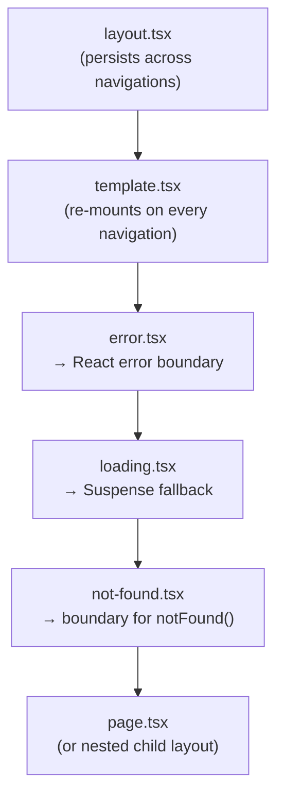
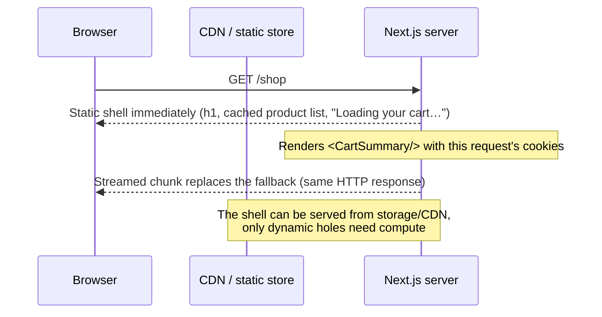

# 05 — Next.js (Part 1 of 4): Routing, Server Components, Rendering & Data Fetching

> **Parts:** **Part 1 — Overview, Topic Map, Routing, Server Components, Rendering & Data** · [Part 2 — Caching, Server Actions, Route Handlers, Proxy, Auth, Env & Runtimes](./05-nextjs-part2.md) · [Part 3 — Optimization, SEO, Web Vitals, Errors, Deployment & Full Example](./05-nextjs-part3.md) · [Part 4 — Resources, Practice, Interview Questions & Revision](./05-nextjs-part4.md)
>
> Applies to: **Next.js 16.4** (October 2026) with React 19.3 and the **App Router**. Where behavior differs between the **Cache Components** model (`cacheComponents: true` — the default for new apps since 16.4 and planned as the only model in Next.js 17) and the **previous model** (still what most existing 14/15/16 codebases run), both are shown and labeled. Next.js moves fast; verify against nextjs.org/docs for your version. React fundamentals (RSC concepts, Suspense, Actions) are in [04-react Part 2](./04-react-part2.md#35-server-components--server-functions); this file covers what Next.js adds on top.

## Table of Contents

- [1. Overview](#1-overview)
- [2. Topic Map](#2-topic-map)
- [3. Detailed Explanations (Part 1)](#3-detailed-explanations-part-1)
  - [3.1 App Router vs Pages Router](#31-app-router-vs-pages-router)
  - [3.2 Routing & File Conventions](#32-routing--file-conventions)
  - [3.3 Server & Client Components in Next.js](#33-server--client-components-in-nextjs)
  - [3.4 Rendering Strategies: SSR, SSG, ISR, PPR](#34-rendering-strategies-ssr-ssg-isr-ppr)
  - [3.5 Data Fetching Patterns](#35-data-fetching-patterns)
  - [3.6 Streaming](#36-streaming)
- [Next: Part 2](#next-part-2)

---

## 1. Overview

**What it is.** Next.js is a React framework that owns the parts React deliberately leaves open: routing, server rendering, data loading and caching, bundling (Turbopack), mutations (Server Actions), request interception (Proxy), asset optimization, and deployment output. With the App Router it is the reference implementation of React Server Components.

**Why interviewers care.** "Full stack React" in a job description usually means Next.js. It is also where candidates most often give *outdated* answers, because the framework's defaults have changed three times in three years. Interviewers use it to test whether you understand *where code runs* and *what gets cached*:

| Junior answer | Senior answer |
|---------------|---------------|
| "Server Components are SSR" | "Server Components run only on the server and send an RSC payload; SSR turns the tree into HTML for the first load. A request usually uses both" |
| "`fetch` is cached by default" | "That was Next 14. Since 15, `fetch` isn't cached unless you opt in; with Cache Components, nothing is cached unless you write `'use cache'`" |
| "Use middleware for auth" | "Middleware — now `proxy.ts` — is only for an optimistic redirect. The real check is in a Data Access Layer called by every page, Server Action and Route Handler, because Server Actions are public POST endpoints" |
| "ISR regenerates the page every N seconds" | "It's stale-while-revalidate: after N seconds the *next* request still gets the stale page and triggers a background regeneration. On-demand invalidation with tags is usually better" |

**Version landscape — know which era a codebase is in:**

| Version | Date | What changed (interview-relevant) |
|---------|------|-----------------------------------|
| 13.4 | May 2023 | App Router stable; Server Actions experimental |
| 14 | Oct 2023 | Server Actions stable; `fetch` cached by default (the "everything is cached" era) |
| 15 | Oct 2024 | React 19; `params`/`searchParams`/`cookies()`/`headers()` become async; `fetch`, `GET` Route Handlers and client router cache **no longer cached by default** |
| 15.5 | Aug 2025 | Node.js runtime for middleware stable; typed `PageProps`/`LayoutProps` helpers; `next lint` deprecated |
| 16 | Oct 2025 | **Cache Components** (`'use cache'`, `cacheLife`, `cacheTag`) and PPR as its rendering model; `middleware.ts` → **`proxy.ts`** (Node runtime); Turbopack default; `revalidateTag(tag, profile)`, `updateTag`, `refresh`; sync `params`/`cookies()` removed; Node 20.9+ |
| 16.2 | Mar 2026 | Deployment **Adapters API** stable; `unstable_catchError` |
| 16.3 | Jun 2026 | **Instant Navigations** and Partial Prefetching; App Shell for unlisted ISR params; root params; `catchError` and `retry` stable; TypeScript 7 support |
| 16.4 | Oct 2026 | Cache Components **recommended for every app** and on by default in `create-next-app`; `ensureStatic`; `navigation()`/`prefetch()` deferral; React 19.3 |

**Depth expected at 3+ years.**

- Explain the server/client boundary, what crosses it (serializable props, Server Function references) and what doesn't.
- Describe exactly what's cached, where, for how long, and how each cache is invalidated — in *both* models, since you'll meet both.
- Pick a rendering strategy per *component* (static shell, cached, streamed) rather than per page.
- Write secure Server Actions: authenticate, authorize, validate, and revalidate correctly.
- Deploy beyond Vercel: standalone output in Docker, shared caches across instances, skew and encryption-key concerns.
- Diagnose Core Web Vitals problems and fix them with Next.js primitives.

> 💡 Interview Tip: Open any Next.js answer by stating the version and model: "In Next 15 without Cache Components…" or "With Cache Components in 16…". It immediately signals that you know the defaults changed, and it protects you when your interviewer's mental model is a version behind.

---

## 2. Topic Map

Legend: 🟢 fundamentals · 🟡 intermediate · 🔴 advanced · ⭐ interview favorite

**Part 1 — Routing, Server Components, rendering, data (this file)**

- [ ] 🟢⭐ App Router vs Pages Router; mapping Pages Router APIs to App Router
- [ ] 🟢 File conventions: `layout`, `page`, `loading`, `error`, `not-found`, `template`, `route`, `default`
- [ ] 🟡 Route groups, dynamic and catch-all segments, parallel routes, intercepting routes (modal pattern)
- [ ] 🟡⭐ Server vs Client Components in Next: `"use client"` placement, serialization, `server-only`, providers
- [ ] 🟡⭐ SSR / SSG / ISR / CSR / PPR — and how each is expressed in both caching models
- [ ] 🟡⭐ Data fetching: parallel vs sequential, waterfalls, `React.cache`, preloading, passing promises to the client
- [ ] 🟡 Streaming: `loading.tsx`, Suspense boundaries, status codes and bots

**Part 2 — Server-side features ([link](./05-nextjs-part2.md))**

- [ ] 🔴⭐ Previous model: the four caches (Request Memoization, Data Cache, Full Route Cache, Router Cache)
- [ ] 🔴⭐ Cache Components: `'use cache'` (+ `private`/`remote`), `cacheLife`, `cacheTag`, static shell, `connection()`
- [ ] 🔴⭐ Invalidation: `revalidateTag` vs `updateTag` vs `revalidatePath` vs `refresh` vs `router.refresh`
- [ ] 🟡⭐ Server Actions: forms, `useActionState`, security model, validation, revalidation, sequential dispatch
- [ ] 🟡 Route Handlers: when vs Server Actions, webhooks, streaming, CORS
- [ ] 🟡⭐ Proxy (formerly Middleware): matcher, execution order, limits, CVE-2025-29927 lesson
- [ ] 🟡⭐ Authentication: sessions, Auth.js v5, Data Access Layer, auth with Cache Components
- [ ] 🟢 Environment variables: `NEXT_PUBLIC_`, build vs runtime
- [ ] 🟡 Node.js vs Edge runtime (Edge deprecated)

**Part 3 — Optimization & production ([link](./05-nextjs-part3.md))**

- [ ] 🟡 `next/image`, `next/font`, `next/script`
- [ ] 🟡 Metadata API, OG images, sitemap/robots, streaming metadata
- [ ] 🟡⭐ Core Web Vitals (LCP, INP, CLS) and Next.js-specific fixes
- [ ] 🟡 Error handling: `error.tsx` + `retry`, `global-error`, `not-found`, `catchError`, `instrumentation.ts`
- [ ] 🔴⭐ Deployment: Vercel, `output: "standalone"` + Docker, adapters/OpenNext, multi-instance caches, skew

---

## 3. Detailed Explanations (Part 1)

### 3.1 App Router vs Pages Router

**Explanation.** Next.js has two routers that can coexist in one app (`app/` and `pages/`):

| | Pages Router (`pages/`) | App Router (`app/`) |
|--|------------------------|--------------------|
| Component model | Every component is a Client Component (rendered on the server for HTML, then hydrated) | Server Components by default; `"use client"` opts subtrees into client JS |
| Data loading | Page-level functions: `getServerSideProps`, `getStaticProps`, `getStaticPaths` | `async` components fetch where the data is used |
| Layouts | `_app` + manual per-page layout patterns; layouts re-mount on navigation | Nested `layout.tsx` that persist across navigations and keep state |
| Loading / errors | Manual | `loading.tsx` (Suspense) and `error.tsx` (error boundary) per segment |
| Mutations | API routes + client fetch | Server Actions (plus Route Handlers) |
| Streaming | No (whole page HTML at once) | Yes, per Suspense boundary |
| Caching | Page-level SSG/ISR | Component/function-level (`'use cache'`) or route-level (previous model) |
| Head / SEO | `next/head` | Metadata API |
| Status | Supported, maintenance mode for new features | Where all new features land |

**Mapping Pages Router APIs** (useful for migration questions):

| Pages Router | App Router (previous model) | App Router (Cache Components) |
|--------------|-----------------------------|-------------------------------|
| `getServerSideProps` | `async` Server Component; dynamic because it reads `cookies()`/`headers()`/`searchParams` or uses `cache: "no-store"` | `async` Server Component inside `<Suspense>` (dynamic by default) |
| `getStaticProps` | `async` Server Component with cached `fetch`/`unstable_cache` | `'use cache'` + `cacheLife` |
| `getStaticProps` + `revalidate: 60` | `export const revalidate = 60` or `fetch(url, { next: { revalidate: 60 } })` | `cacheLife({ revalidate: 60 })` |
| `getStaticPaths` | `generateStaticParams` | `generateStaticParams` |
| `fallback: true` / `'blocking'` | `dynamicParams = true` (default) | App Shell for unlisted params (with Partial Prefetching) |
| `pages/api/*` | `app/**/route.ts` Route Handlers | Same |
| `_app.tsx` / `_document.tsx` | Root `app/layout.tsx` (owns `<html>`/`<body>`) | Same |
| `next/head` | `metadata` / `generateMetadata` | Same |
| `useRouter` from `next/router` | `useRouter`, `usePathname`, `useSearchParams` from `next/navigation` | Same |

**Migration strategy.** Incremental: keep `pages/`, move one route at a time into `app/` (defining the same path in both routers is a build error), starting with leaf pages that have simple data needs. Move shared providers into a Client Component imported by the root layout. Replace `getServerSideProps` logic with direct data access in a Server Component (no internal API hop). Navigation between the two routers is a hard navigation (full page load), so migrate tightly linked sections together.

> ⚠️ Pitfall: Calling your own Route Handler (`fetch("http://localhost:3000/api/products")`) from a Server Component. It adds a network hop, breaks at build time (no server running), and loses types. Call the data function directly — the Server Component already runs on the server.

> 💡 Interview Tip: "Why App Router?" — answer with trade-offs, not hype: less client JavaScript and colocated data fetching, nested persistent layouts and streaming; costs are a server/client boundary to design, a more complex caching model, and a steeper learning curve for the team.

### 3.2 Routing & File Conventions

**Explanation.** Folders define URL segments; special files inside a folder define the UI for that segment. Only `page.tsx` and `route.ts` make a segment publicly routable, so you can colocate components, tests and utilities in `app/` safely.

```text
app/
├── layout.tsx                 # root layout: <html>, <body>; required
├── page.tsx                   # "/"
├── not-found.tsx              # 404 UI for notFound() and unmatched URLs
├── global-error.tsx           # replaces the root layout when it throws
├── (marketing)/               # route group: organizes, doesn't affect the URL
│   ├── layout.tsx             # layout only for marketing pages
│   └── pricing/page.tsx       # "/pricing"
├── blog/
│   ├── page.tsx               # "/blog"
│   └── [slug]/                # dynamic segment: "/blog/hello"
│       ├── page.tsx
│       ├── loading.tsx        # Suspense fallback for this segment
│       ├── error.tsx          # error boundary for this segment (Client Component)
│       └── opengraph-image.tsx
├── docs/[...slug]/page.tsx    # catch-all: "/docs/a/b/c" (requires ≥1 segment)
├── shop/[[...filters]]/page.tsx # optional catch-all: also matches "/shop"
├── api/webhooks/route.ts      # Route Handler (no page.tsx allowed in the same folder)
├── _components/               # private folder: never routable
├── @modal/                    # parallel route slot (passed to the layout as `modal`)
│   ├── default.tsx            # required fallback for the slot (Next 16)
│   └── (.)photos/[id]/page.tsx # intercepting route: soft-nav to /photos/1 opens a modal
└── photos/[id]/page.tsx       # hard navigation / refresh renders the full page
```

How the special files nest for one segment (outer → inner):



Because `error.tsx` sits *inside* the layout of the same segment, it can't catch errors thrown by that layout — the parent segment's `error.tsx` does (or `global-error.tsx` for the root layout).

**Layouts vs templates.** A layout is preserved on navigation between its child pages: its state, effects and DOM survive, and it does not re-render. That's great for nav bars and sidebars, and a trap for auth (see [Part 2 §3.11](./05-nextjs-part2.md#311-authentication)). A `template.tsx` gets a new key per navigation, so it re-mounts — use it for enter animations or per-page effects like logging.

**Dynamic segments** receive `params` as a **Promise** (Next 15+, mandatory in 16). Next.js generates global, route-aware helper types — `PageProps<'/blog/[slug]'>`, `LayoutProps<'/blog'>`, `RouteContext<'/api/items/[id]'>` — during `next dev`, `next build` or `next typegen`, so you don't hand-write `{ params: Promise<{ slug: string }> }`.

**Parallel + intercepting routes — the modal pattern.** Clicking a photo in a grid opens it in a modal (URL changes to `/photos/1`, shareable), while refreshing or opening the link directly renders the full photo page. Interception markers are relative to *route segments*, not folders: `(.)` same level, `(..)` one level up, `(...)` from the root.

```tsx
// lib/photos.ts
export type Photo = { id: string; title: string; color: string };

export const photos: Photo[] = [
  { id: "1", title: "Sunrise", color: "#f59e0b" },
  { id: "2", title: "Forest", color: "#16a34a" },
  { id: "3", title: "Ocean", color: "#0284c7" },
];

export function getPhoto(id: string): Photo | undefined {
  return photos.find((p) => p.id === id);
}
```

```tsx
// app/layout.tsx
import type { ReactNode } from "react";

export default function RootLayout({ children, modal }: { children: ReactNode; modal: ReactNode }) {
  return (
    <html lang="en">
      <body>
        {children}
        {modal}
      </body>
    </html>
  );
}
```

```tsx
// app/@modal/default.tsx
export default function Default() {
  return null; // slot renders nothing when no intercepted route matches
}
```

```tsx
// app/photos/page.tsx
import Link from "next/link";
import { photos } from "@/lib/photos";

export default function PhotoGrid() {
  return (
    <ul style={{ display: "flex", gap: 12, listStyle: "none" }}>
      {photos.map((p) => (
        <li key={p.id}>
          <Link href={`/photos/${p.id}`} aria-label={p.title}>
            <div style={{ width: 120, height: 80, background: p.color }} />
          </Link>
        </li>
      ))}
    </ul>
  );
}
```

```tsx
// app/photos/[id]/page.tsx
import { notFound } from "next/navigation";
import { Suspense } from "react";
import { getPhoto, photos } from "@/lib/photos";

export function generateStaticParams() {
  return photos.map((p) => ({ id: p.id }));
}

async function PhotoDetails({ params }: Pick<PageProps<"/photos/[id]">, "params">) {
  const { id } = await params;
  const photo = getPhoto(id);
  if (!photo) notFound();
  return (
    <article>
      <h1>{photo.title}</h1>
      <div style={{ width: 480, height: 320, background: photo.color }} />
    </article>
  );
}

export default function PhotoPage(props: PageProps<"/photos/[id]">) {
  return (
    <Suspense fallback={<p>Loading photo…</p>}>
      <PhotoDetails params={props.params} />
    </Suspense>
  );
}
```

```tsx
// app/@modal/(.)photos/[id]/page.tsx
import { Suspense } from "react";
import { Modal } from "@/components/modal";
import { getPhoto } from "@/lib/photos";

async function PhotoInModal({ params }: Pick<PageProps<"/photos/[id]">, "params">) {
  const { id } = await params;
  const photo = getPhoto(id);
  if (!photo) return null;
  return (
    <Modal title={photo.title}>
      <div style={{ width: 320, height: 200, background: photo.color }} />
    </Modal>
  );
}

export default function InterceptedPhoto(props: PageProps<"/photos/[id]">) {
  return (
    <Suspense fallback={null}>
      <PhotoInModal params={props.params} />
    </Suspense>
  );
}
```

```tsx
// components/modal.tsx
"use client";

import { useRouter } from "next/navigation";
import { useEffect, useRef, type ReactNode } from "react";

export function Modal({ title, children }: { title: string; children: ReactNode }) {
  const router = useRouter();
  const ref = useRef<HTMLDialogElement>(null);

  useEffect(() => {
    const dialog = ref.current;
    if (dialog && !dialog.open) dialog.showModal(); // native dialog: focus trap, Escape, inert background
    return () => dialog?.close(); // runs on unmount AND when <Activity> hides the route
  }, []);

  return (
    <dialog
      ref={ref}
      aria-label={title}
      onCancel={(e) => {
        e.preventDefault(); // Escape: let the router close it, not the browser
        router.back();
      }}
    >
      <h2>{title}</h2>
      {children}
      <button type="button" onClick={() => router.back()}>
        Close
      </button>
    </dialog>
  );
}
```

> ⚠️ Pitfall: In Next 16 every parallel route slot needs a `default.tsx`; builds fail without it. `default.tsx` is what renders in the slot on a hard navigation when Next.js can't recover the slot's previous state.

> ⚠️ Pitfall (Cache Components): on back/forward navigation Next keeps recently visited routes mounted but **hidden** inside React `<Activity>` (`display: none`) to preserve their state. A modal that only calls `showModal()` stays `open` in the browser's top layer while hidden. React runs effect cleanups when Activity hides a subtree, so close the dialog in the cleanup. Avoid putting `router.back()` in `onClose`: the cleanup's `close()` would fire it a second time.

**Navigation.** `<Link>` does client-side navigation and prefetches routes as links enter the viewport. In 16.x the prefetch cache was rewritten: shared layouts are downloaded once, only missing segments are fetched, and with **Partial Prefetching** (16.3+, on by default in new apps) a default `<Link>` prefetches the route's *App Shell* — static content plus loading states — while `prefetch={true}` also prefetches cached content that depends on that link's params/search params. Use `useRouter()` from `next/navigation` for imperative navigation, `redirect()`/`permanentRedirect()` on the server, and `notFound()` to render the nearest `not-found.tsx`.

> 💡 Interview Tip: "How does a soft navigation work?" — `<Link>` fetches the **RSC payload** for the new route (not HTML), React reconciles it into the existing tree, shared layouts are untouched, and only the changed segments re-render. Client state in layouts survives; scroll and focus are managed by the router.

### 3.3 Server & Client Components in Next.js

**Explanation.** Every file in `app/` is a Server Component unless it — or a module that imports it — is marked `"use client"`. The directive marks an **entry point into the client module graph**: that module and everything it imports are bundled for the browser (and still server-rendered to HTML on first load). You don't need it on every client file, only on the boundary.

| Need | Server Component | Client Component |
|------|:---------------:|:----------------:|
| Fetch data, read DB/secrets/files | ✅ | ❌ (call an API or a Server Function) |
| Large dependencies kept off the client (markdown parser, date libs) | ✅ | ❌ ships to the browser |
| `useState`, `useEffect`, event handlers, refs | ❌ | ✅ |
| Browser APIs (`window`, `localStorage`, `IntersectionObserver`) | ❌ | ✅ |
| Context providers / consumers | ❌ (can render a client provider) | ✅ |
| `async` component | ✅ | ❌ (use `use(promise)`) |

**Rules at the boundary.**

1. Props from Server to Client Components must be **serializable** by React: primitives, plain objects/arrays, `Date`, `Map`, `Set`, typed arrays, Promises (consumed with `use`), JSX, and **Server Function references**. Not class instances, plain functions, or symbols.
2. A Client Component can't *import* a Server Component (the import would pull it into the client bundle), but it can *render* one passed as `children` or another prop. This "donut" pattern keeps the heavy part on the server.
3. Push `"use client"` to the **leaves** — the like button, not the whole page.
4. Mark server-only modules with `import "server-only"`, so an accidental import from a Client Component fails the build instead of leaking secrets or bundling a DB driver.

```tsx
// lib/secrets.ts
import "server-only";

export function getAnalyticsKey(): string {
  const key = process.env.ANALYTICS_SECRET;
  if (!key) throw new Error("ANALYTICS_SECRET is not set");
  return key;
}
```

```tsx
// components/collapsible.tsx
"use client";

import { useState, type ReactNode } from "react";

// Client "donut": owns the interactivity, renders server-rendered children it never imports
export function Collapsible({ title, children }: { title: string; children: ReactNode }) {
  const [open, setOpen] = useState(false);
  return (
    <section>
      <button type="button" aria-expanded={open} onClick={() => setOpen((o) => !o)}>
        {title}
      </button>
      {open && <div>{children}</div>}
    </section>
  );
}
```

```tsx
// app/faq/page.tsx
import { Collapsible } from "@/components/collapsible";

const faqs = [
  { q: "Do you ship worldwide?", a: "Yes, to 40+ countries." },
  { q: "What is the return window?", a: "30 days from delivery." },
];

export default function FaqPage() {
  return (
    <main>
      <h1>FAQ</h1>
      {faqs.map((f) => (
        <Collapsible key={f.q} title={f.q}>
          {/* Rendered on the server; only the Collapsible's toggle logic ships as JS */}
          <p>{f.a}</p>
        </Collapsible>
      ))}
    </main>
  );
}
```

**Providers.** Context needs a Client Component. Wrap providers in one `"use client"` file and render it from the root layout; its `children` (the rest of the app) remain Server Components. Render providers as deep as possible — a provider around `<html>` prevents Next.js from optimizing static parts as much.

**What leaks to the client.** Anything passed as a prop to a Client Component ends up in the RSC payload in the page source — including fields you didn't render. Shape data before passing it (`{ id, name }`, not the whole user row). React's experimental taint APIs (`experimental_taintObjectReference`, `experimental_taintUniqueValue`, enabled with `experimental.taint`) can make the build or render throw if a tainted secret crosses the boundary.

> ⚠️ Pitfall: `process.env.SECRET` inside a Client Component is `undefined` (only `NEXT_PUBLIC_*` vars are inlined into client bundles) — but a secret passed *as a prop* from a Server Component is shipped to the browser. The leak is the prop, not the env var.

> 💡 Interview Tip: "Where would you put `'use client'` on a product page?" — on the add-to-cart button, image carousel and review form; the page, product details, reviews list and recommendations stay on the server. Then mention the donut pattern for a client tab container with server-rendered panels.

### 3.4 Rendering Strategies: SSR, SSG, ISR, PPR

**Definitions.**

| Strategy | When HTML is produced | Freshness | Typical use |
|----------|-----------------------|-----------|-------------|
| **SSG** (static) | Build time | Until next build/revalidation | Marketing, docs, blog |
| **ISR** | Build time or first request, then regenerated in the background | Stale-while-revalidate after a time or on demand | Catalogs, CMS content |
| **SSR** (dynamic) | Every request | Always fresh | Personalized dashboards, search |
| **CSR** | In the browser after JS loads | Client-controlled | Highly interactive widgets behind auth |
| **PPR** (Partial Prerendering) | Static shell at build time + dynamic parts streamed per request, **in one response** | Per component | Most real pages: static layout + personalized or fresh islands |

**Previous model — static or dynamic per *route*.** Next.js renders a route statically at build time unless something makes it dynamic: reading `cookies()`, `headers()`, `searchParams`, `connection()`, an uncached `fetch` (`cache: "no-store"`), or `export const dynamic = "force-dynamic"`. One dynamic call anywhere makes the whole route dynamic. ISR is configured with `export const revalidate = N` or `fetch(url, { next: { revalidate: N, tags } })`. `next build` prints each route with a symbol: ○ static, ● SSG with `generateStaticParams`, ƒ dynamic. (With Cache Components you'll also see ◐ *Partial Prerender* — a static shell with streamed dynamic content — plus each cached route's Revalidate/Expire times.)

```tsx
// [previous model] app/legacy-blog/[slug]/page.tsx
export const revalidate = 3600; // ISR: regenerate at most once an hour

export async function generateStaticParams() {
  const posts: { slug: string }[] = await fetch("https://api.example.com/posts").then((r) => r.json());
  return posts.map((p) => ({ slug: p.slug })); // prerender these; others render on first request
}

export default async function Post({ params }: PageProps<"/legacy-blog/[slug]">) {
  const { slug } = await params;
  const post: { title: string; html: string } = await fetch(`https://api.example.com/posts/${slug}`, {
    next: { tags: [`post:${slug}`] }, // on-demand: revalidateTag(`post:${slug}`, "max")
  }).then((r) => r.json());
  return <article><h1>{post.title}</h1><div dangerouslySetInnerHTML={{ __html: post.html }} /></article>;
}
```

**Cache Components model — static, cached or dynamic per *component*.** Everything is dynamic (request-time) by default and nothing is cached implicitly. At build time Next.js prerenders as much of each route as it can into a **static shell** (HTML + RSC payload), which is PPR — the default rendering model:

- Synchronous/pure code and module imports → part of the static shell.
- `'use cache'` functions/components → cached and included in the shell (unless their lifetime is very short).
- Uncached async work or runtime APIs (`cookies()`, `headers()`, `searchParams`, awaited dynamic `params`) → **must** be inside a `<Suspense>` boundary; its fallback goes into the shell and the content streams at request time. If you forget the boundary, the dev overlay and build report a "blocking route" error naming the component — the framework won't silently make the whole page dynamic.
- `Math.random()`, `Date.now()`, `crypto.randomUUID()` → either `await connection()` first (per request, inside Suspense) or put them in `'use cache'` (shared).

```tsx
// lib/catalog.ts
import { cacheLife, cacheTag } from "next/cache";

export type Product = { id: string; name: string; price: number };

const PRODUCTS: Product[] = [
  { id: "p1", name: "Mechanical keyboard", price: 129 },
  { id: "p2", name: "USB-C dock", price: 89 },
  { id: "p3", name: "4K monitor", price: 399 },
];

export async function getProducts(): Promise<Product[]> {
  "use cache";
  cacheLife("hours");
  cacheTag("products");
  await new Promise((r) => setTimeout(r, 50)); // stand-in for a DB query
  return PRODUCTS;
}

export async function getProduct(id: string): Promise<Product | undefined> {
  "use cache";
  cacheLife("hours");
  cacheTag("products", `product:${id}`);
  return PRODUCTS.find((p) => p.id === id);
}
```

```tsx
// app/shop/page.tsx
import { cookies } from "next/headers";
import Link from "next/link";
import { Suspense } from "react";
import { getProducts } from "@/lib/catalog";

export default function ShopPage() {
  return (
    <main>
      <h1>Shop</h1>                             {/* static: in the shell */}
      <ProductList />                           {/* cached: in the shell, refreshed hourly or by tag */}
      <Suspense fallback={<p>Loading your cart…</p>}>
        <CartSummary />                         {/* runtime data: fallback in the shell, streamed per request */}
      </Suspense>
    </main>
  );
}

async function ProductList() {
  const products = await getProducts();
  return (
    <ul>
      {products.map((p) => (
        <li key={p.id}>
          <Link href={`/shop/${p.id}`}>{p.name}</Link> — ${p.price}
        </li>
      ))}
    </ul>
  );
}

async function CartSummary() {
  const count = Number((await cookies()).get("cart_count")?.value ?? 0);
  return <p>{count} item(s) in your cart</p>;
}
```



**ISR with Cache Components.** `generateStaticParams` lists URLs to prerender fully. Other URLs get the route's **App Shell** instantly (16.3+), the param-specific content streams, and Next.js upgrades the cached page in the background for the next visitor — the equivalent of Pages Router `fallback: true`. The rule that makes this work: **don't await `params` above a Suspense boundary**; pass the promise down and await it inside.

```tsx
// app/shop/[id]/page.tsx
import { notFound } from "next/navigation";
import { Suspense } from "react";
import { getProduct, getProducts } from "@/lib/catalog";

export async function generateStaticParams() {
  const products = await getProducts();
  return products.slice(0, 2).map((p) => ({ id: p.id })); // prerender the popular ones only
}

async function ProductDetails({ params }: Pick<PageProps<"/shop/[id]">, "params">) {
  const { id } = await params; // awaited inside the boundary → the page still has an App Shell
  const product = await getProduct(id);
  if (!product) notFound();
  return (
    <article>
      <h1>{product.name}</h1>
      <p>${product.price}</p>
    </article>
  );
}

export default function ProductPage(props: PageProps<"/shop/[id]">) {
  return (
    <main>
      <Suspense fallback={<p>Loading product…</p>}>
        <ProductDetails params={props.params} />
      </Suspense>
    </main>
  );
}
```

**Strategy cheat-sheet for both models:**

| Goal | Previous model | Cache Components |
|------|----------------|------------------|
| Fully static page | Default when no dynamic APIs | Default when no runtime/uncached data; enforce with `export const ensureStatic = "navigation"` (16.4) |
| Time-based ISR | `revalidate = N` / `fetch` `next.revalidate` | `cacheLife({ revalidate: N })` or a profile |
| On-demand ISR | `fetch` `next.tags` / `unstable_cache` tags + `revalidateTag`/`revalidatePath` | `cacheTag` + `revalidateTag`/`updateTag`/`revalidatePath` |
| Always fresh | `dynamic = "force-dynamic"` or `cache: "no-store"` | Default — just wrap in `<Suspense>` |
| Static + personalized parts | Not possible per route (whole route becomes dynamic) | PPR: static shell + Suspense holes |

> ⚠️ Pitfall: In the previous model, one `cookies()` call in a shared header component silently made *every* route using that layout dynamic. In Cache Components the same mistake surfaces as a build error, and the 16.3 Instant Insights devtool flags navigations that stopped being instant.

> 💡 Interview Tip: When asked "SSR or SSG?", reframe: "With PPR, the question is per component. The layout, nav and product description are static or cached; the price-for-this-user and cart are streamed. The page gets a CDN-fast first byte *and* fresh data."

### 3.5 Data Fetching Patterns

**Fetch on the server, where the data is used.** Server Components can `await` a database query or `fetch` directly. Because each component fetches its own data, two problems need active design:

**1. Waterfalls.** Sequential `await`s in one component, or a parent that awaits before rendering children that also fetch, serialize network time.

```tsx
// ❌ Sequential: total ≈ user + orders + recommendations
async function DashboardSlow({ userId }: { userId: string }) {
  const user = await getUser(userId);
  const orders = await getOrders(userId);          // doesn't depend on user — waits anyway
  const recs = await getRecommendations(userId);
  return <Dashboard user={user} orders={orders} recs={recs} />;
}

// ✅ Parallel: total ≈ max(user, orders, recommendations)
async function DashboardFast({ userId }: { userId: string }) {
  const [user, orders, recs] = await Promise.all([getUser(userId), getOrders(userId), getRecommendations(userId)]);
  return <Dashboard user={user} orders={orders} recs={recs} />;
}
```

Better still for independent widgets: give each its own async component and `<Suspense>` boundary, so each streams as soon as *its* data is ready and a slow recommendation service doesn't hold back the orders table.

**2. Duplicate requests.** Several components (and `generateMetadata`) often need the same data. Wrap non-`fetch` data access in `React.cache` to dedupe within one render pass; in the previous model `fetch` `GET`s with identical URL and options are memoized automatically (Request Memoization). `React.cache` is per-request — it doesn't persist across requests (that's `'use cache'`'s job).

```tsx
// lib/users.ts
import "server-only";
import { cache } from "react";

export type User = { id: string; name: string; plan: "free" | "pro" };

const USERS = new Map<string, User>([["u1", { id: "u1", name: "Ada", plan: "pro" }]]);

// Deduped per request: layout, page and generateMetadata can all call it; the query runs once
export const getUser = cache(async (id: string): Promise<User | null> => {
  await new Promise((r) => setTimeout(r, 30));
  return USERS.get(id) ?? null;
});

// Start loading early, before other blocking work, without awaiting
export function preloadUser(id: string): void {
  void getUser(id);
}
```

**Passing promises to Client Components.** Start the fetch on the server, pass the *promise* as a prop, and unwrap it with `use()` inside a client component under Suspense. The server doesn't block on it, and the client gets streamed data without a client-side fetch.

```tsx
// app/stats/page.tsx
import { Suspense } from "react";
import { StatsChart } from "@/components/stats-chart";

async function getStats(): Promise<number[]> {
  await new Promise((r) => setTimeout(r, 200));
  return [3, 7, 4, 9];
}

export default function StatsPage() {
  const statsPromise = getStats(); // not awaited
  return (
    <main>
      <h1>Stats</h1>
      <Suspense fallback={<p>Loading chart…</p>}>
        <StatsChart statsPromise={statsPromise} />
      </Suspense>
    </main>
  );
}
```

```tsx
// components/stats-chart.tsx
"use client";

import { use, useState } from "react";

export function StatsChart({ statsPromise }: { statsPromise: Promise<number[]> }) {
  const stats = use(statsPromise);
  const [highlight, setHighlight] = useState<number | null>(null);
  return (
    <div style={{ display: "flex", alignItems: "flex-end", gap: 4, height: 100 }}>
      {stats.map((v, i) => (
        <button
          key={i}
          type="button"
          aria-label={`Value ${v}`}
          onMouseEnter={() => setHighlight(i)}
          style={{ height: v * 10, width: 20, background: highlight === i ? "tomato" : "steelblue" }}
        />
      ))}
    </div>
  );
}
```

**Client-side fetching** is still right for data that changes after load without navigation (polling, infinite scroll, search-as-you-type) — use TanStack Query or SWR, optionally seeded with initial data from a Server Component ([04-react Part 2 §3.1](./04-react-part2.md#31-state-management-choosing-the-right-tool)).

| Data | Where to fetch |
|------|----------------|
| Needed for first render, SEO-relevant | Server Component |
| Shared across components in a request | Server + `React.cache` |
| Same for many users, changes rarely | `'use cache'` (or previous-model cached fetch) |
| Changes on user interaction without navigation | Client (TanStack Query / SWR), maybe seeded by the server |
| Mutation | Server Action (from forms) or Route Handler (external clients) |

> ⚠️ Pitfall: `await`ing everything at the top of `page.tsx` and passing results down. It creates a waterfall *and* turns the whole page into one Suspense unit. Fetch in the leaf that needs the data, and deduplicate with `React.cache`.

### 3.6 Streaming

**Explanation.** With streaming, the server sends HTML in chunks over one HTTP response. The shell (layouts, static content, Suspense fallbacks) goes first; each Suspense boundary's content follows as soon as it resolves, as an HTML fragment plus a tiny inline script that swaps it into place — **out of order**, so a fast widget below a slow one isn't blocked. Selective hydration then hydrates boundaries as their code arrives, prioritizing the ones the user interacts with.

Two ways to create boundaries:

- `loading.tsx` — wraps the segment's `page` in `<Suspense fallback={<Loading />}>` automatically. Coarse, and it's also what navigation shows instantly while the new segment loads.
- `<Suspense>` in JSX — fine-grained, anywhere in the tree. Preferred for independent widgets.

```tsx
// app/stream-demo/page.tsx
import { Suspense } from "react";

async function Slow({ ms, label }: { ms: number; label: string }) {
  await new Promise((r) => setTimeout(r, ms));
  return <p>{label} loaded after {ms} ms</p>;
}

export default function StreamDemo() {
  return (
    <main>
      <h1>Streaming demo</h1>
      <Suspense fallback={<p>Loading slow widget…</p>}>
        <Slow ms={1500} label="Slow widget" />
      </Suspense>
      <Suspense fallback={<p>Loading fast widget…</p>}>
        <Slow ms={300} label="Fast widget" />  {/* arrives first even though it's below */}
      </Suspense>
    </main>
  );
}
```

> ⚠️ Pitfall: In the Cache Components model this page renders the two widgets at **request time** because they're uncached async work inside Suspense. In the previous model, the same code with no dynamic APIs would be **prerendered at build time** and never stream in production — a common "streaming works in dev but not prod" confusion.

**Status codes and headers.** Once the first byte is sent, the status code and headers are fixed. If a streamed boundary later calls `notFound()` or `redirect()`, Next.js can't change the 200: it injects a `<meta name="robots" content="noindex">` for not-found and performs a client-side redirect. So call `notFound()`/`redirect()` **before** the first Suspense boundary when the status matters (SEO, crawlers), e.g. validate the slug in the page component itself — at the cost of making that part blocking.

With Cache Components that isn't always enough. For a dynamic route with `generateStaticParams`, an *unlisted* param is served from the route's fallback shell, and the static layout part of that shell is flushed before the page even reads `params`. Measured on 16.4 with the [Part 3 blog](./05-nextjs-part3.md#4-full-example-a-blog-with-comments):

- The first request for an unknown slug gets **200 + `noindex`**, even though the page calls `notFound()` at the top level.
- HTML-limited bots (Twitterbot, Bingbot…) get a real **404**, because they skip the shell.
- Later requests for the same slug get **404**, because the not-found result is cached.

`noindex` is enough for Google. If the status itself matters on the first hit (monitoring, link checkers), reject unknown slugs earlier — e.g. in `proxy.ts` against a known-slug set. `dynamicParams = false` is not available with Cache Components.

**Bots.** Some crawlers can't execute streamed metadata. Next.js detects them by user agent (`htmlLimitedBots` config) and serves blocking metadata in `<head>`; with PPR it skips the static shell and renders those requests dynamically. Data needed at build-time prerender must therefore also be available at request time.

> 💡 Interview Tip: "Why not wrap the whole page in one `loading.tsx`?" — one boundary means the page reveals all at once when the slowest query finishes. Boundaries should follow *what the user needs first*: the main content gets its own boundary; secondary widgets get theirs; and you avoid "popcorn" UI by grouping things that should appear together under one boundary.

---

## Next: Part 2

➡️ [05-nextjs-part2.md](./05-nextjs-part2.md) — caching in both models (the four caches and Cache Components), invalidation APIs, Server Actions and their security model, Route Handlers, Proxy, authentication, environment variables and runtimes.
