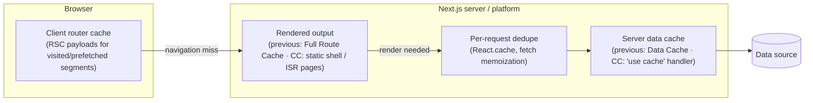

# 05 — Next.js (Part 2 of 4): Caching, Server Actions, Route Handlers, Proxy, Auth, Env & Runtimes

> **Parts:** [Part 1 — Overview, Topic Map, Routing, Server Components, Rendering & Data](./05-nextjs-part1.md) · **Part 2 — Caching, Server Actions, Route Handlers, Proxy, Auth, Env & Runtimes** · [Part 3 — Optimization, SEO, Web Vitals, Errors, Deployment & Full Example](./05-nextjs-part3.md) · [Part 4 — Resources, Practice, Interview Questions & Revision](./05-nextjs-part4.md)
>
> Applies to: Next.js 16.4. Sections marked **previous model** describe apps without `cacheComponents` (Next 14/15, and 16 apps that haven't migrated). Code blocks whose first line is a file path were built together with `next build` on 16.4 with Cache Components enabled.

## Table of Contents

- [3.7 Caching](#37-caching)
  - [Previous model: the four caches](#previous-model-the-four-caches)
  - [Cache Components: `'use cache'`](#cache-components-use-cache)
  - [Invalidation APIs](#invalidation-apis)
  - [Migrating between the models](#migrating-between-the-models)
- [3.8 Server Actions](#38-server-actions)
- [3.9 Route Handlers](#39-route-handlers)
- [3.10 Proxy (formerly Middleware)](#310-proxy-formerly-middleware)
- [3.11 Authentication](#311-authentication)
- [3.12 Environment Variables](#312-environment-variables)
- [3.13 Node.js vs Edge Runtime](#313-nodejs-vs-edge-runtime)
- [Next: Part 3](#next-part-3)

---

### 3.7 Caching

**Explanation.** Caching is the most-asked and most-misunderstood Next.js topic, because the model changed twice: Next 14 cached aggressively and implicitly; Next 15 turned most implicit caching off; Next 16 introduced **Cache Components**, where caching is explicit and component-level, and 16.4 recommends it for every app. Whatever the model, there are three questions to answer for any piece of data:

1. **Where is it cached?** Per request (dedupe), on the server across requests, in a CDN/static store as rendered output, or in the browser's router cache.
2. **For how long?** Time-based (revalidate/expire) and/or until an on-demand invalidation.
3. **How is it invalidated?** By tag, by path, by redeploy, or by navigation/refresh on the client.



#### Previous model: the four caches

Applies to Next 14–15 and 16 without `cacheComponents`. Interviewers still ask "name the four caches" — answer with the table, then say which defaults changed in 15.

| Cache | What | Where | Lifetime | Opt out / invalidate |
|-------|------|-------|----------|---------------------|
| **Request Memoization** | Return values of `fetch` `GET` calls with the same URL + options during one render pass (a React feature); use `React.cache` for non-`fetch` code | Server, per request | One request's render tree | Not needed — it's request-scoped. Doesn't apply in Route Handlers or to `POST` |
| **Data Cache** | Results of `fetch` with `cache: "force-cache"` or `next.revalidate`, and of `unstable_cache` | Server, persistent (survives requests and, on platforms that support it, deployments) | Until `revalidate` seconds pass or an on-demand invalidation | `cache: "no-store"`; `revalidateTag(tag, profile)`, `revalidatePath(path)` |
| **Full Route Cache** | Rendered HTML + RSC payload of **static** routes, produced at build time or on ISR regeneration | Server / CDN | Until the route's data revalidates or the next deploy | Make the route dynamic (`cookies()`, `headers()`, `searchParams`, `no-store` fetch, `dynamic = "force-dynamic"`); revalidating the data also regenerates the route |
| **Router Cache** | RSC payloads of visited and prefetched route segments | Browser memory | Session; per-segment stale times (`staleTimes` config) | `router.refresh()`; `revalidatePath`/`revalidateTag`/setting cookies inside a **Server Action** clears it; a hard reload |

**What changed in 15 (common interview follow-up):** `fetch` defaults to **not** cached (14 defaulted to `force-cache`); `GET` Route Handlers are not cached by default; the client Router Cache no longer reuses *page* segments for dynamic routes (`staleTimes.dynamic` default 0 — layouts, back/forward navigation and `loading.tsx` are still reused). One subtlety survives: an uncached `fetch` reached **before** any request-time API in a *static* route is executed once at build time and baked into the Full Route Cache, so "not cached" doesn't mean "fetched per request" unless the route is dynamic.

```ts
// [previous model] lib/legacy-data.ts
import { unstable_cache } from "next/cache";

type Post = { id: string; title: string };

// Data Cache via fetch: cached until revalidated by time or tag
export async function getPosts(): Promise<Post[]> {
  const res = await fetch("https://api.example.com/posts", {
    next: { revalidate: 3600, tags: ["posts"] },
  });
  return res.json();
}

// Data Cache for non-fetch code (an ORM call, an SDK…)
export const getPostCount = unstable_cache(
  async (): Promise<number> => (await getPosts()).length,
  ["post-count"],                // key parts (in addition to the arguments)
  { revalidate: 3600, tags: ["posts"] },
);
```

```ts
// [previous model] app/legacy-dashboard/page.tsx
export const dynamic = "force-dynamic"; // opt the whole route out of the Full Route Cache
// other route segment config: revalidate = N | false, fetchCache = "default-no-store" | …, dynamicParams = false

export default async function Dashboard() {
  const res = await fetch("https://api.example.com/metrics", { cache: "no-store" });
  const metrics: { visitors: number } = await res.json();
  return <p>{metrics.visitors} visitors</p>;
}
```

> ⚠️ Pitfall: Multiple cache layers interact. A classic bug: data updated in the DB, `revalidatePath("/products")` called from a **Route Handler** (not a Server Action), and the user still sees old data — because the browser's Router Cache holds the old payload. Server Action revalidation clears the client cache in the same response; Route Handler revalidation doesn't reach the browser until the next navigation that misses the cache, or `router.refresh()`.

#### Cache Components: `'use cache'`

Enable with `cacheComponents: true` (plus `partialPrefetching: true`, which the 16.4 docs ask you to set explicitly) in `next.config.ts`. The rules:

1. **Nothing is cached unless you say so.** Uncached async work and runtime APIs run at request time inside `<Suspense>`.
2. **`'use cache'`** at the top of an `async` function, component, or file caches its return value. The cache key is built automatically from the build ID, a hash of the function's identity, its **serializable arguments and captured closure variables** — so different inputs get separate entries and you never write keys by hand.
3. **`cacheLife(profile)`** sets the lifetime — always set it explicitly. **`cacheTag(...tags)`** labels entries for on-demand invalidation. Both are called inside the cached scope.
4. **Cached scopes can't read runtime APIs** (`cookies()`, `headers()`, `searchParams`, `connection()`) — read them outside and pass the *values* as arguments. Arguments must be serializable; JSX `children` and Server Actions can be **passed through** without becoming part of the key (as long as you don't inspect them).
5. Cached output lands in the **static shell** (if its lifetime is long enough), in a **server cache handler** at runtime, and in the **browser** for its `stale` time (minimum 30 s).

**Built-in `cacheLife` profiles** (`stale` = browser reuse without asking the server; `revalidate` = after this, the next request serves stale and refreshes in the background; `expire` = after this with no traffic, the next request waits for fresh data):

| Profile | `stale` | `revalidate` | `expire` | Example |
|---------|:-------:|:-----------:|:--------:|---------|
| `default` (when you omit `cacheLife`) | 5 min | 15 min | never | — |
| `seconds` | 30 s | 1 s | 1 min | Live scores (excluded from prerender — too short) |
| `minutes` | 5 min | 1 min | 1 h | Social feed |
| `hours` | 5 min | 1 h | 1 day | Inventory, weather |
| `days` | 5 min | 1 day | 1 week | Blog posts |
| `weeks` | 5 min | 1 week | 30 days | Podcasts |
| `max` | 5 min | 30 days | 1 year | Legal pages, CMS content invalidated by webhook |

Custom profiles go in `next.config.ts` under `cacheLife`; inline objects (`cacheLife({ revalidate: 600 })`) inherit missing fields from `default`. A cache with `revalidate: 0` or `expire` under 5 minutes becomes a "dynamic hole" (resolved at request time, needs Suspense). Nesting a short-lived cache inside a `'use cache'` scope that has no explicit `cacheLife` is a build error — which is why you always set one.

**Three cache directives:**

| Directive | Can read `cookies()`/`headers()` | Stored on the server across requests | Use for |
|-----------|:-------------------------------:|:------------------------------------:|---------|
| `'use cache'` | No (pass values as args) | Yes — default in-memory LRU per instance; durable only via a configured handler | Shared data and UI |
| `'use cache: remote'` | No | Yes — in a platform/remote cache handler (Redis, KV) shared across instances | High-traffic data on serverless where in-memory entries don't survive |
| `'use cache: private'` | **Yes** | **No** — browser memory only (plus per-request dedupe) | Personalized results you want prefetched/reused client-side, when you can't refactor runtime reads out |

```tsx
// app/greeting/page.tsx
import { cacheLife } from "next/cache";
import { cookies } from "next/headers";
import { Suspense } from "react";

export default function GreetingPage() {
  return (
    <main>
      <h1>Welcome</h1>
      <Suspense fallback={<p>Personalizing…</p>}>
        <Greeting />
      </Suspense>
    </main>
  );
}

// Not cached: reads runtime data, then passes a plain value to a cached function
async function Greeting() {
  const locale = (await cookies()).get("locale")?.value ?? "en";
  return <p>{await getGreeting(locale)}</p>;
}

// Cached: one entry per locale, shared by all users with that locale
async function getGreeting(locale: string): Promise<string> {
  "use cache";
  cacheLife("days");
  const greetings: Record<string, string> = { en: "Hello", es: "Hola", de: "Hallo" };
  return greetings[locale] ?? greetings.en ?? "Hello";
}
```

**Where entries live, and why it matters for deployment.** The default handler is in-memory **per server instance**: on a single long-running server it's effective; on serverless or many containers, runtime entries are rarely reused (build-time prerendered output still works). Configure `cacheHandlers` (for `'use cache'`/`'use cache: remote'`) to share entries across instances. All entries are scoped to a deployment — the build ID is part of the key, so a new deploy starts with a cold cache. Data that must survive deploys still uses `fetch` caching or `unstable_cache` with the ISR `cacheHandler`.

> ⚠️ Pitfall: Passing a *promise* of runtime data (e.g. the un-awaited `cookies()` promise or `params` of an unlisted route) into a `'use cache'` function makes `next build` hang until it times out ("Filling a cache during prerender timed out"). Await the runtime value outside and pass the resolved string.

> ⚠️ Pitfall: `Date.now()`, `Math.random()` and `crypto.randomUUID()` outside a cache need `await connection()` (and a Suspense boundary); inside `'use cache'` they're computed once and shared by everyone until revalidation. Pick deliberately — "request ID" must be per request, "build ID" can be cached.

#### Invalidation APIs

| API | Where you can call it | Semantics | Re-renders current page in the action response? |
|-----|----------------------|-----------|:----:|
| `updateTag(tag)` | **Server Actions only** | Expire now; the next read waits for fresh data → **read-your-own-writes** | ✅ |
| `revalidateTag(tag, profile)` | Server Actions, Route Handlers | **Stale-while-revalidate**: mark stale, serve stale, refresh in background. The second argument (a `cacheLife` profile such as `"max"` or `{ expire: 3600 }`) is required since 16 — the one-argument form is deprecated and behaves like `{ expire: 0 }`. Pass `{ expire: 0 }` to expire immediately (never serve stale) when you can't use `updateTag` | ❌ (reflected on a later read) |
| `revalidatePath(path, type?)` | Server Actions, Route Handlers | Invalidate everything cached for a path (`type: "layout"` includes nested routes) | ✅ |
| `refresh()` | **Server Actions only** | Re-fetch the current route's payload *without* touching any cache — for uncached data shown elsewhere on the page (notification count) | ✅ |
| `router.refresh()` | Client Components | Ask the server for a fresh RSC payload of the current route; client state is preserved | n/a (client) |

Rules of thumb: after a **user's own mutation** → `updateTag` (they must see their change) in a Server Action, or `revalidateTag(tag, { expire: 0 })` when the same write arrives through a Route Handler. After a **CMS webhook** → `revalidateTag(tag, "max")` (eventual consistency is fine, and serving stale is cheaper). Prefer tags over paths — paths over-invalidate and couple mutations to URL structure.

#### Migrating between the models

| Previous model | Cache Components |
|----------------|------------------|
| `export const dynamic = "force-dynamic"` | Delete it — dynamic is the default; add `<Suspense>` around request-time parts |
| `export const dynamic = "force-static"` / `"error"` | `'use cache'` on the data/components; enforce with `export const ensureStatic = "navigation"` (16.4) |
| `export const revalidate = 3600` | `cacheLife({ revalidate: 3600 })` or `cacheLife("hours")` in the cached scope |
| `fetch(url, { cache: "force-cache", next: { revalidate, tags } })` | Wrap the call in a `'use cache'` function with `cacheLife` + `cacheTag` |
| `unstable_cache(fn, keys, { tags, revalidate })` | `'use cache'` function — keys are automatic |
| `export const fetchCache = …` | Not needed |
| `revalidateTag(tag)` | `revalidateTag(tag, "max")` or `updateTag(tag)` in Server Actions |
| `export const runtime = "edge"` | Remove (Edge runtime is deprecated; see [§3.13](#313-nodejs-vs-edge-runtime)) |

Route segment configs `dynamic`, `revalidate` and `fetchCache` are not supported when `cacheComponents` is on — the build tells you which to remove. The official "Migrating to Cache Components" guide and `next upgrade --agent` (16.4) walk through it.

> 💡 Interview Tip: A strong caching answer is a *story*: "Product data is `'use cache'` with `cacheLife('hours')` and `cacheTag('product:42')`, so it's in the static shell. Price-for-this-customer reads a cookie, so it streams in a Suspense hole. When an admin edits the product, the Server Action calls `updateTag('product:42')`, so the admin sees it immediately; when the ERP pushes a stock update via webhook, the Route Handler calls `revalidateTag('product:42', 'max')`."

---

### 3.8 Server Actions

**Explanation.** A **Server Function** is an async function marked `'use server'` (at the top of a file to mark all its exports, or inline in a Server Component). React replaces it in client bundles with a reference; calling it sends a `POST` to the current route. When it's invoked through React's action machinery — `<form action>`, `formAction`, `useActionState`, or `startTransition` — it's a **Server Action**. Next.js adds:

- **One round trip for data + UI.** If the action calls `updateTag`, `revalidatePath`, `refresh`, sets cookies, or `redirect`s, the response carries both the return value and a freshly rendered RSC payload for the current route — no follow-up fetch.
- **Sequential dispatch.** The client runs actions one at a time. `Promise.all` over Server Actions doesn't parallelize; do parallel work inside one action, or use a Route Handler for reads.
- **Progressive enhancement.** `<form action={serverAction}>` in a Server Component works before (or without) JavaScript.

**Security model — say this in every Server Actions answer.** An action is a **public HTTP endpoint**. Hiding the form doesn't protect it; anyone can replay the `POST`. Next.js provides a CSRF check (the `Origin` must match the `Host`/`X-Forwarded-Host`; add proxy domains to `serverActions.allowedOrigins`), a 1 MB default body limit (`serverActions.bodySizeLimit`), encrypted, non-guessable action IDs, dead-code elimination of unused actions, and encryption of closed-over variables. You must still, **inside every action**: authenticate, authorize (ownership/role), validate input, and return only what the UI needs.

The example below is a small notes app: a signed-cookie session, a Data Access Layer, cached per-user reads, and actions with validation and read-your-own-writes invalidation.

```ts
// lib/session-token.ts
import { createHmac, timingSafeEqual } from "node:crypto";

export type SessionPayload = { userId: string; expiresAt: number };

function secret(): string {
  const s = process.env.SESSION_SECRET;
  if (!s || s.length < 32) throw new Error("SESSION_SECRET must be at least 32 characters");
  return s;
}

function hmac(body: string): string {
  return createHmac("sha256", secret()).update(body).digest("base64url");
}

// Stateless session token: base64url(JSON payload) + "." + HMAC-SHA256 signature
export function signSessionToken(payload: SessionPayload): string {
  const body = Buffer.from(JSON.stringify(payload)).toString("base64url");
  return `${body}.${hmac(body)}`;
}

export function verifySessionToken(token: string | undefined): SessionPayload | null {
  if (!token) return null;
  const [body, sig] = token.split(".");
  if (!body || !sig) return null;
  const expected = Buffer.from(hmac(body));
  const actual = Buffer.from(sig);
  if (expected.length !== actual.length || !timingSafeEqual(expected, actual)) return null;
  try {
    const payload = JSON.parse(Buffer.from(body, "base64url").toString("utf8")) as SessionPayload;
    return payload.expiresAt > Date.now() ? payload : null;
  } catch {
    return null;
  }
}
```

```ts
// lib/session.ts
import "server-only";
import { cookies } from "next/headers";
import { signSessionToken } from "./session-token";

const SEVEN_DAYS_MS = 7 * 24 * 60 * 60 * 1000;

export async function createSession(userId: string): Promise<void> {
  const expiresAt = Date.now() + SEVEN_DAYS_MS;
  (await cookies()).set("session", signSessionToken({ userId, expiresAt }), {
    httpOnly: true,                                   // not readable from JS → XSS can't steal it
    secure: process.env.NODE_ENV === "production",    // HTTPS only in production
    sameSite: "lax",                                  // not sent on cross-site POSTs
    path: "/",
    expires: new Date(expiresAt),
  });
}

export async function deleteSession(): Promise<void> {
  (await cookies()).delete("session");
}
```

```ts
// lib/dal.ts
import "server-only";
import { cookies } from "next/headers";
import { redirect } from "next/navigation";
import { cache } from "react";
import { verifySessionToken } from "./session-token";

// Data Access Layer: the one place that decides who the user is. React.cache dedupes per request.
export const getSession = cache(async () => {
  return verifySessionToken((await cookies()).get("session")?.value);
});

export const requireUser = cache(async (): Promise<{ userId: string }> => {
  const session = await getSession();
  if (!session) redirect("/login");
  return { userId: session.userId };
});
```

```ts
// lib/notes-db.ts
import "server-only";

export type Note = { id: string; ownerId: string; text: string; createdAt: string };

// In-memory stand-in for a real database; survives dev hot reloads via globalThis
const store = ((globalThis as { __notes?: Map<string, Note> }).__notes ??= new Map<string, Note>());

export const notesDb = {
  async listByOwner(ownerId: string): Promise<Note[]> {
    return [...store.values()].filter((n) => n.ownerId === ownerId).sort((a, b) => b.createdAt.localeCompare(a.createdAt));
  },
  async create(input: { ownerId: string; text: string }): Promise<Note> {
    const note: Note = { id: crypto.randomUUID(), createdAt: new Date().toISOString(), ...input };
    store.set(note.id, note);
    return note;
  },
  async deleteOwned(id: string, ownerId: string): Promise<boolean> {
    const note = store.get(id);
    if (!note || note.ownerId !== ownerId) return false;   // ownership enforced at the data layer
    return store.delete(id);
  },
};
```

```ts
// lib/notes-data.ts
import { cacheLife, cacheTag } from "next/cache";
import { notesDb } from "./notes-db";

export const notesTag = (userId: string) => `notes:${userId}`;

// Cached per user: userId is an argument → part of the cache key
export async function getNotesForUser(userId: string) {
  "use cache";
  cacheLife("minutes");
  cacheTag(notesTag(userId));
  const notes = await notesDb.listByOwner(userId);
  return notes.map(({ id, text, createdAt }) => ({ id, text, createdAt })); // shape for the UI: no ownerId
}
```

```ts
// app/notes/actions.ts
"use server";

import { updateTag } from "next/cache";
import { z } from "zod";
import { requireUser } from "@/lib/dal";
import { notesDb } from "@/lib/notes-db";
import { notesTag } from "@/lib/notes-data";

const NoteInput = z.object({
  text: z.string().trim().min(1, "Write something first").max(500, "Keep it under 500 characters"),
});

export type CreateNoteState =
  | { status: "idle" }
  | { status: "error"; message: string; fieldErrors: { text?: string[] }; values: { text: string } }
  | { status: "success"; message: string };

export async function createNote(_prev: CreateNoteState, formData: FormData): Promise<CreateNoteState> {
  const { userId } = await requireUser();                       // 1. authenticate
  const raw = { text: String(formData.get("text") ?? "") };
  const parsed = NoteInput.safeParse(raw);                     // 2. validate
  if (!parsed.success) {
    return {
      status: "error",
      message: "Please fix the errors below.",
      fieldErrors: z.flattenError(parsed.error).fieldErrors,
      values: raw,                                             // echo input back: React resets the form after the action
    };
  }
  await notesDb.create({ ownerId: userId, text: parsed.data.text }); // 3. mutate (owner from the session, not the client)
  updateTag(notesTag(userId));                                 // 4. read-your-own-writes
  return { status: "success", message: "Note saved." };
}

export async function deleteNote(noteId: string): Promise<void> {
  const { userId } = await requireUser();
  const ok = await notesDb.deleteOwned(noteId, userId);        // authorize: only the owner can delete
  if (!ok) throw new Error("Note not found");
  updateTag(notesTag(userId));
}
```

```tsx
// app/notes/note-form.tsx
"use client";

import { useActionState } from "react";
import { useFormStatus } from "react-dom";
import { createNote, type CreateNoteState } from "./actions";

const initialState: CreateNoteState = { status: "idle" };

function SubmitButton() {
  const { pending } = useFormStatus(); // reads the parent <form>'s pending state
  return (
    <button type="submit" disabled={pending}>
      {pending ? "Saving…" : "Add note"}
    </button>
  );
}

export function NoteForm() {
  const [state, formAction] = useActionState(createNote, initialState);
  const error = state.status === "error" ? state : null;

  return (
    <form action={formAction}>
      <label htmlFor="note-text">New note</label>
      <textarea
        id="note-text"
        name="text"
        defaultValue={error?.values.text ?? ""}
        aria-invalid={Boolean(error?.fieldErrors.text)}
        aria-describedby={error?.fieldErrors.text ? "note-text-error" : undefined}
      />
      {error?.fieldErrors.text && (
        <p id="note-text-error" role="alert">
          {error.fieldErrors.text[0]}
        </p>
      )}
      <SubmitButton />
      <p aria-live="polite">{state.status === "success" ? state.message : ""}</p>
    </form>
  );
}
```

```tsx
// app/notes/page.tsx
import { Suspense } from "react";
import { requireUser } from "@/lib/dal";
import { getNotesForUser } from "@/lib/notes-data";
import { deleteNote } from "./actions";
import { NoteForm } from "./note-form";

export default function NotesPage() {
  return (
    <main>
      <h1>Your notes</h1>
      <Suspense fallback={<p>Loading notes…</p>}>
        <Notes />
      </Suspense>
    </main>
  );
}

async function Notes() {
  const { userId } = await requireUser();       // runtime data (cookie) → inside Suspense
  const notes = await getNotesForUser(userId);  // cached per user, invalidated by updateTag
  return (
    <>
      <NoteForm />
      {notes.length === 0 ? (
        <p>No notes yet.</p>
      ) : (
        <ul>
          {notes.map((n) => (
            <li key={n.id}>
              {n.text}
              {/* .bind pre-fills the argument; the id is encrypted in the action reference */}
              <form action={deleteNote.bind(null, n.id)} style={{ display: "inline", marginLeft: 8 }}>
                <button type="submit" aria-label={`Delete note: ${n.text}`}>Delete</button>
              </form>
            </li>
          ))}
        </ul>
      )}
    </>
  );
}
```

```ts
// app/login/actions.ts
"use server";

import { redirect } from "next/navigation";
import { z } from "zod";
import { createSession, deleteSession } from "@/lib/session";

const Login = z.object({ username: z.string().trim().min(2).max(32).regex(/^[a-z0-9_]+$/i) });

export async function login(formData: FormData): Promise<void> {
  const parsed = Login.safeParse({ username: formData.get("username") });
  if (!parsed.success) redirect("/login?error=invalid");
  // Demo only: a real app verifies a password hash (argon2/bcrypt) or delegates to an auth provider
  await createSession(`user_${parsed.data.username.toLowerCase()}`);
  redirect("/notes");
}

export async function logout(): Promise<void> {
  await deleteSession();
  redirect("/login");
}
```

```tsx
// app/login/page.tsx
import { login } from "./actions";

export default function LoginPage() {
  return (
    <main>
      <h1>Sign in</h1>
      {/* Works without JavaScript: a plain POST to the Server Action */}
      <form action={login}>
        <label htmlFor="username">Username</label>
        <input id="username" name="username" autoComplete="username" required />
        <button type="submit">Sign in</button>
      </form>
    </main>
  );
}
```

> ⚠️ Pitfall: React 19 **resets uncontrolled form fields after a form action completes** — including when you return a validation error, which wipes what the user typed. Echo the submitted values in the error state and use them as `defaultValue` (as above), or make the field controlled.

> ⚠️ Pitfall: `redirect()` works by throwing. Call it **outside** `try/catch` (or rethrow), and call `updateTag`/`revalidatePath` **before** it, or the destination renders stale data.

> ⚠️ Pitfall: Taking the whole object from the client (`updateItem(item)`) and writing it back. A well-formed object can still reference a row the caller doesn't own, or carry fields they shouldn't set. Accept an ID plus the change, then re-read with an ownership filter (`where: { id, ownerId: session.userId }`).

**Optimistic UI** pairs naturally: `useOptimistic` shows the new note instantly while the action runs and reverts automatically if it throws (see [04-react Part 2 §3.4](./04-react-part2.md#34-react-19-actions-use--friends)).

**Deployment concerns.** Action IDs change between builds (and rotate at least every 14 days), so a tab running an old build gets "Failed to find Server Action" after a deploy — handle it as a retry/refresh. On multiple instances, set the same `NEXT_SERVER_ACTIONS_ENCRYPTION_KEY` everywhere so closure-encrypted references decrypt on any instance.

---

### 3.9 Route Handlers

**Explanation.** `route.ts` files export functions named after HTTP methods (`GET`, `POST`, `PUT`, `PATCH`, `DELETE`, `HEAD`, `OPTIONS`) using Web `Request`/`Response` (extended by `NextRequest`/`NextResponse`). A folder can't contain both `page.tsx` and `route.ts`.

**Server Action or Route Handler?**

| Use a Server Action when | Use a Route Handler when |
|--------------------------|--------------------------|
| The caller is your own React UI | The caller is external: webhooks, mobile apps, third parties, cron |
| It's a mutation tied to a form or button | You need a specific HTTP contract: method, status codes, headers, content type |
| You want revalidation + new UI in one response | Responses are non-HTML: files, CSV, images, streams (SSE) |
| — | Public, cacheable `GET` APIs, or anything that must work across deploys with stable URLs |

**Caching.** Non-`GET` handlers are never cached. Previous model: `GET` isn't cached by default since 15 (`export const dynamic = "force-static"` opts in). Cache Components: `GET` handlers follow the page model — prerendered at build time if they touch no request data and no uncached data; reading `request.url`, `request.headers`, cookies, the body, `connection()`, the network or a database makes them request-time; extract `'use cache'` into a helper to cache the data.

```ts
// app/api/notes/route.ts
import { revalidateTag } from "next/cache";
import { NextResponse, type NextRequest } from "next/server";
import { z } from "zod";
import { notesDb } from "@/lib/notes-db";
import { notesTag } from "@/lib/notes-data";
import { verifySessionToken } from "@/lib/session-token";

function currentUser(request: NextRequest) {
  return verifySessionToken(request.cookies.get("session")?.value);
}

export async function GET(request: NextRequest) {
  const session = currentUser(request);
  if (!session) return NextResponse.json({ error: "Unauthorized" }, { status: 401 });
  const notes = await notesDb.listByOwner(session.userId);
  return NextResponse.json({ notes: notes.map(({ id, text, createdAt }) => ({ id, text, createdAt })) });
}

const CreateNote = z.object({ text: z.string().trim().min(1).max(500) });

export async function POST(request: NextRequest) {
  const session = currentUser(request);
  if (!session) return NextResponse.json({ error: "Unauthorized" }, { status: 401 });
  const body: unknown = await request.json().catch(() => null);
  const parsed = CreateNote.safeParse(body);
  if (!parsed.success) {
    return NextResponse.json({ error: "Invalid body", issues: z.flattenError(parsed.error).fieldErrors }, { status: 400 });
  }
  const note = await notesDb.create({ ownerId: session.userId, text: parsed.data.text });
  revalidateTag(notesTag(session.userId), { expire: 0 }); // updateTag is Server-Actions-only
  return NextResponse.json({ id: note.id }, { status: 201, headers: { Location: `/api/notes/${note.id}` } });
}
```

> ⚠️ Pitfall: Every write path must invalidate the same tags. If the API `POST` skips `revalidateTag`, the `/notes` page keeps serving the cached list (here for up to `cacheLife("minutes")`) until some *other* write happens to call `updateTag`. Centralize "write + invalidate" in one data-layer function so the Server Action and the Route Handler can't drift apart.

**Webhooks** — verify the signature against the **raw** body (parsing and re-serializing JSON changes bytes), compare in constant time, reject old timestamps to stop replays, make processing **idempotent** (providers retry), acknowledge fast, and move slow work after the response with `after()`.

```ts
// app/api/webhooks/payments/route.ts
import { createHmac, timingSafeEqual } from "node:crypto";
import { after } from "next/server";
import { z } from "zod";

const Event = z.object({
  id: z.string(),
  type: z.enum(["payment.succeeded", "payment.failed"]),
  data: z.object({ orderId: z.string(), amount: z.number().int().positive() }),
});

const TOLERANCE_SECONDS = 300;
const processedEvents = new Set<string>(); // demo — use a unique constraint in your database

function validSignature(secret: string, timestamp: string, rawBody: string, signature: string): boolean {
  const expected = Buffer.from(createHmac("sha256", secret).update(`${timestamp}.${rawBody}`).digest("hex"));
  const actual = Buffer.from(signature);
  return expected.length === actual.length && timingSafeEqual(expected, actual);
}

export async function POST(request: Request) {
  const secret = process.env.PAYMENTS_WEBHOOK_SECRET;
  if (!secret) return new Response("Webhook secret not configured", { status: 500 });

  const rawBody = await request.text();
  const timestamp = request.headers.get("x-webhook-timestamp") ?? "";
  const signature = request.headers.get("x-webhook-signature") ?? "";

  const age = Math.abs(Date.now() / 1000 - Number(timestamp));
  if (!Number.isFinite(age) || age > TOLERANCE_SECONDS) return new Response("Stale or missing timestamp", { status: 400 });
  if (!validSignature(secret, timestamp, rawBody, signature)) return new Response("Invalid signature", { status: 401 });

  let json: unknown;
  try {
    json = JSON.parse(rawBody);
  } catch {
    return new Response("Invalid JSON", { status: 400 });
  }
  const parsed = Event.safeParse(json);
  if (!parsed.success) return new Response("Unexpected payload", { status: 400 });

  const event = parsed.data;
  if (processedEvents.has(event.id)) return Response.json({ received: true, duplicate: true });
  processedEvents.add(event.id);

  after(async () => {
    // Runs after the response is sent: fulfil the order, send email, revalidateTag(`order:${event.data.orderId}`, "max")…
    console.log(`processing ${event.type} for order ${event.data.orderId}`);
  });

  return Response.json({ received: true });
}
```

**Streaming responses** — Server-Sent Events from a `ReadableStream`; stop work when the client disconnects (`request.signal`).

```ts
// app/api/events/route.ts
import { connection } from "next/server";

export async function GET(request: Request) {
  await connection(); // explicitly request-time (never prerendered)
  const encoder = new TextEncoder();
  let timer: ReturnType<typeof setInterval> | undefined;

  const stream = new ReadableStream<Uint8Array>({
    start(controller) {
      let n = 0;
      const send = () => {
        n += 1;
        controller.enqueue(encoder.encode(`id: ${n}\nevent: tick\ndata: ${JSON.stringify({ n, at: new Date().toISOString() })}\n\n`));
      };
      send();
      timer = setInterval(send, 1000);
      request.signal.addEventListener("abort", () => {
        clearInterval(timer);
        try {
          controller.close();
        } catch {
          // already closed by cancel()
        }
      });
    },
    cancel() {
      clearInterval(timer);
    },
  });

  return new Response(stream, {
    headers: { "Content-Type": "text/event-stream", "Cache-Control": "no-cache, no-transform", Connection: "keep-alive" },
  });
}
```

> ⚠️ Pitfall: Long-lived connections (SSE, WebSockets) don't fit serverless function time limits and are buffered by some proxies. Next.js has no built-in WebSocket server; use a separate Node service or a managed realtime provider for heavy realtime work ([06-nodejs.md](./06-nodejs.md), [09-system-design.md](./09-system-design.md)). For Nginx in front of SSE, disable proxy buffering for that location ([10-deployment-aws-ec2.md](./10-deployment-aws-ec2.md)).

**CORS** for a Route Handler: answer `OPTIONS` preflights and set `Access-Control-Allow-Origin` to an **allowlisted** origin (never reflect arbitrary `Origin` with credentials). For many routes, do it once in Proxy.

---

### 3.10 Proxy (formerly Middleware)

**Explanation.** `proxy.ts` (or `.js`) at the project root (next to `app/`, or inside `src/`) exports one function, `proxy` (named or default), that runs **before routing** for every matched request. It can redirect, rewrite, set request/response headers and cookies, or respond directly. In Next 16 `middleware.ts` was renamed to `proxy.ts` to make the network-boundary role explicit and discourage Express-style use; Proxy runs on the **Node.js runtime** (the `runtime` option isn't allowed). `middleware.ts` still works for Edge-runtime use but is deprecated; `npx @next/codemod@canary middleware-to-proxy .` migrates it.

```ts
// proxy.ts
import { NextResponse, type NextRequest } from "next/server";
import { verifySessionToken } from "@/lib/session-token";

const PROTECTED_PREFIXES = ["/notes"];

export function proxy(request: NextRequest) {
  const { pathname } = request.nextUrl;
  const isProtected = PROTECTED_PREFIXES.some((p) => pathname === p || pathname.startsWith(`${p}/`));

  // Optimistic check: cookie signature only — no database calls here (runs on every matched request, incl. prefetches)
  if (isProtected && !verifySessionToken(request.cookies.get("session")?.value)) {
    const url = new URL("/login", request.url);
    url.searchParams.set("next", pathname);
    return NextResponse.redirect(url);
  }

  const response = NextResponse.next();
  response.headers.set("X-Content-Type-Options", "nosniff");
  response.headers.set("Referrer-Policy", "strict-origin-when-cross-origin");
  return response;
}

export const config = {
  // Skip static assets and image optimization, or auth redirects can block CSS/JS/images
  matcher: ["/((?!api|_next/static|_next/image|favicon.ico|sitemap.xml|robots.txt).*)"],
};
```

**Execution order** for a request: `headers` → `redirects` from `next.config` → **Proxy** → `beforeFiles` rewrites → filesystem routes (`public/`, `_next/static`, `app/`, `pages/`) → `afterFiles` rewrites → dynamic routes → `fallback` rewrites.

**Good uses:** optimistic auth redirects, locale detection and redirects, A/B test bucketing via rewrites and a cookie, bot filtering, geography-based routing, adding a CSP nonce header per request. **Bad uses:** database queries, heavy computation, anything that should be a layout or a route — it runs on every matched request, including prefetches.

> ⚠️ Pitfall: **Proxy is not your security boundary.** Server Actions are `POST`s to the page that uses them, so a matcher change or moving an action to another route can silently remove Proxy coverage. In March 2025, CVE-2025-29927 let attackers skip Next.js middleware entirely by sending a crafted internal header (`x-middleware-subrequest`) to self-hosted apps (fixed in 12.3.5 / 13.5.9 / 14.2.25 / 15.2.3). Apps that only checked auth in middleware were fully exposed; apps with a Data Access Layer were not. Check auth next to the data, always.

> 💡 Interview Tip: Static security headers (HSTS, `X-Frame-Options`, `Permissions-Policy`) are cheaper in `next.config.ts` `headers()` (or at the CDN/Nginx) than in Proxy. Use Proxy for headers that vary per request, like a CSP with a nonce.

---

### 3.11 Authentication

**Session strategies.**

| | Stateless (signed/encrypted cookie or JWT) | Database session (opaque ID in cookie) |
|--|--------------------------------------------|----------------------------------------|
| Server state | None — the cookie *is* the session | Session row in DB/Redis |
| Revocation ("log out everywhere", ban a user) | Hard: valid until expiry unless you add a denylist or short expiry + refresh | Easy: delete the row |
| Per-request cost | Signature check (cheap; fine in Proxy) | DB/Redis lookup (keep out of Proxy) |
| Size limits | ~4 KB cookie limit; keep claims small | Tiny cookie |
| Good for | Most apps, with short expiry and rotation | Apps needing device management, instant revocation, audit |

Either way the cookie is `HttpOnly`, `Secure`, `SameSite=Lax` (or `Strict`), scoped to `Path=/`, with an expiry, and you **rotate** the session on login and privilege change (prevents session fixation). Don't put tokens in `localStorage` (readable by any XSS). Token-based auth for APIs (access + refresh tokens, OAuth2 flows) is in [06-nodejs.md](./06-nodejs.md).

**Where to check auth in the App Router:**

| Place | Role | Enough on its own? |
|-------|------|:-----------------:|
| Proxy | Optimistic redirect for UX | ❌ |
| Layout | ❌ **Don't** rely on it: layouts don't re-render on client navigation between their child pages, and a page's data request can be made without the layout | ❌ |
| Page / component that reads data | Calls the DAL before reading user data | ✅ for that data |
| Server Action / Route Handler | Calls the DAL first thing | ✅ required — these are public endpoints |
| Data Access Layer | Single source of truth: `verifySession()` / `requireUser()` + authorization helpers, `server-only`, `React.cache`'d | ✅ the boundary |

**Auth libraries.** The Next.js docs list Auth0, Better Auth, Clerk, Descope, Kinde, Logto, NextAuth.js (Auth.js), Ory, Stack Auth, Supabase, Stytch and WorkOS, plus session libraries `iron-session` and `jose`. Trade-off: hosted providers (Clerk, Auth0, WorkOS) give you MFA, SSO/SAML, organizations and UI fast but cost money and add a vendor; open-source libraries (Auth.js, Better Auth) keep users in your DB with more wiring. **Auth.js v5** is still published as `next-auth@beta` (5.0.0-beta.32 at the time of writing; v4 is `latest`) — check authjs.dev for its current status before choosing it for a new project.

**Auth.js v5 in the App Router** (built and type-checked against `next-auth@5.0.0-beta.32`):

```ts
// auth.ts
import NextAuth from "next-auth";
import GitHub from "next-auth/providers/github";

// Reads AUTH_SECRET, AUTH_GITHUB_ID and AUTH_GITHUB_SECRET from the environment
export const { handlers, auth, signIn, signOut } = NextAuth({
  providers: [GitHub],
  session: { strategy: "jwt" }, // stateless; add a database adapter for "database" sessions
  callbacks: {
    jwt({ token, profile }) {
      if (profile?.login) token.username = profile.login; // copy what you need into the token once
      return token;
    },
    session({ session, token }) {
      if (typeof token.username === "string") session.user.name = token.username;
      return session;
    },
  },
});
```

```ts
// app/api/auth/[...nextauth]/route.ts
import { handlers } from "@/auth";

export const { GET, POST } = handlers; // OAuth callback, sign-in/out, session and CSRF endpoints
```

```tsx
// app/account/page.tsx
import { Suspense } from "react";
import { auth, signIn, signOut } from "@/auth";

export default function AccountPage() {
  return (
    <main>
      <h1>Account</h1>
      <Suspense fallback={<p>Checking your session…</p>}>
        <AccountDetails />
      </Suspense>
    </main>
  );
}

async function AccountDetails() {
  const session = await auth(); // reads the session cookie → request-time, inside Suspense
  if (!session?.user) {
    return (
      <form
        action={async () => {
          "use server";
          await signIn("github", { redirectTo: "/account" });
        }}
      >
        <button type="submit">Sign in with GitHub</button>
      </form>
    );
  }
  return (
    <>
      <p>Signed in as {session.user.name ?? session.user.email}</p>
      <form
        action={async () => {
          "use server";
          await signOut({ redirectTo: "/" });
        }}
      >
        <button type="submit">Sign out</button>
      </form>
    </>
  );
}
```

With Auth.js you can also export its `auth` as the proxy (`export { auth as proxy } from "@/auth"`) and use the `authorized` callback for optimistic redirects — same caveat: it's UX, not security.

**Auth with Cache Components.** Reading the session is runtime data, so it goes inside Suspense (or into the shell via `'use cache: private'`). Cache *derived* data by passing the user ID as an argument (`getNotesForUser(userId)` above); never cache something keyed only by a URL if its content depends on who's asking. Session-specific App Shells (from `cookies()`) are cached per session in the browser, not in the shared server cache.

> ⚠️ Pitfall: Checking auth in `layout.tsx` and assuming child pages are protected. A user who's logged out in another tab can still navigate between children (the layout doesn't re-render), and Server Actions/Route Handlers under that layout don't run it at all.

> 💡 Interview Tip: "How do you protect a route?" — answer in layers: Proxy for an optimistic redirect; DAL `requireUser()` in the page or component that loads private data; the same call plus an ownership/role check in every Server Action and Route Handler; and shape returned data so nothing sensitive crosses to the client.

---

### 3.12 Environment Variables

**How Next.js loads them.** `.env` files in the project root are loaded into `process.env` in this order (first match wins): the real environment → `.env.$(NODE_ENV).local` → `.env.local` (skipped when `NODE_ENV=test`) → `.env.$(NODE_ENV)` → `.env`. Commit `.env` / `.env.production` defaults only if they contain no secrets; `.env*.local` is for secrets and is git-ignored. Variables can reference others (`$HOST`).

**Two kinds of variables:**

| | Server-only (`DATABASE_URL`) | Public (`NEXT_PUBLIC_API_URL`) |
|--|----------------------------|-------------------------------|
| Available in | Server Components, Actions, Route Handlers, Proxy | Also Client Components |
| When resolved | At runtime when read during request-time rendering (at build time for prerendered output) | **Inlined into the JS bundle at build time** — a string replacement |
| Changing it | Restart/redeploy with new env | **Rebuild** required |
| Secret? | Yes, can be | Never — it's in the bundle |

```ts
// lib/env.ts
import "server-only";
import { z } from "zod";

const ServerEnv = z.object({
  NODE_ENV: z.enum(["development", "test", "production"]).default("development"),
  SESSION_SECRET: z.string().min(32),
  PAYMENTS_WEBHOOK_SECRET: z.string().min(16),
});

let cached: z.infer<typeof ServerEnv> | undefined;

// Validate lazily on first use: importing this during `next build` won't fail
// in CI just because runtime-only secrets aren't present at build time
export function serverEnv(): z.infer<typeof ServerEnv> {
  cached ??= ServerEnv.parse(process.env);
  return cached;
}
```

```ts
// lib/public-env.ts
// Each NEXT_PUBLIC_ variable must be referenced literally (process.env.NEXT_PUBLIC_X) to be inlined;
// dynamic lookups like process.env[name] are not replaced and are undefined in the browser.
export const publicEnv = {
  appUrl: process.env.NEXT_PUBLIC_APP_URL ?? "http://localhost:3000",
} as const;
```

> ⚠️ Pitfall: **"Build once, deploy many"** (one Docker image for staging and production) breaks with `NEXT_PUBLIC_` variables, because they were baked in at build time. Options: read config on the server and pass it to the client as props; expose a small config Route Handler; or build per environment. Also, a *prerendered* page that reads a server env var captures the build-time value — read it in request-time code (after `await connection()`) if it must come from the runtime environment.

Cross-reference: the Zod env pattern and typing `process.env` are in [03-typescript Part 2 §3.19](./03-typescript-part2.md#319-runtime-validation-with-zod).

---

### 3.13 Node.js vs Edge Runtime

**Status in 16.x.** The **Node.js runtime is the default everywhere**, including Proxy. The Edge runtime (`export const runtime = "edge"` on a page, layout or Route Handler) is **deprecated** — the docs say to remove the export, with no replacement needed. `middleware.ts` (deprecated) is the remaining place where Edge execution is still used.

| | Node.js runtime | Edge runtime (deprecated) |
|--|-----------------|---------------------------|
| APIs | Full Node.js (`fs`, `crypto`, `net`, native addons), all npm packages | Web APIs subset (`fetch`, Web Crypto, streams); no `fs`, no native modules, many npm packages break |
| Cold start | Slower historically (platform-dependent) | Very fast |
| Limits | Platform function limits | Small code size and CPU-time limits |
| Features | Everything (ISR, `revalidate`, `use cache`, Server Actions…) | Several features unsupported (e.g. segment `revalidate`) |
| Where it ran | Region(s) near your database | Globally, close to users — but far from your DB, so DB-heavy work got *slower* |

**Why interviewers still ask.** It tests whether you reason about *location*: running compute at the edge only helps when the work doesn't depend on a centralized database. Global edge compute talking to a single-region Postgres adds a round trip per query. The modern answer: run app logic in Node.js near the data; use the CDN for static shells, cached responses and assets; use edge platforms (e.g. Cloudflare Workers — [12-cloudflare.md](./12-cloudflare.md)) deliberately for request-routing logic that needs no central data.

> ⚠️ Pitfall: Copying an old tutorial's `export const runtime = "edge"` into a route that uses an ORM, `bcrypt` or `jsonwebtoken`. It fails at build or runtime with "module not found" or Node API errors — and in 16 it's also deprecated. Remove it.

---

## Next: Part 3

➡️ [05-nextjs-part3.md](./05-nextjs-part3.md) — `next/image`, `next/font`, `next/script`, Metadata API and SEO, Core Web Vitals, error handling and instrumentation, deployment (Vercel, standalone Docker, adapters, multi-instance caching), and a full feature example.
