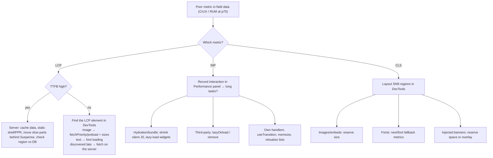
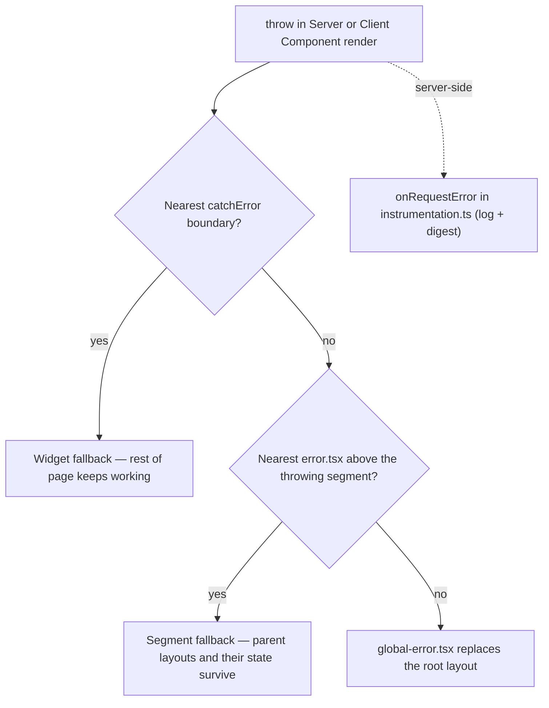
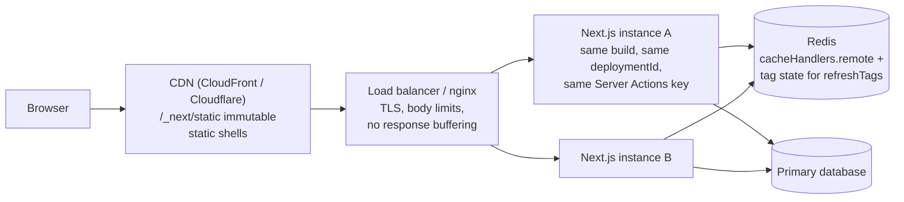
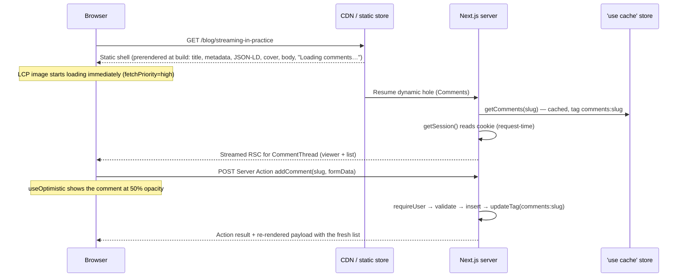

# 05 — Next.js (Part 3 of 4): Optimization, SEO, Web Vitals, Errors, Deployment & Full Example

> **Parts:** [Part 1 — Overview, Topic Map, Routing, Server Components, Rendering & Data](./05-nextjs-part1.md) · [Part 2 — Caching, Server Actions, Route Handlers, Proxy, Auth, Env & Runtimes](./05-nextjs-part2.md) · **Part 3 — Optimization, SEO, Web Vitals, Errors, Deployment & Full Example** · [Part 4 — Resources, Practice, Interview Questions & Revision](./05-nextjs-part4.md)
>
> Applies to: Next.js 16.4 with Cache Components enabled. Code blocks whose first line is a file path were built and run together with the Part 1–2 code (`next build` + `next start` on 16.4). The standalone output was built and run with `node server.js`. The Dockerfile itself was **not** run here — treat it as a template and check it against the official `with-docker` example.

## Table of Contents

- [3.14 Images, Fonts & Scripts](#314-images-fonts--scripts)
- [3.15 Metadata & SEO](#315-metadata--seo)
- [3.16 Core Web Vitals](#316-core-web-vitals)
- [3.17 Error Handling & Instrumentation](#317-error-handling--instrumentation)
- [3.18 Deployment](#318-deployment)
- [4. Full Example: a Blog with Comments](#4-full-example-a-blog-with-comments)
- [5. Diagrams Index](#5-diagrams-index)
- [Next: Part 4](#next-part-4)

---

### 3.14 Images, Fonts & Scripts

#### `next/image`

**What it does.** `<Image>` renders an `` with a generated `srcset`, served through the built-in optimizer at `/_next/image`. The optimizer resizes on demand, converts to WebP (or AVIF if configured) based on the `Accept` header, and caches the result. The component also reserves space to prevent layout shift and lazy-loads by default.

**The props that matter in interviews:**

| Prop | What it does | Senior detail |
|------|--------------|---------------|
| `width` / `height` | Intrinsic size → aspect ratio → no layout shift | Static imports (`import hero from "./hero.jpg"`) fill these and `blurDataURL` automatically and get an immutable, content-hashed URL |
| `fill` | Image fills its positioned parent | Parent needs `position: relative` and a size (e.g. `aspect-ratio`) or CLS comes back |
| `sizes` | Tells the browser how wide the image will be at each breakpoint | **Without it**, a `fill` image assumes `100vw` and phones download desktop-sized files. With it, Next generates the full width-based `srcset` |
| `loading` | `lazy` (default) or `eager` | Never lazy-load the LCP image |
| `fetchPriority` | `"high"` raises network priority | Recommended over `preload` in most cases for the LCP image |
| `preload` | Inserts `<link rel="preload">` in `<head>` | **Replaced `priority` in 16.0** (`priority` is deprecated). Don't combine with `loading`/`fetchPriority`, and don't use it when different images are the LCP element at different viewports |
| `quality` | 1–100, default 75 | Must be in `images.qualities` (default `[75]` since 16); other values are coerced to the nearest allowed one |
| `placeholder="blur"` | Blur-up while loading | Automatic for static imports; remote images need `blurDataURL` |
| `unoptimized` | Serve the original file | For SVGs, tiny icons, or when a CDN does the optimization |

**Configuration (`next.config.ts`)** — the optimizer is an open proxy unless you restrict it:

```ts
// next.config.ts
import type { NextConfig } from "next";

const nextConfig: NextConfig = {
  cacheComponents: true,
  partialPrefetching: true,
  images: {
    // Only these remote URLs may be optimized; anything else gets 400 Bad Request
    remotePatterns: [new URL("https://images.example-cdn.com/blog/**")],
    qualities: [60, 75],
    formats: ["image/avif", "image/webp"], // AVIF preferred, WebP fallback; each format is cached separately
  },
  deploymentId: process.env.DEPLOYMENT_VERSION, // version-skew protection, see §3.18
};

export default nextConfig;
```

Version 16 defaults and limits worth knowing (16.0 unless noted):

- `qualities` defaults to `[75]`. Since 16, setting it explicitly is how you allow other qualities.
- `minimumCacheTTL` defaults to 4 hours. There is no API to invalidate optimized images; change the `src` instead.
- Redirects followed when fetching remote images are capped by `maximumRedirects` (default 3).
- Fetching images from local or private IPs is blocked unless you set `dangerouslyAllowLocalIP`.
- `maximumResponseBody` (16.1.2) caps source images at 50 MB.
- SVG isn't optimized unless you set `dangerouslyAllowSVG` (and then also set a CSP). The response defaults to `Content-Disposition: attachment`.
- `localPatterns` restricts which local paths (and query strings) can be optimized.

```tsx
// components/cover-image.tsx
import Image from "next/image";

type Props = { src: string; alt: string; isLcp?: boolean };

export function CoverImage({ src, alt, isLcp = false }: Props) {
  return (
    // Reserve the box before the image arrives: positioned parent + aspect ratio → CLS 0
    <div style={{ position: "relative", aspectRatio: "16 / 9", maxWidth: 960 }}>
      <Image
        src={src}
        alt={alt}
        fill
        sizes="(max-width: 960px) 100vw, 960px"
        quality={60}
        fetchPriority={isLcp ? "high" : "auto"}
        loading={isLcp ? "eager" : "lazy"}
      />
    </div>
  );
}
```

> ⚠️ Pitfall: A `remotePatterns` entry without `pathname`/`search` implies `**` for the missing parts — `{ hostname: "**.amazonaws.com" }` lets anyone use **your** server (and bill) to optimize images from **any** S3 bucket. Scope patterns to your bucket path. Also note that redirects from an allowed host are followed *without* re-checking the patterns.

> 💡 Interview Tip: "Where does image optimization run when you self-host?" — in the Next.js server process, using `sharp`. That costs CPU and memory under load (and on glibc Linux, `sharp` may need allocator tuning per the docs). At scale, teams either put a CDN in front of `/_next/image` or switch to a custom `loader` that points at an image CDN (Cloudinary, imgix, Cloudflare Images — see [12-cloudflare.md](./12-cloudflare.md)). For S3 + CloudFront delivery see [11-deployment-aws-s3.md](./11-deployment-aws-s3.md).

#### `next/font`

`next/font/google` and `next/font/local` download the font files **at build time** and serve them from your own domain. Browsers make no requests to Google. The CSS is inlined with `font-display: swap` by default. `adjustFontFallback` (on by default) generates a size-adjusted fallback font, so swapping from fallback to web font barely moves text, which lowers CLS. Fonts are preloaded only on the routes that use them.

```ts
// lib/fonts.ts
import { Inter, JetBrains_Mono } from "next/font/google";

// Font loaders must be called at module scope and assigned to a const
export const inter = Inter({ subsets: ["latin"], display: "swap", variable: "--font-sans" });
// Code font isn't needed for first paint: don't preload it
export const mono = JetBrains_Mono({ subsets: ["latin"], variable: "--font-mono", preload: false });
```

Apply fonts with `className` (sets `font-family` directly) or `variable` (declares a CSS custom property you use in CSS or Tailwind). Usually that goes on `<html>` in the root layout. The blog example in §4 applies it on its layout wrapper.

> ⚠️ Pitfall: Calling a font loader inside a component (`const f = Inter(...)` in the function body) is a build error, and so is calling it in many separate files. Calling it in each of 20 files creates 20 font instances. Define each font once in a shared module and import it.

#### `next/script`

| `strategy` | When it loads | Use for |
|------------|---------------|---------|
| `beforeInteractive` | Before any Next.js code and hydration; must be in the root layout | Bot detection, consent managers that must run first — rare |
| `afterInteractive` (default) | Early, after some hydration | Tag managers, analytics |
| `lazyOnload` | Browser idle time | Chat widgets, social embeds |
| `worker` (experimental) | Off the main thread via Partytown | Heavy third-party scripts — experimental; verify on official docs |

```tsx
// components/third-party-scripts.tsx
import Script from "next/script";

export function ThirdPartyScripts() {
  return (
    <>
      {/* Not needed for the first interaction: load when the browser is idle */}
      <Script src="https://widgets.example.com/chat.js" strategy="lazyOnload" />
      {/* Inline scripts need an id so Next can track and dedupe them */}
      <Script id="consent-defaults" strategy="afterInteractive">
        {`window.dataLayer = window.dataLayer || []; window.dataLayer.push({ consent: "denied" });`}
      </Script>
    </>
  );
}
```

`<Script>` is deduplicated across navigations: rendering it in a layout loads it once. Event props (`onLoad`, `onReady`, `onError`) only work in Client Components. Third-party scripts are the #1 cause of poor INP on content sites — see §3.16.

---

### 3.15 Metadata & SEO

**Explanation.** In the App Router, `<head>` is not something you write directly. Each `layout`/`page` exports a static `metadata` object or an async `generateMetadata()`, and Next resolves them from the root down, merges them, and emits the tags. Both exports work in Server Components only.

**Merging is shallow.** Segments are evaluated root → leaf, and a key defined deeper **replaces** the parent's value entirely. If the root sets `openGraph: { siteName, images }` and a page sets `openGraph: { title }`, the page loses `siteName` and `images`. Share nested defaults by spreading a common object (the §4 example does this with `siteOpenGraph`).

**Title templates.** `title: { template: "%s | Acme", default: "Acme" }` in a layout applies to **child** segments, not the layout's own segment. `default` is required with `template`, and `title.absolute` opts a page out of the template.

**`metadataBase`.** URL fields (`openGraph.images`, `alternates.canonical`) need absolute URLs; set `metadataBase` once (usually the root layout) and use relative paths. Using a relative URL without it is a build error. If `generateMetadata` uses `'use cache'`, return strings rather than `URL` objects, because cached values must be serializable.

**File conventions** (each can be a static file or a code file that generates it):

| File | Output | Notes |
|------|--------|-------|
| `favicon.ico`, `icon.(png\|svg\|tsx)`, `apple-icon.*` | `<link rel="icon">` etc. | `favicon.ico` only at the app root |
| `opengraph-image.(jpg\|png\|tsx)`, `twitter-image.*` | `og:image` / `twitter:image` + width/height/type | Code version uses `ImageResponse` from `next/og` (Satori → flexbox and a CSS subset only, no `grid`). File-based metadata overrides `metadata.openGraph.images` |
| `sitemap.(xml\|ts)` | `/sitemap.xml` | `generateSitemaps` splits large sites (50,000 URLs per sitemap is the protocol limit) |
| `robots.(txt\|ts)` | `/robots.txt` | `disallow` hides from crawling, *not* from indexing — use `robots: { index: false }` metadata (noindex) for that |
| `manifest.(json\|ts)` | Web app manifest | PWA install metadata |

**Streaming metadata.** For dynamically rendered pages, Next doesn't block the HTML on `generateMetadata`. The UI streams first and the tags are appended to `<body>` when metadata resolves. Bots that only read `<head>` (the default `htmlLimitedBots` list includes Bingbot, Twitterbot, Slackbot and several Google services such as AdsBot) get blocking metadata in `<head>` instead. Googlebot executes JavaScript and reads the full DOM, so it gets the streamed version. Prerendered pages resolve metadata at build time, so nothing streams. Setting `htmlLimitedBots: /.*/` disables streaming metadata for everyone.

**With Cache Components.** `generateMetadata` follows the same rules as components. If it reads runtime data (`cookies()`, `headers()`, `params`, `searchParams`) or uncached data, it defers to request time. When the rest of the page is fully prerenderable, the build errors and makes you choose:

- Cache the metadata's data with `'use cache'`.
- Or, if it really needs request data, render a dynamic marker: a `<Suspense>`-wrapped component that calls `await connection()`. The rest of the page stays in the static shell.

**Dedupe page + metadata fetches** with `React.cache` (or a `'use cache'` function, which also persists across requests). Both calls in one request then hit the data source once (pattern from [Part 1 §3.5](./05-nextjs-part1.md#35-data-fetching-patterns)).

**Structured data (JSON-LD).** Render `<script type="application/ld+json">` in the page. `JSON.stringify` doesn't escape `<`, so CMS content containing `</script>` breaks out of the tag and becomes stored XSS. Replace `<` with `\u003c` (the §4 page does this). Validate with Google's Rich Results Test or the Schema Markup Validator.

```tsx
// ❌ Bad: client-side title + unescaped JSON-LD
"use client";
useEffect(() => { document.title = post.title; }, [post.title]);          // crawlers that don't run JS see no title
<script type="application/ld+json" dangerouslySetInnerHTML={{ __html: JSON.stringify(jsonLd) }} /> // XSS via "</script>"

// ✅ Good: server-generated metadata + escaped JSON-LD (see §4 for the full page)
export async function generateMetadata({ params }: PageProps<"/blog/[slug]">): Promise<Metadata> { /* … */ }
<script type="application/ld+json" dangerouslySetInnerHTML={{ __html: JSON.stringify(jsonLd).replace(/</g, "\\u003c") }} />
```

> 💡 Interview Tip: "How do you do SEO in the App Router?" Cover all four layers:
>
> 1. **Rendering:** crawlable HTML via the static shell or SSR.
> 2. **Metadata:** `generateMetadata` with canonical URLs and an `openGraph` built from shared defaults.
> 3. **Discovery:** `sitemap.ts` / `robots.ts`, plus correct status codes. `notFound()` gives a 404, or `200 + noindex` once streaming has started — see the status-code caveat in [Part 1 §3.6](./05-nextjs-part1.md#36-streaming).
> 4. **Rich results:** JSON-LD.
>
> Then mention streaming metadata and `htmlLimitedBots`; that detail is what sets a senior answer apart.

---

### 3.16 Core Web Vitals

**What they are.** Google's user-experience metrics, measured from real Chrome users (CrUX field data) at the **75th percentile** of page loads, split by mobile and desktop:

| Metric | Measures | Good | Poor | Since |
|--------|----------|------|------|-------|
| **LCP** — Largest Contentful Paint | Loading: when the largest image/text block renders | ≤ 2.5 s | > 4.0 s | 2020 |
| **INP** — Interaction to Next Paint | Responsiveness: worst-ish latency from input to next frame across the visit | ≤ 200 ms | > 500 ms | Replaced FID in March 2024 |
| **CLS** — Cumulative Layout Shift | Visual stability: largest burst of unexpected layout shifts | ≤ 0.1 | > 0.25 | 2020 |

TTFB and FCP are diagnostic metrics, not Core Web Vitals, but a slow TTFB caps your LCP. **Lab tools** (Lighthouse, PageSpeed Insights' lab section, the DevTools Performance panel) are for debugging. **Field data** (CrUX, your own Real User Monitoring) is what counts. Lighthouse can't measure INP because it doesn't interact with the page; its Total Blocking Time (TBT) metric is only a proxy.

**Next.js levers per metric:**

| Metric | Usual causes | Next.js fixes |
|--------|--------------|---------------|
| LCP | Slow server render; the LCP image is lazy, discovered late, or oversized; render-blocking fonts/CSS; client-side data fetching | Static shell + PPR so HTML arrives fast; stream slow parts behind Suspense; `fetchPriority="high"` or `preload` on the hero image, plus correct `sizes`; `next/font` (self-hosted, swap); fetch data in Server Components, not `useEffect` |
| INP | Long tasks from large hydration; heavy third-party scripts; expensive renders on each keystroke | Smaller client bundles (push `"use client"` down, keep libraries server-side); `next/script` `lazyOnload`; `useTransition`/`useDeferredValue` for expensive updates ([04-react Part 3](./04-react-part3.md)); `next/dynamic` for heavy widgets below the fold |
| CLS | Images without dimensions; web-font swaps; late banners/ads; content inserted above existing content | `next/image` with `width`/`height` or `fill` + aspect-ratio box; `next/font` fallback metrics; reserve space for ads/embeds; `loading.tsx` skeletons the same size as the content |

**Measure in production** with `useReportWebVitals`. Keep the callback reference stable (define it at module scope) so metrics aren't reported twice. Use `sendBeacon` so reports survive page unload.

```tsx
// components/web-vitals.tsx
"use client";

import { useReportWebVitals } from "next/web-vitals";

type Metric = Parameters<Parameters<typeof useReportWebVitals>[0]>[0];

// Module scope = stable reference; a new function each render would re-report metrics
function report(metric: Metric) {
  const body = JSON.stringify({
    name: metric.name,
    value: metric.value,
    rating: metric.rating,
    id: metric.id,
    navigationType: metric.navigationType,
    page: window.location.pathname,
  });
  // sendBeacon survives page unload; fall back to a keepalive fetch
  if (!navigator.sendBeacon("/api/vitals", body)) {
    void fetch("/api/vitals", { method: "POST", body, keepalive: true });
  }
}

export function WebVitals() {
  useReportWebVitals(report);
  return null;
}
```

```ts
// app/api/vitals/route.ts
import { after } from "next/server";
import { z } from "zod";

const Vital = z.object({
  name: z.enum(["TTFB", "FCP", "LCP", "CLS", "INP"]),
  value: z.number().nonnegative(),
  rating: z.enum(["good", "needs-improvement", "poor"]).optional(),
  id: z.string().max(100),
  navigationType: z.string().max(40).optional(),
  page: z.string().max(300),
});

export async function POST(request: Request) {
  // sendBeacon posts text/plain; request.json() parses the body regardless of content type
  const parsed = Vital.safeParse(await request.json().catch(() => null));
  if (!parsed.success) return new Response(null, { status: 400 });
  // Respond immediately; ship to your metrics store after the response
  after(() => console.log(JSON.stringify({ type: "web-vital", ...parsed.data })));
  return new Response(null, { status: 204 });
}
```



> ⚠️ Pitfall: Optimizing the Lighthouse score on a fast laptop. INP and LCP problems usually appear on mid-range Android phones on slow networks. Check CrUX or your own RUM data split by device, and throttle CPU 4–6× in DevTools when you reproduce.

---

### 3.17 Error Handling & Instrumentation

**Two kinds of errors** (the docs' framing, and the right interview answer):

- **Expected errors** (validation, "not found", a failed upstream call you can explain) are **return values**. Return state from Server Actions (`useActionState`), render a message from Server Components, or call `notFound()`. Don't throw these.
- **Uncaught exceptions** are bugs. Throw them; **error boundaries** catch them during rendering.

**File conventions:**

| File | Catches | Notes |
|------|---------|-------|
| `error.tsx` | Errors thrown while rendering the segment's **children** (page and nested segments) | Must be a Client Component. Props: `error` (with `digest`) and **`retry()`** (stable since 16.3) — re-fetches and re-renders the segment in a transition. `reset()` only clears state without re-fetching, so it can't recover Server Component errors. Doesn't catch errors in the **layout of the same segment** — put `error.tsx` one level up for that |
| `global-error.tsx` | Errors in the root layout/template | Replaces the root layout, so it must render its own `<html>` and `<body>` |
| `not-found.tsx` | `notFound()` calls in the segment, and unmatched URLs (root `not-found.tsx`) | Sets 404 if called before streaming starts |
| `catchError(fallback)` from `next/error` | Component-level boundary anywhere in the tree (stable in 16.3) | Unlike a hand-written class boundary, it lets `redirect()`/`notFound()` through, offers `retry()`, and clears on navigation |

**What error boundaries don't catch:** errors in event handlers, `setTimeout`, and other async code outside rendering. Catch those yourself and store them in state. Errors thrown inside `startTransition` **do** bubble to the nearest boundary.

**`digest` and production messages.** In production, errors thrown in Server Components reach the client as a generic message plus a `digest` hash. The real message and stack stay on the server, so secrets never leak. Show the digest as a "reference ID" and search for it in server logs.



```tsx
// components/widget-boundary.tsx
"use client";

import { catchError, type ErrorInfo } from "next/error";

function WidgetFallback({ name }: { name: string }, { retry }: ErrorInfo) {
  return (
    <div role="alert">
      <p>{name} couldn&apos;t load.</p>
      <button type="button" onClick={() => retry()}>
        Try again
      </button>
    </div>
  );
}

// Usage: <WidgetBoundary name="Comments">…</WidgetBoundary> — props are forwarded to the fallback
export const WidgetBoundary = catchError(WidgetFallback);
```

```tsx
// app/global-error.tsx
"use client";

export default function GlobalError({ error, retry }: { error: Error & { digest?: string }; retry: () => void }) {
  return (
    // Replaces the root layout, so it renders its own <html> and <body>
    <html lang="en">
      <body>
        <h1>Something went wrong</h1>
        {error.digest && <p>Reference: {error.digest}</p>}
        <button type="button" onClick={() => retry()}>
          Try again
        </button>
      </body>
    </html>
  );
}
```

**`instrumentation.ts`** (project root or `src/`):

- **`register()`** runs **once per server instance**, before the server handles requests. Start OpenTelemetry, APM agents, or connection pools there (`@vercel/otel` is the documented quick start).
- **`onRequestError(error, request, context)`** fires for errors caught during rendering, Route Handlers, Server Actions and Proxy. Report them to Sentry, Datadog or your logging pipeline there.
- `instrumentation-client.ts` is the browser equivalent; it runs before hydration.

```ts
// instrumentation.ts
import type { Instrumentation } from "next";

export async function register() {
  if (process.env.NEXT_RUNTIME === "nodejs") {
    // Start OpenTelemetry/APM SDKs here (e.g. `await import("./lib/otel")`), once per server process
    console.log(JSON.stringify({ type: "server-start", pid: process.pid }));
  }
}

export const onRequestError: Instrumentation.onRequestError = async (err, request, context) => {
  const message = err instanceof Error ? err.message : String(err);
  const digest = typeof err === "object" && err !== null && "digest" in err ? String(err.digest) : undefined;
  // Log what you need to find the bug; never forward request.headers wholesale (cookies, auth tokens)
  console.error(
    JSON.stringify({
      type: "request-error",
      message,
      digest,
      method: request.method,
      path: request.path,
      routePath: context.routePath,
      routeType: context.routeType, // render | route | action | proxy
      renderSource: context.renderSource,
    }),
  );
};
```

> ⚠️ Pitfall: `try { … } catch { return fallback }` around `redirect()` or `notFound()` swallows them, because both work by throwing special errors. Call `unstable_rethrow(err)` from `next/navigation` first thing in the `catch` (still marked unstable in 16.4) or keep those calls outside the `try`. `catchError` and `error.tsx` already handle this.

> 💡 Interview Tip: "How do you correlate a user's error screen with your logs?" — show `error.digest` in the UI. On the server, log the same digest from `onRequestError`, together with route path, route type and a request/trace ID. With OpenTelemetry started in `register()`, the trace ID ties the error to the slow DB query that caused it. Structured logging and tracing are covered in [06-nodejs](./06-nodejs.md) and [08-engineering-practices](./08-engineering-practices.md).

---

### 3.18 Deployment

**Options** (from the 16.4 deploying guide):

| Option | Feature support | Typical use |
|--------|-----------------|-------------|
| **Node.js server** (`next build && next start`) | All | VM/EC2 behind nginx — [10-deployment-aws-ec2.md](./10-deployment-aws-ec2.md) |
| **Docker** (`output: "standalone"`) | All | ECS/Kubernetes/Cloud Run/Fly |
| **Static export** (`output: "export"`) | Limited | S3 + CloudFront, GitHub Pages — [11-deployment-aws-s3.md](./11-deployment-aws-s3.md) |
| **Adapters** | Varies; *verified* adapters (Vercel, Bun) run the full Next.js test suite | Platforms — Cloudflare and Netlify ship their own integrations while building verified adapters ([12-cloudflare.md](./12-cloudflare.md)) |

**Static export can't do anything that needs a server:**

- Server Actions, cookies, and Route Handlers that read the request.
- Rewrites, redirects, headers, and Proxy.
- ISR, and image optimization with the default loader.
- Draft Mode and intercepting routes.
- Dynamic routes without `generateStaticParams` (or with `dynamicParams: true`).

Choose it only for content sites or SPAs.

**Vercel** is zero-config: static shells and assets go to the CDN, functions run near your data, the cache and tag invalidation are shared globally, and skew protection, image optimization and `after()` work out of the box. The interview point is to know **what you must rebuild yourself** when you self-host. That's the checklist below.

**Standalone output + Docker.** `output: "standalone"` traces imports and writes `.next/standalone` with a minimal `server.js` and only the `node_modules` files it needs. For this file's test project it was 34.6 MB, against 366 MB for the full `node_modules`. `public/` and `.next/static` are **not** copied (the expectation is that a CDN serves them). Without them, the HTML renders but every `/_next/static/chunks/*.js` returns 404, so the page never hydrates (verified on 16.4). `server.js` only picks the files up at startup. Copy them yourself:

```dockerfile
# Dockerfile — template based on the official with-docker example; verify against it before use
FROM node:22-alpine AS deps
WORKDIR /app
COPY package.json package-lock.json ./
RUN npm ci

FROM node:22-alpine AS builder
WORKDIR /app
COPY --from=deps /app/node_modules ./node_modules
COPY . .
ARG DEPLOYMENT_VERSION
ENV NEXT_TELEMETRY_DISABLED=1 DEPLOYMENT_VERSION=$DEPLOYMENT_VERSION
# The Server Actions key is embedded in the build output: same key for every image you roll out together
RUN --mount=type=secret,id=actions_key \
    NEXT_SERVER_ACTIONS_ENCRYPTION_KEY="$(cat /run/secrets/actions_key)" npm run build

FROM node:22-alpine AS runner
WORKDIR /app
ENV NODE_ENV=production NEXT_TELEMETRY_DISABLED=1 PORT=3000 HOSTNAME=0.0.0.0
RUN addgroup -S -g 1001 nodejs && adduser -S -u 1001 -G nodejs nextjs
COPY --from=builder --chown=nextjs:nodejs /app/public ./public
COPY --from=builder --chown=nextjs:nodejs /app/.next/standalone ./
COPY --from=builder --chown=nextjs:nodejs /app/.next/static ./.next/static
USER nextjs
EXPOSE 3000
CMD ["node", "server.js"]
```

Points an interviewer will probe:

- **`HOSTNAME=0.0.0.0`.** Without it the server binds only to localhost inside the container and the container port is unreachable.
- **Runtime env vs build env.** `NEXT_PUBLIC_*` values are baked in at build time ([Part 2 §3.12](./05-nextjs-part2.md#312-environment-variables)). Server-only vars can come from the container's runtime environment, but only in code that runs at request time.
- **Non-root user, multi-stage build, no dev dependencies or source in the final image.** These are covered in [08-engineering-practices](./08-engineering-practices.md) under Docker.
- **The `public/` COPY fails if the folder doesn't exist.** Keep an empty `public/` or drop that line.

**Self-hosting checklist — what Vercel does that you now own:**

| Concern | What goes wrong | Fix |
|---------|-----------------|-----|
| Reverse proxy | Slowloris attacks, huge payloads and TLS handled by the Node process | nginx/ALB/Cloudflare in front for TLS, body limits and rate limits ([10](./10-deployment-aws-ec2.md), [12](./12-cloudflare.md)) |
| **Streaming** | nginx buffers responses, so PPR shells and Suspense content arrive all at once and the TTFB benefit disappears | `proxy_buffering off` for the app location, or send `X-Accel-Buffering: no` via `headers()`; make sure the load balancer passes chunked responses through |
| **Multiple instances: Server Actions** | "Failed to find Server Action" when instance A encrypted the closure and instance B tries to decrypt it | Same `NEXT_SERVER_ACTIONS_ENCRYPTION_KEY` (base64, 16/24/32 bytes) for every build in the rollout |
| **Multiple instances: cache** | Each instance has its own in-memory LRU for `'use cache'`, and its own ISR/page cache on disk, so users see different versions | `'use cache: remote'` with a `cacheHandlers.remote` backed by Redis/DynamoDB; `cacheHandler` (+ `cacheMaxMemorySize: 0`) for the page/ISR cache |
| **Multiple instances: tag invalidation** | `revalidateTag`/`updateTag` on instance A doesn't invalidate instance B | Implement `refreshTags()` in your cache handler, synced from shared storage (called before each request) |
| **Version skew** | During a rolling deploy, old clients request chunks or Server Action IDs the new server doesn't have | `deploymentId` (or `NEXT_DEPLOYMENT_ID`): assets get `?dpl=`, navigations send `x-deployment-id`, and a mismatch triggers a hard reload. Also route requests by deployment at the CDN/load balancer, because Next doesn't route on `?dpl=` |
| Static assets | Every instance serves `_next/static` | Serve `/_next/static/*` from a CDN with `immutable` caching (hashed filenames); `assetPrefix` for a separate domain |
| Image optimization | CPU spikes from `sharp`; disk cache per instance | CDN in front of `/_next/image`, or a custom loader pointing at an image CDN |
| **Graceful shutdown** | Deploys kill in-flight requests and pending `after()` callbacks | Send `SIGTERM` and wait. `next start` drains requests and runs pending `after()` work; give it a drain period (the docs suggest 10–30 s) via ECS `stopTimeout` / Kubernetes `terminationGracePeriodSeconds` |
| CDN caching | CDN caches a personalized page or ignores `Vary` | Dynamic responses are sent `private, no-store`; fully static ones `public`. Check that the CDN respects these and forwards `Accept` (needed for image format negotiation) |



**Adapters (stable in 16.2).** `adapterPath` points the build at an adapter that converts Next's build output (routes, static assets, prerenders, PPR shells, functions) into a platform's primitives. This is how platforms support Next.js without reverse-engineering `.next/`. Before adapters, community projects such as **OpenNext** did that reverse-engineering for AWS (Lambda + CloudFront + S3) and Cloudflare. Verify their current status on each project's docs before you recommend one.

**Security patching is part of deployment.** Two incidents an interviewer may bring up:

- **CVE-2025-29927 (March 2025).** A middleware authorization bypass via the internal `x-middleware-subrequest` header. It affected self-hosted apps that relied on middleware for auth. Fixed in 12.3.5 / 13.5.9 / 14.2.25 / 15.2.3. The lesson is covered in [Part 2 §3.10](./05-nextjs-part2.md#310-proxy-formerly-middleware).
- **CVE-2025-66478 (December 2025).** The Next.js advisory for the upstream React Server Components "Flight" protocol remote code execution (CVE-2025-55182), rated CVSS 10.0. It affected App Router apps on 15.x/16.x. Fixed in 15.0.5, 15.1.9, 15.2.6, 15.3.6, 15.4.8, 15.5.7 and 16.0.7, with React patched in 19.0.1/19.1.2/19.2.1. Vercel published `npx fix-react2shell-next` to bump versions.

The practice behind both: watch the GitHub security advisories for `vercel/next.js` and `facebook/react`, use Dependabot or Renovate, upgrade within your release line quickly, and know which versions get backports (Next.js publishes an LTS policy).

> 💡 Interview Tip: "We're moving off Vercel to ECS — what breaks?" Run through the checklist:
>
> - Encryption key and `deploymentId` consistent across instances.
> - A shared cache plus tag coordination.
> - Streaming not buffered by the proxy or load balancer.
> - Static assets on a CDN; image optimization load planned for.
> - Graceful shutdown with a drain period.
> - `NEXT_PUBLIC_*` vars set at build time.
>
> Covering all of these is what makes the answer sound like you've actually done it.

---

## 4. Full Example: a Blog with Comments

One feature that uses most of this file and Part 2. Each part is shown in its own block below:

- Posts are cached content, prerendered for known slugs.
- Metadata, an OG image, JSON-LD, a sitemap and robots.
- An LCP-optimized cover image.
- Comments: a cached list, streamed viewer state, and a Server Action with an optimistic update.
- An error boundary per widget and a correct 404.

It reuses `lib/dal.ts` (`getSession`/`requireUser`) and the login flow from [Part 2 §3.8](./05-nextjs-part2.md#38-server-actions).

```text
app/
  sitemap.ts  robots.ts
  blog/
    layout.tsx               # fonts, title template, shared OG defaults, WebVitals
    page.tsx                 # post list (static)
    error.tsx                # segment error boundary
    [slug]/
      page.tsx               # generateStaticParams + generateMetadata + JSON-LD + cover
      opengraph-image.tsx    # ImageResponse per post
      not-found.tsx
      comments.tsx           # Server Component: cached list + session (inside Suspense)
      comment-thread.tsx     # Client Component: useOptimistic + useActionState
      actions.ts             # addComment Server Action
lib/
  site.ts  posts.ts  comments.ts
```

```ts
// lib/site.ts
import type { Metadata } from "next";

export const siteUrl = process.env.NEXT_PUBLIC_APP_URL ?? "http://localhost:3000";

// Nested metadata merges shallowly: spread these into every segment that sets openGraph
export const siteOpenGraph = { siteName: "Acme Blog", locale: "en_US" } satisfies NonNullable<Metadata["openGraph"]>;
```

```ts
// lib/posts.ts
import "server-only";
import { cacheLife, cacheTag } from "next/cache";

export type Post = {
  slug: string;
  title: string;
  excerpt: string;
  body: string;
  author: string;
  publishedAt: string;
  updatedAt: string;
  cover: string;
};

export type PostSummary = Pick<Post, "slug" | "title" | "excerpt" | "publishedAt" | "updatedAt">;

const POSTS: Post[] = [
  {
    slug: "streaming-in-practice",
    title: "Streaming in Practice",
    excerpt: "What Suspense boundaries did to our TTFB and LCP.",
    body: "We moved the recommendations rail behind a Suspense boundary.\n\nTTFB dropped from 900 ms to 120 ms because the static shell no longer waited for the slowest query.",
    author: "Ada Lovelace",
    publishedAt: "2026-09-01T09:00:00.000Z",
    updatedAt: "2026-09-03T12:00:00.000Z",
    cover: "https://images.example-cdn.com/blog/streaming-in-practice.jpg",
  },
  {
    slug: "cache-tags-everywhere",
    title: "Cache Tags Everywhere",
    excerpt: "Why we stopped invalidating by path.",
    body: "Paths couple invalidation to URL structure.\n\nTags describe data, so one write invalidates every page that shows it.",
    author: "Grace Hopper",
    publishedAt: "2026-09-20T09:00:00.000Z",
    updatedAt: "2026-09-20T09:00:00.000Z",
    cover: "https://images.example-cdn.com/blog/cache-tags-everywhere.jpg",
  },
];

export const postTag = (slug: string) => `post:${slug}`;

export async function getPost(slug: string): Promise<Post | null> {
  "use cache";
  cacheLife("days");
  cacheTag(postTag(slug), "posts"); // invalidate one post, or all of them, from a CMS webhook
  await new Promise((resolve) => setTimeout(resolve, 50)); // simulate a CMS call
  return POSTS.find((p) => p.slug === slug) ?? null;
}

export async function listPosts(): Promise<PostSummary[]> {
  "use cache";
  cacheLife("days");
  cacheTag("posts");
  return POSTS.map(({ slug, title, excerpt, publishedAt, updatedAt }) => ({ slug, title, excerpt, publishedAt, updatedAt }));
}
```

```ts
// lib/comments.ts
import "server-only";
import { cacheLife, cacheTag } from "next/cache";

export type Comment = { id: string; slug: string; author: string; text: string; createdAt: string };

type Store = Map<string, Comment[]>;
const g = globalThis as typeof globalThis & { __comments?: Store };
const store: Store = (g.__comments ??= new Map()); // demo store — a database table in real life

export const commentsTag = (slug: string) => `comments:${slug}`;

export async function getComments(slug: string): Promise<Comment[]> {
  "use cache";
  cacheLife("minutes");
  cacheTag(commentsTag(slug));
  return [...(store.get(slug) ?? [])];
}

export async function insertComment(input: Pick<Comment, "slug" | "author" | "text">): Promise<Comment> {
  const comment: Comment = { ...input, id: crypto.randomUUID(), createdAt: new Date().toISOString() };
  store.set(input.slug, [...(store.get(input.slug) ?? []), comment]);
  return comment;
}
```

```tsx
// app/blog/layout.tsx
import type { Metadata } from "next";
import { WebVitals } from "@/components/web-vitals";
import { inter, mono } from "@/lib/fonts";
import { siteOpenGraph, siteUrl } from "@/lib/site";

export const metadata: Metadata = {
  metadataBase: new URL(siteUrl), // usually in the root layout; here so the example is self-contained
  title: { template: "%s | Acme Blog", default: "Acme Blog" },
  description: "Engineering notes from the Acme team.",
  openGraph: { ...siteOpenGraph, type: "website" },
};

export default function BlogLayout({ children }: LayoutProps<"/blog">) {
  return (
    <div className={`${inter.variable} ${mono.variable}`} style={{ fontFamily: "var(--font-sans), system-ui, sans-serif" }}>
      <WebVitals />
      {children}
    </div>
  );
}
```

```tsx
// app/blog/page.tsx
import Link from "next/link";
import { listPosts } from "@/lib/posts";

export default async function BlogIndex() {
  const posts = await listPosts(); // cached → part of the static shell
  return (
    <main>
      <h1>Acme Blog</h1>
      <ul>
        {posts.map((post) => (
          <li key={post.slug}>
            <Link href={`/blog/${post.slug}`}>{post.title}</Link>
            <p>{post.excerpt}</p>
          </li>
        ))}
      </ul>
    </main>
  );
}
```

```tsx
// app/blog/[slug]/page.tsx
import type { Metadata } from "next";
import { notFound } from "next/navigation";
import { Suspense } from "react";
import { CoverImage } from "@/components/cover-image";
import { WidgetBoundary } from "@/components/widget-boundary";
import { getPost, listPosts } from "@/lib/posts";
import { siteOpenGraph, siteUrl } from "@/lib/site";
import { Comments } from "./comments";

export async function generateStaticParams() {
  return (await listPosts()).map((post) => ({ slug: post.slug }));
}

export async function generateMetadata({ params }: PageProps<"/blog/[slug]">): Promise<Metadata> {
  const { slug } = await params;
  const post = await getPost(slug); // same cached call as the page → one CMS hit
  if (!post) return { title: "Post not found", robots: { index: false } };
  return {
    title: post.title,
    description: post.excerpt,
    alternates: { canonical: `/blog/${post.slug}` },
    openGraph: {
      ...siteOpenGraph, // without this spread, the layout's siteName/locale would be dropped
      type: "article",
      title: post.title,
      description: post.excerpt,
      publishedTime: post.publishedAt,
      modifiedTime: post.updatedAt,
      authors: [post.author],
    },
  };
}

export default async function PostPage({ params }: PageProps<"/blog/[slug]">) {
  // Unknown slug → notFound(). The first hit is 200 + noindex (the layout shell already streamed);
  // later hits and HTML-limited bots get 404 — see Part 1 §3.6 "Status codes and headers"
  const { slug } = await params;
  const post = await getPost(slug);
  if (!post) notFound();

  const jsonLd = {
    "@context": "https://schema.org",
    "@type": "BlogPosting",
    headline: post.title,
    description: post.excerpt,
    image: post.cover,
    datePublished: post.publishedAt,
    dateModified: post.updatedAt,
    author: { "@type": "Person", name: post.author },
    mainEntityOfPage: `${siteUrl}/blog/${post.slug}`,
  };

  return (
    <article>
      <script
        type="application/ld+json"
        // Escape "<" so CMS content can't close the script tag (stored XSS)
        dangerouslySetInnerHTML={{ __html: JSON.stringify(jsonLd).replace(/</g, "\\u003c") }}
      />
      <h1>{post.title}</h1>
      <p>
        By {post.author} · <time dateTime={post.publishedAt}>{post.publishedAt.slice(0, 10)}</time>
      </p>
      <CoverImage src={post.cover} alt="" isLcp />
      {post.body.split("\n\n").map((paragraph, i) => (
        <p key={i}>{paragraph}</p>
      ))}
      <WidgetBoundary name="Comments">
        <Suspense fallback={<p>Loading comments…</p>}>
          <Comments slug={post.slug} />
        </Suspense>
      </WidgetBoundary>
    </article>
  );
}
```

```tsx
// app/blog/[slug]/opengraph-image.tsx
import { ImageResponse } from "next/og";
import { getPost, listPosts } from "@/lib/posts";

export const alt = "Acme Blog post";
export const size = { width: 1200, height: 630 };
export const contentType = "image/png";

// Without this, `params` is request-time data and every OG image is generated per request (ƒ)
export async function generateStaticParams() {
  return (await listPosts()).map((post) => ({ slug: post.slug }));
}

export default async function OpenGraphImage({ params }: { params: Promise<{ slug: string }> }) {
  const { slug } = await params;
  const post = await getPost(slug);
  return new ImageResponse(
    (
      // Satori: flexbox + a CSS subset, inline styles only
      <div
        style={{
          width: "100%",
          height: "100%",
          display: "flex",
          flexDirection: "column",
          justifyContent: "space-between",
          padding: 64,
          background: "#0f172a",
          color: "white",
        }}
      >
        <div style={{ fontSize: 36, opacity: 0.7 }}>Acme Blog</div>
        <div style={{ fontSize: 72, fontWeight: 700 }}>{post?.title ?? "Not found"}</div>
        <div style={{ fontSize: 32 }}>{post?.author ?? ""}</div>
      </div>
    ),
    size,
  );
}
```

```tsx
// app/blog/[slug]/not-found.tsx
import Link from "next/link";

export default function PostNotFound() {
  return (
    <main>
      <h1>Post not found</h1>
      <Link href="/blog">All posts</Link>
    </main>
  );
}
```

```tsx
// app/blog/error.tsx
"use client";

import { useEffect } from "react";

export default function BlogError({ error, retry }: { error: Error & { digest?: string }; retry: () => void }) {
  useEffect(() => {
    console.error(error); // client-side reporting hook; server errors are already in onRequestError
  }, [error]);

  return (
    <main role="alert">
      <h1>The blog is having trouble</h1>
      {error.digest && <p>Reference: {error.digest}</p>}
      <button type="button" onClick={() => retry()}>
        Try again
      </button>
    </main>
  );
}
```

```tsx
// app/blog/[slug]/comments.tsx
import { getSession } from "@/lib/dal";
import { getComments } from "@/lib/comments";
import { CommentThread } from "./comment-thread";

// Rendered inside <Suspense>: reading the session cookie makes this part request-time,
// while getComments() is served from the cache
export async function Comments({ slug }: { slug: string }) {
  // Cookie first: prerendering stops here, so the comments cache ("minutes") never runs during
  // the build and can't shorten the post shell's lifetime ("days"). Sequential is cheap: it's a cache hit.
  const session = await getSession();
  const comments = await getComments(slug);
  return <CommentThread slug={slug} comments={comments} viewer={session?.userId ?? null} />;
}
```

> ⚠️ Pitfall (verified in the build output): a short-lived cache that *runs during prerendering* sets the lifetime of the whole static shell. With `Promise.all([getComments(slug), getSession()])`, `getComments` starts before the cookie read suspends the prerender. `next build` then reports the post pages as `1m / 1h` (the comments' `"minutes"` profile) instead of `1d / 1w`, so every post shell regenerates every minute. Reading the request data first keeps the shell at `1d / 1w`. Check the Revalidate/Expire columns of `next build` whenever you add a cached call to a page.

```ts
// app/blog/[slug]/actions.ts
"use server";

import { updateTag } from "next/cache";
import { z } from "zod";
import { requireUser } from "@/lib/dal";
import { commentsTag, insertComment } from "@/lib/comments";
import { getPost } from "@/lib/posts";

export type AddCommentState =
  | { status: "idle" }
  | { status: "ok" }
  | { status: "error"; message: string; text: string };

const Input = z.object({
  slug: z.string().min(1).max(100),
  text: z.string().trim().min(1, "Write something first").max(1000, "Keep it under 1000 characters"),
});

// `slug` is a bound argument — it still comes from the client, so validate it like form data
export async function addComment(slug: string, _prev: AddCommentState, formData: FormData): Promise<AddCommentState> {
  const { userId } = await requireUser(); // 1. authenticate (redirects to /login)
  const raw = { slug, text: formData.get("text") };
  const parsed = Input.safeParse(raw); // 2. validate
  if (!parsed.success) {
    return { status: "error", message: parsed.error.issues[0]?.message ?? "Invalid comment", text: String(raw.text ?? "") };
  }
  if (!(await getPost(parsed.data.slug))) {
    return { status: "error", message: "Post not found", text: parsed.data.text }; // 3. authorize the target
  }
  await insertComment({ slug: parsed.data.slug, author: userId, text: parsed.data.text });
  updateTag(commentsTag(parsed.data.slug)); // 4. read-your-own-writes in the same response
  return { status: "ok" };
}
```

```tsx
// app/blog/[slug]/comment-thread.tsx
"use client";

import Link from "next/link";
import { useActionState, useOptimistic } from "react";
import type { Comment } from "@/lib/comments";
import { addComment, type AddCommentState } from "./actions";

type Props = { slug: string; comments: Comment[]; viewer: string | null };
type Shown = Comment & { pending?: boolean };

export function CommentThread({ slug, comments, viewer }: Props) {
  // Optimistic list: shows the new comment immediately, falls back to `comments` when the action settles
  const [shown, addOptimistic] = useOptimistic<Shown[], Shown>(comments, (state, next) => [...state, next]);

  const [state, formAction, pending] = useActionState(
    async (prev: AddCommentState, formData: FormData): Promise<AddCommentState> => {
      const text = String(formData.get("text") ?? "").trim();
      if (text) {
        addOptimistic({ id: `temp-${Date.now()}`, slug, author: viewer ?? "you", text, createdAt: new Date().toISOString(), pending: true });
      }
      return addComment(slug, prev, formData);
    },
    { status: "idle" },
  );
  const error = state.status === "error" ? state : null;

  return (
    <section aria-labelledby="comments-heading">
      <h2 id="comments-heading">Comments ({shown.length})</h2>
      <ul>
        {shown.map((c) => (
          <li key={c.id} style={{ opacity: c.pending ? 0.5 : 1 }}>
            <strong>{c.author}</strong>: {c.text}
          </li>
        ))}
      </ul>
      {viewer ? (
        <form action={formAction}>
          <label htmlFor="comment-text">Add a comment</label>
          <textarea id="comment-text" name="text" defaultValue={error?.text ?? ""} aria-invalid={Boolean(error)} />
          {error && <p role="alert">{error.message}</p>}
          <button type="submit" disabled={pending}>
            {pending ? "Posting…" : "Post comment"}
          </button>
        </form>
      ) : (
        <p>
          <Link href="/login">Sign in</Link> to comment.
        </p>
      )}
    </section>
  );
}
```

```ts
// app/sitemap.ts
import type { MetadataRoute } from "next";
import { listPosts } from "@/lib/posts";
import { siteUrl } from "@/lib/site";

export default async function sitemap(): Promise<MetadataRoute.Sitemap> {
  const posts = await listPosts();
  return [
    { url: `${siteUrl}/blog`, changeFrequency: "daily", priority: 0.8 },
    ...posts.map((post) => ({ url: `${siteUrl}/blog/${post.slug}`, lastModified: new Date(post.updatedAt) })),
  ];
}
```

```ts
// app/robots.ts
import type { MetadataRoute } from "next";
import { siteUrl } from "@/lib/site";

export default function robots(): MetadataRoute.Robots {
  return {
    // disallow = don't crawl; private pages should also send noindex and require auth
    rules: [{ userAgent: "*", allow: "/", disallow: ["/api/", "/notes", "/account"] }],
    sitemap: `${siteUrl}/sitemap.xml`,
  };
}
```

**What happens on a request for `/blog/streaming-in-practice`:**



> 💡 Interview Tip: If asked to "design a blog page in Next.js", walk through this example in the same order: what's in the shell, what's cached and with which tag, what streams and why (it reads a cookie), how the mutation is secured, how it invalidates, and what the user sees during the round trip (optimistic). It's a full senior-level answer in about three minutes.

---

## 5. Diagrams Index

| Diagram | Where |
|---------|-------|
| Route nesting: layouts, templates, error and loading boundaries | [Part 1 §3.2](./05-nextjs-part1.md#32-routing--file-conventions) |
| Partial Prerendering request sequence | [Part 1 §3.4](./05-nextjs-part1.md#34-rendering-strategies-ssr-ssg-isr-ppr) |
| Caches in both models and how they're invalidated | [Part 2 §3.7](./05-nextjs-part2.md#37-caching) |
| Core Web Vitals triage flow | [§3.16](#316-core-web-vitals) |
| Error bubbling: `catchError` → `error.tsx` → `global-error.tsx` | [§3.17](#317-error-handling--instrumentation) |
| Self-hosted multi-instance topology | [§3.18](#318-deployment) |
| Blog request + optimistic comment sequence | [§4](#4-full-example-a-blog-with-comments) |

---

## Next: Part 4

➡️ [05-nextjs-part4.md](./05-nextjs-part4.md) — resources, learning path, hands-on exercises, interview questions with model answers, red flags, and the quick revision checklist.
