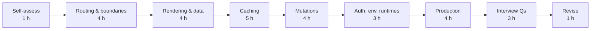

# 05 — Next.js (Part 4 of 4): Resources, Practice, Interview Questions & Revision

> **Parts:** [Part 1 — Overview, Topic Map, Routing, Server Components, Rendering & Data](./05-nextjs-part1.md) · [Part 2 — Caching, Server Actions, Route Handlers, Proxy, Auth, Env & Runtimes](./05-nextjs-part2.md) · [Part 3 — Optimization, SEO, Web Vitals, Errors, Deployment & Full Example](./05-nextjs-part3.md) · **Part 4 — Resources, Practice, Interview Questions & Revision**
>
> Applies to: Next.js 16.4 (Cache Components and the previous model). Answers state the version or model they apply to. Verify version-specific details in the Next.js release notes (nextjs.org/blog).

## Table of Contents

- [6. Resources](#6-resources)
- [7. How to Learn It](#7-how-to-learn-it)
- [8. Hands-on Practice](#8-hands-on-practice)
- [9. Interview Questions](#9-interview-questions)
  - [Basic](#basic)
  - [Intermediate](#intermediate)
  - [Advanced](#advanced)
  - [Tricky](#tricky)
- [10. Common Mistakes & Red Flags](#10-common-mistakes--red-flags)
- [11. Quick Revision Summary](#11-quick-revision-summary)
- [Next Steps](#next-steps)

---

## 6. Resources

| Subtopic | Resource | Type | Where to find it | Free/Paid | Why it's good |
|----------|----------|------|------------------|:---------:|---------------|
| Everything (official) | Next.js docs — App Router: "Getting Started", "Guides", "API Reference" | docs | nextjs.org/docs | Free | The source of truth; the docs are versioned, so check the selector matches your version. Also shipped inside the `next` package at `node_modules/next/dist/docs` |
| What changed when | Next.js blog release posts (15, 16, 16.1–16.4) | docs | nextjs.org/blog | Free | Feature lists and breaking changes per release; read before claiming a default |
| Guided project | "Learn Next.js" dashboard course | course | nextjs.org/learn | Free | Official App Router course: routing, data, Server Actions, auth, metadata. Check that it matches your version's caching model |
| Caching (new model) | Docs: "Caching" (Getting Started), `use cache`, `cacheLife`, `cacheTag`; guide "Migrating to Cache Components" | docs | nextjs.org/docs | Free | The rules for static shell, cache keys, profiles and migration from segment configs |
| Caching (old model) | Docs guide "Caching without Cache Components" | docs | nextjs.org/docs | Free | The previous model (four caches, `fetch` options, segment config) for existing codebases |
| Revalidation internals | Docs guide "How Revalidation Works" | docs | nextjs.org/docs | Free | Tags, soft tags, stale-while-revalidate and multi-instance coordination explained by the framework team |
| Security | Docs guides "Data Security" and "Authentication" | docs | nextjs.org/docs | Free | Data Access Layer, DTOs, Server Action security, encryption keys, `server-only` |
| Security incidents | "Postmortem on Next.js Middleware bypass" (CVE-2025-29927) and the CVE-2025-66478 advisory | blog | vercel.com/blog; nextjs.org/blog | Free | Real-world reasons behind "don't do auth in middleware" and "patch quickly" |
| Server Components (React side) | react.dev "Server Components" and "Server Functions" reference | docs | react.dev/reference/rsc | Free | What RSC is independent of Next.js; serialization rules |
| Auth libraries | Auth.js docs; Better Auth docs | docs | authjs.dev; better-auth.com | Free | Configuration, session strategies, adapters; Auth.js v5 is still in beta in npm — check status |
| Self-hosting | Docs guide "Self-Hosting" + the 45-minute self-hosting video linked from it | docs/video | nextjs.org/docs; YouTube | Free | Reverse proxy, caching, encryption key, `deploymentId`, streaming through nginx |
| Docker | `with-docker` example (standalone output) | repo | github.com/vercel/next.js/tree/canary/examples | Free | Reference multi-stage Dockerfile maintained with the framework |
| Other platforms | Deployment Adapter API docs; OpenNext | docs | nextjs.org/docs (Adapters); opennext.js.org | Free | How Next runs on AWS/Cloudflare and what each platform supports |
| Web Vitals | web.dev "Web Vitals", "Optimize LCP", "Optimize INP", "Optimize CLS" | docs | web.dev | Free | Thresholds, measurement and fixes from the Chrome team |
| Field data | PageSpeed Insights and the Chrome UX Report (CrUX) | tool | pagespeed.web.dev; developer.chrome.com/docs/crux | Free | Real-user p75 data per URL and origin — what Google actually uses |
| OG images | Satori README + OG Playground | repo/tool | github.com/vercel/satori; og-playground.vercel.app | Free | What CSS works in `ImageResponse` before you debug it in a route |
| Structured data | Schema.org types + Google Rich Results Test | docs/tool | schema.org; search.google.com/test/rich-results | Free | Valid JSON-LD and preview of rich results |
| Debugging | Chrome DevTools Performance panel (LCP/INP/CLS tracks) + React DevTools | tool | Built into Chrome; browser extension stores | Free | Find the LCP element, long tasks and layout shifts |
| Video | Next.js / Vercel YouTube channel; Jack Herrington | video | YouTube | Free | Release walkthroughs and practical App Router builds — check the publish date against the caching model |
| Structured course | Next.js courses on Frontend Masters (e.g. Scott Moss) | course | frontendmasters.com | Paid | Guided builds with exercises; pick one recorded for 15+ (the caching defaults changed) |

> 💡 Interview Tip: Next.js content ages faster than almost anything else in this repo. Before you trust a blog post or video, check its date against the version landscape in [Part 1 §1](./05-nextjs-part1.md#1-overview). Anything from 2023–2024 that says "fetch is cached by default" describes Next 14.

---

## 7. How to Learn It

Total: **~29 hours** (matches the [syllabus](./01-fullstack-syllabus.md#4-nextjs)). Prerequisite: [04-react](./04-react.md), especially Server Components and Actions.

| Step | What to do | Time |
|------|-----------|:----:|
| **0. Self-assess** | Tick the [Topic Map](./05-nextjs-part1.md#2-topic-map). Answer the [Tricky](#tricky) questions cold. | 1 h |
| **1. Routing & boundaries** | [Part 1 §3.1–3.3](./05-nextjs-part1.md#31-app-router-vs-pages-router) + docs "Layouts and Pages", "Linking and Navigating", "Server and Client Components". Build the photo modal. | 4 h |
| **2. Rendering & data** | [Part 1 §3.4–3.6](./05-nextjs-part1.md#34-rendering-strategies-ssr-ssg-isr-ppr). Build one page of each strategy; read every symbol and column in `next build` output. | 4 h |
| **3. Caching** | [Part 2 §3.7](./05-nextjs-part2.md#37-caching) + docs "Caching" and "How Revalidation Works". Do [exercise 3](#8-hands-on-practice). | 5 h |
| **4. Mutations & server features** | [Part 2 §3.8–3.10](./05-nextjs-part2.md#38-server-actions). Build the notes app + webhook; attack your own actions (wrong user, forged IDs). | 4 h |
| **5. Auth, env, runtimes** | [Part 2 §3.11–3.13](./05-nextjs-part2.md#311-authentication) + "Authentication" and "Data Security" guides. Add GitHub OAuth. | 3 h |
| **6. Production** | [Part 3](./05-nextjs-part3.md): build the blog example, run Lighthouse on throttled mobile, build the standalone Docker image. | 4 h |
| **7. Interview questions** | Answer every [question](#9-interview-questions) out loud in ≤ 2 minutes; compare with the model answer. | 3 h |
| **8. Revise** | [Quick Revision Summary](#11-quick-revision-summary) at +1 day, +1 week and the day before. | 1 h |

> 💡 Interview Tip: Step 3 is where most candidates fail. Interviewers ask "what's cached here?" about a code snippet. Practice by reading `next build` output — symbols (○ ◐ ƒ ●) and the Revalidate/Expire columns — until you can predict it before you run the build.

---

## 8. Hands-on Practice

| # | Exercise | Level | Acceptance criteria |
|---|----------|:-----:|---------------------|
| 1 | **Pages → App Router port** — take a Pages Router page with `getServerSideProps`, an API route and `_app` layout | 🟢 Easy | Same URL and behavior in `app/`; data fetched in an async Server Component; API route becomes a Route Handler or Server Action (you justify which); layout state survives navigation; no `"use client"` at page level. |
| 2 | **Render map** — one route with a static header, a cached product list, a cookie-based cart summary and an uncached "now" timestamp | 🟢 Easy | `next build` shows ◐ for the route with the expected Revalidate/Expire; you predict the output in writing first; moving the cart outside `<Suspense>` produces the build error and you can explain it. |
| 3 | **Caching lab** — product page with `cacheTag("product:<id>")`, an admin Server Action, and a webhook Route Handler | 🟡 Medium | Admin edit shows immediately (`updateTag`); webhook uses `revalidateTag(tag, "max")` and you *prove* stale-while-revalidate (first request after invalidation still shows old data, second shows new — log timestamps); a short-lived cache inside the page is shown to shorten the shell lifetime in build output, then fixed. |
| 4 | **Secure CRUD with Server Actions** — notes owned by users | 🟡 Medium | Every action authenticates via the DAL, validates with Zod, and checks ownership in the query (`WHERE id = ? AND owner_id = ?`). A second user can't delete the first user's note even when calling the action with a guessed ID. Form keeps input on validation error; pending state shown; `updateTag` gives read-your-own-writes. |
| 5 | **Intercepted modal** — photo grid with `@modal` + `(.)photos/[id]` | 🟡 Medium | Soft navigation opens a modal with the URL updated; hard load renders the full page; Escape and Close go back exactly one history entry; no `<dialog open>` left behind after back navigation (check the DOM with Cache Components' `<Activity>` hiding); `default.tsx` present. |
| 6 | **Webhook endpoint** — Stripe-style signed events | 🟡 Medium | Signature verified over the raw body with `timingSafeEqual`; timestamp tolerance rejects replays older than 5 min; duplicate event IDs are ignored via a DB unique constraint; slow work runs in `after()`; tests cover valid, bad signature, stale and duplicate. |
| 7 | **Auth end-to-end** — GitHub OAuth (Auth.js or Better Auth), protected page, protected Route Handler and Server Action | 🟡 Medium | Proxy does only an optimistic redirect; **deleting `proxy.ts` leaves all data protected** (the DAL checks it); session read happens inside Suspense so the page keeps a static shell; logout invalidates the session. |
| 8 | **SEO & Core Web Vitals** — the [Part 3 blog](./05-nextjs-part3.md#4-full-example-a-blog-with-comments) with your own posts | 🔴 Hard | `generateMetadata` + shared OG defaults; OG images prerendered (● in build); sitemap and robots; JSON-LD validates in the Rich Results Test; Lighthouse mobile LCP < 2.5 s and CLS < 0.1; `useReportWebVitals` posts to an endpoint and you can query p75 per page. |
| 9 | **Self-host for real** — standalone Docker image behind nginx, two instances | 🔴 Hard | Image runs as non-root; `curl -N` shows the static shell arriving before streamed content (buffering off); both instances share `NEXT_SERVER_ACTIONS_ENCRYPTION_KEY` and `deploymentId`; you demonstrate the "Failed to find Server Action" error with mismatched keys, then fix it; SIGTERM drains in-flight requests. |
| 10 | **Migration** — a previous-model app using `fetch(..., { next: { revalidate, tags } })`, `unstable_cache` and `dynamic = "force-dynamic"` | 🔴 Hard | `cacheComponents: true` builds with no segment-config errors; each cached call moved to a `'use cache'` function with explicit `cacheLife`/`cacheTag`; freshness behavior is identical (you write down before/after per route); request-time parts wrapped in Suspense. |

---

## 9. Interview Questions

### Basic

#### Q1. App Router vs Pages Router — what's different, and would you still start a project with Pages?

**Model answer.** The App Router (`app/`) is built on React Server Components:

- Components are server-only by default, and `"use client"` marks the client boundary.
- Data is fetched in async components where it's used, instead of in page-level `getServerSideProps`/`getStaticProps`.
- Layouts nest and persist across navigations; `loading.tsx` and `error.tsx` are per-segment Suspense and error boundaries.
- Mutations are Server Actions, and responses stream.

The Pages Router renders every component on the server for HTML and then hydrates all of it.

I'd start every new project on the App Router. Pages is still supported, and both can coexist during a migration. I'd keep Pages only for an existing app where migration cost outweighs the benefits.

**Follow-ups:** How do you migrate incrementally? What maps to `getStaticPaths`?

**Great answer includes:** Mixing both routers (the same path in both is a build error); the API mapping (`getStaticPaths` → `generateStaticParams`, API routes → Route Handlers); "RSC is the reason, not file naming".

#### Q2. Server vs Client Components in Next.js — where do you put `"use client"`?

**Model answer.** Everything in `app/` is a Server Component unless it's in, or imported by, a module marked `"use client"`. The directive marks an **entry point** into the client bundle: that module and its imports ship to the browser, and they're still server-rendered to HTML on first load.

I put it at the **leaves**: the like button, not the page. Server Components keep data access, secrets and heavy libraries off the client. Client Components handle state, effects, event handlers and browser APIs.

Props crossing the boundary must be serializable: primitives, plain objects, `Date`, `Map`, promises, JSX and Server Function references. Class instances and plain functions don't cross. Server Components can be passed into Client Components as `children`.

**Follow-ups:** Can a Client Component import a Server Component? How do you use a context provider?

**Great answer includes:** "Boundary, not per-file"; the donut pattern; `import "server-only"` for modules that must never ship to the client.

#### Q3. Explain SSR, SSG, ISR, CSR and PPR.

**Model answer.**

- **CSR:** the browser fetches data and renders.
- **SSR:** HTML is rendered per request.
- **SSG:** HTML is rendered at build time.
- **ISR:** a static page regenerates after a time or on demand, with stale-while-revalidate semantics.
- **PPR (Partial Prerendering):** one route mixes them. A static shell is prerendered and served instantly, and `<Suspense>` holes stream in at request time.

In the Cache Components model (Next 16), you don't choose per page. Each component is static, cached (`'use cache'` + `cacheLife`), or request-time inside Suspense, and PPR is simply how the route is served. In the previous model you chose per route, through dynamic APIs and segment config (`revalidate`, `dynamic`).

**Follow-ups:** How does ISR behave right after the revalidate time passes? How do you see what Next chose?

**Great answer includes:** SWR semantics (the next request still gets stale content); `next build` symbols ○ ● ◐ ƒ; "per component, not per page".

#### Q4. What does `loading.tsx` do, and how does streaming work?

**Model answer.** `loading.tsx` wraps the segment's page in a `<Suspense>` boundary with that file as the fallback. The layout renders immediately, and the page content streams in when it's ready. Streaming means the server sends HTML in chunks over one response. The shell and fallbacks arrive first; each suspended part arrives later as HTML, plus a small script that swaps it into place. On client navigations the same happens with the RSC payload. Finer-grained `<Suspense>` boundaries inside the page let independent widgets reveal separately.

**Follow-ups:** What happens to the status code if a streamed part calls `notFound()`? How do you avoid "popcorn" UI?

**Great answer includes:** One response, chunked; status and headers are fixed once streaming starts (`noindex` meta instead of a 404); boundaries designed around what the user needs first.

#### Q5. `layout.tsx` vs `template.tsx`?

**Model answer.** A layout wraps its segment and **persists** across navigations between child routes. It isn't re-rendered or re-mounted, so its state, effects and DOM survive. A template wraps the same way but gets a **new instance per navigation**: state resets and effects re-run. Use templates for enter animations per page, per-page analytics effects, or deliberately resetting a form between child routes. Layouts are the default and almost always what you want.

**Follow-ups:** Can a layout read the current pathname? Why can't layouts read `searchParams`?

**Great answer includes:** Persistence explained in terms of React identity; pathname via `usePathname` in a client child; layouts aren't re-rendered on child navigation, so request-specific data like `searchParams` belongs to pages.

#### Q6. How do you fetch data in the App Router, and why not `useEffect`?

**Model answer.** I fetch in async Server Components, directly from the database or an internal service through a data-access function, as close as possible to where the data is used.

- Independent requests run in parallel with `Promise.all`, or as sibling components under separate Suspense boundaries.
- Shared reads within one request are deduplicated with `React.cache`.
- Reads that should persist across requests use `'use cache'`.

`useEffect` fetching means extra client JS, a loading spinner after hydration, request waterfalls, race conditions and no SEO for the content. I keep client fetching for user-driven, highly interactive data, such as search-as-you-type, through TanStack Query or a Route Handler.

**Follow-ups:** How do you pass server data to a client chart? How do you avoid a waterfall between parent and child?

**Great answer includes:** Passing a promise to a Client Component and reading it with `use()`; preload pattern; `React.cache` vs `'use cache'` (per request vs across requests).

#### Q7. How do environment variables work in Next.js?

**Model answer.** `.env*` files are loaded automatically. Variables are **server-only** by default. Variables prefixed with `NEXT_PUBLIC_` are **inlined into the client bundle at build time**: the literal `process.env.NEXT_PUBLIC_X` is replaced with its value, so changing it later requires a rebuild, and dynamic lookups like `process.env[name]` don't work. Server variables are read at runtime, but a prerendered page captures the build-time value; read them in request-time code if they must come from the deployment environment. I validate env at startup with Zod and keep secrets out of `NEXT_PUBLIC_`.

**Follow-ups:** How do you build one Docker image for staging and production? Where do `.env.local` and `.env.production` fit in the load order?

**Great answer includes:** Build-time inlining; the "build once, deploy many" problem and its solutions (pass config from the server, a config endpoint); never commit secrets.

#### Q8. What does `next/image` do for you, and what do `sizes` and `preload` control?

**Model answer.** It generates a responsive `srcset`, optimizes on demand (resize, WebP/AVIF), lazy-loads by default and reserves space to prevent CLS.

- **`sizes`** tells the browser how wide the image renders at each breakpoint, so it picks the right file. Without it, a `fill` image assumes `100vw`, and phones download desktop-sized images.
- **`preload`** (which replaced the deprecated `priority` in 16) adds a `<link rel="preload">` for the LCP image. The docs recommend `fetchPriority="high"` or `loading="eager"` in most cases instead.

Remote sources must be allow-listed in `images.remotePatterns`. Since 16, `qualities` defaults to `[75]`.

**Follow-ups:** Why is an over-broad `remotePatterns` a security and cost issue? How do you serve images from a CDN instead?

**Great answer includes:** Never lazy-load the LCP image; static imports give dimensions, blur and immutable caching; custom `loader` for an image CDN.

#### Q9. Route Handlers vs Server Actions — when do you use each?

**Model answer.** Server Actions are for **mutations triggered from your own UI**. They're called like functions, work with forms and progressive enhancement, are typed end to end, and can update the UI and cache in the same round trip. Route Handlers (`route.ts`) are **HTTP endpoints you design**, with a stable URL, any method, and custom status codes and headers. Use them for:

- Webhooks.
- Public or mobile APIs.
- Third-party callbacks such as OAuth.
- File downloads, streaming responses (SSE), and anything non-React that calls you.

Both are public endpoints, so both need authentication, authorization and validation.

**Follow-ups:** Can you call a Server Action from a mobile app? Is a `GET` Route Handler cached?

**Great answer includes:** Actions are POST-only, with unstable IDs (not an API contract) and dispatched sequentially; `GET` handlers follow the page caching model under Cache Components; `updateTag` is only available in actions.

### Intermediate

#### Q10. Describe the previous-model caches in Next 14/15.

**Model answer.** There are four:

1. **Request memoization.** Identical `fetch` calls in one render pass are deduplicated (React-level, per request).
2. **Data Cache.** `fetch` results persisted across requests and deployments on the server. Controlled by `cache: "force-cache"` and `next: { revalidate, tags }`, plus `unstable_cache` for non-fetch work.
3. **Full Route Cache.** The HTML and RSC payload of statically rendered routes, from build or ISR.
4. **Router Cache.** The client-side, in-memory store of RSC payloads for visited and prefetched segments.

Next 14 cached `fetch` and `GET` handlers by default. Next 15 flipped those defaults to uncached, and the client router cache stopped reusing page segments by default (`staleTimes.dynamic` = 0). Invalidation uses `revalidateTag`/`revalidatePath` on the server and `router.refresh()` on the client.

**Follow-ups:** Which cache does `revalidatePath` clear? Why did users see stale data after a mutation in Next 14?

**Great answer includes:** Where each cache lives and its lifetime; the 14 → 15 default changes; dynamic APIs (`cookies()`) opting a route out of the Full Route Cache.

#### Q11. Explain Cache Components: `'use cache'`, `cacheLife`, `cacheTag` and the static shell.

**Model answer.** With `cacheComponents: true` nothing is cached implicitly.

- **`'use cache'`** marks a function or component as cacheable. Its arguments and closed-over values form the cache key, and the result must be serializable.
- **`cacheLife`** sets how long the entry lives: stale, revalidate and expire, e.g. `"hours"`.
- **`cacheTag`** labels entries so they can be invalidated on demand.

At build, Next prerenders everything that's synchronous or cached into a **static shell**. Anything that reads request data (`cookies()`, `headers()`, `params` for unknown values, `connection()`) or does uncached async work must sit inside `<Suspense>` and streams at request time. If it isn't, the build fails, which makes "dynamic by accident" impossible. Request APIs can't be read inside `'use cache'`; read them outside and pass the values in as arguments (or use `'use cache: private'`).

**Follow-ups:** What happens if a cached function closes over a user ID? What do very short `cacheLife` values do?

**Great answer includes:** Arguments as key; short-lived caches (revalidate 0 or expire < 5 min) become dynamic holes; the build error as a feature; 16.4 recommends it for every app and it's the default for new ones.

#### Q12. `revalidateTag` vs `updateTag` vs `revalidatePath` vs `refresh` vs `router.refresh()`.

**Model answer.**

- **`updateTag(tag)`** (Server Actions only) expires the entry immediately. The action's response includes freshly rendered UI, so the user reads their own write.
- **`revalidateTag(tag, profile)`** marks the entry stale with stale-while-revalidate semantics: the next request may still get old data while it regenerates. The profile argument is required since 16. Use it for webhooks and other eventual-consistency cases. `{ expire: 0 }` expires immediately where `updateTag` isn't available, such as a Route Handler serving your own app's writes.
- **`revalidatePath`** invalidates everything for a path. It's coarse, and it couples invalidation to URLs.
- **`refresh()`** (Server Actions only) re-renders the current route without touching caches, for uncached data like a notification count.
- **`router.refresh()`** is the client asking for a fresh RSC payload while keeping client state.

**Follow-ups:** A user edits their profile and sees old data — which did you call? Why prefer tags over paths?

**Great answer includes:** "Who needs to see it, and how soon?" as the decision rule; the deprecated one-argument `revalidateTag`; every write path must invalidate the same tags.

#### Q13. What's the security model of Server Actions?

**Model answer.** Every exported action is a **public POST endpoint**: anyone can call it with any arguments, including bound ones. Next gives you some protection:

- Unguessable, rotating action IDs.
- Unused actions are removed from the bundle.
- An `Origin` vs `Host` check against CSRF.
- Encrypted closure variables.
- A 1 MB body limit by default.

But **authorization and validation are on you**. In every action:

1. Authenticate via the Data Access Layer.
2. Validate input with Zod.
3. Authorize against the resource, with ownership in the query.
4. Return a minimal result.
5. Invalidate.

Don't rely on a layout or Proxy check: actions are invoked on the page's route, but the check must sit next to the data.

**Follow-ups:** Is a hidden form field safe for the record ID? Why does the encryption key matter with multiple instances?

**Great answer includes:** "Treat it like an API route"; bound arguments are client-controlled; `allowedOrigins` behind proxies; `NEXT_SERVER_ACTIONS_ENCRYPTION_KEY` consistent across instances.

#### Q14. How do you avoid data-fetching waterfalls in the App Router?

**Model answer.** Waterfalls come from awaiting sequentially, either in one component or parent → child (the child can't start until the parent finishes rendering). The fixes:

- **Start independent work together:** `Promise.all`, or create promises first and await later.
- **Split into sibling components under separate Suspense boundaries,** so each fetches in parallel and reveals independently.
- **Preload:** call `preload(id)` (which kicks off a `React.cache`'d function) before an `await` you can't avoid.
- **Pass promises down to Client Components** and read them with `use()`, instead of awaiting in the parent.
- **Cache hot reads.**

Sequential is only right when the second request genuinely needs the first's result.

**Follow-ups:** Does `Promise.all` lose the benefit of streaming? How do you see a waterfall?

**Great answer includes:** The parent-child waterfall specifically; separate boundaries vs one `Promise.all`; tracing/server timings to detect them.

#### Q15. What is Proxy (formerly Middleware), and why isn't it your auth layer?

**Model answer.** `proxy.ts` (renamed from `middleware.ts` in 16, now on the Node runtime) runs before routing for matched requests. It's for redirects and rewrites (i18n, A/B tests), setting headers and cookies, and **optimistic** auth redirects based on a cookie's presence or signature. It runs after `next.config` headers and redirects and before the filesystem routes.

It isn't the security boundary, for three reasons:

- Matchers are easy to get wrong.
- Server Actions and data reads can be reached through other routes.
- It runs before you know which data is accessed.

CVE-2025-29927 showed the risk: a crafted internal header skipped middleware entirely on self-hosted apps, and apps that only checked auth there were exposed. Real checks live in the Data Access Layer.

**Follow-ups:** What should Proxy *not* do (slow DB calls on every request)? How do you exclude static assets in the matcher?

**Great answer includes:** Execution order; matcher excluding `_next/static`; the CVE and its lesson; the codemod `middleware-to-proxy`.

#### Q16. How do you implement authentication in the App Router?

**Model answer.** Choose a session strategy. A stateless signed or encrypted cookie (JWT-like) is simple and needs no lookup, but is hard to revoke. A database session is revocable and needs a lookup per request; Auth.js and Better Auth offer both. Then:

1. Centralize "who is the user?" in a **Data Access Layer**: `verifySession()` wrapped in `React.cache`, reading the cookie and returning a user or redirecting.
2. Call it in every page, Server Action and Route Handler that touches protected data.
3. Return DTOs, not raw DB rows.
4. Use Proxy only for an optimistic redirect.

With Cache Components, read the session inside `<Suspense>` so the rest of the page stays in the static shell. Never cache user-specific data under a shared key.

**Follow-ups:** Why not check auth in the layout? How do you log out a stolen stateless session?

**Great answer includes:** Layouts don't re-render on navigation, so they're not a guard; the DAL plus authorization per resource; cookie flags (`httpOnly`, `secure`, `sameSite`); refresh and rotation are covered in [06-nodejs](./06-nodejs.md).

#### Q17. How do `metadata` and `generateMetadata` work, including streaming metadata?

**Model answer.** Each layout or page exports static `metadata` or an async `generateMetadata({ params })`. Next resolves them root → leaf and merges shallowly: a deeper `openGraph` replaces the parent's entirely, so spread shared defaults. `title.template` applies to children. `metadataBase` lets URL fields be relative. File conventions (`opengraph-image.tsx`, `sitemap.ts`, `robots.ts`, `icon`) generate the rest.

For dynamic pages, metadata **streams**: the UI is sent first, and the tags are appended when `generateMetadata` resolves. Bots in `htmlLimitedBots` (Bingbot, Twitterbot…) get blocking metadata in `<head>`. Deduplicate the page and metadata fetches with `React.cache` or `'use cache'`.

**Follow-ups:** Why did your OG `siteName` disappear on article pages? What does Cache Components require when metadata reads `cookies()`?

**Great answer includes:** Shallow merge; streaming plus bot detection; with Cache Components, `'use cache'` the metadata data or render a Suspense-wrapped `connection()` marker.

#### Q18. How do you handle errors in the App Router?

**Model answer.** Expected errors are return values: validation states from actions, messages in UI, `notFound()`. Uncaught exceptions are thrown and caught by error boundaries:

- **`error.tsx`** (a client component) per segment receives `error` with a `digest` and `retry()`, which re-fetches and re-renders the segment (stable since 16.3). `reset()` only clears the state.
- **`global-error.tsx`** catches errors in the root layout and must render `<html>`/`<body>`.
- **`catchError` from `next/error`** gives component-level boundaries that let `redirect`/`notFound` through.

In production, server error messages are replaced by a digest. `instrumentation.ts`'s `onRequestError` reports server errors with route context, so the digest links the UI to the logs.

**Follow-ups:** Why doesn't `error.tsx` catch errors in its own layout? Do error boundaries catch event-handler errors?

**Great answer includes:** Expected vs unexpected; `retry` vs `reset`; boundary placement; `unstable_rethrow` for `try/catch` around `notFound`/`redirect`.

#### Q19. Build a modal that has its own URL. How?

**Model answer.** Use a **parallel route slot** plus an **intercepting route**:

1. `app/@modal/(.)photos/[id]/page.tsx` renders the modal.
2. The root layout renders `{children}{modal}`.
3. `app/@modal/default.tsx` returns `null`.

A soft navigation from the grid is intercepted. The URL becomes `/photos/2`, the grid stays mounted underneath, and the modal renders in the slot. A hard load or refresh of `/photos/2` isn't intercepted and renders the full page from `app/photos/[id]/page.tsx`, so links are shareable. Closing calls `router.back()`. I use a native `<dialog>` for focus trapping and Escape. With Cache Components I also close it in the effect cleanup, because `<Activity>` keeps the previous route mounted but hidden.

**Follow-ups:** Why is `default.tsx` required? What do `(..)` and `(...)` mean?

**Great answer includes:** Soft vs hard navigation behavior; `default.tsx` for unmatched slots; accessibility (focus, Escape, labels); the Activity cleanup detail.

### Advanced

#### Q20. Walk through how a PPR route is built and served, including params not returned by `generateStaticParams`.

**Model answer.** **At build**, Next renders the route. Synchronous and cached content becomes the static shell (HTML plus the RSC payload for those parts), and every Suspense boundary whose content reads request data, or does uncached work, is recorded as a hole with its fallback in the shell. Routes with `generateStaticParams` get one shell per listed param. Since 16.3, a route-level **App Shell** also serves unlisted params when their components await `params` inside Suspense.

**At request time**, the shell is sent immediately (from the CDN if the platform supports it) and the server *resumes* rendering only the holes, streaming them into the same response.

The trade-off: content in the shell can't depend on the request, and status codes are committed when the shell is flushed.

**Follow-ups:** What does ◐ mean in build output? How does the CDN serve the shell and stream holes in the same response?

**Great answer includes:** Build-time vs request-time split; resume, not re-render; status-code consequence (unknown slug: first hit 200 + noindex); platform support for PPR (adapters, streaming through the proxy).

#### Q21. What's in the RSC payload, and what happens on a soft navigation?

**Model answer.** The RSC payload is React's serialized output of the Server Component tree:

- Rendered elements for server parts.
- **References** (module IDs and export names) to Client Components, with their serialized props.
- Placeholders for suspended parts, which stream later.

It's not HTML; React uses it to reconcile the tree on the client.

On a `<Link>` click, the router fetches the payload for only the segments that change. With Partial Prefetching in 16.3+, the route's static shell may already have been prefetched when the link entered the viewport. React then merges it into the existing tree: shared layouts don't re-render and keep their state, and the URL and scroll update. Client-side, recently visited routes are kept and can be restored, which is where `<Activity>` state preservation comes from.

**Follow-ups:** Why are Client Component props visible in page source? What's the cost of passing a large object to a client component?

**Great answer includes:** References, not code; serialization cost and data exposure (everything passed to the client is public); segment-level fetching; prefetch behavior in the version you're on.

#### Q22. You're moving a Next.js app from Vercel to Kubernetes with 6 pods. What breaks, and how do you fix it?

**Model answer.**

1. **Server Actions** fail across pods unless every build uses the same `NEXT_SERVER_ACTIONS_ENCRYPTION_KEY`.
2. **Caching** becomes per-pod (in-memory `'use cache'`, disk ISR), so users see different versions. Configure `cacheHandlers` (e.g. a Redis-backed `remote` with `'use cache: remote'`) and `cacheHandler` for page/ISR output.
3. **Tag invalidation** on one pod doesn't reach the others. Implement `refreshTags()` in the handler against shared storage.
4. **Rolling deploys** cause version skew. Set `deploymentId` and route requests by deployment.
5. **Streaming** dies if nginx or the ingress buffers responses. Turn buffering off.
6. **Static assets** go behind a CDN with immutable caching, and **image optimization** load has to be planned for.
7. **Graceful shutdown:** SIGTERM plus a drain window long enough for `after()` work.

**Follow-ups:** How would you verify that streaming works through the ingress? What's in a cache entry that JSON can't serialize?

**Great answer includes:** All seven concerns; "Cache Components works with `next start` and Docker — it isn't Vercel-only"; testing with `curl -N`; Buffers/Maps in cache entries.

#### Q23. What is version skew, and how does `deploymentId` address it?

**Model answer.** During a rolling deploy, a browser holding the old build's JavaScript can hit a new server. Its chunk URLs 404, its Server Action IDs aren't recognized, or prefetched payloads don't match the new tree. With `deploymentId` (or `NEXT_DEPLOYMENT_ID`) set:

- Assets get `?dpl=<id>` for cache-busting.
- Navigations send `x-deployment-id`, and responses carry `x-nextjs-deployment-id`.
- On a mismatch, the client does a **hard navigation** instead of a soft one, losing component state but loading consistent assets.
- The ID is also part of `'use cache'` keys.

Next doesn't route on `?dpl=`. Real skew protection keeps old assets available (immutable assets in a shared bucket) or routes by deployment at the CDN or load balancer.

**Follow-ups:** What state is lost on the hard reload? How does Vercel's skew protection differ?

**Great answer includes:** The three failure modes; hard reload as the fallback; keeping old assets around; cache-key inclusion.

#### Q24. `'use cache'` vs `'use cache: private'` vs `'use cache: remote'`. When do you use each?

**Model answer.**

- **`'use cache'` (default handler).** Shared across users, stored in the server's in-memory LRU (or your `default` handler), and can be prerendered into the static shell. Use it for anything not user-specific. It can't read `cookies()`/`headers()`, so pass values in as arguments.
- **`'use cache: private'`.** Per-user results that may read cookies. It's stored only in the browser's memory and never on the server, so it reduces repeat work during navigation but doesn't help the first request.
- **`'use cache: remote'`.** Uses the `remote` handler for a shared external store (Redis, KV). Use it with multiple instances, or for expensive results that should survive restarts. It costs a network round trip.

The decision is about scope (shared vs per user) and location (instance memory, shared store, or browser).

**Follow-ups:** How would you cache a per-user dashboard? Why can't `private` be customized?

**Great answer includes:** Scope × location; the serialization constraint; passing `userId` as an argument to the shared cache when the data is safe to share per key, versus `private` when it must not touch server storage.

#### Q25. What makes up a `'use cache'` cache key, and what are the serialization rules?

**Model answer.** The key is derived from:

- The function's identity (its location in the build).
- Its **serialized arguments**.
- Any **closed-over values** from the enclosing scope.
- The build and deployment ID.

So a cached function reused with different arguments creates separate entries, and capturing a request-specific variable in a closure changes the key; that's how per-user data can accidentally get its own entries, or leak if you key wrongly.

Arguments and return values must be serializable by React: primitives, plain objects, arrays, `Date`, `Map`, `Set`, typed arrays, JSX. `URL` instances aren't. Non-serializable values like `children` can be **passed through** as long as the cached function doesn't inspect them.

`Date.now()` or `Math.random()` inside the cache is computed once and shared until revalidation.

**Follow-ups:** Why return `metadataBase` as a string from a cached `generateMetadata`? What happens if you pass a class instance?

**Great answer includes:** Arguments and closures in the key; pass-through of JSX; time and randomness inside caches; the deployment ID invalidating entries on deploy.

#### Q26. A Next.js product page has poor INP on mobile. How do you diagnose and fix it?

**Model answer.**

1. **Confirm in field data:** CrUX or RUM at p75 on mobile, plus which interaction is slow.
2. **Reproduce** in the DevTools Performance panel with 4–6× CPU throttling and record that interaction. INP is input delay plus processing plus presentation delay.
3. **Fix by cause:**
   - **Long tasks from hydration:** shrink client JS by pushing `"use client"` down and keeping heavy libraries in Server Components; lazy-load below-the-fold widgets with `next/dynamic`.
   - **Third-party scripts:** `next/script` `lazyOnload`, or remove them.
   - **Expensive handlers or renders:** `useTransition` or `useDeferredValue` for non-urgent updates, memoization or the React Compiler, list virtualization.
   - **Main-thread contention from analytics on click:** defer it.
4. **Verify** in the lab, then watch field data for 28 days (CrUX's window).

**Follow-ups:** Why can't Lighthouse measure INP? What's the difference between input delay and processing time?

**Great answer includes:** Field before lab; the three INP phases; Next-specific levers (bundle via RSC, scripts, dynamic import); React levers (transitions).

#### Q27. Design the rendering and caching for a high-traffic e-commerce product page.

**Model answer.**

- **Shell and cached content.** Product details, images and reviews summary come from `'use cache'` functions with `cacheLife("hours")` and `cacheTag("product:<id>")`, prerendered for the top N products via `generateStaticParams`, with the App Shell covering the long tail.
- **Request-time parts.** Price-for-this-customer, stock-at-your-store and cart read cookies or geo, so each sits in its own Suspense hole with skeletons sized to avoid CLS.
- **Recommendations.** Cached per segment key, or streamed.
- **Invalidation.** An admin edit is a Server Action calling `updateTag`. ERP stock and price feeds hit a webhook Route Handler that calls `revalidateTag(tag, "max")`, or `{ expire: 0 }` for prices that must never be stale.
- **Performance.** The LCP image uses `fetchPriority="high"`; fonts come from `next/font`; third-party scripts load `lazyOnload`.
- **SEO.** `generateMetadata` from the same cached call, Product JSON-LD, sitemap.
- **Multiple instances.** A shared remote cache and tag sync.

**Follow-ups:** How stale can price be? What happens at 10× traffic on launch day?

**Great answer includes:** A per-component strategy; a freshness requirement per data type; a tag design; the CWV plan; multi-instance caching.

#### Q28. How would you migrate an existing app to Cache Components?

**Model answer.**

1. **Upgrade to 16.x** and run the codemods (async request APIs, `middleware-to-proxy`).
2. **Inventory caching per route.** `next build` output and the code tell you where `fetch` options, `unstable_cache`, and `revalidate`/`dynamic`/`fetchCache` segment configs are.
3. **Enable `cacheComponents`** and work through the build errors. Delete `dynamic = "force-dynamic"` (dynamic is the default), and move `revalidate` and `fetch` options into `'use cache'` functions with explicit `cacheLife` and `cacheTag`.
4. **Wrap request-time reads in Suspense** where the build complains about blocking.
5. **Replace** one-argument `revalidateTag` with `updateTag` in actions, or `revalidateTag(tag, "max")` elsewhere.
6. **Verify each route's** static/dynamic split and Revalidate/Expire columns against the old behavior, then load-test.

Do it route by route on a branch. 16.4's `next upgrade --agent` can assist, but review every change.

**Follow-ups:** What's the risk of wrapping everything in `'use cache'`? How do you test freshness behavior?

**Great answer includes:** Build errors as a checklist; freshness parity per route; the segment-config errors; Suspense placement and its effect on the static shell.

#### Q29. How are Server Action closures and bound arguments handled, and what are the security implications?

**Model answer.** An inline Server Action defined inside a Server Component can close over variables. Next **encrypts** those captured values and sends them to the client, which sends them back on invocation. The key is per build unless you set `NEXT_SERVER_ACTIONS_ENCRYPTION_KEY`.

Encryption stops casual reading and tampering, but the docs explicitly say not to rely on it alone: don't capture secrets, and re-check authorization inside the action. **Bound arguments** (`action.bind(null, id)`) need the same care. `.bind()` is often called in a Client Component, where the value is whatever the client chose, and any exported action can be called directly with arbitrary arguments. So treat bound arguments as client input, exactly like form fields: validate them.

Action IDs rotate (at most every 14 days in 16) and aren't a stable API. Unused actions are removed from the build, so you can't invoke dead code.

**Follow-ups:** What breaks when two instances have different keys? Is `bind(null, userId)` a safe way to identify the user?

**Great answer includes:** Encrypted closures as defense in depth, not a guarantee; bound args treated as untrusted; identity always read from the session inside the action; key consistency across instances.

### Tricky

#### Q30. Our blog posts are cached for `"days"`, but `next build` shows the post page with Revalidate `1m`. Why?

**Model answer.** A static shell's lifetime is the **shortest `cacheLife` of the caches that run while it's prerendered**. Suppose a comments component does `Promise.all([getComments(slug), getSession()])`. `getComments` (cached for `"minutes"`) starts before the cookie read suspends the prerender, so its short profile is folded into the shell, and the whole post page now revalidates every minute.

The fix is to read request data first (`await getSession()`, then `getComments`), so the prerender stops before the short-lived cache runs. Or move the short-lived data into its own hole. I verified this behavior on 16.4 for [Part 3](./05-nextjs-part3.md#4-full-example-a-blog-with-comments).

**Follow-ups:** Does the sequential version add latency? (Barely: the second call is a cache hit.) How do you catch this in CI?

**Great answer includes:** Reading the Revalidate/Expire columns; "what runs during prerender sets the shell's lifetime"; checking build output in review.

#### Q31. The page calls `notFound()` for an unknown slug at the top of the component, but monitoring shows `200`. Why?

**Model answer.** With PPR, an unlisted param is served from the route's **fallback shell**, and the static layout portion is flushed before the page component even awaits `params`. Once bytes are sent, the status is fixed at 200, so Next injects `<meta name="robots" content="noindex">` instead.

Measured on 16.4: the first request for an unknown slug gets 200 + noindex; HTML-limited bots get a real 404 because they skip the shell; later requests for the same slug get 404 because the not-found result is cached.

`noindex` satisfies Google. If the status matters on the first hit, reject unknown slugs before rendering, e.g. in Proxy against a known-slug set. `dynamicParams = false` isn't available with Cache Components.

**Follow-ups:** What does the previous model do here? How do redirects behave once streaming has started?

**Great answer includes:** Status committed at first byte; the shell explanation; the bot difference; mitigation options.

#### Q32. After closing an intercepted-route modal with `router.back()`, the URL is right but `document.querySelector("dialog[open]")` still finds the dialog. Bug?

**Model answer.** It's expected with Cache Components. Next preserves recently visited routes by keeping them mounted inside React `<Activity mode="hidden">`, so the dialog is hidden with `display: none` but its `open` attribute and top-layer state remain. Nothing is visible, but a hidden modal can leave the page partly inert, and it's surprising in tests.

React runs **effect cleanups** when Activity hides a subtree. So call `dialog.close()` in the cleanup of the effect that called `showModal()`. Don't put `router.back()` in `onClose`, or the cleanup's `close()` would navigate a second time; handle Escape via `onCancel` with `preventDefault()` + `router.back()`.

**Follow-ups:** What else should run in cleanup when a route is hidden (timers, subscriptions)? How do you test this?

**Great answer includes:** `<Activity>` state preservation; cleanup on hide; avoiding a double back navigation.

#### Q33. Notes created through `POST /api/notes` don't show on `/notes` for several minutes, but notes created through the form appear instantly. Why?

**Model answer.** The page reads a `'use cache'` function tagged `notes:<userId>`. The Server Action calls `updateTag`, so form writes are visible immediately. The Route Handler writes to the database but never invalidates, so the page serves the cached list until `cacheLife` expires, or until some other write happens to call `updateTag`.

`updateTag` isn't available in Route Handlers. Use `revalidateTag(tag, { expire: 0 })` for immediate expiry, or `"max"` if eventual consistency is acceptable. The structural fix is one data-layer function that does "write + invalidate", used by both entry points.

**Follow-ups:** How would you catch this in tests? What if the write comes from another service entirely?

**Great answer includes:** Every write path invalidates the same tags; `expire: 0` vs `"max"`; webhooks for external writers.

#### Q34. Can a Client Component render a Server Component?

**Model answer.** It can't **import** one. Importing it from a `"use client"` module pulls it into the client bundle, where it becomes a Client Component, and fails if it uses server-only code. But a Client Component can **render** a Server Component passed in as `children` or another prop. The Server Component is rendered on the server by a server parent, and the client receives it as already-rendered output in the RSC payload.

This "donut" pattern is how providers, modals and collapsibles wrap server-rendered content without turning it into client code.

**Follow-ups:** What happens to a Server Component's `async` data fetch when it's passed as `children`? Can you pass a Server Function to a Client Component?

**Great answer includes:** Import vs render distinction; the module graph explanation; Server Function references as props.

#### Q35. What was CVE-2025-29927, and what does it teach about architecture?

**Model answer.** A March 2025 critical vulnerability. Next.js used an internal `x-middleware-subrequest` header to prevent middleware recursion, and an external request carrying a crafted value made Next **skip middleware entirely**. Self-hosted apps that enforced authorization only in middleware were exposed; Vercel-hosted apps weren't affected. It was fixed in 12.3.5, 13.5.9, 14.2.25 and 15.2.3, and the workaround was stripping the header at the proxy.

The lesson is **defense in depth**: middleware/Proxy is a convenience layer. Authorization belongs next to the data (the DAL), and an edge or proxy can filter internal headers. Patching quickly matters, which is why you track security advisories.

**Follow-ups:** How would your architecture have fared? What did the December 2025 RSC vulnerability (CVE-2025-66478) teach?

**Great answer includes:** The mechanism in one sentence; who was affected; the DAL as the real boundary; patch process.

#### Q36. An old tutorial says to add `export const runtime = "edge"` for speed. Should you?

**Model answer.** Not in Next 16. The Edge runtime for pages and Route Handlers is **deprecated**, and the docs say to remove the export with no replacement. Even before that, it was only faster for work that didn't depend on a central database. Edge functions run close to users but far from a single-region DB, so every query paid a long round trip. It also lacked Node APIs, which breaks ORMs, `bcrypt` and many SDKs.

The modern approach: run app logic on Node near the data; let the CDN serve static shells and cached responses; use edge platforms such as Cloudflare Workers deliberately for request-routing logic that needs no central data.

**Follow-ups:** Where does Proxy run in 16? When *is* edge compute the right call?

**Great answer includes:** Deprecation; the latency argument (compute location vs data location); API limitations; CDN for static, Node for data.

---

## 10. Common Mistakes & Red Flags

| Red flag | Why it hurts | Say/do instead |
|----------|--------------|----------------|
| "`fetch` is cached by default in Next.js" | True only in 14; signals outdated knowledge | State the version and model first; "with Cache Components, nothing is cached unless I write `'use cache'`" |
| `"use client"` at the top of every page | Ships everything to the browser; loses RSC benefits | Push the boundary to the interactive leaves; pass server content as `children` |
| Auth checked only in Proxy/middleware or the layout | Bypassable (CVE-2025-29927; layouts don't re-render; actions are public) | Data Access Layer in every page, action and handler |
| Server Actions without validation or ownership checks | Any client can call them with any arguments | Authenticate → validate (Zod) → authorize per resource → invalidate |
| `revalidateTag(tag)` with one argument | Deprecated in 16 | `updateTag` in actions, `revalidateTag(tag, "max")` or `{ expire: 0 }` elsewhere |
| Mutation paths that don't share invalidation | Stale pages after API/webhook writes | One "write + invalidate" function per entity |
| Reading cookies inside `'use cache'` or caching per-user data under a shared key | Build error at best, data leak at worst | Read outside, pass as argument; `'use cache: private'`; DTOs |
| Short-lived caches running during prerender | Whole static shell revalidates too often | Read request data first or isolate short-lived data in a hole; check build columns |
| Fetching in `useEffect` in the App Router | Waterfalls, spinners, no SEO | Async Server Components; `use(promise)`; TanStack Query only for client-driven data |
| `NEXT_PUBLIC_` secrets, or expecting runtime changes to public vars | Leaked secrets; stale config | Server-only env; build-time awareness |
| Lazy-loading the hero image; no `sizes` on `fill` images | Poor LCP; oversized downloads | `fetchPriority="high"`/`preload`, accurate `sizes` |
| `try/catch` swallowing `redirect()`/`notFound()` | Navigation silently fails | Keep them outside `try`, or `unstable_rethrow` |
| Self-hosting multiple instances with defaults | Action failures, per-pod caches, skew, no streaming | Encryption key, shared cache handlers + `refreshTags`, `deploymentId`, buffering off |
| `export const runtime = "edge"` copied from old tutorials | Deprecated; breaks Node libraries; slower DB access | Remove it |
| Quoting Lighthouse scores as proof of performance | Lab ≠ field; INP isn't measured in Lighthouse | CrUX / RUM at p75 by device |

---

## 11. Quick Revision Summary

### One-page recap

**Model & routing**
- App Router = RSC. Server by default; `"use client"` marks the client entry point. Serializable props; donut pattern; `server-only`.
- Files: `layout` (persists), `template` (remounts), `page`, `loading` (Suspense), `error` (+`retry`), `not-found`, `default` (slots), `route`.
- Parallel `@slot` + intercepting `(.)` → modal with its own URL; hard load = full page. With Cache Components, close dialogs in the effect cleanup (`<Activity>`).

**Rendering & data**
- Cache Components: component-level static / cached / request-time-in-Suspense → static shell + streamed holes (PPR). Build fails on accidental blocking.
- Previous model: per-route via dynamic APIs and segment config; four caches.
- `next build`: ○ static, ● SSG with params, ◐ partial prerender, ƒ dynamic; read Revalidate/Expire columns.
- Parallel fetching, preload, `React.cache` (per request) vs `'use cache'` (across requests); `use(promise)` in Client Components.
- Streaming fixes status at first byte: late `notFound()` → 200 + noindex (first hit on an unlisted param, too).

**Caching**
- `'use cache'` (+`private`, `remote`), key = build/deployment ID + function ID + args (closures become args); serializable values; `cacheLife` profiles; `cacheTag`.
- `updateTag` (actions, read-your-writes) · `revalidateTag(tag, profile)` (SWR; `{ expire: 0 }` immediate) · `revalidatePath` · `refresh()` · `router.refresh()`.
- Shortest cache running during prerender sets the shell's lifetime.

**Server features**
- Server Actions = public POST: DAL auth, Zod, ownership, invalidate; bound args are client input; sequential dispatch; 1 MB default.
- Route Handlers for webhooks/APIs/streams; raw-body HMAC + timestamp + idempotency + `after()`.
- Proxy (`proxy.ts`, Node runtime) = optimistic redirects and headers, not security. Edge runtime deprecated.
- Env: `NEXT_PUBLIC_` inlined at build; server env read at request time.

**Production**
- `next/image` (`sizes`, `fetchPriority`/`preload` replaced `priority`, `remotePatterns` scoped, `qualities` [75]); `next/font` (self-hosted, fallback metrics); `next/script` strategies.
- Metadata: shallow merge, title templates, `metadataBase`, file conventions, streaming metadata + `htmlLimitedBots`, JSON-LD with `<` escaped.
- CWV at p75: LCP ≤ 2.5 s, INP ≤ 200 ms, CLS ≤ 0.1; `useReportWebVitals` + `sendBeacon`.
- Errors: expected → return values; `error.tsx` `retry`, `global-error`, `catchError`, digest ↔ `onRequestError`.
- Deploy: Node server / standalone Docker (copy `public` + `.next/static`, `HOSTNAME=0.0.0.0`) / static export (limited) / adapters. Multi-instance: encryption key, shared cache + `refreshTags`, `deploymentId`, no buffering, graceful SIGTERM. Patch CVEs fast.

### Last-day checklist

- [ ] I open every Next.js answer by stating the version and caching model.
- [ ] I can explain RSC vs SSR and what's in the RSC payload in under a minute.
- [ ] Given a component tree, I can say what's in the static shell, what's cached (and for how long) and what streams — and predict the `next build` line.
- [ ] I can pick between `updateTag`, `revalidateTag(…, "max")`, `{ expire: 0 }`, `revalidatePath` and `refresh()` for five scenarios.
- [ ] I can write a secure Server Action from memory: DAL, Zod, ownership, invalidation, form state.
- [ ] I can explain why Proxy isn't the auth layer and summarize CVE-2025-29927.
- [ ] I can build the intercepted-route modal and explain soft vs hard navigation.
- [ ] I can list the self-hosting checklist (key, cache, tags, skew, streaming, assets, shutdown) without notes.
- [ ] I know the CWV thresholds and one Next.js fix for each metric.
- [ ] I can answer Q30–Q36 cold.

---

## Next Steps

- Update your Next.js rows in the [Progress Tracker](./00-README.md#progress-tracker).
- Keep the [Part 3 blog](./05-nextjs-part3.md#4-full-example-a-blog-with-comments) as your sandbox: every new release, rebuild it and diff the `next build` output.
- ➡️ Continue to [06-nodejs.md](./06-nodejs.md) — event loop and libuv, streams, cluster and workers, Express/Fastify/NestJS, auth (JWT, sessions, OAuth2, refresh tokens), rate limiting, uploads, WebSockets/SSE, queues, Redis, observability, graceful shutdown, security and testing.
