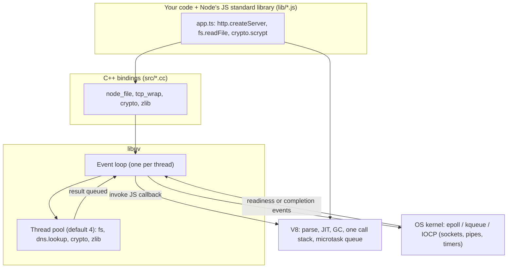
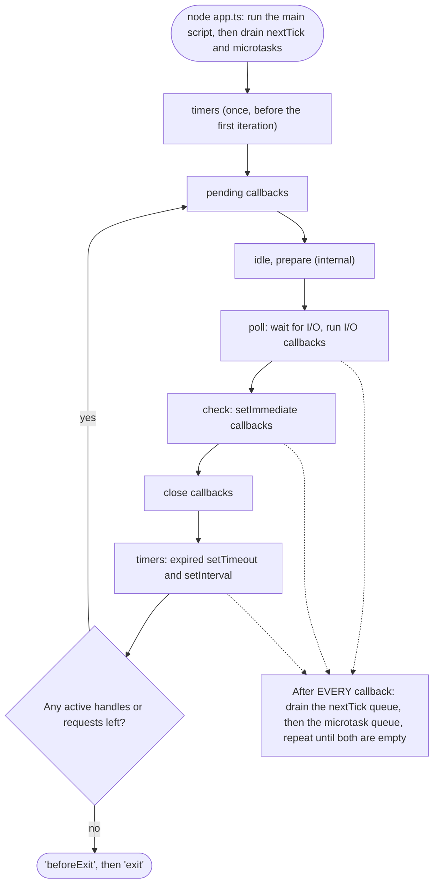
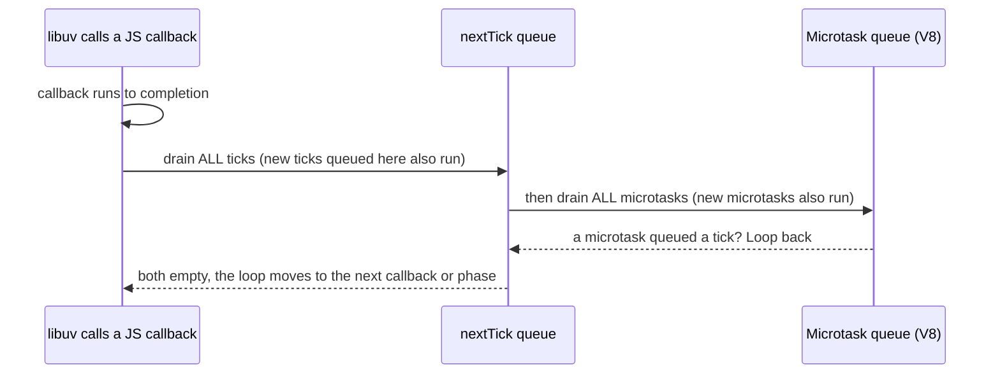
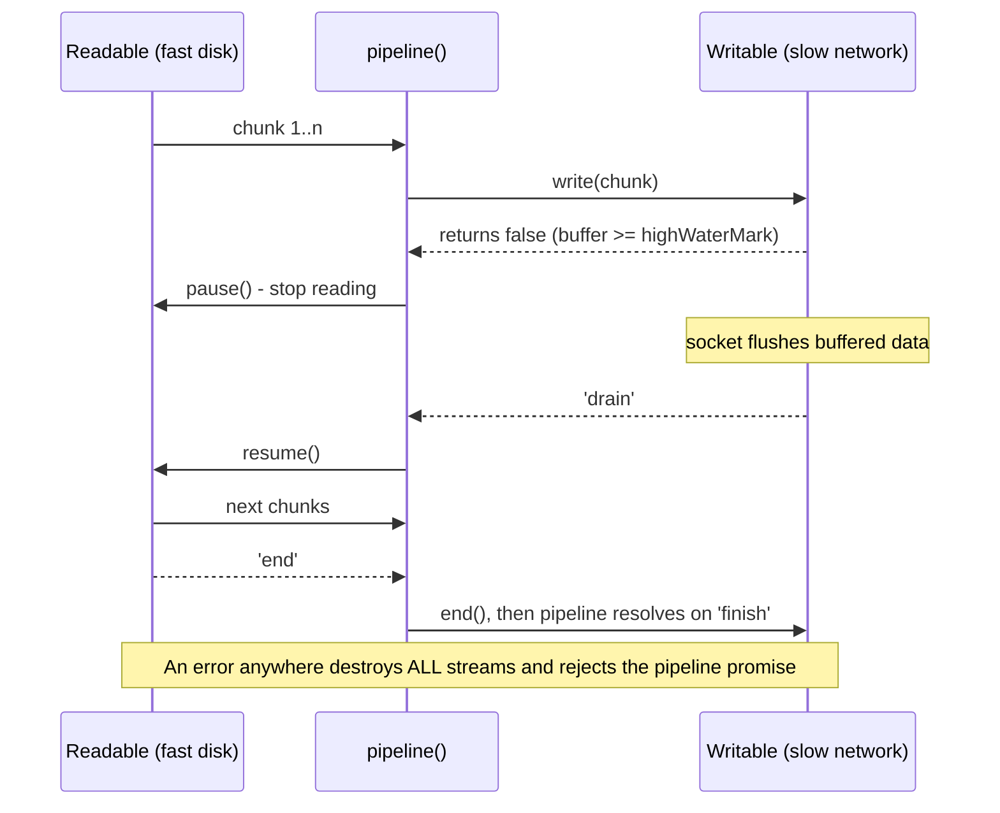
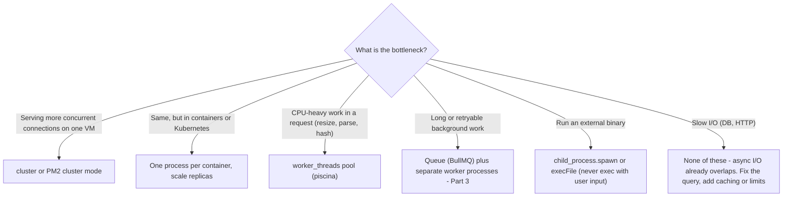

# 06 — Node.js (Part 1 of 4): Runtime Internals — Event Loop, libuv, Streams & Concurrency

> **Parts:** **Part 1 — Overview, Topic Map, Event Loop, libuv, Streams, Concurrency, EventEmitter & AsyncLocalStorage** · [Part 2 — Frameworks, Errors, Auth, Rate Limiting, Uploads & Real-time](./06-nodejs-part2.md) · [Part 3 — Redis, Queues, Logging, Observability, Shutdown, Security, Testing, Profiling & Full Example](./06-nodejs-part3.md) · [Part 4 — Resources, Practice, Interview Questions & Revision](./06-nodejs-part4.md)
>
> Applies to: **Node.js 24 LTS** ("Krypton"; examples verified on **24.21.0**, which ships V8 13.6 and libuv 1.52, in October 2026). Node 24 moves to *Maintenance LTS* on 2026-10-20, and **Node 26 becomes Active LTS on 2026-10-28** (per the official schedule at github.com/nodejs/Release). Nothing in this part changes between 24 and 26, but verify on nodejs.org for your version. Library versions used in later parts: Express 5.3, Fastify 5.12, NestJS 12, BullMQ 6, ioredis 6, Pino 10, Zod 4, TypeScript 7. The browser event loop and Promise internals are in [02-javascript Part 1](./02-javascript-part1.md#37-the-event-loop-browser); this file covers what is different in Node.

## Table of Contents

- [1. Overview](#1-overview)
- [2. Topic Map](#2-topic-map)
- [3. Detailed Explanations (Part 1)](#3-detailed-explanations-part-1)
  - [3.1 Architecture: V8, libuv and the Bindings](#31-architecture-v8-libuv-and-the-bindings)
  - [3.2 The Event Loop in Depth](#32-the-event-loop-in-depth)
  - [3.3 libuv Thread Pool & Not Blocking the Loop](#33-libuv-thread-pool--not-blocking-the-loop)
  - [3.4 Buffers & Streams](#34-buffers--streams)
  - [3.5 Concurrency: cluster vs worker_threads vs child_process](#35-concurrency-cluster-vs-worker_threads-vs-child_process)
  - [3.6 EventEmitter & AsyncLocalStorage](#36-eventemitter--asynclocalstorage)
  - [3.7 Modern Node: Built-ins That Replace Dependencies](#37-modern-node-built-ins-that-replace-dependencies)
- [How to run the code in this file](#how-to-run-the-code-in-this-file)
- [Next: Part 2](#next-part-2)

---

## 1. Overview

**What it is.** Node.js is a JavaScript runtime. It puts Google's V8 engine together with **libuv**, a C library that provides the event loop, a thread pool, and cross-platform asynchronous I/O. It adds a standard library (`fs`, `net`, `http`, `crypto`, `stream`, `worker_threads` and more) written partly in JavaScript and partly in C++. Your JavaScript runs on one main thread. The I/O happens in the operating system kernel or on libuv's worker threads, and the results come back to your thread as callbacks.

**Why interviewers care.** For a full-stack role, Node is usually where production incidents happen: a blocked event loop, a memory leak, a stream that buffers 2 GB, a missing `await` that crashes the process, a JWT that can't be revoked, or a deploy that drops in-flight requests. Interviewers want to see that you know *what runs where* and *what happens under load*.

| Junior answer | Senior answer |
|---------------|---------------|
| "Node is single-threaded" | "*Your JavaScript* runs on one thread. Network I/O is handled by the kernel (epoll, kqueue, IOCP), while `fs`, `dns.lookup`, some `crypto` and `zlib` run on libuv's thread pool (4 threads by default). So a slow `fs` call can delay DNS lookups for outgoing HTTP calls" |
| "`process.nextTick` runs on the next loop iteration" | "It runs before the event loop continues, right after the current operation and *before* promise callbacks. Except at the top level of an ES module, where promise callbacks run first, because the module itself is evaluated inside a promise job" |
| "Use `cluster` to make it faster" | "`cluster` gives you more processes to serve more connections. `worker_threads` take CPU-heavy work off the main thread. In Kubernetes, I'd usually run one process per container and scale the number of replicas" |
| "Read the file and send it" | "Stream it with `pipeline()` so backpressure keeps memory flat and an error on any side destroys every stream" |
| "Catch errors with try/catch" | "Separate operational errors from programmer errors. Crash on programmer errors and on `uncaughtException`, and let the orchestrator restart the process — after a graceful shutdown that drains connections" |

**Version landscape (dates from the official schedule):**

| Line | Released | Status (Oct 2026) | What changed that interviewers ask about |
|------|----------|-------------------|------------------------------------------|
| 18 | 2022-04 | End of life (2025-04-30) | Global `fetch` (experimental), `node:test` (experimental), `--watch` (experimental) |
| 20 | 2023-04 | End of life (2026-04-30) | libuv 1.45: **timers now run after the poll phase**; permission model (experimental); stable test runner |
| 22 | 2024-04 | Maintenance LTS until 2027-04-30 | `require(esm)` unflagged in **22.12**; global `WebSocket` client; `node --run`; **type stripping on by default in 22.18** |
| 24 | 2025-05 | Active LTS → Maintenance 2026-10-20 | V8 13.6 (`using`, `Float16Array`, `RegExp.escape`, `Error.isError`), global `URLPattern`, `AsyncLocalStorage` built on `AsyncContextFrame`, npm 11 |
| 26 | 2026-05 | Current → **Active LTS 2026-10-28** | Check the release notes on nodejs.org before you claim specifics |

> 💡 Interview Tip: Say which Node line you run in production, and why. For example: "We're on 24 LTS and plan the 26 upgrade after it enters LTS; odd-numbered lines never become LTS, so we skip them." This tells the interviewer you own upgrades and don't just consume them.

---

## 2. Topic Map

Use this as a checklist. Each item links to where it's covered.

**Part 1 — Runtime internals**
- [ ] Architecture: V8, libuv, bindings, and what is (and isn't) single-threaded — [3.1](#31-architecture-v8-libuv-and-the-bindings)
- [ ] Event loop phases, the Node 20+ timer change, `nextTick` vs microtasks, ESM vs CJS ordering — [3.2](#32-the-event-loop-in-depth)
- [ ] Thread pool: which APIs use it, `UV_THREADPOOL_SIZE`, detecting and fixing a blocked loop — [3.3](#33-libuv-thread-pool--not-blocking-the-loop)
- [ ] Buffers, the four stream types, backpressure, `pipeline`, async iteration, Web Streams — [3.4](#34-buffers--streams)
- [ ] `cluster`, `worker_threads`, `child_process` and a typed worker pool — [3.5](#35-concurrency-cluster-vs-worker_threads-vs-child_process)
- [ ] `EventEmitter` internals and `AsyncLocalStorage` — [3.6](#36-eventemitter--asynclocalstorage)
- [ ] Modern built-ins: type stripping, `--env-file`, `--watch`, `node --run`, `node:test`, `fetch`, permission model — [3.7](#37-modern-node-built-ins-that-replace-dependencies)

**[Part 2](./06-nodejs-part2.md) — Building APIs**
- [ ] Express 5 internals (middleware chain, error middleware, async errors), Fastify (schemas, plugins, encapsulation), NestJS 12 (DI, guards, pipes, interceptors)
- [ ] Error handling: operational vs programmer errors, `unhandledRejection`, typed errors, Problem Details
- [ ] Validation at the edge, REST conventions (deeper API design is in [07](./07-databases-and-apis.md))
- [ ] Auth: password hashing, sessions vs JWT, access + refresh tokens with rotation and reuse detection, OAuth2/OIDC with PKCE
- [ ] Rate limiting: token bucket and sliding window in Redis with Lua
- [ ] File uploads: streaming multipart to S3, limits, file type checks
- [ ] WebSockets and Server-Sent Events, scaling with Redis pub/sub

**[Part 3](./06-nodejs-part3.md) — Production**
- [ ] Redis caching: cache-aside, TTL jitter, stampede protection
- [ ] BullMQ 6: retries, backoff, concurrency, idempotency, job schedulers, failed jobs
- [ ] Logging with Pino, correlation IDs, redaction
- [ ] Observability: OpenTelemetry tracing, Prometheus metrics, health vs readiness
- [ ] Graceful shutdown
- [ ] Security: OWASP API Top 10, prototype pollution, SSRF, ReDoS, Helmet, the supply chain
- [ ] Testing: `node:test`, Supertest, Testcontainers
- [ ] Profiling: `--cpu-prof`, heap snapshots, finding a leak
- [ ] A full example service tying it together

**[Part 4](./06-nodejs-part4.md)** — Resources, learning path, exercises, 36 interview questions, red flags and revision.

---

## 3. Detailed Explanations (Part 1)

### 3.1 Architecture: V8, libuv and the Bindings



**The layers:**

| Layer | What it does | Interview-relevant detail |
|-------|--------------|---------------------------|
| **V8** | Compiles and runs JS, manages the heap and GC, owns the **microtask queue** (promise jobs) | Heap limits are separate from the process's RSS. Buffers live *outside* the V8 heap. The `--max-old-space-size` flag only raises the JS heap limit |
| **libuv** | The event loop, timers, non-blocking sockets via the OS, and a thread pool for work the OS can't do asynchronously everywhere (file I/O, `getaddrinfo`) | One loop per thread. Every worker thread gets its own |
| **Bindings** | C++ glue (`internalBinding('fs')` and others) that turns JS calls into libuv requests and libuv completions into JS callbacks | Each completion is one "operation". After each one, Node drains the `nextTick` and microtask queues (see [3.2](#32-the-event-loop-in-depth)) |
| **Other deps** | OpenSSL (TLS and crypto), llhttp (the HTTP parser), c-ares (`dns.resolve*`), undici (`fetch`), zlib, ICU, simdjson/simdutf | Run `process.versions` to see the exact versions — useful when a CVE notice arrives |

**What "single-threaded" really means:** a Node process already runs several threads. There is the main JS thread, the libuv pool threads, V8's GC and compiler helper threads, and the inspector. What you get is *one JavaScript call stack per isolate*. No two pieces of your JS run at the same time on the main thread, so you never need a mutex around a `Map`. The flip side: if one callback runs for 200 ms, every other request waits 200 ms.

> ⚠️ Pitfall: "Node is great for I/O, bad for CPU" is true only on the *main thread*. With `worker_threads`, CPU-heavy work runs in parallel inside the same process ([3.5](#35-concurrency-cluster-vs-worker_threads-vs-child_process)). For heavy, sustained number crunching, a service in another language may still be the right answer, but say *why* (throughput per core, memory per worker), not "because Node is single-threaded".

---

### 3.2 The Event Loop in Depth

#### The phases (Node 20+)

Each libuv loop iteration goes through these phases. Each phase has a FIFO queue of callbacks:

| Phase | Runs | Examples |
|-------|------|----------|
| **pending callbacks** | I/O callbacks deferred from the previous iteration | Some TCP errors, such as `ECONNREFUSED` on some Unix systems |
| idle, prepare | Internal only | — |
| **poll** | Waits for new I/O and runs almost all I/O callbacks. **This is where the loop blocks** when there is nothing to do | Socket `data`, `fs.readFile` completion, incoming connections |
| **check** | `setImmediate` callbacks | — |
| **close callbacks** | `'close'` events from abruptly closed handles | `socket.destroy()` → `'close'` |
| **timers** | Expired `setTimeout` and `setInterval` callbacks | — |

> ⚠️ Pitfall: Most blog posts (and many interviewers' mental models) show **timers first**. Since **libuv 1.45 (Node 20)**, timers run **after the poll phase** in each iteration. libuv still runs timers once before entering the loop, for backwards compatibility. The official Node.js "Event Loop" guide was updated to say this. If you mention it, say you know the diagram changed and why it rarely matters: you can't rely on the order of a timer vs an immediate scheduled from the main module anyway.



#### `process.nextTick` vs microtasks vs `setImmediate`

Node has **two** queues that are drained after every callback that C++ calls into JS (the official guide calls this "after the current operation"):

1. The **`nextTick` queue** (Node's own, in JS).
2. The **microtask queue** (V8's: promise reactions, `queueMicrotask`).

Node's internal `processTicksAndRejections` drains *all* ticks first. Then it asks V8 to run *all* microtasks. If a microtask queued a new tick, it loops again. So:

- `nextTick` beats promise callbacks **when both are scheduled from the same macrotask callback** (a timer, an I/O callback, CommonJS top level).
- A `nextTick` queued *from inside a microtask* runs only after the microtask queue is empty.
- Since **Node 11**, microtasks drain between *each* `setTimeout`/`setImmediate` callback, which matches browsers. Before Node 11, they ran only between phases. Very old answers online still describe the pre-11 behavior.
- **ES modules are different.** The top level of an ESM entry runs *inside* a promise job (module evaluation is asynchronous). So the microtask queue drains before Node gets to the tick queue, and promise callbacks scheduled at top level run before `nextTick` callbacks.

`setImmediate` runs in the **check** phase, right after poll. Compared with `setTimeout(fn, 0)` (which is really 1 ms):

- **From the main module**, the order is **non-deterministic**. It depends on whether 1 ms has passed by the time the loop first checks timers.
- **From inside an I/O callback**, `setImmediate` **always** runs first, because check comes right after poll.

The script below prints all of these orderings. The comments show the output measured on Node 24.21:

```ts
// src/runtime/event-loop-order.ts
import { readFile } from 'node:fs';
import { setTimeout as sleep } from 'node:timers/promises';

const topLevel: string[] = [];
setTimeout(() => topLevel.push('timeout'), 0);
setImmediate(() => topLevel.push('immediate'));
Promise.resolve().then(() => topLevel.push('promise'));
process.nextTick(() => topLevel.push('nextTick'));
queueMicrotask(() => topLevel.push('microtask'));
topLevel.push('sync');

const insideIo = await new Promise<string[]>((resolve) => {
  readFile(import.meta.filename, () => {
    const order: string[] = [];
    setTimeout(() => order.push('timeout'), 0);
    setImmediate(() => order.push('immediate'));
    process.nextTick(() => order.push('nextTick'));
    Promise.resolve().then(() => order.push('promise'));
    setTimeout(() => resolve(order), 20);
  });
});

const nested = await new Promise<string[]>((resolve) => {
  setTimeout(() => {
    const order: string[] = [];
    Promise.resolve()
      .then(() => {
        order.push('p1');
        process.nextTick(() => order.push('tick-from-p1'));
      })
      .then(() => order.push('p2'));
    process.nextTick(() => {
      order.push('t1');
      Promise.resolve().then(() => order.push('p-from-t1'));
    });
    setTimeout(() => resolve(order), 10);
  }, 0);
});

await sleep(5);
// ESM top level: sync > promise > microtask > nextTick > timeout|immediate (order of the last two varies)
console.log('ESM top level:', topLevel.join(' > '));
// Inside I/O:    nextTick > promise > immediate > timeout (always)
console.log('Inside I/O:   ', insideIo.join(' > '));
// Inside timer:  t1 > p1 > p-from-t1 > p2 > tick-from-p1
console.log('Inside timer: ', nested.join(' > '));
```

Read the "inside timer" line slowly; it is the classic senior puzzle:

1. The timer callback finishes, so Node drains ticks first: `t1` runs and queues the microtask `p-from-t1`.
2. The tick queue is empty, so V8 drains *all* microtasks. `p1` runs; it queues `tick-from-p1` (a tick, which must wait) and resolves the chain, which queues `p2`. Then `p-from-t1` runs, then `p2`.
3. The microtask queue is empty, so Node checks ticks again and runs `tick-from-p1`.

The CommonJS version of the top-level test gives `sync > nextTick > promise`. A `.cjs` file proves it:

```ts
// src/runtime/order-cjs-demo.ts
import { execFileSync } from 'node:child_process';
import { writeFileSync, rmSync } from 'node:fs';
import { join } from 'node:path';
import { tmpdir } from 'node:os';

const file = join(tmpdir(), 'order-demo.cjs');
writeFileSync(
  file,
  `const log = [];
Promise.resolve().then(() => log.push('promise'));
process.nextTick(() => log.push('nextTick'));
log.push('sync');
setTimeout(() => console.log(log.join(' > ')), 5);`,
);
// CJS top level: sync > nextTick > promise
console.log('CJS top level:', execFileSync(process.execPath, [file], { encoding: 'utf8' }).trim());
rmSync(file);
```



**Starvation.** Both queues drain *completely* before the loop continues. A recursive `process.nextTick(loop)` or an endless promise chain (`const loop = () => Promise.resolve().then(loop)`) starves I/O forever: no request is ever accepted again, but CPU sits at 100%. Recursive `setImmediate` does **not** starve the loop, because immediates queued during the check phase run in the *next* iteration.

**When to use which:**

| Need | Use | Why |
|------|-----|-----|
| Emit an event after the constructor returns, so the caller can attach listeners | `process.nextTick` | Runs before any I/O. This is how Node core emits early errors from streams and sockets |
| Defer work but stay in the Promise world | `queueMicrotask` / `await` | Standard and portable to browsers, Deno and Bun |
| Yield to I/O inside a long loop | `setImmediate` (or `await setImmediate()` from `node:timers/promises`) | Lets the poll phase run between chunks |
| Run "later" with a delay | `setTimeout` | It's a *minimum* delay; it can fire late if the loop is busy |

> 💡 Interview Tip: If you're asked to predict output, first ask: "Is this an ES module or CommonJS, and is it at top level or inside a callback?" Then walk through it out loud: the synchronous code, then the tick queue, then microtasks, then the phase the next callback lives in. Asking that question first is a senior signal by itself.

---

### 3.3 libuv Thread Pool & Not Blocking the Loop

#### Who uses the thread pool?

Network sockets do **not** use the pool. libuv registers them with the kernel's readiness or completion API (epoll on Linux, kqueue on macOS/BSD, IOCP on Windows), so one thread can watch 50,000 sockets. Work the OS can't do asynchronously everywhere goes to the **thread pool**:

| Uses the thread pool (default size 4) | Does NOT use the pool |
|---------------------------------------|-----------------------|
| All async `fs` APIs (`fs.readFile`, `fs.promises.*`, `createReadStream` reads) except watchers | TCP/UDP sockets, HTTP servers and clients (the I/O part), pipes |
| `dns.lookup` (uses `getaddrinfo`, the OS resolver) — **used by `http.get`, `fetch` and `net.connect` by default** | `dns.resolve*` / `dns.promises.resolve*` (c-ares, async on the network) |
| `crypto.pbkdf2`, `scrypt`, `randomBytes`/`randomFill` (async), `generateKeyPair`, `hkdf` | `crypto.createHash`, `createCipheriv` — these run *synchronously* on the main thread |
| Async `zlib` (`gzip`, `createGzip` streams) | Timers, `setImmediate`, signals |

**Measured (Node 24.21, 8 cores):** eight concurrent `crypto.pbkdf2` calls of about 0.7 s each.

| `UV_THREADPOOL_SIZE` | Completion times | Why |
|----------------------|------------------|-----|
| 4 (default) | 4 calls finish around 0.7 s, the other 4 around 1.4 s | Two "waves" — the pool is the bottleneck |
| 8 | All 8 finish between 0.73 s and 0.86 s | One wave, limited by CPU cores |

The benchmark used for that table:

```ts
// src/runtime/threadpool-bench.ts
// Run twice: `node src/runtime/threadpool-bench.ts`, then with UV_THREADPOOL_SIZE=8 set in the environment.
import { pbkdf2 } from 'node:crypto';
import { availableParallelism } from 'node:os';

const N = 8;
const start = performance.now();
let done = 0;
for (let i = 0; i < N; i++) {
  pbkdf2('secret', 'salt', 300_000, 64, 'sha512', (err) => {
    if (err) throw err;
    console.log(`#${i} done at ${(performance.now() - start).toFixed(0)}ms`);
    if (++done === N) {
      console.log(`pool=${process.env.UV_THREADPOOL_SIZE ?? '4 (default)'} cpus=${availableParallelism()}`);
    }
  });
}
```

**Tuning `UV_THREADPOOL_SIZE`:**
- The pool is created the first time something uses it, and its size is then fixed (the maximum is 1024). **Set the variable in the environment at launch** (Dockerfile `ENV`, systemd unit, PM2 `env`). Assigning `process.env.UV_THREADPOOL_SIZE` inside your code is fragile: it doesn't work on Windows, and anything that touches the pool earlier, such as an imported module, wins.
- Raise it when you have lots of concurrent `fs`, `dns.lookup` or `crypto` work and spare cores. A common starting point is the number of cores. Measure, because too many threads just fight over the CPU.
- **Hidden coupling:** with 4 threads, four slow NFS reads or four `scrypt` password hashes can stall **every outgoing `fetch`**, because `dns.lookup` waits for a free thread. Fixes: a bigger pool, caching DNS, or using `dns.resolve` through a custom `lookup` option.

#### What blocks the event loop

Anything synchronous and slow on the main thread:

| Culprit | Example | Fix |
|---------|---------|-----|
| `*Sync` APIs in request handlers | `fs.readFileSync`, `crypto.pbkdf2Sync`, `zlib.gzipSync` | Use the async version. `*Sync` is fine at startup |
| Big JSON | `JSON.parse` / `JSON.stringify` on a 50 MB payload (often 100+ ms) | Limit request body size, stream-parse, paginate responses |
| Catastrophic regex backtracking (ReDoS) | `/(a+)+$/.test('a'.repeat(30) + '!')` | Linear-time patterns, input length limits; see [Part 3](./06-nodejs-part3.md) |
| CPU-heavy loops | Image or PDF generation, password hashing with `*Sync`, big sorts, template rendering | `worker_threads` ([3.5](#35-concurrency-cluster-vs-worker_threads-vs-child_process)), a queue ([Part 3](./06-nodejs-part3.md)), or chunking with `setImmediate` |
| Unbounded `Promise.all` over 100,000 items | Allocates 100k promises at once and floods the pool | Concurrency limit (a promise pool — see [14](./14-js-logical-interview-questions.md)) |

**Detecting it.** `perf_hooks.monitorEventLoopDelay()` samples how late a timer fires. Its p99 is the number to alert on: on a healthy API it's single-digit milliseconds. The script below blocks the loop, then does the same work in chunks that yield, and prints both:

```ts
// src/runtime/loop-lag.ts
import { monitorEventLoopDelay } from 'node:perf_hooks';
import { setImmediate as yieldToLoop, setTimeout as sleep } from 'node:timers/promises';

const ns = 1e6;

function work(i: number): number {
  let x = 0;
  for (let j = 0; j < 20_000; j++) x += Math.sqrt(i * j);
  return x;
}

// ❌ Bad: one giant synchronous loop — no timer, request or health check can run until it ends
function processAllSync(items: number[]): number {
  let total = 0;
  for (const i of items) total += work(i);
  return total;
}

// ✅ Better: same work, time-sliced — run for ~budgetMs, then give the loop a turn
async function processAllChunked(items: number[], budgetMs = 10): Promise<number> {
  let total = 0;
  let k = 0;
  while (k < items.length) {
    const deadline = performance.now() + budgetMs;
    while (k < items.length && performance.now() < deadline) total += work(items[k++]!);
    await yieldToLoop();
  }
  return total;
}

async function measure(label: string, fn: () => unknown): Promise<void> {
  const h = monitorEventLoopDelay({ resolution: 10 });
  h.enable();
  await sleep(20); // the histogram measures between its own timer ticks, so let it start ticking first
  const t0 = performance.now();
  await fn();
  const ms = performance.now() - t0;
  await sleep(50); // the late sample is only recorded when the histogram's timer finally fires
  h.disable();
  console.log(`${label}: took ${ms.toFixed(0)}ms, loop delay p99=${(h.percentile(99) / ns).toFixed(1)}ms max=${(h.max / ns).toFixed(1)}ms`);
}

const items = Array.from({ length: 10_000 }, (_, i) => i);
await measure('sync   ', () => processAllSync(items));
await measure('chunked', () => processAllChunked(items));
```

Measured on Node 24.21: the sync version stalled the loop for its whole duration (worst delay about 510 ms), while the time-sliced version kept the worst delay at about 15–27 ms (its 10 ms budget plus the histogram's resolution). Slice by **time, not item count**: a fixed count is too coarse for slow items and adds needless yields for fast ones.

Slicing is a **responsiveness** fix, not a throughput fix. It doesn't reduce the CPU work, and on the Windows test machine the sliced run took 2–4x longer in wall time than the sync one, even though it yielded only about 200 times. That's environment-dependent, so measure on your target. If the work is heavy *and* frequent, move it off the main thread instead.

> ⚠️ Pitfall: `monitorEventLoopDelay` measures the gap between *its own* timer ticks, so its values include the sampling `resolution` (an idle loop at `resolution: 10` reports about 10 ms), and a block that starts before the first tick isn't recorded. In production you enable it once at startup (prom-client's default metrics do this), so neither quirk matters — they only bite micro-benchmarks.

> ⚠️ Pitfall: `async` doesn't make code non-blocking. An `async function` that runs a 2-second `for` loop blocks for 2 seconds; `async` only changes how the result is returned. Interviewers love this one.

---

### 3.4 Buffers & Streams

#### Buffers

- `Buffer` is a subclass of `Uint8Array`. Its memory lives **outside the V8 heap**, so it shows up in `process.memoryUsage().arrayBuffers` and `rss`, not in `heapUsed`.
- `Buffer.alloc(n)` zero-fills. `Buffer.allocUnsafe(n)` doesn't: it may contain old memory, so you must overwrite it all before you use it. Small `allocUnsafe` and `Buffer.from(string)` results are carved out of a shared pre-allocated pool (`Buffer.poolSize`; it measured **64 KiB on Node 24.21**, while older versions used 8 KiB — check yours).
- ⚠️ Because of that pool, `buf.buffer` can be a **shared** `ArrayBuffer` bigger than the buffer. Use `buf.byteOffset` and `buf.byteLength`, or copy with `Uint8Array.prototype.slice`. `new Uint8Array(buf.buffer)` can expose other data. (Measured: `Buffer.from('hi').buffer.byteLength` was 65536.)
- `buf.subarray()` (and the deprecated `buf.slice()`) **share memory** with the original. Holding a 10-byte subarray keeps the whole parent allocation alive — a subtle memory leak.
- Strings vs bytes: `'é'.length === 1` but `Buffer.byteLength('é') === 2`. Splitting a UTF-8 stream at arbitrary chunk boundaries can cut a character in half; use `setEncoding('utf8')` or a `StringDecoder`, which hold back incomplete sequences.

#### Stream types

| Type | You… | Examples |
|------|------|----------|
| **Readable** | read from it | `fs.createReadStream`, `http.IncomingMessage` (the request on the server), `process.stdin` |
| **Writable** | write to it | `fs.createWriteStream`, `http.ServerResponse`, `process.stdout` |
| **Duplex** | both, with independent sides | `net.Socket`, a WebSocket |
| **Transform** | write in, read transformed data out | `zlib.createGzip()`, `crypto.createHash` (as a stream), a CSV parser |

**Buffering and `highWaterMark`.** Every stream has an internal buffer. `highWaterMark` is the *threshold* where the stream starts saying "slow down". It is not a hard limit. Measured on Node 24.21: the default is **16 KiB** for byte streams and **16 objects** in object mode, while `fs.createReadStream` uses **64 KiB**.

**Backpressure** is the mechanism that keeps a fast producer from flooding a slow consumer:

1. `writable.write(chunk)` returns **`false`** once the buffer passes `highWaterMark`.
2. The producer should **stop** and wait for the **`'drain'`** event.
3. `pipe()`, `pipeline()` and `for await` handle this for you. Code that ignores the `false` return value keeps the whole backlog in memory.



**Manual backpressure, bad vs good:**

```ts
// src/streams/backpressure.ts
import { createWriteStream } from 'node:fs';
import { once } from 'node:events';
import { tmpdir } from 'node:os';
import { join } from 'node:path';
import type { Writable } from 'node:stream';

const LINES = 2_000_000;
const line = (i: number) => `${i},user-${i},${'x'.repeat(40)}\n`;

// ❌ Bad: ignores write()'s return value. All 2M lines pile up in the stream's buffer (memory spike).
function writeIgnoringBackpressure(out: Writable): void {
  for (let i = 0; i < LINES; i++) out.write(line(i));
  out.end();
}

// ✅ Good: when write() returns false, wait for 'drain'
async function writeWithBackpressure(out: Writable): Promise<void> {
  for (let i = 0; i < LINES; i++) {
    if (!out.write(line(i))) await once(out, 'drain');
  }
  out.end();
  await once(out, 'finish');
}

const mb = (n: number) => `${(n / 1024 / 1024).toFixed(0)}MB`;
for (const [label, fn] of [
  ['good', writeWithBackpressure],
  ['bad ', writeIgnoringBackpressure],
] as const) {
  const out = createWriteStream(join(tmpdir(), `bp-${label.trim()}.csv`));
  const before = process.memoryUsage().rss;
  let peak = before;
  const sampler = setInterval(() => (peak = Math.max(peak, process.memoryUsage().rss)), 5);
  await fn(out);
  if (!out.writableFinished) await once(out, 'finish');
  clearInterval(sampler);
  peak = Math.max(peak, process.memoryUsage().rss);
  console.log(`${label}: peak RSS growth ≈ ${mb(peak - before)}`);
}
```

The "good" version runs first, so the "bad" version's growth isn't hidden by memory the good one already allocated. Measured on Node 24.21: **good ≈ 63 MB, bad ≈ 565 MB** of peak RSS growth for the same 2 million lines. The good version's growth is mostly short-lived strings waiting for GC. The bad version's growth is the queued backlog itself, and it scales with the input. Exact numbers depend on the disk.

#### `pipeline()` — the default way to connect streams

Use `pipeline` from `node:stream/promises`, **not** `.pipe()`:

| | `a.pipe(b).pipe(c)` | `await pipeline(a, b, c)` |
|---|---|---|
| Backpressure | Yes | Yes |
| Error in `b` | `a` and `c` are **not** destroyed → leaked file descriptors, hung requests | Every stream is destroyed and the promise rejects |
| Completion | You have to listen for `'finish'` on the last stream yourself | `await` resolves when the last stream finishes |
| Cancellation | Manual | `pipeline(a, b, { signal })` with an `AbortSignal` |
| Async generators as transforms | No | Yes — `async function* (source) { for await (const chunk of source) yield ... }` |

**Example: convert a large CSV to gzipped NDJSON with flat memory.** First a script that generates the test file:

```ts
// scripts/make-csv.ts
import { createWriteStream } from 'node:fs';
import { once } from 'node:events';

const rows = Number(process.argv[2] ?? 500_000);
const out = createWriteStream(process.argv[3] ?? 'users.csv');
out.write('id,name,email,country\n');
for (let i = 1; i <= rows; i++) {
  if (!out.write(`${i},User ${i},user${i}@example.com,${i % 2 ? 'PK' : 'DE'}\n`)) await once(out, 'drain');
}
out.end();
await once(out, 'finish');
console.log(`wrote ${rows} rows`);
```

Then the converter. The transform is an async generator: it receives chunks, carries over the partial last line, and yields NDJSON text. `pipeline` handles backpressure between every stage:

```ts
// src/streams/csv-to-ndjson.ts
import { createReadStream, createWriteStream } from 'node:fs';
import { pipeline } from 'node:stream/promises';
import { createGzip } from 'node:zlib';

/** Minimal CSV (no quoted fields) -> NDJSON. Real CSV needs a parser such as csv-parse. */
export async function* csvToNdjson(source: AsyncIterable<string>): AsyncGenerator<string> {
  let carry = '';
  let header: string[] | undefined;
  for await (const chunk of source) {
    const lines = (carry + chunk).split('\n');
    carry = lines.pop() ?? ''; // the last piece may be an incomplete line
    let out = '';
    for (const line of lines) {
      if (!line) continue;
      const cells = line.replace(/\r$/, '').split(',');
      if (!header) {
        header = cells;
        continue;
      }
      out += JSON.stringify(Object.fromEntries(header.map((h, i) => [h, cells[i] ?? '']))) + '\n';
    }
    if (out) yield out; // one yield per input chunk, not per line, keeps overhead low
  }
  if (carry && header) {
    const cells = carry.split(',');
    yield JSON.stringify(Object.fromEntries(header.map((h, i) => [h, cells[i] ?? '']))) + '\n';
  }
}

export async function convert(input: string, output: string, signal?: AbortSignal): Promise<void> {
  await pipeline(
    createReadStream(input, { encoding: 'utf8' }), // utf8 decoding handles characters split across chunks
    csvToNdjson,
    createGzip(),
    createWriteStream(output),
    { signal },
  );
}

if (import.meta.main) {
  const [input = 'users.csv', output = 'users.ndjson.gz'] = process.argv.slice(2);
  const t0 = performance.now();
  const timer = setInterval(() => {}, 1000);
  let peak = 0;
  const sample = setInterval(() => (peak = Math.max(peak, process.memoryUsage().rss)), 20);
  await convert(input, output, AbortSignal.timeout(60_000));
  clearInterval(sample);
  clearInterval(timer);
  console.log(`done in ${(performance.now() - t0).toFixed(0)}ms, peak RSS ${(peak / 1024 / 1024).toFixed(0)}MB`);
}
```

`import.meta.main` (true when the file is the entry point) is available in Node 24.2+. On older lines, compare `import.meta.filename` with `process.argv[1]`. Measured: 500,000 rows (about 23 MB) converted in about 1 s with a peak RSS of about 89 MB. A 10x larger file (5 million rows, 226 MB) peaked at about 176 MB, which is less than the file itself. Only a few chunks per stage are in flight at once; the growth that remains is V8 letting the heap expand under heavy short-lived allocation before it collects. A `readFile` version would need the whole file plus every intermediate string in memory at the same time. Pass `--max-old-space-size` (or a smaller `highWaterMark`) if you need a hard memory cap.

> 💡 Interview Tip: "How do you process a 10 GB file in Node?" The answer is a `pipeline` of streams with a transform, never `readFile`. Then add the senior parts: the `highWaterMark` sets memory per stage, an error destroys every stream, `AbortSignal` handles timeouts and client disconnects, and if the transform is CPU-bound, the pipeline runs at the speed of one core (so split the file or use workers).

**Other stream facts that come up:**
- **Async iteration:** `for await (const chunk of readable)` respects backpressure, and `break` destroys the stream. It's the simplest way to *consume* a stream.
- **`Readable.from(iterable)`** turns any iterable or async iterable into a stream (object mode by default).
- **Web Streams:** `fetch` returns WHATWG `ReadableStream`s. Convert with `Readable.fromWeb(webStream)` and `Readable.toWeb(nodeStream)`. Both stream styles are first class in Node 24; Node streams still have the richer ecosystem.
- **HTTP is streams:** on a server, `req` is a Readable and `res` is a Writable. `await pipeline(createReadStream(path), res)` streams a file download with backpressure from the client's bandwidth. When the client disconnects, the file stream is destroyed.
- **Object mode** streams count *objects* against `highWaterMark`. Use it for row-by-row database exports (`pg-query-stream`, Mongo cursors' `.stream()`).

---

### 3.5 Concurrency: cluster vs worker_threads vs child_process

| | `cluster` | `worker_threads` | `child_process` |
|---|---|---|---|
| Unit | A separate **process** per worker (a full Node instance) | A **thread** with its own V8 isolate and event loop, inside the same process | Any **process** — Node (`fork`) or any binary (`spawn`, `execFile`) |
| Memory | Separate heaps; nothing shared | Separate heaps, but you can **share** `SharedArrayBuffer` and **transfer** `ArrayBuffer`s with zero copy | Separate |
| Communication | IPC messages (serialized) | `postMessage` (structured clone), `MessageChannel`, `Atomics` | stdio streams; IPC with `fork` |
| Solves | Using all cores for **serving connections** (a shared listening port) | **CPU-bound work** without blocking the main loop | Running **other programs** (ffmpeg, git, ImageMagick) or isolating unsafe work |
| Startup cost | Highest | Medium (tens of ms and some MB per isolate) — use a **pool** | Varies by program |
| Crash isolation | A worker crash doesn't kill the primary | An uncaught error ends the worker; the main thread gets an `'error'` event | Full isolation |

**`cluster` details:** the primary process accepts connections and hands them to workers **round-robin** (the default everywhere except Windows, which leaves it to the OS). Each worker is a separate process, so **nothing in memory is shared**: in-memory sessions, rate-limit counters and caches break, and WebSocket or long-polling clients need sticky sessions or an external store such as Redis. PM2's "cluster mode" uses this module.

> 💡 Interview Tip: "Would you use `cluster` in Kubernetes or ECS?" Usually no. Run **one Node process per container**, set CPU requests to about 1 core, and let the orchestrator scale replicas and restart crashed ones. A second supervisor inside the container (cluster or PM2) hides crashes from the orchestrator and confuses memory limits. `cluster` or PM2 still makes sense on a single VM ([10-deployment-aws-ec2.md](./10-deployment-aws-ec2.md)).

**`child_process` — the safe way:**

| API | Shell? | Output | Use for |
|-----|--------|--------|---------|
| `spawn(cmd, args)` | No (unless `shell: true`) | Streams | Long-running output (ffmpeg); stream it into a pipeline |
| `execFile(file, args)` | No | Buffered (`maxBuffer`) | Short commands with **user-provided arguments** |
| `exec('cmd string')` | **Yes** | Buffered | Only fixed, trusted command strings — `exec(\`convert ${userInput}\`)` is command injection |
| `fork(modulePath)` | No | IPC channel + stdio | Another Node script you talk to with messages |

#### A typed worker pool

Creating a worker per task wastes tens of milliseconds, so production code keeps a **pool** (the `piscina` library is the mature option). The version below is small enough to write in an interview and shows the parts that matter: a queue, idle workers, replacing workers that crash, and shutting down.

```ts
// src/workers/pool.ts
import { Worker } from 'node:worker_threads';
import { availableParallelism } from 'node:os';

type Task<In, Out> = { input: In; resolve: (value: Out) => void; reject: (reason: unknown) => void };

export class WorkerPool<In, Out> {
  readonly #file: URL;
  readonly #idle: Worker[] = [];
  readonly #queue: Task<In, Out>[] = [];
  readonly #busy = new Map<Worker, Task<In, Out>>();
  #closed = false;

  constructor(file: URL, size = Math.max(1, availableParallelism() - 1)) {
    this.#file = file;
    for (let i = 0; i < size; i++) this.#spawn();
  }

  run(input: In): Promise<Out> {
    if (this.#closed) return Promise.reject(new Error('Pool is closed'));
    return new Promise<Out>((resolve, reject) => {
      this.#queue.push({ input, resolve, reject });
      this.#dispatch();
    });
  }

  get pending(): number {
    return this.#queue.length;
  }

  async close(): Promise<void> {
    this.#closed = true;
    for (const task of this.#queue.splice(0)) task.reject(new Error('Pool is closed'));
    const all = [...this.#idle, ...this.#busy.keys()];
    this.#idle.length = 0;
    await Promise.all(all.map((w) => w.terminate()));
  }

  #spawn(): void {
    const worker = new Worker(this.#file);
    worker.on('message', (out: Out) => {
      const task = this.#busy.get(worker);
      this.#busy.delete(worker);
      task?.resolve(out);
      this.#idle.push(worker);
      this.#dispatch();
    });
    worker.on('error', (err) => {
      // An uncaught exception inside the worker: fail its task. 'exit' follows.
      this.#busy.get(worker)?.reject(err);
      this.#busy.delete(worker);
    });
    worker.on('exit', (code) => {
      this.#busy.get(worker)?.reject(new Error(`Worker exited with code ${code}`));
      this.#busy.delete(worker);
      const i = this.#idle.indexOf(worker);
      if (i !== -1) this.#idle.splice(i, 1);
      if (!this.#closed) {
        this.#spawn(); // replace the dead worker
        this.#dispatch();
      }
    });
    this.#idle.push(worker);
  }

  #dispatch(): void {
    while (this.#idle.length > 0 && this.#queue.length > 0) {
      const worker = this.#idle.pop();
      const task = this.#queue.shift();
      if (!worker || !task) break;
      this.#busy.set(worker, task);
      worker.postMessage(task.input);
    }
  }
}
```

The worker does pure-JS CPU work (counting primes stands in for image resizing, PDF rendering or parsing). It throws on bad input, to show how errors cross the thread boundary:

```ts
// src/workers/prime-worker.ts
import { parentPort } from 'node:worker_threads';

export type PrimeJob = { limit: number };
export type PrimeResult = { limit: number; count: number };

/** Deliberately CPU-bound (trial division), unlike a sieve, which is limited by memory bandwidth. */
export function countPrimes(limit: number): number {
  let count = 0;
  for (let n = 2; n <= limit; n++) {
    let prime = true;
    for (let d = 2; d * d <= n; d++) {
      if (n % d === 0) {
        prime = false;
        break;
      }
    }
    if (prime) count++;
  }
  return count;
}

parentPort?.on('message', (job: PrimeJob) => {
  if (!Number.isInteger(job.limit) || job.limit < 2) throw new RangeError(`bad limit: ${job.limit}`);
  const result: PrimeResult = { limit: job.limit, count: countPrimes(job.limit) };
  parentPort?.postMessage(result);
});
```

The demo runs the same eight jobs on the main thread and then on the pool, while measuring how responsive the event loop stays:

```ts
// src/workers/demo.ts
import { monitorEventLoopDelay } from 'node:perf_hooks';
import { setTimeout as sleep } from 'node:timers/promises';
import { WorkerPool } from './pool.ts';
import type { PrimeJob, PrimeResult } from './prime-worker.ts';

const jobs: PrimeJob[] = Array.from({ length: 8 }, () => ({ limit: 1_500_000 }));

function countPrimesInline(limit: number): number {
  let count = 0;
  for (let n = 2; n <= limit; n++) {
    let prime = true;
    for (let d = 2; d * d <= n; d++) {
      if (n % d === 0) {
        prime = false;
        break;
      }
    }
    if (prime) count++;
  }
  return count;
}

async function timed(label: string, fn: () => Promise<unknown>): Promise<void> {
  const h = monitorEventLoopDelay({ resolution: 10 });
  h.enable();
  await sleep(20); // let the histogram start ticking first
  const t0 = performance.now();
  await fn();
  const ms = performance.now() - t0;
  await sleep(50); // let the histogram's late timer fire so the stall is recorded
  h.disable();
  console.log(`${label}: ${ms.toFixed(0)}ms wall, max loop delay ${(h.max / 1e6).toFixed(0)}ms`);
}

await timed('main thread', async () => jobs.map((j) => countPrimesInline(j.limit)));

const pool = new WorkerPool<PrimeJob, PrimeResult>(new URL('./prime-worker.ts', import.meta.url), 4);
await timed('pool of 4  ', () => Promise.all(jobs.map((j) => pool.run(j))));

try {
  await pool.run({ limit: -1 });
} catch (err) {
  console.log('worker error surfaced:', (err as Error).message);
}
console.log('pool still works after a crash:', (await pool.run({ limit: 100 })).count);
await pool.close();
```

Measured on Node 24.21 (8 cores): the main-thread run took **2.85 s with a 2.85 s loop stall** — no other request could have been served. The pool of 4 took **1.2 s with a worst loop delay of 31 ms**. The thrown `RangeError` came back as a rejected `run()` promise, and the pool replaced the dead worker.



> ⚠️ Pitfall: Worker threads don't speed up I/O-bound code — async I/O already overlaps. Putting database calls in a worker adds serialization cost and a second connection pool, and gains nothing.

---

### 3.6 EventEmitter & AsyncLocalStorage

#### EventEmitter internals

- **`emit` is synchronous.** Listeners run in registration order, on the caller's stack, before `emit` returns. A throwing listener throws out of `emit`, and the remaining listeners don't run.
- **`'error'` is special.** Emitting `'error'` with no listener **throws** the error. On a socket or stream, that crashes the process. Always attach `'error'` handlers to streams, sockets and clients you create (or use `pipeline`, which does it for you).
- **Leak warning.** More than 10 listeners for one event (the default `maxListeners`) prints `MaxListenersExceededWarning`. It's a warning, not an error, and it usually means you're adding a listener per request to a long-lived object. Find the leak; don't just raise the limit.
- **Async listeners:** a rejected promise returned by a listener is an *unhandled rejection* — unless you create the emitter with `{ captureRejections: true }`, which routes it to `'error'`.
- **Promise helpers:** `await once(emitter, 'ready', { signal })` and `for await (const [msg] of on(emitter, 'message', { signal }))`.
- **Typing:** `@types/node` accepts an event map, so `emit` and `on` are checked at compile time:

```ts
// src/runtime/typed-emitter.ts
import { EventEmitter, once, on } from 'node:events';

type JobEvents = {
  progress: [jobId: string, percent: number];
  done: [jobId: string, result: { url: string }];
  error: [err: Error];
};

class JobRunner extends EventEmitter<JobEvents> {
  constructor() {
    super({ captureRejections: true }); // async listener rejections are routed to 'error'
  }

  start(jobId: string): void {
    // Emit asynchronously so callers can attach listeners after start() returns
    process.nextTick(() => {
      this.emit('progress', jobId, 50);
      this.emit('done', jobId, { url: `/files/${jobId}.pdf` });
    });
  }
}

const runner = new JobRunner();
runner.on('error', (err) => console.error('runner error:', err.message));
runner.on('progress', (id, pct) => console.log(`${id}: ${pct}%`));
// runner.emit('progress', 'a', '50%'); // ❌ compile error: string is not assignable to number

const ac = new AbortController();
const progressEvents = (async () => {
  let n = 0;
  try {
    for await (const [id] of on(runner, 'progress', { signal: ac.signal })) n += id ? 1 : 0;
  } catch (err) {
    if ((err as Error).name !== 'AbortError') throw err;
  }
  return n;
})();

runner.start('job-1');
const [id, result] = await once(runner, 'done');
console.log('finished', id, result.url);
ac.abort();
console.log('progress events seen by the async iterator:', await progressEvents);
```

#### AsyncLocalStorage (ALS)

**Problem:** you want a `requestId` (or user, tenant or trace context) available in every log line deep inside your services, without passing it through every function.

**Solution:** `AsyncLocalStorage` stores a value that follows the *async* call chain. Code inside `als.run(store, fn)` — and every callback, promise continuation and timer it creates — sees the same `store` via `als.getStore()`. Concurrent requests each see their own value.

**How it works:** on Node 24, ALS is built on **`AsyncContextFrame`** by default. V8 carries the current context "frame" along with every promise continuation and callback, so a `getStore()` call is cheap and you don't pay for `async_hooks` tracking all the time (the older implementation). This is also the model behind the TC39 `AsyncContext` proposal. OpenTelemetry's context and most logging libraries' request context use ALS underneath.

```ts
// src/runtime/request-context.ts
import { AsyncLocalStorage } from 'node:async_hooks';
import { randomUUID } from 'node:crypto';
import { setTimeout as sleep } from 'node:timers/promises';

type RequestContext = { requestId: string; userId?: string };
const als = new AsyncLocalStorage<RequestContext>();

export function log(msg: string): void {
  const ctx = als.getStore();
  console.log(JSON.stringify({ msg, requestId: ctx?.requestId ?? null, userId: ctx?.userId ?? null }));
}

export function withRequestContext<T>(ctx: RequestContext, fn: () => Promise<T>): Promise<T> {
  return als.run(ctx, fn);
}

// Deep in the call stack — no requestId parameter anywhere
async function chargeCard(amount: number): Promise<void> {
  await sleep(Math.random() * 20);
  log(`charged ${amount}`);
}

async function handleCheckout(userId: string): Promise<void> {
  const ctx = als.getStore();
  if (ctx) ctx.userId = userId; // mutate the store for the rest of this request only
  log('checkout started');
  await chargeCard(42);
  setTimeout(() => log('timer callback still has context'), 5);
}

await Promise.all([
  withRequestContext({ requestId: randomUUID() }, () => handleCheckout('alice')),
  withRequestContext({ requestId: randomUUID() }, () => handleCheckout('bob')),
]);
log('outside any request'); // requestId: null
await sleep(20);
```

> ⚠️ Pitfall: The context is lost when work is handed over through something that queues callbacks *outside* the async chain: a hand-rolled callback queue, some connection pools, or old callback-style libraries. Symptom: logs with `requestId: null` deep in the stack. Fix it by wrapping the callback with `AsyncLocalStorage.bind(fn)` or `AsyncResource.bind(fn)` at the point where you enqueue it. Also, use `als.run()`, not `enterWith()`, in request handlers: `enterWith` leaks the store into the rest of the current synchronous execution.

---

### 3.7 Modern Node: Built-ins That Replace Dependencies

A senior answer knows when a dependency is no longer needed. As of Node 24 (check the docs for stability levels):

| Built-in | Replaces | Notes |
|----------|----------|-------|
| **Type stripping** — `node app.ts` | `ts-node`, `tsx` for many cases | On by default since 23.6 / 22.18, no warning since 24.3, and **Stable since 24.12** (per the Node 24 docs; `process.features.typescript === 'strip'`). It doesn't apply to `.ts` files inside `node_modules`. It only *erases* types: no type checking (run `tsc --noEmit` in CI) and no `enum`, `namespace` or constructor parameter properties. Enable `erasableSyntaxOnly` in `tsconfig`. Relative imports need the `.ts` extension. Legacy decorators (NestJS) still need a compile step |
| `--env-file=.env`, `--env-file-if-exists`, `process.loadEnvFile()`, `util.parseEnv()` | `dotenv` | Validate the result with a schema anyway — Part 2 |
| `--watch`, `--watch-path` | `nodemon` | Restarts on file changes |
| `node --run <script>` | `npm run` for local scripts | Faster: no npm startup. Doesn't run `pre`/`post` scripts |
| `node:test`, `node:assert`, `mock`, `mock.timers`, `--experimental-test-coverage`, snapshot tests | Jest/Mocha for many backend projects | Vitest is still more popular for TS apps; know both. See [Part 3](./06-nodejs-part3.md) |
| Global `fetch`, `Request`, `Response`, `FormData`, `WebSocket` (client), `AbortSignal.timeout()` | `node-fetch`, `axios` (for simple uses), `ws` (as a *client*) | `fetch` is built on undici (7.x in Node 24). For high throughput, configure an undici `Agent` (keep-alive, connection count) |
| `--permission` with `--allow-fs-read`, `--allow-fs-write`, `--allow-child-process`, `--allow-worker`, `--allow-addons` | — (defense in depth) | Restricts what the *process* can do, which limits the damage from a compromised dependency. Not a sandbox for untrusted code |
| `util.styleText`, `util.parseArgs`, `fs.glob`, `structuredClone`, `crypto.randomUUID` | `chalk`, `yargs`/`minimist` (simple CLIs), `glob`, `lodash.clonedeep`, `uuid` | Fewer dependencies means a smaller supply-chain attack surface ([Part 3](./06-nodejs-part3.md)) |
| `node:sqlite` | `better-sqlite3` (for simple cases) | Still experimental on 24 — check before you rely on it |
| `require(esm)` (unflagged in 20.19 / 22.12) | Dual-package hacks | CommonJS code can `require()` an ES module, as long as it has no top-level `await`. NestJS 12 depends on this. ESM vs CJS semantics are in [02 Part 2](./02-javascript-part2.md#313-modules-esm-vs-commonjs) |

> 💡 Interview Tip: When asked "how would you set up a new Node service in 2026?", a strong answer is short: "Node 24 LTS (26 once it's LTS), ESM, TypeScript with `tsc --noEmit` in CI and type stripping or a bundler for running it, Fastify or Express 5, Zod at the edges, Pino logs, OpenTelemetry, `node:test` or Vitest, and a Dockerfile with a non-root user and graceful shutdown." Then justify each choice in one line.

---

## How to run the code in this file

Every code block that starts with a `// path` comment is a file in one small project. Requirements: **Node 24+**; nothing else is needed for Part 1.

```json
{
  "compilerOptions": {
    "target": "es2024",
    "lib": ["es2024", "esnext.disposable"],
    "module": "nodenext",
    "moduleResolution": "nodenext",
    "types": ["node"],
    "strict": true,
    "noUncheckedIndexedAccess": true,
    "erasableSyntaxOnly": true,
    "verbatimModuleSyntax": true,
    "allowImportingTsExtensions": true,
    "noEmit": true,
    "skipLibCheck": true
  },
  "include": ["src/**/*.ts", "test/**/*.ts", "scripts/**/*.ts"]
}
```

Save that as `tsconfig.json`, put `"type": "module"` in `package.json`, and run `npm i -D typescript @types/node`. Then:

```bash
npx tsc                                  # type-check only (noEmit)
node src/runtime/event-loop-order.ts     # Node 24 strips the types and runs the file directly
node src/runtime/order-cjs-demo.ts
node src/runtime/threadpool-bench.ts
node src/runtime/loop-lag.ts
node src/streams/backpressure.ts
node scripts/make-csv.ts 500000 users.csv && node src/streams/csv-to-ndjson.ts users.csv users.ndjson.gz
node src/workers/demo.ts
node src/runtime/typed-emitter.ts
node src/runtime/request-context.ts
```

To compare thread-pool sizes, set `UV_THREADPOOL_SIZE=8` in the environment before launching (`$env:UV_THREADPOOL_SIZE=8` in PowerShell, `UV_THREADPOOL_SIZE=8 node ...` in bash).

---

## Next: Part 2

Continue to **[Part 2 — Frameworks, Errors, Auth, Rate Limiting, Uploads & Real-time](./06-nodejs-part2.md)**: Express 5 internals, Fastify and NestJS, error handling, validation, auth with refresh-token rotation, Redis rate limiting, streaming uploads to S3, and WebSockets/SSE at scale.
