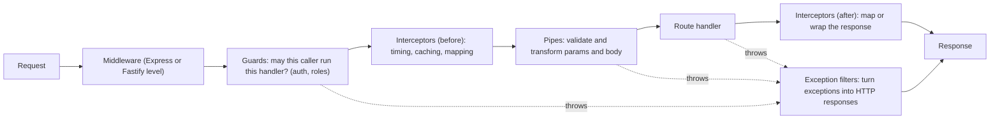
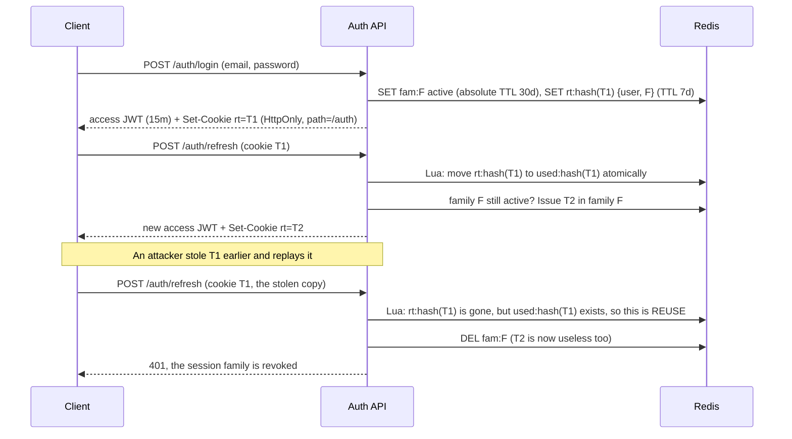
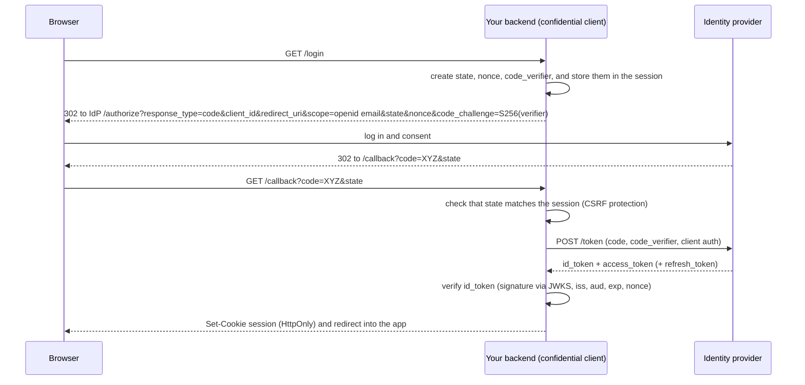
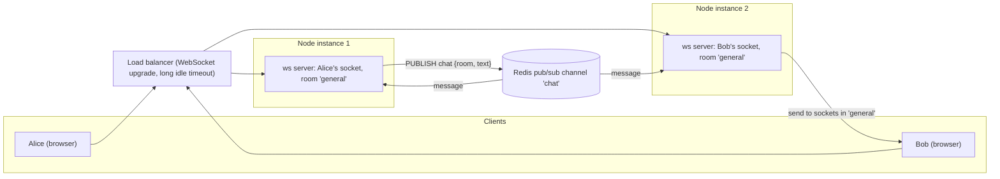

# 06 — Node.js (Part 2 of 4): Frameworks, Errors, Auth, Rate Limiting, Uploads & Real-time

> **Parts:** [Part 1 — Overview, Topic Map, Event Loop, libuv, Streams, Concurrency, EventEmitter & AsyncLocalStorage](./06-nodejs-part1.md) · **Part 2 — Frameworks, Errors, Auth, Rate Limiting, Uploads & Real-time** · [Part 3 — Redis, Queues, Logging, Observability, Shutdown, Security, Testing, Profiling & Full Example](./06-nodejs-part3.md) · [Part 4 — Resources, Practice, Interview Questions & Revision](./06-nodejs-part4.md)
>
> Applies to: Node.js 24 LTS with **Express 5.3**, **Fastify 5.12**, **NestJS 12.1**, **Zod 4.6**, **jose 6.2**, **ioredis 6.0** (against Redis 8), **busboy 1.6**, **AWS SDK v3** (`@aws-sdk/lib-storage`) and **ws 8.22**. All code here was type-checked with TypeScript 7.0 and run on Node 24.21 in October 2026; the S3 upload ran against an S3-compatible mock. Check each library's changelog before you rely on version-specific details. Deeper API design (pagination, idempotency, versioning, GraphQL/tRPC/gRPC) is in [07-databases-and-apis.md](./07-databases-and-apis.md).

## Table of Contents

- [3. Detailed Explanations (Part 2)](#3-detailed-explanations-part-2)
  - [3.8 Express 5: How It Works Inside](#38-express-5-how-it-works-inside)
  - [3.9 Error Handling](#39-error-handling)
  - [3.10 Validation, Config & REST Conventions](#310-validation-config--rest-conventions)
  - [3.11 A Production-Shaped Express App](#311-a-production-shaped-express-app)
  - [3.12 Fastify](#312-fastify)
  - [3.13 NestJS 12](#313-nestjs-12)
  - [3.14 Authentication & Authorization](#314-authentication--authorization)
  - [3.15 Rate Limiting with Redis](#315-rate-limiting-with-redis)
  - [3.16 File Uploads](#316-file-uploads)
  - [3.17 Real-time: SSE & WebSockets at Scale](#317-real-time-sse--websockets-at-scale)
- [Next: Part 3](#next-part-3)

---

## 3. Detailed Explanations (Part 2)

### 3.8 Express 5: How It Works Inside

**The mental model.** An Express app is a function `(req, res) => void` that you pass to `http.createServer`. Inside, a **router** keeps a **stack of layers**. Each layer has a path matcher, an optional HTTP method, and a handler. For each request, the router walks the stack with an index:

- `next()` moves to the next layer whose path and method match.
- `next(err)` skips every normal handler and jumps to the next **error handler** — a function with **four** parameters `(err, req, res, next)`. Express tells the two kinds apart by `fn.length`, which is why you must declare all four parameters even if you don't use `next`.
- `next('route')` skips the remaining handlers of the current route; `next('router')` leaves the current router.
- If nobody sends a response and the stack runs out, Express's final handler sends 404 (or 500 if there was an error).
- **Express 5:** if a handler returns a **rejected promise** (any `async` handler that throws), the router calls `next(err)` for you. In Express 4 the rejection went unhandled, and the request hung until it timed out.

You can build the core of this in 40 lines — a common interview exercise:

```ts
// src/express/mini-router.ts
type Req = { method: string; path: string; [key: string]: unknown };
type Res = { statusCode: number; body?: unknown; send(body: unknown): void };
type Next = (err?: unknown) => void;
type Handler = (req: Req, res: Res, next: Next) => unknown;
type ErrorHandler = (err: unknown, req: Req, res: Res, next: Next) => unknown;
type Layer = { path: string; fn: Handler | ErrorHandler };

export class MiniRouter {
  readonly #stack: Layer[] = [];

  use(path: string, fn: Handler | ErrorHandler): this {
    this.#stack.push({ path, fn });
    return this;
  }

  handle(req: Req, res: Res, done: (err?: unknown) => void): void {
    let i = 0;
    const next: Next = (err) => {
      const layer = this.#stack[i++];
      if (!layer) return done(err);
      if (!req.path.startsWith(layer.path)) return next(err);
      const isErrorHandler = layer.fn.length === 4; // exactly how Express tells them apart
      if (err !== undefined && !isErrorHandler) return next(err); // skip normal handlers while erroring
      if (err === undefined && isErrorHandler) return next(); // skip error handlers while healthy
      try {
        const out = isErrorHandler
          ? (layer.fn as ErrorHandler)(err, req, res, next)
          : (layer.fn as Handler)(req, res, next);
        // Express 5 behavior: a rejected promise from a handler is forwarded to next(err)
        if (out instanceof Promise) out.catch(next);
      } catch (syncErr) {
        next(syncErr);
      }
    };
    next();
  }
}

if (import.meta.main) {
  const log: string[] = [];
  const router = new MiniRouter()
    .use('/', (req: Req, _res: Res, next: Next) => {
      log.push(`logger ${req.method} ${req.path}`);
      next();
    })
    .use('/api', async () => {
      throw new Error('db down'); // async throw, no try/catch needed
    })
    .use('/api', (_req: Req, res: Res) => res.send('never reached'))
    .use('/', (err: unknown, _req: Req, res: Res, _next: Next) => {
      res.statusCode = 500;
      res.send({ error: (err as Error).message });
    });

  const res: Res = { statusCode: 200, send(body) { this.body = body; } };
  router.handle({ method: 'GET', path: '/api/notes' }, res, () => log.push('final handler'));
  setTimeout(() => console.log(log, res.statusCode, res.body), 0);
  // [ 'logger GET /api/notes' ] 500 { error: 'db down' }
}
```

**What changed in Express 5** (5.0 shipped in late 2024; 5.1 became the default `latest` on npm in March 2025). Each row below was checked on 5.3:

| Change | Express 4 | Express 5 |
|--------|-----------|-----------|
| Async errors | A rejected promise was an unhandled rejection; you needed `express-async-errors` or a wrapper | Forwarded to `next(err)` automatically |
| Wildcards (path-to-regexp v8) | `app.get('/files/*')` | Must be **named**: `'/files/*splat'`, and `req.params.splat` is an **array** (`['a','b','c.txt']`). `'/old/*'` now throws "Missing parameter name" at startup |
| Optional params | `'/:id?'` | `'{/:id}'` |
| `req.query` | Writable | A **getter**: assigning to it throws. Put parsed values somewhere else (a local variable or `res.locals`) |
| `req.body` without a parser | `{}` | `undefined` |
| `res.status(1000)` | Silently accepted | Throws `RangeError` (status must be an integer from 100 to 999) |
| `express.urlencoded` | `extended: true` by default | `extended: false` by default |
| Removed | — | `app.del`, `req.param()`, `res.sendfile` (lowercase), and others; see the migration guide on expressjs.com |
| Node support | Old versions | Node 18+ |

> 💡 Interview Tip: "What's the order of middleware?" It's **registration order**, and it matters. Body parsing must come before handlers that read `req.body`. Auth comes before protected routers. The 404 handler goes after all routes. The error handler goes **last** and has four parameters. Put `helmet` and request IDs first so even error responses get the headers.

---

### 3.9 Error Handling

**Two kinds of errors** (a distinction made popular by Joyent's error-handling guide and the Node Best Practices repo):

| | Operational errors | Programmer errors (bugs) |
|---|---|---|
| Examples | Invalid input, resource not found, DB timeout, upstream 503, unique constraint violation | `undefined is not a function`, wrong argument type, a broken invariant |
| Expected? | Yes — part of normal operation | No |
| Handle by | Returning the right status code, retrying, falling back, logging at `warn` | Logging at `error`/`fatal`, alerting, and usually **crashing the process** so a clean one replaces it |
| In code | Typed error classes (`NotFoundError`) thrown deliberately | Anything else that reaches the global handler |

**A typed error hierarchy** that turns into RFC 9457 *Problem Details* responses (`application/problem+json`; RFC 9457 obsoletes RFC 7807):

```ts
// src/http/errors.ts
export type ProblemDetails = {
  type: string;
  title: string;
  status: number;
  detail?: string;
  instance?: string;
  [extension: string]: unknown;
};

export abstract class AppError extends Error {
  abstract readonly status: number;
  abstract readonly code: string; // stable, machine-readable; clients switch on this, not on messages
  readonly expose: boolean = true; // safe to show `message` to clients

  constructor(message: string, options?: ErrorOptions) {
    super(message, options);
    this.name = new.target.name;
  }

  toProblem(instance?: string): ProblemDetails {
    return {
      type: `https://errors.example.com/${this.code}`,
      title: this.code.replaceAll('_', ' '),
      status: this.status,
      detail: this.expose ? this.message : undefined,
      instance,
    };
  }
}

export class ValidationError extends AppError {
  readonly status = 400;
  readonly code = 'validation_failed';
  readonly issues: { path: string; message: string }[];
  constructor(issues: { path: string; message: string }[]) {
    super('Request validation failed');
    this.issues = issues;
  }
  override toProblem(instance?: string): ProblemDetails {
    return { ...super.toProblem(instance), errors: this.issues };
  }
}

export class UnauthorizedError extends AppError {
  readonly status = 401;
  readonly code = 'unauthorized';
}
export class ForbiddenError extends AppError {
  readonly status = 403;
  readonly code = 'forbidden';
}
export class NotFoundError extends AppError {
  readonly status = 404;
  readonly code = 'not_found';
}
export class ConflictError extends AppError {
  readonly status = 409;
  readonly code = 'conflict';
}
export class PayloadTooLargeError extends AppError {
  readonly status = 413;
  readonly code = 'payload_too_large';
}
export class UnsupportedMediaTypeError extends AppError {
  readonly status = 415;
  readonly code = 'unsupported_media_type';
}
export class TooManyRequestsError extends AppError {
  readonly status = 429;
  readonly code = 'rate_limited';
  readonly retryAfterSeconds: number;
  constructor(retryAfterSeconds: number) {
    super('Too many requests');
    this.retryAfterSeconds = retryAfterSeconds;
  }
}

/** Wrap an infrastructure failure: the client sees a generic 503, the logs keep the cause chain. */
export class DependencyError extends AppError {
  readonly status = 503;
  readonly code = 'dependency_unavailable';
  override readonly expose = false;
}

export function isAppError(err: unknown): err is AppError {
  return err instanceof AppError;
}
```

**Process-level handlers — what actually happens:**

| Event | Default since | What to do |
|-------|---------------|------------|
| `unhandledRejection` | Node 15: the default mode is `throw`, so an unhandled rejection **crashes the process** like an uncaught exception | Fix the missing `await`/`.catch`. Keep the default. Optionally log it with context before the crash |
| `uncaughtException` | Always: print the stack and exit with code 1 | Log it synchronously (at `fatal`), then **exit**. The process is in an unknown state (half-finished writes, held locks). Don't keep serving |
| `'error'` on an emitter with no listener | Throws | Add `'error'` listeners to every stream, socket and client you create |

```ts
// src/http/process-handlers.ts
type FatalLogger = { fatal: (obj: object, msg: string) => void };

export function installProcessHandlers(log: FatalLogger, shutdown: (code: number) => Promise<void>): void {
  process.on('uncaughtException', (err, origin) => {
    log.fatal({ err, origin }, 'uncaught exception, shutting down');
    // Give in-flight requests a short, bounded grace period, then exit non-zero (see graceful shutdown in Part 3)
    void shutdown(1);
  });
  process.on('unhandledRejection', (reason) => {
    // Re-throw so it becomes an uncaughtException and takes the same path
    throw reason instanceof Error ? reason : new Error(`Unhandled rejection: ${String(reason)}`);
  });
}
```

**Rules that separate a senior answer:**
- **Never leak internals.** For unknown errors, send `500` with a generic body and a request ID. Log the stack *with* that request ID so support can find it.
- **Keep the cause chain:** `throw new DependencyError('payment provider down', { cause: err })`. `Error.cause` is supported by Pino's serializer and by `util.inspect`.
- **Map, don't leak, infrastructure errors:** a Postgres `23505` (unique violation) becomes `ConflictError`; a timeout becomes `DependencyError` (503) — not a 500 that pages someone at night for a client mistake.
- **Don't catch and ignore.** `catch {}` with no rethrow or log is a red flag in code review.
- **If headers are already sent** (for example, an error halfway through a streamed response), you can't change the status. Delegate to Express's default handler with `next(err)`, which destroys the connection so the client sees a broken response instead of a "successful" truncated one.

---

### 3.10 Validation, Config & REST Conventions

**Validate at the edge, trust inside.** Parse every untrusted input — body, query, params, headers, env vars, queue messages, webhook payloads — with a schema. Once parsed, pass the *typed* result inward. Zod 4 is the default choice in TypeScript codebases; Valibot and ArkType implement the same **Standard Schema** interface, which NestJS 12 and many frameworks now accept.

```ts
// src/http/validate.ts
import { z } from 'zod';
import { ValidationError } from './errors.ts';

/** Parse untrusted input or throw a 400 with field-level issues. */
export function parse<S extends z.ZodType>(schema: S, data: unknown): z.output<S> {
  const result = schema.safeParse(data);
  if (result.success) return result.data;
  throw new ValidationError(
    result.error.issues.map((i) => ({ path: i.path.join('.') || '(root)', message: i.message })),
  );
}

// Reusable building blocks
export const IdParam = z.object({ id: z.uuid() });
export const PageQuery = z.object({
  limit: z.coerce.number().int().min(1).max(100).default(20), // query strings are strings: coerce
  cursor: z.string().max(200).optional(),
});
```

**Config is input too.** Fail fast at startup, listing *every* problem at once, instead of crashing on the first request that reads a missing variable:

```ts
// src/config/env.ts
import { z } from 'zod';

const EnvSchema = z.object({
  NODE_ENV: z.enum(['development', 'test', 'production']).default('development'),
  PORT: z.coerce.number().int().min(1).max(65535).default(3000),
  REDIS_URL: z.url().default('redis://localhost:6379'),
  JWT_ISSUER: z.string().min(1).default('https://auth.example.com'),
  JWT_AUDIENCE: z.string().min(1).default('notes-api'),
  CORS_ORIGINS: z
    .string()
    .default('http://localhost:5173')
    .transform((s) => s.split(',').map((o) => o.trim())),
  TRUST_PROXY_HOPS: z.coerce.number().int().min(0).default(0), // 1 behind one ALB/Nginx
  S3_BUCKET: z.string().min(1).default('uploads'),
});

export type Env = z.output<typeof EnvSchema>;

export function loadEnv(source: NodeJS.ProcessEnv = process.env): Env {
  const result = EnvSchema.safeParse(source);
  if (!result.success) {
    console.error('Invalid environment:\n' + z.prettifyError(result.error));
    process.exit(1);
  }
  return Object.freeze(result.data);
}
```

**Status codes that interviewers probe:**

| Code | Use it when | Common mistake |
|------|-------------|----------------|
| 200 / **201** + `Location` | OK / created a resource | 200 for creation |
| **202** | Accepted for async processing (a queued job); return a status URL | Doing the long work in the request |
| **204** | Success, no body (DELETE, some PUTs) | Sending a body with 204 |
| **400** vs **422** | 400 for malformed syntax or failed validation; some APIs use 422 for semantically invalid but well-formed data. Pick one and document it | Mixing both randomly |
| **401** vs **403** | 401: not authenticated (missing or invalid credentials). 403: authenticated but not allowed | 403 for an expired token |
| **404** for forbidden resources | Return 404 instead of 403 when even revealing that a resource *exists* leaks information (another tenant's ID) | Leaking existence through 403 |
| **409** / **412** | Conflict (duplicate, state clash) / precondition failed (`If-Match` ETag mismatch — optimistic concurrency) | 500 on unique-constraint violations |
| **413** / **415** | Body too large / wrong `Content-Type` | Accepting anything |
| **429** + `Retry-After` | Rate limited | No `Retry-After` header, so clients retry immediately |
| 500 / **502** / **503** / **504** | Bug / bad upstream response / overloaded or dependency down (with `Retry-After`) / upstream timeout | Everything is 500 |

Pagination (cursor vs offset), idempotency keys, versioning and ETags are covered in [07-databases-and-apis.md](./07-databases-and-apis.md).

---

### 3.11 A Production-Shaped Express App

A small notes API with the habits interviewers look for: an app factory (testable without a port), security headers, body limits, request IDs, validation, typed errors and a single error handler. The repository is an interface with an in-memory implementation, so the app runs without a database. The real Postgres version is in [Part 3](./06-nodejs-part3.md).

```ts
// src/notes/repo.ts
import { randomUUID } from 'node:crypto';

export type Note = { id: string; ownerId: string; title: string; body: string; createdAt: string };
export type NewNote = { title: string; body: string };

export interface NotesRepo {
  list(ownerId: string, limit: number, cursor?: string): Promise<{ items: Note[]; nextCursor: string | null }>;
  get(ownerId: string, id: string): Promise<Note | null>;
  create(ownerId: string, input: NewNote): Promise<Note>;
  update(ownerId: string, id: string, patch: Partial<NewNote>): Promise<Note | null>;
  delete(ownerId: string, id: string): Promise<boolean>;
}

export class InMemoryNotesRepo implements NotesRepo {
  readonly #notes = new Map<string, Note>();

  async list(ownerId: string, limit: number, cursor?: string) {
    // Cursor = the last seen createdAt|id; stable ordering by (createdAt, id)
    const all = [...this.#notes.values()]
      .filter((n) => n.ownerId === ownerId)
      .sort((a, b) => a.createdAt.localeCompare(b.createdAt) || a.id.localeCompare(b.id));
    const start = cursor ? all.findIndex((n) => `${n.createdAt}|${n.id}` === cursor) + 1 : 0;
    const items = all.slice(start, start + limit);
    const last = items.at(-1);
    const nextCursor = start + limit < all.length && last ? `${last.createdAt}|${last.id}` : null;
    return { items, nextCursor };
  }

  async get(ownerId: string, id: string) {
    const note = this.#notes.get(id);
    return note && note.ownerId === ownerId ? note : null; // other owners' notes look like 404
  }

  async create(ownerId: string, input: NewNote) {
    const note: Note = { id: randomUUID(), ownerId, ...input, createdAt: new Date().toISOString() };
    this.#notes.set(note.id, note);
    return note;
  }

  async update(ownerId: string, id: string, patch: Partial<NewNote>) {
    const note = await this.get(ownerId, id);
    if (!note) return null;
    const updated = { ...note, ...patch };
    this.#notes.set(id, updated);
    return updated;
  }

  async delete(ownerId: string, id: string) {
    const note = await this.get(ownerId, id);
    return note ? this.#notes.delete(id) : false;
  }
}
```

```ts
// src/express/app.ts
import express from 'express';
import type { Request, Response, NextFunction, RequestHandler } from 'express';
import helmet from 'helmet';
import { randomUUID } from 'node:crypto';
import { z } from 'zod';
import type { NotesRepo } from '../notes/repo.ts';
import { parse, IdParam, PageQuery } from '../http/validate.ts';
import { isAppError, NotFoundError, TooManyRequestsError, UnauthorizedError } from '../http/errors.ts';

const NoteFields = {
  title: z.string().trim().min(1).max(200),
  body: z.string().max(10_000),
};
const CreateNote = z.object({ ...NoteFields, body: NoteFields.body.default('') });
// Built from the raw fields, NOT CreateNote.partial(): a .default() would fill in missing fields on PATCH
const UpdateNote = z
  .object(NoteFields)
  .partial()
  .strict()
  .refine((v) => Object.keys(v).length > 0, 'Provide at least one field');

export type ErrorLogger = { error: (obj: object, msg: string) => void };

export type AppDeps = {
  repo: NotesRepo;
  /** Resolves the caller from the request; §3.14 plugs in JWT verification here. */
  authenticate: (req: Request) => Promise<{ userId: string } | null>;
  trustProxyHops?: number;
  /** Runs right after request IDs are assigned (logging, metrics, shutdown flag — Part 3). */
  middleware?: RequestHandler[];
  extraRoutes?: (app: express.Express) => void;
  log?: ErrorLogger;
};

declare module 'express-serve-static-core' {
  interface Locals {
    requestId: string;
    userId?: string;
  }
}

export function createApp(deps: AppDeps): express.Express {
  const app = express();
  app.disable('x-powered-by');
  // req.ip is only correct behind a proxy if you say how many hops to trust. Never use `true` blindly.
  app.set('trust proxy', deps.trustProxyHops ?? 0);

  app.use(helmet());
  app.use((req, res, next) => {
    const incoming = req.get('x-request-id');
    res.locals.requestId = incoming && /^[\w-]{8,64}$/.test(incoming) ? incoming : randomUUID();
    res.set('x-request-id', res.locals.requestId);
    next();
  });
  for (const mw of deps.middleware ?? []) app.use(mw);
  app.use(express.json({ limit: '100kb' })); // bigger bodies get 413 before reaching handlers

  app.get('/healthz', (_req, res) => {
    res.json({ ok: true });
  });

  const requireUser: RequestHandler = async (req, res, next) => {
    const user = await deps.authenticate(req);
    if (!user) throw new UnauthorizedError('Missing or invalid access token');
    res.locals.userId = user.userId;
    next();
  };

  const notes = express.Router();
  notes.use(requireUser);

  notes.get('/', async (req, res) => {
    const { limit, cursor } = parse(PageQuery, req.query);
    res.json(await deps.repo.list(res.locals.userId!, limit, cursor));
  });

  notes.get('/:id', async (req, res) => {
    const { id } = parse(IdParam, req.params);
    const note = await deps.repo.get(res.locals.userId!, id);
    if (!note) throw new NotFoundError(`Note ${id} not found`);
    res.json(note);
  });

  notes.post('/', async (req, res) => {
    const input = parse(CreateNote, req.body);
    const note = await deps.repo.create(res.locals.userId!, input);
    res.status(201).location(`/v1/notes/${note.id}`).json(note);
  });

  notes.patch('/:id', async (req, res) => {
    const { id } = parse(IdParam, req.params);
    const note = await deps.repo.update(res.locals.userId!, id, parse(UpdateNote, req.body));
    if (!note) throw new NotFoundError(`Note ${id} not found`);
    res.json(note);
  });

  notes.delete('/:id', async (req, res) => {
    const { id } = parse(IdParam, req.params);
    if (!(await deps.repo.delete(res.locals.userId!, id))) throw new NotFoundError(`Note ${id} not found`);
    res.status(204).end();
  });

  app.use('/v1/notes', notes);
  deps.extraRoutes?.(app);

  app.use((req, _res, next) => next(new NotFoundError(`No route for ${req.method} ${req.path}`)));
  app.use(createErrorHandler(deps.log ?? { error: (obj, msg) => console.error(msg, obj) }));
  return app;
}

export function createErrorHandler(log: ErrorLogger) {
  // Four parameters: this is what makes Express treat it as an error handler.
  return function errorHandler(err: unknown, req: Request, res: Response, next: NextFunction): void {
    if (res.headersSent) return next(err); // mid-stream failure: let Express destroy the socket

    const instance = `${req.originalUrl}#${res.locals.requestId}`;
    if (isAppError(err)) {
      if (err instanceof TooManyRequestsError) res.set('Retry-After', String(err.retryAfterSeconds));
      if (err.status >= 500) log.error({ err, requestId: res.locals.requestId }, err.message);
      res.status(err.status).type('application/problem+json').json(err.toProblem(instance));
      return;
    }

    // body-parser and similar libraries throw http-errors-style objects: { status, expose, type }
    const httpLike = err as { status?: unknown; expose?: unknown; type?: unknown; message?: unknown };
    if (typeof httpLike.status === 'number' && httpLike.status >= 400 && httpLike.status < 500 && httpLike.expose) {
      res.status(httpLike.status).type('application/problem+json').json({
        type: `https://errors.example.com/${String(httpLike.type ?? 'bad_request')}`,
        title: String(httpLike.type ?? 'bad request'),
        status: httpLike.status,
        detail: String(httpLike.message),
        instance,
      });
      return;
    }

    // Programmer error or unknown failure: log everything, reveal nothing
    log.error({ err, requestId: res.locals.requestId }, 'unhandled error');
    res.status(500).type('application/problem+json').json({
      type: 'https://errors.example.com/internal',
      title: 'internal error',
      status: 500,
      instance,
    });
  };
}
```

> ⚠️ Pitfall: Don't derive a PATCH schema with `CreateNote.partial()` when the create schema has `.default()`s. Zod still applies the default to a missing field, so `PATCH {"title":"x"}` parses as `{ title: 'x', body: '' }` and **wipes the body**, and `PATCH {}` passes an "at least one field" check. This bug was caught while testing this exact app. Build the update schema from the raw fields, and use `.strict()` so unknown keys are rejected instead of silently dropped.

> ⚠️ Pitfall: `app.set('trust proxy', true)` trusts **every** `X-Forwarded-For` hop. Any client can then send `X-Forwarded-For: 1.2.3.4` and spoof `req.ip`, which defeats IP rate limiting and corrupts audit logs. Set the exact number of proxies in front of you (`1` for a single ALB or Nginx), or their subnets.

> 💡 Interview Tip: Note the `ownerId` check *in the repository query*. "User A can read user B's note by changing the ID in the URL" is **Broken Object Level Authorization** — #1 in the OWASP API Security Top 10. Returning 404 (not 403) for other users' resources also avoids leaking which IDs exist.

---

### 3.12 Fastify

**Why it's faster than Express:**
- **Routing** uses `find-my-way`, a radix tree, instead of walking a list of regexes.
- **Validation** uses Ajv, which compiles each JSON Schema into a JS function once at startup.
- **Serialization** uses `fast-json-stringify`: with a **response schema**, Fastify generates a serializer specialized for that shape. This beats `JSON.stringify` and **drops properties that aren't in the schema**, so a `passwordHash` can't leak by accident.
- Less per-request work and fewer closures.

Fastify publishes its own benchmarks on fastify.dev showing several times Express's requests per second for "hello world". In a real API the database dominates, so the gap shrinks — say that, and don't quote a number you can't back up.

**Concepts that differ from Express:**

| Concept | What it means |
|---------|---------------|
| **Plugins and encapsulation** | `app.register(plugin, { prefix })` creates a child context. Hooks, decorators and routes added inside are **invisible to siblings and parents**. Wrap a plugin with `fastify-plugin` to deliberately share its decorators (a DB client, for example) with the parent |
| **Lifecycle hooks** | `onRequest` → `preParsing` → `preValidation` → `preHandler` → handler → `preSerialization` → `onSend` → `onResponse`, plus `onError` and `onTimeout`. Auth usually goes in `onRequest` or `preHandler` |
| **Decorators** | `app.decorate('db', pool)` and `app.decorateRequest('user', null)` add typed properties. Declare them up front: Fastify keeps object shapes stable for V8 |
| **Async handlers** | Return the value (or throw); don't mix `return` with `reply.send()` in the same handler |
| **Logging** | Pino is built in (`Fastify({ logger: true })`), with a request ID per request |
| **Testing** | `app.inject({ method, url, payload })` runs the full lifecycle in memory — no port, no Supertest |
| **Fastify 5** | Node 20+; full JSON Schemas are required for `querystring`, `params` and `body` (the old shorthand is gone); `listen()` only takes an options object |

```ts
// src/fastify/app.ts
import Fastify from 'fastify';
import type { FastifyError, FastifyInstance } from 'fastify';
import type { NotesRepo } from '../notes/repo.ts';
import { isAppError, NotFoundError, UnauthorizedError } from '../http/errors.ts';

const noteSchema = {
  type: 'object',
  required: ['id', 'title', 'body', 'createdAt'],
  properties: {
    id: { type: 'string' },
    title: { type: 'string' },
    body: { type: 'string' },
    createdAt: { type: 'string' },
    // ownerId is deliberately NOT listed, so the serializer strips it from responses
  },
} as const;

type CreateBody = { title: string; body?: string };
type IdParams = { id: string };

export function buildFastify(deps: {
  repo: NotesRepo;
  authenticate: (authorization: string | undefined) => Promise<{ userId: string } | null>;
}): FastifyInstance {
  const app = Fastify({ logger: false, bodyLimit: 100 * 1024 });
  app.decorateRequest('userId', '');

  // Encapsulated plugin: its auth hook applies only to routes registered inside it
  app.register(
    async (notes) => {
      notes.addHook('onRequest', async (req) => {
        const user = await deps.authenticate(req.headers.authorization);
        if (!user) throw new UnauthorizedError('Missing or invalid access token');
        req.userId = user.userId;
      });

      notes.post<{ Body: CreateBody }>(
        '/notes',
        {
          schema: {
            body: {
              type: 'object',
              required: ['title'],
              additionalProperties: false,
              properties: { title: { type: 'string', minLength: 1, maxLength: 200 }, body: { type: 'string', maxLength: 10_000 } },
            },
            response: { 201: noteSchema },
          },
        },
        async (req, reply) => {
          const note = await deps.repo.create(req.userId, { title: req.body.title, body: req.body.body ?? '' });
          return reply.code(201).header('location', `/v1/notes/${note.id}`).send(note);
        },
      );

      notes.get<{ Params: IdParams }>(
        '/notes/:id',
        {
          schema: {
            params: { type: 'object', required: ['id'], properties: { id: { type: 'string', format: 'uuid' } } },
            response: { 200: noteSchema },
          },
        },
        async (req) => {
          const note = await deps.repo.get(req.userId, req.params.id);
          if (!note) throw new NotFoundError(`Note ${req.params.id} not found`);
          return note;
        },
      );
    },
    { prefix: '/v1' },
  );

  app.get('/healthz', async () => ({ ok: true })); // outside the plugin: no auth hook

  app.setErrorHandler((err: FastifyError, req, reply) => {
    if (isAppError(err)) return reply.code(err.status).type('application/problem+json').send(err.toProblem(req.url));
    if (err.validation) {
      return reply.code(400).type('application/problem+json').send({
        type: 'https://errors.example.com/validation_failed',
        title: 'validation failed',
        status: 400,
        errors: err.validation.map((v) => ({ path: v.instancePath || '(root)', message: v.message ?? 'invalid' })),
      });
    }
    if (err.statusCode && err.statusCode < 500) return reply.code(err.statusCode).send({ status: err.statusCode, title: err.code });
    req.log.error({ err }, 'unhandled error');
    return reply.code(500).send({ status: 500, title: 'internal error' });
  });

  return app;
}

declare module 'fastify' {
  interface FastifyRequest {
    userId: string;
  }
}
```

> ⚠️ Pitfall: Fastify's default Ajv settings aren't strict. With `additionalProperties: false`, unknown keys are **silently removed** rather than rejected (`removeAdditional: true`). Verified: `{ title: 'ok', extra: 1, ownerId: 'hacker' }` returned 201 with both extra keys dropped. Types are also **coerced** (`?n=42` arrives as the number `42`). That's usually what you want for safety and convenience, but if your API contract says "unknown fields are a 400", configure `ajv.customOptions` in the Fastify constructor.

**Express vs Fastify vs NestJS — how to choose:**

| | Express 5 | Fastify 5 | NestJS 12 |
|---|---|---|---|
| Style | Minimal, unopinionated | Minimal core plus a plugin system and schemas | Opinionated framework: modules, DI, decorators |
| Performance | Fine for most APIs | Lowest overhead of the three | Runs on an Express (default) or Fastify adapter; adds a little DI overhead |
| Validation | Bring your own (Zod) | JSON Schema built in (Ajv), with Zod/TypeBox type providers | Pipes: `ValidationPipe` + class-validator, or the new `StandardSchemaValidationPipe` (Zod, Valibot, ArkType) |
| TypeScript | Types via `@types/express` | First-class, with type providers | First-class, and the whole design depends on it |
| Best for | Small services, existing codebases, maximum ecosystem | High-throughput APIs, teams that like schema-first | Large teams, many modules, Angular-like structure, enterprise conventions |
| Cost | You design the structure yourself | A smaller middleware ecosystem than Express (though `@fastify/express` bridges it) | Boilerplate, magic, a learning curve; legacy decorators need a compile step |

---

### 3.13 NestJS 12

**The pieces:**
- **Modules** group providers and controllers. `imports` and `exports` define what's visible between modules.
- **Providers** are injectable classes that the DI container constructs. They're singletons by default; `REQUEST` and `TRANSIENT` scopes exist but cost performance.
- **Controllers** map routes to methods with decorators.

**The request pipeline** — know the order:



**What's new in v12** (from the official migration guide): packages ship as **ESM only** (CommonJS apps keep working through `require(esm)`, so Node 20.19+ or 22.12+ is required); a schema-first **`StandardSchemaValidationPipe`** and a `schema` option on `@Body()`, `@Query()` and `@Param()` that accept Zod, Valibot or ArkType schemas; `@nestjs/config` validates through Standard Schema; lifecycle hooks are called in component-hierarchy order; and Rspack replaces webpack as the CLI's default bundler for monorepos. Run `nest upgrade` to apply the mechanical parts.

The snippet below was compiled with TypeScript 7 (`experimentalDecorators` and `emitDecoratorMetadata` on, because Nest's DI reads constructor parameter types from decorator metadata) and run on Node 24. It showed 403 without the API key, 400 for `/notes/abc` from `ParseIntPipe`, and 404 from `NotFoundException`:

```ts
import 'reflect-metadata';
import { NestFactory } from '@nestjs/core';
import {
  Module, Controller, Get, Post, Body, Param, Injectable, UseGuards, UseInterceptors,
  NotFoundException, ParseIntPipe,
} from '@nestjs/common';
import type { CanActivate, ExecutionContext, NestInterceptor, CallHandler } from '@nestjs/common';
import { tap } from 'rxjs';

@Injectable()
class NotesService {
  #notes = new Map<number, { id: number; title: string }>();
  #next = 1;
  create(title: string) {
    const note = { id: this.#next++, title };
    this.#notes.set(note.id, note);
    return note;
  }
  get(id: number) {
    const note = this.#notes.get(id);
    if (!note) throw new NotFoundException(`note ${id} not found`); // exception filter -> 404
    return note;
  }
}

@Injectable()
class ApiKeyGuard implements CanActivate {
  canActivate(ctx: ExecutionContext): boolean {
    const req = ctx.switchToHttp().getRequest<{ headers: Record<string, string | undefined> }>();
    return req.headers['x-api-key'] === process.env.API_KEY; // false -> 403 Forbidden
  }
}

@Injectable()
class TimingInterceptor implements NestInterceptor {
  intercept(_ctx: ExecutionContext, next: CallHandler) {
    const t0 = performance.now();
    return next.handle().pipe(tap(() => console.log(`handled in ${(performance.now() - t0).toFixed(1)}ms`)));
  }
}

@Controller('notes')
@UseGuards(ApiKeyGuard)
@UseInterceptors(TimingInterceptor)
class NotesController {
  constructor(private readonly notes: NotesService) {} // injected by type, via emitDecoratorMetadata

  @Post()
  create(@Body() body: { title: string }) {
    return this.notes.create(body.title);
  }

  @Get(':id')
  get(@Param('id', ParseIntPipe) id: number) {
    return this.notes.get(id);
  }
}

@Module({ controllers: [NotesController], providers: [NotesService] })
class AppModule {}

const app = await NestFactory.create(AppModule);
app.enableShutdownHooks(); // run onModuleDestroy / beforeApplicationShutdown on SIGTERM
await app.listen(Number(process.env.PORT ?? 3000));
```

> ⚠️ Pitfall: In production, a plain `{ title: string }` type does **no** validation: types vanish at runtime. Use a DTO class with `ValidationPipe` (class-validator) or a Standard Schema with `StandardSchemaValidationPipe`. Also, Nest code can't run with Node's type stripping: constructor parameter properties and legacy decorators aren't erasable syntax. Build with `tsc` or SWC (the Nest CLI handles this).

---

### 3.14 Authentication & Authorization

#### Password storage

| Algorithm | Verdict | Notes |
|-----------|---------|-------|
| **Argon2id** | First choice (OWASP Password Storage Cheat Sheet) | Memory-hard, so GPU attacks get expensive. OWASP's minimum config is m=19 MiB, t=2, p=1 (verify the current cheat sheet). Built into `node:crypto` since **24.7.0** (`crypto.argon2`); on older Node, use the `argon2` npm package |
| **scrypt** | Good | Memory-hard and built into `node:crypto` for a long time |
| **bcrypt** | Acceptable for legacy systems | Truncates input at **72 bytes**; not memory-hard |
| PBKDF2-SHA256 | Only when FIPS requires it | Needs a very high iteration count (OWASP lists 600,000) |
| SHA-256 / MD5, even salted | **Never** | Fast hashes are made for speed, which is exactly what an attacker wants |

Store the algorithm, parameters, salt and hash together in the standard **PHC string format**, so you can raise the cost later and **rehash on next login**:

```ts
// src/auth/passwords.ts
import { argon2, randomBytes, timingSafeEqual } from 'node:crypto';
import { promisify } from 'node:util';

const argon2Async = promisify(argon2); // runs on the libuv thread pool, so it doesn't block the event loop

// OWASP minimum for Argon2id: 19 MiB memory, 2 passes, 1 lane. Tune so one hash takes roughly 100–500 ms on your hardware.
const CURRENT = { memory: 19_456, passes: 2, parallelism: 1, tagLength: 32 } as const;
type Params = { memory: number; passes: number; parallelism: number };

const b64 = (b: Buffer) => b.toString('base64').replace(/=+$/, '');

export async function hashPassword(password: string): Promise<string> {
  const salt = randomBytes(16);
  const hash = await argon2Async('argon2id', { message: password, nonce: salt, ...CURRENT });
  // PHC string format: $argon2id$v=19$m=...,t=...,p=...$<salt>$<hash>
  return `$argon2id$v=19$m=${CURRENT.memory},t=${CURRENT.passes},p=${CURRENT.parallelism}$${b64(salt)}$${b64(hash)}`;
}

function parsePhc(phc: string): { params: Params; salt: Buffer; hash: Buffer } | null {
  const m = /^\$argon2id\$v=19\$m=(\d+),t=(\d+),p=(\d+)\$([A-Za-z0-9+/]+)\$([A-Za-z0-9+/]+)$/.exec(phc);
  if (!m) return null;
  return {
    params: { memory: Number(m[1]), passes: Number(m[2]), parallelism: Number(m[3]) },
    salt: Buffer.from(m[4]!, 'base64'),
    hash: Buffer.from(m[5]!, 'base64'),
  };
}

export async function verifyPassword(phc: string, password: string): Promise<boolean> {
  const parsed = parsePhc(phc);
  if (!parsed) return false;
  const candidate = await argon2Async('argon2id', {
    message: password,
    nonce: parsed.salt,
    ...parsed.params,
    tagLength: parsed.hash.length,
  });
  return timingSafeEqual(candidate, parsed.hash); // constant-time compare
}

export function needsRehash(phc: string): boolean {
  const parsed = parsePhc(phc);
  return (
    !parsed ||
    parsed.params.memory < CURRENT.memory ||
    parsed.params.passes < CURRENT.passes ||
    parsed.params.parallelism !== CURRENT.parallelism
  );
}

/** A real hash of a random password, used to keep "unknown user" as slow as "wrong password". */
export const DUMMY_HASH = await hashPassword(randomBytes(16).toString('hex'));
```

> ⚠️ Pitfall: Returning early when the user doesn't exist makes "unknown email" answer in about 1 ms and "wrong password" in about 100 ms, so an attacker can enumerate which accounts exist. Always run a verification (against `DUMMY_HASH`) and return the same generic error either way. Also: hashing runs on the thread pool, which has 4 threads by default ([Part 1 §3.3](./06-nodejs-part1.md#33-libuv-thread-pool--not-blocking-the-loop)). A login flood therefore delays every `fs` and `dns.lookup` call in the process, so rate-limit the login route ([3.15](#315-rate-limiting-with-redis)).

#### Sessions vs JWT

| | Server-side sessions | Stateless JWT access tokens |
|---|---|---|
| What the client holds | An opaque random ID in an `HttpOnly` cookie | A signed token (in memory, or a cookie) |
| Server state | A session store (Redis or a DB) lookup on every request | None to verify: signature plus claims |
| Revocation | Instant: delete the session | **Hard**: valid until `exp`. Keep tokens short-lived (5–15 min), use a denylist for emergencies |
| Scaling | A shared store — easy with Redis | No shared state on the hot path |
| Best for | First-party web apps (one domain, one backend) | Many services or APIs verifying the same token, mobile clients, third-party APIs |
| Typical mistake | Sticky sessions with in-memory stores | Long-lived JWTs in `localStorage` that can't be revoked |

**The practical hybrid:** a short-lived **JWT access token** (15 minutes) sent as `Authorization: Bearer …`, plus a long-lived **opaque refresh token** in an `HttpOnly; Secure; SameSite=Strict` cookie scoped to the refresh path. The refresh token is stored (hashed) on the server, so it **can** be revoked. That gives you stateless verification on every API call and revocation where it matters.

**JWT rules:**
- **Pin the algorithm** (`algorithms: ['EdDSA']`). This blocks `alg: none` and the RS256→HS256 confusion attack, where the public key gets used as an HMAC secret.
- **Validate `iss`, `aud` and `exp`**, allowing a few seconds of clock tolerance.
- The payload is **only base64url-encoded, not encrypted**. Don't put PII or secrets in it.
- Prefer **asymmetric keys** (EdDSA/ES256) when other services verify tokens: they get the *public* key (published as a JWKS), and only the auth service can sign. Rotate keys with a `kid` header.
- Keep claims small. Authorization data that changes often (roles) is better looked up than baked into a 15-minute token — or accept up to 15 minutes of staleness on purpose.

```ts
// src/auth/tokens.ts
import { SignJWT, jwtVerify, generateKeyPair, errors } from 'jose';
import type { CryptoKey } from 'jose';
import { randomUUID } from 'node:crypto';

export type AccessClaims = { sub: string; sid: string; roles: string[] };

export class AccessTokens {
  readonly #privateKey: CryptoKey;
  readonly #publicKey: CryptoKey;
  readonly #issuer: string;
  readonly #audience: string;
  readonly kid: string;

  private constructor(keys: { privateKey: CryptoKey; publicKey: CryptoKey }, issuer: string, audience: string, kid: string) {
    this.#privateKey = keys.privateKey;
    this.#publicKey = keys.publicKey;
    this.#issuer = issuer;
    this.#audience = audience;
    this.kid = kid;
  }

  /** Demo: generates a fresh Ed25519 key pair. In production, load keys from a secret manager and publish a JWKS. */
  static async create(issuer: string, audience: string): Promise<AccessTokens> {
    return new AccessTokens(await generateKeyPair('EdDSA'), issuer, audience, randomUUID());
  }

  sign(claims: AccessClaims, ttl = '15m'): Promise<string> {
    return new SignJWT({ sid: claims.sid, roles: claims.roles })
      .setProtectedHeader({ alg: 'EdDSA', kid: this.kid })
      .setSubject(claims.sub)
      .setIssuer(this.#issuer)
      .setAudience(this.#audience)
      .setIssuedAt()
      .setJti(randomUUID())
      .setExpirationTime(ttl)
      .sign(this.#privateKey);
  }

  /** Returns the claims, or null for any invalid, expired or wrongly signed token. */
  async verify(token: string): Promise<AccessClaims | null> {
    try {
      const { payload } = await jwtVerify(token, this.#publicKey, {
        algorithms: ['EdDSA'], // pin the algorithm
        issuer: this.#issuer,
        audience: this.#audience,
        clockTolerance: 5,
      });
      if (typeof payload.sub !== 'string' || typeof payload.sid !== 'string') return null;
      return { sub: payload.sub, sid: payload.sid, roles: Array.isArray(payload.roles) ? payload.roles.map(String) : [] };
    } catch (err) {
      if (err instanceof errors.JOSEError) return null; // expired, bad signature, wrong aud...
      throw err; // anything else is a bug
    }
  }
}
```

#### Refresh-token rotation with reuse detection

**Rotation:** every refresh *consumes* the presented refresh token and issues a new one in the same **family** (one family per login).

**Reuse detection:** if a token that was *already consumed* shows up again, then either the attacker or the real user is holding a stolen copy — you can't tell which. So **revoke the whole family**. Both sides are logged out, and the attacker's stolen token dies with it.



```ts
// src/auth/refresh-tokens.ts
import { createHash, randomBytes, randomUUID } from 'node:crypto';
import type { Redis } from 'ioredis';
import { runScript } from '../redis/scripts.ts';

const REFRESH_TTL_S = 7 * 24 * 3600; // idle timeout: unused for 7 days means log in again
const FAMILY_TTL_S = 30 * 24 * 3600; // absolute lifetime of a login session

// Atomically: if the token is live, move it to the "used" set and return it. If it was already used, report reuse.
const CONSUME = `
local live = redis.call('GET', KEYS[1])
if live then
  redis.call('DEL', KEYS[1])
  redis.call('SET', KEYS[2], live, 'EX', tonumber(ARGV[1]))
  return {1, live}
end
local used = redis.call('GET', KEYS[2])
if used then return {2, used} end
return {0, false}
`;

type Record_ = { userId: string; familyId: string };

export type RefreshResult =
  | { ok: true; userId: string; familyId: string; token: string }
  | { ok: false; reason: 'invalid' | 'reused' | 'revoked' };

const sha256 = (s: string) => createHash('sha256').update(s).digest('base64url');

export class RefreshTokens {
  readonly #redis: Redis;
  constructor(redis: Redis) {
    this.#redis = redis;
  }

  /** Start a new family (one per login) and return its first refresh token. */
  async startFamily(userId: string): Promise<{ familyId: string; token: string }> {
    const familyId = randomUUID();
    await this.#redis.set(`fam:${familyId}`, userId, 'EX', FAMILY_TTL_S);
    return { familyId, token: await this.#issue({ userId, familyId }) };
  }

  async rotate(presented: string): Promise<RefreshResult> {
    const h = sha256(presented); // only hashes are stored: a Redis dump doesn't leak usable tokens
    const [status, raw] = (await runScript(this.#redis, CONSUME, [`rt:${h}`, `rt-used:${h}`], [REFRESH_TTL_S])) as [
      number,
      string | null,
    ];
    if (status === 0 || !raw) return { ok: false, reason: 'invalid' };
    const record = JSON.parse(raw) as Record_;
    if (status === 2) {
      await this.revokeFamily(record.familyId); // reuse: kill every token in this login
      return { ok: false, reason: 'reused' };
    }
    if (!(await this.#redis.exists(`fam:${record.familyId}`))) return { ok: false, reason: 'revoked' };
    return { ok: true, ...record, token: await this.#issue(record) };
  }

  async revokeFamily(familyId: string): Promise<void> {
    await this.#redis.del(`fam:${familyId}`);
  }

  async isFamilyActive(familyId: string): Promise<boolean> {
    return (await this.#redis.exists(`fam:${familyId}`)) === 1;
  }

  async #issue(record: Record_): Promise<string> {
    const token = randomBytes(32).toString('base64url'); // 256 bits, opaque
    await this.#redis.set(`rt:${sha256(token)}`, JSON.stringify(record), 'EX', REFRESH_TTL_S);
    return token;
  }
}
```

A tiny helper for Lua scripts: it sends the script's SHA (`EVALSHA`) and falls back to the full script body only when Redis doesn't have it cached. The rate limiters in §3.15 reuse it.

```ts
// src/redis/scripts.ts
import { createHash } from 'node:crypto';
import type { Redis } from 'ioredis';

const shaCache = new Map<string, string>();

export async function runScript(redis: Redis, lua: string, keys: string[], args: (string | number)[]): Promise<unknown> {
  let sha = shaCache.get(lua);
  if (!sha) {
    sha = createHash('sha1').update(lua).digest('hex');
    shaCache.set(lua, sha);
  }
  try {
    return await redis.evalsha(sha, keys.length, ...keys, ...args);
  } catch (err) {
    if (!(err instanceof Error) || !err.message.startsWith('NOSCRIPT')) throw err;
    return redis.eval(lua, keys.length, ...keys, ...args); // loads it into the script cache as a side effect
  }
}
```

The auth routes tie these together:

```ts
// src/auth/router.ts
import express from 'express';
import type { Request, Response } from 'express';
import { z } from 'zod';
import { parse } from '../http/validate.ts';
import { ForbiddenError, UnauthorizedError } from '../http/errors.ts';
import { verifyPassword, needsRehash, hashPassword, DUMMY_HASH } from './passwords.ts';
import type { AccessTokens } from './tokens.ts';
import type { RefreshTokens } from './refresh-tokens.ts';

export type UserStore = {
  findByEmail(email: string): Promise<{ id: string; passwordHash: string; roles: string[] } | null>;
  updatePasswordHash(id: string, hash: string): Promise<void>;
  rolesOf(id: string): Promise<string[]>;
};

const Login = z.object({ email: z.email().toLowerCase(), password: z.string().min(1).max(1024) });
const COOKIE = 'rt';

export function authRouter(deps: {
  users: UserStore;
  access: AccessTokens;
  refresh: RefreshTokens;
  allowedOrigins: string[];
  secureCookies: boolean;
}): express.Router {
  const router = express.Router();
  router.use(express.json({ limit: '10kb' }));

  // Cookie-authenticated endpoints are CSRF targets: SameSite=Strict plus an Origin allowlist
  router.use((req, _res, next) => {
    const origin = req.get('origin');
    if (origin && !deps.allowedOrigins.includes(origin)) throw new ForbiddenError('Origin not allowed');
    next();
  });

  const setRefreshCookie = (res: Response, token: string) =>
    res.cookie(COOKIE, token, {
      httpOnly: true, // JS can't read it, so XSS can't steal it
      secure: deps.secureCookies,
      sameSite: 'strict',
      path: '/auth', // only sent to /auth/*, not with every API call
      maxAge: 7 * 24 * 3600 * 1000,
    });

  const readRefreshCookie = (req: Request): string | undefined => {
    const header = req.get('cookie') ?? '';
    const match = header.split(/;\s*/).find((c) => c.startsWith(`${COOKIE}=`));
    return match ? decodeURIComponent(match.slice(COOKIE.length + 1)) : undefined;
  };

  router.post('/login', async (req, res) => {
    const { email, password } = parse(Login, req.body);
    const user = await deps.users.findByEmail(email);
    const ok = await verifyPassword(user?.passwordHash ?? DUMMY_HASH, password); // same cost either way
    if (!user || !ok) throw new UnauthorizedError('Invalid email or password'); // one generic message
    if (needsRehash(user.passwordHash)) await deps.users.updatePasswordHash(user.id, await hashPassword(password));

    const { familyId, token } = await deps.refresh.startFamily(user.id);
    setRefreshCookie(res, token);
    res.json({ accessToken: await deps.access.sign({ sub: user.id, sid: familyId, roles: user.roles }), tokenType: 'Bearer', expiresIn: 900 });
  });

  router.post('/refresh', async (req, res) => {
    const presented = readRefreshCookie(req);
    if (!presented) throw new UnauthorizedError('No refresh token');
    const result = await deps.refresh.rotate(presented);
    if (!result.ok) {
      res.clearCookie(COOKIE, { path: '/auth' });
      throw new UnauthorizedError(result.reason === 'reused' ? 'Session revoked' : 'Invalid refresh token');
    }
    setRefreshCookie(res, result.token);
    const roles = await deps.users.rolesOf(result.userId); // fresh roles on every refresh
    res.json({ accessToken: await deps.access.sign({ sub: result.userId, sid: result.familyId, roles }), tokenType: 'Bearer', expiresIn: 900 });
  });

  router.post('/logout', async (req, res) => {
    const presented = readRefreshCookie(req);
    if (presented) {
      const result = await deps.refresh.rotate(presented);
      if (result.ok) await deps.refresh.revokeFamily(result.familyId);
    }
    res.clearCookie(COOKIE, { path: '/auth' }).status(204).end();
  });

  return router;
}

/** Plug into createApp({ authenticate }) — verifies `Authorization: Bearer <jwt>`. */
export function bearerAuthenticator(access: AccessTokens) {
  return async (req: Request): Promise<{ userId: string } | null> => {
    const header = req.get('authorization');
    if (!header?.startsWith('Bearer ')) return null;
    const claims = await access.verify(header.slice(7));
    return claims ? { userId: claims.sub } : null;
  };
}
```

**Trade-offs to bring up yourself:**
- **Concurrent refreshes.** Two browser tabs refreshing at the same moment both present T1. The second one looks like reuse and logs the user out. Fixes: refresh from one place (a `BroadcastChannel` or a lock in the client), or a short **grace period** where a just-used token returns the *same* successor instead of triggering revocation (Auth0 calls this a reuse interval).
- **Access tokens outlive revocation.** After logout, the 15-minute access token still works. If that's not acceptable, check `sid` against the family key on sensitive operations (one Redis `EXISTS`), or shorten the TTL.
- **Where the SPA keeps the access token:** in memory (a JS variable), not `localStorage`. Any XSS can read `localStorage`. With a **BFF** (backend-for-frontend), the browser holds only an `HttpOnly` session cookie and never sees tokens at all — the strongest option for first-party web apps, and the default in many Next.js setups ([05 Part 2](./05-nextjs-part2.md)).

#### OAuth 2.0 and OpenID Connect

- **OAuth 2.0** is *delegated authorization*: an app gets an access token to call an API on a user's behalf.
- **OpenID Connect (OIDC)** sits on top of it for *authentication*: it adds an **ID token** (a JWT about the user), the `userinfo` endpoint, and discovery (`/.well-known/openid-configuration`).
- "Log in with Google" is OIDC.
- The **OAuth 2.1** draft folds in current best practice: Authorization Code + **PKCE** for every client, no implicit flow, and no password grant.



The PKCE part is small enough to write from memory. Everything else — discovery, token exchange, ID-token validation, JWKS caching — should come from a certified library such as `openid-client`:

```ts
// src/auth/pkce.ts
import { randomBytes, createHash } from 'node:crypto';

/** RFC 7636: the verifier stays on the server; only its S256 hash goes in the authorize URL. */
export function createPkcePair(): { verifier: string; challenge: string; method: 'S256' } {
  const verifier = randomBytes(32).toString('base64url'); // 43 chars, inside the allowed 43–128
  const challenge = createHash('sha256').update(verifier).digest('base64url');
  return { verifier, challenge, method: 'S256' };
}

export function buildAuthorizeUrl(opts: {
  authorizationEndpoint: string;
  clientId: string;
  redirectUri: string;
  scope: string;
  state: string;
  nonce: string;
  challenge: string;
}): string {
  const url = new URL(opts.authorizationEndpoint);
  url.search = new URLSearchParams({
    response_type: 'code',
    client_id: opts.clientId,
    redirect_uri: opts.redirectUri, // must exactly match a registered URI
    scope: opts.scope,
    state: opts.state, // CSRF protection for the callback
    nonce: opts.nonce, // binds the ID token to this login attempt (replay protection)
    code_challenge: opts.challenge,
    code_challenge_method: 'S256',
  }).toString();
  return url.toString();
}
```

**Authorization** (what the caller may do) is a separate layer: role-based (RBAC) checks in a guard or middleware for coarse rules; ownership or attribute checks (ABAC) **in the data-access layer** for object-level rules, as in `repo.get(ownerId, id)` above. Put that check where every code path must pass, not in each route.

---

### 3.15 Rate Limiting with Redis

**Why Redis:** with more than one instance, in-memory counters let a client get N times the limit by spreading requests across instances. A single Redis gives one shared counter, and **Lua scripts** make "read, decide, write" atomic.

| Algorithm | How it works | Pros | Cons |
|-----------|--------------|------|------|
| Fixed window | `INCR key:minute` + `EXPIRE` | Trivial, one key | Allows up to 2x the limit at window boundaries |
| **Sliding window log** | Sorted set of request timestamps; drop the old ones, count the rest | Exact | Memory O(limit) per key |
| Sliding window counter | Weighted mix of the current and previous fixed windows: `prev × (1 − elapsed/window) + curr` | O(1) memory, close to exact (the approach Cloudflare describes on its blog) | An approximation |
| **Token bucket** | A bucket of `capacity` tokens refills at `rate`/s; each request takes one | Allows controlled **bursts**; O(1) memory | Two parameters to tune |
| Leaky bucket | A queue drains at a fixed rate | Smooth output | Adds latency; better for shaping than for APIs |

**Where to limit:** at the edge first (Cloudflare or AWS WAF rate rules, API Gateway — see [12-cloudflare.md](./12-cloudflare.md)), then per user or API key in the app for business limits (for example, 100 AI generations per day). **Key choice:** user ID or API key when authenticated; IP otherwise, and only with `trust proxy` set correctly. **Response:** 429 with `Retry-After`. The IETF `RateLimit` / `RateLimit-Policy` headers are still a draft whose format has changed between versions, so check the current draft before you emit them.

```ts
// src/ratelimit/limiter.ts
import type { Redis } from 'ioredis';
import type { RequestHandler, Request } from 'express';
import { runScript } from '../redis/scripts.ts';
import { TooManyRequestsError } from '../http/errors.ts';

// Redis TIME (not the app server's clock), so every instance agrees on "now"
const TOKEN_BUCKET = `
local t = redis.call('TIME')
local now = tonumber(t[1]) * 1000 + math.floor(tonumber(t[2]) / 1000)
local capacity = tonumber(ARGV[1])
local refillPerSec = tonumber(ARGV[2])
local cost = tonumber(ARGV[3])
local state = redis.call('HMGET', KEYS[1], 'tokens', 'ts')
local tokens = tonumber(state[1]) or capacity
local ts = tonumber(state[2]) or now
tokens = math.min(capacity, tokens + (now - ts) * refillPerSec / 1000)
local allowed, retryMs = 0, 0
if tokens >= cost then
  tokens = tokens - cost
  allowed = 1
else
  retryMs = math.ceil((cost - tokens) * 1000 / refillPerSec)
end
redis.call('HSET', KEYS[1], 'tokens', tostring(tokens), 'ts', now)
redis.call('PEXPIRE', KEYS[1], math.ceil(capacity * 1000 / refillPerSec) + 1000)
return {allowed, math.floor(tokens), retryMs}
`;

const SLIDING_LOG = `
local t = redis.call('TIME')
local now = tonumber(t[1]) * 1000 + math.floor(tonumber(t[2]) / 1000)
local windowMs = tonumber(ARGV[1])
local limit = tonumber(ARGV[2])
redis.call('ZREMRANGEBYSCORE', KEYS[1], '-inf', now - windowMs)
local count = redis.call('ZCARD', KEYS[1])
if count < limit then
  redis.call('ZADD', KEYS[1], now, ARGV[3])
  redis.call('PEXPIRE', KEYS[1], windowMs)
  return {1, limit - count - 1, 0}
end
local oldest = redis.call('ZRANGE', KEYS[1], 0, 0, 'WITHSCORES')
return {0, 0, tonumber(oldest[2]) + windowMs - now}
`;

export type Decision = { allowed: boolean; remaining: number; retryAfterMs: number };

export async function tokenBucket(redis: Redis, key: string, capacity: number, refillPerSec: number, cost = 1): Promise<Decision> {
  const [allowed, remaining, retryAfterMs] = (await runScript(redis, TOKEN_BUCKET, [key], [capacity, refillPerSec, cost])) as number[];
  return { allowed: allowed === 1, remaining: remaining ?? 0, retryAfterMs: retryAfterMs ?? 0 };
}

export async function slidingWindow(redis: Redis, key: string, limit: number, windowMs: number): Promise<Decision> {
  const member = `${Date.now()}-${Math.random().toString(36).slice(2)}`; // unique per request
  const [allowed, remaining, retryAfterMs] = (await runScript(redis, SLIDING_LOG, [key], [windowMs, limit, member])) as number[];
  return { allowed: allowed === 1, remaining: remaining ?? 0, retryAfterMs: retryAfterMs ?? 0 };
}

export function rateLimit(opts: {
  redis: Redis;
  name: string;
  capacity: number;
  refillPerSec: number;
  key?: (req: Request) => string;
  failOpen?: boolean;
}): RequestHandler {
  const keyOf = opts.key ?? ((req) => req.ip ?? 'unknown');
  return async (req, res, next) => {
    let decision: Decision;
    try {
      decision = await tokenBucket(opts.redis, `rl:${opts.name}:${keyOf(req)}`, opts.capacity, opts.refillPerSec);
    } catch (err) {
      // Redis down: fail open for general traffic (availability) or closed for login/OTP routes (security)
      if (opts.failOpen ?? true) {
        console.warn({ err }, 'rate limiter unavailable, failing open');
        return next();
      }
      throw err;
    }
    res.set('X-RateLimit-Limit', String(opts.capacity));
    res.set('X-RateLimit-Remaining', String(decision.remaining));
    if (!decision.allowed) throw new TooManyRequestsError(Math.max(1, Math.ceil(decision.retryAfterMs / 1000)));
    next();
  };
}
```

> ⚠️ Pitfall: Redis converts a Lua **number return value to an integer** by truncating it, which is why the script returns `math.floor(tokens)`. It also explains the explicit `tostring(tokens)` when storing a fractional token count. And remember the `PEXPIRE`: without it, every IP you have ever seen keeps a key forever.

> 💡 Interview Tip: Mention **fail-open vs fail-closed** without being asked. A limiter on product endpoints should fail open, so a Redis blip doesn't become an outage. A limiter on login, OTP or password reset should fail closed, because that's when attackers benefit from it being down.

---

### 3.16 File Uploads

**Option A — direct to S3 with a pre-signed URL (usually best).** The API checks permissions and returns a short-lived signed `PUT` URL or a POST policy (with a size limit). The browser uploads straight to S3, then the client tells the API "done", or an S3 event triggers processing. The Node process never touches the bytes, so there's no bandwidth, memory or timeout cost on your servers. Details, including multipart uploads and CloudFront, are in [11-deployment-aws-s3.md](./11-deployment-aws-s3.md).

**Option B — stream through the server**, when you must inspect or transform bytes on the way, or when clients can't talk to S3. The rules:

| Rule | Why |
|------|-----|
| **Stream; never buffer to memory or disk** | `multer`'s memory storage keeps the whole file in RAM, so 50 concurrent 100 MB uploads means 5 GB |
| **Enforce limits in the parser** | `fileSize`, `files` and `fields` limits, plus a `Content-Length` precheck to reject early |
| **Don't trust `Content-Type` or the filename** | Detect the type from the **magic bytes**, generate your own object key, and treat the original name as display text only |
| **Abort on failure** | Abort the S3 multipart upload (or set a lifecycle rule that cleans up incomplete uploads) so orphaned parts don't keep costing money |
| **Scan and process asynchronously** | Virus scanning, thumbnails and so on go on a queue ([Part 3](./06-nodejs-part3.md)), and the file is "pending" until they finish |
| **Serve from a different origin** | User files from a separate domain or CDN with `Content-Disposition: attachment`, so an uploaded HTML or SVG can't run script on your app's origin |

```ts
// src/uploads/sniff.ts
export type Detected = { mime: string; ext: string };

const SIGNATURES: { mime: string; ext: string; bytes: number[]; offset?: number }[] = [
  { mime: 'image/png', ext: 'png', bytes: [0x89, 0x50, 0x4e, 0x47, 0x0d, 0x0a, 0x1a, 0x0a] },
  { mime: 'image/jpeg', ext: 'jpg', bytes: [0xff, 0xd8, 0xff] },
  { mime: 'application/pdf', ext: 'pdf', bytes: [0x25, 0x50, 0x44, 0x46, 0x2d] }, // %PDF-
  { mime: 'image/webp', ext: 'webp', bytes: [0x57, 0x45, 0x42, 0x50], offset: 8 }, // RIFF....WEBP
];

export const SNIFF_BYTES = 12;

export function sniff(head: Uint8Array): Detected | null {
  for (const sig of SIGNATURES) {
    const offset = sig.offset ?? 0;
    if (sig.bytes.every((b, i) => head[offset + i] === b)) return { mime: sig.mime, ext: sig.ext };
  }
  return null;
}
```

```ts
// src/uploads/route.ts
import express from 'express';
import type { Request } from 'express';
import busboy from 'busboy';
import { Readable } from 'node:stream';
import { randomUUID } from 'node:crypto';
import type { S3Client } from '@aws-sdk/client-s3';
import { Upload } from '@aws-sdk/lib-storage';
import { sniff, SNIFF_BYTES } from './sniff.ts';
import type { Detected } from './sniff.ts';
import { AppError, DependencyError, PayloadTooLargeError, UnsupportedMediaTypeError, ValidationError } from '../http/errors.ts';

type Deps = { s3: S3Client; bucket: string; maxBytes: number; allowed: string[] };
type Stored = { key: string; bytes: number; mime: string; originalName: string };

export function uploadRouter(deps: Deps): express.Router {
  const router = express.Router();
  router.post('/uploads', async (req, res) => {
    const declared = Number(req.get('content-length') ?? 0);
    if (declared > deps.maxBytes + 16 * 1024) throw new PayloadTooLargeError(`Max ${deps.maxBytes} bytes`); // fail before reading
    try {
      res.status(201).json(await receiveSingleFile(req, deps));
    } catch (err) {
      res.set('Connection', 'close'); // stop reading the rest of a rejected upload
      throw err;
    }
  });
  return router;
}

function receiveSingleFile(req: Request, deps: Deps): Promise<Stored> {
  return new Promise<Stored>((resolve, reject) => {
    let parser: busboy.Busboy;
    try {
      parser = busboy({ headers: req.headers, limits: { files: 1, fileSize: deps.maxBytes, fields: 5, fieldSize: 1024 } });
    } catch {
      return reject(new UnsupportedMediaTypeError('Expected multipart/form-data'));
    }

    let work: Promise<Stored> | undefined;
    parser.on('file', (field, file, info) => {
      if (field !== 'file' || work) {
        file.resume(); // drain and ignore unexpected file fields
        return;
      }
      work = storeStream(file, info.filename ?? 'unnamed', deps);
      work.catch((err) => {
        // Fail fast: stop parsing, discard the rest of the body, and answer now.
        // (Waiting for 'close' would hang: once unpiped, the parser never finishes.)
        req.unpipe(parser);
        req.resume();
        reject(err);
      });
    });
    parser.on('error', (err) => reject(new ValidationError([{ path: 'body', message: (err as Error).message }])));
    parser.on('close', () => {
      if (!work) return reject(new ValidationError([{ path: 'file', message: 'Missing file field' }]));
      work.then(resolve, reject);
    });
    req.on('aborted', () => reject(new ValidationError([{ path: 'body', message: 'Client aborted upload' }])));
    req.pipe(parser);
  });
}

async function storeStream(file: Readable & { truncated?: boolean }, originalName: string, deps: Deps): Promise<Stored> {
  const it = file[Symbol.asyncIterator]();
  let head = Buffer.alloc(0);
  while (head.length < SNIFF_BYTES) {
    const { value, done } = await it.next();
    if (done) break;
    head = Buffer.concat([head, value as Buffer]);
  }

  const detected: Detected | null = sniff(head);
  if (!detected || !deps.allowed.includes(detected.mime)) {
    file.resume();
    throw new UnsupportedMediaTypeError(`Allowed types: ${deps.allowed.join(', ')}`);
  }

  let bytes = 0;
  // Re-emit the bytes we already read, then the rest of the stream, with backpressure intact
  const body = Readable.from(
    (async function* () {
      bytes += head.length;
      yield head;
      for (;;) {
        const { value, done } = await it.next();
        if (done) break;
        bytes += (value as Buffer).length;
        yield value as Buffer;
      }
      if (file.truncated) throw new PayloadTooLargeError(`Max ${deps.maxBytes} bytes`); // busboy hit the fileSize limit
    })(),
  );

  const key = `uploads/${new Date().toISOString().slice(0, 10)}/${randomUUID()}.${detected.ext}`;
  const upload = new Upload({
    client: deps.s3,
    params: { Bucket: deps.bucket, Key: key, Body: body, ContentType: detected.mime },
    queueSize: 4, // parts uploaded in parallel
    partSize: 5 * 1024 * 1024, // the S3 minimum part size; memory ≈ queueSize × partSize per upload
    leavePartsOnError: false, // abort the multipart upload on failure
  });
  try {
    await upload.done();
  } catch (err) {
    // Our own errors (413 from the generator) pass through; S3 failures become a generic 503 with the cause logged
    throw err instanceof AppError ? err : new DependencyError('Upload to storage failed', { cause: err });
  }
  return { key, bytes, mime: detected.mime, originalName: originalName.slice(0, 255) };
}
```

> ⚠️ Pitfall: busboy doesn't *error* when a file goes over `fileSize`: it **truncates** the stream, sets `file.truncated = true` and emits `'limit'`. If you don't check, you'll silently store a cut-off file and return 201. The generator above checks after the last chunk and throws, which makes `Upload` abort the multipart upload.

---

### 3.17 Real-time: SSE & WebSockets at Scale

| | Server-Sent Events (SSE) | WebSocket | Long polling |
|---|---|---|---|
| Direction | Server → client only | Both directions | Simulated both directions |
| Protocol | Plain HTTP (`text/event-stream`) | HTTP `Upgrade` to the WS protocol | HTTP |
| Reconnect | **Built into `EventSource`**, with `Last-Event-ID` for resuming | You write it (or use Socket.IO) | Every response is a reconnect |
| Proxies and CDNs | Works anywhere HTTP works; turn off buffering | Needs `Upgrade` support and long idle timeouts | Works everywhere |
| Binary | No (text) | Yes | Possible |
| HTTP/1.1 limit | Browsers allow about 6 connections per origin, so many tabs can exhaust it; HTTP/2 multiplexes | One TCP connection per socket | — |
| Use for | Notifications, live feeds, progress bars, **streaming LLM tokens** | Chat, collaborative editing, games, anything with frequent client→server messages | Legacy fallback |

**SSE endpoint:**

```ts
// src/realtime/sse.ts
import express from 'express';
import { EventEmitter } from 'node:events';

export type FeedEvent = { id: number; type: string; data: unknown };

/** In-process event bus with a small replay buffer. With several instances, feed it from Redis pub/sub (see the WebSocket section). */
export class Feed extends EventEmitter<{ event: [FeedEvent] }> {
  #nextId = 1;
  readonly #recent: FeedEvent[] = [];

  publish(type: string, data: unknown): FeedEvent {
    const event = { id: this.#nextId++, type, data };
    this.#recent.push(event);
    if (this.#recent.length > 100) this.#recent.shift();
    this.emit('event', event);
    return event;
  }

  since(lastId: number): FeedEvent[] {
    return this.#recent.filter((e) => e.id > lastId);
  }
}

const frame = (e: FeedEvent) => `id: ${e.id}\nevent: ${e.type}\ndata: ${JSON.stringify(e.data)}\n\n`;

export function sseRouter(feed: Feed): express.Router {
  const router = express.Router();
  router.get('/events', (req, res) => {
    res.writeHead(200, {
      'Content-Type': 'text/event-stream; charset=utf-8',
      'Cache-Control': 'no-cache, no-transform', // no-transform: proxies must not compress or buffer it
      'X-Accel-Buffering': 'no', // Nginx: don't buffer this response
    });
    res.write('retry: 3000\n\n'); // tell EventSource how long to wait before reconnecting

    // Resume after a reconnect: the browser sends the last id it saw
    const lastId = Number(req.get('last-event-id') ?? 0);
    for (const e of feed.since(lastId)) res.write(frame(e));

    const onEvent = (e: FeedEvent) => {
      // write() returning false means a slow client. Drop it rather than buffering without limit.
      if (!res.write(frame(e)) && res.writableLength > 1_000_000) res.destroy();
    };
    feed.on('event', onEvent);
    const heartbeat = setInterval(() => res.write(': ping\n\n'), 15_000); // keeps proxies from closing an idle connection

    req.on('close', () => {
      clearInterval(heartbeat);
      feed.off('event', onEvent); // forgetting this leaks a listener per connection (MaxListenersExceededWarning)
    });
  });
  return router;
}
```

**WebSockets across several instances.** Each Node instance only knows its *own* sockets. When a user on instance A sends a message to a room, the users on instance B must get it too. The standard fix is a **pub/sub backplane**: every instance publishes incoming messages to Redis and subscribes to receive everyone else's (Socket.IO's Redis adapter does exactly this). For guaranteed delivery or history, use **Redis Streams**, Kafka or a database, because plain pub/sub is fire-and-forget: an instance that is disconnected for a moment misses messages.



```ts
// src/realtime/ws-server.ts
import { createServer } from 'node:http';
import type { Server } from 'node:http';
import { randomBytes } from 'node:crypto';
import { WebSocketServer, WebSocket } from 'ws';
import { Redis } from 'ioredis';
import { z } from 'zod';

const ClientMessage = z.discriminatedUnion('type', [
  z.object({ type: z.literal('join'), room: z.string().regex(/^[\w-]{1,40}$/) }),
  z.object({ type: z.literal('say'), room: z.string().regex(/^[\w-]{1,40}$/), text: z.string().min(1).max(2000) }),
]);
type Broadcast = { room: string; from: string; text: string; at: number };

/** WebSockets can't send an Authorization header from browsers. Use a short-lived, single-use ticket instead. */
export async function issueWsTicket(redis: Redis, userId: string): Promise<string> {
  const ticket = randomBytes(24).toString('base64url');
  await redis.set(`ws-ticket:${ticket}`, userId, 'EX', 30);
  return ticket;
}

export async function startChatNode(opts: { port: number; redisUrl: string; allowedOrigins: string[] }): Promise<{
  server: Server;
  close: () => Promise<void>;
}> {
  const pub = new Redis(opts.redisUrl);
  const sub = pub.duplicate(); // a subscribed connection is dedicated to pub/sub
  await sub.subscribe('chat');

  const rooms = new Map<string, Set<WebSocket>>();
  const alive = new WeakMap<WebSocket, boolean>();
  const wss = new WebSocketServer({ noServer: true, maxPayload: 16 * 1024 }); // cap the message size

  sub.on('message', (_channel, raw) => {
    const msg = JSON.parse(raw) as Broadcast;
    for (const ws of rooms.get(msg.room) ?? []) {
      // Backpressure: skip clients whose send buffer is backing up instead of growing memory without limit
      if (ws.readyState === WebSocket.OPEN && ws.bufferedAmount < 1_000_000) ws.send(raw);
    }
  });

  const server = createServer((_req, res) => res.writeHead(426).end('Upgrade required'));
  server.on('upgrade', async (req, socket, head) => {
    socket.on('error', () => socket.destroy());
    const reject = (code: number, text: string) => {
      socket.write(`HTTP/1.1 ${code} ${text}\r\nConnection: close\r\n\r\n`);
      socket.destroy();
    };
    // Browsers always send Origin; checking it prevents cross-site WebSocket hijacking
    if (req.headers.origin && !opts.allowedOrigins.includes(req.headers.origin)) return reject(403, 'Forbidden');
    const ticket = new URL(req.url ?? '/', 'http://x').searchParams.get('ticket');
    const userId = ticket ? await pub.getdel(`ws-ticket:${ticket}`) : null; // single use: GETDEL
    if (!userId) return reject(401, 'Unauthorized');
    wss.handleUpgrade(req, socket, head, (ws) => wss.emit('connection', ws, userId));
  });

  wss.on('connection', (ws: WebSocket, userId: string) => {
    alive.set(ws, true);
    const joined = new Set<string>();
    ws.on('pong', () => alive.set(ws, true));
    ws.on('message', async (data) => {
      const parsed = ClientMessage.safeParse(safeJson(data.toString()));
      if (!parsed.success) return ws.send(JSON.stringify({ error: 'bad message' }));
      const msg = parsed.data;
      if (msg.type === 'join') {
        if (!rooms.has(msg.room)) rooms.set(msg.room, new Set());
        rooms.get(msg.room)!.add(ws);
        joined.add(msg.room);
        ws.send(JSON.stringify({ joined: msg.room }));
      } else if (joined.has(msg.room)) {
        const out: Broadcast = { room: msg.room, from: userId, text: msg.text, at: Date.now() };
        await pub.publish('chat', JSON.stringify(out)); // every instance, including this one, delivers it
      }
    });
    ws.on('close', () => {
      for (const room of joined) rooms.get(room)?.delete(ws);
    });
  });

  // Heartbeat: detect dead connections (a laptop that went to sleep never sends a FIN)
  const heartbeat = setInterval(() => {
    for (const ws of wss.clients) {
      if (!alive.get(ws)) {
        ws.terminate();
        continue;
      }
      alive.set(ws, false);
      ws.ping();
    }
  }, 30_000);

  await new Promise<void>((resolve) => server.listen(opts.port, resolve));

  return {
    server,
    close: async () => {
      clearInterval(heartbeat);
      for (const ws of wss.clients) ws.close(1001, 'server shutting down'); // 1001 = going away; clients reconnect elsewhere
      await new Promise<void>((resolve) => server.close(() => resolve()));
      await Promise.all([sub.quit(), pub.quit()]);
    },
  };
}

function safeJson(s: string): unknown {
  try {
    return JSON.parse(s);
  } catch {
    return undefined;
  }
}
```

**Scaling checklist for real-time:**
- **Load balancer:** raise the idle timeout (the AWS ALB default is 60 s, which drops quiet sockets without heartbeats). Make sure `Upgrade` and `Connection` headers pass through (Nginx: `proxy_http_version 1.1` and `proxy_set_header Upgrade $http_upgrade`; see [10](./10-deployment-aws-ec2.md)).
- **Sticky sessions** are only needed for protocols that span several HTTP requests (Socket.IO's polling fallback). Pure WebSocket and SSE don't need them.
- **Deploys:** on SIGTERM, close sockets with code `1001` so clients reconnect (with **jittered** backoff, or every client will reconnect in the same second). Drain before exiting ([Part 3](./06-nodejs-part3.md)).
- **Capacity:** each idle connection costs memory (kernel buffers plus your per-socket state). Load-test the connection count, not only messages per second, and raise the file-descriptor limit (`ulimit -n`).
- **Auth expiry:** a socket opened with a valid token stays open after the token expires. Re-check periodically, or close sockets when the session is revoked (publish a "revoke" message).

---

## Next: Part 3

Continue to **[Part 3 — Redis, Queues, Logging, Observability, Shutdown, Security, Testing, Profiling & Full Example](./06-nodejs-part3.md)**: cache-aside with stampede protection, BullMQ 6 jobs, Pino with request context, OpenTelemetry and Prometheus, graceful shutdown, the OWASP API Top 10, `node:test` + Supertest + Testcontainers, finding a memory leak, and a full service that ties Parts 1–3 together.
