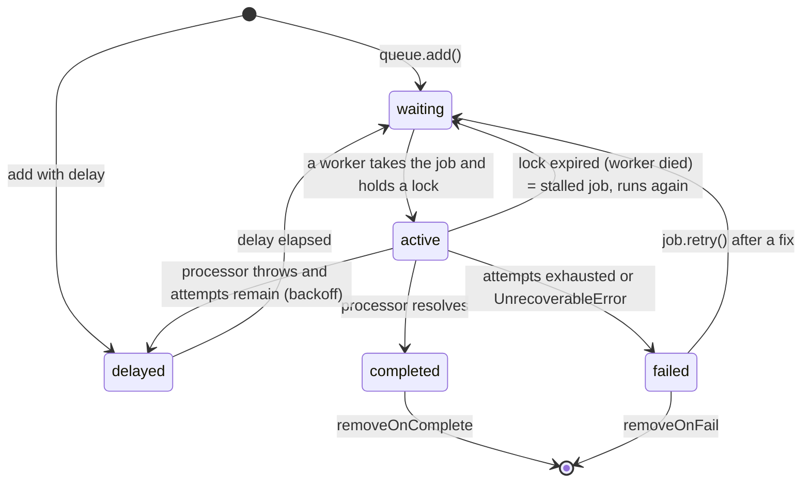
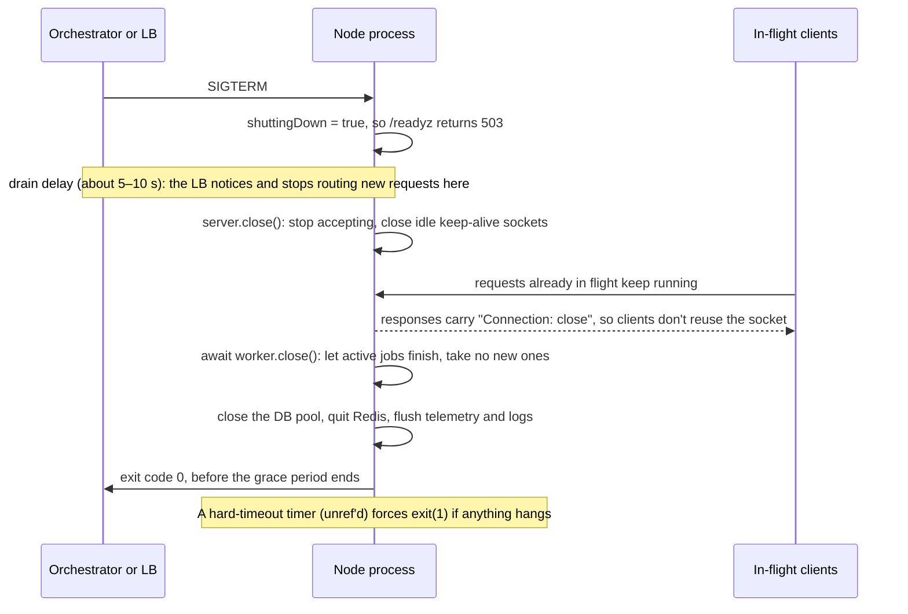
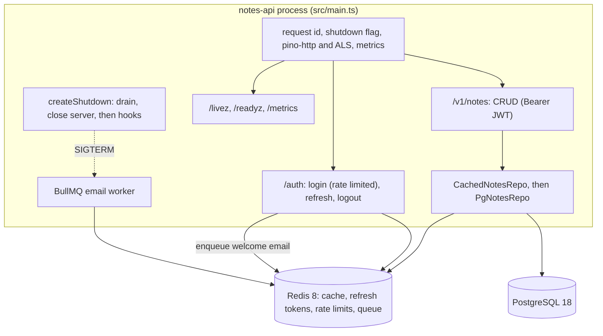

# 06 — Node.js (Part 3 of 4): Production — Redis, Queues, Logging, Observability, Shutdown, Security, Testing, Profiling & Full Example

> **Parts:** [Part 1 — Overview, Topic Map, Event Loop, libuv, Streams, Concurrency, EventEmitter & AsyncLocalStorage](./06-nodejs-part1.md) · [Part 2 — Frameworks, Errors, Auth, Rate Limiting, Uploads & Real-time](./06-nodejs-part2.md) · **Part 3 — Redis, Queues, Logging, Observability, Shutdown, Security, Testing, Profiling & Full Example** · [Part 4 — Resources, Practice, Interview Questions & Revision](./06-nodejs-part4.md)
>
> Applies to: Node.js 24 LTS with **ioredis 6** (Redis 8), **BullMQ 6.3**, **Pino 10** + **pino-http 11**, **OpenTelemetry JS** (`@opentelemetry/sdk-node` 0.223, auto-instrumentations 0.81), **prom-client 15**, **undici 8**, **pg 8** (PostgreSQL 18), **Supertest 7** and **Testcontainers 12**. Verified on Node 24.21 against real Redis and Postgres containers in October 2026. Builds on the app from [Part 2 §3.11](./06-nodejs-part2.md#311-a-production-shaped-express-app). Redis data structures and SQL depth are in [07-databases-and-apis.md](./07-databases-and-apis.md); CI/CD, Docker and the testing pyramid in general are in [08-engineering-practices.md](./08-engineering-practices.md).

## Table of Contents

- [3. Detailed Explanations (Part 3)](#3-detailed-explanations-part-3)
  - [3.18 Caching with Redis](#318-caching-with-redis)
  - [3.19 Background Jobs with BullMQ](#319-background-jobs-with-bullmq)
  - [3.20 Structured Logging with Pino](#320-structured-logging-with-pino)
  - [3.21 Observability: Traces, Metrics & Health Checks](#321-observability-traces-metrics--health-checks)
  - [3.22 Graceful Shutdown](#322-graceful-shutdown)
  - [3.23 Security](#323-security)
  - [3.24 Testing Node APIs](#324-testing-node-apis)
  - [3.25 Profiling & Memory Leaks](#325-profiling--memory-leaks)
- [4. Full Example: The Notes Service](#4-full-example-the-notes-service)
- [5. Diagrams Index](#5-diagrams-index)
- [Next: Part 4](#next-part-4)

---

## 3. Detailed Explanations (Part 3)

### 3.18 Caching with Redis

**Cache-aside** (lazy loading) is the default pattern:

1. **Read:** check the cache. On a miss, load from the database and write the result to the cache with a TTL.
2. **Write:** update the database, then **delete** the cache key. Don't *set* it: two writers racing to set it can leave the older value in the cache for a whole TTL.

**The problems a senior should name:**

| Problem | What happens | Fix |
|---------|--------------|-----|
| **Stampede** (thundering herd, dog-piling) | A hot key expires and 500 concurrent requests all miss and all hit the database at once | **Single-flight** inside the process + a short **distributed lock** across instances; or serve stale data while one caller refreshes |
| **Synchronized expiry** | Keys cached at the same moment (after a deploy) expire together | Add **TTL jitter** (±10–20%) |
| **Penetration** | Requests for IDs that don't exist always miss and always hit the database (sometimes as an attack) | **Negative caching**: cache "not found" briefly; validate IDs first |
| **Stale reads after a write** | A reader loads the old row just before the writer deletes the key, then writes it back after | Short TTLs, versioned keys, or delete again after a delay ("delayed double delete") when it matters |
| **Big or hot keys** | One 5 MB value or one extremely hot key saturates a single Redis shard | Split values, compress them, or add a small in-process LRU in front for the hottest keys |
| **Redis is down** | Every request fails if the code treats the cache as required | Treat cache errors as misses (with a circuit breaker), and size the database for at least partial cold-cache load |

```ts
// src/cache/cache.ts
import type { Redis } from 'ioredis';
import { randomUUID } from 'node:crypto';
import { setTimeout as sleep } from 'node:timers/promises';
import { runScript } from '../redis/scripts.ts';

const NIL = '\u0000nil'; // marker for cached "not found"
// Delete the lock only if we still own it (it may have expired and been taken by someone else)
const RELEASE_LOCK = `if redis.call('GET', KEYS[1]) == ARGV[1] then return redis.call('DEL', KEYS[1]) end return 0`;

export type CacheOptions = { ttlSeconds: number; negativeTtlSeconds?: number; jitter?: number; lockMs?: number };

export class Cache {
  readonly #redis: Redis;
  readonly #inflight = new Map<string, Promise<unknown>>();
  readonly stats = { hits: 0, misses: 0, loads: 0, errors: 0 };

  constructor(redis: Redis) {
    this.#redis = redis;
  }

  /** Cache-aside with in-process single-flight and a cross-instance lock. `load` returns null for "not found". */
  getOrLoad<T>(key: string, load: () => Promise<T | null>, opts: CacheOptions): Promise<T | null> {
    const existing = this.#inflight.get(key);
    if (existing) return existing as Promise<T | null>; // concurrent callers in this process share one promise
    const p = this.#getOrLoad(key, load, opts).finally(() => this.#inflight.delete(key));
    this.#inflight.set(key, p);
    return p;
  }

  async invalidate(...keys: string[]): Promise<void> {
    if (keys.length) await this.#redis.del(...keys);
  }

  async #getOrLoad<T>(key: string, load: () => Promise<T | null>, opts: CacheOptions): Promise<T | null> {
    const cached = await this.#safeGet(key);
    if (cached !== undefined) return cached as T | null;
    this.stats.misses++;

    const lockKey = `lock:${key}`;
    const token = randomUUID();
    let lock: 'acquired' | 'busy' | 'unavailable';
    try {
      lock = (await this.#redis.set(lockKey, token, 'PX', opts.lockMs ?? 5_000, 'NX')) ? 'acquired' : 'busy';
    } catch {
      lock = 'unavailable'; // Redis is down: don't wait for a lock holder that can't exist — load directly
    }
    if (lock === 'busy') {
      // Another instance is loading: poll briefly for its result instead of hitting the database too
      for (let i = 0; i < 20; i++) {
        await sleep(25 + Math.random() * 25);
        const value = await this.#safeGet(key);
        if (value !== undefined) return value as T | null;
      }
      // The lock holder is slow or died: load anyway (availability beats strictness here)
    }
    try {
      this.stats.loads++;
      const value = await load();
      const ttl = value === null ? (opts.negativeTtlSeconds ?? 30) : jittered(opts.ttlSeconds, opts.jitter ?? 0.15);
      await this.#redis.set(key, value === null ? NIL : JSON.stringify(value), 'EX', ttl).catch(() => this.stats.errors++);
      return value;
    } finally {
      if (lock === 'acquired') await runScript(this.#redis, RELEASE_LOCK, [lockKey], [token]).catch(() => undefined);
    }
  }

  /** undefined = miss (or Redis unavailable: degrade to a miss rather than failing the request) */
  async #safeGet(key: string): Promise<unknown> {
    try {
      const raw = await this.#redis.get(key);
      if (raw === null) return undefined;
      this.stats.hits++;
      return raw === NIL ? null : JSON.parse(raw);
    } catch {
      this.stats.errors++;
      return undefined;
    }
  }
}

function jittered(ttl: number, ratio: number): number {
  return Math.max(1, Math.round(ttl * (1 - ratio + Math.random() * 2 * ratio)));
}
```

Plugging it in as a **decorator** around the repository keeps caching out of the route handlers and the database code (the Decorator pattern; see [08](./08-engineering-practices.md)):

```ts
// src/notes/cached-repo.ts
import type { NotesRepo, Note, NewNote } from './repo.ts';
import type { Cache } from '../cache/cache.ts';

export class CachedNotesRepo implements NotesRepo {
  readonly #inner: NotesRepo;
  readonly #cache: Cache;
  constructor(inner: NotesRepo, cache: Cache) {
    this.#inner = inner;
    this.#cache = cache;
  }

  #key = (ownerId: string, id: string) => `note:v1:${ownerId}:${id}`; // bump v1 when the cached shape changes

  get(ownerId: string, id: string): Promise<Note | null> {
    return this.#cache.getOrLoad(this.#key(ownerId, id), () => this.#inner.get(ownerId, id), { ttlSeconds: 300 });
  }
  list(ownerId: string, limit: number, cursor?: string) {
    return this.#inner.list(ownerId, limit, cursor); // lists change too often to be worth caching here
  }
  create(ownerId: string, input: NewNote) {
    return this.#inner.create(ownerId, input);
  }
  async update(ownerId: string, id: string, patch: Partial<NewNote>) {
    const note = await this.#inner.update(ownerId, id, patch);
    await this.#cache.invalidate(this.#key(ownerId, id)); // write to the DB first, then delete the key
    return note;
  }
  async delete(ownerId: string, id: string) {
    const ok = await this.#inner.delete(ownerId, id);
    await this.#cache.invalidate(this.#key(ownerId, id));
    return ok;
  }
}
```

**Verified behavior:**
- Two `Cache` instances (standing in for two servers) received **100 concurrent requests** for the same cold key, and the loader ran **once**. Single-flight collapsed each instance's 50 callers into one, and the Redis lock made the second instance wait for the first one's result.
- A second lookup of a missing ID was served from the negative cache.
- With Redis unreachable, the call fell through to the loader and returned in about 5 ms. (An earlier version treated "can't reach Redis" as "someone else holds the lock" and polled for about a second first — distinguish the two.)

> 💡 Interview Tip: "How do you keep the cache consistent with the database?" Be honest: cache-aside gives **eventual** consistency, bounded by the TTL. Then list the tools: delete on write, short TTLs for volatile data, versioned keys, and change-data-capture (Debezium or Postgres logical replication) to invalidate from the database's own change log when you need tighter bounds.

---

### 3.19 Background Jobs with BullMQ

**Why a queue:** anything slow, unreliable or retryable shouldn't happen inside the HTTP request. Examples: emails, webhooks to third parties, PDF and image processing, imports, and fan-out notifications. The request **enqueues** a job and returns `202 Accepted` (or `201`), and **worker processes** do the work with retries.

**BullMQ in one paragraph:**
- Jobs live in Redis: lists and sorted sets for the waiting, active, delayed, completed and failed states, all moved atomically by Lua scripts.
- A `Queue` adds jobs. A `Worker` pulls them with blocking commands, runs your processor, and holds a **lock** that it renews while the job runs.
- If the worker dies, the lock expires, and the job is detected as **stalled** and moved back to waiting. That's why delivery is **at least once**: *your processor must be idempotent*.

**BullMQ 6 changes to know** (from the official v5→v6 migration guide):
- `ioredis` is now an **optional peer dependency**: install it yourself.
- **Legacy repeatable jobs are gone**: use **Job Schedulers** (`upsertJobScheduler`).
- `debounce` became **`deduplication`**.
- Raw Redis clients are reached through `getBackend()`.
- Retry-stopping errors use `UnrecoverableError`.
- There's a pluggable backend interface, including a PostgreSQL backend.

| Option | What it does | Typical value |
|--------|--------------|---------------|
| `attempts` + `backoff: { type: 'exponential', delay }` | Retry failures with growing delays | 5 attempts, starting at 1 s |
| `jobId` | **Idempotent enqueue**: adding a job with an existing ID is a no-op while that job exists | `welcome-${userId}` (custom IDs can't contain `:`) |
| `deduplication: { id, ttl }` | Ignore duplicates for a time window, even after the first job has completed | Collapse "user edited the profile 20 times" into one sync |
| `concurrency` (Worker) | Jobs processed in parallel **per worker process** | 5–50 for I/O-bound work; about 1 per core for CPU-bound work |
| `limiter: { max, duration }` | Global rate limit across all workers for this queue | Respect the email provider's limit |
| `removeOnComplete` / `removeOnFail` | Keep Redis from growing forever | Completed: keep about 1,000 or 1 hour. Failed: keep about 7 days for inspection |
| `UnrecoverableError` | Fail **now**, without retries | Invalid input, a 4xx from the provider |
| `upsertJobScheduler(id, { pattern \| every }, template)` | Cron-like recurring jobs, safe to call on every boot | Daily digest at 08:00 in a time zone |

```ts
// src/jobs/email.ts
import { Queue, Worker, UnrecoverableError } from 'bullmq';
import type { ConnectionOptions, Job } from 'bullmq';
import type { Redis } from 'ioredis';

export type EmailJob = { to: string; template: 'welcome' | 'digest'; userId: string };
export type EmailResult = { status: 'sent' | 'skipped' };
export const EMAIL_QUEUE = 'email';

export function createEmailQueue(connection: ConnectionOptions): Queue<EmailJob, EmailResult> {
  return new Queue<EmailJob, EmailResult>(EMAIL_QUEUE, {
    connection,
    defaultJobOptions: {
      attempts: 5,
      backoff: { type: 'exponential', delay: 1_000 }, // 1s, 2s, 4s, 8s...
      removeOnComplete: { age: 3600, count: 1000 },
      removeOnFail: { age: 7 * 24 * 3600 },
    },
  });
}

/** Idempotent enqueue: a retry of the signup request can't send two welcome emails. */
export function enqueueWelcome(queue: Queue<EmailJob, EmailResult>, userId: string, to: string) {
  return queue.add('welcome', { to, template: 'welcome', userId }, { jobId: `welcome-${userId}` });
}

export async function scheduleDailyDigest(queue: Queue<EmailJob, EmailResult>): Promise<void> {
  // Safe to run on every boot: upsert by scheduler id (replaces the removed "repeat" option)
  await queue.upsertJobScheduler(
    'daily-digest',
    { pattern: '0 8 * * *', tz: 'Asia/Karachi' },
    { name: 'digest', data: { to: 'all', template: 'digest', userId: 'system' } },
  );
}

export class PermanentEmailError extends Error {}

export function startEmailWorker(deps: {
  connection: ConnectionOptions;
  redis: Redis; // for the idempotency marker
  send: (job: EmailJob, idempotencyKey: string) => Promise<void>;
  log: { info: (o: object, m: string) => void; warn: (o: object, m: string) => void };
  concurrency?: number;
}): Worker<EmailJob, EmailResult> {
  const worker = new Worker<EmailJob, EmailResult>(
    EMAIL_QUEUE,
    async (job: Job<EmailJob, EmailResult>) => {
      if (!job.data.to.includes('@') && job.data.to !== 'all') throw new UnrecoverableError(`invalid address: ${job.data.to}`);

      // At-least-once delivery: this job may run twice (worker crash after sending, stalled lock).
      // Make the side effect idempotent: skip if done, and pass an idempotency key to the provider too.
      const marker = `email-sent:${job.id}`;
      if (await deps.redis.exists(marker)) return { status: 'skipped' };
      try {
        await deps.send(job.data, `email-${job.id}`);
      } catch (err) {
        if (err instanceof PermanentEmailError) throw new UnrecoverableError(err.message); // e.g. a 4xx: retrying won't help
        throw err; // transient: BullMQ retries with backoff
      }
      await deps.redis.set(marker, '1', 'EX', 7 * 24 * 3600);
      return { status: 'sent' };
    },
    {
      connection: deps.connection,
      concurrency: deps.concurrency ?? 10,
      limiter: { max: 50, duration: 1_000 }, // at most 50 sends per second across ALL workers
    },
  );

  worker.on('completed', (job, result) => deps.log.info({ jobId: job.id, result }, 'email job completed'));
  worker.on('failed', (job, err) =>
    deps.log.warn({ jobId: job?.id, attemptsMade: job?.attemptsMade, err: err.message }, 'email job failed'),
  );
  return worker;
}
```



**Verified on BullMQ 6.3 + Redis 8:**
- A job whose send failed twice succeeded on attempt 3.
- An invalid address failed after **1** attempt (`UnrecoverableError`).
- Adding the same `jobId` twice produced one job.
- A job scheduler with `every: 300` produced repeated jobs.
- `worker.close()` waited for the in-flight job before resolving.

> ⚠️ Pitfall: The worker's Redis connection must use `maxRetriesPerRequest: null`, because BullMQ relies on blocking commands that must not time out and retry. When you pass plain connection options (as above), BullMQ creates correctly configured connections itself. When you pass your own ioredis instance, configure it that way, or the worker throws at startup.

> 💡 Interview Tip: "What happens if the worker crashes halfway through a job?" The lock expires, the job is marked stalled, and it runs again on another worker. So: idempotent processors, idempotency keys for third-party calls, and side effects split into steps that are each safe to repeat (or modeled as a flow of child jobs). Mention the **outbox pattern** for "write to the DB *and* enqueue": write the job into an outbox table in the same transaction, and have a relay publish it. That way you never enqueue for a transaction that rolled back ([07](./07-databases-and-apis.md), [09](./09-system-design.md)).

---

### 3.20 Structured Logging with Pino

**Why structured (JSON) logs:** machines search, filter and aggregate fields (`level=error AND route="/v1/notes/:id"`) instead of grepping text. **Why Pino:** it's the fastest mainstream Node logger, because it serializes JSON cheaply and, with transports, does formatting and shipping in a **worker thread**, off the event loop. Fastify uses it by default.

**Rules:**
- **Log to stdout**, one JSON object per line, and let the platform ship the logs (CloudWatch agent, Fluent Bit, Vector, Datadog agent). Don't write log files from the app inside containers.
- Every line from a request carries the **`requestId`**, and with OpenTelemetry also the **`trace_id`/`span_id`** (`@opentelemetry/instrumentation-pino` injects them).
- **Redact** secrets and PII at the logger level, not "carefully" at every call site.
- **Levels:** `fatal` (process is going down), `error` (needs a human), `warn` (degraded, but handled), `info` (business events: one line per request), `debug` (off in production).
- Pass the error object as `{ err }`, so Pino's serializer records `type`, `message`, `stack` and the **`cause` chain**.
- `pino-pretty` is for local development only (`node app.ts | npx pino-pretty`).

```ts
// src/observability/logger.ts
import { pino } from 'pino';
import { AsyncLocalStorage } from 'node:async_hooks';

export type RequestContext = { requestId: string; userId?: string };
export const requestContext = new AsyncLocalStorage<RequestContext>();

export const logger = pino({
  level: process.env.LOG_LEVEL ?? 'info',
  base: { service: 'notes-api', version: process.env.APP_VERSION ?? 'dev' },
  timestamp: pino.stdTimeFunctions.isoTime,
  formatters: { level: (label) => ({ level: label }) }, // "warn" instead of 40: easier to query in log platforms
  redact: {
    paths: [
      'req.headers.authorization',
      'req.headers.cookie',
      'res.headers["set-cookie"]',
      '*.password',
      '*.passwordHash',
      '*.accessToken',
      '*.refreshToken',
    ],
    censor: '[REDACTED]',
  },
  // Every log line written inside a request gets its requestId, even deep in the call stack (Part 1 §3.6)
  mixin() {
    const ctx = requestContext.getStore();
    return ctx ? { requestId: ctx.requestId, ...(ctx.userId ? { userId: ctx.userId } : {}) } : {};
  },
});

export type Logger = typeof logger;
```

```ts
// src/observability/http-logging.ts
import type { RequestHandler } from 'express';
import { pinoHttp } from 'pino-http';
import { logger, requestContext } from './logger.ts';

const httpLogger = pinoHttp({
  logger,
  genReqId: (_req, res) => (res as unknown as { locals: { requestId: string } }).locals.requestId, // reuse the app's id
  customLogLevel: (_req, res, err) => (err || res.statusCode >= 500 ? 'error' : res.statusCode >= 400 ? 'warn' : 'info'),
  autoLogging: { ignore: (req) => req.url === '/livez' || req.url === '/readyz' || req.url === '/metrics' },
  serializers: {
    req: (req: { id: string; method: string; url: string; headers: Record<string, unknown> }) => ({
      id: req.id,
      method: req.method,
      url: req.url,
      userAgent: req.headers['user-agent'],
    }),
    // The default serializer logs every response header: ~1.5 KB of helmet headers per line, plus Set-Cookie
    res: (res: { statusCode: number }) => ({ statusCode: res.statusCode }),
  },
});

/** One access-log line per request, plus request context for every log line written while handling it. */
export const httpLogging: RequestHandler = (req, res, next) => {
  httpLogger(req, res);
  requestContext.run({ requestId: res.locals.requestId }, next);
};
```

A real log line captured from the full example in §4 (a 404, logged at `warn`, with the request ID from the mixin):

```json
{"level":"warn","time":"2026-10-14T09:56:40.775Z","service":"notes-api","version":"dev","req":{"id":"ed129d40-8194-474d-a253-dac81e80295a","method":"GET","url":"/v1/notes/00000000-0000-4000-8000-000000000000","userAgent":"node"},"requestId":"ed129d40-8194-474d-a253-dac81e80295a","res":{"statusCode":404},"responseTime":24,"msg":"request completed"}
```

> ⚠️ Pitfall: Without the `res` serializer, pino-http logged every response header on every line — about 1.5 KB of helmet headers per request in this app, plus `Set-Cookie` (saved only by the redact path). Without the `level` formatter, levels are numbers (`40`), not names.

> ⚠️ Pitfall: `console.log` is **synchronous when writing to a file or a TTY**, and asynchronous for pipes on POSIX. Under heavy load it can block the event loop or buffer without limit. And `JSON.stringify` of a huge object inside a log call is a hidden CPU cost: log IDs and sizes, not whole payloads.

---

### 3.21 Observability: Traces, Metrics & Health Checks

**The three signals:**
- **Logs** tell you *what happened* in one place.
- **Metrics** tell you *how much and how often*, cheaply aggregated: rates, latency histograms, saturation.
- **Traces** tell you *where the time went across services*: a tree of spans per request, linked by a `traceparent` header (W3C Trace Context).

**OpenTelemetry (OTel)** is the vendor-neutral standard for producing all three. You export over **OTLP** to a collector, then on to Jaeger, Grafana Tempo, Honeycomb, Datadog and others.

**Auto-instrumentation in an ESM app:** OTel patches libraries (`http`, `express`, `pg`, `ioredis`, `undici`) when they load. With ES modules, that requires a **loader hook**, and it has to be installed *before* the app's imports run. Verified on Node 24.21: with only `--import @opentelemetry/auto-instrumentations-node/register`, the HTTP and `fetch` spans appeared but **Express wasn't patched** (server spans were just named `GET`). With the hook registered as below, spans were named `GET /users/:id` with `http.route` set, plus Express handler spans, and no warnings.

```ts
// src/observability/instrumentation.ts
// Load BEFORE the app: node --import ./src/observability/instrumentation.ts src/main.ts
import { register } from 'node:module';
import { NodeSDK } from '@opentelemetry/sdk-node';
import { getNodeAutoInstrumentations } from '@opentelemetry/auto-instrumentations-node';
import { OTLPTraceExporter } from '@opentelemetry/exporter-trace-otlp-http';
import { BatchSpanProcessor, ConsoleSpanExporter, SimpleSpanProcessor } from '@opentelemetry/sdk-trace-base';

// ESM modules can't be monkey-patched after import, so install the loader hook that patches them on load
register('@opentelemetry/instrumentation/hook.mjs', import.meta.url);

const debug = process.env.OTEL_DEBUG_CONSOLE === '1';
const sdk = new NodeSDK({
  serviceName: process.env.OTEL_SERVICE_NAME ?? 'notes-api',
  spanProcessors: [
    debug
      ? new SimpleSpanProcessor(new ConsoleSpanExporter()) // print each span immediately
      : new BatchSpanProcessor(
          new OTLPTraceExporter({ url: process.env.OTEL_EXPORTER_OTLP_TRACES_ENDPOINT ?? 'http://localhost:4318/v1/traces' }),
        ), // batch and send to a collector (Jaeger, Grafana Alloy, the OTel Collector...)
  ],
  instrumentations: [
    getNodeAutoInstrumentations({
      '@opentelemetry/instrumentation-fs': { enabled: false }, // very noisy, rarely useful
    }),
  ],
});
sdk.start();

/** Flush buffered spans; the graceful shutdown in main.ts awaits this. */
export const shutdownTelemetry = (): Promise<void> => sdk.shutdown();
```

> ⚠️ Pitfall: The batch processor buffers spans and exports them every few seconds. A process that calls `process.exit()` without `await sdk.shutdown()` **loses the last batch** — often exactly the spans around a crash. (While testing, the console exporter printed nothing until it was switched to `SimpleSpanProcessor`, for this reason.)

**Metrics with Prometheus.** RED for request-driven services (**R**ate, **E**rrors, **D**uration), USE for resources (**U**tilization, **S**aturation, **E**rrors). Measure latency with **histograms**, not averages, so you can compute p95/p99 across instances.

```ts
// src/observability/metrics.ts
import client from 'prom-client';
import type { Request, RequestHandler } from 'express';

export const registry = new client.Registry();
client.collectDefaultMetrics({ register: registry }); // heap, GC, event-loop lag, handles, CPU

const httpDuration = new client.Histogram({
  name: 'http_server_request_duration_seconds',
  help: 'HTTP request duration',
  labelNames: ['method', 'route', 'status'] as const,
  buckets: [0.005, 0.01, 0.025, 0.05, 0.1, 0.25, 0.5, 1, 2.5, 5],
  registers: [registry],
});

// Express restores req.baseUrl when an error propagates out of a mounted router, so reading it on 'finish'
// labels a failed POST /auth/login as "/login". Capture the template when Express assigns req.route instead.
function trackRouteTemplate(req: Request): () => string {
  let route: Request['route'];
  let template: string | undefined;
  Object.defineProperty(req, 'route', {
    configurable: true,
    enumerable: true,
    get: () => route,
    set(value: Request['route']) {
      route = value;
      if (value) template = `${req.baseUrl}${value.path === '/' && req.baseUrl ? '' : String(value.path)}`;
    },
  });
  return () => template ?? 'unmatched'; // includes requests rejected by middleware before any route matched
}

export const metricsMiddleware: RequestHandler = (req, res, next) => {
  const end = httpDuration.startTimer();
  const routeTemplate = trackRouteTemplate(req);
  res.on('finish', () => {
    // Label with the route TEMPLATE (/v1/notes/:id), never the raw URL: each unique label set is a new time series
    end({ method: req.method, route: routeTemplate(), status: String(res.statusCode) });
  });
  next();
};

export const metricsHandler: RequestHandler = async (_req, res) => {
  res.set('Content-Type', registry.contentType).send(await registry.metrics());
};
```

**Health checks — liveness vs readiness:**

| Probe | Question | Should check | Failure means |
|-------|----------|--------------|---------------|
| **Liveness** (`/livez`) | Is the process stuck or broken beyond repair? | Only the process itself: it can answer, the event loop isn't wedged | The orchestrator **restarts** the container |
| **Readiness** (`/readyz`) | Should this instance get traffic *right now*? | Critical dependencies (DB, Redis) with short timeouts; not shutting down | The load balancer **stops routing** to it (no restart) |
| Startup | Has it finished booting? | Migrations, warm-up | Delays the other probes |

```ts
// src/observability/health.ts
import express from 'express';

type Check = () => Promise<unknown>;

const withTimeout = <T>(p: Promise<T>, ms: number) =>
  Promise.race([p, new Promise<never>((_, reject) => setTimeout(() => reject(new Error(`timeout after ${ms}ms`)), ms).unref())]);

export function healthRouter(checks: Record<string, Check>, isShuttingDown: () => boolean): express.Router {
  const router = express.Router();

  // Liveness: NO dependency checks. If Postgres is down, restarting every pod doesn't fix it — it makes it worse.
  router.get('/livez', (_req, res) => {
    res.json({ status: 'ok' });
  });

  router.get('/readyz', async (_req, res) => {
    if (isShuttingDown()) return void res.status(503).json({ status: 'shutting_down' });
    const results = await Promise.allSettled(Object.values(checks).map((check) => withTimeout(check(), 1_000)));
    const details = Object.fromEntries(
      Object.keys(checks).map((name, i) => [name, results[i]?.status === 'fulfilled' ? 'ok' : String((results[i] as PromiseRejectedResult).reason)]),
    );
    const ok = results.every((r) => r.status === 'fulfilled');
    res.status(ok ? 200 : 503).json({ status: ok ? 'ok' : 'degraded', checks: details });
  });

  return router;
}
```

> 💡 Interview Tip: "Your liveness probe checks the database. What goes wrong?" A database blip fails every pod's liveness probe at once, so Kubernetes restarts the whole fleet. That causes cold caches and a connection storm against a database that is already struggling: a self-inflicted outage. Dependencies belong in **readiness**, and only the ones without which the instance is useless.

---

### 3.22 Graceful Shutdown

**The goal:** a deploy or scale-in drops **zero** requests and loses **zero** jobs.

**What happens when a container stops:**
- Docker (`docker stop`) and Kubernetes send **SIGTERM**, wait (Docker: 10 s by default; Kubernetes: `terminationGracePeriodSeconds`, 30 s by default), then send **SIGKILL**.
- Your shutdown must finish inside that window.

**The sequence:**



**Verified details that trip people up (Node 24.21):**
- `server.close()` stops accepting connections and closes **idle** keep-alive sockets (Node 19+). But a connection with a request **in flight** stays open, and after its response the client reused it for a **new request, which the server served**. The close callback only fired once that connection went idle. Fix: while shutting down, set `Connection: close` on every response (the middleware below), and after the timeout, call `server.closeAllConnections()`.
- Default server timeouts: `keepAliveTimeout` 5 s, `headersTimeout` 60 s, `requestTimeout` 300 s. Behind an **AWS ALB** (60 s idle timeout), set `keepAliveTimeout` **above** 60 s (for example 65 s, with `headersTimeout` slightly higher). Otherwise Node closes sockets that the ALB still thinks are open, and you get sporadic **502s**.
- **PID 1 in a container:** if `node` is PID 1 and you *don't* handle SIGTERM, the kernel's default "terminate" action doesn't apply to PID 1. The signal is ignored, and you wait out the whole grace period (10 s by default in Docker) before SIGKILL. Handle the signal, or run with `docker run --init` (tini).
- **`CMD ["npm", "start"]`** puts npm in front of node, and npm hasn't always forwarded signals reliably. Use `CMD ["node", "src/main.ts"]` in exec form.

```ts
// src/lifecycle/shutdown.ts
import type { Server } from 'node:http';
import type { RequestHandler } from 'express';
import { setTimeout as sleep } from 'node:timers/promises';

type Hook = { name: string; close: () => Promise<unknown> };
type Log = { info: (o: object, m: string) => void; error: (o: object, m: string) => void };

export function createShutdown(opts: {
  server: Server;
  hooks: Hook[]; // closed in order AFTER the HTTP server: workers, then pools and clients, then telemetry
  log: Log;
  drainDelayMs?: number; // time for the LB to see readiness fail before we stop accepting
  timeoutMs?: number; // must be below the orchestrator's grace period
}) {
  let shuttingDown = false;

  const middleware: RequestHandler = (_req, res, next) => {
    if (shuttingDown) res.set('Connection', 'close'); // stop keep-alive reuse during drain
    next();
  };

  async function run(reason: string, exitCode = 0): Promise<void> {
    if (shuttingDown) return;
    shuttingDown = true;
    const started = Date.now();
    opts.log.info({ reason }, 'shutdown started');

    const hardTimeout = setTimeout(() => {
      opts.log.error({ reason }, 'shutdown timed out, forcing exit');
      opts.server.closeAllConnections();
      process.exit(1);
    }, opts.timeoutMs ?? 25_000);
    hardTimeout.unref(); // don't keep the process alive just for this timer

    await sleep(opts.drainDelayMs ?? 5_000);
    await new Promise<void>((resolve) => opts.server.close(() => resolve()));
    opts.log.info({ ms: Date.now() - started }, 'http server closed');

    for (const hook of opts.hooks) {
      try {
        await hook.close();
        opts.log.info({ hook: hook.name }, 'closed');
      } catch (err) {
        opts.log.error({ hook: hook.name, err }, 'close failed');
        exitCode = 1;
      }
    }
    clearTimeout(hardTimeout);
    opts.log.info({ ms: Date.now() - started, exitCode }, 'shutdown complete');
    process.exitCode = exitCode; // let the event loop empty and exit naturally — no abrupt process.exit()
  }

  return { middleware, run, isShuttingDown: () => shuttingDown };
}
```

> 💡 Interview Tip: When you describe graceful shutdown, mention the **drain delay**. Readiness turning 503 isn't instant: the load balancer polls it every few seconds, and Kubernetes endpoint removal propagates asynchronously. If you call `server.close()` immediately, the LB keeps sending new connections for a few seconds and they get *connection refused*. A `preStop: sleep 5` hook or an in-app delay closes that gap.

---

### 3.23 Security

**OWASP API Security Top 10 (2023 edition)** — know the names, and one Node example each:

| # | Risk | Node example / defense |
|---|------|------------------------|
| API1 | **Broken Object Level Authorization (BOLA)** | `GET /notes/:id` without an owner check. Scope every query by `ownerId`/`tenantId` in the data layer ([Part 2 §3.11](./06-nodejs-part2.md#311-a-production-shaped-express-app)) |
| API2 | Broken Authentication | Unpinned JWT algorithms, no rate limit on login, long-lived tokens ([Part 2 §3.14](./06-nodejs-part2.md#314-authentication--authorization)) |
| API3 | Broken Object *Property* Level Authorization | Mass assignment (`{ ...req.body }` setting `role: 'admin'`), or over-exposing fields. Strict schemas in, response schemas or DTOs out |
| API4 | Unrestricted Resource Consumption | No body, page-size, upload or query-complexity limits; no timeouts; ReDoS |
| API5 | Broken Function Level Authorization | Admin routes protected only by hiding them in the UI. Role checks on the server, deny by default |
| API6 | Unrestricted Access to Sensitive Business Flows | Bots buying all the stock or creating accounts. Rate limits per flow, CAPTCHA, device signals |
| API7 | **Server-Side Request Forgery (SSRF)** | "Import from URL" fetching `http://169.254.169.254/` (cloud metadata). See below |
| API8 | Security Misconfiguration | Stack traces in responses, permissive CORS (`*` with credentials), missing security headers, debug ports open |
| API9 | Improper Inventory Management | Forgotten `/v1` endpoints, staging APIs with production data. Keep an API inventory and retire old versions |
| API10 | Unsafe Consumption of APIs | Trusting third-party responses and webhooks. Validate them like user input, verify webhook signatures, set timeouts |

#### Prototype pollution

Merging untrusted JSON into objects can write to `Object.prototype` through the `__proto__` key. After that, **every** object in the process "has" the injected property — for example `isAdmin`.

```ts
// src/security/prototype-pollution.ts
type Obj = Record<string, unknown>;
const isObj = (v: unknown): v is Obj => typeof v === 'object' && v !== null && !Array.isArray(v);

// ❌ Vulnerable: a classic recursive merge (many old utility libraries shipped exactly this bug)
export function unsafeMerge(target: Obj, source: Obj): Obj {
  for (const key of Object.keys(source)) {
    const value = source[key];
    if (isObj(value)) {
      if (!isObj(target[key])) target[key] = {};
      unsafeMerge(target[key] as Obj, value);
    } else {
      target[key] = value;
    }
  }
  return target;
}

const FORBIDDEN = new Set(['__proto__', 'constructor', 'prototype']);

// ✅ Safe: skip prototype keys and only recurse into own, plain objects
export function safeMerge(target: Obj, source: Obj): Obj {
  for (const key of Object.keys(source)) {
    if (FORBIDDEN.has(key)) continue;
    const value = source[key];
    if (isObj(value)) {
      const current = Object.hasOwn(target, key) ? target[key] : undefined;
      target[key] = safeMerge(isObj(current) ? current : {}, value);
    } else {
      target[key] = value;
    }
  }
  return target;
}

if (import.meta.main) {
  const payload = JSON.parse('{"theme":"dark","__proto__":{"isAdmin":true}}') as Obj; // JSON.parse creates an OWN "__proto__" key

  safeMerge({}, payload);
  console.log('after safeMerge, ({}).isAdmin =', (({}) as Obj).isAdmin); // undefined

  unsafeMerge({}, payload);
  console.log('after unsafeMerge, ({}).isAdmin =', (({}) as Obj).isAdmin); // true — every object is now "admin"
  delete (Object.prototype as Obj).isAdmin; // clean up the demo
}
```

**Defenses:** validate input with strict schemas (unknown keys rejected, so `__proto__` never gets through); use `Object.create(null)` or `Map` for dictionaries keyed by user input; use `structuredClone` instead of hand-written deep copies; check `Object.hasOwn` before reading config flags; and optionally run with `--disable-proto=delete`.

#### SSRF

Any feature that fetches a URL supplied by a user (webhooks, "import from URL", link previews, image proxies) can be pointed at **internal** addresses:
- cloud metadata at `169.254.169.254`, which can hand out IAM credentials;
- `localhost` admin ports;
- internal services such as `10.x.x.x`.

String checks on the URL aren't enough: DNS can resolve an innocent-looking name to `127.0.0.1`, and **DNS rebinding** can change the answer between your check and the connection.

**The robust fix:** check the IP **at connect time**, for every connection, including redirects.

```ts
// src/security/safe-fetch.ts
import { Agent, fetch } from 'undici';
import { BlockList, isIP } from 'node:net';
import { lookup } from 'node:dns';
import type { LookupAddress } from 'node:dns';

const blocked = new BlockList();
for (const [net, prefix] of [
  ['0.0.0.0', 8], ['10.0.0.0', 8], ['100.64.0.0', 10], ['127.0.0.0', 8], ['169.254.0.0', 16],
  ['172.16.0.0', 12], ['192.168.0.0', 16], ['198.18.0.0', 15], ['224.0.0.0', 4], ['240.0.0.0', 4],
] as const) blocked.addSubnet(net, prefix, 'ipv4');
for (const [net, prefix] of [['::', 128], ['::1', 128], ['fc00::', 7], ['fe80::', 10]] as const) blocked.addSubnet(net, prefix, 'ipv6');
// No ::ffff:0:0/96 rule: BlockList already matches IPv4-mapped IPv6 (::ffff:127.0.0.1) against the IPv4 rules,
// and such a rule would also match EVERY plain IPv4 address.

export class SsrfBlockedError extends Error {}

const isBlocked = (address: string) => blocked.check(address, isIP(address) === 6 ? 'ipv6' : 'ipv4');

// Runs for EVERY connection the agent opens — including after redirects and after DNS changes (rebinding)
const agent = new Agent({
  connect: {
    lookup(hostname, options, callback) {
      lookup(hostname, { ...options, all: true }, (err, addresses: LookupAddress[]) => {
        if (err) return callback(err, '', 0);
        const bad = addresses.find((a) => isBlocked(a.address));
        if (bad) return callback(new SsrfBlockedError(`${hostname} resolves to blocked address ${bad.address}`), '', 0);
        if (options.all) return (callback as unknown as (e: null, a: LookupAddress[]) => void)(null, addresses);
        const first = addresses[0]!;
        callback(null, first.address, first.family);
      });
    },
  },
  headersTimeout: 5_000,
  bodyTimeout: 10_000,
});

export async function safeFetch(rawUrl: string, maxBytes = 1_000_000): Promise<{ status: number; body: string }> {
  const url = new URL(rawUrl); // WHATWG parsing normalizes tricks like http://2130706433/ to 127.0.0.1
  if (url.protocol !== 'http:' && url.protocol !== 'https:') throw new SsrfBlockedError(`protocol ${url.protocol} not allowed`);
  if (url.username || url.password) throw new SsrfBlockedError('credentials in URL not allowed');
  const host = url.hostname.replace(/^\[|\]$/g, '');
  if (isIP(host) && isBlocked(host)) throw new SsrfBlockedError(`blocked address ${host}`); // IP literals skip DNS lookup

  const res = await fetch(url, { dispatcher: agent, redirect: 'follow', signal: AbortSignal.timeout(10_000) });
  const reader = res.body?.getReader();
  let received = 0;
  const chunks: Uint8Array[] = [];
  while (reader) {
    const { done, value } = await reader.read();
    if (done) break;
    received += value.length;
    if (received > maxBytes) {
      await reader.cancel();
      throw new SsrfBlockedError(`response larger than ${maxBytes} bytes`); // also an API4 defense
    }
    chunks.push(value);
  }
  return { status: res.status, body: Buffer.concat(chunks).toString('utf8') };
}
```

**Verified:** `http://127.0.0.1:…`, `http://localhost:…` (which resolved to `::1`), `http://[::1]/`, `http://169.254.169.254/latest/meta-data/`, the decimal form `http://2130706433/`, `file:` URLs and URLs with credentials were all blocked, while `https://example.com/` succeeded.

> ⚠️ Pitfall: An earlier draft of this guard also added `::ffff:0:0/96` "to block IPv4-mapped addresses", and it then blocked **every** public site. Node's `BlockList` matches IPv4 addresses against IPv4-mapped IPv6 rules, and matches mapped IPv6 addresses against IPv4 rules (`check('::ffff:127.0.0.1', 'ipv6')` is `true` with only `127.0.0.0/8` listed). Test an allow case, not only block cases. In production, also run fetchers in a network segment with no route to internal services, and on AWS require **IMDSv2** (session tokens) so that a plain GET to the metadata endpoint gets nothing ([10](./10-deployment-aws-ec2.md)).

#### ReDoS

JavaScript regexes backtrack. Nested quantifiers on overlapping patterns make some inputs take **exponential** time, and since it runs on the main thread, one request freezes the whole server ([Part 1 §3.3](./06-nodejs-part1.md#33-libuv-thread-pool--not-blocking-the-loop)).

```ts
// src/security/redos.ts
const evil = /^(a+)+$/; // nested quantifier: catastrophic backtracking on a near-miss
const safe = /^a+$/; // same language, linear time

for (const n of [20, 22, 24, 26]) {
  const input = 'a'.repeat(n) + '!'; // almost matches, which forces every split to be tried
  let t0 = performance.now();
  evil.test(input);
  const evilMs = performance.now() - t0;
  t0 = performance.now();
  safe.test(input);
  console.log(`n=${n}: evil ${evilMs.toFixed(1)}ms, safe ${(performance.now() - t0).toFixed(3)}ms`);
}
// Measured on Node 24.21: n=24 took about 120 ms and n=26 about 600 ms for the evil pattern, while the safe one stayed under 0.1 ms.
// Each +2 characters multiplies the time by about 4–5: exponential growth. n=40 would take hours.
```

**Defenses:** cap input length *before* matching, avoid nested quantifiers and overlapping alternation (`(a|a)*`, `(\w+\s?)+`), lint with `eslint-plugin-regexp`, and run untrusted user-supplied patterns in a worker with a timeout or with a linear-time engine such as RE2 (the `re2` npm package).

#### The rest of the checklist

- **Headers:** `helmet()` sets CSP, `X-Content-Type-Options: nosniff`, HSTS, `Referrer-Policy` and more. Tune CSP for HTML apps; for JSON-only APIs, the defaults are fine.
- **CORS** is a *browser* relaxation, not a server protection. Allowlist the exact origins. Never reflect any `Origin` back with `Access-Control-Allow-Credentials: true`.
- **Secrets:** load them from a secret manager (AWS Secrets Manager or SSM Parameter Store), never commit them, and redact them in logs. Rotate them, and keep their scope minimal.
- **Supply chain:**
  - Commit the lockfile and install with `npm ci` in CI. Review lockfile diffs.
  - `npm audit` (with triage, not blind `--force`) and `npm audit signatures` (registry signatures and provenance).
  - Minimize dependencies ([Part 1 §3.7](./06-nodejs-part1.md#37-modern-node-built-ins-that-replace-dependencies)).
  - Consider `--ignore-scripts` for installs where you can.
  - Pin base images by digest, and enable Dependabot or Renovate.
  - Several npm packages were compromised through stolen maintainer credentials in 2025, which made lockfiles, delayed upgrades and provenance checks mainstream advice.
- **Runtime:** run as a non-root user, use a read-only filesystem where possible, consider the Node permission model (`--permission`) for defense in depth, and **stay on a supported LTS line** — security fixes only land on supported lines.

---

### 3.24 Testing Node APIs

**What to test at each level** (the pyramid in general is in [08](./08-engineering-practices.md)):

| Level | Tooling | Example here |
|-------|---------|--------------|
| Unit | `node:test` (or Vitest), `mock.fn`, `mock.timers` | `sniff()`, `safeMerge()`, token-bucket math |
| HTTP integration (in-memory) | Supertest against the app factory (`createApp`), or Fastify's `inject` | Status codes, validation, auth, BOLA |
| Integration with real dependencies | **Testcontainers**: a throwaway Postgres or Redis per test run | The SQL repository: pagination, constraints, ownership |
| Contract / end-to-end | Pact, Playwright, k6 for load | Outside the scope of this file |

**`node:test` essentials (Node 24):** `describe`/`it`/`test`, `before`/`after`/`beforeEach`, `t.mock.fn()`, `t.mock.method()`, `mock.timers.enable({ apis: ['setTimeout', 'Date'] })`, snapshot tests (`t.assert.snapshot`), `--test` (with glob patterns), `--test-concurrency`, `--experimental-test-coverage`, and `--test-reporter=spec|tap|junit`.

```ts
// test/notes.api.test.ts
import { describe, it } from 'node:test';
import assert from 'node:assert/strict';
import request from 'supertest';
import { createApp } from '../src/express/app.ts';
import { InMemoryNotesRepo } from '../src/notes/repo.ts';

// Fake auth: the token *is* the user id. Real JWT verification is tested separately.
const app = createApp({
  repo: new InMemoryNotesRepo(),
  authenticate: async (req) => {
    const token = req.get('authorization')?.replace(/^Bearer /, '');
    return token ? { userId: token } : null;
  },
  log: { error: () => {} }, // keep test output quiet
});

describe('notes API', () => {
  it('rejects requests without a token (401, problem+json)', async () => {
    const res = await request(app).get('/v1/notes').expect(401);
    assert.equal(res.headers['content-type'], 'application/problem+json; charset=utf-8');
    assert.equal(res.body.title, 'unauthorized');
  });

  it('creates a note and returns 201 with Location', async () => {
    const res = await request(app).post('/v1/notes').set('authorization', 'Bearer alice').send({ title: '  Hello ' }).expect(201);
    assert.equal(res.body.title, 'Hello'); // trimmed by the schema
    assert.equal(res.headers.location, `/v1/notes/${res.body.id}`);
  });

  it('returns field-level validation errors', async () => {
    const res = await request(app).post('/v1/notes').set('authorization', 'Bearer alice').send({ title: '' }).expect(400);
    assert.deepEqual(res.body.errors.map((e: { path: string }) => e.path), ['title']);
  });

  it("does not let bob read alice's note (BOLA -> 404, not 403)", async () => {
    const created = await request(app).post('/v1/notes').set('authorization', 'Bearer alice').send({ title: 'secret' });
    await request(app).get(`/v1/notes/${created.body.id}`).set('authorization', 'Bearer bob').expect(404);
    await request(app).get(`/v1/notes/${created.body.id}`).set('authorization', 'Bearer alice').expect(200);
  });

  it('PATCH keeps fields that were not sent', async () => {
    const created = await request(app).post('/v1/notes').set('authorization', 'Bearer alice').send({ title: 't', body: 'keep' });
    const res = await request(app).patch(`/v1/notes/${created.body.id}`).set('authorization', 'Bearer alice').send({ title: 't2' }).expect(200);
    assert.equal(res.body.body, 'keep');
  });

  it('maps malformed JSON to 400 and oversized bodies to 413', async () => {
    await request(app).post('/v1/notes').set('authorization', 'Bearer alice').set('content-type', 'application/json').send('{bad').expect(400);
    await request(app).post('/v1/notes').set('authorization', 'Bearer alice').send({ title: 'x', body: 'y'.repeat(200_000) }).expect(413);
  });
});
```

The Postgres repository, tested against a **real** Postgres 18 in a throwaway container. Mocking SQL proves nothing about SQL.

```ts
// src/notes/pg-repo.ts
import type { Pool } from 'pg';
import type { NotesRepo, Note, NewNote } from './repo.ts';

// uuidv7() is built into PostgreSQL 18: time-ordered ids give a stable keyset pagination order
export const NOTES_SCHEMA = `
CREATE TABLE IF NOT EXISTS notes (
  id         uuid PRIMARY KEY DEFAULT uuidv7(),
  owner_id   text NOT NULL,
  title      text NOT NULL CHECK (length(title) BETWEEN 1 AND 200),
  body       text NOT NULL DEFAULT '',
  created_at timestamptz NOT NULL DEFAULT now()
);
CREATE INDEX IF NOT EXISTS notes_owner_id_idx ON notes (owner_id, id);
`;

type Row = { id: string; owner_id: string; title: string; body: string; created_at: Date };
const toNote = (r: Row): Note => ({ id: r.id, ownerId: r.owner_id, title: r.title, body: r.body, createdAt: r.created_at.toISOString() });

export class PgNotesRepo implements NotesRepo {
  readonly #pool: Pool;
  constructor(pool: Pool) {
    this.#pool = pool;
  }

  async list(ownerId: string, limit: number, cursor?: string) {
    // Keyset pagination: WHERE id > last_seen_id. Uses the index, and doesn't drift when rows are inserted (unlike OFFSET).
    const { rows } = await this.#pool.query<Row>(
      `SELECT * FROM notes WHERE owner_id = $1 AND ($2::uuid IS NULL OR id > $2::uuid) ORDER BY id LIMIT $3`,
      [ownerId, cursor ?? null, limit + 1], // fetch one extra row to learn whether there's a next page
    );
    const page = rows.slice(0, limit).map(toNote);
    return { items: page, nextCursor: rows.length > limit ? (page.at(-1)?.id ?? null) : null };
  }

  async get(ownerId: string, id: string) {
    const { rows } = await this.#pool.query<Row>('SELECT * FROM notes WHERE owner_id = $1 AND id = $2', [ownerId, id]);
    return rows[0] ? toNote(rows[0]) : null;
  }

  async create(ownerId: string, input: NewNote) {
    const { rows } = await this.#pool.query<Row>('INSERT INTO notes (owner_id, title, body) VALUES ($1, $2, $3) RETURNING *', [
      ownerId,
      input.title,
      input.body,
    ]);
    return toNote(rows[0]!);
  }

  async update(ownerId: string, id: string, patch: Partial<NewNote>) {
    const { rows } = await this.#pool.query<Row>(
      `UPDATE notes SET title = COALESCE($3, title), body = COALESCE($4, body) WHERE owner_id = $1 AND id = $2 RETURNING *`,
      [ownerId, id, patch.title ?? null, patch.body ?? null],
    );
    return rows[0] ? toNote(rows[0]) : null;
  }

  async delete(ownerId: string, id: string) {
    const { rowCount } = await this.#pool.query('DELETE FROM notes WHERE owner_id = $1 AND id = $2', [ownerId, id]);
    return (rowCount ?? 0) > 0;
  }
}
```

```ts
// test/notes.pg.test.ts
import { describe, it, before, after } from 'node:test';
import assert from 'node:assert/strict';
import pg from 'pg';
import { PostgreSqlContainer } from '@testcontainers/postgresql';
import type { StartedPostgreSqlContainer } from '@testcontainers/postgresql';
import { PgNotesRepo, NOTES_SCHEMA } from '../src/notes/pg-repo.ts';

describe('PgNotesRepo (real Postgres 18)', { timeout: 180_000 }, () => {
  let container: StartedPostgreSqlContainer;
  let pool: pg.Pool;
  let repo: PgNotesRepo;

  before(async () => {
    container = await new PostgreSqlContainer('postgres:18-alpine').start(); // needs Docker running
    pool = new pg.Pool({ connectionString: container.getConnectionUri() });
    await pool.query(NOTES_SCHEMA);
    repo = new PgNotesRepo(pool);
  });

  after(async () => {
    await pool?.end();
    await container?.stop();
  });

  it('paginates with a keyset cursor without duplicates or gaps', async () => {
    for (let i = 0; i < 7; i++) await repo.create('alice', { title: `n${i}`, body: '' });
    const seen: string[] = [];
    let cursor: string | undefined;
    do {
      const page = await repo.list('alice', 3, cursor);
      seen.push(...page.items.map((n) => n.title));
      cursor = page.nextCursor ?? undefined;
    } while (cursor);
    assert.deepEqual(seen, ['n0', 'n1', 'n2', 'n3', 'n4', 'n5', 'n6']);
  });

  it('scopes every query by owner', async () => {
    const note = await repo.create('alice', { title: 'private', body: '' });
    assert.equal(await repo.get('bob', note.id), null);
    assert.equal(await repo.update('bob', note.id, { title: 'hacked' }), null);
    assert.equal(await repo.delete('bob', note.id), false);
    assert.equal((await repo.get('alice', note.id))?.title, 'private');
  });

  it('enforces constraints in the database, not only in the app', async () => {
    await assert.rejects(repo.create('alice', { title: '', body: '' }), /notes_title_check/);
  });
});
```

Run everything with `node --test "test/**/*.test.ts"` (quote the glob so Node expands it, not the shell; Node strips the types itself). Note that `node --test test/` does **not** work: a directory argument is treated as a file to run. **Verified:** all 9 tests passed. The API suite took under 0.2 s. The Postgres suite took about 23 s on the first run, almost all of it pulling and starting the container; later runs are much faster.

> ⚠️ Pitfall: With `timestamptz`, Postgres stores **microseconds** but a JS `Date` holds only milliseconds. Keyset cursors built from `createdAt` as a JS `Date` silently **skip or repeat rows** that fall within the same millisecond. Use a time-ordered unique ID (UUIDv7, built into Postgres 18) as the cursor, or keep the timestamp as text with full precision, always with `id` as a tiebreaker.

---

### 3.25 Profiling & Memory Leaks

**CPU — "the API is slow and CPU is at 100%":**

| Tool | How | Use for |
|------|-----|---------|
| `node --cpu-prof app.ts` | Writes a `.cpuprofile` when the process exits; open it in Chrome DevTools (Performance tab) or VS Code | Reproducible load tests |
| `node --inspect` + `chrome://inspect` | Attach DevTools; record a CPU profile while sending load | Interactive exploration |
| Flame graphs (`0x`; `perf` + `--perf-basic-prof` on Linux) | Visualize where samples land | Spotting a hot function |
| `monitorEventLoopDelay` / prom-client's `nodejs_eventloop_lag_*` | Production metric | Detecting blocking before users report it ([Part 1 §3.3](./06-nodejs-part1.md#33-libuv-thread-pool--not-blocking-the-loop)) |

**Memory — "RSS grows until the container is OOM-killed":**

1. **Confirm it's a leak.** `heapUsed` keeps rising *after* garbage collection, across many requests. A sawtooth pattern is normal.
2. **Identify which memory.** `heapUsed` is JS objects. `external`/`arrayBuffers` are Buffers. RSS growing while the heap stays flat points to native memory: Buffers, a native addon, or allocator fragmentation.
3. **Take heap snapshots:** warm up, take snapshot A, apply load, take snapshot B, then compare (DevTools **Comparison** view: sort by `# Delta` and `Size Delta`).
4. **Follow the retainers** of the growing objects up to a GC root. That chain is your leak.

**Common leak sources:** module-level `Map`s and caches without a bound or TTL; event listeners added per request to long-lived emitters; `setInterval` without `clearInterval`; closures that capture large objects; unresolved promises kept in arrays; and queue or retry buffers that grow while a dependency is down.

**Ways to take snapshots:**
- `v8.writeHeapSnapshot()` in code (behind an admin route).
- `--heapsnapshot-signal=SIGUSR2` (not on Windows).
- `--heapsnapshot-near-heap-limit=2`, which writes snapshots automatically just before an out-of-memory crash.
- DevTools.

Snapshots **pause the process** and can be bigger than the heap, so take them on an instance out of rotation.

A planted leak, plus a script that diffs two snapshots by constructor name — the same thing DevTools' Comparison view does:

```ts
// src/diagnostics/leak-demo.ts
import { writeHeapSnapshot } from 'node:v8';

class RequestTrace {
  id: string;
  payload: string[];
  constructor(id: string) {
    this.id = id;
    this.payload = Array.from({ length: 20 }, (_, i) => `${id}-chunk-${i}`);
  }
}

const traces = new Map<string, RequestTrace>(); // ❌ the planted leak: entries are added and never removed

function handleRequest(i: number): void {
  traces.set(`req-${i}`, new RequestTrace(`req-${i}`));
}

for (let i = 0; i < 2_000; i++) handleRequest(i); // warm-up
globalThis.gc?.(); // with --expose-gc, collect garbage first so the snapshot shows only retained objects
const before = writeHeapSnapshot('before.heapsnapshot');
for (let i = 2_000; i < 22_000; i++) handleRequest(i); // "load"
globalThis.gc?.();
const after = writeHeapSnapshot('after.heapsnapshot');
console.log(`wrote ${before} and ${after}; heapUsed=${(process.memoryUsage().heapUsed / 1e6).toFixed(1)}MB`);
```

```ts
// src/diagnostics/heap-diff.ts
import { readFileSync } from 'node:fs';

type Snapshot = {
  snapshot: { meta: { node_fields: string[]; node_types: [string[], ...unknown[]] } };
  nodes: number[];
  strings: string[];
};

function countByConstructor(file: string): Map<string, { count: number; size: number }> {
  const snap = JSON.parse(readFileSync(file, 'utf8')) as Snapshot;
  const fields = snap.snapshot.meta.node_fields;
  const width = fields.length;
  const typeIdx = fields.indexOf('type');
  const nameIdx = fields.indexOf('name');
  const sizeIdx = fields.indexOf('self_size');
  const typeNames = snap.snapshot.meta.node_types[0];
  const out = new Map<string, { count: number; size: number }>();
  for (let i = 0; i < snap.nodes.length; i += width) {
    const type = typeNames[snap.nodes[i + typeIdx]!];
    if (type !== 'object') continue; // JS objects, named by their constructor
    const name = snap.strings[snap.nodes[i + nameIdx]!] ?? '?';
    const entry = out.get(name) ?? { count: 0, size: 0 };
    entry.count++;
    entry.size += snap.nodes[i + sizeIdx]!;
    out.set(name, entry);
  }
  return out;
}

const [beforeFile = 'before.heapsnapshot', afterFile = 'after.heapsnapshot'] = process.argv.slice(2);
const a = countByConstructor(beforeFile);
const b = countByConstructor(afterFile);
const rows = [...b].map(([name, s]) => ({ name, countDelta: s.count - (a.get(name)?.count ?? 0), sizeDelta: s.size - (a.get(name)?.size ?? 0) }));
rows.sort((x, y) => y.countDelta - x.countDelta);
console.table(rows.slice(0, 5));
```

**Verified output** (`node --expose-gc src/diagnostics/leak-demo.ts`, then `node src/diagnostics/heap-diff.ts`): the top two rows were `RequestTrace` and `Array`, each with a `countDelta` of exactly **+20,000** — the number of "load" requests (each trace owns one payload array). Everything else was flat. Opening the same two files in DevTools and following the retainers of a `RequestTrace` leads to the `traces` `Map` — the leak. The fix is a bounded structure: an LRU with a max size and TTL (see the LRU in [14](./14-js-logical-interview-questions.md)), or deleting entries when the request finishes.

> 💡 Interview Tip: A great "memory leak in production" story has numbers and a method: "RSS grew about 50 MB an hour. I confirmed `heapUsed` grew after GC, took two snapshots 30 minutes apart on a pod out of rotation, compared them, found 300k `Socket` listeners retained through an emitter we subscribed to per request, fixed it with `once` plus cleanup on `close`, and added a heap-usage alert." That's the STAR shape from [15](./15-other-interview-questions.md).

---

## 4. Full Example: The Notes Service

Everything from Parts 1–3 composed into one process. Small enough to read, shaped like production:

- Postgres repository, with the Redis cache as a decorator.
- JWT auth with rotating refresh tokens, and rate-limited login.
- Pino logs with request context, and Prometheus metrics.
- Liveness and readiness probes.
- A BullMQ email worker. In a real deployment it would be **a separate process** (same image, a different command); it's in-process here to keep the example in one file.
- Graceful shutdown.



```ts
// src/auth/demo-users.ts
import type { UserStore } from './router.ts';
import { hashPassword } from './passwords.ts';

/** Development-only user store with one seeded account. Replace with a users table in a real service. */
export async function createDemoUsers(email: string, password: string): Promise<UserStore> {
  const user = { id: 'user-1', email, passwordHash: await hashPassword(password), roles: ['user'] };
  return {
    findByEmail: async (e) => (e === user.email ? user : null),
    updatePasswordHash: async (_id, hash) => void (user.passwordHash = hash),
    rolesOf: async () => user.roles,
  };
}
```

```ts
// src/main.ts
import pg from 'pg';
import { Redis } from 'ioredis';
import { z } from 'zod';
import { createApp } from './express/app.ts';
import { authRouter, bearerAuthenticator } from './auth/router.ts';
import { AccessTokens } from './auth/tokens.ts';
import { RefreshTokens } from './auth/refresh-tokens.ts';
import { createDemoUsers } from './auth/demo-users.ts';
import { rateLimit } from './ratelimit/limiter.ts';
import { Cache } from './cache/cache.ts';
import { PgNotesRepo, NOTES_SCHEMA } from './notes/pg-repo.ts';
import { CachedNotesRepo } from './notes/cached-repo.ts';
import { createEmailQueue, startEmailWorker } from './jobs/email.ts';
import { logger } from './observability/logger.ts';
import { httpLogging } from './observability/http-logging.ts';
import { metricsMiddleware, metricsHandler } from './observability/metrics.ts';
import { healthRouter } from './observability/health.ts';
import { createShutdown } from './lifecycle/shutdown.ts';
import { installProcessHandlers } from './http/process-handlers.ts';

const env = z
  .object({
    PORT: z.coerce.number().default(3000),
    DATABASE_URL: z.string().default('postgres://postgres:pg@localhost:5432/postgres'),
    REDIS_URL: z.string().default('redis://localhost:6379'),
    JWT_ISSUER: z.string().default('https://auth.example.com'),
    JWT_AUDIENCE: z.string().default('notes-api'),
    ALLOWED_ORIGINS: z.string().default('http://localhost:5173').transform((s) => s.split(',')),
    DEMO_EMAIL: z.email().default('demo@example.com'),
    DEMO_PASSWORD: z.string().min(8).default('change-me-please'),
    DRAIN_DELAY_MS: z.coerce.number().default(5_000),
    TRUST_PROXY_HOPS: z.coerce.number().default(0),
    NODE_ENV: z.string().default('development'),
  })
  .parse(process.env);

// --- infrastructure ------------------------------------------------------------
const pool = new pg.Pool({ connectionString: env.DATABASE_URL, max: 10, idleTimeoutMillis: 30_000 });
pool.on('error', (err) => logger.error({ err }, 'idle pg client error')); // otherwise an idle-client error crashes the process
const redis = new Redis(env.REDIS_URL, { maxRetriesPerRequest: 3 });
redis.on('error', (err) => logger.warn({ err: err.message }, 'redis error'));
const redisUrl = new URL(env.REDIS_URL);
const queueConnection = { host: redisUrl.hostname, port: Number(redisUrl.port || 6379) };

await pool.query(NOTES_SCHEMA); // demo only: real services run migrations as a separate deploy step ([08](./08-engineering-practices.md))

// --- domain wiring -----------------------------------------------------------------
const repo = new CachedNotesRepo(new PgNotesRepo(pool), new Cache(redis));
const access = await AccessTokens.create(env.JWT_ISSUER, env.JWT_AUDIENCE);
const refresh = new RefreshTokens(redis);
const users = await createDemoUsers(env.DEMO_EMAIL, env.DEMO_PASSWORD);
const emailQueue = createEmailQueue(queueConnection);
const emailWorker = startEmailWorker({
  connection: queueConnection,
  redis,
  log: logger,
  send: async (job, key) => logger.info({ to: job.to, template: job.template, key }, 'pretend-sending email'),
});

// --- HTTP ----------------------------------------------------------------------------
// eslint-disable-next-line prefer-const
let shutdown: ReturnType<typeof createShutdown>;
const app = createApp({
  repo,
  authenticate: bearerAuthenticator(access),
  trustProxyHops: env.TRUST_PROXY_HOPS,
  log: logger,
  middleware: [(req, res, next) => shutdown.middleware(req, res, next), httpLogging, metricsMiddleware],
  extraRoutes: (a) => {
    a.use(
      healthRouter(
        { postgres: () => pool.query('SELECT 1'), redis: () => redis.ping() },
        () => shutdown.isShuttingDown(),
      ),
    );
    a.get('/metrics', metricsHandler); // in production, expose it on an internal port or protect it
    a.use('/auth/login', rateLimit({ redis, name: 'login', capacity: 5, refillPerSec: 5 / 60, failOpen: false }));
    a.use('/auth', authRouter({ users, access, refresh, allowedOrigins: env.ALLOWED_ORIGINS, secureCookies: env.NODE_ENV === 'production' }));
    a.post('/v1/welcome-email', async (_req, res) => {
      const job = await emailQueue.add('welcome', { to: env.DEMO_EMAIL, template: 'welcome', userId: 'user-1' }, { jobId: 'welcome-user-1' });
      res.status(202).json({ jobId: job.id });
    });
  },
});

const server = app.listen(env.PORT, () => logger.info({ port: env.PORT }, 'listening'));
server.keepAliveTimeout = 65_000; // above the ALB's 60 s idle timeout, to avoid sporadic 502s
server.headersTimeout = 66_000;

shutdown = createShutdown({
  server,
  log: logger,
  drainDelayMs: env.DRAIN_DELAY_MS,
  timeoutMs: 25_000,
  hooks: [
    { name: 'email worker', close: () => emailWorker.close() }, // finishes the active job, takes no new ones
    { name: 'email queue', close: () => emailQueue.close() },
    { name: 'postgres pool', close: () => pool.end() },
    { name: 'redis', close: () => redis.quit() },
  ],
});

for (const signal of ['SIGTERM', 'SIGINT'] as const) process.on(signal, () => void shutdown.run(signal));
installProcessHandlers(logger, (code) => shutdown.run('fatal error', code));
```

**Dockerfile** (the generic multi-stage pattern is in [08](./08-engineering-practices.md); EC2/ECS deployment is in [10](./10-deployment-aws-ec2.md)):

```dockerfile
FROM node:24-alpine AS deps
WORKDIR /app
COPY package.json package-lock.json ./
RUN npm ci --omit=dev --ignore-scripts

FROM node:24-alpine
ENV NODE_ENV=production
WORKDIR /app
COPY --from=deps /app/node_modules ./node_modules
COPY package.json ./
COPY src ./src
USER node
EXPOSE 3000
# Exec form: node gets the signals directly (no npm or shell in between). Type stripping runs .ts as-is on Node 24.12+.
CMD ["node", "src/main.ts"]
```

`--ignore-scripts` works here because nothing in this dependency set needs an install script. If you add a native addon (`argon2` from npm, `sharp`), drop the flag or rebuild that package explicitly.

**Verified run.** The image was built from this Dockerfile and run with `DRAIN_DELAY_MS=1000`, against Postgres 18 and Redis 8 containers.
- Login returned an access token and an `rt` refresh cookie. Creating, reading and paginating notes worked (2 notes on page 1 with a cursor, then 1). The welcome-email job ran (`202`, then "email job completed").
- Five login attempts got through (one success, then four `401`s), and the sixth got `429` with `Retry-After`.
- `/readyz` returned `{"status":"ok","checks":{"postgres":"ok","redis":"ok"}}`.
- `/metrics` labelled requests with route templates: `/auth/login` (for both 200 and 401), `/v1/notes`, `/v1/notes/:id`. The `429`s were labelled `unmatched`, because the limiter rejects them before any route matches.
- `docker stop -t 30` logged `shutdown started → http server closed → closed ×4 (email worker, email queue, postgres pool, redis) → shutdown complete`. The container **exited with code 0** about 1.4 s after the signal.

> ⚠️ Pitfall: On the test machine, plain `docker stop` gave exit code **137** (SIGKILL). `docker inspect` showed `StopTimeout: 1` on *every* container there, so Docker killed the process before the 1 s drain had finished — even though Docker's documented default is 10 s. Always check the real grace period (`docker inspect --format '{{.Config.StopTimeout}}'`, Compose `stop_grace_period`, ECS `stopTimeout`, Kubernetes `terminationGracePeriodSeconds`), and make sure it's longer than `timeoutMs` (which already includes the drain delay, because the hard timer starts first). Exit code 137 together with a "shutdown complete" log line means the grace period was too short, not that the code is wrong.

> 💡 Interview Tip: If you're asked to "design the backend for X" in a Node interview, this file's structure *is* the answer outline: edge (auth, rate limits, validation), domain (repository behind an interface, cache decorator), async work (queue, idempotent workers), operations (logs, metrics, traces, health, shutdown). Spend your time on the trade-offs, not on listing libraries.

---

## 5. Diagrams Index

| Diagram | Part / Section |
|---------|----------------|
| Node architecture: V8, libuv, bindings, OS | [Part 1 §3.1](./06-nodejs-part1.md#31-architecture-v8-libuv-and-the-bindings) |
| Event loop phases (Node 20+) | [Part 1 §3.2](./06-nodejs-part1.md#32-the-event-loop-in-depth) |
| nextTick and microtask draining | [Part 1 §3.2](./06-nodejs-part1.md#32-the-event-loop-in-depth) |
| Stream backpressure with `pipeline()` | [Part 1 §3.4](./06-nodejs-part1.md#34-buffers--streams) |
| cluster vs worker_threads vs child_process decision | [Part 1 §3.5](./06-nodejs-part1.md#35-concurrency-cluster-vs-worker_threads-vs-child_process) |
| NestJS request pipeline | [Part 2 §3.13](./06-nodejs-part2.md#313-nestjs-12) |
| Refresh-token rotation and reuse detection | [Part 2 §3.14](./06-nodejs-part2.md#314-authentication--authorization) |
| OAuth 2.0 Authorization Code + PKCE | [Part 2 §3.14](./06-nodejs-part2.md#314-authentication--authorization) |
| WebSockets across instances with Redis pub/sub | [Part 2 §3.17](./06-nodejs-part2.md#317-real-time-sse--websockets-at-scale) |
| BullMQ job lifecycle | [§3.19](#319-background-jobs-with-bullmq) |
| Graceful shutdown sequence | [§3.22](#322-graceful-shutdown) |
| Notes service composition | [§4](#4-full-example-the-notes-service) |

---

## Next: Part 4

Continue to **[Part 4 — Resources, Practice, Interview Questions & Revision](./06-nodejs-part4.md)**: a curated resource table, a 37-hour learning path, 10 graded exercises, 36 interview questions with model answers, red flags, and a last-day checklist.
