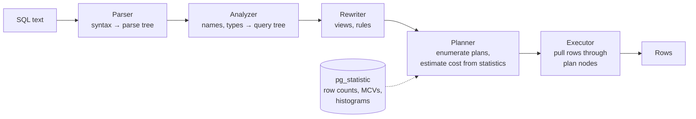
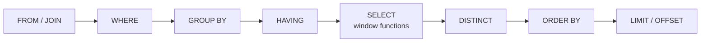
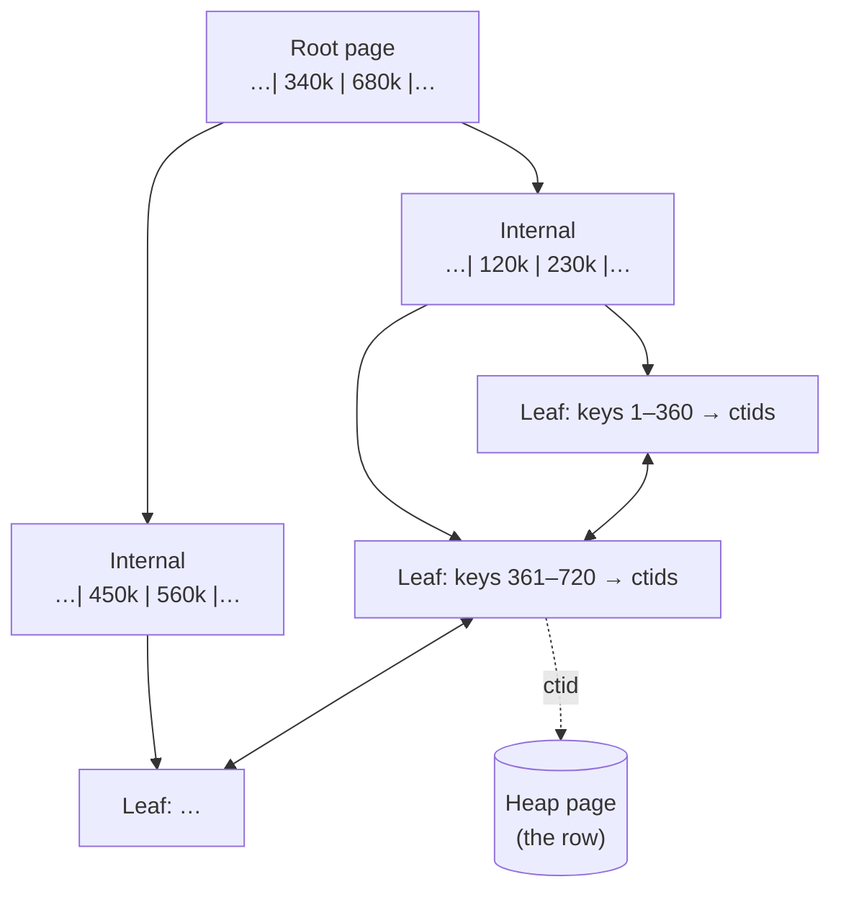

# 07 — Databases & APIs (Part 1 of 5): SQL, Indexes & Query Performance

> **Parts:** **Part 1 — Overview, Topic Map, SQL, Indexes, EXPLAIN, N+1 & Normalization** · [Part 2 — Transactions, Isolation, MVCC, Locking & Running Postgres](./07-databases-and-apis-part2.md) · [Part 3 — MongoDB, Redis, Choosing a Database & ORMs](./07-databases-and-apis-part3.md) · [Part 4 — API Design: REST, HTTP, Pagination, Idempotency, GraphQL, tRPC, gRPC & Webhooks](./07-databases-and-apis-part4.md) · [Part 5 — Resources, Practice, Interview Questions & Revision](./07-databases-and-apis-part5.md)
>
> Applies to: **PostgreSQL 18** (verified on **18.6**, October 2026; PostgreSQL 19 is in beta), node-postgres (`pg`) **8.23** on **Node.js 24**. Every plan and timing below was measured on a seeded shop database (100k users, 1M orders, 2.9M order items, 423 MB) running in Docker on a laptop. Your absolute numbers will differ; the *ratios* and plan shapes are the point. Redis as a cache and the Node service around these queries are in [06-nodejs Part 3](./06-nodejs-part3.md).

## Table of Contents

- [1. Overview](#1-overview)
- [2. Topic Map](#2-topic-map)
- [3. Detailed Explanations (Part 1)](#3-detailed-explanations-part-1)
  - [3.1 How Postgres Stores and Runs a Query](#31-how-postgres-stores-and-runs-a-query)
  - [3.2 SQL That Interviewers Actually Ask](#32-sql-that-interviewers-actually-ask)
  - [3.3 Indexes: B-tree Internals and Design Rules](#33-indexes-b-tree-internals-and-design-rules)
  - [3.4 Reading EXPLAIN ANALYZE](#34-reading-explain-analyze)
  - [3.5 Querying from Node: N+1, Deep Pagination, Types & Injection](#35-querying-from-node-n1-deep-pagination-types--injection)
  - [3.6 Normalization and Deliberate Denormalization](#36-normalization-and-deliberate-denormalization)
- [How to run the code in this file](#how-to-run-the-code-in-this-file)
- [Next: Part 2](#next-part-2)

---

## 1. Overview

**What this file covers.** How a full-stack developer stores, queries and exposes data: relational modeling and SQL on PostgreSQL, how indexes and the planner really work, transactions and concurrency, MongoDB and Redis where they fit, ORMs, and then the API layer on top — REST and HTTP semantics, pagination, idempotency, versioning, GraphQL, tRPC, gRPC and webhooks.

**Why interviewers care.** Most production slowness and most data-corruption bugs live here, not in React. A mid-level developer can write the query; a senior developer can say *why* it's slow (wrong column order in a composite index, a function on an indexed column, `OFFSET 500000`), *what breaks under concurrency* (lost updates, double charges on retry), and *what the API promises* (idempotent retries, stable cursors, versioning).

| Junior answer | Senior answer |
|---------------|---------------|
| "Add an index on the columns in the `WHERE`" | "One composite index ordered **equality columns first, then the range or sort column**: `(user_id, created_at)`, not `(created_at, user_id)`. Measured on 1M rows: 0.08 ms vs 14.8 ms for the same query. And every index costs writes — five extra indexes made inserts 3.8× slower" |
| "The query is slow, so we need caching" | "Let's read `EXPLAIN ANALYZE` first: compare estimated vs actual rows, find where the time and buffers go. Usually it's a missing or unusable index, a bad estimate, or N+1 from the app" |
| "Use `OFFSET`/`LIMIT` for pages" | "Keyset pagination on `(created_at, id)` — constant time at any depth. `OFFSET 500000` had to walk 500,020 index entries (65 ms); the keyset query read 4 pages (0.1 ms)" |
| "`NOT IN (subquery)` to find missing rows" | "`NOT EXISTS`. If the subquery returns a single `NULL`, `NOT IN` returns *zero rows* — three-valued logic" |
| "Normalize everything" | "Normalize to 3NF by default, then denormalize deliberately with an owner for consistency — e.g. snapshot the price on the order line, because the product price will change" |

**Version landscape (October 2026):**

| System | Current | What changed that interviewers ask about |
|--------|---------|------------------------------------------|
| PostgreSQL | **18** (19 still beta — `postgres:19` / `19-alpine` do not exist yet; `19beta3-alpine` does) | **18:** asynchronous I/O, **B-tree skip scan**, `uuidv7()`, **virtual generated columns** (now the default), `OLD`/`NEW` in `RETURNING`, `EXPLAIN ANALYZE` shows buffers by default, OAuth authentication, `pg_upgrade` keeps planner statistics. **17:** `JSON_TABLE`, `MERGE … RETURNING`, incremental backups, lower `VACUUM` memory use. **16:** `pg_stat_io`, logical replication from standbys. 14 reaches end of life in November 2026 — verify dates on postgresql.org/support/versioning |
| MongoDB | **9.0** current stable (`mongo:9.0` exists); examples in this topic used **`mongo:8` → 8.3.13** | 8.0: large performance gains, a cross-collection `bulkWrite` command, range queries in Queryable Encryption. Transactions need a replica set — see [Part 3](./07-databases-and-apis-part3.md) |
| Redis | **8.x** | Open source again (AGPLv3 option), JSON/search/time-series built into the core distribution; Valkey is the BSD-licensed fork — see [Part 3](./07-databases-and-apis-part3.md) |
| ORMs | Prisma **7**, Drizzle **0.45** (1.0 in RC), Mongoose **9** | Prisma 7 dropped the Rust query engine and requires driver adapters — see [Part 3](./07-databases-and-apis-part3.md) |

> 💡 Interview Tip: When a database question starts, anchor it: "Assuming Postgres with default `READ COMMITTED`…". Half of the classic questions (isolation anomalies, `COUNT(*)` speed, upsert behavior, index-only scans) have different answers in MySQL/InnoDB, and naming your assumption shows you know that.

---

## 2. Topic Map

Use this as a checklist. Each item links to where it's covered.

**Part 1 — SQL & query performance**
- [ ] Pages, heap, TOAST, and the parse → plan → execute pipeline — [3.1](#31-how-postgres-stores-and-runs-a-query)
- [ ] Joins, `GROUP BY`/`HAVING`, `NULL` logic and `NOT IN`, `EXISTS`, CTEs (and inlining), recursive CTEs, window functions, `LATERAL`, `DISTINCT ON`, `ROLLUP` — [3.2](#32-sql-that-interviewers-actually-ask)
- [ ] B-tree internals, composite order, covering (`INCLUDE`), partial, expression, collation and `LIKE`, skip scan, GIN/GiST/BRIN, write cost, unused indexes, `CREATE INDEX CONCURRENTLY` — [3.3](#33-indexes-b-tree-internals-and-design-rules)
- [ ] `EXPLAIN ANALYZE`: scans, join algorithms, estimates vs actuals, buffers, extended statistics, `pg_stat_statements` — [3.4](#34-reading-explain-analyze)
- [ ] N+1 from application code, deep `OFFSET`, `pg` type mapping, parameterized queries — [3.5](#35-querying-from-node-n1-deep-pagination-types--injection)
- [ ] 1NF–BCNF and deliberate denormalization — [3.6](#36-normalization-and-deliberate-denormalization)

**[Part 2](./07-databases-and-apis-part2.md) — Transactions & running Postgres**
- [ ] ACID, isolation levels and the anomalies each allows (reproduced), lost updates and their four fixes, `SELECT … FOR UPDATE`/`SKIP LOCKED`, deadlocks, advisory locks
- [ ] MVCC, tuple versions, `VACUUM`, autovacuum, bloat, transaction ID wraparound
- [ ] JSONB and GIN, full-text search, `pgvector`
- [ ] Connection pooling and PgBouncer, serverless, `max_connections`
- [ ] Zero-downtime migrations (expand/contract), locks taken by DDL
- [ ] Replication and read replicas, partitioning, sharding

**[Part 3](./07-databases-and-apis-part3.md) — Beyond Postgres**
- [ ] MongoDB: document modeling (embed vs reference), indexes (ESR rule), aggregation pipeline, transactions, schema validation
- [ ] Redis data structures, persistence, eviction
- [ ] SQL vs NoSQL, CAP and PACELC, choosing a database
- [ ] ORMs and query builders: Prisma 7, Drizzle, Kysely, Mongoose — generated SQL and trade-offs

**[Part 4](./07-databases-and-apis-part4.md) — API design**
- [ ] REST resources, methods, safe vs idempotent, status codes, Problem Details
- [ ] HTTP caching (`Cache-Control`, `ETag`), CORS and preflight, HTTP/1.1 vs 2 vs 3
- [ ] Offset vs cursor pagination as an API contract, idempotency keys, versioning, OpenAPI
- [ ] GraphQL (resolvers, DataLoader, complexity limits), tRPC, gRPC, webhooks, choosing an API style

**[Part 5](./07-databases-and-apis-part5.md)** — Resources, learning path, exercises, interview questions, red flags and revision.

---

## 3. Detailed Explanations (Part 1)

The schema used throughout ([how to create it](#how-to-run-the-code-in-this-file)):

```sql
CREATE TABLE users (
  id         bigint GENERATED ALWAYS AS IDENTITY PRIMARY KEY,
  email      text NOT NULL,
  country    char(2) NOT NULL,
  created_at timestamptz NOT NULL
);
CREATE TABLE products (
  id          bigint GENERATED ALWAYS AS IDENTITY PRIMARY KEY,
  name        text NOT NULL,
  category    text NOT NULL,
  price_cents integer NOT NULL CHECK (price_cents > 0)
);
CREATE TABLE orders (
  id          bigint GENERATED ALWAYS AS IDENTITY PRIMARY KEY,
  user_id     bigint NOT NULL REFERENCES users (id),
  status      text NOT NULL CHECK (status IN ('pending', 'paid', 'shipped', 'cancelled')),
  total_cents integer NOT NULL,
  created_at  timestamptz NOT NULL
);
CREATE TABLE order_items (
  order_id    bigint NOT NULL REFERENCES orders (id),
  product_id  bigint NOT NULL REFERENCES products (id),
  quantity    integer NOT NULL CHECK (quantity > 0),
  price_cents integer NOT NULL,           -- snapshot of the price at purchase time (see 3.6)
  PRIMARY KEY (order_id, product_id)
);
```

> ⚠️ Pitfall: Postgres creates an index for every `PRIMARY KEY` and `UNIQUE` constraint, but **not for foreign keys**. `orders.user_id` has no index here until we add one. Without it, "orders for user X" scans the table, and deleting a user scans `orders` to check the constraint.

### 3.1 How Postgres Stores and Runs a Query

**Storage.** A table is a **heap**: an unordered set of 8 KB pages (`block_size` = 8192). Each page holds tuples (row versions) plus a header and line pointers. `orders` (1M rows) is 16,667 pages, 130 MB. Values larger than about 2 KB are compressed and/or moved out of line into a **TOAST** table, so wide `text`/`jsonb` columns don't bloat every page — but reading them costs extra lookups.

An **index** is a separate structure that maps key values to tuple locations (`ctid` = page + slot). Reading a row through an index means: walk the index, then fetch the heap page. That second step is why "index scan" isn't free and why a query that touches most of a table is faster as a sequential scan.

**Every `UPDATE` writes a new row version** (MVCC); the old one stays until `VACUUM` removes it. That's covered in [Part 2](./07-databases-and-apis-part2.md); for now, remember that "row" and "tuple version" aren't the same thing.

**The pipeline.**



The planner is **cost-based**: for each candidate plan it estimates rows at every node from table statistics (collected by `ANALYZE`/autovacuum — row counts, most common values, histograms, correlation) and picks the cheapest. Bad statistics produce bad estimates, and bad estimates produce bad plans ([3.4](#34-reading-explain-analyze)).

**Logical evaluation order of a `SELECT`** — the reason you can't use a `SELECT` alias in `WHERE`, but you can in `ORDER BY`:



### 3.2 SQL That Interviewers Actually Ask

**Joins.** `INNER JOIN` keeps matching pairs; `LEFT JOIN` keeps every left row and fills `NULL`s when there's no match; `FULL JOIN` keeps both sides; `CROSS JOIN` is the Cartesian product. A condition on the right table belongs in the `ON` clause of a `LEFT JOIN` — put it in `WHERE` and you've turned it back into an inner join.

```sql
-- Revenue by country for paid/shipped orders, only countries with > 100k orders
SELECT u.country,
       count(DISTINCT o.user_id)         AS buyers,
       count(*)                          AS orders,
       round(sum(o.total_cents) / 100.0) AS revenue
FROM orders o
JOIN users u ON u.id = o.user_id
WHERE o.status IN ('paid', 'shipped')   -- filters rows before grouping
GROUP BY u.country
HAVING count(*) > 100000                -- filters groups after aggregation
ORDER BY revenue DESC;
```

```text
 country | buyers | orders | revenue
---------+--------+--------+----------
 US      |  37497 | 331219 | 28146930
 BR      |  12499 | 110801 |  9429511
 GB      |  12499 | 110178 |  9375256
 ...
```

**`NULL` and three-valued logic.** Comparisons with `NULL` yield `NULL` (unknown), and `WHERE` keeps only `TRUE`. `x NOT IN (1, 2, NULL)` means `x <> 1 AND x <> 2 AND x <> NULL` — the last term is unknown, so the whole thing is never true:

```sql
SELECT count(*) FROM users WHERE id NOT IN (SELECT x FROM (VALUES (1::bigint), (2), (NULL)) v(x));
-- 0        ← every row disappears
SELECT count(*) FROM users u
WHERE NOT EXISTS (SELECT 1 FROM (VALUES (1::bigint), (2), (NULL)) v(x) WHERE v.x = u.id);
-- 99998    ← what you meant
```

> ⚠️ Pitfall: `NOT IN (SELECT col …)` silently returns nothing the day `col` gets its first `NULL`. Use `NOT EXISTS` (the planner turns it into an efficient **anti-join**) or `LEFT JOIN … WHERE right.id IS NULL`. Both returned the same 2 users-without-orders on our data.

Aggregates skip `NULL`s, which matters for `count` and `avg`:

```sql
SELECT count(*) AS all_rows, count(x) AS non_null,
       count(*) FILTER (WHERE x > 1) AS gt_one, avg(x) AS avg_ignores_nulls
FROM (VALUES (1), (2), (NULL), (3)) v(x);
--  all_rows | non_null | gt_one | avg_ignores_nulls
--         4 |        3 |      2 | 2.0000000000000000
```

`FILTER (WHERE …)` replaces the old `sum(CASE WHEN … THEN 1 ELSE 0 END)` trick for conditional aggregates — one pass, several counts.

**CTEs (`WITH`).** Since Postgres 12, a non-recursive CTE that's referenced once is **inlined** into the main query, so predicates are pushed into it. `MATERIALIZED` forces the old behavior (compute once, then scan the result) — useful as an optimization fence, harmful by accident:

```sql
EXPLAIN (COSTS OFF) WITH o AS (SELECT * FROM orders) SELECT * FROM o WHERE user_id = 4242;
--  Bitmap Heap Scan on orders → Bitmap Index Scan … Index Cond: (user_id = 4242)
EXPLAIN (COSTS OFF) WITH o AS MATERIALIZED (SELECT * FROM orders) SELECT * FROM o WHERE user_id = 4242;
--  CTE Scan on o  Filter: (user_id = 4242)  →  CTE o → Seq Scan on orders   (all 1M rows)
```

**Recursive CTEs** walk hierarchies (org charts, category trees, threaded comments): an anchor query, `UNION ALL`, and a recursive step that joins back to the CTE.

```sql
WITH RECURSIVE emp(id, name, manager_id) AS (
  VALUES (1, 'Ana', NULL::int), (2, 'Bilal', 1), (3, 'Chen', 1), (4, 'Dara', 2), (5, 'Eve', 4)
), chain AS (
  SELECT id, name, manager_id, 0 AS depth, name::text AS path FROM emp WHERE manager_id IS NULL
  UNION ALL
  SELECT e.id, e.name, e.manager_id, c.depth + 1, c.path || ' > ' || e.name
  FROM emp e JOIN chain c ON e.manager_id = c.id
)
SELECT depth, path FROM chain ORDER BY path;
--  0 | Ana
--  1 | Ana > Bilal
--  2 | Ana > Bilal > Dara
--  3 | Ana > Bilal > Dara > Eve
--  1 | Ana > Chen
```

> ⚠️ Pitfall: A cycle in the data (A manages B, B manages A) makes a recursive CTE run forever. Postgres 14+ has a `CYCLE` clause (`CYCLE id SET is_cycle USING path`); otherwise track visited IDs in an array and stop when you see one again.

**Window functions** compute across related rows *without collapsing them* — the thing `GROUP BY` can't do. `OVER (PARTITION BY … ORDER BY …)` defines the window.

```sql
-- Ranking: how ties are treated
SELECT name, score,
       row_number() OVER w AS row_number,  -- 1,2,3,4: unique, ties broken arbitrarily
       rank()       OVER w AS rank,        -- 1,2,2,4: ties share, then a gap
       dense_rank() OVER w AS dense_rank   -- 1,2,2,3: ties share, no gap
FROM (VALUES ('a', 90), ('b', 80), ('c', 80), ('d', 70)) t(name, score)
WINDOW w AS (ORDER BY score DESC);
```

```text
 name | score | row_number | rank | dense_rank
------+-------+------------+------+------------
 a    |    90 |          1 |    1 |          1
 b    |    80 |          2 |    2 |          2
 c    |    80 |          3 |    2 |          2
 d    |    70 |          4 |    4 |          3
```

```sql
-- Top-N per group: the classic interview question
WITH sales AS (
  SELECT p.category, p.name, sum(oi.quantity) AS units
  FROM order_items oi JOIN products p ON p.id = oi.product_id
  GROUP BY p.category, p.name
)
SELECT category, name, units
FROM (
  SELECT *, row_number() OVER (PARTITION BY category ORDER BY units DESC, name) AS rn
  FROM sales
) ranked
WHERE rn <= 2;   -- window results can't be filtered in WHERE of the same level: wrap it
```

> ⚠️ Pitfall: On our data three `toys` products tied at 120,001 units. Without a tie-breaker the query returned Products 9 and 24; with `name` as the tie-breaker it returned Products 14 and 24 (text order puts `'Product 14'` before `'Product 9'`). Without a tie-breaker, which tied row wins is unspecified and can change with the plan or the data. Always add a unique column to the window's `ORDER BY` — the same rule as for pagination.

```sql
-- Running total and month-over-month change
WITH monthly AS (
  SELECT date_trunc('month', created_at) AS month, sum(total_cents) / 100 AS revenue
  FROM orders WHERE status <> 'cancelled' AND created_at < '2024-07-01'
  GROUP BY 1
)
SELECT to_char(month, 'YYYY-MM') AS month, revenue,
       sum(revenue) OVER (ORDER BY month) AS running_total,
       round(100.0 * (revenue - lag(revenue) OVER (ORDER BY month))
             / lag(revenue) OVER (ORDER BY month), 1) AS mom_pct
FROM monthly ORDER BY month;
```

```text
  month  | revenue | running_total | mom_pct
---------+---------+---------------+---------
 2024-01 | 2390303 |       2390303 |
 2024-02 | 2238162 |       4628465 |    -6.4
 2024-03 | 2409146 |       7037611 |     7.6
 ...
```

The default frame with `ORDER BY` is `RANGE BETWEEN UNBOUNDED PRECEDING AND CURRENT ROW`, which treats **peer rows (equal sort keys) as one** — a running total over duplicate dates jumps by the whole day at once. Use `ROWS BETWEEN …` when you mean physical rows, e.g. a 7-row moving average: `avg(x) OVER (ORDER BY day ROWS BETWEEN 6 PRECEDING AND CURRENT ROW)`.

**`LATERAL`** lets a subquery in `FROM` reference columns from earlier items — "for each user, run this query". It's the efficient way to get the top N *rows* per group when an index supports the inner query:

```sql
SELECT u.id AS user_id, o.id AS order_id, o.created_at::date, o.total_cents
FROM users u
CROSS JOIN LATERAL (
  SELECT id, created_at, total_cents FROM orders
  WHERE user_id = u.id ORDER BY created_at DESC LIMIT 2
) o
WHERE u.id IN (10, 11);
```

```text
 user_id | order_id | created_at | total_cents
---------+----------+------------+-------------
      10 |   975771 | 2026-09-08 |        6292
      10 |    13827 | 2026-08-31 |        8754
      11 |   716297 | 2026-09-23 |       14490
      11 |   622741 | 2026-07-14 |       11288
```

For exactly one row per group, Postgres has **`DISTINCT ON`**: `SELECT DISTINCT ON (user_id) … ORDER BY user_id, created_at DESC` keeps the first row of each `user_id` in that order.

**`ROLLUP` / `GROUPING SETS`** produce subtotals and a grand total in one pass:

```sql
SELECT coalesce(status, 'ALL') AS status, count(*) FROM orders GROUP BY ROLLUP (status) ORDER BY count(*) DESC;
--  ALL       | 1000000
--  shipped   |  530018
--  paid      |  352562
--  cancelled |   97480
--  pending   |   19940
```

> 💡 Interview Tip: For "write a query" questions, talk through the *shape* before typing: "I need one row per category, so I'll aggregate per product, rank within category with a window function, then filter outside." Interviewers grade the approach and the edge cases (ties, `NULL`s, empty groups) more than the syntax.

### 3.3 Indexes: B-tree Internals and Design Rules

**B-tree structure.** The default index type is a B+tree: sorted keys in leaf pages, linked left-to-right, with internal pages that route searches. Each 8 KB page holds hundreds of keys, so the tree is very shallow. Our `orders_pkey` (1M `bigint` keys, 5,486 pages) has **2 levels above the leaves**: any lookup reads 3 index pages plus the heap page. At 100M rows it would be about 4 levels — that's why B-tree lookups stay fast as tables grow.



Because leaves are sorted and linked, a B-tree answers equality, ranges (`<`, `BETWEEN`), prefix matches, `ORDER BY` (in either direction) and `min`/`max` — without sorting.

**How the planner uses an index — three access paths.**

| Plan node | What it does | When the planner picks it |
|-----------|--------------|---------------------------|
| **Index Scan** | Walk the index, fetch each heap row in index order | Few rows, or the order is needed (`ORDER BY … LIMIT`) |
| **Bitmap Index Scan + Bitmap Heap Scan** | Collect matching ctids into a bitmap, then read heap pages in physical order | A moderate number of rows; can combine several indexes with `BitmapAnd`/`BitmapOr` |
| **Index Only Scan** | Answer from the index alone; skip the heap if the page is marked all-visible in the **visibility map** | Every referenced column is in the index, and the table is recently vacuumed (`Heap Fetches: 0`) |

**Measured on 1M orders** (all numbers are `EXPLAIN ANALYZE` execution times, warm cache):

| Query | Without the right index | With it |
|-------|-------------------------|---------|
| `WHERE user_id = 4242` | Parallel Seq Scan, 55.9 ms, 16,667 pages | Bitmap scan on `(user_id)`, 0.7 ms, 17 pages |
| `WHERE lower(email) = '…'` | Seq Scan, 41.1 ms (plain index on `email` is unusable) | Expression index `(lower(email))`, 0.05 ms |
| `WHERE created_at::date = '2025-03-10'` | 68.0 ms — scanned the entire index, filtering every entry | Rewritten as a range `>= '2025-03-10' AND < '2025-03-11'`: 0.18 ms |
| `WHERE status = 'pending' ORDER BY created_at LIMIT 20` | — | Partial index `(created_at) WHERE status = 'pending'`: 0.43 ms, and the index is **456 kB** vs 30 MB for a full one |

**Rule 1 — composite index column order: equality first, then range or sort.** The index is sorted by the first column, then the second within it. For `WHERE user_id = ? AND created_at >= ? ORDER BY created_at DESC LIMIT 5`:

```sql
-- (created_at, user_id): the range is on the leading column, so it walks the index backwards from the
-- newest order, checking user_id on every entry, until it has found 5 orders for this user
--   Index Scan Backward using orders_created_user_idx   Buffers: shared read=1851   Execution Time: 14.837 ms

-- (user_id, created_at): jump to user 4242, then read its entries in created_at order and stop after 5
--   Index Scan Backward using orders_user_created_idx   Buffers: shared hit=4 read=3   Execution Time: 0.078 ms
```

That's a **190× difference** from column order alone. The general rule ("ESR" in MongoDB's terms — Equality, Sort, Range) is the same in every B-tree database.

**Rule 2 — an index on `(a, b)` also serves queries on `a` alone**, so a separate index on `a` is usually redundant. Before Postgres 18, it did *not* help queries on `b` alone. **Postgres 18 adds skip scan:** if the leading column has few distinct values, the planner does one index descent per value. With an index on `(status, created_at)` and a filter on `created_at` only:

```text
Index Only Scan using orders_status_created_idx on orders
  Index Cond: ((created_at >= '2026-09-20') AND (created_at < '2026-09-21'))
  Index Searches: 9          ← skip scan: several descents instead of one full scan
Execution Time: 0.587 ms
```

Skip scan is a bonus for low-cardinality leading columns, not a reason to design indexes in the wrong order.

**Rule 3 — make the index match the expression.** `lower(email)`, `created_at::date` and `col + 1` can't use a plain index on the column. Either rewrite the predicate to be **sargable** (a bare column compared with a constant or range) or create an **expression index** on exactly that expression. The `::date` cast is also time-zone dependent (`timestamptz` → `date` uses the session's `TimeZone`), so the range form is both faster and more correct.

**Rule 4 — collation decides whether `LIKE 'prefix%'` can use an index.** Our database uses the `en_US.utf8` collation (the Docker image default). A plain B-tree index on `email` did **not** serve `LIKE 'user4242%'` — Seq Scan, 9.3 ms. Under a non-C collation, sort order isn't byte order, so prefix ranges aren't contiguous in the index. Fixes:

```sql
CREATE INDEX users_email_pattern_idx ON users (email text_pattern_ops);   -- byte-wise ordering
-- Index Cond: ((email ~>=~ 'user4242') AND (email ~<~ 'user4243'))   Execution Time: 0.123 ms
```

…or declare the column `COLLATE "C"` if you never need linguistic sorting on it. For `LIKE '%infix%'`, a B-tree can't help at all; use a **trigram GIN index** (`pg_trgm`). On `LIKE '%r4242%'` it went from 8.1 ms to 0.17 ms — but on `'%4242@example.com'` it saved nothing, because every row contains the trigrams of `example.com`. Trigram indexes help only when the pattern has *selective* trigrams.

**Rule 5 — selectivity decides whether the index is used at all.** With an index on `status`:

```text
status = 'shipped' (53% of rows):  Parallel Seq Scan               81.6 ms   ← correct choice
status = 'pending' (2% of rows):   Index Only Scan on orders_status_idx   3.5 ms
```

Reading half the table through an index means random heap I/O for each row, which is slower than reading every page sequentially. The planner knows this from the statistics. An index on a low-cardinality column (booleans, status) only pays off for the rare values — which is exactly what a **partial index** gives you, at a fraction of the size.

**Covering indexes.** Adding non-key columns with `INCLUDE` lets more queries become index-only:

```sql
CREATE INDEX orders_user_created_cov_idx ON orders (user_id, created_at) INCLUDE (total_cents, status);
-- Index Only Scan Backward using orders_user_created_cov_idx   Heap Fetches: 0   Execution Time: 0.105 ms
```

It cost size: 47 MB vs 30 MB for the same index without `INCLUDE`. `Heap Fetches: 0` depends on the visibility map — on a table with lots of recent updates the "index-only" scan still visits the heap until `VACUUM` catches up ([Part 2](./07-databases-and-apis-part2.md)).

**Indexes aren't free.** Every `INSERT`, every non-HOT `UPDATE` and every `DELETE` (eventually, via `VACUUM`) maintains every index. Measured: inserting 200,000 rows into a table with only a primary key took **0.89 s**; with five more single-column indexes, **3.34 s** (3.8×). Indexes also take RAM in the buffer cache and can block **HOT updates** (an update that changes no indexed column can stay on the same page and skip index maintenance entirely).

Find indexes that never get used:

```sql
SELECT indexrelname, idx_scan, pg_size_pretty(pg_relation_size(indexrelid)) AS size
FROM pg_stat_user_indexes WHERE relname = 'orders' ORDER BY idx_scan;
--  orders_pending_idx          |        1 | 456 kB
--  orders_user_created_cov_idx |       10 | 47 MB
--  ...
```

Check this on the primary *and* on replicas (stats are per server), and over a full business cycle (month-end reports), before dropping anything.

> ⚠️ Pitfall: `CREATE INDEX` blocks writes to the table for the whole build. On a live table, use **`CREATE INDEX CONCURRENTLY`**: it takes longer and can't run inside a transaction, and if it fails it leaves an `INVALID` index you must drop and retry. Migration tools that wrap every migration in a transaction need a per-migration opt-out ([Part 2](./07-databases-and-apis-part2.md)).

**Other index types** — know when each one fits:

| Type | Good for | Example |
|------|----------|---------|
| B-tree | Equality, ranges, sorting, prefix (with the right collation/opclass) | Almost everything |
| Hash | Equality only; rarely better than B-tree | — |
| **GIN** | "Contains" queries on composite values: `jsonb`, arrays, full-text `tsvector`, trigrams | `WHERE tags @> '{sale}'`, `WHERE doc @> '{"status":"active"}'` |
| **GiST** | Geometric/range types, nearest-neighbor, exclusion constraints | PostGIS, `tstzrange` overlap (`&&`), "no overlapping bookings" |
| **BRIN** | Huge, naturally ordered tables (append-only logs, time series) — stores min/max per block range | `created_at` on a 1B-row events table; tiny index |
| `pgvector` HNSW/IVFFlat | Approximate nearest-neighbor on embeddings | Semantic search ([Part 2](./07-databases-and-apis-part2.md)) |

### 3.4 Reading EXPLAIN ANALYZE

`EXPLAIN` shows the chosen plan with *estimates*. `EXPLAIN ANALYZE` **runs the query** and adds actual rows, loops and time per node. In Postgres 18, `ANALYZE` includes buffer counts automatically (before 18 you had to add `BUFFERS`).

> ⚠️ Pitfall: `EXPLAIN ANALYZE` executes the statement. For `UPDATE`/`DELETE`/`INSERT`, wrap it: `BEGIN; EXPLAIN ANALYZE …; ROLLBACK;`.

Read a plan **from the innermost node outwards**, and check these in order:

1. **Estimated vs actual rows** at each node. An error of 10× or more is where bad plans come from (the planner picked a nested loop for "10 rows" that turned out to be 100,000).
2. **Where the time goes**: actual time is per loop — multiply by `loops`.
3. **Buffers**: `shared hit` (from cache) vs `read` (from disk or OS cache). This is more stable than timing and shows how much work the query does.
4. **Row-removing filters**: `Rows Removed by Filter: 333330` means an index (or a better one) would help.
5. **Sort/hash spills**: `Sort Method: external merge  Disk: …` means `work_mem` is too small for that operation.

A plan from §3.3 annotated:

```text
Gather (actual time=24.261..55.778 rows=11.00 loops=1)       ← parallel query: leader + workers
  Workers Planned: 2
  Workers Launched: 2
  Buffers: shared hit=9923 read=6744                          ← 16,667 pages = the whole table
  ->  Parallel Seq Scan on orders (actual time=12.861..43.935 rows=3.67 loops=3)   ← 3 processes
        Filter: (user_id = 4242)
        Rows Removed by Filter: 333330                        ← per process: read 1M rows to find 11
Execution Time: 55.872 ms
```

(Postgres 18 prints fractional row counts such as `rows=3.67` — the average per loop.)

**Join algorithms** — the planner chose all three on our schema:

| Algorithm | How it works | Chosen when | Seen as |
|-----------|--------------|-------------|---------|
| **Nested Loop** | For each outer row, look up matches (ideally via an index) | Outer side is small, inner side is indexed | `orders WHERE id < 50` joined to `order_items` via its primary key |
| **Hash Join** | Build a hash table on the smaller input, probe with the larger | Large unsorted inputs, equality join | Revenue by country: hash `users`, probe with a parallel scan of `orders` |
| **Merge Join** | Walk two inputs sorted on the join key | Both sides already sorted (indexes) or worth sorting | Full `orders ⋈ order_items` with hash/nested loop disabled: both primary keys provide the order |

**When estimates are wrong.** The planner assumes columns are independent. In this table every Karachi row is in Pakistan, so `city = 'Karachi' AND country = 'PK'` matches 25% of rows, but the planner multiplies 25% × 50%:

```sql
EXPLAIN ANALYZE SELECT * FROM addr WHERE city = 'Karachi' AND country = 'PK';
--  Seq Scan on addr  (… rows=24341 …) (actual rows=50000.00 …)   ← estimate off by 2×
CREATE STATISTICS addr_city_country (dependencies) ON city, country FROM addr;
ANALYZE addr;
--  Seq Scan on addr  (… rows=50587 …) (actual rows=50000.00 …)   ← fixed
```

Other fixes for bad estimates: run `ANALYZE` after bulk loads (autovacuum may not have caught up), raise the statistics target for skewed columns (`ALTER TABLE … ALTER COLUMN … SET STATISTICS 1000`), and avoid hiding columns inside functions or `OR` chains.

**Finding the queries worth tuning.** Don't optimize the query you happen to be looking at; optimize the ones that take the most *total* time. The `pg_stat_statements` extension (it must be in `shared_preload_libraries`; managed services such as RDS enable it with a parameter) aggregates normalized queries:

```sql
SELECT calls, round(total_exec_time) AS total_ms, round(mean_exec_time, 2) AS mean_ms, rows, left(query, 80) AS query
FROM pg_stat_statements ORDER BY total_exec_time DESC LIMIT 10;
```

A 2 ms query called 5 million times a day matters more than a 3-second report that runs once. `auto_explain` (log plans of queries slower than a threshold) catches plans that only go bad in production.

### 3.5 Querying from Node: N+1, Deep Pagination, Types & Injection

A shared pool with sane limits, and a typed helper:

```ts
// src/db/pool.ts
import pg from 'pg';

// int8 (bigint, count(*)) arrives as a string by default, because JS numbers lose precision above 2^53.
// Parse it only if every value you store fits in Number.MAX_SAFE_INTEGER; otherwise keep strings or use BigInt.
pg.types.setTypeParser(pg.types.builtins.INT8, (value) => {
  const n = Number(value);
  if (!Number.isSafeInteger(n)) throw new RangeError(`int8 ${value} exceeds Number.MAX_SAFE_INTEGER`);
  return n;
});
// A DATE has no time zone; the default parser turns it into a JS Date at *local* midnight. Keep it a string.
pg.types.setTypeParser(pg.types.builtins.DATE, (value) => value);

export const pool = new pg.Pool({
  connectionString: process.env.DATABASE_URL ?? 'postgres://postgres:pg@localhost:5440/postgres',
  max: 10, // per process: instances × max must stay below the server's max_connections (see Part 2)
  idleTimeoutMillis: 30_000,
  connectionTimeoutMillis: 2_000, // fail fast instead of queueing forever when the pool is exhausted
  statement_timeout: 5_000, // server-side cap per statement
  application_name: 'shop-api', // shows up in pg_stat_activity
});

pool.on('error', (err) => console.error('idle client error', err)); // without this, an idle-client error crashes the process

export async function query<Row extends pg.QueryResultRow>(text: string, values: unknown[] = []): Promise<Row[]> {
  const result = await pool.query<Row>(text, values);
  return result.rows;
}
```

**Default `pg` type mapping, measured** (without the parsers above):

```text
count(*)                     string "1"
9007199254740993::bigint     string "9007199254740993"
12.50::numeric               string "12.50"       ← exact decimal; never parse money into a float
now()                        Date
'2025-03-10'::date           Date 2025-03-09T19:00:00.000Z   ← on a UTC+5 machine: off by one day in UTC
'{"a":1}'::jsonb             object
1.5::float8 / 42::int        number
```

> ⚠️ Pitfall: The `date` → `Date` conversion is a classic production bug: a birthday stored as `2025-03-10` is serialized to JSON as `2025-03-09T19:00:00.000Z` by a server in Pakistan, and shows up as the 9th in the browser. Keep `date` as a `'YYYY-MM-DD'` string end to end, and keep money as integer cents or `numeric` strings.

**The N+1 problem.** Loading a list and then querying once per item — what a naive loop, a lazy-loading ORM or a GraphQL resolver does by default:

```ts
// src/orders/n-plus-one.ts — run: node src/orders/n-plus-one.ts
import { pool, query } from '../db/pool.ts';

type Order = { id: number; created_at: Date; total_cents: number };
type Item = { order_id: number; product_id: number; quantity: number };
type OrderWithItems = Order & { items: Omit<Item, 'order_id'>[] };

const recentOrders = (limit: number) =>
  query<Order>('SELECT id, created_at, total_cents FROM orders ORDER BY created_at DESC, id DESC LIMIT $1', [limit]);

// ❌ BAD: 1 query for the orders + 1 query per order (what a naive ORM loop or GraphQL resolver does)
export async function nPlusOne(limit: number): Promise<OrderWithItems[]> {
  const orders = await recentOrders(limit);
  const result: OrderWithItems[] = [];
  for (const order of orders) {
    const items = await query<Item>('SELECT product_id, quantity FROM order_items WHERE order_id = $1', [order.id]);
    result.push({ ...order, items });
  }
  return result;
}

// ✅ GOOD: 2 queries total — batch the child lookup with = ANY($1) and stitch in memory
export async function batched(limit: number): Promise<OrderWithItems[]> {
  const orders = await recentOrders(limit);
  const items = await query<Item>(
    'SELECT order_id, product_id, quantity FROM order_items WHERE order_id = ANY($1::bigint[])',
    [orders.map((o) => o.id)],
  );
  const byOrder = Map.groupBy(items, (item) => item.order_id);
  return orders.map((o) => ({
    ...o,
    items: (byOrder.get(o.id) ?? []).map(({ product_id, quantity }) => ({ product_id, quantity })),
  }));
}

// ✅ ALSO GOOD: 1 query — let Postgres build the nested JSON
export async function singleQuery(limit: number): Promise<OrderWithItems[]> {
  return query<OrderWithItems>(
    `SELECT o.id, o.created_at, o.total_cents,
            coalesce(json_agg(json_build_object('product_id', oi.product_id, 'quantity', oi.quantity)
                     ORDER BY oi.product_id) FILTER (WHERE oi.order_id IS NOT NULL), '[]') AS items
     FROM (SELECT id, created_at, total_cents FROM orders ORDER BY created_at DESC, id DESC LIMIT $1) o
     LEFT JOIN order_items oi ON oi.order_id = o.id
     GROUP BY o.id, o.created_at, o.total_cents
     ORDER BY o.created_at DESC, o.id DESC`,
    [limit],
  );
}

if (import.meta.main) {
  // Count round trips by wrapping pool.query
  let roundTrips = 0;
  const original = pool.query.bind(pool);
  pool.query = ((...args: Parameters<typeof original>) => {
    roundTrips++;
    return original(...args);
  }) as typeof pool.query;

  for (const [name, fn] of [['N+1', nPlusOne], ['batched', batched], ['single query', singleQuery]] as const) {
    await fn(200); // warm up
    roundTrips = 0;
    const started = performance.now();
    const rows = await fn(200);
    const ms = performance.now() - started;
    const itemCount = rows.reduce((n, r) => n + r.items.length, 0);
    console.log(`${name.padEnd(12)} ${String(roundTrips).padStart(3)} round trips  ${ms.toFixed(1).padStart(6)} ms  (${rows.length} orders, ${itemCount} items)`);
  }
  await pool.end();
}
```

**Measured** (Node 24, Postgres in local Docker — the *best case* for round-trip latency):

```text
N+1          201 round trips   161.2 ms  (200 orders, 592 items)
batched        2 round trips     4.2 ms  (200 orders, 592 items)
single query   1 round trips     3.0 ms  (200 orders, 592 items)
```

Each query was fast; the cost is **201 network round trips**, each with its own pool checkout, protocol messages and scheduling. Across availability zones (≈0.5–1 ms per round trip), N+1 gets proportionally worse, while the batched version barely changes. It also hides from per-query monitoring: no single query is slow, so you find it by counting queries per request (logs, traces, `pg_stat_statements` `calls`).

Fixes, by layer: batch with `= ANY($1)` (or `IN`) and stitch in memory; one query with `JOIN` + `json_agg`; ORM eager loading (`include`, `with`) — check the SQL it generates ([Part 3](./07-databases-and-apis-part3.md)); **DataLoader** in GraphQL ([Part 4](./07-databases-and-apis-part4.md)).

> ⚠️ Pitfall: `JOIN`ing several one-to-many relations in one flat query multiplies rows (orders × items × payments). Either aggregate each child relation separately (subqueries with `json_agg`) or use separate batched queries.

**Deep pagination.** `OFFSET n` doesn't skip rows; it *produces and discards* them. With a covering index on `(created_at DESC, id DESC)`:

```text
LIMIT 20 OFFSET 10        Index Only Scan  rows=30        Buffers: 4       0.095 ms
LIMIT 20 OFFSET 500000    Index Only Scan  rows=500020    Buffers: 1,919   65.458 ms
keyset at the same depth  Index Only Scan  rows=20        Buffers: 4       0.095 ms
   WHERE (created_at, id) < ('2025-05-14 07:11:14.396329+00', 548588)
   ORDER BY created_at DESC, id DESC LIMIT 20
```

The **row-value comparison** `(created_at, id) < ($1, $2)` matches the index order exactly, so the scan starts at the right place. `id` is the tie-breaker that makes the order total — without it, rows with equal timestamps can repeat or vanish between pages. And this is the best case for `OFFSET`: here the index covered every column. With a regular index, each skipped row would also be a heap fetch. API-level cursor design (opaque cursors, page sizes, consistency) is in [Part 4](./07-databases-and-apis-part4.md).

**SQL injection.** Never build SQL by concatenating input. Parameters (`$1`) are sent separately from the SQL text, so they can't change the query's structure:

```ts
// ❌ BAD: input becomes SQL. email = "' OR '1'='1" returns every user.
const bad = await pool.query(`SELECT id FROM users WHERE email = '${email}'`);

// ✅ GOOD: a bound parameter
const good = await pool.query('SELECT id FROM users WHERE email = $1', [email]);

// Identifiers (column names for sorting) can't be parameters — allowlist them
const SORTABLE = { created: 'created_at', total: 'total_cents' } as const;
const column = SORTABLE[sortKey as keyof typeof SORTABLE] ?? 'created_at';
const sorted = await pool.query(`SELECT id FROM orders ORDER BY ${column} DESC LIMIT $1`, [limit]);
```

### 3.6 Normalization and Deliberate Denormalization

Normalization removes **redundancy**, so each fact is stored once and can't contradict itself. Start from a spreadsheet export:

| order_id | customer_email | customer_country | items | product_names | category_of_each |
|----------|----------------|------------------|-------|---------------|------------------|
| 1 | ana@x.com | PK | "3, 7" | "Pen, Ink" | "tools, tools" |

| Normal form | Rule | Violation above | Fix |
|-------------|------|-----------------|-----|
| **1NF** | Atomic values; no repeating groups | `items` holds a list | One row per order line: `order_items(order_id, product_id, quantity)` |
| **2NF** | 1NF, and every non-key column depends on the *whole* key | In `order_items(order_id, product_id, product_name)`, `product_name` depends only on `product_id` | Move it to `products` |
| **3NF** | 2NF, and no non-key column depends on another non-key column | `customer_country` depends on `customer_email`, not on the order | Move customers to `users`; orders reference `user_id` |
| **BCNF** | Every determinant is a candidate key | Rare in practice; e.g. a `(student, course, teacher)` table where each teacher teaches one course | Split so every functional dependency's left side is a key |

**Anomalies that normalization prevents:** an *update anomaly* (change a customer's country in one order but not another), an *insert anomaly* (can't add a product until someone orders it), a *delete anomaly* (deleting the last order deletes the only record of the customer).

**Denormalize deliberately**, with a reason and an owner for consistency:

- **Historical snapshots are not redundancy.** `order_items.price_cents` copies the product's price at purchase time. It *must* differ from `products.price_cents` later — the invoice can't change when the catalog does. Same for shipping addresses on orders.
- **Derived values for read performance:** `orders.total_cents` (sum of the lines), a `comments_count` on posts, a materialized view for a dashboard. Decide who keeps it correct: the same transaction that writes the children, a trigger, or a periodic recompute — and how stale it may be.
- **Read models**: a separate denormalized table, search index or cache fed by events (CQRS-style), when one shape can't serve both writes and heavy reads.

**Constraints are the schema's documentation and its last line of defense.** Application validation can be bypassed by a script, a second service or a race; the database can't:

```sql
ALTER TABLE users ADD CONSTRAINT users_email_key UNIQUE (email);               -- race-proof uniqueness
ALTER TABLE orders ADD CONSTRAINT total_non_negative CHECK (total_cents >= 0);
-- No two overlapping bookings for the same room (needs the btree_gist extension)
CREATE TABLE bookings (
  room_id bigint NOT NULL,
  during  tstzrange NOT NULL,
  EXCLUDE USING gist (room_id WITH =, during WITH &&)
);
INSERT INTO bookings VALUES (1, '[2026-10-14 10:00, 2026-10-14 11:00)');   -- ok
INSERT INTO bookings VALUES (1, '[2026-10-14 11:00, 2026-10-14 12:00)');   -- ok: half-open ranges just touch
INSERT INTO bookings VALUES (1, '[2026-10-14 10:30, 2026-10-14 11:30)');
-- ERROR: conflicting key value violates exclusion constraint "bookings_room_id_during_excl"
```

> 💡 Interview Tip: "Check uniqueness in the app, then insert" is a race: two requests both pass the check. The answer interviewers look for is a `UNIQUE` constraint plus handling the violation (`23505`) — or `INSERT … ON CONFLICT` ([Part 2](./07-databases-and-apis-part2.md)).

**Keys.** `bigint GENERATED ALWAYS AS IDENTITY` is the default surrogate key: small, ordered, index-friendly. Use UUIDs when IDs are generated outside the database, must be unguessable in URLs, or must be unique across systems — and prefer **UUIDv7** (time-ordered; `uuidv7()` is built into Postgres 18) over random UUIDv4, which scatters inserts across the whole B-tree and bloats it. Keep natural keys (email, SKU) as `UNIQUE` constraints rather than primary keys: they change.

---

## How to run the code in this file

```powershell
docker run -d --name pg18 -p 5440:5432 -e POSTGRES_PASSWORD=pg postgres:18-alpine
# seed.sql = the CREATE TABLE statements from section 3 + the data generator below
Get-Content seed.sql | docker exec -i pg18 psql -U postgres
```

A data generator that produces the same shape as the measurements (100k users, 1M orders, ~3 items each):

```sql
SELECT setseed(0.42);
INSERT INTO users (email, country, created_at)
SELECT 'user' || g || '@example.com',
       (ARRAY['US','US','US','GB','DE','IN','PK','BR'])[1 + (g % 8)],
       timestamptz '2024-01-01' + (g * interval '5 minutes')
FROM generate_series(1, 100000) AS g;

INSERT INTO products (name, category, price_cents)
SELECT 'Product ' || g, (ARRAY['books','games','music','tools','toys'])[1 + (g % 5)], 500 + (g * 37) % 9500
FROM generate_series(1, 50) AS g;

INSERT INTO orders (user_id, status, total_cents, created_at)
SELECT 1 + floor(random() * 100000)::bigint,
       CASE WHEN random() < 0.02 THEN 'pending' WHEN random() < 0.10 THEN 'cancelled'
            WHEN random() < 0.40 THEN 'paid' ELSE 'shipped' END,
       0,
       timestamptz '2024-01-01' + random() * interval '1000 days'
FROM generate_series(1, 1000000);

INSERT INTO order_items (order_id, product_id, quantity, price_cents)
SELECT o.id, p.id, 1 + (o.id + p.id) % 3, p.price_cents
FROM orders o
CROSS JOIN LATERAL (
  SELECT id, price_cents FROM products
  WHERE id IN (1 + o.id % 50, 1 + (o.id * 7) % 50, 1 + (o.id * 13) % 50)
) p;

UPDATE orders o SET total_cents = s.total
FROM (SELECT order_id, sum(quantity * price_cents) AS total FROM order_items GROUP BY order_id) s
WHERE s.order_id = o.id;
VACUUM ANALYZE;
```

It took about 3 minutes on a laptop. Then run the TypeScript with Node 24 (type stripping; no build step):

```powershell
npm i pg && npm i -D @types/pg @types/node
node src/orders/n-plus-one.ts
```

---

## Next: Part 2

➡️ [Part 2 — Transactions, Isolation, MVCC, Locking & Running Postgres](./07-databases-and-apis-part2.md): ACID, isolation anomalies reproduced with two connections, the four fixes for lost updates, `SKIP LOCKED` job queues, deadlocks, MVCC and `VACUUM`, JSONB, full-text search and `pgvector`, connection pooling, zero-downtime migrations, replication, partitioning and sharding.
