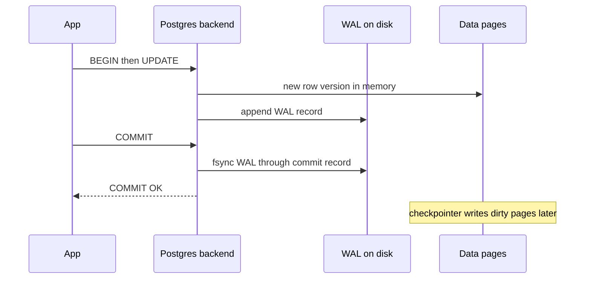
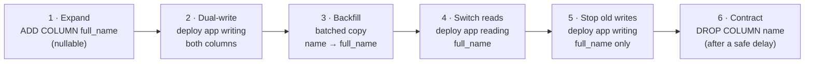

# 07 — Databases & APIs (Part 2 of 5): Transactions, Isolation, MVCC, Locking & Running Postgres

> **Parts:** [Part 1 — Overview, Topic Map, SQL, Indexes, EXPLAIN, N+1 & Normalization](./07-databases-and-apis-part1.md) · **Part 2 — Transactions, Isolation, MVCC, Locking & Running Postgres** · [Part 3 — MongoDB, Redis, Choosing a Database & ORMs](./07-databases-and-apis-part3.md) · [Part 4 — API Design: REST, HTTP, Pagination, Idempotency, GraphQL, tRPC, gRPC & Webhooks](./07-databases-and-apis-part4.md) · [Part 5 — Resources, Practice, Interview Questions & Revision](./07-databases-and-apis-part5.md)
>
> Applies to: **PostgreSQL 18.6**, `pg` 8.23 on **Node.js 24**, **PgBouncer 1.26**, **pgvector 0.8.7** — all verified in October 2026. Every anomaly below was reproduced with two real connections, and every number was measured on the [Part 1 dataset](./07-databases-and-apis-part1.md#how-to-run-the-code-in-this-file) (1M orders). Behavior described is Postgres's; MySQL/InnoDB differs in several places, called out where it matters.

## Table of Contents

- [3. Detailed Explanations (Part 2)](#3-detailed-explanations-part-2)
  - [3.7 Transactions and ACID](#37-transactions-and-acid)
  - [3.8 Isolation Levels and Anomalies, Reproduced](#38-isolation-levels-and-anomalies-reproduced)
  - [3.9 Locking: Lost Updates, Queues, Deadlocks, Upserts](#39-locking-lost-updates-queues-deadlocks-upserts)
  - [3.10 MVCC, VACUUM and Bloat](#310-mvcc-vacuum-and-bloat)
  - [3.11 JSONB, Full-Text Search and pgvector](#311-jsonb-full-text-search-and-pgvector)
  - [3.12 Connection Pooling and PgBouncer](#312-connection-pooling-and-pgbouncer)
  - [3.13 Zero-Downtime Migrations](#313-zero-downtime-migrations)
  - [3.14 Replication, Partitioning and Sharding](#314-replication-partitioning-and-sharding)
- [How to run the code in this file](#how-to-run-the-code-in-this-file)
- [Next: Part 3](#next-part-3)

---

## 3. Detailed Explanations (Part 2)

### 3.7 Transactions and ACID

A transaction groups statements so they succeed or fail as a unit. What each ACID letter means *in Postgres*:

| Property | Guarantee | How Postgres provides it |
|----------|-----------|--------------------------|
| **Atomicity** | All of the transaction's changes become visible, or none do | MVCC: new row versions are invisible to others until the commit record is written; a rollback just marks the transaction aborted |
| **Consistency** | Constraints hold after every transaction | `PRIMARY KEY`, `UNIQUE`, `FOREIGN KEY`, `CHECK`, `EXCLUDE` — checked per statement, or at commit if `DEFERRABLE INITIALLY DEFERRED`. Business rules the schema doesn't express are *your* job |
| **Isolation** | Concurrent transactions don't see each other's partial work | Snapshots (MVCC) and row locks; how much they're isolated depends on the level ([3.8](#38-isolation-levels-and-anomalies-reproduced)) |
| **Durability** | A committed transaction survives a crash | The **write-ahead log (WAL)** is flushed to disk at commit (`synchronous_commit = on`); data pages are written later and replayed from WAL after a crash |



Practical rules in application code:

- **Keep transactions short.** A transaction holds row locks until it ends and pins an MVCC snapshot that blocks `VACUUM` ([3.10](#310-mvcc-vacuum-and-bloat)). Never await an HTTP call, a queue publish or user input inside one.
- **One transaction = one client.** With a pool, `BEGIN` on one pooled connection and `UPDATE` on another are two unrelated sessions. Check out a client (`pool.connect()`), run everything on it, and always release it in `finally`.
- **Side effects outside the database aren't transactional.** If you commit and then the email send fails, or send and then the commit fails, you need the **outbox pattern**: insert an `outbox` row in the same transaction and have a worker deliver it ([06 Part 3](./06-nodejs-part3.md#319-background-jobs-with-bullmq)).

> 💡 Interview Tip: When asked "how do you make X atomic?", first ask whether X spans systems. Within one Postgres database, a transaction is the answer. Across a database and a broker, or two services, it isn't — the answer is an outbox, idempotent consumers or a saga ([09](./09-system-design.md)), not "distributed transactions".

### 3.8 Isolation Levels and Anomalies, Reproduced

The SQL standard defines levels by which **anomalies** they allow. Postgres implements them with snapshots, which makes it stricter than the standard requires:

| Level | When the snapshot is taken | Dirty read | Non-repeatable read | Phantom | Lost update (read-modify-write) | Write skew |
|-------|---------------------------|:---:|:---:|:---:|:---:|:---:|
| `READ UNCOMMITTED` | Same as `READ COMMITTED` in Postgres | No | Yes | Yes | Yes | Yes |
| **`READ COMMITTED`** (default) | At the start of **each statement** | No | **Yes** | **Yes** | **Yes** | **Yes** |
| `REPEATABLE READ` | At the **first statement** of the transaction | No | No | **No** (stricter than the standard) | No — the second writer gets **`40001`** | **Yes** |
| `SERIALIZABLE` | Same as RR, plus Serializable Snapshot Isolation (SSI) tracking | No | No | No | No (`40001`) | **No (`40001`)** |

Every "Yes"/"No" in the last four columns was reproduced with the scripts below. The helper:

```ts
// src/tx/setup.ts — shared helpers for the transaction demos
import pg from 'pg';

export const url = process.env.DATABASE_URL ?? 'postgres://postgres:pg@localhost:5440/postgres';

export async function connect(name: string): Promise<pg.Client> {
  const client = new pg.Client({ connectionString: url, application_name: name });
  await client.connect();
  return client;
}

export async function resetAccounts(): Promise<void> {
  const c = await connect('setup');
  await c.query(`
    DROP TABLE IF EXISTS accounts, doctors;
    CREATE TABLE accounts (id int PRIMARY KEY, balance int NOT NULL CHECK (balance >= 0), version int NOT NULL DEFAULT 0);
    INSERT INTO accounts (id, balance) VALUES (1, 100), (2, 100);
    CREATE TABLE doctors (name text PRIMARY KEY, on_call boolean NOT NULL);
    INSERT INTO doctors VALUES ('alice', true), ('bob', true);
  `);
  await c.end();
}

export async function balance(id: number): Promise<number> {
  const c = await connect('check');
  const { rows } = await c.query<{ balance: number }>('SELECT balance FROM accounts WHERE id = $1', [id]);
  await c.end();
  return rows[0]!.balance;
}

/** SQLSTATE of a pg error, or undefined */
export const sqlState = (err: unknown): string | undefined =>
  err instanceof Error && 'code' in err ? String((err as { code: unknown }).code) : undefined;
```

```ts
// src/tx/isolation.ts — run: node src/tx/isolation.ts
import { connect, resetAccounts, sqlState } from './setup.ts';

type Level = 'READ COMMITTED' | 'REPEATABLE READ' | 'SERIALIZABLE';

// 1. Non-repeatable read: does a second SELECT in the same transaction see another transaction's commit?
async function nonRepeatableRead(level: Level): Promise<void> {
  await resetAccounts();
  const [reader, writer] = await Promise.all([connect('reader'), connect('writer')]);
  await reader.query(`BEGIN ISOLATION LEVEL ${level}`);
  const first = (await reader.query<{ balance: number }>('SELECT balance FROM accounts WHERE id = 1')).rows[0]!.balance;
  await writer.query('UPDATE accounts SET balance = 50 WHERE id = 1'); // autocommit
  const second = (await reader.query<{ balance: number }>('SELECT balance FROM accounts WHERE id = 1')).rows[0]!.balance;
  await reader.query('COMMIT');
  console.log(`${level.padEnd(16)} non-repeatable read: first=${first} second=${second} ${first === second ? '(stable snapshot)' : '(changed mid-transaction)'}`);
  await Promise.all([reader.end(), writer.end()]);
}

// 2. Phantom: does a second COUNT see a row inserted and committed by someone else?
async function phantom(level: Level): Promise<void> {
  await resetAccounts();
  const [reader, writer] = await Promise.all([connect('reader'), connect('writer')]);
  await reader.query(`BEGIN ISOLATION LEVEL ${level}`);
  const first = (await reader.query<{ n: string }>('SELECT count(*) AS n FROM accounts WHERE balance >= 100')).rows[0]!.n;
  await writer.query('INSERT INTO accounts (id, balance) VALUES (3, 500)');
  const second = (await reader.query<{ n: string }>('SELECT count(*) AS n FROM accounts WHERE balance >= 100')).rows[0]!.n;
  await reader.query('COMMIT');
  console.log(`${level.padEnd(16)} phantom read:        first=${first} second=${second} ${first === second ? '(no phantom)' : '(phantom row appeared)'}`);
  await Promise.all([reader.end(), writer.end()]);
}

// 3. Write skew: two doctors are on call; each checks "someone else is on call" and goes off call.
//    Each transaction updates a DIFFERENT row, so row locks never conflict.
async function writeSkew(level: Level): Promise<void> {
  await resetAccounts();
  const [alice, bob] = await Promise.all([connect('alice'), connect('bob')]);
  const goOffCall = async (c: typeof alice, name: string) => {
    await c.query(`BEGIN ISOLATION LEVEL ${level}`);
    const onCall = Number((await c.query<{ n: string }>('SELECT count(*) AS n FROM doctors WHERE on_call')).rows[0]!.n);
    return async () => {
      try {
        if (onCall >= 2) await c.query('UPDATE doctors SET on_call = false WHERE name = $1', [name]);
        await c.query('COMMIT');
        return 'committed';
      } catch (err) {
        await c.query('ROLLBACK');
        return `rolled back (${sqlState(err)})`;
      }
    };
  };
  // Both read first, then both write: the classic interleaving
  const [finishAlice, finishBob] = await Promise.all([goOffCall(alice, 'alice'), goOffCall(bob, 'bob')]);
  const results = [await finishAlice(), await finishBob()];
  const check = await connect('check');
  const stillOnCall = Number((await check.query<{ n: string }>('SELECT count(*) AS n FROM doctors WHERE on_call')).rows[0]!.n);
  console.log(`${level.padEnd(16)} write skew: alice ${results[0]}, bob ${results[1]} → on call: ${stillOnCall} ${stillOnCall === 0 ? '❌ invariant broken' : '✅'}`);
  await Promise.all([alice.end(), bob.end(), check.end()]);
}

for (const level of ['READ COMMITTED', 'REPEATABLE READ'] as const) await nonRepeatableRead(level);
for (const level of ['READ COMMITTED', 'REPEATABLE READ'] as const) await phantom(level);
for (const level of ['READ COMMITTED', 'REPEATABLE READ', 'SERIALIZABLE'] as const) await writeSkew(level);
```

**Output (Postgres 18.6):**

```text
READ COMMITTED   non-repeatable read: first=100 second=50 (changed mid-transaction)
REPEATABLE READ  non-repeatable read: first=100 second=100 (stable snapshot)
READ COMMITTED   phantom read:        first=2 second=3 (phantom row appeared)
REPEATABLE READ  phantom read:        first=2 second=2 (no phantom)
READ COMMITTED   write skew: alice committed, bob committed → on call: 0 ❌ invariant broken
REPEATABLE READ  write skew: alice committed, bob committed → on call: 0 ❌ invariant broken
SERIALIZABLE     write skew: alice committed, bob rolled back (40001) → on call: 1 ✅
```

**Write skew** is the anomaly people miss: each transaction reads a shared condition ("at least two doctors are on call"), then writes a *different* row based on it. No row is written twice, so row locks and `REPEATABLE READ`'s write-conflict check never fire. Only `SERIALIZABLE` (SSI tracks read/write dependencies between transactions) catches it — or you make the conflict explicit: lock the rows you read (`SELECT … FOR UPDATE`), lock a parent row ("the shift"), or encode the rule as a constraint.

> ⚠️ Pitfall: `SERIALIZABLE` and `REPEATABLE READ` are only correct if the application **retries the whole transaction on `40001`** (and on `40P01`, deadlock). A retry means re-running the reads too, not just the failed statement. Without a retry loop, you've just turned a data bug into a user-facing error.

> 💡 Interview Tip: "Which isolation level do you use?" A strong answer: "`READ COMMITTED` by default, with the conflict-prone operations made safe explicitly — atomic `UPDATE`s, `FOR UPDATE`, unique constraints, version columns. `SERIALIZABLE` with a retry wrapper for the few multi-row invariants, like booking or balances across accounts." Also mention that MySQL/InnoDB's default is `REPEATABLE READ` with different semantics (locking reads see the latest data, gap locks).

### 3.9 Locking: Lost Updates, Queues, Deadlocks, Upserts

**The lost update.** Two requests each withdraw 30 from an account holding 100. Under the default level, the classic read-modify-write in application code loses one of them — and there are four standard fixes:

```ts
// src/tx/lost-update.ts — run: node src/tx/lost-update.ts
// Two requests each withdraw 30 from an account holding 100, at the same time. Correct result: 40.
import type pg from 'pg';
import { connect, resetAccounts, balance, sqlState } from './setup.ts';

type Withdraw = (c: pg.Client, amount: number, pause: () => Promise<void>) => Promise<void>;

// ❌ Read-modify-write in application code, default READ COMMITTED
const naive: Withdraw = async (c, amount, pause) => {
  await c.query('BEGIN');
  const { rows } = await c.query<{ balance: number }>('SELECT balance FROM accounts WHERE id = 1');
  await pause(); // both transactions have now read 100
  await c.query('UPDATE accounts SET balance = $1 WHERE id = 1', [rows[0]!.balance - amount]);
  await c.query('COMMIT');
};

// ✅ Fix 1: let the database do the arithmetic — the row lock serializes the two updates
const atomic: Withdraw = async (c, amount, pause) => {
  await pause();
  const res = await c.query('UPDATE accounts SET balance = balance - $1 WHERE id = 1 AND balance >= $1', [amount]);
  if (res.rowCount === 0) throw new Error('insufficient funds');
};

// ✅ Fix 2: pessimistic lock — SELECT … FOR UPDATE makes the second reader wait
const forUpdate: Withdraw = async (c, amount, pause) => {
  await c.query('BEGIN');
  const { rows } = await c.query<{ balance: number }>('SELECT balance FROM accounts WHERE id = 1 FOR UPDATE');
  await pause();
  await c.query('UPDATE accounts SET balance = $1 WHERE id = 1', [rows[0]!.balance - amount]);
  await c.query('COMMIT');
};

// ✅ Fix 3: optimistic concurrency — a version column; the loser sees 0 rows updated and retries
const optimistic: Withdraw = async (c, amount, pause) => {
  for (let attempt = 1; ; attempt++) {
    const { rows } = await c.query<{ balance: number; version: number }>('SELECT balance, version FROM accounts WHERE id = 1');
    const { balance: current, version } = rows[0]!;
    if (attempt === 1) await pause();
    const res = await c.query('UPDATE accounts SET balance = $1, version = version + 1 WHERE id = 1 AND version = $2', [
      current - amount,
      version,
    ]);
    if (res.rowCount === 1) return;
    console.log(`    version conflict, retrying (attempt ${attempt + 1})`);
  }
};

// ✅ Fix 4: REPEATABLE READ (or SERIALIZABLE) — the second writer gets SQLSTATE 40001 and must retry the whole transaction
const repeatableRead: Withdraw = async (c, amount, pause) => {
  for (let attempt = 1; ; attempt++) {
    try {
      await c.query('BEGIN ISOLATION LEVEL REPEATABLE READ');
      const { rows } = await c.query<{ balance: number }>('SELECT balance FROM accounts WHERE id = 1');
      if (attempt === 1) await pause();
      await c.query('UPDATE accounts SET balance = $1 WHERE id = 1', [rows[0]!.balance - amount]);
      await c.query('COMMIT');
      return;
    } catch (err) {
      await c.query('ROLLBACK');
      if (sqlState(err) !== '40001') throw err;
      console.log(`    serialization failure (40001), retrying (attempt ${attempt + 1})`);
    }
  }
};

async function race(name: string, withdraw: Withdraw): Promise<void> {
  await resetAccounts();
  const [a, b] = await Promise.all([connect('request-a'), connect('request-b')]);
  // A barrier: neither transaction continues past pause() until both have reached it
  let arrived = 0;
  let release!: () => void;
  const bothRead = new Promise<void>((resolve) => (release = resolve));
  const pause = async () => {
    if (++arrived === 2) release();
    await Promise.race([bothRead, new Promise((r) => setTimeout(r, 200))]); // a waiting lock means the other never arrives
  };
  await Promise.all([withdraw(a, 30, pause), withdraw(b, 30, pause)]);
  await Promise.all([a.end(), b.end()]);
  const final = await balance(1);
  console.log(`${name.padEnd(28)} final balance ${final} ${final === 40 ? '✅' : '❌ lost update'}`);
}

await race('naive read-modify-write', naive);
await race('atomic UPDATE', atomic);
await race('SELECT … FOR UPDATE', forUpdate);
await race('optimistic version column', optimistic);
await race('REPEATABLE READ + retry', repeatableRead);
```

```text
naive read-modify-write      final balance 70 ❌ lost update
atomic UPDATE                final balance 40 ✅
SELECT … FOR UPDATE          final balance 40 ✅
    version conflict, retrying (attempt 2)
optimistic version column    final balance 40 ✅
    serialization failure (40001), retrying (attempt 2)
REPEATABLE READ + retry      final balance 40 ✅
```

| Fix | Use when | Cost |
|-----|----------|------|
| Atomic `UPDATE … SET x = x - $1 WHERE … AND x >= $1` | The change can be expressed in SQL | None — the default choice |
| `SELECT … FOR UPDATE` | You need application logic between read and write, and contention is real | Waiters hold connections; keep the transaction short |
| Version column (optimistic) | Conflicts are rare; the read and write may be in **different requests** (an edit form) — send the version with the form, return 409 on mismatch | Retries or a user-facing conflict |
| `REPEATABLE READ`/`SERIALIZABLE` + retry | Several rows/conditions involved | Retry logic everywhere it's used |

**Row lock strengths.** `FOR UPDATE` (exclusive; for deletes or key changes), `FOR NO KEY UPDATE` (what a plain `UPDATE` takes; doesn't block foreign-key checks), `FOR SHARE` and `FOR KEY SHARE` (what foreign-key checks take). Add `NOWAIT` to fail immediately, or `SKIP LOCKED` to skip locked rows.

**A job queue in Postgres with `SKIP LOCKED`.** Each worker claims a batch of unlocked rows; rows locked by another worker are skipped instead of waited for:

```ts
// src/tx/job-queue.ts — a Postgres job queue with FOR UPDATE SKIP LOCKED. run: node src/tx/job-queue.ts
import pg from 'pg';
import { url } from './setup.ts';

const pool = new pg.Pool({ connectionString: url, max: 8 });

await pool.query(`
  DROP TABLE IF EXISTS jobs;
  CREATE TABLE jobs (
    id         bigint GENERATED ALWAYS AS IDENTITY PRIMARY KEY,
    payload    jsonb NOT NULL,
    status     text NOT NULL DEFAULT 'queued' CHECK (status IN ('queued', 'done', 'failed')),
    attempts   int NOT NULL DEFAULT 0,
    run_after  timestamptz NOT NULL DEFAULT now(),
    done_by    text
  );
  CREATE INDEX jobs_ready_idx ON jobs (run_after, id) WHERE status = 'queued';
  INSERT INTO jobs (payload) SELECT jsonb_build_object('n', g) FROM generate_series(1, 1000) g;
`);

/** Claim up to `batch` jobs, run them, and mark them done — all in one transaction. */
async function workOnce(worker: string, batch: number): Promise<number> {
  const client = await pool.connect();
  try {
    await client.query('BEGIN');
    const { rows } = await client.query<{ id: number; payload: { n: number } }>(
      `SELECT id, payload FROM jobs
       WHERE status = 'queued' AND run_after <= now()
       ORDER BY run_after, id
       LIMIT $1
       FOR UPDATE SKIP LOCKED`, // rows locked by another worker are skipped, not waited for
      [batch],
    );
    for (const job of rows) {
      await new Promise((r) => setTimeout(r, 1)); // "do the work"
      await client.query(`UPDATE jobs SET status = 'done', attempts = attempts + 1, done_by = $2 WHERE id = $1`, [job.id, worker]);
    }
    await client.query('COMMIT'); // a crash before this line releases the locks: the jobs become claimable again
    return rows.length;
  } catch (err) {
    await client.query('ROLLBACK');
    throw err;
  } finally {
    client.release();
  }
}

async function worker(name: string): Promise<number> {
  let total = 0;
  for (;;) {
    const n = await workOnce(name, 10);
    if (n === 0) return total;
    total += n;
  }
}

const started = performance.now();
const perWorker = await Promise.all(['w1', 'w2', 'w3', 'w4'].map(worker));
const { rows } = await pool.query<{ done: string; dupes: string }>(
  `SELECT count(*) FILTER (WHERE status = 'done') AS done, count(*) FILTER (WHERE attempts > 1) AS dupes FROM jobs`,
);
console.log(`4 workers processed ${perWorker.join(' + ')} = ${perWorker.reduce((a, b) => a + b)} jobs in ${(performance.now() - started).toFixed(0)} ms`);
console.log(`done=${rows[0]!.done}, processed more than once=${rows[0]!.dupes}`);
await pool.end();
```

**Measured — three variants of the claim query, same 1,000 jobs and 4 workers:**

| Claim query | Result |
|-------------|--------|
| `FOR UPDATE SKIP LOCKED` | 1,000 jobs, ~250 per worker, in **1.9–2.0 s**, **0 duplicates** |
| Plain `SELECT` (no lock) | 2,910 job executions in 9.7 s — **990 of the 1,000 jobs ran more than once** |
| `FOR UPDATE` without `SKIP LOCKED` | 1,000 jobs, 0 duplicates, but **14.1 s** (workers queue behind each other's locks), and one worker processed **0** jobs |

That last row hides a real bug: a worker waiting on a locked row re-checks it after the lock is released (`READ COMMITTED` re-evaluates the `WHERE` on the newest version), finds `status = 'done'`, and returns *fewer* rows than `LIMIT` — here, none. The worker loop read "empty batch" as "queue empty" and exited. With `SKIP LOCKED` an empty batch really means nothing is claimable right now.

Postgres-as-a-queue is a good choice when jobs must be enqueued **in the same transaction** as the business write (no outbox needed) and volumes are moderate (thousands per second, not millions). Libraries such as pg-boss and Graphile Worker build on exactly this pattern; at higher volumes, or for fan-out, use Redis/BullMQ ([06 Part 3](./06-nodejs-part3.md#319-background-jobs-with-bullmq)), SQS or Kafka.

**Deadlocks.** Two transactions each hold a lock the other needs. Postgres checks for cycles after `deadlock_timeout` (1 s by default) and aborts one with `40P01`:

```ts
// src/tx/deadlock.ts — run: node src/tx/deadlock.ts
import { connect, resetAccounts, sqlState } from './setup.ts';

await resetAccounts();
const [a, b] = await Promise.all([connect('transfer-1-to-2'), connect('transfer-2-to-1')]);

// ❌ Each transfer locks its source row first, so the two lock the rows in opposite orders
async function transfer(c: typeof a, from: number, to: number): Promise<string> {
  const started = performance.now();
  try {
    await c.query('BEGIN');
    await c.query('UPDATE accounts SET balance = balance - 10 WHERE id = $1', [from]);
    await new Promise((r) => setTimeout(r, 100)); // the other transfer locks its first row meanwhile
    await c.query('UPDATE accounts SET balance = balance + 10 WHERE id = $1', [to]);
    await c.query('COMMIT');
    return `committed after ${(performance.now() - started).toFixed(0)} ms`;
  } catch (err) {
    await c.query('ROLLBACK');
    return `aborted with ${sqlState(err)} after ${(performance.now() - started).toFixed(0)} ms`;
  }
}

console.log(await Promise.all([transfer(a, 1, 2), transfer(b, 2, 1)]));

// ✅ Lock rows in a consistent order (lowest id first) — no cycle is possible
async function safeTransfer(c: typeof a, from: number, to: number): Promise<string> {
  await c.query('BEGIN');
  await c.query('SELECT id FROM accounts WHERE id = ANY($1) ORDER BY id FOR UPDATE', [[from, to]]);
  await c.query('UPDATE accounts SET balance = balance - 10 WHERE id = $1', [from]);
  await new Promise((r) => setTimeout(r, 100));
  await c.query('UPDATE accounts SET balance = balance + 10 WHERE id = $1', [to]);
  await c.query('COMMIT');
  return 'committed';
}

console.log(await Promise.all([safeTransfer(a, 1, 2), safeTransfer(b, 2, 1)]));
await Promise.all([a.end(), b.end()]);
```

```text
[ 'aborted with 40P01 after 1112 ms', 'committed after 1113 ms' ]
[ 'committed', 'committed' ]
```

Both transactions stalled for the full `deadlock_timeout` before Postgres broke the cycle. Prevent deadlocks by locking in a consistent order, keeping transactions short, and treating `40P01` as retryable.

**Advisory locks** are application-defined locks on a number: `pg_try_advisory_xact_lock(hashtext('nightly-report'))` returns `true` for exactly one session at a time and is released at transaction end. They're handy for "only one instance runs this cron job". They're tied to the session/transaction, so they don't work through a transaction-mode pooler for session-level locks ([3.12](#312-connection-pooling-and-pgbouncer)).

**Upserts.** "Check if it exists, then insert or update" is a race. `INSERT … ON CONFLICT` is atomic against a unique index:

```sql
INSERT INTO inventory (sku, qty) VALUES ('A', 3), ('C', 7)
ON CONFLICT (sku) DO UPDATE SET qty = inventory.qty + EXCLUDED.qty, updated_at = now()
RETURNING sku, qty, (xmax <> 0) AS was_update;   -- xmax <> 0: a common trick to tell updates from inserts
--  A |  13 | t        ← 10 + 3
--  C |   7 | f
```

`MERGE` (Postgres 15+, with `RETURNING` and `merge_action()` since 17) handles richer "sync this source into that table" logic, including deletes:

```sql
MERGE INTO inventory i
USING (VALUES ('B', 0), ('D', 4)) AS s(sku, qty) ON i.sku = s.sku
WHEN MATCHED AND s.qty = 0 THEN DELETE
WHEN MATCHED THEN UPDATE SET qty = s.qty
WHEN NOT MATCHED THEN INSERT (sku, qty) VALUES (s.sku, s.qty)
RETURNING merge_action(), i.sku, i.qty;
--  DELETE | B | 5
--  INSERT | D | 4
```

> ⚠️ Pitfall: `MERGE` is **not** a race-free upsert. If two sessions both see "not matched" for the same key, one of them fails with a unique violation — the Postgres docs say so explicitly. For concurrent single-row upserts, use `INSERT … ON CONFLICT`.

### 3.10 MVCC, VACUUM and Bloat

**Multi-version concurrency control.** An `UPDATE` never overwrites a row in place. It writes a **new tuple version** and marks the old one as deleted by setting its `xmax` to the updating transaction's ID. Each transaction's snapshot decides which version it sees from the `xmin`/`xmax` of each tuple. That's why readers never block writers and writers never block readers. The cost: dead versions accumulate until `VACUUM` removes them.

```ts
// src/mvcc/bloat.ts — MVCC row versions, dead tuples, VACUUM and a long transaction. run: node src/mvcc/bloat.ts
import pg from 'pg';

const url = process.env.DATABASE_URL ?? 'postgres://postgres:pg@localhost:5440/postgres';
const db = new pg.Client({ connectionString: url });
await db.connect();
const q = async <T extends pg.QueryResultRow>(sql: string) => (await db.query<T>(sql)).rows;

const stats = async (label: string) => {
  await q('SELECT pg_stat_force_next_flush()'); // make this session's counters visible now
  const [s] = await q<{ size: string; dead: string }>(`
    SELECT pg_size_pretty(pg_table_size('mv')) AS size, n_dead_tup AS dead
    FROM pg_stat_user_tables WHERE relname = 'mv'`);
  console.log(`${label.padEnd(44)} size=${s!.size.padEnd(7)} dead tuples=${s!.dead}`);
};

await q(`DROP TABLE IF EXISTS mv;
         CREATE TABLE mv AS SELECT id, status, total_cents FROM orders;
         ALTER TABLE mv ADD PRIMARY KEY (id);
         ALTER TABLE mv SET (autovacuum_enabled = false);  -- so we control when VACUUM runs`);
await q('VACUUM ANALYZE mv'); // a multi-statement string runs as one implicit transaction, and VACUUM refuses to run in one

// 1. An UPDATE writes a new tuple version; the old one is marked with xmax
const [before] = await q<{ ctid: string; xmin: string }>('SELECT ctid, xmin FROM mv WHERE id = 1');
await q('UPDATE mv SET total_cents = total_cents + 1 WHERE id = 1');
const [after] = await q<{ ctid: string; xmin: string }>('SELECT ctid, xmin FROM mv WHERE id = 1');
console.log(`row id=1 before: ctid=${before!.ctid} xmin=${before!.xmin} | after UPDATE: ctid=${after!.ctid} xmin=${after!.xmin}`);

await stats('fresh copy of 1M rows');
await q('UPDATE mv SET total_cents = total_cents + 1');
await stats('after UPDATE of every row');
await q('VACUUM mv');
await stats('after VACUUM');
await q('UPDATE mv SET total_cents = total_cents + 1');
await stats('after a 2nd full UPDATE (reuses freed space)');

// 2. A long-running transaction holds back the cleanup horizon
const longTx = new pg.Client({ connectionString: url, application_name: 'forgotten-tx' });
await longTx.connect();
await longTx.query('BEGIN ISOLATION LEVEL REPEATABLE READ');
await longTx.query('SELECT 1 FROM mv LIMIT 1'); // takes a snapshot and keeps it

await q('VACUUM mv');
await q('UPDATE mv SET total_cents = total_cents + 1');
db.on('notice', (n) => {
  // VERBOSE reports the table, then its TOAST table; print the table's "tuples:" line only
  if (n.message?.includes('vacuuming "postgres.public.mv"') && n.message.includes('tuples:')) {
    console.log('   VACUUM VERBOSE:', n.message.split('\n').find((l) => l.includes('tuples:'))?.trim());
  }
});
await q('VACUUM (VERBOSE) mv');
await stats('VACUUM while an old snapshot is open');

const [activity] = await q<{ application_name: string; state: string; age: string }>(`
  SELECT application_name, state, (now() - xact_start)::text AS age FROM pg_stat_activity
  WHERE application_name = 'forgotten-tx'`);
console.log(`pg_stat_activity: ${activity!.application_name} state="${activity!.state}" xact age=${activity!.age}`);

await longTx.query('COMMIT');
await longTx.end();
await q('VACUUM (VERBOSE) mv');
await stats('VACUUM after that transaction ended');
await q('VACUUM FULL mv');
await stats('after VACUUM FULL (rewrites the table)');

await q('DROP TABLE mv');
await db.end();
```

```text
row id=1 before: ctid=(226,51) xmin=1446 | after UPDATE: ctid=(6369,68) xmin=1448
fresh copy of 1M rows                        size=50 MB   dead tuples=1
after UPDATE of every row                    size=100 MB  dead tuples=1000001
after VACUUM                                 size=100 MB  dead tuples=0
after a 2nd full UPDATE (reuses freed space) size=100 MB  dead tuples=1000000
   VACUUM VERBOSE: tuples: 0 removed, 2000000 remain, 1000000 are dead but not yet removable
VACUUM while an old snapshot is open         size=100 MB  dead tuples=1000000
pg_stat_activity: forgotten-tx state="idle in transaction" xact age=00:00:04.034135
   VACUUM VERBOSE: tuples: 1000000 removed, 1000000 remain, 0 are dead but not yet removable
VACUUM after that transaction ended          size=100 MB  dead tuples=0
after VACUUM FULL (rewrites the table)       size=50 MB   dead tuples=0
```

What this shows:

1. **The row moved** to a new physical location (`ctid`) with a new `xmin`. Every index on the table had to get a new entry pointing at it — unless the update was **HOT** (heap-only tuple: no indexed column changed *and* the page had free space; then the indexes are untouched).
2. **Updating every row doubled the table.** `VACUUM` marked the dead space reusable (the second full update fit into it) but **didn't shrink the file**. Only `VACUUM FULL` (or `pg_repack`) returns space to the OS — and `VACUUM FULL` holds an `ACCESS EXCLUSIVE` lock for the whole rewrite, so it's an outage on a busy table.
3. **One forgotten transaction blocked cleanup for the whole database.** `VACUUM` can't remove versions that an open snapshot might still need ("dead but not yet removable"). In production this is an `idle in transaction` session left by an app that forgot to commit, a stuck migration, a long analytics query on the primary, or a replica with `hot_standby_feedback`. The table and its indexes bloat, queries slow down, and autovacuum spins without effect.

```sql
-- Find what's holding the cleanup horizon back
SELECT pid, application_name, state, now() - xact_start AS xact_age, left(query, 60) AS query
FROM pg_stat_activity
WHERE xact_start IS NOT NULL ORDER BY xact_start LIMIT 5;
```

Defenses: `idle_in_transaction_session_timeout` (e.g. 60 s) and `statement_timeout` for application roles, alerting on the oldest transaction age, running heavy analytics on a replica.

**Autovacuum** runs `VACUUM` and `ANALYZE` when a table's dead tuples exceed `autovacuum_vacuum_threshold + autovacuum_vacuum_scale_factor × rows` (defaults: 50 + 20%). On a 100M-row table that's 20M dead tuples before it starts — too late for hot tables. Tune per table: `ALTER TABLE orders SET (autovacuum_vacuum_scale_factor = 0.02)`.

**Transaction ID wraparound.** Transaction IDs are 32-bit. `VACUUM` "freezes" old tuples so their IDs can be reused. If freezing falls too far behind (about 2 billion transactions), Postgres stops accepting writes to protect data. Monitor `age(datfrozenxid)` per database; it's the reason you must never disable autovacuum globally.

> 💡 Interview Tip: "Why is our table 40 GB when it has 1 GB of live data?" is a common senior question. The answer chain: MVCC dead tuples → VACUUM couldn't keep up or was blocked (long transactions, replication slots, autovacuum settings) → VACUUM doesn't shrink files → fix the blocker, tune autovacuum, then `pg_repack` online. Mention HOT updates and `fillfactor` for update-heavy tables.

### 3.11 JSONB, Full-Text Search and pgvector

**JSONB** stores JSON in a parsed binary form (keys sorted and deduplicated, no whitespace). Use it for genuinely variable attributes — event payloads, per-tenant settings, third-party webhooks — next to normal columns for everything you filter, join or constrain on. Measured on 500k events (`data` shaped like `{"type": "click", "user": {"id": 100, "plan": "pro"}, "tags": ["beta","vip"], "amount": 100}`):

| Query | No index | With index |
|-------|----------|------------|
| `data @> '{"tags": ["vip"]}'` (containment) | Parallel Seq Scan, 45–64 ms | GIN `jsonb_path_ops`: **6.5 ms** (12 MB index) |
| `data->'user'->>'id' = '4242'` | Parallel Seq Scan, 43–52 ms — **the GIN index is not used** | Expression B-tree on `((data->'user'->>'id')::int)`: **0.10 ms** (4.6 MB) |

(Ranges are across two runs; the table is 83 MB.)

GIN indexes support the containment and existence operators (`@>`, `?`, `?|`, `?&`, and jsonpath `@?`/`@@`); `->>` equality needs an expression index, and the query must use the *same* expression (including the cast). `jsonb_path_ops` is smaller and faster than the default `jsonb_ops` but supports only `@>` and jsonpath.

```sql
-- Update one key without rewriting the document by hand
UPDATE events SET data = jsonb_set(data, '{user,plan}', '"team"') WHERE id = 1 RETURNING data->'user';
--  {"id": 1, "plan": "team"}

-- JSON_TABLE (Postgres 17+): turn documents into rows and columns
SELECT jt.* FROM events,
  JSON_TABLE(data, '$' COLUMNS (type text PATH '$.type', plan text PATH '$.user.plan', amount int PATH '$.amount')) jt
WHERE id BETWEEN 1 AND 3;
--  view     | pro  | 1
--  purchase | team | 2
--  signup   | free | 3
```

> ⚠️ Pitfall: Every JSONB update rewrites the whole value (and its TOAST chunks), and statistics on keys inside JSONB are weak, so the planner guesses. If a key is in every row and you filter on it, it should be a column.

**Full-text search.** `to_tsvector` normalizes text into **lexemes** (lowercased, stemmed, stop words removed); `tsquery` matches against them; a GIN index makes it fast:

```sql
CREATE TABLE articles (
  id bigint GENERATED ALWAYS AS IDENTITY PRIMARY KEY,
  title text NOT NULL,
  body text NOT NULL,
  search tsvector GENERATED ALWAYS AS (
    setweight(to_tsvector('english', title), 'A') || setweight(to_tsvector('english', body), 'B')
  ) STORED
);
CREATE INDEX articles_search_idx ON articles USING gin (search);

SELECT to_tsvector('english', 'Running runners ran quickly; the indexes were indexed');
--  'index':6,8 'quick':4 'ran':3 'run':1 'runner':2       ← "the"/"were" dropped; "ran" isn't stemmed to "run"

-- websearch_to_tsquery accepts Google-style input: quotes, OR, -exclusion
SELECT id, title FROM articles WHERE search @@ websearch_to_tsquery('english', '"composite indexes"');
--  1 | Postgres indexing guide

SELECT id, title, round(ts_rank(search, q)::numeric, 3) AS rank
FROM articles, websearch_to_tsquery('english', 'index') q
WHERE search @@ q ORDER BY rank DESC;
--  1 | Postgres indexing guide    | 0.696     ← title match, weight A
--  3 | Why the index was not used | 0.608
```

> ⚠️ Pitfall: Ranking with the *same* query you filter with breaks as soon as it contains a negation. With `websearch_to_tsquery('english', 'index -marathon')` (→ `'index' & !'marathon'`), `ts_rank` returned **1e-20 for every row**, so the ordering became meaningless. Filter with the full query, rank with the positive terms only.

Postgres FTS is good enough for in-app search over thousands to a few million documents. Move to OpenSearch/Elasticsearch (or Meilisearch/Typesense) for typo tolerance, facets at scale, synonyms per locale, or relevance tuning as a product feature — and accept the cost of syncing a second store.

**`pgvector`** adds a `vector(n)` type and nearest-neighbor operators: `<->` (L2), `<=>` (cosine distance), `<#>` (negative inner product). Measured on 50,000 random 128-dimensional vectors:

| Search | Time | Recall@10 (vs exact) |
|--------|------|----------------------|
| Exact (`ORDER BY embedding <=> $1 LIMIT 10`, no index) | 14.0 ms | 10/10 |
| HNSW, `hnsw.ef_search = 40` (default) | 1.3 ms | **2/10** |
| HNSW, `ef_search = 200` | 3.9 ms | 7/10 |
| HNSW, `ef_search = 1000` | 10.9 ms | 10/10 |

```sql
CREATE INDEX docs_embedding_hnsw ON docs USING hnsw (embedding vector_cosine_ops);  -- 8.9 s to build; 40 MB vs 28 MB table
SET hnsw.ef_search = 200;  -- per session or per transaction (SET LOCAL)
SELECT id FROM docs WHERE category = 'faq' ORDER BY embedding <=> $1 LIMIT 10;
```

Approximate indexes trade recall for speed, and **uniformly random vectors are a worst case** (every distance looks similar); real embeddings have structure, so recall at the default is usually far better — but measure it on your data. With a `WHERE` filter, the index returns candidates first and the filter runs afterwards, so a selective filter can return fewer than `LIMIT` rows; pgvector 0.8 added **iterative index scans** (`SET hnsw.iterative_scan = relaxed_order`) to keep scanning until enough rows pass.

> 💡 Interview Tip: For "add semantic search to our app", the senior answer is often "pgvector in the Postgres we already run" — one system, transactional with the source rows, filters in SQL — until scale (tens of millions of vectors, high QPS) or features justify a dedicated vector database.

### 3.12 Connection Pooling and PgBouncer

Each Postgres connection is a separate **operating-system process** with its own memory (several MB, more with large `work_mem` sorts). Throughput peaks at a modest number of *active* connections — roughly a small multiple of the CPU cores — and falls after that because of contention. Connections are also slow to open (TCP, TLS, authentication, process fork).

```ts
// src/pooling/connections.ts — max_connections, and what breaks behind PgBouncer in transaction mode
// run: node src/pooling/connections.ts   (Postgres on :5440, PgBouncer transaction mode with pool size 2 on :6440)
import pg from 'pg';

const direct = 'postgres://postgres:pg@localhost:5440/postgres';
const bouncer = 'postgres://postgres:pg@localhost:6440/postgres';
const open = async (url: string) => {
  const c = new pg.Client({ connectionString: url });
  await c.connect();
  return c;
};

// 1. Each Postgres connection is a process. Past max_connections, new ones are refused.
const clients: pg.Client[] = [await open(direct)];
const { rows } = await clients[0]!.query<{ max: string }>(`SELECT current_setting('max_connections') AS max`);
try {
  for (;;) clients.push(await open(direct));
} catch (err) {
  // superusers may also use the superuser_reserved_connections slots; an app role is refused 3 connections earlier
  console.log(`max_connections=${rows[0]!.max}: opened ${clients.length} connections, the next one → ${(err as Error).message}`);
}
await Promise.all(clients.map((c) => c.end()));

// 2. Through PgBouncer: 200 clients share 2 server connections
const many = await Promise.all(Array.from({ length: 200 }, () => open(bouncer)));
const pids = await Promise.all(many.map(async (c) => (await c.query<{ pid: number }>('SELECT pg_backend_pid() AS pid')).rows[0]!.pid));
console.log(`200 PgBouncer clients ran on ${new Set(pids).size} distinct server processes`);
await Promise.all(many.map((c) => c.end()));

// 3. Session state leaks between clients in transaction mode
const a = await open(bouncer);
const b = await open(bouncer);
await a.query("SET statement_timeout = '50ms'"); // a session-level SET outside a transaction
const seen = new Set<string>();
for (let i = 0; i < 6; i++) seen.add((await b.query<{ statement_timeout: string }>('SHOW statement_timeout')).rows[0]!.statement_timeout);
console.log(`client B (never ran SET) saw statement_timeout values: ${[...seen].join(', ')}`);
await a.query('RESET statement_timeout');
// ✅ Scope settings to a transaction instead: SET LOCAL (or set_config(..., true)) ends with the transaction
await a.query('BEGIN');
await a.query("SET LOCAL statement_timeout = '50ms'");
await a.query('COMMIT');
const after = (await b.query<{ statement_timeout: string }>('SHOW statement_timeout')).rows[0]!.statement_timeout;
console.log(`after SET LOCAL in A's transaction, B sees: ${after}`);

// 4. Named prepared statements (pg's { name } option) through PgBouncer
try {
  for (let i = 0; i < 5; i++) await b.query({ name: 'order-by-id', text: 'SELECT id FROM orders WHERE id = $1', values: [i + 1] });
  console.log('named prepared statements: OK (PgBouncer tracks them; max_prepared_statements must be > 0)');
} catch (err) {
  console.log('named prepared statements failed:', (err as Error).message);
}
await Promise.all([a.end(), b.end()]);
```

```text
max_connections=100: opened 98 connections, the next one → sorry, too many clients already
200 PgBouncer clients ran on 2 distinct server processes
client B (never ran SET) saw statement_timeout values: 50ms
after SET LOCAL in A's transaction, B sees: 0
named prepared statements: OK (PgBouncer tracks them; max_prepared_statements must be > 0)
```

Only 98 got in because PgBouncer's 2 server connections were already open: **every** connection counts — app pools, poolers, replicas' replication connections, migration jobs, your `psql`.

**Pool sizing.** Two layers:

1. **In the app** (`pg.Pool max`): total = instances × `max`. Ten pods × 20 = 200 connections, already over the default `max_connections` of 100. Autoscaling multiplies it further.
2. **A server-side pooler** (PgBouncer, RDS Proxy, Supavisor, or the one your platform provides) multiplexes many client connections onto a few server connections.

| PgBouncer mode | Server connection is held for | Breaks |
|----------------|-------------------------------|--------|
| `session` | The client's whole session | Nothing — but no multiplexing gain while clients are idle |
| **`transaction`** (the useful one) | One transaction | Session state: `SET` (measured above — it leaked to another client), session advisory locks, `LISTEN`/`NOTIFY`, temp tables, `WITH HOLD` cursors |
| `statement` | One statement | Multi-statement transactions entirely |

Named/protocol-level prepared statements work in transaction mode since PgBouncer 1.21 (via `max_prepared_statements`); they worked with 1.26's defaults in the test above.

**Serverless functions** (Lambda, Vercel) are the extreme case: every concurrent invocation is a process with its own pool, and frozen instances hold connections open. Use a pooler endpoint in transaction mode with `max: 1` per function, or an HTTP-based driver (Neon, PlanetScale, Prisma Accelerate) designed for it.

> ⚠️ Pitfall: A full app pool doesn't fail loudly by default — `pool.connect()` waits forever while requests pile up. Set `connectionTimeoutMillis` (fail fast with a 503), watch the pool's `waitingCount`, and make sure every `pool.connect()` has a `release()` in `finally`: a single leaked client per error path will exhaust the pool under load.

### 3.13 Zero-Downtime Migrations

The rule: **every schema change must work with both the old and the new application code running at the same time**, because during a rolling deploy both are live. And every DDL statement takes a lock — the question is which one, and for how long.

**How a "fast" `ALTER TABLE` takes the site down** — reproduced:

```ts
// src/migrations/lock-queue.ts — how a "fast" ALTER TABLE takes the site down. run: node src/migrations/lock-queue.ts
import pg from 'pg';

const url = process.env.DATABASE_URL ?? 'postgres://postgres:pg@localhost:5440/postgres';
const client = async (name: string) => {
  const c = new pg.Client({ connectionString: url, application_name: name });
  await c.connect();
  return c;
};
const ms = (t: number) => `${(performance.now() - t).toFixed(0)} ms`;

const [report, migration, app, monitor] = await Promise.all([client('report'), client('migration'), client('app'), client('monitor')]);

async function scenario(lockTimeout: string | null): Promise<void> {
  console.log(`\n--- migration with lock_timeout = ${lockTimeout ?? 'none (default)'}`);
  // 1. A long report holds ACCESS SHARE on orders inside an open transaction
  await report.query('BEGIN');
  await report.query('SELECT count(*) FROM orders');

  // 2. The migration needs ACCESS EXCLUSIVE, which conflicts with ACCESS SHARE: it waits
  const t0 = performance.now();
  if (lockTimeout) await migration.query(`SET lock_timeout = '${lockTimeout}'`);
  const alter = migration
    .query('ALTER TABLE orders ADD COLUMN IF NOT EXISTS note text')
    .then(() => `migration done after ${ms(t0)}`)
    .catch((e: { code?: string }) => `migration failed with ${e.code} after ${ms(t0)}`);
  await new Promise((r) => setTimeout(r, 200));

  // 3. A trivial app query now queues BEHIND the waiting ALTER (lock requests are granted in order)
  const t1 = performance.now();
  const appQuery = app.query('SELECT id FROM orders WHERE id = 1').then(() => `app query answered after ${ms(t1)}`);
  await new Promise((r) => setTimeout(r, 300));
  const { rows } = await monitor.query<{ application_name: string; wait_event_type: string | null; blocked_by: string }>(`
    SELECT application_name, wait_event_type, pg_blocking_pids(pid)::text AS blocked_by
    FROM pg_stat_activity WHERE application_name IN ('migration', 'app') ORDER BY application_name`);
  for (const r of rows) console.log(`  ${r.application_name.padEnd(9)} waiting on ${r.wait_event_type ?? '-'} blocked by pids ${r.blocked_by}`);

  // 4. The report finishes 3 s later
  await new Promise((r) => setTimeout(r, 2_500));
  await report.query('COMMIT');
  console.log(' ', await alter);
  console.log(' ', await appQuery);
  await migration.query('RESET lock_timeout');
  await migration.query('ALTER TABLE orders DROP COLUMN IF EXISTS note');
}

await scenario(null);
await scenario('1s');
await Promise.all([report.end(), migration.end(), app.end(), monitor.end()]);
```

```text
--- migration with lock_timeout = none (default)
  app       waiting on Lock blocked by pids {340}       ← 340 is the migration, not the report
  migration waiting on Lock blocked by pids {341}       ← 341 is the report
  migration done after 3050 ms
  app query answered after 2840 ms

--- migration with lock_timeout = 1s
  app       waiting on Lock blocked by pids {340}
  migration waiting on Lock blocked by pids {341}
  migration failed with 55P03 after 1003 ms
  app query answered after 789 ms
```

The `ALTER` itself is instant (adding a nullable column is metadata-only). The outage comes from the **lock queue**: the `ALTER` waits for the report, and every new query — even a primary-key lookup — queues behind the waiting `ALTER`. With real traffic, that's every request for as long as the report runs. **Always set `lock_timeout`** (a few seconds) in migrations and retry on `55P03`.

**Measured cost of common DDL on 1M orders** (and the lock it takes):

| Operation | Time | Lock / effect | Safe version |
|-----------|------|---------------|--------------|
| `ADD COLUMN … DEFAULT false` (constant) | 5.7 ms | Metadata only (Postgres 11+) | ✅ as is, with `lock_timeout` |
| `ADD COLUMN … DEFAULT random()` (volatile) | **2.8 s** | `ACCESS EXCLUSIVE` + full rewrite | Add nullable, backfill in batches, then set the default |
| `ALTER COLUMN total_cents TYPE bigint` | **2.7 s** | `ACCESS EXCLUSIVE` + rewrite | New column + dual-write + backfill + switch (expand/contract) |
| `ADD CONSTRAINT … CHECK (…)` | 275 ms | `ACCESS EXCLUSIVE` during the scan | `… NOT VALID` (1.5 ms), then `VALIDATE CONSTRAINT` (61 ms under `SHARE UPDATE EXCLUSIVE` — reads and writes continue) |
| `ADD FOREIGN KEY` | — | Scans under a strong lock | `NOT VALID` (2.8 ms) + `VALIDATE` (210 ms, writes continue) |
| `ALTER COLUMN … SET NOT NULL` | 551 ms | Full scan under `ACCESS EXCLUSIVE` | Postgres 18: `ADD CONSTRAINT … NOT NULL col NOT VALID` (2.3 ms) + `VALIDATE` (115 ms). Older: a validated `CHECK (col IS NOT NULL)` lets `SET NOT NULL` skip the scan |
| `UPDATE orders SET note = ''` (one statement) | **35.3 s** | Row locks on every row for 35 s, 1M dead tuples, WAL spike | Batched backfill (below) |
| `CREATE INDEX` | — | `SHARE` — **blocks writes** for the build | `CREATE INDEX CONCURRENTLY` (353 ms here; can't run in a transaction) |

`NOT VALID` still takes a brief `ACCESS EXCLUSIVE` lock to update the catalog — it's fast, but it waits in the same lock queue, so it still needs `lock_timeout`.

**Batched backfill:**

```ts
// src/migrations/backfill.ts — backfill a new column in small batches. run: node src/migrations/backfill.ts
import pg from 'pg';

const pool = new pg.Pool({ connectionString: process.env.DATABASE_URL ?? 'postgres://postgres:pg@localhost:5440/postgres', max: 2 });

/**
 * Copies total_cents into the new total_minor column, 10k rows per transaction, walking the primary key.
 * Each batch locks only its own rows for a few milliseconds, so application writes keep flowing,
 * and autovacuum can clean up between batches. Safe to stop and re-run: it skips rows already done.
 */
export async function backfill(batchSize = 10_000, pauseMs = 10): Promise<{ rows: number; batches: number; slowestMs: number }> {
  let lastId = 0;
  let rows = 0;
  let batches = 0;
  let slowestMs = 0;
  for (;;) {
    const started = performance.now();
    const { rows: done } = await pool.query<{ max_id: number | null; n: string }>(
      `WITH batch AS (
         SELECT id FROM orders WHERE id > $1 ORDER BY id LIMIT $2
       ), updated AS (
         UPDATE orders o SET total_minor = o.total_cents
         FROM batch WHERE o.id = batch.id AND o.total_minor IS NULL
         RETURNING o.id
       )
       SELECT (SELECT max(id) FROM batch) AS max_id, (SELECT count(*) FROM updated) AS n`,
      [lastId, batchSize],
    );
    const { max_id, n } = done[0]!;
    if (max_id === null) break; // walked past the last row
    lastId = Number(max_id);
    rows += Number(n);
    batches++;
    slowestMs = Math.max(slowestMs, performance.now() - started);
    await new Promise((r) => setTimeout(r, pauseMs)); // leave room for application traffic and replication
  }
  return { rows, batches, slowestMs: Math.round(slowestMs) };
}

if (import.meta.main) {
  await pool.query('ALTER TABLE orders ADD COLUMN IF NOT EXISTS total_minor bigint'); // step 1: nullable, no default → instant
  const started = performance.now();
  const result = await backfill();
  console.log(`backfilled ${result.rows} rows in ${result.batches} batches, ${((performance.now() - started) / 1000).toFixed(1)} s total, slowest batch ${result.slowestMs} ms`);
  await pool.query('ALTER TABLE orders DROP COLUMN total_minor'); // demo cleanup
  await pool.end();
}
```

```text
backfilled 1000000 rows in 100 batches, 25.3 s total, slowest batch 488 ms
```

Similar total time to the single statement, but no row was locked for more than half a second, autovacuum could keep up, and the job can stop and resume.

**Expand / contract** — renaming `users.name` to `users.full_name` with zero downtime:



Each step is a separate deploy and can be rolled back on its own. `ALTER TABLE … RENAME COLUMN` itself is instant — the problem is that old application instances still query `name` during the rollout.

Migration tooling practices: migrations in version control and run by CI, not by app instances at startup (several pods racing to migrate); one concern per migration; `lock_timeout` and `statement_timeout` set at the top; non-transactional migrations (`CONCURRENTLY`) flagged explicitly in the tool; and the generic CI/CD side in [08](./08-engineering-practices.md).

### 3.14 Replication, Partitioning and Sharding

**Streaming replication.** The primary ships its WAL to replicas, which replay it. Replicas are read-only and can serve reads (`hot_standby`).

| Mode | Commit waits for | Risk |
|------|------------------|------|
| Asynchronous (default) | Local WAL flush only | A primary crash loses the last few transactions that hadn't reached the replica |
| `synchronous_commit = remote_write` / `on` / `remote_apply` (with `synchronous_standby_names`) | The replica to receive / flush / apply the WAL | Higher commit latency; if the sync replica is down, writes stall unless you have a quorum (`ANY 1 (r1, r2)`) |

**Read replicas and replication lag.** A replica is typically milliseconds behind, but it can fall seconds or minutes behind under heavy writes, long queries on the replica, or network issues. The classic bug is **read-your-own-writes**: a user saves their profile (primary), the next page load reads from a replica, and the change is "gone".

Fixes, from simplest: read from the primary for a short window after a user writes (a cookie or session flag); route reads that must be fresh to the primary; or compare the replica's replayed position (`pg_last_wal_replay_lsn()`) with the LSN returned at commit. Monitor lag with `pg_stat_replication` on the primary (`replay_lag`). **Logical replication** (publications/subscriptions) replicates selected tables row by row — for zero-downtime major-version upgrades, feeding other systems, or partial copies.

**Partitioning** splits one logical table into child tables by a key — usually time:

```sql
CREATE TABLE logs (
  id bigint GENERATED ALWAYS AS IDENTITY, at timestamptz NOT NULL, level text NOT NULL, msg text NOT NULL,
  PRIMARY KEY (id, at)                                -- the partition key must be part of every unique key
) PARTITION BY RANGE (at);
CREATE TABLE logs_2026_08 PARTITION OF logs FOR VALUES FROM ('2026-08-01') TO ('2026-09-01');
CREATE TABLE logs_2026_09 PARTITION OF logs FOR VALUES FROM ('2026-09-01') TO ('2026-10-01');
CREATE TABLE logs_2026_10 PARTITION OF logs FOR VALUES FROM ('2026-10-01') TO ('2026-11-01');
CREATE INDEX ON logs (at);                           -- created on every partition

EXPLAIN (COSTS OFF) SELECT count(*) FROM logs WHERE at >= '2026-09-10' AND at < '2026-09-11';
--  Aggregate
--    ->  Index Only Scan using logs_2026_09_at_idx on logs_2026_09 logs     ← partition pruning: one partition

INSERT INTO logs (at, level, msg) VALUES ('2026-12-05', 'info', 'too new');
--  ERROR:  no partition of relation "logs" found for row

-- Retention: dropping a month of 335k rows took 3 ms (DETACH) + 10 ms (DROP) — no DELETE, no dead tuples
ALTER TABLE logs DETACH PARTITION logs_2026_08;
DROP TABLE logs_2026_08;
```

Partition when a table is large *and* queries filter on the partition key, or when you need cheap retention (drop old partitions). Create future partitions ahead of time (a scheduled job, or `pg_partman`), and consider a `DEFAULT` partition so a missing one doesn't fail inserts. Don't partition small tables — planning gets slower with many partitions, and queries without the key scan all of them.

**Sharding** splits data across *servers*, by a shard key (tenant ID, user ID). It's the last resort, after vertical scaling, read replicas, caching, partitioning and archiving, because it costs cross-shard queries and transactions, rebalancing, and operational complexity. Options: Citus (a Postgres extension), application-level routing by tenant, or a distributed SQL database (CockroachDB, YugabyteDB, Spanner) — trade-offs in [09](./09-system-design.md).

> 💡 Interview Tip: For "our Postgres is at 90% CPU", walk the ladder out loud: find the top queries (`pg_stat_statements`) and fix them → indexes → connection pooling → cache hot reads → read replicas for read-heavy paths → bigger instance → partition/archive → shard by tenant. Interviewers want to hear that sharding is the last step, not the first.

---

## How to run the code in this file

All scripts expect the [Part 1](./07-databases-and-apis-part1.md#how-to-run-the-code-in-this-file) database on port 5440 (`orders` must exist for the queue, MVCC, migration and pooling demos).

```powershell
npm i pg && npm i -D @types/pg @types/node
node src/tx/lost-update.ts
node src/tx/isolation.ts
node src/tx/job-queue.ts
node src/tx/deadlock.ts
node src/mvcc/bloat.ts
node src/migrations/lock-queue.ts
node src/migrations/backfill.ts

# PgBouncer in transaction mode, on the same Docker network as Postgres
docker network create pgnet; docker network connect pgnet pg18
docker run -d --name pgbouncer --network pgnet -p 6440:5432 -e DB_HOST=pg18 -e DB_PORT=5432 `
  -e DB_USER=postgres -e DB_PASSWORD=pg -e DB_NAME=postgres -e POOL_MODE=transaction `
  -e DEFAULT_POOL_SIZE=2 -e MAX_CLIENT_CONN=500 -e AUTH_TYPE=scram-sha-256 edoburu/pgbouncer:latest
node src/pooling/connections.ts

# pgvector
docker run -d --name pgvector -p 5441:5432 -e POSTGRES_PASSWORD=pg pgvector/pgvector:pg18
```

> ⚠️ Pitfall: Pointing the PgBouncer container at `host.docker.internal` failed with "server DNS lookup failed" (PgBouncer uses its own async resolver). Put both containers on a user-defined Docker network and use the container name.

---

## Next: Part 3

➡️ [Part 3 — MongoDB, Redis, Choosing a Database & ORMs](./07-databases-and-apis-part3.md): document modeling (embed vs reference), the ESR index rule, aggregation pipelines and transactions in MongoDB 8; Redis data structures, persistence and eviction; SQL vs NoSQL with CAP and PACELC; and Prisma 7, Drizzle, Kysely and Mongoose compared on generated SQL.
