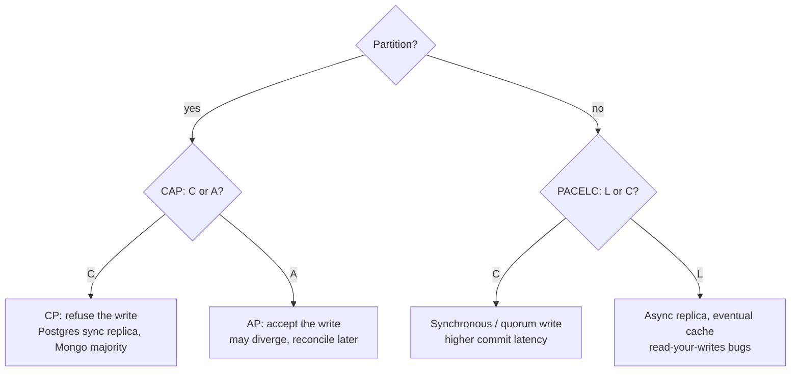

# 07 — Databases & APIs (Part 3 of 5): MongoDB, Redis, Choosing a Database & ORMs

> **Parts:** [Part 1 — Overview, Topic Map, SQL, Indexes, EXPLAIN, N+1 & Normalization](./07-databases-and-apis-part1.md) · [Part 2 — Transactions, Isolation, MVCC, Locking & Running Postgres](./07-databases-and-apis-part2.md) · **Part 3 — MongoDB, Redis, Choosing a Database & ORMs** · [Part 4 — API Design: REST, HTTP, Pagination, Idempotency, GraphQL, tRPC, gRPC & Webhooks](./07-databases-and-apis-part4.md) · [Part 5 — Resources, Practice, Interview Questions & Revision](./07-databases-and-apis-part5.md)
>
> Applies to: **MongoDB 8.3.13** (`mongo:8`), **Redis 8.10.2**, **Prisma ORM 7.10** (Prisma 8 is a release candidate as of October 2026 — `prisma@latest` may install the RC; pin `prisma@7` and `@prisma/client@7` for production), **Drizzle 0.45.4**, **Kysely 0.29**, **Mongoose 9.11**, **mongodb** driver **7.7**, **ioredis 6**, **pg 8.23**, Node 24. Measurements below were taken against those versions in October 2026. Cache-aside, stampede protection and Redis Lua rate limits are in [06-nodejs Part 3](./06-nodejs-part3.md) — this file is the data model, the structures, and the persistence/eviction trade-offs.

## Table of Contents

- [3. Detailed Explanations (Part 3)](#3-detailed-explanations-part-3)
  - [3.15 MongoDB: Modeling, Indexes, Aggregation, Transactions](#315-mongodb-modeling-indexes-aggregation-transactions)
  - [3.16 Redis Data Structures, Persistence and Eviction](#316-redis-data-structures-persistence-and-eviction)
  - [3.17 SQL vs NoSQL, CAP and PACELC](#317-sql-vs-nosql-cap-and-pacelc)
  - [3.18 ORMs and Query Builders](#318-orms-and-query-builders)
- [How to run the code in this file](#how-to-run-the-code-in-this-file)
- [Next: Part 4](#next-part-4)

---

## 3. Detailed Explanations (Part 3)

### 3.15 MongoDB: Modeling, Indexes, Aggregation, Transactions

MongoDB stores **BSON documents** (binary JSON with extra types: `ObjectId`, `Date`, `Decimal128`, `BinData`). There are no joins in the relational sense; you either **embed** related data in the same document or **reference** it by `_id` and fetch it in a second query (or a `$lookup`). The 16 MiB document size limit is the hard constraint on embedding.

**The modeling question is "what's the access pattern?", not "what's the entity-relationship diagram?"**

| Pattern | Shape | When it wins | When it hurts |
|---------|-------|--------------|---------------|
| **Embed** | `{ _id, title, comments: [{ body, at }] }` | Data is always read together; child has no independent lifecycle; bounded growth | Comments grow without bound; you need to query/update a child on its own; documents approach 16 MiB |
| **Reference** | `posts` + `comments: { postId, body }` | Children queried independently; unbounded growth; many-to-many | Extra round trip (or `$lookup`); no foreign keys unless you add `$jsonSchema` + app checks |
| **Subset** | embed the *latest* 20 comments, store the rest in a collection | Hot path is one read; archive is unbounded | Two writes on every comment; the embedded slice can drift |

Verified on 1,000 posts × 20 comments, MongoDB 8.3:

| Collection | Docs | On-disk size | Avg doc |
|------------|------|--------------|---------|
| `posts` (parent only) | 1,000 | 86 KB | 88 B |
| `comments` (referenced) | 20,000 | 1,433 KB | 73 B |
| `posts_embedded` (comments inside) | 1,000 | 1,036 KB | 1,061 B |

Embedding was *smaller* here (no repeated `postId`). Fetching one post with its comments: **2.7 ms** embedded vs **19.9 ms** referenced (two round trips from Node on localhost). The referenced model still wins when a post can have tens of thousands of comments — a 16 MiB document is roughly 10–20k comment objects of this size, and then inserts fail.

```ts
// src/mongo/model.ts
import { MongoClient, type Collection } from 'mongodb';

export type Comment = { body: string; createdAt: Date };
export type PostEmbedded = { _id: number; title: string; comments: Comment[] };
export type PostRef = { _id: number; title: string };
export type CommentRef = { postId: number; body: string; createdAt: Date };

export async function collections(url: string) {
  const client = new MongoClient(url); // from the host against Docker: mongodb://127.0.0.1:27030/?directConnection=true
  await client.connect();
  const db = client.db('shop');
  return {
    client,
    posts: db.collection<PostRef>('posts'),
    comments: db.collection<CommentRef>('comments'),
    embedded: db.collection<PostEmbedded>('posts_embedded'),
  };
}

export async function fetchEmbedded(col: Collection<PostEmbedded>, id: number) {
  return col.findOne({ _id: id }); // one round trip, comments included
}

export async function fetchReferenced(
  posts: Collection<PostRef>,
  comments: Collection<CommentRef>,
  id: number,
) {
  const post = await posts.findOne({ _id: id });
  if (!post) return null;
  const kids = await comments.find({ postId: id }).toArray(); // second round trip
  return { ...post, comments: kids };
}
```

> 💡 Interview Tip: When they say "model a blog in Mongo", don't jump to embedding comments. Ask: "How many comments per post, p99? Do we paginate comments? Do we show a comment on the author's profile?" Bounded one-to-few (an address on a user) → embed. Unbounded one-to-many (comments, events) → reference. The 16 MiB limit is the backstop, not the design goal.

**Indexes and the ESR rule.** MongoDB's default index is a B-tree, same column-order rule as Postgres ([Part 1 §3.3](./07-databases-and-apis-part1.md#33-indexes-b-tree-internals-and-design-rules)): **Equality, then Sort, then Range**. For `find({ status: 'featured' }).sort({ createdAt: -1 }).limit(20)` the index you want is `{ status: 1, createdAt: -1 }`.

Verified on 50,000 documents, 1% `featured`:

| Index hinted | Docs examined | Keys examined | Time |
|--------------|---------------|---------------|------|
| `{ status: 1, createdAt: -1 }` (ESR) | **20** | 20 | 2 ms |
| `{ createdAt: -1 }` (sort only) | **1,901** | 1,901 | 9 ms |
| Planner's choice (no hint) | 20 | 20 | <1 ms (picked the ESR index) |

The wrong index walks newest-first and *filters* on `status` until it has 20 hits — about 100× too many documents at 1% selectivity. `explain('executionStats')` is the Mongo equivalent of `EXPLAIN ANALYZE`. Also know: a collection scan is `COLLSCAN`; an index scan is `IXSCAN`; `totalDocsExamined >> nReturned` means the index isn't covering the filter.

Compound indexes in Mongo still obey the prefix rule: `{ a: 1, b: 1, c: 1 }` serves `{ a }`, `{ a, b }`, `{ a, b, c }`, not `{ b }` or `{ c }` alone. Equality on a prefix plus a sort on the next field can be a non-blocking (index-provided) sort; a sort that skips a prefix is an in-memory `SORT`.

**Aggregation pipeline.** Documents flow through stages. Order matters: **`$match` and `$sort` first** so they can use indexes; `$project`/`$group`/`$lookup` later. Verified pipeline:

```ts
// src/mongo/agg.ts
const topAuthors = await posts
  .aggregate([
    { $match: { status: 'published' } },                          // uses { status: 1, createdAt: -1 } if present
    { $group: { _id: '$authorId', n: { $sum: 1 }, latest: { $max: '$createdAt' } } },
    { $sort: { n: -1 } },
    { $limit: 5 },
  ])
  .toArray();

const withComments = await posts
  .aggregate([
    { $match: { _id: 1 } },
    { $lookup: { from: 'comments', localField: '_id', foreignField: 'postId', as: 'comments' } },
    { $project: { title: 1, n: { $size: '$comments' } } },
  ])
  .toArray();
// [ { _id: 1, title: 'Post 1', n: 20 } ]
```

`$lookup` is a left join. It's the right tool for occasional fetches, not for replacing a referenced hot path — you still pay a nested query per doc unless the pipeline can use an index on `foreignField`. Other stages interviewers name: `$unwind` (explode an array), `$facet` (several pipelines in one), `$unionWith`, `$merge` (write to a collection). MongoDB 8.0 added `$rankFusion`; 8.3 added `$scoreFusion` (search ranking) — know they exist, don't pretend you've tuned them.

**Schema validation.** Mongo is not schemaless in production. `$jsonSchema` on the collection rejected `priceCents: 0` with code **121** (`DocumentValidationFailure`) when the schema required `minimum: 1`:

```js
db.createCollection('products', {
  validator: {
    $jsonSchema: {
      bsonType: 'object',
      required: ['sku', 'priceCents'],
      properties: {
        sku: { bsonType: 'string', minLength: 1, maxLength: 40 },
        priceCents: { bsonType: 'int', minimum: 1 },
      },
    },
  },
});
```

Keep invariants that matter in the validator; keep the rest in the application (Mongoose/Zod). Validation is not a substitute for transactions.

**Transactions.** Multi-document ACID transactions require a **replica set** (or sharded cluster). A default `docker run mongo` is standalone — `startSession().startTransaction()` fails. A one-node replica set (`--replSet rs0` + `rs.initiate()`) is enough for local tests.

Verified on `rs0`: a transfer that inserted two accounts and moved 40 from `a` to `b` committed as `{ a: 60, b: 40 }`. A second transaction that updated `a` and then threw **aborted**, and the balances were unchanged. You cannot `drop` (or several other commands) inside a transaction.

```js
const session = db.getMongo().startSession();
session.startTransaction();
const coll = session.getDatabase('shop').getCollection('tx_accounts');
coll.updateOne({ _id: 'a' }, { $inc: { bal: -40 } });
coll.updateOne({ _id: 'b' }, { $inc: { bal: 40 } });
session.commitTransaction();
session.endSession();
```

They're slower and hold WiredTiger snapshot resources — don't wrap every write. Prefer **single-document atomicity** (`updateOne` with `$inc`, `$push`, `$set` on one doc is already atomic) and embed when the invariant fits in one document.

> ⚠️ Pitfall: From the host, a replica set that advertised `localhost:27017` *inside* Docker was unreachable as a replica set on the published port (`ReplicaSetNoPrimary`, 30 s timeout). Non-transactional access works with `directConnection=true`. For transactions from the host, the replica-set member host must be an address the client can resolve (for example `host.docker.internal:<published-port>` in `rs.initiate`).

**Mongoose 9** sits on the driver: schemas, validation, middleware, populate (which is `$lookup` or a second query). It does **not** give you joins-as-in-SQL or multi-document transactions for free — you still open a session. Use it for document apps where the schema is the product; skip it when you want aggregation-heavy pipelines and would be fighting the ORM.

### 3.16 Redis Data Structures, Persistence and Eviction

Redis is an in-memory data structure server. The interview is "which type, and what happens on reboot / when RAM is full?" Cache-aside, locking and rate-limit Lua are in [06 Part 3](./06-nodejs-part3.md#318-caching-with-redis) — don't rebuild them here.

Verified on Redis **8.10.2** with ioredis 6 (`redis://127.0.0.1:6390`):

| Type | Commands (measured) | Use |
|------|---------------------|-----|
| **STRING** | `SET sess:1 json EX 60` → `TTL` 60 | Blobs, cache entries, counters (`INCR`), distributed locks (`SET NX PX`) |
| **HASH** | `HSET user:7 name Ada plan pro logins 3` then `HINCRBY logins 1` → `{ logins: '4', ... }` | Object fields you update independently (session, feature flags). `HGETALL` is O(N) in fields |
| **LIST** | `LPUSH recent e1 e2 e3` then `LTRIM 0 99` → `[e3, e2, e1]` | Recent-N, queues. `LPUSH` of several args pushes left-to-right, so the *last* arg is at index 0 |
| **SET** | `SINTER online mods` → `[u2]` | Unique membership, tags, online users. `SISMEMBER` O(1) |
| **SORTED SET** | `ZADD lb 100 ada 250 linus 180 grace 250 ken` | Leaderboards, scheduled jobs, sliding-window rate limits. Members unique; score is a float. Ties: `linus` then `ken` at 250 in `ZREVRANGE` |
| **STREAM** | `XADD orders * user 7 sku book` → `1791979065024-0`; `XREADGROUP` delivered both entries to `emailers/w1` | Append-only log with consumer groups, pending entries, replay. At-least-once: you `XACK` |
| **JSON** | `JSON.SET doc:1 $ '{"a":1,"b":{"c":2}}'` then `JSON.GET … $.b.c` → `[2]` | Nested documents without flattening into hashes. Path queries return a JSON *array* |

```ts
// src/redis/structures.ts
import { Redis } from 'ioredis';

export async function demo(url: string): Promise<void> {
  const r = new Redis(url);
  await r.set('sess:1', JSON.stringify({ userId: 7 }), 'EX', 60);

  await r.hset('user:7', { name: 'Ada', plan: 'pro', logins: '3' });
  await r.hincrby('user:7', 'logins', 1);

  await r.zadd('lb', 100, 'ada', 250, 'linus', 180, 'grace', 250, 'ken');
  const top3 = await r.zrevrange('lb', 0, 2, 'WITHSCORES');
  // ['linus','250','ken','250','grace','180']  — equal scores: reverse lexicographic member order

  const id = await r.xadd('orders', '*', 'user', '7', 'sku', 'book');
  await r.xgroup('CREATE', 'orders', 'emailers', '0', 'MKSTREAM');
  await r.xreadgroup('GROUP', 'emailers', 'w1', 'COUNT', 10, 'STREAMS', 'orders', '>');
  // … process, then XACK, or the entry stays in the PEL (pending entries list)

  await r.call('JSON.SET', 'doc:1', '$', JSON.stringify({ a: 1, b: { c: 2 } }));
  await r.quit();
  void id;
  void top3;
}
```

**Streams vs lists vs pub/sub.** A list `BRPOP` is a queue: each item is consumed once, no replay. Pub/sub is fire-and-forget (if nobody is subscribed, the message is gone) — that's how [06](./06-nodejs-part3.md) fans out WebSocket events. A stream is a **log**: many consumer groups, replay from an ID, pending-entry recovery after a crash. Use streams for "this must be processed at least once"; lists for cheap disposable work; pub/sub for live fan-out.

**Persistence** (this process: `aof_enabled:0`, `save 3600 1 300 100 60 10000`):

| Mode | What it writes | Durability | Cost |
|------|----------------|------------|------|
| **RDB** (default snapshots) | Fork, dump the dataset | Lose everything since the last snapshot that met a `save` threshold (here: 1 change in 3600 s, or 100 in 300 s, or 10,000 in 60 s) | Cheap most of the time; `BGSAVE` copy-on-write can double RSS during the fork |
| **AOF** (`appendonly yes`) | Every write to a log, rewritten in the background | `appendfsync everysec` (default) can lose ~1 s; `always` is durable and slow | AOF rewrite is another fork |
| **both** | Redis 7+ `appendyes` + RDB; Redis 8 keeps the same idea | Restore prefers AOF if present | What you want for a session store or a job log you can't rebuild |

A cache can run with **no persistence** (`save ""`, `appendonly no`) and treat a restart as a cold cache. A session store or a stream of payments cannot.

**Eviction.** Default on this server: `maxmemory 0` (unlimited) and `maxmemory-policy noeviction`. Writes fail with `OOM` once the OS is unhappy — not when Redis hits a budget. For a cache, set `maxmemory` and a policy:

| Policy | Evicts | Typical use |
|--------|--------|-------------|
| `noeviction` | Nothing; writes error | Redis as a *database* (streams, sessions you must keep) |
| `allkeys-lru` / `allkeys-lfu` | Any key | Generic cache |
| `volatile-lru` / `volatile-lfu` / `volatile-ttl` | Only keys with a TTL | Mixed: cache keys expire, durable keys don't |

LFU needs a few minutes of traffic before the counters mean anything. **TTL is not eviction**: a key with `EX 60` dies at 60 s even under `noeviction`.

> ⚠️ Pitfall: Using Redis as "the database" for anything you can't rebuild, with default RDB snapshots and `noeviction`, looks fine in staging (small data, no restart) and loses a minute of writes in production — or OOMs the box. Say out loud whether this Redis is a cache, a lock/rate-limit store, or a source of truth, and configure persistence and `maxmemory` for that job.

**Key design.** `user:7:sess` is a key, not a directory: `KEYS user:*` is O(N) and blocks the single thread. Use `SCAN`. Hash tags `{user:7}:sess` and `{user:7}:cart` land on the same cluster slot. ioredis 6 speaks RESP3 by default; reply shapes for some commands differ from v4 — pin and test.

Redis 8 ships JSON/search/time-series in the core distribution (the `JSON.SET` above worked on `redis:8-alpine`). **Valkey** is the BSD-licensed Linux Foundation fork; commands overlap, modules and operator tooling don't always. Name which one you run.

### 3.17 SQL vs NoSQL, CAP and PACELC

**Pick the data model for the access pattern and the invariants, then pick the product.**

| If you need… | Reach for | Why |
|--------------|-----------|-----|
| Multi-row invariants, ad-hoc query, reporting, joins | PostgreSQL | Constraints, MVCC, a planner, 30 years of tooling ([Parts 1–2](./07-databases-and-apis-part1.md)) |
| Document-shaped aggregates, flexible fields, huge write streams with a known query set | MongoDB | Embed the aggregate; aggregation pipeline; horizontal scale is operationally older than Citus |
| Sub-millisecond lookups, counters, leaderboards, ephemeral coordination | Redis | In-memory structures; not your system of record unless you design for it |
| Append-only facts, replay, many independent consumers | Kafka / Redis Streams | Log, not a table |
| Graph traversals ("friends of friends") | A graph DB, or Postgres with recursive CTEs until it hurts | Recursive CTEs got us far in Part 1; dedicated graph stores win at deep, fan-out traversals |
| Vectors next to the source row | `pgvector` in Postgres you already run | [Part 2 §3.11](./07-databases-and-apis-part2.md#311-jsonb-full-text-search-and-pgvector) |

Hybrids are normal: Postgres as source of truth, Redis as cache/lock/stream, object storage for blobs ([11](./11-deployment-aws-s3.md)). The failure mode is two sources of truth with no owner.

**CAP** (Brewer / Gilbert–Lynch): in a **network partition**, a distributed system can keep **C**onsistency (linearizability) or **A**vailability, not both. **P**artition tolerance isn't optional on a real network — so the live choice is CP vs AP.

That's a statement about *partitions*, not about Tuesday afternoon. **PACELC** (Abadi) adds the other half: **else**, when the network is fine, you still choose **L**atency vs **C**onsistency (synchronous replication vs stale reads).



Concrete mappings (approximate — products have knobs):

- Postgres primary + async replica: **CA inside one primary**, **ELC = L** for replica reads (replication lag, [Part 2 §3.14](./07-databases-and-apis-part2.md#314-replication-partitioning-and-sharding)). A partition that isolates the primary from the app makes you unavailable, not inconsistent.
- MongoDB `w: majority` + `readConcern: majority`: **CP** for those operations; default `w: 1` on a primary is faster and can lose the last write in a failover.
- Redis Cluster: **AP-ish** for a partition that splits slots (clients hash to a slot; a minority of slots can be down). Redis as a single instance is not a distributed-consensus system.

> 💡 Interview Tip: Don't say "Mongo is AP, Postgres is CA". Say what the *write concern / replica sync / cache TTL* is. Interviewers who know PACELC are checking that you don't treat CAP as a product label.

### 3.18 ORMs and Query Builders

An ORM is a trade: faster CRUD and migrations against a *cost you must measure* — hidden queries, leaky abstractions around SQL you still need to read.

Verified on Prisma **7.10**, Drizzle **0.45.4**, Kysely **0.29.6**, same two users / three posts:

**Prisma `findMany({ include: { posts: true } })` is not a SQL join.** It ran:

```sql
SELECT "public"."User"."id", "public"."User"."email" FROM "public"."User" WHERE 1=1 OFFSET $1
SELECT "public"."Post"."id", "public"."Post"."title", "public"."Post"."authorId"
  FROM "public"."Post" WHERE "public"."Post"."authorId" IN ($1,$2) OFFSET $3
```

Two round trips, batched with `IN` — DataLoader-shaped, not `JOIN`. A naïve loop (`findMany` users, then `findMany` posts per user) was **three** queries (`=` each time). That's the N+1 Prisma *does* save you from, and the join it *doesn't* write unless you use `$queryRaw` or features you must opt into. Always log queries in development (`log: ['query']`).

**Drizzle** emitted SQL you could have written:

```sql
select "id", "email" from "User"
select "id", "title", "authorId" from "Post" where "Post"."authorId" in ($1, $2)
```

**Kysely** compiled an explicit join (one round trip, denormalized rows — Ada appeared twice):

```sql
select "User"."email", "Post"."title"
from "User"
left join "Post" on "Post"."authorId" = "User"."id"
```

```ts
// src/orm/clients.ts — Prisma 7 requires a driver adapter; pin prisma@7 (8 is RC)
import { PrismaPg } from '@prisma/adapter-pg';
import { PrismaClient } from '../generated/prisma/client.ts';
import { drizzle } from 'drizzle-orm/node-postgres';
import { pgTable, serial, text, integer } from 'drizzle-orm/pg-core';
import { Kysely, PostgresDialect } from 'kysely';
import pg from 'pg';

const url = process.env.DATABASE_URL!;
const pool = new pg.Pool({ connectionString: url });

export const prisma = new PrismaClient({ adapter: new PrismaPg({ connectionString: url }) });

export const users = pgTable('User', {
  id: serial('id').primaryKey(),
  email: text('email').notNull(),
});
export const db = drizzle(pool);

type DB = {
  User: { id: number; email: string };
  Post: { id: number; title: string; authorId: number };
};
export const kysely = new Kysely<DB>({ dialect: new PostgresDialect({ pool }) });
```

| Tool | You write | SQL you get | Migrations | Fits |
|------|-----------|-------------|------------|------|
| **Prisma 7** | Models in `schema.prisma`; `prisma.config.ts` holds the URL | Client generates (often 1+`IN`, not joins); Rust engine is gone — **driver adapter required** (`@prisma/adapter-pg`) | `prisma migrate`; `migrate dev` no longer auto-seeds or auto-generates the client | Product CRUD, teams that want a schema file as the contract. Mongo is **not** in Prisma 7 — stay on 6 or wait for 8 |
| **Drizzle** | TS schema is the source of truth | What you wrote; relational API is optional | `drizzle-kit` generate/push | Teams that want SQL visibility without string SQL |
| **Kysely** | Typed query builder, no models | Exactly the query | Bring your own (or `kysely-ctl`) | Complex SQL, reporting, when you've outgrown the ORM |
| **`pg` + SQL** | SQL | SQL | Bring your own | Hot paths, `FOR UPDATE SKIP LOCKED`, recursive CTEs, anything the ORM mangles |
| **Mongoose 9** | Schemas over BSON | Mongo queries / aggregation | None (or `migrate-mongo`) | Document apps on Mongo; not a SQL ORM |

Prisma 7 specifics that catch upgrades: ESM (`"type": "module"`), `generator` `provider = "prisma-client"` with a **required `output`** path (no more generating into `node_modules` by default), `new PrismaClient({ adapter })` is mandatory, `$use` middleware is gone (`$extends` instead), env vars are **not** loaded unless you `import 'dotenv/config'` (or `node --env-file`). Prisma 8 (`prisma@latest` on 2026-10-12 was `8.0.0-rc.22`) redesigns the client again and is still an RC — don't learn RC APIs for an interview; say "we're on 7, 8 is RC".

**N+1 is the default failure mode of every ORM.** Detect it with query logs, `pg_stat_statements`, or an allow-list of queries in tests. Fix with: `include` / `select` (Prisma — still 2 queries), `inArray` (Drizzle), a join (Kysely/`pg`), `SELECT … WHERE id = ANY($1)` from a DataLoader ([Part 4](./07-databases-and-apis-part4.md)). The Postgres side of N+1 is [Part 1 §3.5](./07-databases-and-apis-part1.md#35-querying-from-node-n1-deep-pagination-types--injection).

**Migrations belong in CI, not in app startup** ([Part 2 §3.13](./07-databases-and-apis-part2.md#313-zero-downtime-migrations)). ORMs that wrap every migration in a transaction cannot run `CREATE INDEX CONCURRENTLY` without an opt-out.

> 💡 Interview Tip: "Would you use an ORM?" — "Yes for 80% of CRUD, with query logging on, and raw SQL for anything with a plan I care about. I can show you the SQL Prisma generated for `include` — it's two queries, not a join."

---

## How to run the code in this file

```powershell
# Postgres (ORM demo) — do not use the user's :5432 instance
docker run -d --name doc-pg -p 5440:5432 -e POSTGRES_PASSWORD=pg postgres:18-alpine

# Redis 8
docker run -d --name doc-redis -p 6390:6379 redis:8-alpine

# Mongo 8 as a one-node replica set (needed for transactions)
docker run -d --name doc-mongo -p 27030:27017 mongo:8 --replSet rs0 --bind_ip_all
docker exec doc-mongo mongosh --eval "rs.initiate({_id:'rs0', members:[{_id:0, host:'localhost:27017'}]})"

$env:DATABASE_URL = 'postgres://postgres:pg@127.0.0.1:5440/postgres'
npm i mongodb mongoose ioredis pg prisma@7 @prisma/client@7 @prisma/adapter-pg drizzle-orm kysely
node src/mongo/model.ts
node src/redis/structures.ts
```

From the host, add `?directConnection=true` unless the replica-set member host is reachable.

---

## Next: Part 4

➡️ [Part 4 — API Design](./07-databases-and-apis-part4.md): REST resources and HTTP semantics, caching and CORS, cursor pagination as a contract, idempotency keys, versioning, OpenAPI, GraphQL + DataLoader, tRPC, gRPC, webhooks, and when to use which.
