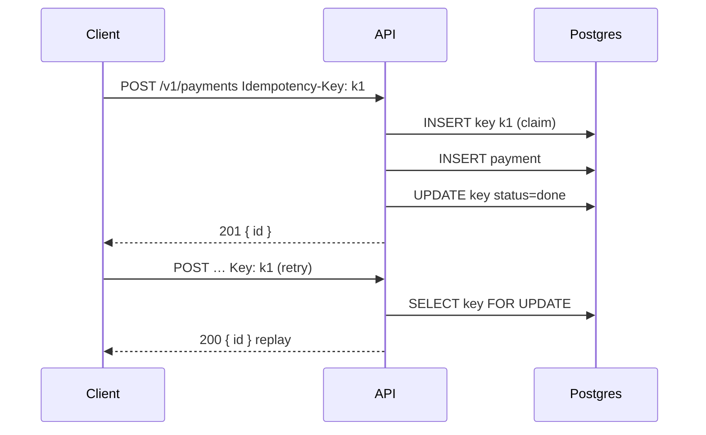

# 07 — Databases & APIs (Part 4 of 5): REST, HTTP, Pagination, Idempotency, GraphQL, tRPC, gRPC & Webhooks

> **Parts:** [Part 1 — Overview, Topic Map, SQL, Indexes, EXPLAIN, N+1 & Normalization](./07-databases-and-apis-part1.md) · [Part 2 — Transactions, Isolation, MVCC, Locking & Running Postgres](./07-databases-and-apis-part2.md) · [Part 3 — MongoDB, Redis, Choosing a Database & ORMs](./07-databases-and-apis-part3.md) · **Part 4 — API Design** · [Part 5 — Resources, Practice, Interview Questions & Revision](./07-databases-and-apis-part5.md)
>
> Applies to: HTTP semantics as of 2026, **GraphQL Yoga 5.24** + **graphql 17** + **DataLoader 2.2**, **tRPC 11.19**, **Zod 4**. Status codes and Express routing are in [06-nodejs Part 2 §3.10](./06-nodejs-part2.md#310-validation-config--rest-conventions); this file is the API *contract*: resources, caching, pagination, retries, versioning and the choice of style. DataLoader and idempotency numbers were measured on Node 24 against Postgres 18 in October 2026.

## Table of Contents

- [3. Detailed Explanations (Part 4)](#3-detailed-explanations-part-4)
  - [3.19 REST: Resources, Safe vs Idempotent, Errors](#319-rest-resources-safe-vs-idempotent-errors)
  - [3.20 HTTP Caching, CORS, HTTP/1.1 vs 2 vs 3](#320-http-caching-cors-http11-vs-2-vs-3)
  - [3.21 Pagination as an API Contract](#321-pagination-as-an-api-contract)
  - [3.22 Idempotency Keys](#322-idempotency-keys)
  - [3.23 Versioning and OpenAPI](#323-versioning-and-openapi)
  - [3.24 GraphQL, N+1 and DataLoader](#324-graphql-n1-and-dataloader)
  - [3.25 tRPC](#325-trpc)
  - [3.26 gRPC and Protocol Buffers](#326-grpc-and-protocol-buffers)
  - [3.27 Webhooks](#327-webhooks)
  - [3.28 Choosing an API Style](#328-choosing-an-api-style)
- [4. Full Example: Payments API Sketch](#4-full-example-payments-api-sketch)
- [5. Diagrams Index](#5-diagrams-index)
- [Next: Part 5](#next-part-5)

---

## 3. Detailed Explanations (Part 4)

### 3.19 REST: Resources, Safe vs Idempotent, Errors

REST is resources with nouns as URLs and HTTP methods as verbs. Interviewers care about **what retries do**, not whether you put `/api` in the path.

```
GET    /v1/orders           list (safe, idempotent)
POST   /v1/orders           create (neither safe nor idempotent — unless you add an Idempotency-Key)
GET    /v1/orders/{id}      read (safe, idempotent)
PUT    /v1/orders/{id}      replace (idempotent: repeating it leaves the same state)
PATCH  /v1/orders/{id}      partial update (not inherently idempotent — `{"add":1}` twice doubles)
DELETE /v1/orders/{id}      remove (idempotent: second call is 404 or 204, resource still gone)
POST   /v1/orders/{id}/cancel   controller action when it isn't a field patch
```

**Safe** = no server-side state change (GET, HEAD, OPTIONS). **Idempotent** = N copies of the request leave the same state as 1 copy (safe methods + PUT + DELETE). POST is the one clients must not retry blindly.

| Don't | Do |
|-------|----|
| `GET /createOrder?user=1` | `POST /v1/orders` — GET is cached, prefetched, logged in Referer |
| `POST /v1/orders/123/update` | `PATCH /v1/orders/123` |
| `GET /v1/orders/latest` as the only way to fetch | Give a stable `id`; "latest" is a filter (`?sort=-createdAt&limit=1`) |
| Returning 200 for a create | **201** + `Location: /v1/orders/{id}` |
| 403 when the id is another tenant's | **404** — existence is data ([06](./06-nodejs-part2.md#310-validation-config--rest-conventions)) |

Collection names are plural; IDs are opaque (`uuidv7`, not `?id=1` guessable sequences for anything authorization-sensitive). Query strings filter, sort and paginate the collection; they don't mutate.

Error bodies: pick **RFC 9457 Problem Details** (`Content-Type: application/problem+json`) and stick to it. The 06 notes already map status codes — reuse that table, don't invent a second one.

> 💡 Interview Tip: "Is PATCH idempotent?" — "Not by definition. Incrementing a field isn't; setting a field to a client-supplied value is. If retries matter, use PUT or an idempotency key."

### 3.20 HTTP Caching, CORS, HTTP/1.1 vs 2 vs 3

**Caching is a correctness feature.** A `GET` that isn't cacheable still needs a policy so shared caches don't guess.

```
Cache-Control: private, no-store          # personalized / sensitive — browsers and CDNs must not store
Cache-Control: no-cache                   # store, but revalidate before using (does NOT mean "don't cache")
Cache-Control: public, max-age=60, stale-while-revalidate=30
ETag: "v3-a1b2"                           # strong validator
Last-Modified: Wed, 14 Oct 2026 12:00:00 GMT
```

Revalidation:

1. Server sends `ETag` (hash of representation, **not** of the whole row if the projection is smaller).
2. Client repeats with `If-None-Match: "v3-a1b2"`.
3. Same → **304** empty body. Different → 200 + new body + new ETag.
4. `If-Match` on PATCH/PUT implements **optimistic concurrency**: mismatch → **412**. That's the HTTP form of `UPDATE … WHERE version = $n` from [Part 2](./07-databases-and-apis-part2.md#39-locking-lost-updates-queues-deadlocks-upserts).

`private` vs `public`: Authorization-bearing responses must be `private` (or `no-store`). A CDN caching `GET /v1/me` with `public` is an incident.

**CORS is a browser rule, not a server security boundary.** A non-browser client ignores it. `Access-Control-Allow-Origin: *` cannot be combined with `Access-Control-Allow-Credentials: true`. A preflight (`OPTIONS`, `Access-Control-Request-Method`) happens when the request is "non-simple" (custom headers, `Content-Type: application/json`, methods other than GET/POST/HEAD). Failures look like a network error in `fetch` — the status code of the preflight is in the Network panel, not in your `catch`.

**HTTP versions:**

| | HTTP/1.1 | HTTP/2 | HTTP/3 |
|--|----------|--------|--------|
| Transport | TCP, text headers | TCP, binary frames | **QUIC** (UDP) |
| Parallelism | 6-ish connections per origin; head-of-line blocking on each | Multiplexed streams on one connection; TCP HOL still exists | Stream-level loss recovery — a lost packet doesn't stall other streams |
| Extra | Chunked encoding, keep-alive | HPACK header compression, server push (mostly unused) | 0-RTT (replay risk — don't 0-RTT a POST) |

For APIs, HTTP/2 is the default behind Nginx/ALB/Cloudflare. You almost never speak h2 from Node to Postgres; this is the *public* hop. SSE over HTTP/1.1 is capped by that 6-connection limit; over h2 it isn't ([06](./06-nodejs-part2.md#317-real-time-sse--websockets-at-scale)).

### 3.21 Pagination as an API Contract

The SQL (keyset vs `OFFSET`) is [Part 1 §3.5](./07-databases-and-apis-part1.md#35-querying-from-node-n1-deep-pagination-types--injection) and the notes repo in [06](./06-nodejs-part3.md). The API contract:

```json
GET /v1/orders?limit=20&cursor=eyJjIjoiMjAyNi0xMC0xNCIsImkiOiIwMTljLi4ifQ
{ "items": [ …20 ], "nextCursor": "eyJ…" | null }
```

Rules that keep it honest:

- The cursor is **opaque**. Don't document it as a raw id; you'll want to add a timestamp later without breaking clients. Sign or at least base64url-encode `{ createdAt, id }`.
- **Keyset** (`WHERE (created_at, id) < ($c, $i) ORDER BY created_at DESC, id DESC LIMIT n`) is stable under inserts. `OFFSET` skips/duplicates when the list moves and gets slower at depth (Part 1 measured 65 ms vs 0.1 ms at offset 500k).
- `limit` is capped server-side (100). Fetch `limit+1` rows to decide `nextCursor`.
- Don't offer `page=847` on a live feed. Offset is acceptable for admin UIs over a stable sort of a small table.
- Total counts (`X-Total-Count`) are another query (`COUNT(*)` can be expensive — estimate with `reltuples` if "about 1.2M" is enough).

> ⚠️ Pitfall: Encoding `createdAt` as a JS `Date` (milliseconds) while Postgres stores microseconds **skips or repeats** rows. Cursor on `uuidv7` (Postgres 18) or `(timestamptz text, id)`.

### 3.22 Idempotency Keys

Clients retry. Networks duplicate. `POST /v1/payments` without an idempotency key double-charges.

Stripe's contract, which you should copy: the client sends `Idempotency-Key: <uuid>`. The server stores the key, the **hash of the request body**, the status, and the response. A retry with the same key and body returns the stored response. A retry with the same key and a **different** body is **409**.

Verified against Postgres 18 (one payments row after first + retry + conflicting body):

| Call | Result |
|------|--------|
| First `POST` with key `k-1`, 500 cents | **201**, `paymentId=43953693-…` |
| Retry, same key and body | **200**, `replay: true`, same `paymentId` |
| Same key, 999 cents | **409** `Idempotency-Key reused with a different body` |
| `SELECT count(*) FROM payments` | **1** |

```ts
// src/http/idempotency.ts
import type { Pool } from 'pg';
import { createHash, randomUUID } from 'node:crypto';

export async function charge(
  pool: Pool,
  input: { key: string; userId: number; amountCents: number },
): Promise<{ status: number; replay?: boolean; paymentId?: string; error?: string }> {
  const hash = createHash('sha256').update(JSON.stringify({ userId: input.userId, amountCents: input.amountCents })).digest('hex');
  const client = await pool.connect();
  try {
    await client.query('BEGIN');
    const claimed = await client.query(
      `INSERT INTO idempotency_keys (key, request_hash, status) VALUES ($1, $2, 'started')
       ON CONFLICT (key) DO NOTHING RETURNING key`,
      [input.key, hash],
    );
    if (claimed.rowCount === 0) {
      const { rows: [row] } = await client.query('SELECT * FROM idempotency_keys WHERE key = $1 FOR UPDATE', [input.key]);
      if (row.request_hash !== hash) {
        await client.query('ROLLBACK');
        return { status: 409, error: 'Idempotency-Key reused with a different body' };
      }
      if (row.status !== 'done') {
        await client.query('ROLLBACK');
        return { status: 409, error: 'in flight' }; // or 425 / wait-and-retry
      }
      await client.query('COMMIT');
      return { status: 200, replay: true, ...row.response };
    }
    const paymentId = randomUUID();
    await client.query('INSERT INTO payments (id, user_id, amount_cents) VALUES ($1, $2, $3)', [
      paymentId, input.userId, input.amountCents,
    ]);
    const response = { paymentId, amountCents: input.amountCents };
    await client.query(`UPDATE idempotency_keys SET status = 'done', response = $2 WHERE key = $1`, [input.key, response]);
    await client.query('COMMIT');
    return { status: 201, replay: false, ...response };
  } catch (err) {
    await client.query('ROLLBACK');
    throw err;
  } finally {
    client.release();
  }
}
```

The `INSERT … ON CONFLICT DO NOTHING` **claims** the key in the same transaction as the side effect. Two concurrent first requests: one inserts the payment, the other waits on `FOR UPDATE` and then replays. TTL the keys table (Stripe keeps keys ~24 h). Hash the body so a retried *different* cart doesn't silently charge the first amount.

Apply keys to any POST with side effects: payments, sends, "create if missing". GET/PUT/DELETE shouldn't need them.

### 3.23 Versioning and OpenAPI

Breaking changes happen. Strategies:

| Approach | Example | Trade-off |
|----------|---------|-----------|
| **URL prefix** | `/v1/orders`, `/v2/orders` | Obvious, cacheable, easy to route. URL clutter; people copy v1 forever |
| **Header** | `Accept: application/vnd.myapp.v2+json` | Clean URLs; harder to try in a browser |
| **Date / Stripe-style** | `Stripe-Version: 2026-08-27` | One URL, per-account pin, additive changes. You keep old code paths for years |

Prefer **additive evolution inside v1** (new optional fields, new endpoints) and a new major only for removals or meaning changes. Deprecate with `Sunset` / `Deprecation` headers and a changelog. Don't version because a field was renamed in the database — that's an expand/contract deploy ([Part 2 §3.13](./07-databases-and-apis-part2.md#313-zero-downtime-migrations)).

**OpenAPI 3.1** is the contract: paths, schemas, status codes, security. Generate the TypeScript client from it (`openapi-typescript`, Orval) rather than hand-writing fetch wrappers. Contract-first (write YAML, generate both) vs code-first (Fastify/Nest emit the spec) — pick one; the value is CI failing when the spec and the handlers diverge. HATEOAS / JSON:API / OData exist; you will almost never be asked to implement them. Know that JSON:API is a spec for `data`/`included`/`links` if a job description mentions it.

### 3.24 GraphQL, N+1 and DataLoader

GraphQL lets the client name the fields. The server is a tree of **resolvers**. The classic bug is N+1: `users { posts { title } }` calls `User.posts` once per user.

Verified with GraphQL Yoga 5 + graphql 17, two users / three posts:

| Strategy | SQL statements |
|----------|----------------|
| Naive resolvers (`SELECT * FROM "Post" WHERE "authorId" = $1` per user) | **3** (1 users + 2 posts) |
| DataLoader batching `WHERE "authorId" = ANY($1)` | **2** (1 users + 1 posts) |

```ts
// src/graphql/schema.ts
import DataLoader from 'dataloader';
import { createSchema, createYoga } from 'graphql-yoga';
import type { Pool } from 'pg';

export function createGql(pool: Pool) {
  const typeDefs = /* GraphQL */ `
    type User { id: Int! email: String! posts: [Post!]! }
    type Post { id: Int! title: String! }
    type Query { users: [User!]! }
  `;
  return createYoga({
    schema: createSchema({
      typeDefs,
      resolvers: {
        Query: { users: async () => (await pool.query('SELECT * FROM "User"')).rows },
        User: { posts: (u: { id: number }, _a: unknown, ctx: { loaders: ReturnType<typeof makeLoaders> }) => ctx.loaders.postsByAuthor.load(u.id) },
      },
    }),
    context: () => ({ loaders: makeLoaders(pool) }), // NEW loaders per request — never global
  });
}

function makeLoaders(pool: Pool) {
  return {
    postsByAuthor: new DataLoader(async (ids: readonly number[]) => {
      const { rows } = await pool.query('SELECT * FROM "Post" WHERE "authorId" = ANY($1)', [ids]);
      return ids.map((id) => rows.filter((r) => r.authorId === id));
    }),
  };
}
```

DataLoader **batches** loads in the same tick and **caches** per request. A global loader caches across users → leaked data. Prisma's `include` is the same idea ([Part 3](./07-databases-and-apis-part3.md#318-orms-and-query-builders)).

Other GraphQL production concerns:

- **Auth in resolvers** (or a field directive), not only at the URL — clients pick fields on other users' objects.
- **Depth / complexity limits** and persisted queries, or a malicious `{ friends { friends { friends { … }}}}` eats the database.
- **Pagination** is cursor-based (`Connection` spec) for the same reasons as REST.
- Mutations are just functions; they still need idempotency keys for payments.
- Caching is harder than REST (each query is a unique POST). Persisted queries + CDN, or cache at the object-loader layer (GET is used by some GraphQL-over-HTTP clients for persisted queries).

> 💡 Interview Tip: GraphQL doesn't remove N+1 — it *moves* it into resolvers. Naming DataLoader and "per-request cache" is the senior answer.

### 3.25 tRPC

tRPC **11** exposes TypeScript procedures over HTTP. The client imports the **router type**, not a generated OpenAPI client. Input/output go through Zod (or another Standard Schema library).

```ts
// src/trpc/router.ts
import { initTRPC, TRPCError } from '@trpc/server';
import { z } from 'zod';

export type Ctx = { userId: string | null; repo: { list: (u: string, limit: number) => Promise<unknown> } };

const t = initTRPC.context<Ctx>().create();
const authed = t.middleware(({ ctx, next }) => {
  if (!ctx.userId) throw new TRPCError({ code: 'UNAUTHORIZED' });
  return next({ ctx: { ...ctx, userId: ctx.userId } });
});

export const appRouter = t.router({
  notes: {
    list: t.procedure.use(authed)
      .input(z.object({ limit: z.number().int().min(1).max(100).default(20), cursor: z.string().optional() }))
      .query(({ ctx, input }) => ctx.repo.list(ctx.userId, input.limit)),
  },
});
export type AppRouter = typeof appRouter;
```

The React client (`@trpc/tanstack-react-query` in v11) shares `AppRouter`. Refactor a procedure's output → the app doesn't compile. That's the pitch.

Limits: **TypeScript-only** on both sides (or you publish a wrapper). HTTP caching, CDNs, and non-TS consumers are worse than REST/OpenAPI. Batching multiple procedures in one HTTP call is convenient and wrecks cache granularity. Use tRPC inside a TS monorepo (Next.js app + Node API); use REST/OpenAPI when you have mobile clients, partners, or a public API.

### 3.26 gRPC and Protocol Buffers

gRPC is HTTP/2 (or HTTP/3 in some stacks) + **Protocol Buffers**: a `.proto` schema, generated stubs, binary messages.

```protobuf
syntax = "proto3";
package notes.v1;
service Notes {
  rpc GetNote (GetNoteRequest) returns (Note);
  rpc StreamNotes (StreamFilter) returns (stream Note); // server streaming
}
message GetNoteRequest { string id = 1; }
message Note { string id = 1; string title = 2; }
```

| vs REST/JSON | Why it matters |
|--------------|----------------|
| Binary, schema evolution via **field numbers** | Smaller payloads; adding a field is backward compatible if clients ignore unknowns |
| Deadlines, status codes (`NOT_FOUND`, `UNAVAILABLE`) | First-class timeouts — put them on every call |
| Streaming (unary, server, client, bidi) | Long-lived feeds without SSE/WebSocket framing |
| Codegen required | No `curl` without grpcurl; browsers need gRPC-Web or Connect |

Use it **between internal services** (low latency, typed, streaming). Don't put it on a public browser API unless you have a reason (Connect/gRPC-Web). JSON/REST remains the lingua franca for third parties.

### 3.27 Webhooks

You *call out*. The other system retries. Design for that.

1. **Sign** the body with HMAC-SHA256 over `timestamp.payload` (Stripe: `t=,v1=`). Verify with `crypto.timingSafeEqual`. Reject timestamps older than 5 minutes (replay).
2. **Idempotency:** store `event.id` with a unique constraint; a retry of the same event is 200 with no extra work.
3. **Respond fast:** 2xx after persisting the event; do the slow work in a queue ([06](./06-nodejs-part3.md#319-background-jobs-with-bullmq)). A 5xx makes Stripe retry; a 2xx that you then fail internally is *your* retry.
4. **Ordering is not guaranteed.** Two events for the same resource can arrive swapped. Make handlers fold-safe (`status = 'paid'` beats `status = 'created'` regardless of order) or use an event sequence number you already trust.
5. **Don't expose an unauthenticated URL that mutates.** The signature *is* the auth.

Outbound webhooks you send: at-least-once, exponential backoff, a delivery log, a way for the receiver to rotate secrets.

### 3.28 Choosing an API Style

| Situation | Default | Why |
|-----------|---------|-----|
| Public HTTP API, mixed clients, caching, webhooks | **REST + OpenAPI** | Universal, cacheable GETs, boring |
| One TS web app + one TS server in a monorepo | **tRPC** | End-to-end types, no spec drift |
| Mobile + web + partners, evolving product queries | **GraphQL** (with DataLoader, persisted queries, depth limits) | Clients fetch what they need; you pay N+1 and auth-on-every-field |
| Internal service mesh, streaming, tight latency | **gRPC** | Protobuf, deadlines, bidi |
| Live updates to a browser | REST/GraphQL for CRUD **plus** SSE or WebSockets ([06](./06-nodejs-part2.md#317-real-time-sse--websockets-at-scale)) | Don't stretch GraphQL subscriptions until you must |
| Browser talking to a payment **create** | REST POST + **Idempotency-Key** | GraphQL mutation still needs the same key |

Long polling vs SSE vs WebSockets vs WebTransport: the Node side is in [06](./06-nodejs-part2.md). One-line table: long poll = simple and wasteful; SSE = one-way over HTTP; WebSocket = duplex; WebTransport = multiplexed over QUIC, still thin browser support — verify before you promise it.

---

## 4. Full Example: Payments API Sketch

A resource that combines this part's contract with Part 2's transactions and Part 3's ORM-or-SQL choice:

```
POST /v1/payments
  Idempotency-Key: required
  body: { amountCents, currency, orderId }
  201 { id, status: "created" }           # first time
  200 { id, status: "created" }           # replay
  409 problem+json                        # key reused with different body

GET  /v1/payments/{id}
  ETag: "…"
  200 / 304 / 404

GET  /v1/payments?cursor&limit
  keyset on (created_at, id)

POST /v1/webhooks/stripe
  Stripe-Signature verified; event.id unique; 2xx then queue
```

The charge runs in one Postgres transaction with the idempotency insert ([§3.22](#322-idempotency-keys)). The list is keyset SQL from [Part 1](./07-databases-and-apis-part1.md). Auth is [06](./06-nodejs-part2.md#314-authentication--authorization). Observability is [06 Part 3](./06-nodejs-part3.md).

---

## 5. Diagrams Index



Other diagrams in this topic: B-tree ([Part 1](./07-databases-and-apis-part1.md)), WAL commit ([Part 2](./07-databases-and-apis-part2.md)), expand/contract ([Part 2](./07-databases-and-apis-part2.md)), CAP/PACELC ([Part 3](./07-databases-and-apis-part3.md#317-sql-vs-nosql-cap-and-pacelc)).

---

## Next: Part 5

➡️ [Part 5 — Resources, Practice, Interview Questions & Revision](./07-databases-and-apis-part5.md).
