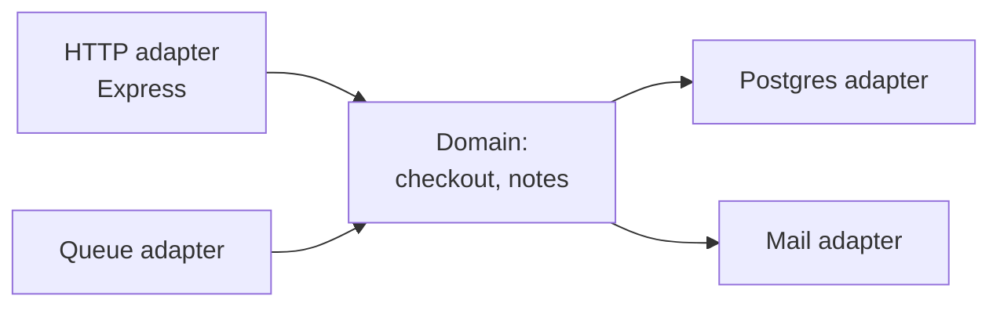

# 08 — Engineering Practices (Part 1 of 5): SOLID, Patterns, Clean Code & Architecture

> **Parts:** **Part 1 — Overview, Topic Map, SOLID, Design Patterns, Clean Code** · [Part 2 — Testing](./08-engineering-practices-part2.md) · [Part 3 — Git, CI/CD, Docker, Monorepos](./08-engineering-practices-part3.md) · [Part 4 — Security, Observability, Accessibility](./08-engineering-practices-part4.md) · [Part 5 — Resources, Practice, Interview Questions & Revision](./08-engineering-practices-part5.md)
>
> Applies to: TypeScript 7 / Node 24 patterns as of October 2026. Interviewers at 3+ years do not want the animal/Shape textbook; they want these ideas applied to a Node/React codebase. Logging internals, API tests and Node security exploits live in [06-nodejs](./06-nodejs.md); React component patterns and RTL queries in [04-react](./04-react.md). This file is the *practice*: how you structure, review, ship and secure work.

## Table of Contents

- [1. Overview](#1-overview)
- [2. Topic Map](#2-topic-map)
- [3. Detailed Explanations (Part 1)](#3-detailed-explanations-part-1)
  - [3.1 SOLID in TypeScript](#31-solid-in-typescript)
  - [3.2 Design Patterns You Already Use](#32-design-patterns-you-already-use)
  - [3.3 Clean Code, Smells and Refactoring](#33-clean-code-smells-and-refactoring)
  - [3.4 Hexagonal Architecture and DDD Vocabulary](#34-hexagonal-architecture-and-ddd-vocabulary)
- [Next: Part 2](#next-part-2)

---

## 1. Overview

**What this file covers.** How a mid-to-senior full-stack developer keeps a codebase changeable: SOLID and a handful of patterns (with realistic TypeScript, not zoo animals), the tests that make refactoring safe, Git and code review, CI/CD and Docker, monorepos, web security as of OWASP Top 10 **2025**, observability as an SLO practice, and accessibility as a release bar.

**Why interviewers care.** At 3+ years the coding round is rarely "can you write a loop". It is "can you change this service without breaking checkout", "why is this PR 1,800 lines", "how do you know production is healthy", "walk me through a XSS you shipped and how you prevent the next one". The answers are engineering habits, not library trivia.

| Junior answer | Senior answer |
|---------------|---------------|
| "I follow SOLID" | "This pricing module mixed tax, discounts and persistence. I split the calculator (SRP), injected a `TaxTable` (DIP), and the tests now cover combinations without a database" |
| "We use GitFlow" | "Trunk-based with short-lived PRs and feature flags. GitFlow's `develop`+`release` made hotfixes miss `develop`. Here's how we recovered a bad rebase with reflog" |
| "We have 80% coverage" | "Coverage of *behavior*: the payment POST has an idempotency test; the button has a role query; k6 covers p95. 80% of getters is a vanity metric" |
| "I put Helmet on" | "Helmet is headers. Access control is still A01. We return 404 for other tenants, CSP on the Next app, and Dependabot + `npm ci` for A03" |
| "Docker is `docker build`" | "Multi-stage, non-root, `npm ci --omit=dev --ignore-scripts`, layer order so `src` changes don't bust `node_modules`, compose for Postgres/Redis" |

**Version landscape (October 2026):**

| Tool | Current | What interviewers ask |
|------|---------|------------------------|
| Vitest | **5.0** (5.0.4 here; Node ≥ 22.12, Vite ≥ 6.4 peer) | `clearMocks` default on; `vi.mock` must be top-level; unawaited `expect.resolves` fails the test |
| Playwright | **1.64** | `storageState` for auth; trace on retry; CI `install --with-deps` |
| MSW | **3.0** (ESM-only, Node 22+) | `http`/`HttpResponse` from `msw/http`; `setupServer` still `msw/node` |
| ESLint | **10** | Flat config only — `.eslintrc` is dead |
| Biome | **2.5** | Lint + format, often instead of ESLint+Prettier in new repos |
| Turborepo | **2.11** | Task graph + remote cache; pnpm workspaces underneath |
| GitHub Actions | `actions/checkout` **v7** | v7 blocks fork checkouts on `pull_request_target` by default |
| Sentry | `@sentry/node` **11** | SDK 8+ uses `Sentry.init` with OpenTelemetry under the hood |
| OWASP | Top 10 **2025**; API Top 10 **2023** | A03 is supply chain; SSRF folded into A01; new A10 is exceptional conditions |

> 💡 Interview Tip: Name the *edition*. "OWASP A03 is injection" is the 2021 list. In 2025 A03 is **Software Supply Chain Failures** and injection is A05.

---

## 2. Topic Map

**Part 1 — Design & code quality**
- [ ] SOLID with TypeScript services, not shapes — [3.1](#31-solid-in-typescript)
- [ ] Strategy, Adapter, Decorator, Observer, Factory, Chain of Responsibility; Singleton as a smell — [3.2](#32-design-patterns-you-already-use)
- [ ] Names, function size, smells, refactoring with tests as a net — [3.3](#33-clean-code-smells-and-refactoring)
- [ ] Ports & adapters, bounded contexts, ubiquitous language — [3.4](#34-hexagonal-architecture-and-ddd-vocabulary)

**[Part 2](./08-engineering-practices-part2.md) — Testing**
- [ ] Pyramid vs trophy; what belongs at each layer
- [ ] Vitest 5: mocks, spies, fake timers
- [ ] RTL by role (details in [04](./04-react-part2.md#310-testing-react)); MSW 3; Playwright; doubles; flakes; k6/Pact skim

**[Part 3](./08-engineering-practices-part3.md) — Shipping**
- [ ] Trunk-based vs GitFlow; rebase vs merge; bisect; reflog
- [ ] Code review; GitHub Actions; Docker multi-stage + Compose
- [ ] pnpm workspaces + Turborepo; feature flags; ESLint 10 / Biome; ADRs

**[Part 4](./08-engineering-practices-part4.md) — Security & operations**
- [ ] XSS, CSRF, injection, OWASP 2025 + API 2023, secrets, headers
- [ ] SLIs/SLOs, Sentry (Pino/OTel in [06](./06-nodejs-part3.md))
- [ ] Accessibility as a release practice; performance budgets in CI

**[Part 5](./08-engineering-practices-part5.md)** — Resources, ~34 h path, exercises, 36 questions, recap.

---

## 3. Detailed Explanations (Part 1)

### 3.1 SOLID in TypeScript

SOLID is five constraints that keep change local. The failure mode in interviews is reciting the acronym and then showing a 400-line `UserService`.

**S — Single Responsibility.** A module has one reason to change. Not "one function", not "one class" — one *axis of change*.

```ts
// ❌ God service: persistence, tax, email, and HTTP live together
export class OrderService {
  async checkout(userId: string, items: Item[]): Promise<Order> {
    const total = items.reduce((s, i) => s + i.priceCents, 0);
    const taxed = total + Math.round(total * 0.2);          // UK VAT hardcoded
    const order = await db.insert(userId, taxed);
    await fetch('https://mailer/send', { method: 'POST', body: JSON.stringify(order) });
    return order;
  }
}

// ✅ Each change-axis is a port. Checkout orchestrates; it does not implement.
export type TaxCalculator = { taxOn(cents: number, country: string): number };
export type OrderRepo = { insert(row: NewOrder): Promise<Order> };
export type Mailer = { send(event: 'order.paid', payload: Order): Promise<void> };

export async function checkout(
  deps: { tax: TaxCalculator; orders: OrderRepo; mailer: Mailer },
  input: { userId: string; country: string; items: Item[] },
): Promise<Order> {
  const net = input.items.reduce((s, i) => s + i.priceCents, 0);
  const total = net + deps.tax.taxOn(net, input.country);
  const order = await deps.orders.insert({ userId: input.userId, totalCents: total });
  await deps.mailer.send('order.paid', order); // better: outbox ([06](./06-nodejs-part3.md#319-background-jobs-with-bullmq), [07](./07-databases-and-apis-part2.md))
  return order;
}
```

**O — Open/Closed.** Open to extension, closed to modification. In TS this is usually a **union + exhaustive switch** or a Strategy map, not a growing `if (type ===`.

```ts
type Discount =
  | { kind: 'percent'; bps: number }
  | { kind: 'fixed'; cents: number }
  | { kind: 'none' };

export function applyDiscount(cents: number, d: Discount): number {
  switch (d.kind) {
    case 'percent': return Math.round(cents * (10_000 - d.bps) / 10_000);
    case 'fixed': return Math.max(0, cents - d.cents);
    case 'none': return cents;
    default: {
      const _x: never = d; // compile error when a new kind is added and not handled
      return _x;
    }
  }
}
```

**L — Liskov Substitution.** Subtypes must honor the parent's contract. The classic break in Node is a `CachedRepo` that swallows errors (cache down → empty list) when the interface promised "throws on store failure". Callers then skip the empty-state UI. Returning a miss on Redis-down was the *documented* degradation in [06](./06-nodejs-part3.md#318-caching-with-redis) — that's LSP done right: the subtype still satisfies "returns T | null".

**I — Interface Segregation.** Don't force clients to depend on methods they don't use. A `NotesRepo` with `list/get/create/update/delete` is fine. A `GodRepo` with `sendEmail` + `chargeCard` + `listNotes` is not. Split by actor: `NoteReader` vs `NoteWriter` if some workers only read.

**D — Dependency Inversion.** High-level policy depends on abstractions, not on `pg` or Stripe. `checkout` above takes `OrderRepo`, not `Pool`. The [06](./06-nodejs-part2.md#311-a-production-shaped-express-app) `createApp({ repo, authenticate })` factory is DIP: tests pass an in-memory repo.

> 💡 Interview Tip: If they ask "how have you applied DIP?", point at constructors/`createApp` and at tests that don't boot Postgres. If all your "interfaces" are 1:1 with the Prisma client, you have types, not inversion.

### 3.2 Design Patterns You Already Use

Patterns are names for structures you already ship. Identify them in libraries — that's the senior move.

| Pattern | In the wild | When to reach for it | Smell |
|---------|-------------|----------------------|-------|
| **Strategy** | Tax calculator, password hasher, `maxmemory-policy` | A family of algorithms behind one interface | `if (provider === 'stripe')` scattered in 12 files |
| **Adapter** | Prisma adapter, S3 SDK vs your `BlobStore` | A third-party shape you don't want leaking | Wrapping every call "just in case" |
| **Decorator** | `CachedNotesRepo` wrapping `PgNotesRepo` ([06](./06-nodejs-part3.md)) | Add caching/logging/retries without editing the core | Decorators stacked five deep |
| **Observer** | `EventEmitter`, React state, Redis pub/sub | Fan-out of a fact | Implicit global events nobody can trace |
| **Factory** | `createApp`, `createHash('sha256')` | Hide construction; pick an impl from config | AbstractFactory of AbstractFactories |
| **Chain of Responsibility** | Express middleware, Next.js `proxy.ts` | Ordered processors that can pass or stop | Middleware that must run in a secret order with no tests |
| **Singleton** | `prisma` / `Redis` client per process | *One connection pool per process* is legitimate | Global mutable `let config` and hidden test coupling |

```ts
// Strategy: pick a hasher without rewriting login
export type PasswordHasher = {
  hash(plain: string): Promise<string>;
  verify(plain: string, hash: string): Promise<boolean>;
};

export const scryptHasher: PasswordHasher = { /* node:crypto scrypt */ hash, verify };
export const argon2Hasher: PasswordHasher = { /* node:crypto argon2 on 24.7+ */ hash, verify };

// Adapter: isolate Stripe so the domain talks "Money + charge id"
export type Charges = { charge(input: { cents: number; currency: 'USD' | 'EUR'; key: string }): Promise<{ id: string }> };
export const stripeCharges = (stripe: Stripe): Charges => ({
  charge: async ({ cents, currency, key }) => {
    const p = await stripe.paymentIntents.create({ amount: cents, currency, idempotencyKey: key });
    return { id: p.id };
  },
});
```

**Singleton is often an anti-pattern** because it is hidden global state: tests leak, serverless reuses the instance across requests (that's actually what you *want* for a pool — so name it "module-level pool", not "the Singleton pattern", and never store request data on it).

```ts
// Legitimate: one Pool per process (module scope)
export const pool = new pg.Pool({ connectionString: process.env.DATABASE_URL, max: 10 });

// Not legitimate: caching the current user on a singleton
export const Session = { currentUser: null as User | null }; // breaks the moment two requests overlap
```

**Express middleware is Chain of Responsibility.** Each layer calls `next()` or ends the response. Error middleware is a second chain selected by arity (4 parameters) — [06](./06-nodejs-part2.md#38-express-5-how-it-works-inside).

> ⚠️ Pitfall: Don't introduce a pattern because a blog post listed it. If a function and a closure will do, that's the pattern (Strategy as a function).

### 3.3 Clean Code, Smells and Refactoring

Interviewers listen for **how you change code**, not for "I write clean code".

**Names.** `d` vs `discountBps`; `handleData` vs `applyPercentDiscount`. Boolean names are predicates: `isPaid`, `hasRefreshCookie`. A function named `and` (`saveAndSendAndLog`) is three functions.

**Size.** A function that needs a scrollbar does more than one thing. Extract until the leftover reads like a paragraph of the business rule.

**Smells that show up in Node/React PRs** (Fowler / refactoring.guru):

| Smell | Typical site | Move |
|-------|--------------|------|
| Long parameter list | `createUser(a,b,c,d,e,f)` | An `input` object with a Zod schema |
| Feature envy | Route handler that knows SQL column names | Push into a repo |
| Shotgun surgery | Rename a field, touch 20 files | One module owns the field |
| Primitive obsession | `string` for Money, Email, Id | Branded types / Zod branded ([03](./03-typescript.md)) |
| Dead code / commented-out blocks | "just in case" | Git has history; delete |
| Speculative generality | `IAbstractFactoryBean` for one impl | YAGNI; add the second impl when it exists |
| Divergent change | `utils.ts` grows forever | Split by reason to change (SRP) |

**Refactoring rule:** tests first, or characterization tests around the ugly function, then small steps (extract function, rename, move). Never mix a behavior change and a structural refactor in one PR — review becomes guesswork.

```ts
// Before: 40-line function doing three jobs — parse, compute, persist
// After: three named steps; each testable
export async function applyCoupon(deps: Deps, raw: unknown): Promise<Order> {
  const input = parseCoupon(raw);          // throws ValidationError
  const priced = priceWithCoupon(input);   // pure
  return deps.orders.updateTotals(priced); // I/O
}
```

### 3.4 Hexagonal Architecture and DDD Vocabulary

You do not need to "do DDD". You need the words so a system-design or architecture interview doesn't stall.

**Hexagonal / ports & adapters** (Cockburn): the domain sits in the middle. **Ports** are interfaces (`OrderRepo`, `Mailer`). **Adapters** are the implementations (Postgres, SES, HTTP). The app core does not import `pg`. The [06](./06-nodejs-part2.md) notes service is a small hexagon: `createApp` is the inbound HTTP adapter; `PgNotesRepo` is the outbound DB adapter.



**DDD (compressed):**

| Term | Meaning | Full-stack example |
|------|---------|-------------------|
| Ubiquitous language | Same words in code, SQL, and Slack | "Family" of refresh tokens, not "session blob 2" |
| Bounded context | A model valid in one area | "Order" in checkout ≠ "Order" in warehouse shipping |
| Aggregate | Cluster of entities with a consistency boundary | `Order` + `OrderItems`; you don't update an item without the order's rules |
| Domain event | A fact that already happened | `OrderPaid` → outbox → email worker |

> 💡 Interview Tip: "We use hexagonal architecture" without a test that substitutes the adapter is a red flag. The proof is `createApp({ repo: new InMemoryNotesRepo() })`.

---

## Next: Part 2

➡️ [Part 2 — Testing](./08-engineering-practices-part2.md): pyramid vs trophy, Vitest 5, RTL, MSW 3, Playwright, doubles, flakes, and what not to mock.
