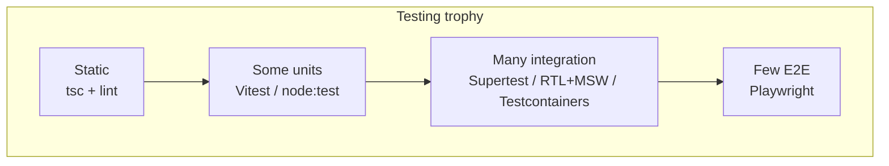

# 08 — Engineering Practices (Part 2 of 5): Testing

> **Parts:** [Part 1 — SOLID, Patterns, Clean Code](./08-engineering-practices-part1.md) · **Part 2 — Testing** · [Part 3 — Git, CI/CD, Docker, Monorepos](./08-engineering-practices-part3.md) · [Part 4 — Security, Observability, Accessibility](./08-engineering-practices-part4.md) · [Part 5 — Resources, Practice, Interview Questions & Revision](./08-engineering-practices-part5.md)
>
> Applies to: **Vitest 5.0.4** (Node ≥ 22.12, Vite ≥ 6.4 as a peer), **Playwright 1.64**, **MSW 3.0**, Testing Library. Node API tests with Supertest and Testcontainers are in [06-nodejs Part 3 §3.24](./06-nodejs-part3.md#324-testing-node-apis); React queries-by-role in [04-react Part 2 §3.10](./04-react-part2.md#310-testing-react). The debounce test below was run on Vitest 5.0.4 in October 2026; the NoSQL `$ne` pair lives in [Part 4](./08-engineering-practices-part4.md#322-injection-sql-nosql-command).

## Table of Contents

- [3. Detailed Explanations (Part 2)](#3-detailed-explanations-part-2)
  - [3.5 Pyramid, Trophy, and What to Test](#35-pyramid-trophy-and-what-to-test)
  - [3.6 Vitest 5: Units, Mocks, Fake Timers](#36-vitest-5-units-mocks-fake-timers)
  - [3.7 Component Tests and MSW 3](#37-component-tests-and-msw-3)
  - [3.8 E2E with Playwright](#38-e2e-with-playwright)
  - [3.9 Doubles, TDD, Flakes](#39-doubles-tdd-flakes)
  - [3.10 Load, Contract, Mutation — Skim](#310-load-contract-mutation--skim)
- [How to run the code in this file](#how-to-run-the-code-in-this-file)
- [Next: Part 3](#next-part-3)

---

## 3. Detailed Explanations (Part 2)

### 3.5 Pyramid, Trophy, and What to Test

Two pictures, one idea: **most confidence per minute**.

- **Fowler's pyramid:** many unit tests, fewer integration tests, few end-to-end tests. Units are cheap and precise; E2E is slow and brittle.
- **Kent C. Dodds' trophy:** a bit of static analysis (TS, ESLint), a modest unit layer, **a large integration layer** (page/component with real children, MSW instead of mocking the framework), a few E2E journeys.

For a full-stack TS app they agree in practice:

| Layer | What it proves | Tool | Cost |
|-------|----------------|------|------|
| Static | Types, lint, dead exports | `tsc --noEmit`, ESLint 10 / Biome | Seconds |
| Unit | Pure domain: pricing, debounce, parsers | Vitest 5 / `node:test` | Milliseconds |
| Integration (app) | HTTP against `createApp`, SQL against Testcontainers, a React page with MSW | Supertest, pg, RTL, MSW | Seconds |
| E2E | A real browser, real (or staged) backend: login → create → logout | Playwright | Tens of seconds |
| Load / contract | p95 under N VUs; consumer/provider schema | k6, Pact | Minutes, specialist |

**Do not mock** the thing you're testing. Mock **across a process or network boundary** you don't own (Stripe, GitHub, the clock). Don't mock `fs` if the unit *is* a file parser — use a temp dir. Don't mock Prisma to "unit test" a SQL filter — that's a Testcontainers test ([06](./06-nodejs-part3.md#324-testing-node-apis), [07](./07-databases-and-apis.md)).

Coverage: advertise **critical paths**, not a percentage. A 90% report that never POSTs `/payments` is worse than 40% that includes idempotency, BOLA, and the checkout form.



### 3.6 Vitest 5: Units, Mocks, Fake Timers

Vitest 5 (September 2026) needs **Node 22.12+** and **Vite ≥ 6.4** as a *peer* (Yarn users must add `vite` themselves). Defaults that bite upgrades:

- **`clearMocks` is on** — spies reset between tests; you no longer leak `toHaveBeenCalledTimes`.
- **`vi.mock` / `vi.hoisted` only at top level** — inside `describe` it now **throws**.
- **Unawaited `expect(p).resolves…` fails** the test.
- Fake timers also mock **`Temporal`**.
- `test.sequential` is gone; tests are concurrent-capable — isolate shared state.

Verified on 5.0.4: a debounce helper fired **once** after 200 ms of fake time, ignoring two extra calls.

```ts
// src/debounce.ts
export function debounce<T extends (...args: never[]) => void>(fn: T, ms: number): T {
  let timer: ReturnType<typeof setTimeout> | undefined;
  return ((...args: Parameters<T>) => {
    if (timer !== undefined) clearTimeout(timer);
    timer = setTimeout(() => {
      timer = undefined;
      fn(...args);
    }, ms);
  }) as T;
}
```

```ts
// test/debounce.test.ts
import { describe, it, expect, vi } from 'vitest';
import { debounce } from '../src/debounce.ts';

describe('debounce', () => {
  it('fires once after the wait', () => {
    vi.useFakeTimers();
    const fn = vi.fn();
    const d = debounce(fn, 200);
    d();
    d();
    d();
    vi.advanceTimersByTime(199);
    expect(fn).not.toHaveBeenCalled();
    vi.advanceTimersByTime(1);
    expect(fn).toHaveBeenCalledOnce();
    vi.useRealTimers();
  });
});
```

```ts
// vitest.config.ts
import { defineConfig } from 'vitest/config';
export default defineConfig({
  test: { include: ['test/**/*.test.ts'] },
});
```

**Spies vs mocks vs stubs** — [§3.9](#39-doubles-tdd-flakes). `vi.fn()` is a spy with a fake implementation. `vi.spyOn(obj, 'method')` wraps a real method. `vi.mock('./mailer.ts')` replaces a module — last resort, because it couples tests to import graphs.

> ⚠️ Pitfall: Mixing fake timers with real `fetch`/Playwright waits. Fake the clock *or* the network, and restore in `finally` / `useRealTimers()`. A leaked fake clock makes later tests hang until timeout — the classic "flaky CI that's fine locally".

### 3.7 Component Tests and MSW 3

Component tests: [04-react §3.10](./04-react-part2.md#310-testing-react). The one rule interviewers listen for: **query by role and accessible name**, not by `className` or `testId` unless there is no role.

```tsx
render(<SaveButton />);
await user.click(screen.getByRole('button', { name: /save/i }));
expect(await screen.findByRole('status')).toHaveTextContent(/saved/i);
```

If `getByRole` can't find it, the UI is probably inaccessible — the test is doing double duty.

**MSW 3** intercepts `fetch`/XHR in both Node and the browser so the component uses the real client. Breaking changes vs 2.x: ESM-only, Node 22+, and **named entrypoints**:

```ts
// test/msw/handlers.ts
import { http, HttpResponse } from 'msw/http'; // 3.x — not `from 'msw'`

export const handlers = [
  http.get('https://api.example.com/v1/notes', () =>
    HttpResponse.json([{ id: '1', title: 'Hello' }]),
  ),
];
```

```ts
// test/msw/server.ts
import { setupServer } from 'msw/node';
import { handlers } from './handlers.ts';

export const server = setupServer(...handlers);
```

```ts
// vitest.setup.ts
import { beforeAll, afterEach, afterAll } from 'vitest';
import { server } from './test/msw/server.ts';

beforeAll(() => server.listen());
afterEach(() => server.resetHandlers());
afterAll(() => server.close());
```

`onUnhandledRequest` was renamed to **`onUnhandledFrame`** (requests *and* WebSockets). GraphQL handlers live on `msw/graphql`. Don't mock `@tanstack/react-query` itself — mock the network.

### 3.8 E2E with Playwright

Playwright drives a real browser. Use it for **journeys** (login → create note → logout), not for every button (that's RTL).

```ts
// e2e/auth.spec.ts
import { test, expect } from '@playwright/test';

test('login, create a note, logout', async ({ page }) => {
  await page.goto('/login');
  await page.getByLabel('Email').fill('demo@example.com');
  await page.getByLabel('Password').fill('change-me-please');
  await page.getByRole('button', { name: 'Log in' }).click();
  await expect(page.getByRole('heading', { name: 'Notes' })).toBeVisible();

  await page.getByRole('button', { name: 'New note' }).click();
  await page.getByLabel('Title').fill('Playwright was here');
  await page.getByRole('button', { name: 'Save' }).click();
  await expect(page.getByText('Playwright was here')).toBeVisible();

  await page.getByRole('button', { name: 'Log out' }).click();
  await expect(page.getByRole('button', { name: 'Log in' })).toBeVisible();
});
```

**Auth state:** run login once in `globalSetup`, save `storageState` (cookies + localStorage), reuse it. Don't log in through the UI in every spec.

**CI:** `npx playwright install --with-deps`, upload the HTML report on failure, `trace: 'on-first-retry'`. Official template uses `actions/checkout` and `actions/setup-node` current majors plus `npx playwright install --with-deps` — pin the majors you actually run and verify on github.com/actions ([Part 3](./08-engineering-practices-part3.md#315-github-actions)).

Locators: `getByRole` / `getByLabel` / `getByText`, same accessibility bias as RTL. `page.locator('.css-xyz')` is the first thing that breaks when you restyle.

### 3.9 Doubles, TDD, Flakes

Fowler's taxonomy ([martinfowler.com "Mocks Aren't Stubs"](https://martinfowler.com/articles/mocksArentStubs.html)):

| Double | Job | Example |
|--------|-----|---------|
| **Dummy** | Fill an argument you ignore | `log: { error() {} }` in [06](./06-nodejs-part3.md) |
| **Stub** | Return canned data | `authenticate: async () => ({ userId: 'alice' })` |
| **Spy** | Record calls, often wrapping real impl | `vi.fn(realSend)` then `toHaveBeenCalledWith` |
| **Mock** | Pre-programmed *expectations* (fail if not met) | A mailer that *must* be called once — overuse makes tests brittle |
| **Fake** | Working lightweight impl | `InMemoryNotesRepo`, in-memory filesystem |

**TDD:** red → green → refactor, for *domain* logic (pricing, debounce, parsers). Don't TDD CSS. Characterization tests wrap legacy code before you touch it.

**Flakes** have causes, not personalities:

1. **Time** — real `setTimeout`, clocks, animations. Fake timers or Playwright `expect.poll`.
2. **Order** — shared DB / module state. Isolate (`beforeEach` truncate, Vitest 5's default mock clearing).
3. **Network** — real APIs in unit tests. MSW / Testcontainers.
4. **Assertions on loading UI** — `getBy` instead of `findBy` / `expect(locator).toBeVisible()`.
5. **Retries that hide bugs** — `retries: 3` on CI without a trace is how flakes go to production. Retry *and* keep the trace; then fix the race.

> 💡 Interview Tip: "How do you deal with flaky tests?" — "Quarantine is a ticket, not a strategy. I look at the trace, then time/order/network. I don't raise retries."

### 3.10 Load, Contract, Mutation — Skim

- **k6** (Grafana): JS scripts, VUs, thresholds on p95. One script against staging `POST /v1/notes` with a smoke + a 100-VU soak is enough to talk about it. Don't load-test a laptop Docker Postgres and call it capacity planning ([09](./09-system-design.md)).
- **Pact:** consumer publishes expectations; provider verifies against them in CI. Useful when two teams own the HTTP boundary; overkill inside one monorepo with tRPC/OpenAPI tests.
- **Mutation testing** (Stryker): changes the code and checks a test fails. Slow; run on a small domain module when you distrust coverage %.

---

## How to run the code in this file

```powershell
npm i -D vitest@5 vite
npx vitest run
# measured: 3 tests, 2 files, ~1.2 s on Node 24.21 / Vitest 5.0.4
```

---

## Next: Part 3

➡️ [Part 3 — Git, CI/CD, Docker, Monorepos](./08-engineering-practices-part3.md): trunk-based development, bisect and reflog, review, GitHub Actions, multi-stage Docker, pnpm + Turborepo, flags, ESLint 10 / Biome, ADRs.
