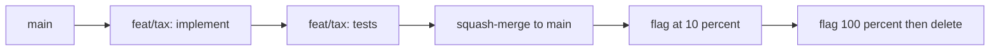

# 08 — Engineering Practices (Part 3 of 5): Git, CI/CD, Docker & Monorepos

> **Parts:** [Part 1 — SOLID, Patterns, Clean Code](./08-engineering-practices-part1.md) · [Part 2 — Testing](./08-engineering-practices-part2.md) · **Part 3 — Git, CI/CD, Docker, Monorepos** · [Part 4 — Security, Observability, Accessibility](./08-engineering-practices-part4.md) · [Part 5 — Resources, Practice, Interview Questions & Revision](./08-engineering-practices-part5.md)
>
> Applies to: Git 2.47+, **Docker 29**, **Turborepo 2.11**, **ESLint 10** (flat config only), **Biome 2.5**, GitHub Actions with `actions/checkout@v7` and `actions/setup-node@v7` (October 2026). The notes-service Dockerfile in [06-nodejs Part 3](./06-nodejs-part3.md) is a verified sibling of the multi-stage pattern here. Do not start extra Postgres/Redis containers if you already have them locally — the Compose file below is a template.

## Table of Contents

- [3. Detailed Explanations (Part 3)](#3-detailed-explanations-part-3)
  - [3.11 Trunk-Based vs GitFlow](#311-trunk-based-vs-gitflow)
  - [3.12 Rebase, Merge, Bisect, Reflog](#312-rebase-merge-bisect-reflog)
  - [3.13 Code Review](#313-code-review)
  - [3.14 Feature Flags](#314-feature-flags)
  - [3.15 GitHub Actions](#315-github-actions)
  - [3.16 Docker: Layers, Multi-Stage, Compose](#316-docker-layers-multi-stage-compose)
  - [3.17 Monorepos: pnpm Workspaces, Turborepo, Nx](#317-monorepos-pnpm-workspaces-turborepo-nx)
  - [3.18 Lint, Format, Pre-commit](#318-lint-format-pre-commit)
  - [3.19 ADRs](#319-adrs)
- [Next: Part 4](#next-part-4)

---

## 3. Detailed Explanations (Part 3)

### 3.11 Trunk-Based vs GitFlow

**Trunk-based development:** everyone integrates to `main` (the trunk) at least daily, via **short-lived** branches (hours to a couple of days) and small PRs. Incomplete work hides behind [feature flags](#314-feature-flags), not behind a `develop` branch that lives for weeks. This is the default answer at SaaS companies that deploy many times a day.

**GitFlow:** long-lived `develop`, `release/*`, `hotfix/*` off `main`. It fits *versioned* products with a real freeze (a mobile app store, an on-prem installer). In a web app it usually means: hotfixes miss `develop`, `release` and `main` drift, and merge conflicts become a weekly ceremony.

| | Trunk-based | GitFlow |
|--|-------------|---------|
| Integration frequency | Daily onto `main` | Feature branches live until a release train |
| Incomplete work | Flags | `develop` is "not quite prod" |
| Hotfix | PR to `main`, cherry-pick if needed | `hotfix/*` that must be merged to *both* `main` and `develop` |
| Failure mode | Flags left on; CI too slow for trunk | Diverging branches; "we'll merge on Friday" |

> 💡 Interview Tip: Don't say "we use GitFlow" because a blog said to. Name the *release cadence*. If you ship to production from `main` ten times a day, you are trunk-based even if you call the branch `master`.



### 3.12 Rebase, Merge, Bisect, Reflog

**Merge commit** (`git merge --no-ff`): preserves the exact history of the branch. The graph is honest; `main` is noisy.

**Squash merge** (GitHub default at many teams): one commit on `main` per PR. `main` is readable; you lose the internal WIP commits (that's usually what you wanted).

**Rebase** (`git rebase main` on your *feature* branch): replay your commits on top of the latest trunk so the PR is a fast-forward-shaped stack. **Do not rebase commits that other people already pulled.** That's the rule. Rewriting `main` is a team incident.

**Interactive rebase** (`git rebase -i HEAD~5`) before you open the PR: squash "wip", reword the title, drop the debug commit. Reviewers should not have to reconstruct your afternoon.

```text
# Find the commit that introduced a bug, given a known-good SHA
git bisect start
git bisect bad HEAD
git bisect good v1.4.0
# Git checks out the midpoint. Run tests; then:
git bisect good   # or: git bisect bad
git bisect reset
```

`git bisect run npm test` automates it when the failure is a test.

**Reflog** is the local diary of where `HEAD` has been. "I rebased and the commits vanished" — they didn't.

```text
git reflog
# a1b2c3d HEAD@{3}: rebase (finish): returning to refs/heads/feat/tax
git checkout -b recover a1b2c3d
```

Reflog is **per clone**, expires (~90 days). It will not save a commit you never had locally and never pushed. `git fsck --lost-found` is the next layer; backups / the remote are the real ones.

> ⚠️ Pitfall: `git push --force` on a shared branch. If you must rewrite a feature branch after rebase, `git push --force-with-lease` refuses to overwrite commits you haven't seen (someone else pushed in between). Never force-push `main`.

**rebase vs merge on `main`:** pick one policy and write it down. A common senior setup: *rebase locally, squash-merge the PR*. Don't mix merge-commits and rebases on the same shared branch without a reason.

### 3.13 Code Review

Google's engineering practices ([google.github.io/eng-practices](https://google.github.io/eng-practices)) are the interview canon. Compressed:

**What the reviewer owns:** correctness, security, readability, tests that would fail if the behavior broke, whether this is the *right* change. Not: "I would have named it differently" unless the name is wrong.

**PR size.** ~200–400 lines of *meaningful* diff is reviewable. 1,800 lines of mixed refactor + feature is how bugs ship. Split: (1) mechanical refactor with no behavior change, (2) the feature on top.

**Giving feedback.** Comment on the code, prefix severity (`nit:`, `blocking:`), suggest a patch. "Have you considered X?" beats "this is wrong". Approve with nits if you would merge it as-is.

**Authoring.** Description is the *why* and how to test. Screenshots for UI. Link the ticket. Self-review the diff before requesting.

| Look for | Why |
|----------|-----|
| Authz in the data layer, not just the UI | [BOLA](./08-engineering-practices-part4.md#323-owasp-top-102025-and-api-top-102023); [06](./06-nodejs-part3.md#323-security) |
| Unbounded lists, missing timeouts | Resource consumption |
| Secrets in the diff / logs | [§3.24](./08-engineering-practices-part4.md#324-secrets-and-supply-chain) |
| Tests that assert implementation (`toHaveBeenCalled` on a private helper) | Brittle; test the behavior |
| Migration without expand/contract | [07](./07-databases-and-apis-part2.md) |
| `dangerouslySetInnerHTML`, `eval`, `innerHTML` | XSS |

> 💡 Interview Tip: "What do you look for in a PR?" — lead with *user-visible correctness and authz*, then tests, then style. Style-only reviews signal you don't own the system.

### 3.14 Feature Flags

Flags are how trunk-based development ships incomplete work. Fowler's taxonomy ([martinfowler.com "Feature Toggles"](https://martinfowler.com/articles/feature-toggles.html)):

| Kind | Lifetime | Example |
|------|----------|---------|
| **Release** | Days–weeks | Hide the new checkout until it's ready |
| **Experiment** | Weeks | 10% A/B on the pricing page |
| **Ops** | Hours, kill-switch | Disable a flaky provider |
| **Permission** | Years | "Enterprise SSO" for this tenant |

A flag that lives forever is a second source of truth. Budget a *removal* ticket when you add one.

```ts
export type FlagContext = { userId: string; tenantId: string };

export type Flags = {
  isOn(key: 'new-checkout' | 'slow-provider-kill', ctx: FlagContext): boolean;
};

// Dev / tests: env. Prod: LaunchDarkly / Unleash / OpenFeature — same interface.
export const envFlags: Flags = {
  isOn(key, _ctx) {
    return process.env[`FLAG_${key.replaceAll('-', '_').toUpperCase()}`] === '1';
  },
};

export function charge(flags: Flags, ctx: FlagContext, order: Order): Promise<void> {
  if (flags.isOn('slow-provider-kill', ctx)) return chargeBackup(order);
  return chargePrimary(order);
}
```

**Progressive rollout:** 1% of traffic → watch error rate and p95 → 10% → 50% → 100% → delete the flag. Pair with an SLO ([Part 4](./08-engineering-practices-part4.md#328-slis-slos-and-sentry)). A flag is not a substitute for tests.

### 3.15 GitHub Actions

A production-shaped pipeline for a Node/Next app: **lint → typecheck → unit/integration → (gated) E2E → build → deploy**. Deploy is a *separate job* that needs an **environment** (protection rules, reviewers, OIDC to AWS — [10](./10-deployment-aws-ec2.md)).

October 2026 pins: `actions/checkout@v7`, `actions/setup-node@v7` (Node 24 runtime on the action itself; hosted runners need ≥ 2.327.1). Confirm majors at github.com/actions before you quote them.

```yaml
# .github/workflows/ci.yml
name: ci
on:
  pull_request:
  push:
    branches: [main]

concurrency:
  group: ci-${{ github.ref }}
  cancel-in-progress: true

jobs:
  test:
    runs-on: ubuntu-latest
    timeout-minutes: 15
    steps:
      - uses: actions/checkout@v7
      - uses: actions/setup-node@v7
        with:
          node-version: 24
          cache: npm
      - run: npm ci
      - run: npm run lint
      - run: npx tsc --noEmit
      - run: npx vitest run
      - run: npm run build

  e2e:
    needs: test
    if: github.event_name == 'push' && github.ref == 'refs/heads/main'
    runs-on: ubuntu-latest
    timeout-minutes: 20
    steps:
      - uses: actions/checkout@v7
      - uses: actions/setup-node@v7
        with:
          node-version: 24
          cache: npm
      - run: npm ci
      - run: npx playwright install --with-deps
      - run: npx playwright test
      - uses: actions/upload-artifact@v4
        if: failure()
        with:
          name: playwright-report
          path: playwright-report/
```

**Caching:** `setup-node`'s `cache: npm` (or `pnpm` / `yarn`) keys on the lockfile. Cache **dependencies**, not `dist/` unless you know the restore is cheaper than rebuilding.

**Matrix:** `strategy.matrix.node-version: [22, 24]` for a library. For an app, test the version you run in prod.

**Secrets:** org/repo/environment secrets, never in logs (`::add-mask::` is not enough if you `echo` them). Prefer **OIDC** (`permissions: id-token: write`) over long-lived AWS keys.

**`pull_request_target`:** the workflow file and the default checkout come from the *base* repo, with the base repo's secrets. That is the "pwn request" class of bugs: if you then check out the fork's SHA and `npm test`, the fork runs with your secrets. **`actions/checkout@v7` refuses fork PR checkouts on `pull_request_target` and PR-triggered `workflow_run` by default.** Opt-out is the loud `allow-unsafe-pr-checkout: true`, and only after the checked-out code is treated as *data*, never executed. Prefer `pull_request` for CI that needs to run the PR's code.

> ⚠️ Pitfall: `pull_request` workflows from forks do **not** get repo secrets (by design). Don't "fix" that with `pull_request_target` + checkout of `github.event.pull_request.head.sha`.

Deploy job sketch (details in [10](./10-deployment-aws-ec2.md)):

```yaml
  deploy:
    needs: [test, e2e]
    if: github.ref == 'refs/heads/main'
    runs-on: ubuntu-latest
    environment: production
    permissions:
      id-token: write
      contents: read
    steps:
      - uses: actions/checkout@v7
      # OIDC → AWS / GCP / Azure, then your deploy command
```

### 3.16 Docker: Layers, Multi-Stage, Compose

**Image** = filesystem snapshot + metadata + default command. **Container** = a running (or stopped) instance of an image with its own writable layer. `docker run` does not rebuild; `docker build` does not start a process.

**Layers.** Each `Dockerfile` instruction is a layer. Docker reuses a layer when the instruction *and every layer above it* are unchanged. Put the rarely changing files first (`package-lock.json` → `npm ci`) and the often changing files last (`COPY src`).

**Multi-stage.** A builder image has compilers and devDependencies; the runtime image copies only `node_modules` (prod) and `dist`. Smaller attack surface, faster pulls.

```dockerfile
# syntax=docker/dockerfile:1
FROM node:24-alpine AS deps
WORKDIR /app
COPY package.json package-lock.json ./
# --ignore-scripts: skip postinstall by default (A03). Drop it for native addons (sharp, bcrypt).
RUN npm ci --omit=dev --ignore-scripts

FROM node:24-alpine AS build
WORKDIR /app
COPY package.json package-lock.json ./
RUN npm ci --ignore-scripts
COPY tsconfig.json ./
COPY src ./src
RUN npx tsc -p tsconfig.json --outDir dist

FROM node:24-alpine
ENV NODE_ENV=production
WORKDIR /app
COPY --from=deps /app/node_modules ./node_modules
COPY --from=build /app/dist ./dist
COPY package.json ./
USER node
EXPOSE 3000
# Exec form: PID 1 is node, so SIGTERM reaches the process ([06](./06-nodejs-part3.md#322-graceful-shutdown)).
CMD ["node", "dist/main.js"]
```

Node 24 can run TypeScript directly (type stripping). The [06 notes service](./06-nodejs-part3.md) does that and skips the `build` stage — valid when you don't need `tsc` emit. Use emit when you target an older Node or want a compile check in the image.

**.dockerignore:** `node_modules`, `.git`, `*.md`, tests, `.env`. Copying the host `node_modules` into Linux is a classic "works on my Mac, crashes in Alpine" bug.

**Compose** (template — do **not** bind 5432/6379 if those ports are already taken by your local stack):

```yaml
# compose.yaml — local dev only
services:
  api:
    build: .
    ports: ["3000:3000"]
    environment:
      DATABASE_URL: postgres://app:app@db:5432/app
      REDIS_URL: redis://cache:6379
    depends_on: [db, cache]
  db:
    image: postgres:18-alpine
    environment:
      POSTGRES_USER: app
      POSTGRES_PASSWORD: app
      POSTGRES_DB: app
    ports: ["5432:5432"]
  cache:
    image: redis:8-alpine
    ports: ["6379:6379"]
```

Prod does not run the database in the same Compose file as the API on one box without a reason — [10](./10-deployment-aws-ec2.md).

> ⚠️ Pitfall: Running as root in the image. `USER node` (Debian/Alpine official images ship that user) or a dedicated UID. Writable dirs the app needs (`/tmp`, a cache path) must be `chown`'d in the Dockerfile.

### 3.17 Monorepos: pnpm Workspaces, Turborepo, Nx

**When a monorepo pays:** a Next app and a Node API sharing Zod schemas / UI kit / Prisma client. **When it doesn't:** two teams with different release cadences and no shared code — two repos is simpler.

**pnpm workspaces** are the layout. `pnpm-workspace.yaml`:

```yaml
packages:
  - "apps/*"
  - "packages/*"
```

```text
apps/web          # Next.js
apps/api          # Fastify
packages/types    # shared Zod + DTOs
packages/ui       # design system
```

`apps/web/package.json` depends on `"@acme/types": "workspace:*"`. One lockfile. `pnpm -r test` runs every package.

**Turborepo 2.11** sits on top: a **task graph** (`build` of `web` depends on `build` of `types`) and a **cache** (local, or remote via Vercel / an S3-compatible store). Unchanged inputs → replay the previous `dist/` instead of rebuilding.

```json
{
  "tasks": {
    "build": {
      "dependsOn": ["^build"],
      "outputs": ["dist/**", ".next/**"]
    },
    "test": {
      "dependsOn": ["build"]
    },
    "lint": {}
  }
}
```

`^build` means "build my dependencies first". `turbo run test --filter=web...` tests `web` and everything it depends on.

**Nx** is the heavier alternative: extra generators, a project graph UI, computation cache, optional module-boundary lint. Choose Nx when you already want those; choose Turborepo when you want "pnpm + a cache" with less framework.

> 💡 Interview Tip: "How would you share types between the Next app and the API?" — `packages/types` with Zod schemas compiled to TS, imported by both, built first in the task graph. Not: copy-paste DTOs; not: a private npm package you forget to publish.

### 3.18 Lint, Format, Pre-commit

**ESLint 10** is **flat config only**. `.eslintrc.*` is gone. Config is `eslint.config.js` (or `.mjs` / `.ts`).

```js
// eslint.config.js
import js from '@eslint/js';
import tseslint from 'typescript-eslint';

export default tseslint.config(
  js.configs.recommended,
  tseslint.configs.recommended,
  { ignores: ['dist/**', '.next/**'] },
);
```

**Biome 2.5** lints *and* formats in one Rust binary. Many new TS repos skip ESLint+Prettier and use Biome; keep ESLint when you need the plugin ecosystem (`eslint-plugin-jsx-a11y`, security plugins, import graphs). Don't run Prettier *and* Biome on the same files.

**Pre-commit:** `lint-staged` so only staged files are formatted. Husky (or a core.hooksPath of `git config`) runs it. CI still runs the full lint — hooks are a convenience, not a gate. `--no-verify` exists; that's why CI is the real gate.

### 3.19 ADRs

An **Architecture Decision Record** is a short markdown file in `docs/adr/` (see [adr.github.io](https://adr.github.io)):

```markdown
# ADR 0014: Postgres as source of truth, Redis as cache

- Status: Accepted
- Date: 2026-10-14

## Context
Notes must survive a Redis flush. Read latency on the hot path is a problem.

## Decision
Postgres is authoritative. Redis is cache-aside with a TTL and stampede lock
(see 06-nodejs Part 3).

## Consequences
+ Simple backup story (Postgres).
+ We can flush Redis without data loss.
- Cache invalidation is now our problem; we invalidate on write by note id.
```

ADRs capture the *why* that PRs forget. Status can move to Superseded. You do not ADR "we use TypeScript".

---

## Next: Part 4

➡️ [Part 4 — Security, Observability, Accessibility](./08-engineering-practices-part4.md): OWASP Top 10 **2025**, XSS/CSRF/injection, secrets, headers, SLOs & Sentry, accessibility as a release bar, performance budgets in CI.
