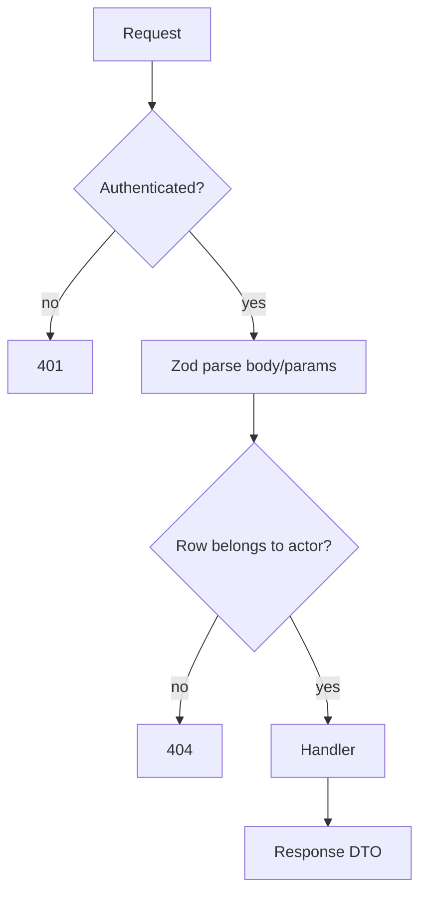

# 08 — Engineering Practices (Part 4 of 5): Security, Observability & Accessibility

> **Parts:** [Part 1 — SOLID, Patterns, Clean Code](./08-engineering-practices-part1.md) · [Part 2 — Testing](./08-engineering-practices-part2.md) · [Part 3 — Git, CI/CD, Docker, Monorepos](./08-engineering-practices-part3.md) · **Part 4 — Security, Observability, Accessibility** · [Part 5 — Resources, Practice, Interview Questions & Revision](./08-engineering-practices-part5.md)
>
> Applies to: **OWASP Top 10:2025**, **OWASP API Security Top 10:2023**, `@sentry/node` **11**. Node-specific exploits (SSRF connect-time checks, prototype pollution, ReDoS) are implemented in [06-nodejs Part 3 §3.23](./06-nodejs-part3.md#323-security) — this file names them and does not re-derive the code. Pino/OTel internals: [06 §3.20–3.21](./06-nodejs-part3.md#320-structured-logging-with-pino). React a11y component patterns: [04 §3.8](./04-react-part2.md#38-accessibility-in-react). Core Web Vitals mechanics: [05 §3.16](./05-nextjs-part3.md#316-core-web-vitals). The NoSQL `$ne` demo below was run on Vitest 5.0.4 (October 2026).

## Table of Contents

- [3. Detailed Explanations (Part 4)](#3-detailed-explanations-part-4)
  - [3.20 XSS](#320-xss)
  - [3.21 CSRF and CORS](#321-csrf-and-cors)
  - [3.22 Injection (SQL, NoSQL, Command)](#322-injection-sql-nosql-command)
  - [3.23 OWASP Top 10:2025 and API Top 10:2023](#323-owasp-top-102025-and-api-top-102023)
  - [3.24 Secrets and Supply Chain](#324-secrets-and-supply-chain)
  - [3.25 Security Headers](#325-security-headers)
  - [3.26 Node-Specific Risks — Pointer](#326-node-specific-risks--pointer)
  - [3.27 Clickjacking and SRI](#327-clickjacking-and-sri)
  - [3.28 SLIs, SLOs, and Sentry](#328-slis-slos-and-sentry)
  - [3.29 Accessibility as a Release Practice](#329-accessibility-as-a-release-practice)
  - [3.30 Performance Budgets in CI](#330-performance-budgets-in-ci)
- [4. Full Example: Checkout Hardening Sketch](#4-full-example-checkout-hardening-sketch)
- [5. Diagrams Index](#5-diagrams-index)
- [Next: Part 5](#next-part-5)

---

## 3. Detailed Explanations (Part 4)

### 3.20 XSS

**Cross-Site Scripting** is injecting script (or HTML that becomes script) into a page another user views. Three delivery paths:

| Kind | How it arrives | Typical site |
|------|----------------|--------------|
| **Stored** | Saved in the DB, served to others | Comment body, display name |
| **Reflected** | Echoed from the request (query, header) into the response | Search `?q=` rendered into HTML |
| **DOM** | Client JS reads attacker-controlled data (`location.hash`, `postMessage`) and writes it into the DOM | `innerHTML = location.hash` |

**Defense is output encoding in context**, not "sanitizing input and hoping". React already text-encodes JSX children. The holes are `dangerouslySetInnerHTML`, `href={`javascript:${…}`}`, and server-rendered HTML you concatenate yourself.

```tsx
// ❌ Stored XSS: markdown/HTML from the DB
<article dangerouslySetInnerHTML={{ __html: note.bodyHtml }} />

// ✅ Treat untrusted content as text, or run a vetted sanitizer (DOMPurify)
// with a tight ALLOWED_TAGS list — then still lock it down with CSP.
<article>{note.bodyText}</article>
```

**Content-Security-Policy** is defense in depth: even if HTML injection lands, the browser refuses to run inline/unknown scripts.

```http
Content-Security-Policy:
  default-src 'self';
  script-src 'self';
  object-src 'none';
  base-uri 'self';
  frame-ancestors 'none';
  img-src 'self' https: data:;
```

`'unsafe-inline'` on `script-src` mostly defeats CSP for XSS. Next.js / nonce-based CSP is the production shape ([05](./05-nextjs.md) for the framework wiring; MDN for the header).

> 💡 Interview Tip: Exploit `dangerouslySetInnerHTML` in a toy app once. Then show CSP blocking the payload. "I put `helmet()` on" is not an XSS answer.

### 3.21 CSRF and CORS

**CSRF:** the browser *automatically* attaches cookies to a request the victim didn't intend (a form on `evil.example` POSTs to `api.yoursite.com`). If your session is a cookie and the action is state-changing, you need a CSRF defense.

| Defense | When it's enough |
|---------|------------------|
| **`SameSite=Lax`** (default on modern browsers) | Cross-*site* POSTs from other registrable domains. Not enough for subdomains you don't trust, or state-changing **GETs** |
| **`SameSite=Strict`** | Stronger; breaks "click a link from email → already logged in" |
| **Synchronizer / double-submit token** | Needed when you have cookie auth *and* cross-site or subdomain attackers |
| **Bearer token in `Authorization`** | Browser does not auto-attach it. CSRF is then mostly a non-issue; XSS that steals the token is the issue |

Cookie-based refresh tokens in [06](./06-nodejs-part2.md#314-authentication--authorization) use `HttpOnly` + `Secure` + `SameSite=Lax`. State-changing requests that a foreign form could issue still need a CSRF token or to not use cookies for that action.

**CORS is not a server security boundary.** It is the browser asking "may this origin read the response?" A `curl` from a datacenter ignores CORS. `Access-Control-Allow-Origin: *` plus `Access-Control-Allow-Credentials: true` is invalid (browsers reject it) — and even a reflected origin with credentials is "any website can call us as the user". Authz still happens on the server, every request.

Preflight (`OPTIONS`) happens when the request is "non-simple" (custom headers, JSON content-type, etc.). Don't "fix" CORS by reflecting any `Origin` in production.

### 3.22 Injection (SQL, NoSQL, Command)

**SQL.** Parameterized queries / `$1` placeholders. String-concatenated SQL is the 1998 bug that still ships. ORMs don't save you if you pass `Prisma.$queryRaw` a interpolated string — use `$queryRaw` tagged templates. Details and `pg` examples: [07](./07-databases-and-apis.md), [06](./06-nodejs.md).

**Command.** Never `exec('convert ' + userFilename)`. Use `execFile` with an argument array, or don't shell out.

**NoSQL.** Mongo interprets objects in the query. If you pass `req.body` through as a filter, `{ "email": { "$ne": null } }` matches every user with a non-null email — that's a login bypass.

Verified on Vitest 5.0.4 (in-memory stand-in for the Mongo operator):

```ts
// src/nosql.ts
export type User = { email: string; role: 'user' | 'admin' };

export function unsafeFind(users: User[], query: Record<string, unknown>): User[] {
  const email = query.email;
  if (email !== null && typeof email === 'object' && '$ne' in (email as object)) {
    const ne = (email as { $ne: unknown }).$ne;
    return users.filter((u) => u.email !== ne);
  }
  return users.filter((u) => u.email === email);
}

export function safeFind(users: User[], email: string): User[] {
  if (typeof email !== 'string') throw new TypeError('email must be a string');
  return users.filter((u) => u.email === email);
}
```

```ts
// test/nosql.test.ts
import { describe, it, expect } from 'vitest';
import { unsafeFind, safeFind, type User } from '../src/nosql.ts';

const users: User[] = [
  { email: 'alice@example.com', role: 'admin' },
  { email: 'bob@example.com', role: 'user' },
];

describe('NoSQL $ne', () => {
  it('unsafeFind treats { $ne: null } as "everyone"', () => {
    const hit = unsafeFind(users, { email: { $ne: null } });
    expect(hit).toHaveLength(2);
  });

  it('safeFind only accepts a string and returns the one user', () => {
    expect(safeFind(users, 'alice@example.com')).toEqual([users[0]]);
  });
});
```

On a real Mongo collection the same payload is `find({ email: { $ne: null } })`. Fix: **parse with Zod** (`z.string().email()`), never pass raw JSON as a query operator. Mongoose `sanitizeFilter` helps; it is not a substitute for a schema.

> ⚠️ Pitfall: Casting `req.query` to `Filter<User>` because TypeScript compiles. Types are erased. Zod at the edge is the check.

### 3.23 OWASP Top 10:2025 and API Top 10:2023

Name the **edition**. "A03 is injection" is the **2021** list. In **2025**:

| # | 2025 name | What changed vs 2021 | Full-stack move |
|---|-----------|----------------------|-----------------|
| **A01** | Broken Access Control | Still #1. **SSRF and CSRF are folded in.** | Tenant checks in the *query* ([06 BOLA](./06-nodejs-part3.md#323-security)); IDOR tests; deny by default |
| **A02** | Security Misconfiguration | Climbed. Default creds, verbose errors, open cloud buckets | Hardened headers, no stack traces in prod, inventory |
| **A03** | **Software Supply Chain Failures** | Expanded from "vulnerable components" to build + distribution | Lockfile, `npm ci`, ignore-scripts, Dependabot, signed Actions |
| **A04** | Cryptographic Failures | | TLS, Argon2/scrypt not SHA-256, no home-rolled JWT crypto |
| **A05** | Injection | Was A03 in 2021 | Parameterized SQL; Zod against NoSQL operators |
| **A06** | Insecure Design | | Threat model *before* code; missing rate limits is design |
| **A07** | Authentication Failures | | [06 auth](./06-nodejs-part2.md#314-authentication--authorization) |
| **A08** | Software or Data Integrity Failures | | Unsigned webhooks, `eval` of CI artifacts, insecure deserialization |
| **A09** | Security Logging & Alerting Failures | Renamed from "monitoring" | Log authz failures; alert on them; no secrets in logs |
| **A10** | **Mishandling of Exceptional Conditions** | **New.** Fail-open, swallowed errors, leaky 500s | Fail *closed* on authz errors; generic 500 to clients; catch `40001` and retry ([07](./07-databases-and-apis-part2.md)) |

**API Security Top 10:2023** (still current in 2026) is the API-shaped vocabulary. Full table with Node examples: [06 §3.23](./06-nodejs-part3.md#323-security). Interviewers who say "BOLA" mean API1 — `GET /notes/:id` without an owner filter. Return **404** for other tenants, not 403 (403 confirms the id exists).



> 💡 Interview Tip: One sentence per 2025 item + one mitigation. If you recite 2021 numbers, they will notice.

### 3.24 Secrets and Supply Chain

**Secrets.** Env vars on the box, not in the repo. GitHub **environments** + OIDC for deploys ([Part 3](./08-engineering-practices-part3.md#315-github-actions)). If a secret hits git: rotate *first* (the token is burned), then purge history (`git filter-repo` / BFG — coordinate; rewriting `main` is a team event). `git revert` does **not** unsay a leaked AWS key.

**Supply chain (A03):**

- Commit the lockfile; install with `npm ci` / `pnpm install --frozen-lockfile`.
- `--ignore-scripts` in Docker unless a native addon needs a build.
- Dependabot / Renovate for PRs; `npm audit` is a signal, not a policy (false positives, no reachability).
- Pin GitHub Actions to a SHA for high-sensitivity repos; at minimum pin **majors** (`@v7`).
- Don't `curl | bash` installers in CI.

**Leak procedure, 60 seconds:** (1) revoke/rotate, (2) check access logs, (3) remove from git and secret stores, (4) incident note. Rehearse it.

### 3.25 Security Headers

`helmet` (Express) / `helmet` equivalents set a sane baseline. Know what each header *does* — interviewers unplug the library.

| Header | Job |
|--------|-----|
| `Content-Security-Policy` | XSS depth charge — [§3.20](#320-xss) |
| `Strict-Transport-Security` | Force HTTPS after first visit (`max-age` + `includeSubDomains`; preload is a commitment) |
| `X-Content-Type-Options: nosniff` | Don't MIME-sniff JS |
| `Referrer-Policy: strict-origin-when-cross-origin` | Don't leak paths to other origins |
| `Permissions-Policy` | Disable camera/mic/geolocation you don't use |
| `Content-Security-Policy: frame-ancestors 'none'` | Clickjacking — prefer this over `X-Frame-Options: DENY` (CSP is the modern control; `X-Frame-Options` still helps old browsers) |

Score the deployed app at securityheaders.com as a lab, not as a production metric. Headers don't fix A01.

### 3.26 Node-Specific Risks — Pointer

Do not re-implement these here; you already have measured examples:

| Risk | Where the code and numbers live |
|------|---------------------------------|
| **SSRF** (2025: under A01; API7 in the API list) | [06 §3.23 SSRF](./06-nodejs-part3.md#323-security) — connect-time IP check, not hostname allow-lists |
| **Prototype pollution** | Same section — `unsafeMerge` vs `safeMerge` |
| **ReDoS** | Same section — nested quantifiers blocking the event loop |

The interview answer is: "SSRF is A01 in 2025; I check the peer address *after* connect and re-validate redirects. Pollution is `__proto__` in a merge. ReDoS is backtracking on one thread — linear regexes and length limits." Then point at 06 if they want the code.

### 3.27 Clickjacking and SRI

**Clickjacking:** your UI in a transparent iframe, user thinks they're clicking the attacker. `frame-ancestors 'none'` (or an allow-list of your own origins). `X-Frame-Options: DENY` as a fallback.

**Subresource Integrity:** `integrity="sha384-…"` on third-party `<script>` / `<link>` so a CDN compromise doesn't change the bytes. First-party bundles hashed by the bundler don't need it; a `cdn.jsdelivr.net` tag does. If you don't load third-party scripts (best), you don't need SRI.

### 3.28 SLIs, SLOs, and Sentry

Google SRE (free online, ch. 4 and 6):

- **SLI** — a measurement: ratio of good events to total. Example: `count(status < 500) / count(all HTTP)` over 30 days, or p95 latency of `POST /v1/checkout`.
- **SLO** — the target: 99.9% of those events good. Not 100% — 100% has no error budget and you'll never ship.
- **Error budget** — `1 - SLO`. At 99.9% you may burn 0.1% of requests. When the budget is gone, **feature work stops** until reliability work recovers it.
- **Alert on budget burn**, not on "one 500". A 5% error spike for 2 minutes is a page; a 0.2% trickle all week is a ticket.

Logs / metrics / traces internals: [06 §3.20–3.21](./06-nodejs-part3.md#320-structured-logging-with-pino). This file's job is the *contract with the business*.

**Sentry `@sentry/node` 11.** SDK 11 produces **native Sentry spans** by default and does **not** register an OpenTelemetry tracer provider (that was the 10 → 11 break: `skipOpenTelemetrySetup` became `enableOpenTelemetrySetup`, default off except `@sentry/nextjs` / `@sentry/sveltekit`). Simple init:

```ts
import * as Sentry from '@sentry/node';

Sentry.init({
  dsn: process.env.SENTRY_DSN,
  sendDefaultPii: false,
  environment: process.env.NODE_ENV,
});
```

If OTel already owns tracing ([06](./06-nodejs-part3.md#321-observability-traces-metrics--health-checks)), keep `enableOpenTelemetrySetup: false`, leave `tracesSampleRate` unset, and add `Sentry.openTelemetryIntegration()` so errors attach to the active OTel span. Don't run two tracer providers.

Wire Sentry to Next with `@sentry/nextjs` (it still enables OTel setup unless you turn it off). Capture authz failures as *events with user id hashed*, not as PII dumps.

### 3.29 Accessibility as a Release Practice

Component-level rules (semantic HTML, focus, APG widgets) live in [04 §3.8](./04-react-part2.md#38-accessibility-in-react). Here it is a **gate**, not a workshop.

| Practice | Bar |
|----------|-----|
| **WCAG 2.2 Level AA** | The usual legal/product target. A is a floor; AAA is rarely the whole product |
| **axe in CI** | `@axe-core/playwright` on the critical journeys (login, checkout). Fail the build on serious/critical |
| **RTL by role** | If `getByRole` can't find it, users can't either ([Part 2](./08-engineering-practices-part2.md#37-component-tests-and-msw-3), [04 §3.10](./04-react-part2.md#310-testing-react)) |
| **Keyboard pass** | Tab through checkout with the mouse unplugged before you ship |
| **Design system** | One `Button`, one `Dialog` that already trap focus — don't re-solve APG in every feature |

axe is necessary and not sufficient: it won't catch "the focus is in the wrong place after save". Pair CI with a human keyboard pass on the journeys you also E2E.

### 3.30 Performance Budgets in CI

Do not re-teach LCP/INP/CLS — [05 §3.16](./05-nextjs-part3.md#316-core-web-vitals). The engineering-practice question is: **how does a regression get blocked?**

| Budget | Tool | What it catches |
|--------|------|-----------------|
| JS bundle bytes (per route) | `size-limit` / `@next/bundle-analyzer` in CI | Accidental `moment` / new date lib |
| Lighthouse CI (lab LCP, CLS, TBT) | `lhci autorun` on a preview URL | Obvious render regressions |
| API p95 | k6 smoke in staging ([Part 2](./08-engineering-practices-part2.md#310-load-contract-mutation--skim)) | Handler / query regression |
| Field RUM | Web Vitals → your backend / Vercel / Sentry | What users actually felt |

Lab tools are for **gating PRs**. Field data is for **telling the truth**. A Lighthouse 100 with a 4 s field LCP means the lab didn't look like your users.

```json
{
  "path": "apps/web/.next/static/chunks/*.js",
  "limit": "180 KB",
  "gzip": true
}
```

A failed budget is a conversation ("we need this chart lib") or a revert — not a silenced check.

---

## 4. Full Example: Checkout Hardening Sketch

Putting Parts 1–4 on the [Part 1 checkout](./08-engineering-practices-part1.md#31-solid-in-typescript):

```ts
import { z } from 'zod';

const CheckoutBody = z.object({
  country: z.string().length(2),
  items: z.array(z.object({ sku: z.string(), qty: z.number().int().positive() })).min(1),
  idempotencyKey: z.string().uuid(),
});

export async function postCheckout(req: AuthedRequest, res: Response, deps: Deps): Promise<void> {
  const parsed = CheckoutBody.safeParse(req.body);
  if (!parsed.success) {
    res.status(400).json({ error: 'invalid_body' });
    return;
  }
  try {
    const order = await checkout(deps, {
      userId: req.user.id,           // never from the body (mass assignment / BOPLA)
      country: parsed.data.country,
      items: await deps.catalog.hydrate(parsed.data.items),
      idempotencyKey: parsed.data.idempotencyKey,
    });
    res.status(201).json(orderDto(order)); // DTO: no internal ids you don't intend
  } catch (err) {
    if (err instanceof IdempotencyConflict) {
      res.status(409).json({ error: 'idempotency_conflict' });
      return;
    }
    deps.logger.error({ err, userId: req.user.id }, 'checkout failed');
    res.status(500).json({ error: 'unavailable' }); // A10: no stack traces
  }
}
```

Tests that belong on this handler (trophy): Zod 400s, BOLA-style "cannot charge another `userId`", idempotency 409, one Playwright journey, k6 smoke on p95. CSP + `frame-ancestors` on the Next app that hosts the form.

---

## 5. Diagrams Index

| Diagram | Part / Section |
|---------|----------------|
| Testing trophy | [Part 2 §3.5](./08-engineering-practices-part2.md#35-pyramid-trophy-and-what-to-test) |
| Hexagonal ports & adapters | [Part 1 §3.4](./08-engineering-practices-part1.md#34-hexagonal-architecture-and-ddd-vocabulary) |
| Trunk-based flow | [Part 3 §3.11](./08-engineering-practices-part3.md#311-trunk-based-vs-gitflow) |
| Request authn → authz → handler | [§3.23](#323-owasp-top-102025-and-api-top-102023) |

---

## Next: Part 5

➡️ [Part 5 — Resources, Practice, Interview Questions & Revision](./08-engineering-practices-part5.md): curated resources, a ~34 h path, 10 exercises, 36 questions, recap and last-day checklist.
