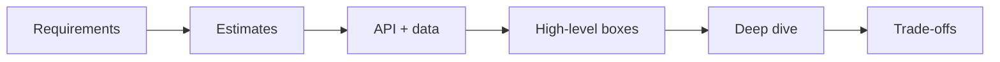
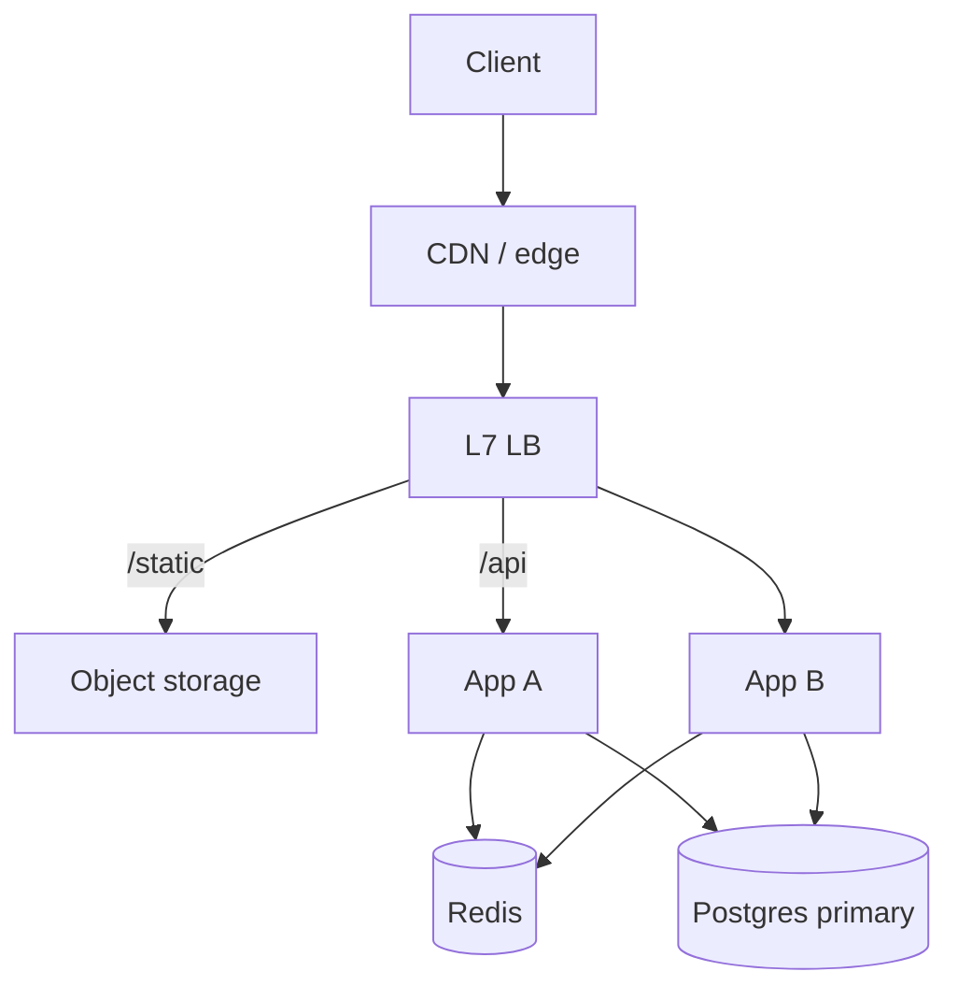

# 09 — System Design (Part 1 of 5): Framework, Estimation, Scale & Load Balancing

> **Parts:** **Part 1 — Framework, Estimation, Scale, Load Balancing** · [Part 2 — Cache, CDN, Databases, Queues, Consistency](./09-system-design-part2.md) · [Part 3 — Rate Limiter, URL Shortener, Chat, Notifications](./09-system-design-part3.md) · [Part 4 — Feed, Files, Typeahead, Frontend, Reliability](./09-system-design-part4.md) · [Part 5 — Resources, Practice, Interview Questions & Revision](./09-system-design-part5.md)
>
> Applies to: mid-to-senior **45-minute** design interviews as of October 2026. Postgres replication/partitioning internals are in [07 Part 2 §3.14](./07-databases-and-apis-part2.md#314-replication-partitioning-and-sharding); CAP/PACELC in [07 Part 3 §3.17](./07-databases-and-apis-part3.md#317-sql-vs-nosql-cap-and-pacelc); Redis cache-aside and BullMQ in [06 Part 3](./06-nodejs-part3.md); ALB/Nginx wiring in [10](./10-deployment-aws-ec2.md); CDN internals in [12](./12-cloudflare.md). This file is the *interview shape*: how you estimate, draw, and trade off. Consistent hashing, token-bucket, and circuit-breaker snippets were run on **Node 24.21** (type-stripped `.ts`).

## Table of Contents

- [1. Overview](#1-overview)
- [2. Topic Map](#2-topic-map)
- [3. Detailed Explanations (Part 1)](#3-detailed-explanations-part-1)
  - [3.1 The 45-Minute Framework](#31-the-45-minute-framework)
  - [3.2 Back-of-the-Envelope](#32-back-of-the-envelope)
  - [3.3 Vertical vs Horizontal, Stateless Services](#33-vertical-vs-horizontal-stateless-services)
  - [3.4 Load Balancing](#34-load-balancing)
- [Next: Part 2](#next-part-2)

---

## 1. Overview

**What this file covers.** How to run a system-design interview: a repeatable framework, Fermi estimates you can do on a whiteboard, the building blocks (load balancers, caches, CDNs, replicas, shards, queues, consistency), then full designs (rate limiter, shortener, chat, notifications, feed, uploads, typeahead), frontend design, reliability patterns, and when *not* to split into microservices.

**Why interviewers care.** At 3+ years the design round is not "draw Kubernetes". It is "can you turn a vague prompt into a capacity number, a data model, and two honest trade-offs before the timer ends". They are hiring someone who will not shard Postgres on day one and who *will* mention idempotency, fan-out, and failure modes.

| Junior answer | Senior answer |
|---------------|---------------|
| "I'd use Kafka and microservices" | "A 10-person team ships a modular monolith. We extract the notification worker when the deploy cadence hurts — here's the seam (outbox)" |
| "Cache everything in Redis" | "Cache-aside on the read path, delete-on-write, 60 s TTL. Stampede lock for the celebrity key. I accept 60 s of staleness; here's why that's OK" |
| "QPS is high so we shard" | "Average 2k writes/s, peak 10k. One primary handles that after indexes. Replicas for reads. Shard when a *single* tenant or key is the hotspot — here's the key" |
| "WebSockets for chat" | "WS to the edge, Redis pub/sub between instances ([06](./06-nodejs-part2.md#317-real-time-sse--websockets-at-scale)), messages durable in Postgres/Cassandra, presence in Redis with TTL" |

**Numbers in this file.** Latency table is **order-of-magnitude** (the classic "numbers every programmer should know" — RAM ~100 ns, same-DC RTT ~0.5 ms, cross-region ~50–150 ms). Estimates are Fermi: one significant figure is correct; three decimal places are a red flag. Hash-ring spread and token-bucket burst were measured on Node 24.21.

> 💡 Interview Tip: Talk while you write. Silence while you draw a perfect box diagram wastes the only signal they have — how you think. Narrate: "I'm assuming 100M DAU unless you want a different scale."

---

## 2. Topic Map

**Part 1 — How to run the interview**
- [ ] Framework: requirements → estimates → API → data → high-level → deep dive → trade-offs — [3.1](#31-the-45-minute-framework)
- [ ] QPS, storage, bandwidth; latency numbers — [3.2](#32-back-of-the-envelope)
- [ ] Vertical vs horizontal; what "stateless" actually forbids — [3.3](#33-vertical-vs-horizontal-stateless-services)
- [ ] L4 vs L7, algorithms, health checks, sticky sessions — [3.4](#34-load-balancing)

**[Part 2](./09-system-design-part2.md) — Building blocks**
- [ ] Cache-aside / write-through / write-back, invalidation, stampedes
- [ ] CDNs and cache keys (details in [12](./12-cloudflare.md))
- [ ] Replication vs sharding vs consistent hashing (Postgres ladder in [07](./07-databases-and-apis-part2.md#314-replication-partitioning-and-sharding))
- [ ] Kafka vs RabbitMQ vs SQS; at-least-once + DLQ
- [ ] CAP/PACELC applied to a design (definitions in [07](./07-databases-and-apis-part3.md#317-sql-vs-nosql-cap-and-pacelc))

**[Part 3](./09-system-design-part3.md) — Classic designs I**
- [ ] Rate limiter (Redis; Node Lua in [06](./06-nodejs-part2.md#315-rate-limiting-with-redis))
- [ ] URL shortener + ID generation
- [ ] Chat (WS fan-out, presence, ordering)
- [ ] Notifications (multi-channel, retries, prefs)

**[Part 4](./09-system-design-part4.md) — Classic designs II + the rest**
- [ ] News feed (fan-out on write vs read; celebrity)
- [ ] File upload (pre-signed + multipart → [11](./11-deployment-aws-s3.md))
- [ ] Autocomplete (trie + top-k)
- [ ] Frontend system design
- [ ] Timeouts, retries, circuit breakers, bulkheads (SLOs in [08](./08-engineering-practices-part4.md#328-slis-slos-and-sentry))
- [ ] Modular monolith vs microservices; gateway; discovery
- [ ] 2PC, sagas, outbox; Snowflake / UUIDv7 / ULID; geo & video skim

**[Part 5](./09-system-design-part5.md)** — Resources, ~39 h path, exercises, 36 questions, recap.

---

## 3. Detailed Explanations (Part 1)

### 3.1 The 45-Minute Framework

Same spine every time. Skipping a step is how you get trapped in a deep-dive on the wrong bottleneck.

| Min | Step | What you produce |
|----:|------|------------------|
| 0–4 | **Requirements** | Functional list + NFRs: QPS, latency SLO, consistency, availability. *Ask* DAU, read/write ratio, mobile vs web, "must not lose X" |
| 4–8 | **Estimates** | Peak QPS, storage / year, bandwidth. One significant figure. State assumptions out loud |
| 8–12 | **API + data model** | 5–8 endpoints, core tables/collections, the primary key / partition key |
| 12–22 | **High-level** | Clients → CDN → LB → app → cache → DB → queue → workers. Boxes *and* arrows labelled with protocols |
| 22–40 | **Deep dive** | The one or two hard parts (fan-out, ID gen, hot keys, ordering, upload). Failure modes |
| 40–45 | **Trade-offs** | What you would do at 10×. What you postponed. Metrics you'd watch |

**Clarify like a product partner, not a questionnaire.** Three good questions beat twelve yes/no:

1. Scale: DAU, read/write, objects per user, peak vs average (usually 4–10×).
2. Consistency: "Can a follower see a post 5 seconds late?" If yes, you just unlocked caches and async fan-out.
3. Failure: "Lose a notification, or delay it?" That picks at-least-once + inbox vs synchronous send.

**Non-functionals they expect you to name even if they don't:** p99 latency (read vs write), availability (two nines vs three), durability (can we drop a presence blip?), security (authn on every path, pre-signed uploads not public buckets), cost (egress).



> ⚠️ Pitfall: Jumping to Kafka in minute two. If you cannot say the QPS, you cannot justify a log. Most full-stack prompts (notes, shortener, notifications for a mid-size app) fit on **one Postgres primary + replicas + Redis + a queue**.

> 💡 Interview Tip: Write the assumptions at the top of the whiteboard (`DAU=10M`, `write:read=1:100`, `eventual OK on feed`). They will correct you; that is the interview working.

### 3.2 Back-of-the-Envelope

**Daily → seconds.** Average QPS ≈ `events_per_day / 86_400`. Peak ≈ average × 4 to 10 (product-dependent; say which).

```text
10M DAU × 20 reads/day  = 200M reads/day
200e6 / 86400           ≈ 2,300 reads/s average
peak (×5)               ≈ 12,000 reads/s
writes at 1:20          ≈ 115/s average, ~600/s peak
```

**Storage.** `rows_per_day × bytes_per_row × retention`. JSON-ish row ≈ 0.5–2 KB unless you are storing blobs (those go to object storage). Indexes often **double** the table. Replication doubles again.

```text
600 writes/s × 86400 × 1 KB × 365 × 5 years ≈ 95 TB raw
+ indexes ~2×, 3 replicas → plan for hundreds of TB
→ partition/archive; blobs in S3 not in Postgres ([07](./07-databases-and-apis.md), [11](./11-deployment-aws-s3.md))
```

**Bandwidth.** `QPS × response_bytes`. 12k reads/s × 2 KB ≈ 24 MB/s ≈ 0.2 Gbps — a single NIC, not a science project. Video and image feeds are where bandwidth becomes the design.

**Memory for cache.** Working set, not total rows. "Top 1% of keys are 80% of reads" (classic Zipf) → cache that 1%. 1M hot keys × 2 KB ≈ 2 GB — one Redis instance, until you have a hot *key* ([Part 2](./09-system-design-part2.md)).

**Latency numbers (order of magnitude — for comparisons, not SLAs):**

| Thing | Ballpark |
|-------|----------|
| L1 / L2 / RAM | 1 ns / 4 ns / 100 ns |
| SSD random read | 0.1 ms |
| Same-datacenter RTT | 0.5 ms |
| Postgres primary in the same AZ, indexed point read | ~1 ms |
| Cross-AZ | a few ms |
| Cross-region (US ↔ EU) | 50–150 ms |
| HDD seek (if anyone still asks) | 10 ms |

**What to do with them.** An extra network hop is ~1 ms in-AZ and **100 ms** cross-region. N+1 queries across the network are the design bug, not the SQL bug. Don't put the app in `us-east-1` and the DB in `eu-west-1` "for DR" and then wonder why p99 is 200 ms.

**Five drills** (do each in < 5 minutes; acceptance criteria in [Part 5 exercise 1](./09-system-design-part5.md#8-hands-on-practice)):

1. URL shortener: 100M new URLs/month, 10:1 redirects.
2. Twitter-like: 200M DAU, 2 posts/user/day, 50:1 read/write on the feed.
3. Chat: 50M DAU, 20 messages/user/day, 1:1 rooms plus a few large groups.
4. Photo upload: 5M uploads/day, 4 MB average, 3 thumbnails.
5. Autocomplete: 10k QPS of prefix queries, 1k of those unique prefixes.

> 💡 Interview Tip: Units first (`/s`, `GB`, `Gbps`). If you write `100M` without `/day` or `/s`, they cannot follow. Divide by 10^5 ≈ 86_400 when you need per-second from per-day.

### 3.3 Vertical vs Horizontal, Stateless Services

**Vertical:** bigger box. Simple, preserves transactions and single-node latency. Ceiling: biggest instance, one AZ blast radius, failover is "wait for the replica to promote".

**Horizontal:** more boxes. Requires **stateless app servers** (any instance can handle any request) and a store that can take the write load (or a queue in front of it).

| Keep on the instance | Push out |
|----------------------|----------|
| Code, connection pool, in-process LRU of *tiny* hot keys | Sessions, uploaded files, job state, WebSocket fan-out, rate-limit counters |
| | Redis / DB / S3 / queue |

**Making a stateful Express app stateless** (the syllabus drill):

1. Session: `express-session` with MemoryStore → Redis store (or JWT access + Redis/DB refresh, [06](./06-nodejs-part2.md#314-authentication--authorization)).
2. Uploads: `diskStorage` → S3 pre-signed ([11](./11-deployment-aws-s3.md)).
3. In-memory rate limits / caches → Redis so two instances don't each allow the full quota.
4. `setInterval` jobs on the web process → a worker (BullMQ / SQS). Two web instances will double-fire the cron.
5. WebSockets: you cannot be fully stateless (a socket is pinned). Use **sticky L7** *or* a pub/sub backplane so the pin doesn't matter for *delivery* ([06](./06-nodejs-part2.md#317-real-time-sse--websockets-at-scale)). Prefer the backplane.

**Scale ladder** (say this out loud when they ask "how would you scale X"):

```text
1. Measure (slow query, p99, CPU, lock waits)
2. Fix the query / add the index / cache the hot read
3. Connection pool (PgBouncer)
4. Vertical on the primary
5. Read replicas for read-heavy paths (read-your-writes!)
6. Queue writes that don't need to be synchronous
7. Partition / archive
8. Shard — last
```

That ladder is the [07](./07-databases-and-apis-part2.md#314-replication-partitioning-and-sharding) interview tip expanded to the whole system.

> ⚠️ Pitfall: "We run 12 Node instances so we're scaled." If they share one Postgres with `max_connections` 100 and each has `pool.max = 20`, you are connection-bound, not CPU-bound. Horizontal without pooling is a self-DDoS.

### 3.4 Load Balancing

**L4 (transport):** TCP/UDP. Cheap, doesn't parse HTTP. TLS is passed through or terminated by a separate hop. Used for raw TCP (databases, some WS if you terminate TLS elsewhere), DNS-based, or NLB-style.

**L7 (application):** HTTP/HTTP2. Path `/api` vs `/static`, header routing, cookie stickiness, WebSocket upgrade, can retry idempotent GETs. ALB, Nginx `http`, Envoy, Cloudflare. This is the default in front of a Node/Next fleet.

| Algorithm | Use | Failure mode |
|-----------|-----|--------------|
| Round robin | Homogeneous, stateless | One slow instance still gets equal share |
| Least connections | Long requests / WS | Needs accurate connection counts |
| Weighted | Mixed instance sizes | Weights rot when you forget to change them |
| Consistent hash (on IP or cookie or user id) | Session-ish affinity, cache locality | Imbalance if the hash key is skewed — [Part 2](./09-system-design-part2.md) |

**Health checks.** Hit **readiness**, not liveness: `/readyz` should fail when Postgres or Redis is gone so the LB **stops sending traffic**; `/healthz` (liveness) failing restarts the process ([06](./06-nodejs-part3.md)). Interval + unhealthy threshold: too aggressive and a GC pause takes you out of rotation; too lax and you serve 502s for a minute.

**Sticky sessions.** Cookie or IP affinity so the same client hits the same instance. Legitimate for: in-memory WebSocket maps *without* a backplane (a crutch); some WebSocket LBs. Smell for: sessions, carts, "the upload lives on disk until we process it". Sticky hides state that will bite you on deploy (the instance drains, the cart vanishes).

**TLS.** Terminate at the LB (ACM on ALB — [10](./10-deployment-aws-ec2.md)) or at Nginx on the box. HTTP to the app on a private network is common; mTLS to the app is the stricter variant.



Nginx sketch (full deploy in [10](./10-deployment-aws-ec2.md)):

```nginx
upstream api {
    least_conn;
    server 10.0.1.11:3000 max_fails=3 fail_timeout=10s;
    server 10.0.1.12:3000 max_fails=3 fail_timeout=10s;
}
server {
    listen 443 ssl;
    location /api/ {
        proxy_pass http://api;
        proxy_http_version 1.1;
        proxy_set_header Connection "";
        proxy_set_header Host $host;
        proxy_set_header X-Forwarded-For $proxy_add_x_forwarded_for;
        proxy_set_header X-Forwarded-Proto $scheme;
        proxy_read_timeout 60s;
    }
}
```

`X-Forwarded-For`: the app must `trust proxy` for **exactly** the hop count, or clients spoof `req.ip` and your rate limiter is theatre ([06](./06-nodejs-part2.md)).

> 💡 Interview Tip: If they say "load balancer", ask L4 or L7. If they say "sticky sessions", ask what state you would rather externalize.

---

## Next: Part 2

➡️ [Part 2 — Cache, CDN, Databases, Queues, Consistency](./09-system-design-part2.md): cache strategies and stampedes, edge cache keys, the replica→shard ladder plus a consistent-hash ring you can run, Kafka vs Rabbit vs SQS, CAP/PACELC in a design.
