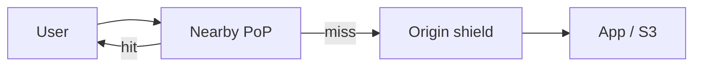
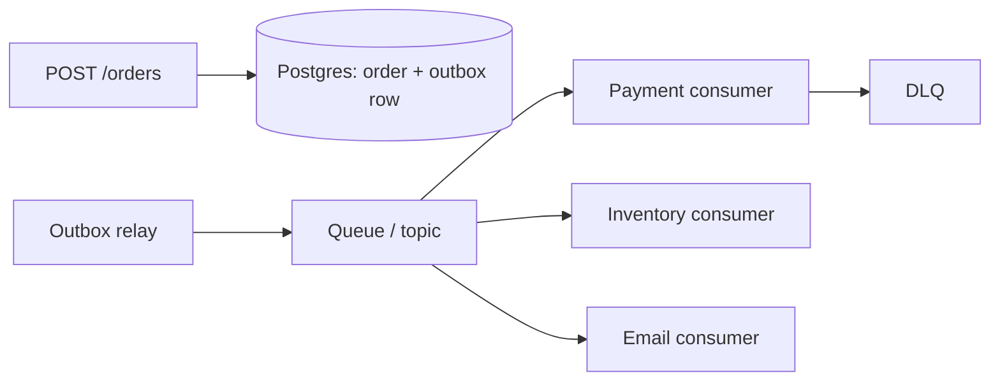

# 09 — System Design (Part 2 of 5): Cache, CDN, Databases, Queues & Consistency

> **Parts:** [Part 1 — Framework, Estimation, Scale, Load Balancing](./09-system-design-part1.md) · **Part 2 — Cache, CDN, Databases, Queues, Consistency** · [Part 3 — Rate Limiter, URL Shortener, Chat, Notifications](./09-system-design-part3.md) · [Part 4 — Feed, Files, Typeahead, Frontend, Reliability](./09-system-design-part4.md) · [Part 5 — Resources, Practice, Interview Questions & Revision](./09-system-design-part5.md)
>
> Applies to: design-interview granularity. Redis cache-aside, stampede lock, and Lua rate limits: [06 Part 3 §3.18](./06-nodejs-part3.md#318-caching-with-redis) / [§3.15](./06-nodejs-part2.md#315-rate-limiting-with-redis). Postgres replicas, partitioning, when to shard: [07 Part 2 §3.14](./07-databases-and-apis-part2.md#314-replication-partitioning-and-sharding). CAP/PACELC definitions: [07 Part 3 §3.17](./07-databases-and-apis-part3.md#317-sql-vs-nosql-cap-and-pacelc). CDN products: [12](./12-cloudflare.md). The consistent-hash ring below was run on Node 24.21: 10_000 keys across 3 nodes spread 3081 / 3144 / 3775 (ratio 1.23).

## Table of Contents

- [3. Detailed Explanations (Part 2)](#3-detailed-explanations-part-2)
  - [3.5 Caching Strategies](#35-caching-strategies)
  - [3.6 CDNs and Edge Caching](#36-cdns-and-edge-caching)
  - [3.7 Database Scaling and Consistent Hashing](#37-database-scaling-and-consistent-hashing)
  - [3.8 Message Queues and Event-Driven Design](#38-message-queues-and-event-driven-design)
  - [3.9 Consistency in a Design Interview](#39-consistency-in-a-design-interview)
- [How to run the code in this file](#how-to-run-the-code-in-this-file)
- [Next: Part 3](#next-part-3)

---

## 3. Detailed Explanations (Part 2)

### 3.5 Caching Strategies

A cache is a **correctness trade**: you are buying latency with staleness (and operational surface). Name the strategy and the invalidation, or you haven't designed a cache.

| Strategy | Write path | Read path | When |
|----------|------------|-----------|------|
| **Cache-aside** (lazy) | App writes DB, **deletes** (or sets) the key | Miss → DB → fill cache | Default for full-stack apps. [06](./06-nodejs-part3.md#318-caching-with-redis) measured this |
| **Read-through** | Same as aside; the cache library fills on miss | Caller only talks to cache | When you want one client |
| **Write-through** | App writes cache, cache writes DB synchronously | Hit is fresh | Need read-your-writes through the cache; write latency includes DB |
| **Write-back** (write-behind) | App writes cache; DB is flushed later | Fast writes | Dangerous for money. A crash loses acknowledged writes unless the cache is replicated and you accept the window |

**Invalidation** is the hard part (Phil Karlton wasn't joking):

- **Delete-on-write** of the exact key (`note:{id}`). Simple, races: a reader can refill with the old row if it read the DB *before* your write committed. Version the value or accept TTL-bounded staleness.
- **TTL** as a backstop (30–300 s for user-facing lists). Even with delete-on-write, a missed delete heals.
- **Versioned keys** (`note:{id}:v{n}`) so you never serve a zombie.
- **CDC** (Debezium, Postgres logical replication) to invalidate from the WAL when many services cache the same row.

**Stampede / thundering herd.** Hot key expires, 2_000 requests miss together, all hit Postgres. Fix: single-flight lock (`SET key:lock NX PX 1000`) so one requester fills; the rest wait or serve stale. Implementation in [06](./06-nodejs-part3.md#318-caching-with-redis). At design time: "I'd add a lock around the celebrity key, and a short stale-while-revalidate."

**Hot key vs big key.** One key taking 90% of QPS saturates a Redis shard (single-threaded). Split (local LRU in front of Redis), replicate the hot item, or compute it into many keys. One 5 MB value is a **big** key — split or don't cache.

**Where to cache.**

```text
Browser / CDN   → public, cache-key = URL + vary headers      (seconds–days)
App in-process  → tiny ultra-hot, per instance, gone on deploy (use sparingly)
Redis           → session, note-by-id, rate counters, locks
```

> 💡 Interview Tip: They will ask "is the cache consistent?" Answer: **eventual, bounded by TTL**, plus delete-on-write. If they need linearizability, don't cache that path (checkout totals, inventory decrement).

### 3.6 CDNs and Edge Caching

A CDN is a geographically distributed cache in front of origin. Users hit a nearby PoP; origin sees a fraction of the traffic. Product details (Cloudflare cache, purge, Workers) are [12](./12-cloudflare.md); CloudFront + OAC are [11](./11-deployment-aws-s3.md). Here: **what you say in a design**.

**Cache key.** Default: scheme + host + path + query. Wrong keys:

- Including cookies / `Authorization` → per-user copies, cache hit ratio collapses.
- Omitting a query param that changes the body (`?v=`) → serving the wrong asset.
- Caching `Set-Cookie` responses → leaking sessions. `Cache-Control: private` for authenticated HTML.

**What belongs at the edge.** Immutable hashed static (`/static/app.a1b2c3.js`, `max-age=31536000, immutable`). Public images. Public API GETs that tolerate 30–60 s staleness (a marketing page, *not* "my inbox").

**Purge.** By URL, by tag (`Cache-Tag: note-42`), or "purge all" (nuclear). Tag purge is how a CMS ships an edit without waiting for TTL. Soft-purge / stale-while-revalidate keeps the PoP snappy.

**Origin shield.** One PoP talks to origin so a global miss doesn't stampede your app from every region at once.



**HTTPS and cookies.** TLS usually terminates at the edge. The edge must not cache responses that differ by cookie unless `Vary` is correct — and `Vary: Cookie` is often a miss-machine.

> ⚠️ Pitfall: "We'll CDN the Next.js app" without separating **static** from **personalized RSC/HTML**. Personalized HTML at the edge needs a cache key that includes the session, which is usually *don't cache HTML, cache the data*.

### 3.7 Database Scaling and Consistent Hashing

**Ladder** (do not skip rungs) — Postgres-shaped, details measured in [07 §3.14](./07-databases-and-apis-part2.md#314-replication-partitioning-and-sharding):

1. Indexes, query rewrite, `EXPLAIN`.
2. Pool (PgBouncer transaction mode).
3. Bigger primary.
4. **Read replicas.** Async: lag, **read-your-writes** after a POST. Sync: latency on the write.
5. Partition (time, tenant) *on one cluster* — still one primary's write bandwidth.
6. Archive cold data.
7. **Shard** across primaries.

**Sharding strategies.**

| Key | Good for | Hotspot |
|-----|----------|---------|
| `user_id` / `tenant_id` | Multi-tenant SaaS; most queries already scoped | Celebrity tenant; "all of Twitter" isn't one user but a few are |
| Time | Time-series, logs | Today's partition takes all writes |
| Hash(id) | Even load | Range queries (`WHERE created_at BETWEEN`) scatter |
| Geo | Latency to the user | Cross-region users, "nearby" queries need a geo index |

**Directory / lookup.** Naive: `hash(user_id) % N`. Adding a node reshuffles **~all** keys. **Consistent hashing** moves only ~`1/N` of keys.

Verified on Node 24.21 (FNV-1a + 150 virtual nodes; 10k keys → ratio 1.23 — even enough for a whiteboard, not a production hash):

```ts
function fnv1a(s: string): number {
  let h = 0x811c9dc5;
  for (let i = 0; i < s.length; i++) {
    h ^= s.charCodeAt(i);
    h = Math.imul(h, 0x01000193);
  }
  return h >>> 0;
}

export class ConsistentHash {
  private ring = new Map<number, string>();
  private keys: number[] = [];
  private readonly vnodes: number;

  constructor(nodes: string[], vnodes = 150) {
    this.vnodes = vnodes;
    for (const n of nodes) this.add(n);
  }

  add(node: string): void {
    for (let i = 0; i < this.vnodes; i++) {
      this.ring.set(fnv1a(`${node}#${i}`), node);
    }
    this.keys = [...this.ring.keys()].sort((a, b) => a - b);
  }

  get(key: string): string {
    if (this.keys.length === 0) throw new Error('empty ring');
    const h = fnv1a(key);
    let lo = 0;
    let hi = this.keys.length;
    while (lo < hi) {
      const mid = (lo + hi) >>> 1;
      if (this.keys[mid]! < h) lo = mid + 1;
      else hi = mid;
    }
    const idx = lo === this.keys.length ? 0 : lo;
    return this.ring.get(this.keys[idx]!)!;
  }
}
```

**Virtual nodes** smear a physical node around the ring so one added machine takes a slice from *many* neighbors, not all of its clockwise victim. Production rings: xxHash/Murmur, hundreds of vnodes, often **bounded loads** (Jump / Maglev / rendezvous) to cap imbalance. Dynamo-style: each key replicated to the next *N* distinct physical nodes on the ring (preference list).

**Hotspots after sharding.** A celebrity user's shard still melts. Escape hatches: split that tenant (inbox vs profile), cache the hot read path, or a dedicated "whale" cluster. Hashing does not fix a Zipf key.

> 💡 Interview Tip: "I'd shard by user_id with consistent hashing, 150 vnodes, and a replica set *per shard*." Then: "I wouldn't shard this at 5k writes/s." That second sentence is the senior one.

### 3.8 Message Queues and Event-Driven Design

Use a queue when the HTTP request should not wait on the side effect: email, thumbnail, fan-out, webhooks. The HTTP path writes a **durable intent** and returns 202/201.

| | **SQS** (managed queue) | **RabbitMQ** (broker) | **Kafka** (log) |
|--|-------------------------|----------------------|-----------------|
| Model | Messages disappear when consumed (after visibility timeout) | Queues + exchanges + routing keys | Append-only partitioned log; consumers have offsets |
| Replay | No (unless you designed it) | No | Yes, while retention lasts |
| Ordering | Standard: none. FIFO: per message-group, lower throughput (check current quotas) | Per-queue if a single consumer | Per **partition** |
| Delivery | At-least-once | At-least-once (ack) | At-least-once (commit offset after process) |
| Fan-out | SNS→SQS, or EventBridge | Multiple queues bound to one exchange | Many consumer groups, each gets all |
| Ops | None | You run Erlang nodes, or a vendor | You run (or pay for) brokers, partitions, rebalances |
| Typical | Notifications, webhooks, "do this later" | Task routing, classic workers | Event sourcing, CDC, high-throughput streams, many independent consumers |

**At-least-once is the default.** The consumer **will** see duplicates (retry, crash after side effect before ack). So: **idempotent consumers** (idempotency key in DB unique index — [07](./07-databases-and-apis.md)), or an inbox table of processed message ids.

**At-most-once:** ack before processing — you can lose the message. Almost never what you want for payments.

**Exactly-once:** marketing. End-to-end exactly-once needs a transactional outbox + idempotent sink, or Kafka transactions in a closed ecosystem. Say "effectively once" and describe the unique constraint.

**DLQ (dead-letter queue).** After N failures, the message leaves the hot queue so it doesn't block the partition/queue. Alert on DLQ depth. A DLQ you never replay is a silent data dump.

**Poison pill.** A message that always throws. Without a max-retry + DLQ, one JSON blob stalls the consumer forever.

**Backpressure.** If consumers are slower than producers, the log/queue grows. Kafka: disk until retention, then you lose (or halt producers if you configure it). SQS: almost unbounded, **money**. Design: scale consumers, shed load, or slow the producer.

**Order pipeline sketch:**



HTTP handler and the outbox insert are **one transaction**. The relay publishes. Consumers are idempotent. This is the [06 BullMQ](./06-nodejs-part3.md#319-background-jobs-with-bullmq) + [07 outbox](./07-databases-and-apis-part2.md) story at design scale. Kafka if several independent teams need the same stream and replay; SQS/BullMQ if you have one worker pool and no replay requirement.

> ⚠️ Pitfall: Dual-write `INSERT order` then `queue.send` without an outbox. Crash between them: order without a job, or a job for a rolled-back order.

### 3.9 Consistency in a Design Interview

Definitions live in [07 §3.17](./07-databases-and-apis-part3.md#317-sql-vs-nosql-cap-and-pacelc). Here is how you *use* them.

**Ask which facts can be stale.** Feed posts: 5 s late is fine (AP / EL = L). Bank balance, inventory decrement, "did this payment succeed?": CP / EL = C on that path.

**Read-your-writes.** After POST `/notes`, GET `/notes/:id` must see it. Fixes: read that user's writes from the primary for T seconds; session sticky to primary; version token in the client (`If-Match`). Don't blindly send all GETs to replicas.

**Monotonic reads.** A user who saw note v2 should not later see v1 from a laggier replica. Sticky replica or "read from primary if you've seen a newer version."

**Causal vs linearizable.** Chat in a room: messages from *you* should appear in send order (causal/client order). Global linearizability across rooms is expensive and unused.

**PACELC one-liner for a design:** "No partition: we pick latency — async replica, 60 s cache TTL. Partition: the primary stays writable in one AZ (availability for writes) and replicas may serve stale reads; payments go only to the primary and fail if it is unreachable (fail closed, [08 A10](./08-engineering-practices-part4.md))."

Don't brand products ("Mongo is AP"). Name the **write concern**, the **TTL**, and the **replica lag SLO**.

---

## How to run the code in this file

```powershell
# Node 24.21 type-stripped .ts — measured 10_000 keys, ratio 1.23
node hash.ts
```

---

## Next: Part 3

➡️ [Part 3 — Rate Limiter, URL Shortener, Chat, Notifications](./09-system-design-part3.md): four full designs with estimates, APIs, data, and the one deep-dive each interview actually wants.
