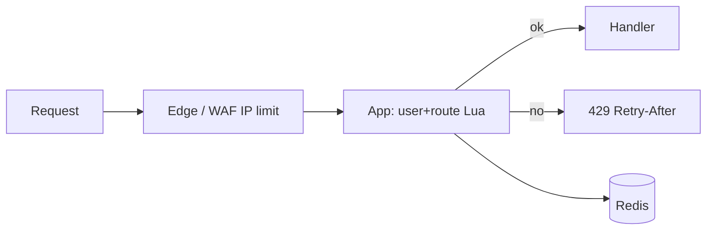
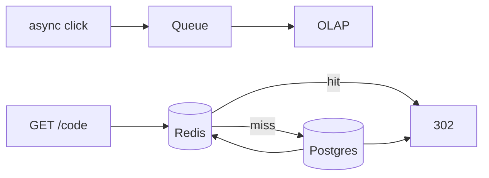
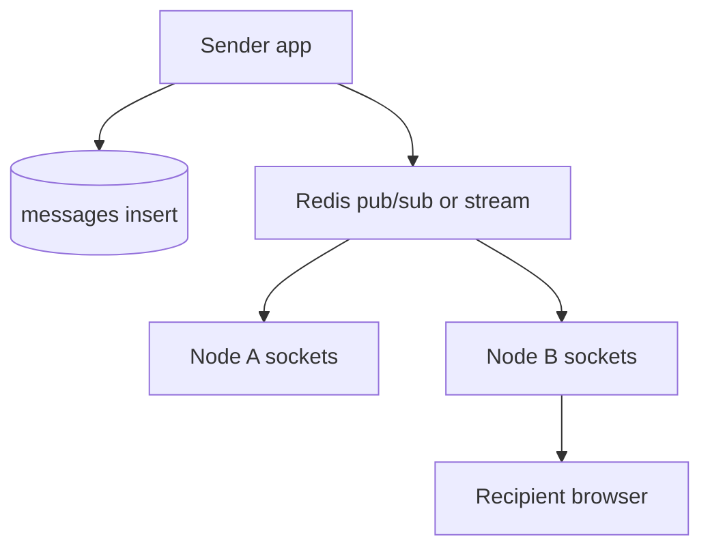
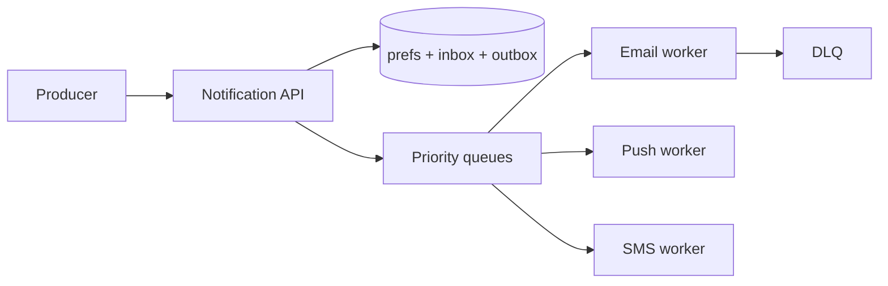

# 09 — System Design (Part 3 of 5): Rate Limiter, URL Shortener, Chat, Notifications

> **Parts:** [Part 1 — Framework, Estimation, Scale, Load Balancing](./09-system-design-part1.md) · [Part 2 — Cache, CDN, Databases, Queues, Consistency](./09-system-design-part2.md) · **Part 3 — Rate Limiter, URL Shortener, Chat, Notifications** · [Part 4 — Feed, Files, Typeahead, Frontend, Reliability](./09-system-design-part4.md) · [Part 5 — Resources, Practice, Interview Questions & Revision](./09-system-design-part5.md)
>
> Four classic prompts, each run through [Part 1's framework](./09-system-design-part1.md#31-the-45-minute-framework). Redis Lua limiters: [06 §3.15](./06-nodejs-part2.md#315-rate-limiting-with-redis). WebSocket backplane: [06 §3.17](./06-nodejs-part2.md#317-real-time-sse--websockets-at-scale). Token-bucket burst was measured on Node 24.21 (10 tokens, 20 immediate `take()` → 10 allowed).

## Table of Contents

- [3. Detailed Explanations (Part 3)](#3-detailed-explanations-part-3)
  - [3.10 Design: Rate Limiter](#310-design-rate-limiter)
  - [3.11 Design: URL Shortener](#311-design-url-shortener)
  - [3.12 Design: Chat](#312-design-chat)
  - [3.13 Design: Notification System](#313-design-notification-system)
- [How to run the code in this file](#how-to-run-the-code-in-this-file)
- [Next: Part 4](#next-part-4)

---

## 3. Detailed Explanations (Part 3)

### 3.10 Design: Rate Limiter

**Requirements.** Limit `N` requests per user (or IP, or API key) per window. Soft vs hard: HTTP `429` + `Retry-After`. Must work across many app instances. Fail **open** or **closed** if Redis is down? Product call: login closed (abuse), public GET open (availability) — name it ([08 A10](./08-engineering-practices-part4.md)).

**Estimates.** 12k QPS of *limited* requests (from Part 1's 10M DAU example). Redis: one INCR / ZADD per request, sub-ms. Memory: 10M keys × ~100 B ≈ 1 GB if you keep a row per user; TTLs expire idle keys.

**API.** Usually a library in the app or a sidecar/gateway, not a public API:

```http
X-RateLimit-Limit: 100
X-RateLimit-Remaining: 41
X-RateLimit-Reset: 1760460000
# 429
Retry-After: 12
```

**Algorithms.**

| Algorithm | Idea | Pros | Cons |
|-----------|------|------|------|
| Fixed window | `INCR user:2026-10-14T12:00` TTL 60 | Simple | Burst of 2N at the window edge |
| Sliding log | Sorted set of timestamps, `ZREMRANGEBYSCORE`, `ZCARD` | Accurate | Memory per request |
| Sliding window (approx) | Weighted previous window + current | Cheap, smooths the edge | Approx |
| **Token bucket** | Burst `B`, refill `R`/s | Allows honest bursts; easy to explain | Needs atomic refill |
| Leaky bucket | Queue drained at constant rate | Smooth egress | Delays rather than rejects |

Verified in-process token bucket (Node 24.21): capacity 10, 20 immediate takes → **10 allowed**. Across instances this must be **one Redis key**, not one bucket per process.

```ts
export class TokenBucket {
  private tokens: number;
  private last = Date.now();
  private readonly ratePerSec: number;
  private readonly burst: number;

  constructor(ratePerSec: number, burst: number) {
    this.ratePerSec = ratePerSec;
    this.burst = burst;
    this.tokens = burst;
  }

  take(n = 1): boolean {
    const now = Date.now();
    const elapsed = (now - this.last) / 1000;
    this.tokens = Math.min(this.burst, this.tokens + elapsed * this.ratePerSec);
    this.last = now;
    if (this.tokens < n) return false;
    this.tokens -= n;
    return true;
  }
}
```

**Deep dive — distributed.** App-local buckets don't work behind an LB (each instance allows `N`). Redis + **Lua** (or `INCR` + TTL for fixed window) so the check-and-decrement is atomic. [06](./06-nodejs-part2.md#315-rate-limiting-with-redis) has the Lua. Gateway (Cloudflare / API Gateway) for IP/bot limits before they reach Node; Redis for **per-user / per-route** limits that know the session.

**Rules of thumb.** Limit by the *expensive* dimension: `POST /login` by IP+email, `POST /search` by user, webhooks by partner. Different limits per route. Return 429, not 500. Don't log every rejection at error level (that's a self-DoS of your log pipeline).



> 💡 Interview Tip: Mention the window-edge burst of a naive fixed window unprompted. That's the "they've implemented one" signal.

### 3.11 Design: URL Shortener

**Requirements.** `POST` a long URL → short code. `GET /{code}` → 302/301 to the long URL. Optional: custom alias, expiry, auth, analytics. Assume 100M new URLs/month, 10:1 redirects, 10 years retention, unique codes, low latency on redirect (this *is* the product).

**Estimates.**

```text
Writes: 100e6 / 2.6e6 s/month ≈ 40/s average, ~400/s peak
Reads:  400/s × 10            ≈ 4,000/s average, ~40k/s peak
Rows:   100e6 × 12 × 10       ≈ 12B
Row:    code 8 B + url 100 B + meta 50 B ≈ 160 B → ~2 TB + indexes
Redirect is a point read — cache will eat most of the 40k/s
```

**API.**

```http
POST /v1/links { "url": "https://example.com/very/long", "ttlDays": 365 }
→ 201 { "code": "aZ3kQ9", "short": "https://s.example/aZ3kQ9" }

GET /aZ3kQ9  → 302 Location: https://example.com/very/long
```

**301 vs 302.** 301 (permanent) is cached by browsers and some CDNs — you **cannot** change the destination or count clicks reliably. 302 (or 307) for analytics and editable links. Default in interviews: **302** unless they ask for CDN offload.

**Data.** `links(code PK, url, created_at, expires_at, owner_id)`. Unique on `code`. Analytics: don't write a row per click on the request path — enqueue `{code, ts, ua}` or Redis `INCR` and flush.

**ID generation** (the deep dive):

| Scheme | How | Collision | Sorted | Ops |
|--------|-----|-----------|--------|-----|
| **Hash** (SHA256 → base62, take 7) | Deterministic, same URL → same code (maybe a feature) | Birthday: 62^7 ≈ 3.5e12; 12B rows is still tiny, but you must retry on clash | No | Stateless |
| **Counter** (Redis `INCR` → base62) | Short, sequential | None | Yes (leaks volume) | Redis is now in the write path; counters are a hotspot |
| **Snowflake** (timestamp + worker + seq) | 64-bit int, k-sortable | None if clock/worker unique | Yes | Clock skew; workers need IDs — [Part 4](./09-system-design-part4.md#321-distributed-ids) |
| **UUIDv7** | 128-bit, time-ordered | Practically none | Yes | Longer in the URL unless you base62 the bits |
| Pre-generated unused codes | Workers fill a pool | None | Optional | Great for custom alphabets; more moving parts |

Base62 `[0-9A-Za-z]`, 7 chars is plenty at this scale; 8 if you want headroom or to skip curse-word filters (drop a dictionary of codes).

**Read path.** CDN optional (302 + cacheable is awkward). App: Redis `GET code` → on miss, Postgres → fill. Bloom filter in front if you want cheap 404s for random scanners (optional; don't lead with it).



> ⚠️ Pitfall: Hashing the URL and treating collisions as "same link" without asking. Two users shortening the same URL may or may not want the same code (analytics, ownership, takedown).

### 3.12 Design: Chat

**Requirements.** 1:1 and group chats, history, online presence, message order *in a conversation*, at-least-once delivery, unread counts. Not Slack-at-Microsoft-scale unless they say so — 50M DAU is already a serious system.

**Estimates.**

```text
50M DAU × 20 msgs/day = 1B msgs/day ≈ 12k writes/s avg, ~50k peak
Read (open a thread): fan-in of last 50 msgs — cache the hot threads
Connections: 10M concurrent would be a WS fleet problem (10M × 1 connection)
  → many Node processes, sticky or (better) a backplane; or a dedicated WS edge (Cloudflare / AWS Gateway)
```

**API.** REST for history and receipts; WebSocket (or SSE for server→client only) for live:

```text
WS: { type: "send", convId, clientMsgId, body, sentAt }
WS: { type: "recv", convId, serverId, body, from, sentAt }
GET /v1/conversations/:id/messages?cursor=
POST /v1/conversations/:id/read { lastId }
```

**Data.**

- `conversations(id, type, created_at)`
- `members(conv_id, user_id, last_read_id)` — unread = messages after `last_read_id`
- `messages(id, conv_id, sender_id, body, created_at)` — PK `(conv_id, id)` so a conversation is one partition
- Presence: Redis `SET user:{id}:presence 1 EX 30` refreshed on ping; not Postgres

**IDs.** Snowflake / UUIDv7 so messages sort by id ≈ time without `ORDER BY created_at` fights.

**Fan-out (the deep dive).** User on instance A sends; recipients connected to B, C must receive.



- **Small rooms:** publish the message on `conv:{id}`; every instance with a socket in that room delivers. [06](./06-nodejs-part2.md#317-real-time-sse--websockets-at-scale) is this pattern.
- **Huge rooms (100k):** don't iterate 100k sockets in the request. Write the message once; let each recipient's **inbox** / device stream pull. Same celebrity problem as [feeds](./09-system-design-part4.md#314-design-news-feed).

**Ordering.** Per conversation: single writer to that partition (or IDs that sort), clients reorder by `id`. No global order across conversations. `clientMsgId` for idempotent retries (the sender's WS dropped after the server stored it).

**Presence.** Heartbeat every 20 s, TTL 30 s. "Last seen" can be async. Don't fire Postgres on every ping.

**History.** Keyset on `(conv_id, id)` — [07](./07-databases-and-apis.md). Cold history in cheaper storage if you ever hit Slack-scale; don't start there.

> 💡 Interview Tip: They will ask "how do you scale WebSockets?" Two sentences: (1) connections are stateful, so a WS fleet + Redis pub/sub; (2) the **message** is durable in the DB *before* fan-out, or a reconnect loses what pub/sub already dropped.

### 3.13 Design: Notification System

**Requirements.** Notify a user over one or more channels: in-app, push, email, SMS. User preferences (per type × channel), quiet hours, retries, no duplicate spam. Producers: "order shipped", "new follower", "2FA code". 2FA is **high priority / low volume / fail loud**; "liked your post" is the opposite.

**Estimates.** 10M DAU × 5 notifs/day = 50M/day ≈ 600/s avg, 5k/s peak. Fan-out to 3 channels is 15k/s of *attempts*, most async.

**API.**

```http
POST /internal/notifications
{ "userId", "type": "order.shipped", "payload": { "orderId": "…" }, "idempotencyKey": "order-123-shipped" }

GET /v1/notifications?cursor=     # in-app inbox
PATCH /v1/preferences              # { "order.shipped": { "email": true, "push": true, "sms": false } }
```

**Data.** `templates(type, channel, body)`. `preferences(user_id, type, channel, enabled)`. `notifications(id, user_id, type, payload, created_at, read_at)` for in-app. `delivery_attempts(id, notif_id, channel, status, next_retry_at)`. Unique `(idempotencyKey)` so producers can retry.

**Pipeline.**



1. Authz: only internal callers; never let a user POST to another user.
2. Load prefs + quiet hours. Drop disabled channels. 2FA ignores marketing prefs (separate type).
3. Write in-app row (if enabled) in the same transaction as an outbox/job.
4. Workers call SES / APNs / Twilio with **idempotency keys**. Timeouts + circuit breaker ([Part 4](./09-system-design-part4.md#318-timeouts-retries-circuit-breakers-bulkheads)).
5. Retry with jitter. After N: DLQ + page for 2FA; ticket for marketing.
6. Dedup: same `idempotencyKey` or "one email per order per hour".

**Priority.** Separate queues (`critical`, `default`, `bulk`) so a Black Friday marketing blast cannot sit in front of OTP SMS. Provider rate limits: worker-side limiter ([06](./06-nodejs-part3.md#319-background-jobs-with-bullmq) `limiter: { max, duration }`).

**Fan-out vs user.** One event, many users ("your team shipped"): enqueue per-user jobs in batches, or a topic per user if they are online. Don't hold an HTTP request while you loop 2 million followers — that's a [feed](./09-system-design-part4.md#314-design-news-feed).

> ⚠️ Pitfall: One queue for OTPs and "people you may know". You will page at 3 a.m. because LinkedIn-style mail delayed 2FA.

---

## How to run the code in this file

```powershell
node bucket.ts
# burst allowed 10
# ok
```

---

## Next: Part 4

➡️ [Part 4 — Feed, Files, Typeahead, Frontend, Reliability](./09-system-design-part4.md): fan-out on write vs read, pre-signed uploads, tries, frontend design, circuit breakers, monolith vs services, sagas, IDs, geo/video skim.
