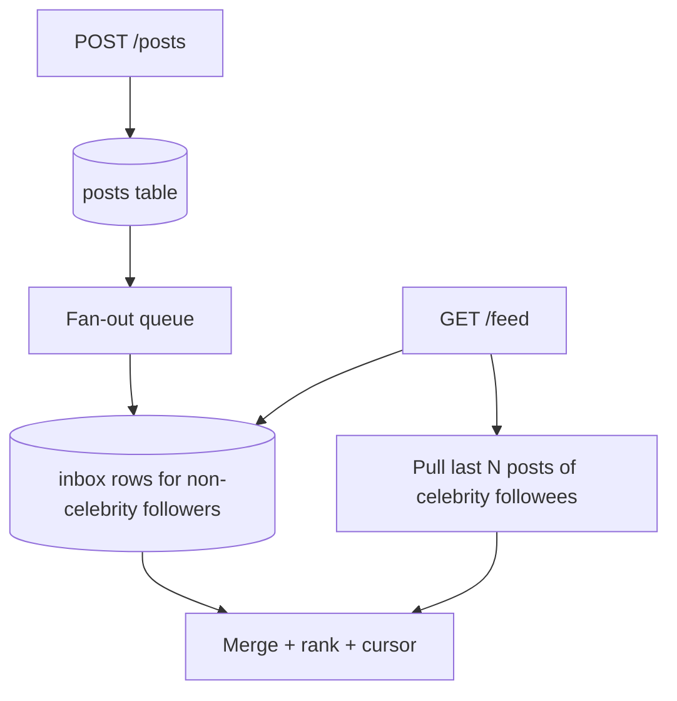
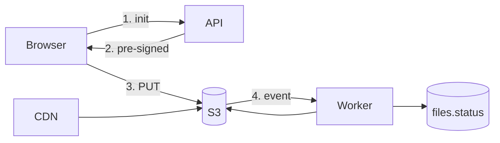
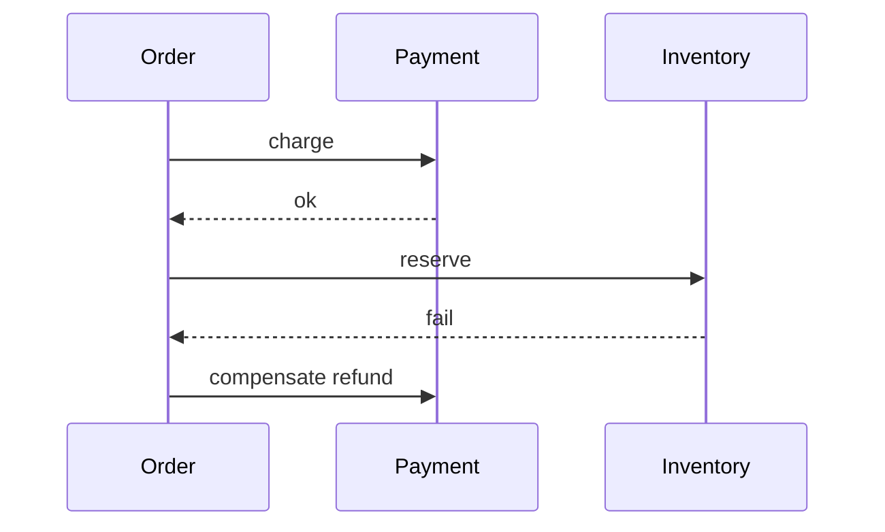

# 09 — System Design (Part 4 of 5): Feed, Files, Typeahead, Frontend & Reliability

> **Parts:** [Part 1 — Framework, Estimation, Scale, Load Balancing](./09-system-design-part1.md) · [Part 2 — Cache, CDN, Databases, Queues, Consistency](./09-system-design-part2.md) · [Part 3 — Rate Limiter, URL Shortener, Chat, Notifications](./09-system-design-part3.md) · **Part 4 — Feed, Files, Typeahead, Frontend, Reliability** · [Part 5 — Resources, Practice, Interview Questions & Revision](./09-system-design-part5.md)
>
> Remaining designs plus the "how it fails" layer. S3 pre-signed/multipart: [11](./11-deployment-aws-s3.md). SLOs: [08 §3.28](./08-engineering-practices-part4.md#328-slis-slos-and-sentry). Outbox: [06](./06-nodejs-part3.md#319-background-jobs-with-bullmq) / [07](./07-databases-and-apis-part2.md). Circuit breaker below was run on Node 24.21: three failures → `open`, fourth throws `circuit_open`, after cooldown a probe succeeds and state is `closed`.

## Table of Contents

- [3. Detailed Explanations (Part 4)](#3-detailed-explanations-part-4)
  - [3.14 Design: News Feed](#314-design-news-feed)
  - [3.15 Design: File Upload / Storage](#315-design-file-upload--storage)
  - [3.16 Design: Search Autocomplete](#316-design-search-autocomplete)
  - [3.17 Frontend System Design](#317-frontend-system-design)
  - [3.18 Timeouts, Retries, Circuit Breakers, Bulkheads](#318-timeouts-retries-circuit-breakers-bulkheads)
  - [3.19 Modular Monolith vs Microservices](#319-modular-monolith-vs-microservices)
  - [3.20 Distributed Transactions: 2PC, Sagas, Outbox](#320-distributed-transactions-2pc-sagas-outbox)
  - [3.21 Distributed IDs](#321-distributed-ids)
  - [3.22 Geo and Video — Skim](#322-geo-and-video--skim)
- [4. Full Example: Putting the Framework on a Feed](#4-full-example-putting-the-framework-on-a-feed)
- [5. Diagrams Index](#5-diagrams-index)
- [How to run the code in this file](#how-to-run-the-code-in-this-file)
- [Next: Part 5](#next-part-5)

---

## 3. Detailed Explanations (Part 4)

### 3.14 Design: News Feed

**Requirements.** User posts; followers see a reverse-chron (or ranked) feed. 200M DAU class is Twitter/Facebook; say the number. Celebrity problem is the interview.

**Estimates.** 200M DAU × 2 posts/day = 400M posts/day ≈ 5k writes/s. Reads: 50× writes → 250k feed-reads/s. A feed-read that joins "everyone I follow" at query time will not survive that without help.

**Two fan-out models.**

| | **Fan-out on write** (push) | **Fan-out on read** (pull) |
|--|----------------------------|----------------------------|
| Write | On post, enqueue "insert into each follower's inbox" | Insert the post once |
| Read | `SELECT * FROM inbox WHERE user_id = me` — precomputed | Fetch IDs of followees, then recent posts, merge |
| Good for | Read-heavy, small-medium follow graphs | Users with huge fan-out (celebrities); write-heavy |
| Pain | Celebrity with 50M followers = 50M inbox writes | Slow reads; merge/rank at read time |

**Hybrid (what you actually propose):** push to inboxes of normal users; celebrities are **pulled** at read time and merged. A "celebrity" threshold (e.g. > 10k followers) is a flag, not a feeling.



**Data.** `posts(id, author_id, body, created_at)`. `follows(follower_id, followee_id)`. `inbox(user_id, post_id, created_at)` — PK `(user_id, created_at, post_id)` for keyset. Redis cache of the first page (~50 ids) per user, invalidate on new push.

**Ranking.** Start reverse-chron. Ranked feeds are a *feature* (ML, last-seen, media type) on top of the same fan-out. Don't volunteer a feature store in minute five.

**Deep dive.** Mute/unfollow: delete from inbox or filter at read (filter is simpler; inbox stays slightly dirty). Pagination: keyset on `(created_at, post_id)`, never `OFFSET`. Fan-out worker must be idempotent (`inbox` unique on `(user_id, post_id)`).

> 💡 Interview Tip: Draw both fan-outs, then the hybrid, then say which users in *their* product are celebrities (verified accounts, "pages", media). That's the design.

### 3.15 Design: File Upload / Storage

**Requirements.** Users upload images/docs/video; we store, optionally transcode, serve via CDN. Do **not** stream gigabytes through Node. Object storage is the product; your API is the policy.

**Path.**

1. Client asks `POST /v1/uploads { filename, mime, size, checksum }`.
2. Authz + quota + MIME allow-list. Server creates `files(id, owner_id, status='pending', key, size)`.
3. Return **pre-signed PUT** (small) or **multipart** URLs (large, typically ≥ 8–16 MB). Details: [11](./11-deployment-aws-s3.md).
4. Client uploads **directly to S3**.
5. S3 event → SQS/Lambda/worker: virus scan, thumbnail, `status='ready'`. Never trust `Content-Type` from the client — sniff on the worker.
6. Read path: CloudFront/OAC or pre-signed GET. Cache immutable keys (`/{id}/{hash}`).

**Processing pipeline.** Original in `s3://bucket/orig/{id}`. Derivatives `s3://bucket/d/{id}/w400.webp`. Status machine: `pending → processing → ready | rejected`. Client polls `GET /v1/files/:id` or gets a WS/SSE ping.

**Failure.** Incomplete multipart: lifecycle abort after N days. Worker crash: S3 event is at-least-once; thumbnail job is idempotent (same output key). Don't mark `ready` until derivatives exist if the product needs them.



> ⚠️ Pitfall: `multer` to local disk on the web instance, then `aws s3 cp`. That is stateful, not horizontally scalable, and a 2 GB video OOMs the box. Pre-signed or multipart, always.

### 3.16 Design: Search Autocomplete

**Requirements.** As the user types, show top-k completions (queries or users) in < 100 ms. Typo-tolerance optional. Personalization optional. 10k QPS.

**Data structure.** A **trie** (prefix tree) with a cached top-k at each node for the hot prefixes. Below ~a few million terms this fits in memory on one box; beyond that, shard the trie by first character(s) or use an inverted index (OpenSearch / Elasticsearch completion suggester).

```text
t → tr → tre → tree (freq 120)
          └→ try  (freq 80)
```

At node `tre`, precompute top 10 by frequency (or by a blend of freq × recency). Update frequencies offline (hourly job) so a typeahead QPS of 10k never writes.

**Read path.** CDN/edge for the most common prefixes (`a`, `how to`, …) with 30–60 s TTL. Else hit a typeahead cluster. Empty prefix: don't query — return a curated list.

**Top-k updates.** A post-commit log of searches → aggregator → rebuild trie snapshots → atomic swap. Online increment is possible (Redis `ZINCRBY prefix`) for "trending now"; mix with the offline trie.

**Deep dive.** Unicode/normalization (`ß` / `ss`). Swear-word filter. Personalization: fetch a small user vector async and rerank the 10, don't change the trie. Misspelling: a second fuzzy index, not a bigger trie.

> 💡 Interview Tip: They want to hear "precomputed top-k per prefix" and "the trie is a snapshot, not a live counter on the request path."

### 3.17 Frontend System Design

Same framework, different boxes. Prompt: "Design the news-feed UI."

**Requirements.** First paint fast, infinite scroll, like/comment without full reload, logged-in vs logged-out, a11y (keyboard, roles — [04](./04-react-part2.md#38-accessibility-in-react), [08](./08-engineering-practices-part4.md#329-accessibility-as-a-release-practice)), offline-ish optional.

**Component tree.** `AppShell` (nav, unread badge) → `Feed` (virtualized list — [04](./04-react-part2.md)) → `Post` / `Composer` / `Comments`. Design system for Dialog/Button so a11y isn't per-feature.

**State.**

| Kind | Where |
|------|--------|
| Server (feed page, post) | TanStack Query / RSC payload; key `['feed', cursor]` |
| Ephemeral UI (composer draft, modal open) | Component / URL search params |
| Cross-cutting (session, feature flags) | Context or a tiny store |
| Realtime (new posts, likes) | WS/SSE → query invalidation, not a second source of truth |

**Data fetching.** First page from RSC or a single `GET /feed?limit=20`. Next pages: cursor, `useInfiniteQuery`. Optimistic like: bump count, rollback on 409. Don't fetch the universe for the first paint.

**Performance budgets.** Route JS budget in CI ([08](./08-engineering-practices-part4.md#330-performance-budgets-in-ci)); LCP image is the first post's media (`priority`); virtualize after a few hundred rows; don't block input (INP — [05](./05-nextjs-part3.md#316-core-web-vitals)).

**Errors.** Feed error boundary with retry; composer errors inline; never lose the draft (`localStorage` keyed by user).

**Deep dive they like.** "New posts while you're scrolled down" — badge "N new", don't jump the viewport. Pagination + realtime merge without duplicate keys (`post.id`).

### 3.18 Timeouts, Retries, Circuit Breakers, Bulkheads

SLOs and error budgets: [08](./08-engineering-practices-part4.md#328-slis-slos-and-sentry). This is the client-side physics.

| Pattern | Rule |
|---------|------|
| **Timeout** | Every outbound call has one. Default "no timeout" is an incident. Set it under the caller's remaining budget (if the SLO is 300 ms, the DB call isn't 3 s) |
| **Retry** | Only **idempotent** calls (GET, PUT, or POST with idempotency key). Exponential backoff + jitter. Cap attempts. Don't retry 400s |
| **Circuit breaker** | After N failures, fail fast for a cooldown so the dependency can recover. Half-open: one probe |
| **Bulkhead** | Isolate pools: payments HTTP client ≠ analytics HTTP client. One hung dependency cannot take all sockets |

Verified circuit breaker (Node 24.21):

```ts
type State = 'closed' | 'open' | 'half';

export class CircuitBreaker {
  private state: State = 'closed';
  private failures = 0;
  private openedAt = 0;
  private readonly threshold: number;
  private readonly cooldownMs: number;

  constructor(threshold = 5, cooldownMs = 30_000) {
    this.threshold = threshold;
    this.cooldownMs = cooldownMs;
  }

  async exec<T>(fn: () => Promise<T>): Promise<T> {
    if (this.state === 'open') {
      if (Date.now() - this.openedAt < this.cooldownMs) {
        throw new Error('circuit_open');
      }
      this.state = 'half';
    }
    try {
      const out = await fn();
      this.failures = 0;
      this.state = 'closed';
      return out;
    } catch (err) {
      this.failures += 1;
      if (this.state === 'half' || this.failures >= this.threshold) {
        this.state = 'open';
        this.openedAt = Date.now();
      }
      throw err;
    }
  }
}
```

Three failures opened it; a call during cooldown threw `circuit_open`; after 50 ms a successful probe closed it.

**Retry + timeout interaction.** Without a timeout, retries pile up (retry storm). Combine: budget 200 ms, 2 retries, circuit at 5 failures, jittered backoff. For non-idempotent POST, **no retry** unless the client owns an idempotency key.

### 3.19 Modular Monolith vs Microservices

**Modular monolith:** one deployable, modules with **enforced boundaries** (packages, lint rules, no import from `billing` internals). One DB is allowed if modules don't reach into each other's tables (or do so through a module API).

**Microservices:** separate deploys, separate data, network between them. You buy independent scaling and team autonomy; you pay latency, failure modes, and distributed transactions.

| 10-person team | 100-person org, two release cadences |
|----------------|--------------------------------------|
| Modular monolith. Extract a **worker** (notifications) when the web deploy is blocked by it | Services along bounded contexts that already have separate data and SLOs |

**API gateway.** One public door: authn, TLS, rate limit, routing `/v1/notes` → notes service. Not a second business-logic layer. Service **discovery**: DNS (ECS/K8s), not a hand-rolled Consul unless you have it.

Fowler: **MonolithFirst**. You can always split a module with a clear interface. You cannot cheaply merge a wrong service split.

> 💡 Interview Tip: Argue *for* the monolith for a 10-person team unprompted. Then name the first seam you'd extract (usually the async worker, not "the user service").

### 3.20 Distributed Transactions: 2PC, Sagas, Outbox

**2PC (two-phase commit):** coordinator asks participants to prepare, then commit. Blocks while someone is down; not what you want across HTTP services. Postgres itself uses a variant internally; you still don't 2PC *between* Order and Payment microservices.

**Saga:** a sequence of local transactions with **compensations**. Order created → payment charged → inventory reserved. If inventory fails, compensating *refund* (not "un-charge" magically — money has its own ledger). **Orchestration** (a conductor process) vs **choreography** (events). Orchestration is easier to debug; choreography couples consumers.



**Outbox:** the reliable way to *start* a saga step. In the same DB transaction as `UPDATE orders SET paid`, `INSERT outbox`. A relay publishes. Consumers idempotent. This is the default senior answer; 2PC is the trap answer.

### 3.21 Distributed IDs

| | **UUIDv4** | **UUIDv7** | **ULID** | **Snowflake** |
|--|------------|------------|----------|---------------|
| Bits | 128 random | 128, time + rand | 128, time + rand | 64 (ts + worker + seq) |
| Sortable | No (index fragmentation) | Yes | Yes | Yes |
| Coordination | None | None | None | Worker IDs, careful clocks |
| URL | Long | Long (base32/62 it) | Crockford base32 | Short numeric |

Postgres 18 has `uuidv7()` ([07](./07-databases-and-apis.md)). Twitter Snowflake: 41-bit ms timestamp + 10-bit worker + 12-bit sequence (tune the split). Clock moving backwards: refuse to issue, or wait. Don't use `MAX(id)+1` across nodes.

### 3.22 Geo and Video — Skim

Unless the job is maps/streaming, 60 seconds:

**Geo / proximity.** "Users near me": geohash or S2 cell as a prefix index, or Postgres `earthdistance` / PostGIS. Quadtrees/geohashes let you query a cell and its neighbors. Don't `SELECT * FROM users ORDER BY distance` without a box filter. Deep design (quadtree + ranking): *System Design Interview* Vol. 2.

**Video.** Upload via multipart to object storage; **transcode** (HLS/DASH renditions) asynchronously; **CDN** for segments; origin is the packager or S3. Adaptive bitrate is a player problem. Chat-over-video is a different product (SFU vs MCU) — say you'd look it up unless that's the role.

---

## 4. Full Example: Putting the Framework on a Feed

Whiteboard script (~12 minutes of the 45):

1. **Assumptions:** 50M DAU, 1 post/user/day, 100:1 read, 5 s staleness OK, celebrity pages exist.
2. **Numbers:** ~600 writes/s avg, ~60k feed reads/s. First page cached.
3. **API:** `POST /posts`, `GET /feed?cursor`, `POST /follows`.
4. **Data:** `posts`, `follows`, `inbox` for non-celebs, pull celebs on read.
5. **Boxes:** Client → CDN (static) → LB → API → Redis (page 1) → Postgres → fan-out workers (SQS/BullMQ).
6. **Deep dive:** hybrid fan-out; idempotent inbox; keyset pagination; mute = filter.
7. **Trade-off:** ranked feed later; not now. Metrics: fan-out lag, feed p99, inbox size per user.

---

## 5. Diagrams Index

| Diagram | Part / Section |
|---------|----------------|
| Framework spine | [Part 1 §3.1](./09-system-design-part1.md#31-the-45-minute-framework) |
| CDN → LB → app → Redis/Postgres | [Part 1 §3.4](./09-system-design-part1.md#34-load-balancing) |
| CDN PoP + origin shield | [Part 2 §3.6](./09-system-design-part2.md#36-cdns-and-edge-caching) |
| Outbox order pipeline | [Part 2 §3.8](./09-system-design-part2.md#38-message-queues-and-event-driven-design) |
| Rate-limit hops | [Part 3 §3.10](./09-system-design-part3.md#310-design-rate-limiter) |
| Shortener read path | [Part 3 §3.11](./09-system-design-part3.md#311-design-url-shortener) |
| Chat fan-out | [Part 3 §3.12](./09-system-design-part3.md#312-design-chat) |
| Notification queues | [Part 3 §3.13](./09-system-design-part3.md#313-design-notification-system) |
| Hybrid feed fan-out | [§3.14](#314-design-news-feed) |
| Pre-signed upload | [§3.15](#315-design-file-upload--storage) |
| Saga compensation | [§3.20](#320-distributed-transactions-2pc-sagas-outbox) |

---

## How to run the code in this file

```powershell
node breaker.ts
# ok { opens: 3, state: 'closed' }
```

---

## Next: Part 5

➡️ [Part 5 — Resources, Practice, Interview Questions & Revision](./09-system-design-part5.md): curated resources, a ~39 h path, 10 exercises, 36 questions, recap and last-day checklist.
