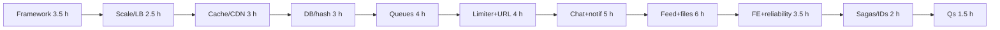

# 09 — System Design (Part 5 of 5): Resources, Practice, Interview Questions & Revision

> **Parts:** [Part 1 — Framework, Estimation, Scale, Load Balancing](./09-system-design-part1.md) · [Part 2 — Cache, CDN, Databases, Queues, Consistency](./09-system-design-part2.md) · [Part 3 — Rate Limiter, URL Shortener, Chat, Notifications](./09-system-design-part3.md) · [Part 4 — Feed, Files, Typeahead, Frontend, Reliability](./09-system-design-part4.md) · **Part 5 — Resources, Practice, Interview Questions & Revision**
>
> ~39 hours matching the [syllabus](./01-fullstack-syllabus.md#13-system-design). Cross-links: [06](./06-nodejs.md) (Redis, WS, jobs), [07](./07-databases-and-apis.md) (replicas, CAP), [08](./08-engineering-practices.md) (SLOs, flags), [10](./10-deployment-aws-ec2.md) (ALB), [11](./11-deployment-aws-s3.md) (uploads), [12](./12-cloudflare.md) (CDN).

## Table of Contents

- [6. Resources](#6-resources)
- [7. How to Learn It](#7-how-to-learn-it)
- [8. Hands-on Practice](#8-hands-on-practice)
- [9. Interview Questions](#9-interview-questions)
  - [Basic](#basic)
  - [Intermediate](#intermediate)
  - [Advanced](#advanced)
  - [Tricky](#tricky)
- [10. Common Mistakes & Red Flags](#10-common-mistakes--red-flags)
- [11. Quick Revision Summary](#11-quick-revision-summary)
- [Next Steps](#next-steps)

---

## 6. Resources

| Subtopic | Resource | Type | Where to find it | Free/Paid | Why it's good |
|----------|----------|------|------------------|:---------:|---------------|
| Framework | *System Design Interview* Vol. 1 (Alex Xu) ch. 3 | book | ByteByteGo / publishers | Paid | The 45-minute spine everyone else is using |
| Building blocks | *System Design Interview* Vol. 1 | book | Same | Paid | Consistent hashing, limiter, shortener, chat, feed, typeahead |
| Volume 2 | *System Design Interview* Vol. 2 (Xu & Lam) | book | Same | Paid | Geo, video — skim unless that's the job |
| Primer | System Design Primer | repo | github.com/donnemartin/system-design-primer | Free | Estimates, cache, LB; verify numbers, some pages age |
| Latency | "Latency numbers every programmer should know" | table | Various (Jeff Dean / later gists) | Free | Order-of-magnitude only; SSD/network improved — don't quote 2010 HDD as your SLO |
| Data-intensive | *Designing Data-Intensive Applications* (Kleppmann) ch. 5–6, 9, 11 | book | O'Reilly | Paid | Replication, partitioning, consistency, streams — the senior book |
| CAP/PACELC | DDIA ch. 9; Abadi PACELC | book/article | O'Reilly; dbmsmusings.blogspot.com | Paid/Free | Definitions we apply in [Part 2](./09-system-design-part2.md#39-consistency-in-a-design-interview) |
| Caching | Primer "Cache"; [06 §3.18](./06-nodejs-part3.md#318-caching-with-redis) | article/notes | GitHub; this repo | Free | Strategies + a real stampede lock |
| CDN | Cloudflare Learning Center "What is a CDN?" | docs | cloudflare.com/learning | Free | Cache keys, PoPs; product in [12](./12-cloudflare.md) |
| Queues | Confluent "Kafka 101"; AWS SQS docs; RabbitMQ tutorials | docs | developer.confluent.io; docs.aws.amazon.com; rabbitmq.com | Free | Log vs queue vs broker — pick with the table in [§3.8](./09-system-design-part2.md#38-message-queues-and-event-driven-design) |
| Patterns | Microsoft Azure Architecture Center "Cloud design patterns" | docs | learn.microsoft.com/azure/architecture/patterns | Free | Circuit breaker, bulkhead, retry — vendor-neutral ideas |
| SRE | Google SRE Book ch. 4 & 6 | book | sre.google/books | Free | SLI/SLO — [08](./08-engineering-practices-part4.md#328-slis-slos-and-sentry) |
| Microservices | Fowler "Microservices" and "MonolithFirst"; Richardson microservices.io | articles | martinfowler.com; microservices.io | Free | Sagas, outbox, when not to split |
| Frontend SD | GreatFrontEnd "Front End System Design" (part free) | site | greatfrontend.com | Free/Paid | UI trees, data fetching, virtualization |
| Uploads | S3 User Guide pre-signed + multipart | docs | docs.aws.amazon.com | Free | [11](./11-deployment-aws-s3.md) |
| IDs | UUIDv7 RFC 9562; Snowflake (blog/engineering posts) | spec | rfc-editor.org | Free | Sortable vs random vs 64-bit |
| Practice | ByteByteGo videos; HelloInterview; Exponent mocks | video | YouTube / sites | Free/Paid | Watch one, then *do* one with a timer |

> 💡 Interview Tip: Xu's diagrams are a dialect. Interviewers care that *you* can draw boxes and name trade-offs, not that you memorized his shortener exactly.

---

## 7. How to Learn It

Total: **~39 hours**. Prerequisites: [06](./06-nodejs.md), [07](./07-databases-and-apis.md), [08](./08-engineering-practices.md) (you cannot design a cache or an SLO you have never operated).

| Step | What to do | Time |
|------|-----------|:----:|
| **0. Self-assess** | Tick the [Topic Map](./09-system-design-part1.md#2-topic-map). Cold [Q31–Q36](#tricky). | 0.5 h |
| **1. Framework + estimates** | [Part 1 §3.1–3.2](./09-system-design-part1.md). Time five Fermi drills (URL, Twitter, chat, photos, typeahead) at 5 min each. | 3.5 h |
| **2. Scale + LB** | [§3.3–3.4](./09-system-design-part1.md#33-vertical-vs-horizontal-stateless-services). List state you'd pull out of a Node process. Sketch L4 vs L7. | 2.5 h |
| **3. Cache + CDN** | [Part 2 §3.5–3.6](./09-system-design-part2.md). For three resources pick a strategy + TTL + invalidation. | 3 h |
| **4. DB scale + hashing** | [§3.7](./09-system-design-part2.md#37-database-scaling-and-consistent-hashing). Run the ring; add a fourth node in your head (~1/4 of keys move). Recite the shard-last ladder. | 3 h |
| **5. Queues + consistency** | [§3.8–3.9](./09-system-design-part2.md#38-message-queues-and-event-driven-design). Draw an order outbox. Name what may be stale in your last app. | 4 h |
| **6. Rate limiter + shortener** | [Part 3 §3.10–3.11](./09-system-design-part3.md). Token bucket on Node; Redis Lua in [06](./06-nodejs-part2.md#315-rate-limiting-with-redis). Pick an ID scheme. | 4 h |
| **7. Chat + notifications** | [§3.12–3.13](./09-system-design-part3.md#312-design-chat). WS backplane vs sticky. Priority queues for OTP vs marketing. | 5 h |
| **8. Feed + files + typeahead** | [Part 4 §3.14–3.16](./09-system-design-part4.md). Hybrid fan-out. Pre-signed upload. Top-k trie. | 6 h |
| **9. Frontend SD + reliability** | [§3.17–3.18](./09-system-design-part4.md#317-frontend-system-design). Feed UI tree. Circuit breaker snippet. | 3.5 h |
| **10. Monolith, sagas, IDs, skim** | [§3.19–3.22](./09-system-design-part4.md#319-modular-monolith-vs-microservices). One saga drawing. UUID vs Snowflake. | 2 h |
| **11. Interview questions** | Every [question](#9-interview-questions) out loud, ≤ 2 minutes; two full 45-min mocks with a timer. | 1.5 h |
| **12. Revise** | [Quick Revision](#11-quick-revision-summary) at +1 day, +1 week, the day before. | 0.5 h |

> 💡 Interview Tip: Steps 6–8 are the discriminator. Everyone can say "Redis". Few can pick fan-out on write vs read for *this* follow graph and defend 302 vs 301.

---

## 8. Hands-on Practice

| # | Exercise | Level | Acceptance criteria |
|---|----------|:-----:|---------------------|
| 1 | **Five Fermi drills** from [Part 1](./09-system-design-part1.md#32-back-of-the-envelope) | 🟢 Easy | Each in < 5 min; units on every number; peak = 5× average unless you justified otherwise |
| 2 | **Stateless audit** of a Node app | 🟢 Easy | Written list: session, uploads, cron, rate limit, WS — where each lives after the change |
| 3 | **Consistent hash ring** | 🟡 Medium | Run the [Part 2](./09-system-design-part2.md#37-database-scaling-and-consistent-hashing) class; 10k keys, ratio < 1.5; describe what fraction moves when you add a 4th node (~1/N) |
| 4 | **Token bucket + 429 headers** | 🟡 Medium | In-process burst matches the measured 10/20; then one Redis-backed route using [06 Lua](./06-nodejs-part2.md#315-rate-limiting-with-redis) across two processes |
| 5 | **Outbox order pipeline** | 🟡 Medium | Diagram + a table: order row and outbox row in one transaction; idempotent consumer; DLQ after N |
| 6 | **URL shortener ID bake-off** | 🟡 Medium | One page: hash vs counter vs Snowflake vs UUIDv7 for 12B rows; 7-char base62 math; 301 vs 302 |
| 7 | **Chat fan-out** | 🟡 Medium | Sequence diagram: persist first, then Redis pub/sub; presence TTL; `clientMsgId` idempotency |
| 8 | **Hybrid feed** | 🔴 Hard | Worked example: user with 200 followees including 2 celebrities; write path and read path; inbox unique key; cursor |
| 9 | **Pre-signed upload** | 🔴 Hard | Init → pre-signed PUT/multipart → S3 event → worker → `ready`. No file bytes through Node. Status machine documented |
| 10 | **45-minute mock** | 🔴 Hard | Timer on. One of: limiter, shortener, chat, notifications, feed. Whiteboard (or paper) with assumptions, numbers, API, boxes, one deep dive, two trade-offs. Record yourself |

---

## 9. Interview Questions

### Basic

#### Q1. Walk the 45-minute framework.

**Model answer.** Requirements (functional + NFRs, *ask* DAU and what may be stale) → Fermi estimates → API + data model → high-level boxes → deep dive on the hard part → trade-offs and 10×. Write assumptions at the top. Narrate while drawing.

**Follow-ups:** How long on estimates?

**Great answer includes:** 4 minutes; one significant figure; they will correct scale.

#### Q2. Convert 100M events/day to QPS.

**Model answer.** `/ 86_400` ≈ `/ 10^5` → ~1,000/s average. Peak ×4–10 depending on product. I say which multiplier.

**Follow-ups:** Storage for 1 KB events, 5 years?

**Great answer includes:** `100e6 × 365 × 5 × 1 KB` ≈ 180 TB raw; indexes and replicas on top; blobs not in the DB.

#### Q3. Vertical vs horizontal scaling.

**Model answer.** Vertical: bigger box, simpler transactions, ceiling and blast radius. Horizontal: more boxes, needs stateless apps and a store that can take writes. Ladder: measure → query/index → pool → vertical → replicas → queue → partition → **shard last**.

**Follow-ups:** What cannot be stateless?

**Great answer includes:** The TCP/WebSocket itself; use a backplane rather than sticky if you can.

#### Q4. L4 vs L7 load balancing.

**Model answer.** L4 is TCP, cheap, no HTTP awareness. L7 parses HTTP: path routing, cookies, WS upgrade, can retry GETs. Default in front of Node/Next is L7 (ALB/Nginx). Health-check **readiness**. Sticky sessions hide state — smell except as a WS crutch.

**Follow-ups:** Least-conn vs round-robin?

**Great answer includes:** Long requests / WS → least-conn; homogeneous short requests → RR.

#### Q5. Name three cache strategies.

**Model answer.** Cache-aside: app fills on miss, delete-on-write, TTL backstop — default. Write-through: cache and DB in the write path, fresher reads, slower writes. Write-back: fast writes, **lose data if the cache dies** — not for money. Stampede: single-flight lock ([06](./06-nodejs-part3.md#318-caching-with-redis)).

**Follow-ups:** Is the cache consistent?

**Great answer includes:** Eventual, bounded by TTL; don't cache the linearizable path.

#### Q6. Why not `% N` for sharding?

**Model answer.** Adding a node reshuffles almost every key. Consistent hashing moves ~`1/N`. Virtual nodes smear load. Measured: 10k keys, 3 nodes, ratio 1.23 with 150 vnodes.

**Follow-ups:** Does hashing fix a celebrity key?

**Great answer includes:** No — Zipf; cache, split, or a whale shard.

#### Q7. Kafka vs SQS vs RabbitMQ in one sentence each.

**Model answer.** SQS: managed queue, at-least-once, easy workers, no replay. Rabbit: routing/exchanges, you (or a vendor) run it. Kafka: partitioned **log**, replay, many consumer groups, more ops. Default for "send email after order": SQS/BullMQ + outbox, not Kafka.

**Follow-ups:** At-least-once implication?

**Great answer includes:** Idempotent consumers; unique inbox; DLQ.

#### Q8. 301 or 302 for a shortener?

**Model answer.** 302/307 if you count clicks or may change the target. 301 is cached by clients — you lose control. At this scale the redirect is a Redis point-read; CDN offload is optional and fights analytics.

**Follow-ups:** How many base62 chars?

**Great answer includes:** 62^7 ≈ 3.5e12; 12B rows is fine; skip curse words.

#### Q9. Why is MemoryStore a problem behind an LB?

**Model answer.** Each instance has its own sessions, rate-limit counters, and upload disk. A user hits instance B and is logged out. Redis/S3/queue are the stateless moves.

**Follow-ups:** `trust proxy`?

**Great answer includes:** Exact hop count or clients spoof IP and bypass the limiter.

---

### Intermediate

#### Q10. Design a distributed rate limiter.

**Model answer.** Edge IP limit + app per-user Lua in Redis so many Node processes share one bucket. Token bucket (burst + refill) or sliding window. Fixed window has a 2N edge burst. 429 + `Retry-After`. Fail closed on login, fail open on public GET if Redis dies — say which. In-process bucket measured: 10/20 takes allowed.

**Follow-ups:** Gateway vs app?

**Great answer includes:** Gateway doesn't know the user until auth; both layers.

#### Q11. ID generation for the shortener.

**Model answer.** Hash(url)→base62: stateless, collisions, maybe merges users. Redis `INCR`: sequential, leaks volume, hotspot. Snowflake: k-sortable 64-bit, needs worker IDs. UUIDv7: 128-bit, no coordination, longer. At 40 writes/s a counter is fine; I still wouldn't use `MAX(id)+1`.

**Follow-ups:** Same URL, two users?

**Great answer includes:** Product question; don't silently alias.

#### Q12. Scale WebSockets for chat.

**Model answer.** Connections are stateful. Persist the message **first**, then Redis pub/sub (or streams) so instances with sockets in that room deliver. Presence = Redis TTL, not a row per ping. Huge rooms: don't iterate 100k sockets on write — inbox/pull like a feed. `clientMsgId` for retries. [06](./06-nodejs-part2.md#317-real-time-sse--websockets-at-scale).

**Follow-ups:** Ordering?

**Great answer includes:** Per conversation; sortable ids; no global order.

#### Q13. Notification OTP vs "people you may know".

**Model answer.** Separate **priority queues**. Prefs + quiet hours apply to marketing, not 2FA. Idempotency key per event. Workers with provider rate limits, timeouts, circuit breaker. DLQ pages for OTP, tickets for bulk. One queue is how you delay 2FA behind a blast.

**Follow-ups:** Quiet hours across TZ?

**Great answer includes:** Store user TZ; compute locally; still send OTP.

#### Q14. Fan-out on write vs read.

**Model answer.** Write: precompute inbox, reads are cheap, celebrities explode the write. Read: write once, reads merge followees, celebrities are fine, p99 suffers. **Hybrid:** push to normal followers, pull celebrities at read, merge. Unique `(user_id, post_id)` on inbox.

**Follow-ups:** Mute?

**Great answer includes:** Filter at read, or delete inbox rows async.

#### Q15. Why not upload through Express?

**Model answer.** Stateful disk, memory, timeouts, no horizontal scale. Init API → pre-signed PUT or multipart → S3 → event → worker for thumbnails → `status=ready`. Bytes never hit Node. [11](./11-deployment-aws-s3.md).

**Follow-ups:** Trust `Content-Type`?

**Great answer includes:** No; sniff on the worker; allow-list.

#### Q16. Autocomplete in 100 ms.

**Model answer.** Trie with **precomputed top-k** at nodes, rebuilt offline. Hot prefixes at the CDN. Don't `ZINCRBY` on the request path for the whole corpus. Personalization reranks the 10. Fuzzy is a second index.

**Follow-ups:** 100M terms?

**Great answer includes:** Shard by prefix; or a search engine completion suggester.

#### Q17. Circuit breaker vs retry vs timeout.

**Model answer.** Timeout on every outbound call. Retry only idempotent + jitter + cap. Breaker: after N failures, fail fast, half-open probe. Measured: 3 failures → open → `circuit_open` → probe closes. Bulkhead: separate pools so analytics cannot starve payments.

**Follow-ups:** Retry POST /payments?

**Great answer includes:** Only with an idempotency key.

#### Q18. When is a microservices split justified?

**Model answer.** Not at 10 people. Modular monolith first (Fowler). Extract when a **bounded context** has its own data, SLO, and deploy cadence — usually the async worker, not "user-service". Gateway for authn/TLS/limits, not business logic.

**Follow-ups:** Service discovery?

**Great answer includes:** DNS from the platform; don't build Consul for a side project.

#### Q19. PACELC on a notes app.

**Model answer.** No partition: we pick **latency** (async replica, 60 s cache). Partition: primary takes writes in one AZ; replica reads may be stale; **payments fail closed** if the primary is unreachable. Not "Postgres is CA".

**Follow-ups:** Read-your-writes after POST?

**Great answer includes:** Primary for that user's reads for T seconds.

#### Q20. CDN cache key mistakes.

**Model answer.** Keying on `Cookie`/`Authorization` → per-user copies. Caching `Set-Cookie`. Forgetting a query param that changes the body. Personalized HTML usually should not be at the edge; hashed static should (`immutable`). Origin shield against global miss stampedes.

**Follow-ups:** Purge?

**Great answer includes:** URL or tag; purge-all is nuclear.

---

### Advanced

#### Q21. Draw the hybrid feed for a user who follows 198 normals and 2 celebs.

**Model answer.** Write: post stored once; fan-out jobs insert into 198 inboxes (idempotent); celebs skipped. Read: keyset the inbox + fetch last N posts of the 2 celebs + merge by `(created_at, id)` + Redis first page. Fan-out lag is a metric. [§3.14](./09-system-design-part4.md#314-design-news-feed).

**Follow-ups:** 50M followers?

**Great answer includes:** That author is a celeb; nobody gets an inbox write.

#### Q22. Outbox vs dual-write vs 2PC.

**Model answer.** Dual-write `INSERT` + `queue.send` loses one side on crash. 2PC across HTTP services blocks and still fails messily. Outbox: same transaction as the business row; relay publishes; consumers idempotent. Saga **compensations** for steps that already committed (refund, not un-insert).

**Follow-ups:** Orchestration vs choreography?

**Great answer includes:** Orchestration is debuggable; choreography couples consumers.

#### Q23. Snowflake clock goes backwards.

**Model answer.** Refuse to issue (or wait) until time catches up; don't emit duplicate (timestamp, seq). Worker IDs must be unique. UUIDv7 if you don't want that operational burden and 128 bits are OK. `MAX+1` is not a distributed ID.

**Follow-ups:** Index fragmentation with v4?

**Great answer includes:** Random PK → page splits; v7/Snowflake are k-sortable.

#### Q24. Frontend design of the feed — data fetching.

**Model answer.** First page RSC or one GET. Infinite query with **cursor**. Optimistic like with rollback. Realtime is invalidation, not a second store. Virtualize long lists. "N new posts" badge rather than jumping the viewport. JS budget in CI. [§3.17](./09-system-design-part4.md#317-frontend-system-design).

**Follow-ups:** Duplicate keys after a WS event?

**Great answer includes:** Merge by `post.id`; don't unshift blindly.

#### Q25. Hot Redis key for a celebrity profile.

**Model answer.** Single-threaded shard saturates. Local LRU in front, replicate the value, split the key (fields), or compute at the edge. Stampede lock on refill. TTL + delete-on-write still apply. Hash rings don't help one key.

**Follow-ups:** Big key 5 MB?

**Great answer includes:** Split; don't cache blobs in Redis — S3/CDN.

#### Q26. Chat history pagination at 1B messages/day.

**Model answer.** Partition/key on `conv_id`. Keyset `(conv_id, id)`. Cold storage for old months if needed. Don't `OFFSET`. Unread = `last_read_id` on membership, not a scan.

**Follow-ups:** Search messages?

**Great answer includes:** Separate search index, async; not `LIKE %` on the OLTP table.

#### Q27. Error budget vs circuit breaker.

**Model answer.** SLO/error budget ([08](./08-engineering-practices-part4.md#328-slis-slos-and-sentry)) is the product contract. The breaker is a **client** mechanism to stop calling a sick dependency so you don't burn the budget (and so it can recover). Alert on burn rate, not on one 500; the breaker trips on consecutive failures.

**Follow-ups:** 100% SLO?

**Great answer includes:** No budget; you never ship.

#### Q28. Consistent hashing with replication (Dynamo-style).

**Model answer.** Walk clockwise from the key's hash; take the next *N distinct physical* nodes (skip vnodes of the same box). That's the preference list. Quorum R+W > N for strong-ish reads. Adding a node steals replicas from neighbors, not the whole keyspace.

**Follow-ups:** Virtual nodes?

**Great answer includes:** Smear; measured spread 1.23 with 150 vnodes on FNV-1a (demo hash, not xxHash).

#### Q29. Modular monolith boundaries.

**Model answer.** Packages per bounded context; no importing another module's tables; events or function calls at the edge. One deploy, one DB allowed. Lint/Nx module boundaries. First extract: the notification **worker**, already async.

**Follow-ups:** Shared `users` table?

**Great answer includes:** A `users` module others call; copy a projection if another service later splits.

#### Q30. Typeahead vs search.

**Model answer.** Typeahead is prefix → top-k, memory, precomputed, <100 ms. Search is relevance, posting lists, ranking, 200–500 ms OK. Don't put Elasticsearch on the critical path of every keystroke if a trie snapshot will do.

**Follow-ups:** Trending queries?

**Great answer includes:** Redis ZSET for the head; merge with the offline trie.

---

### Tricky

#### Q31. "We'll shard Postgres; consistent hashing is web-scale."

**Model answer.** At 5k writes/s a primary with indexes is not the bottleneck. Ladder first. Hashing doesn't fix celebrity tenants. Operational cost of cross-shard joins is the real tax. I'd shard when a **key** is hot or the working set no longer fits after partitioning/archiving.

**Follow-ups:** Hash vs tenant shard?

**Great answer includes:** Tenant if every query already has `tenant_id`; hash if load is even and range queries are rare.

#### Q32. Sticky sessions "so we don't need Redis".

**Model answer.** Deploys drain the instance and drop carts. An LB blip logs people out. You still need shared rate limits. Sticky is a WS stopgap, not a session store.

**Follow-ups:** What if the WS edge is Cloudflare?

**Great answer includes:** Durable objects / pub-sub at the edge — still not in-process Node memory. [12](./12-cloudflare.md).

#### Q33. Cache-aside refill race.

**Model answer.** Reader A gets old DB row; writer commits and deletes the key; A fills the cache with the old row. Mitigations: version in the value, short TTL, compare-and-set, or live with bounded staleness. CDC invalidation if many services cache it.

**Follow-ups:** Write-through fix?

**Great answer includes:** Write path updates cache after commit with the new version; still a race unless you serialize on the key.

#### Q34. Kafka "exactly-once" for email.

**Model answer.** Broker EOS doesn't make SES exactly-once. The sink must be idempotent (provider key, or a sent-mail unique index). Effectively-once = at-least-once + unique constraint. Marketing "exactly-once" without that is a duplicate invoice waiting to happen.

**Follow-ups:** At-most-once?

**Great answer includes:** Ack before send — lost email on crash. Almost never.

#### Q35. Read replicas for the feed, user posts then immediately opens home.

**Model answer.** Async replica may not have the post. Read-your-writes: sticky to primary for T seconds, or "session token with last-write LSN", or cache the author's own posts on write and merge. Blind replica reads are a heisenbug demo.

**Follow-ups:** Sync replica instead?

**Great answer includes:** Write latency includes the replica; availability if it dies — PACELC C vs L.

#### Q36. "Microservices + 2PC for order and payment."

**Model answer.** 2PC across services is the wrong primitive (blocking, operational hell). Outbox + saga: charge, then reserve; compensate with refund. Idempotent payment API. Fail closed if charge's outcome is unknown — poll the provider, don't retry blindly without a key.

**Follow-ups:** Who is the orchestrator?

**Great answer includes:** The order service (or a workflow engine); not the client app.

---

## 10. Common Mistakes & Red Flags

| Red flag | Why it hurts | Say/do instead |
|----------|--------------|----------------|
| Kafka in minute two | Unjustified ops | QPS first; SQS/BullMQ for one worker pool |
| Sharding as step one | Cross-shard tax | Ladder; shard last |
| "Mongo is AP" | CAP as a brand | Write concern, TTL, replica lag |
| In-process rate limit behind LB |  N × limit | Redis Lua |
| Sticky sessions as architecture | Lost on deploy | Redis sessions |
| Dual-write DB + queue | Lost jobs | Outbox |
| 301 on a shortener you want to count | Client-cached | 302 |
| Fan-out on write to 50M followers | Timeout / backlog | Hybrid; celeb = pull |
| Upload through Node | Memory, state | Pre-signed |
| Retry non-idempotent POST | Double charge | Key or don't retry |
| 100% SLO | No budget | 99.9% + freeze |
| Silence while drawing | They can't hire your diagrams | Narrate assumptions |
| Three decimal QPS | Fake precision | One significant figure |
| Ignoring failure | Happy-path only | Timeout, DLQ, poison pill, replica lag |

---

## 11. Quick Revision Summary

### One-page recap

**Framework.** Ask scale + staleness + failure. Estimate (day/8.6e4 ≈ /s, peak ×5). API + keys. Boxes. One deep dive. Trade-offs.

**Scale.** Stateless app: sessions/files/crons/counters out. WS needs a backplane. L7 LB, readiness checks, sticky is a smell. Ladder to shard.

**Cache/CDN.** Aside + delete-on-write + TTL. Stampede lock. Don't cache money. Edge: hashed static, careful keys, origin shield.

**Data.** Replicas → partition → shard. Consistent hash ~1/N moves; vnodes; hot keys remain. CAP/PACELC on the *path*, not the logo.

**Queues.** At-least-once + idempotency + DLQ. SQS/Rabbit/Kafka by replay and consumer-group need. Outbox, not dual-write.

**Designs.** Limiter: token bucket + Redis. Shortener: 302, 7-char base62, cache the read. Chat: persist then pub/sub. Notifs: priority queues. Feed: hybrid fan-out. Files: pre-signed. Typeahead: trie top-k snapshot.

**The rest.** Frontend: cursor + optimistic + budgets. Timeout/retry/breaker/bulkhead. MonolithFirst. Saga + outbox, not 2PC. UUIDv7 vs Snowflake. Geo/video: skim.

### Last-day checklist

- [ ] I can run the 45-min spine without notes.
- [ ] I can turn DAU into peak QPS and a storage ballpark in 3 minutes.
- [ ] I can recite the scale ladder and when sticky sessions are a smell.
- [ ] I can pick cache-aside vs write-through and name a stampede fix.
- [ ] I can explain why `% N` is wrong and what fraction of keys move on the ring.
- [ ] I can choose SQS vs Kafka in one sentence and draw an outbox.
- [ ] I can design a limiter, a shortener, and a hybrid feed on a whiteboard.
- [ ] I can explain 302 vs 301, persist-then-fan-out, and OTP vs marketing queues.
- [ ] I can walk a circuit breaker and say when not to retry.
- [ ] I can argue for a modular monolith for a 10-person team.
- [ ] I can answer Q31–Q36 cold.

---

## Next Steps

- Update your System Design rows in the [Progress Tracker](./00-README.md#progress-tracker).
- Book two 45-minute mocks this week; use the [Part 4 feed script](./09-system-design-part4.md#4-full-example-putting-the-framework-on-a-feed) as a template.
- ➡️ Continue to [10-deployment-aws-ec2.md](./10-deployment-aws-ec2.md) — the boxes you just drew (VPC, ALB, instances, deploys) as they exist in AWS. This file stopped at *shape*; 10 is *how it runs on a box*.
