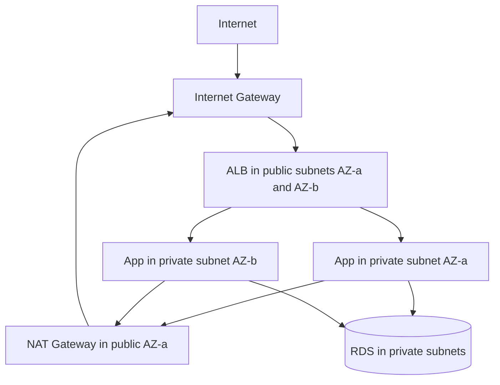

# 10 — AWS EC2 & Deployment (Part 1 of 4): VPC, EC2, IAM & Network Controls

> **Parts:** **Part 1 — VPC, EC2, IAM, Security Groups** · [Part 2 — Nginx, PM2, Certbot Walkthrough](./10-deployment-aws-ec2-part2.md) · [Part 3 — ALB, Auto Scaling, CI/CD, Hardening & Ops](./10-deployment-aws-ec2-part3.md) · [Part 4 — Resources, Practice, Interview Questions & Revision](./10-deployment-aws-ec2-part4.md)
>
> Applies to: **Amazon Linux 2023**, **Node.js 24** (`nodejs24` in AL2023 repos, security support until April 2028 per Amazon's package support info), **IMDSv2 required** on AL2023 AMIs, Well-Architected **six pillars**. Console labels and instance families change — verify on [docs.aws.amazon.com/ec2](https://docs.aws.amazon.com/ec2) before you quote a default. L4 vs L7 theory is in [09 §3.4](./09-system-design-part1.md#34-load-balancing); this file is how those boxes exist in AWS. S3 IAM details continue in [11](./11-deployment-aws-s3.md). GitHub Actions OIDC wiring continues from [08 §3.15](./08-engineering-practices-part3.md#315-github-actions).

## Table of Contents

- [1. Overview](#1-overview)
- [2. Topic Map](#2-topic-map)
- [3. Detailed Explanations (Part 1)](#3-detailed-explanations-part-1)
  - [3.1 VPC: Subnets, Route Tables, IGW, NAT](#31-vpc-subnets-route-tables-igw-nat)
  - [3.2 Security Groups vs NACLs](#32-security-groups-vs-nacls)
  - [3.3 EC2: Families, AMIs, Keys, User Data](#33-ec2-families-amis-keys-user-data)
  - [3.4 IAM: Users, Roles, Policies, Instance Profiles](#34-iam-users-roles-policies-instance-profiles)
- [Next: Part 2](#next-part-2)

---

## 1. Overview

**What this file covers.** How a mid-to-senior full-stack developer puts a Node/Next app on AWS **without** treating the console as a click-through: a VPC with public and private subnets, instance identity via **roles** (no keys on disk), a single-box Nginx + PM2 + TLS lab, then the production shape (ALB + ACM + Auto Scaling + SSM), a GitHub Actions deploy that uses **OIDC**, and the 502s you will actually debug.

**Why interviewers care.** "I've used EC2" is not "I can draw the path from a browser to `node` and name which layer dropped the packet." At 3+ years they ask: why the app is in a private subnet, why the instance has an instance profile instead of an access key, why health checks hit `/readyz`, why you terminated TLS on the ALB, what IMDSv2 blocks.

| Junior answer | Senior answer |
|---------------|---------------|
| "I opened port 22 and 80 on 0.0.0.0/0" | "SSH is off. SSM Session Manager via an instance profile. SG allows 443 from the ALB SG only" |
| "I put AWS keys in `.env` on the box" | "Instance profile. GitHub assumes a role with OIDC. Keys on disk are an incident" |
| "We run PM2 on one instance with an Elastic IP" | "That's the lab. Prod is an ASG behind an ALB, no EIP on the instances, ACM on the listener" |
| "Security groups and NACLs are the same" | "SGs are stateful on the ENI; NACLs are stateless on the subnet. I almost never custom-NACL a web app" |

**What we will not do in this writing session.** Launch a billed instance in *your* account. The [Part 2](./10-deployment-aws-ec2-part2.md) walkthrough is commands you run; prices and Free Tier change — check [aws.amazon.com/free](https://aws.amazon.com/free) and the [Pricing Calculator](https://calculator.aws) the morning you launch.

> 💡 Interview Tip: Draw the VPC **before** the instance. Interviewers who skip you past "t3.micro" are checking whether you understand *where* the box lives.

---

## 2. Topic Map

**Part 1 — Network and identity**
- [ ] VPC, public vs private subnets, IGW, NAT, route tables — [3.1](#31-vpc-subnets-route-tables-igw-nat)
- [ ] Security groups vs NACLs — [3.2](#32-security-groups-vs-nacls)
- [ ] Instance families, AMIs, key pairs, user data, IMDSv2 — [3.3](#33-ec2-families-amis-keys-user-data)
- [ ] IAM users vs roles vs policies vs instance profiles — [3.4](#34-iam-users-roles-policies-instance-profiles)

**[Part 2](./10-deployment-aws-ec2-part2.md) — Single-box ship**
- [ ] Amazon Linux 2023 + Node 24 + Nginx reverse proxy + PM2 + Certbot + env files

**[Part 3](./10-deployment-aws-ec2-part3.md) — Production shape**
- [ ] Elastic IP, EBS types and snapshots
- [ ] ALB (target groups, listeners, ACM)
- [ ] Auto Scaling groups, launch templates, target tracking
- [ ] CloudWatch logs/metrics/alarms
- [ ] GitHub Actions OIDC / CodeDeploy; `pm2 reload` vs blue/green
- [ ] SSM, patching, IMDSv2
- [ ] Cost (Graviton, Spot, Savings Plans); 502/504/OOM; ECS/Fargate/App Runner/Lambda; Route 53; six pillars

**[Part 4](./10-deployment-aws-ec2-part4.md)** — Resources, ~16.5 h path, exercises, 36 questions, recap.

---

## 3. Detailed Explanations (Part 1)

### 3.1 VPC: Subnets, Route Tables, IGW, NAT

A **VPC** is your private IP space in a Region (commonly `10.0.0.0/16`). It does not span Regions. **Subnets** live in **one Availability Zone**. High availability means **at least two AZs**, not two subnets in the same AZ.

**Public subnet.** Route `0.0.0.0/0` → **Internet Gateway (IGW)**. Instances need a public IPv4 (or an EIP) *or* you reach them only through something else (ALB, SSM). The ALB's nodes live here.

**Private subnet.** No IGW route. Outbound (yum, npm, APIs) goes `0.0.0.0/0` → **NAT gateway** (or NAT instance) in a public subnet. The NAT has an EIP; the app instances do not. Inbound from the internet **cannot** hit a private instance directly — that is the point. The ALB target group points at private IPs.



**Route tables** are attached to subnets. The default VPC that AWS creates in a new account is *convenient and wrong for interviews*: every subnet is public-ish, NACLs are allow-all. Draw a **custom** VPC in the round even if your lab used the default.

**IPv6.** Optional. Dual-stack ALBs exist. For the interview, IPv4 + public/private is enough unless they mention IPv6.

| Piece | Lives in | Failure if missing |
|-------|----------|--------------------|
| IGW | VPC, one per VPC | No inbound/outbound to internet from public subnets |
| NAT Gateway | Public subnet, AZ-scoped (HA = one per AZ) | Private instances cannot `dnf` / call Stripe |
| Route `10.0.0.0/16` local | Every table | Subnets cannot talk |
| Route `0.0.0.0/0` → IGW | Public tables | Public subnet is not public |
| Route `0.0.0.0/0` → NAT | Private tables | Private subnet has no egress |

> ⚠️ Pitfall: One NAT in `us-east-1a` and app nodes in `1b`. If `1a` dies you lose **egress** for `1b` too. Production: NAT per AZ, or accept the cost trade-off out loud.

> 💡 Interview Tip: "The app is in a private subnet; the ALB is public; RDS has no public IP." That sentence is the architecture.

### 3.2 Security Groups vs NACLs

| | **Security group** | **Network ACL** |
|--|--------------------|-----------------|
| Attached to | ENI / instance / ALB / RDS (and others) | Subnet |
| State | **Stateful** — return traffic is allowed automatically | **Stateless** — you must allow ephemeral ports inbound *and* outbound |
| Default | Deny inbound, allow outbound | Allow all (custom VPC default NACL) |
| Rules | Allow only (no deny rules) | Allow and deny, numbered, first match |
| Interview default | This is your firewall | Leave default; use for explicit subnet deny (block a bad IP at the edge) if you must |

**Web app pattern:**

- ALB SG: inbound `443` from `0.0.0.0/0` (or Cloudflare IPs — [12](./12-cloudflare.md)); outbound to app SG on `3000` (or `80`).
- App SG: inbound `3000` **from the ALB SG** (reference the SG id, not `0.0.0.0/0`). Outbound `443` to the world (npm, APIs) and `5432` to the RDS SG.
- RDS SG: inbound `5432` **from the app SG only**.
- No `22` from the world. SSM does not need 22.

Referencing another security group (not a CIDR) is the move that survives instance IP changes.

**NACL gotcha.** If you custom-allow inbound `80/443` and forget outbound `1024–65535`, **stateful-looking** TCP breaks because NACLs are stateless. This is why seniors rarely touch NACLs for HTTP apps.

### 3.3 EC2: Families, AMIs, Keys, User Data

**Families** (letter = purpose, generation = number, suffix = extra):

| Letter | Job | Node typical |
|--------|-----|----------------|
| **T** (`t3`, `t3a`, `t4g`) | Burstable CPU (credits) | Labs, low-traffic APIs. CPU credit exhaustion looks like "random slowness" |
| **M** (`m7i`, `m7g`, `m8g`) | General | Default production web |
| **C** | Compute | CPU-bound (image processing, not your Express handler) |
| **R** | Memory | Big Node heaps, in-process caches you should have moved to Redis |
| **g** suffix | **Graviton** (ARM) | Often cheaper for Node; build ARM images / `npm` native addons must compile on ARM |

Size (`large`, `xlarge`) is vCPU/RAM. Interview: pick **Graviton M** unless you have an x86-only native addon, and mention **right-sizing** after a week of CloudWatch.

**AMI.** Amazon Linux 2023 is the AWS-native choice (dnf, `nodejs24`, IMDSv2 required, hop limit 2 for containers). Ubuntu 24.04 is fine; don't mix instructions. Windows AMIs are a different job. **You do not SSH in and `yum update` as the only patch story** — see [Part 3](./10-deployment-aws-ec2-part3.md).

**Key pairs.** An `.pem` is a footgun if you still open port 22. Prefer **no key pair** + SSM. If you keep a key for break-glass, it lives in a secrets manager, not Slack.

**User data.** Cloud-init script that runs on **first boot** (AL2023: subsequent boots don't re-run unless you configure it). Use it to install the CloudWatch agent and join SSM — not to `git clone` production from GitHub with a pat token.

```bash
#!/bin/bash
dnf install -y amazon-ssm-agent
systemctl enable --now amazon-ssm-agent
```

**IMDSv2.** `169.254.169.254` is the metadata endpoint (IAM credentials, user data). v1 is a GET; v2 requires a session token (PUT then GET) — that is the SSRF mitigation ([06](./06-nodejs-part3.md#323-security) is the Node-side SSRF story). **AL2023 requires v2.** Account-level default: `modify-instance-metadata-defaults --http-tokens required`. Hop limit `1` breaks containers (the extra hop); AL2023 defaults to `2` for that reason.

```bash
# v2: token, then curl
TOKEN=$(curl -sS -X PUT "http://169.254.169.254/latest/api/token" \
  -H "X-aws-ec2-metadata-token-ttl-seconds: 21600")
curl -sS -H "X-aws-ec2-metadata-token: $TOKEN" \
  http://169.254.169.254/latest/meta-data/placement/availability-zone
```

> ⚠️ Pitfall: Putting secrets in user data. User data is retrievable from the metadata service and visible in the console. Use SSM Parameter Store / Secrets Manager and an instance role.

### 3.4 IAM: Users, Roles, Policies, Instance Profiles

**Users** are people (or old-style machines). **Roles** are assumed — by an EC2 instance, a GitHub Actions workflow, a Lambda. **Policies** are JSON documents of `Action` / `Resource` / `Effect`. An **instance profile** is the wrapper that lets EC2 assume a role. The instance talks to IMDS; the SDK uses those **temporary** credentials. There is **no access key on disk**.

```json
{
  "Version": "2012-10-17",
  "Statement": [
    {
      "Sid": "PutObjectInThisPrefix",
      "Effect": "Allow",
      "Action": ["s3:PutObject", "s3:GetObject"],
      "Resource": "arn:aws:s3:::notes-uploads-prod/uploads/*"
    }
  ]
}
```

Attach that to `notes-api-role`. The instance profile is `notes-api-profile` → that role. The Node SDK v3 (`@aws-sdk/client-s3`) **picks up the role automatically** in EC2/ECS/Lambda. If you also export `AWS_ACCESS_KEY_ID` on the box, you have just **overridden** the role. Don't.

**Least privilege.** Not `s3:*` on `*`. Not `AdministratorAccess` on the deploy role. Conditions: `aws:SourceIp` is weak from EC2 (NAT IP); prefer resource ARNs and, for GitHub, `sub` matching the repo ([Part 3](./10-deployment-aws-ec2-part3.md#316-cicd-oidc-codedeploy-zero-downtime)).

**Human access.** IAM Identity Center (SSO), not long-lived IAM users with admin keys. MFA on anything that can assume prod.

**Trust policy** (who may assume the role) is the other half. EC2:

```json
{
  "Version": "2012-10-17",
  "Statement": [{
    "Effect": "Allow",
    "Principal": { "Service": "ec2.amazonaws.com" },
    "Action": "sts:AssumeRole"
  }]
}
```

GitHub OIDC uses a different principal (`token.actions.githubusercontent.com`) — Part 3.

> 💡 Interview Tip: "How does the app talk to S3?" If the answer is "we put keys in Parameter Store and inject them" you missed the instance profile. Parameter Store is for *app* secrets (DB URL); AWS API auth is the role.

---

## Next: Part 2

➡️ [Part 2 — Nginx, PM2, Certbot Walkthrough](./10-deployment-aws-ec2-part2.md): Amazon Linux 2023, Node 24, reverse proxy, process manager, Let's Encrypt, `trust proxy`, env files. Lab topology (one public instance). Prod topology is Part 3.
