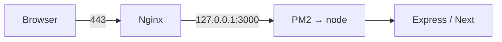

# 10 — AWS EC2 & Deployment (Part 2 of 4): Nginx, PM2, Certbot Walkthrough

> **Parts:** [Part 1 — VPC, EC2, IAM, Security Groups](./10-deployment-aws-ec2-part1.md) · **Part 2 — Nginx, PM2, Certbot Walkthrough** · [Part 3 — ALB, Auto Scaling, CI/CD, Hardening & Ops](./10-deployment-aws-ec2-part3.md) · [Part 4 — Resources, Practice, Interview Questions & Revision](./10-deployment-aws-ec2-part4.md)
>
> **Lab topology:** one **public** subnet instance, Elastic IP, security group `22` optional / `80`+`443` from your IP (or `0.0.0.0/0` only while you learn — tighten it). This is **not** production. Production is [Part 3](./10-deployment-aws-ec2-part3.md): private instances, ALB, ACM, no Certbot on the box. Commands target **Amazon Linux 2023** and **Node 24** (`dnf install nodejs24`). Package names and Certbot's AL2023 module change — verify on [docs.aws.amazon.com/linux/al2023](https://docs.aws.amazon.com/linux/al2023) and [certbot.eff.org](https://certbot.eff.org) before you paste into a billed instance. Graceful shutdown semantics: [06 §3.22](./06-nodejs-part3.md#322-graceful-shutdown). `trust proxy`: [06](./06-nodejs-part2.md).

## Table of Contents

- [3. Detailed Explanations (Part 2)](#3-detailed-explanations-part-2)
  - [3.5 What You Are Building](#35-what-you-are-building)
  - [3.6 Launch and Reach the Box](#36-launch-and-reach-the-box)
  - [3.7 Node 24, App, Env](#37-node-24-app-env)
  - [3.8 PM2](#38-pm2)
  - [3.9 Nginx Reverse Proxy](#39-nginx-reverse-proxy)
  - [3.10 TLS with Certbot](#310-tls-with-certbot)
  - [3.11 Smoke Test and a Deliberate 502](#311-smoke-test-and-a-deliberate-502)
- [Next: Part 3](#next-part-3)

---

## 3. Detailed Explanations (Part 2)

### 3.5 What You Are Building



Nginx terminates HTTP(S), sets `X-Forwarded-*`, serves static files if you want, and restarts independently of Node. PM2 keeps the process up, rotates logs, and `reload`s. Certbot issues a Let's Encrypt cert **on this instance**. When you add an ALB later, you **delete** this Certbot setup and use ACM — two TLS stories, don't mix them.

**Cost reminder.** A running instance bills. Stop it when you walk away (EBS still bills). Terminate when the lab is done. Check current Free Tier.

### 3.6 Launch and Reach the Box

1. VPC: default is OK for the lab; know how [Part 1's custom VPC](./10-deployment-aws-ec2-part1.md#31-vpc-subnets-route-tables-igw-nat) differs.
2. AMI: **Amazon Linux 2023** (`al2023-ami-…`). Architecture: `arm64` (`t4g.small`) if you can — Graviton is the interview-friendly default.
3. Instance type: `t4g.small` or `t3.small`. `t2.micro` is a previous generation; don't lead with it.
4. Storage: `gp3` 20 GiB.
5. Metadata: leave **IMDSv2 required** (AL2023 default).
6. IAM instance profile: attach a role with `AmazonSSMManagedInstanceCore` so you can skip port 22.
7. Security group: inbound `80` and `443` from your IP. No `22` if you use SSM. Outbound all (lab).
8. Key pair: none if SSM works.

**SSM from your laptop** (AWS CLI v2, Session Manager plugin installed):

```bash
aws ssm start-session --target i-0123456789abcdef0 --region us-east-1
```

If SSM fails: instance profile missing, or no outbound `443` to SSM endpoints (private subnet without NAT or VPC endpoints). In this lab the instance is public and can reach the endpoints.

User data (optional, first boot):

```bash
#!/bin/bash
dnf update -y
dnf install -y amazon-ssm-agent
systemctl enable --now amazon-ssm-agent
```

Associate an **Elastic IP** so a stop/start does not change the public IPv4 (lab convenience; [Part 3](./10-deployment-aws-ec2-part3.md#312-elastic-ip-and-ebs) why prod does not EIP the app instances).

Point a DNS **A** record at that EIP (`api-lab.example.com`). Let's Encrypt must resolve here. For a throwaway, `/etc/hosts` on *your* laptop is not enough — Certbot's HTTP-01 hits from the internet.

### 3.7 Node 24, App, Env

AL2023 namespaces Node packages. From [Amazon Linux 2023 Node.js docs](https://docs.aws.amazon.com/linux/al2023/ug/nodejs.html):

```bash
sudo dnf install -y nodejs24 git
node-24 --version    # v24.x
npm-24 --version
# Make `node` / `npm` point at 24 (alternatives; only one "active" version)
sudo alternatives --set node /usr/bin/node-24   # paths: confirm with `rpm -ql nodejs24`
which node && node --version
```

If `alternatives --set` paths differ on your AMI, `ls /usr/bin/node*` and follow the current AL2023 page rather than this comment.

App user — do not run Node as root:

```bash
sudo useradd --system --create-home --shell /sbin/nologin app
sudo mkdir -p /var/www/notes /etc/notes
sudo chown -R app:app /var/www/notes
```

Ship the app (lab: `git clone`; prod: CI copies an artifact, [Part 3](./10-deployment-aws-ec2-part3.md)):

```bash
sudo -u app git clone https://github.com/you/notes.git /var/www/notes
cd /var/www/notes
sudo -u app npm ci --omit=dev
sudo -u app npm run build    # if you emit JS; Node 24 can also run type-stripped .ts
```

**Env.** Not in git. File `/etc/notes/env` mode `0640`, owner `root:app`:

```bash
NODE_ENV=production
PORT=3000
DATABASE_URL=postgres://...    # RDS in a real app; don't expose 5432 to 0.0.0.0/0
```

Load it from the PM2 ecosystem file (`env_file` / `source`). Rotate by rewriting the file and `pm2 reload`. AWS secrets belong in **Secrets Manager / SSM Parameter Store** once you have a role — the file is the lab.

`trust proxy` must be `1` (one Nginx hop). Not `true` ([06](./06-nodejs-part2.md)).

### 3.8 PM2

```bash
sudo npm install -g pm2
# ecosystem.config.cjs
```

```js
module.exports = {
  apps: [{
    name: 'notes',
    cwd: '/var/www/notes',
    script: 'dist/main.js',   // or 'src/main.ts' on Node 24 type stripping
    instances: 2,             // cluster: one per vCPU, not "as many as RAM"
    exec_mode: 'cluster',
    env: { NODE_ENV: 'production', PORT: 3000 },
    max_memory_restart: '400M',
  }],
};
```

```bash
cd /var/www/notes
sudo -u app pm2 start ecosystem.config.cjs
sudo -u app pm2 save
sudo env PATH=$PATH pm2 startup systemd -u app --hp /home/app
```

**Zero-downtime on this box:** `pm2 reload notes` (cluster mode: rolling restart, SIGINT to workers). `pm2 restart` is a hard bounce. Your app must handle SIGINT ([06](./06-nodejs-part3.md#322-graceful-shutdown)): drain HTTP, close the pool. If `kill_timeout` is shorter than your drain, PM2 SIGKILLs — same class of bug as Docker `StopTimeout: 1`.

Logs: `~/.pm2/logs/` or `pm2 install pm2-logrotate`. Ship them to CloudWatch in Part 3; don't `tail -f` as an ops strategy.

> ⚠️ Pitfall: `instances: max` on a `t4g.small` with a 1 GB Node heap. You will OOM. Start at `1` or `2` and watch RSS.

### 3.9 Nginx Reverse Proxy

```bash
sudo dnf install -y nginx
sudo systemctl enable --now nginx
```

`/etc/nginx/conf.d/notes.conf`:

```nginx
upstream notes {
    server 127.0.0.1:3000;
    keepalive 32;
}

server {
    listen 80;
    listen [::]:80;
    server_name api-lab.example.com;

    location /.well-known/acme-challenge/ {
        root /var/www/certbot;
    }

    location / {
        proxy_pass http://notes;
        proxy_http_version 1.1;
        proxy_set_header Connection "";
        proxy_set_header Host $host;
        proxy_set_header X-Forwarded-For $proxy_add_x_forwarded_for;
        proxy_set_header X-Forwarded-Proto $scheme;
        proxy_set_header X-Forwarded-Host $host;
        proxy_read_timeout 60s;
    }
}
```

```bash
sudo mkdir -p /var/www/certbot
sudo nginx -t && sudo systemctl reload nginx
```

**SELinux (AL2023 is enforcing).** Nginx connecting to `127.0.0.1:3000` is often denied until:

```bash
sudo setsebool -P httpd_can_network_connect 1
# if it still 502s:
sudo ausearch -m avc -ts recent
```

This is a classic "works on Ubuntu, 502 on Amazon Linux" interview story.

Open **80** on the SG, then `curl -i http://api-lab.example.com/readyz` from your laptop.

### 3.10 TLS with Certbot

HTTP-01 needs port 80 reachable from the internet and a public DNS name.

AL2023 package names for Certbot drift — **check** `dnf search certbot` and [certbot.eff.org](https://certbot.eff.org) for Amazon Linux. A common shape:

```bash
sudo dnf install -y certbot python3-certbot-nginx
sudo certbot --nginx -d api-lab.example.com --agree-tos -m ops@example.com --redirect
```

Use `--dry-run` or `--staging` the first time (Let's Encrypt **rate limits** failed production issuances). Certbot will rewrite the server block to `listen 443 ssl` and add a `return 301` on 80.

Reload: certbot installs a renew timer (`certbot.timer` or cron). `sudo certbot renew --dry-run`.

**When you move to an ALB:** terminate TLS on the ALB with **ACM**. Do not run Certbot on every ASG instance (they are cattle; HTTP-01 against a moving target is pain). This lab's Certbot is the "one box + EIP" story only.

### 3.11 Smoke Test and a Deliberate 502

```bash
curl -i https://api-lab.example.com/readyz
# 200, JSON from your app
sudo -u app pm2 stop notes
curl -i https://api-lab.example.com/readyz
# 502 Bad Gateway — Nginx is up, upstream is down. This is the interview 502.
sudo -u app pm2 start notes
```

Read Nginx's error log: `connect() failed (111: Connection refused) while connecting to upstream`. That sentence is the diagnosis.

| Symptom | First look |
|---------|------------|
| Connection timed out | SG / NACL / wrong IP |
| Connection refused from laptop | Nginx down, or SG missing 443 |
| 502 | Upstream down, SELinux, wrong port |
| 504 | Upstream slow (`proxy_read_timeout`), DB lock, event-loop stall |
| 404 on `/` but `/readyz` works | Next.js `basePath` / nginx `location` mismatch |

> 💡 Interview Tip: Walk this 502 live in a story: "Nginx returned 502 because PM2 was stopped; `error.log` said connection refused to 127.0.0.1:3000." That beats "we use Nginx."

---

## Next: Part 3

➡️ [Part 3 — ALB, Auto Scaling, CI/CD, Hardening & Ops](./10-deployment-aws-ec2-part3.md): EBS and EIP, two instances behind an ALB with ACM, an ASG, CloudWatch, GitHub OIDC deploys, SSM instead of SSH, cost, troubleshooting, and when ECS/Fargate/Lambda beat a raw box.
