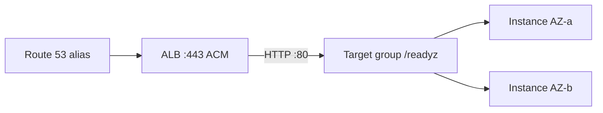

# 10 — AWS EC2 & Deployment (Part 3 of 4): ALB, Auto Scaling, CI/CD, Hardening & Ops

> **Parts:** [Part 1 — VPC, EC2, IAM, Security Groups](./10-deployment-aws-ec2-part1.md) · [Part 2 — Nginx, PM2, Certbot Walkthrough](./10-deployment-aws-ec2-part2.md) · **Part 3 — ALB, Auto Scaling, CI/CD, Hardening & Ops** · [Part 4 — Resources, Practice, Interview Questions & Revision](./10-deployment-aws-ec2-part4.md)
>
> Production shape on top of the lab. L4 vs L7: [09 §3.4](./09-system-design-part1.md#34-load-balancing). GitHub Actions checkout **v7** / setup-node **v7** and `pull_request_target`: [08 §3.15](./08-engineering-practices-part3.md#315-github-actions). DNS record types also appear in [12](./12-cloudflare.md). Console names change — verify on docs.aws.amazon.com.

## Table of Contents

- [3. Detailed Explanations (Part 3)](#3-detailed-explanations-part-3)
  - [3.12 Elastic IP and EBS](#312-elastic-ip-and-ebs)
  - [3.13 ALB: Target Groups, Listeners, ACM](#313-alb-target-groups-listeners-acm)
  - [3.14 Auto Scaling Groups](#314-auto-scaling-groups)
  - [3.15 CloudWatch](#315-cloudwatch)
  - [3.16 CI/CD: OIDC, CodeDeploy, Zero-Downtime](#316-cicd-oidc-codedeploy-zero-downtime)
  - [3.17 Hardening: SSM, Patching, IMDSv2](#317-hardening-ssm-patching-imdsv2)
  - [3.18 Cost](#318-cost)
  - [3.19 Troubleshooting](#319-troubleshooting)
  - [3.20 Alternatives to Raw EC2](#320-alternatives-to-raw-ec2)
  - [3.21 Route 53](#321-route-53)
  - [3.22 Well-Architected Six Pillars](#322-well-architected-six-pillars)
- [4. Full Example: Lab vs Prod](#4-full-example-lab-vs-prod)
- [5. Diagrams Index](#5-diagrams-index)
- [Next: Part 4](#next-part-4)

---

## 3. Detailed Explanations (Part 3)

### 3.12 Elastic IP and EBS

**Elastic IP.** A static public IPv4 you own until you release it. **Idle EIPs bill** (associated to a running instance is the usual free-ish case — check current pricing). Lab: bind one to the single box so DNS stays put. Prod: **the ALB has the stable name** (`xxx.elb.amazonaws.com`); instances in an ASG come and go **without** EIPs. Don't hoard EIPs "just in case."

**EBS.** Network-attached block storage. The instance's root volume is EBS (usually **gp3**). Types you should be able to name:

| Type | Job |
|------|-----|
| **gp3** | Default SSD; set IOPS/throughput independently of size |
| gp2 | Older burst model; don't pick it on a new volume without a reason |
| io2 | High IOPS databases (often RDS does this for you) |
| st1 / sc1 | Throughput / cold HDD; not your Node root |

**Snapshots** are incremental, Region-scoped, sit in S3 behind the API. Snapshot ≠ backup of an app that must be *quiesced* (Postgres: still prefer `pg_dump` / RDS snapshots). To attach a new data volume:

```bash
# console/CLI: create gp3, attach as /dev/sdf
sudo lsblk
sudo mkfs.xfs /dev/nvme1n1          # Nitro names nvme*, not sdf
sudo mkdir -p /data
sudo mount /dev/nvme1n1 /data
# persist in /etc/fstab with UUID= from blkid, not /dev/nvme1n1
```

Root volumes die with `terminate` unless `DeleteOnTermination` is false. Know that flag.

### 3.13 ALB: Target Groups, Listeners, ACM

**ALB = L7.** HTTP/HTTPS, path/host routing, HTTP/2, WebSocket upgrade, OIDC/Cognito if you want. **NLB = L4** (TCP/TLS/UDP, static IPs, extreme scale). Node/Next web: ALB. Database or vanilla TCP: NLB. [09](./09-system-design-part1.md#34-load-balancing).

**Pieces.**

- **Listener** on `443` with an **ACM** certificate (public cert, DNS or email validation). Redirect `80` → `443`.
- **Target group** of instance (or IP, or Lambda) targets, port `80` or `3000`.
- **Health check:** path `/readyz`, matcher `200`, interval 15–30 s, unhealthy threshold 2–3. If you health-check `/` and the homepage hits Postgres, a DB blip drains the ASG. If you health-check `/healthz` that never looks at deps, the ALB keeps sending to a box that cannot query — [06](./06-nodejs-part3.md).
- **Deregistration delay** (default 300 s): time for in-flight requests when an instance leaves. Set it ≥ your app's drain ([06](./06-nodejs-part3.md#322-graceful-shutdown)).

TLS: **terminate on the ALB**. HTTP to the instance on a private SG. ACM certs **cannot be exported** onto Nginx — that's why Certbot on the box and ACM on the ALB are different designs. HTTPS to the instance (TLS again) is extra (defense in depth / compliance), not the default interview answer.

Stickiness: ALB can set an `AWSALB` cookie. Same smell as [09](./09-system-design-part1.md#34-load-balancing) — don't, unless WebSockets without a backplane.



SG: ALB allows `443` from the world (or Cloudflare). Instance allows `80` **from the ALB SG**.

### 3.14 Auto Scaling Groups

An **ASG** keeps `desired` instances of a **launch template** (AMI + type + SG + IAM profile + user data). **Launch configurations are legacy** — don't create new ones.

| Policy | When |
|--------|------|
| Target tracking (`ASGAverageCPUUtilization` 50%) | Default web |
| Step / simple | Custom CloudWatch math |
| Scheduled | Known peaks (9:00 UTC) |
| Predictive | Optional extra; don't lead with it |

**Min / desired / max.** `min=2` across two AZs is the HA floor. `max` is the cost ceiling (runaway scale-out on a bad health check is a real bill).

**ELB health.** Turn on "ELB" health checks so an instance that fails `/readyz` is **replaced**, not just removed from the target group.

**Warm pool / instance refresh.** Instance refresh = rolling AMI/deploy. Combine with a new launch-template version. Capacity-rebalance for Spot.

**User data in the template** should make a *cattle* instance: pull the current artifact, start PM2/Nginx (or skip Nginx and register port 3000 directly — fewer moving parts behind an ALB). Do not bake secrets into the AMI.

### 3.15 CloudWatch

**Metrics (default, 1- or 5-minute):** CPU, network, disk, status checks. ALB: `HTTPCode_Target_5XX_Count`, `TargetResponseTime`, `UnHealthyHostCount`. **Custom:** `PutMetricData` or EMF from the app (or Prometheus — [06](./06-nodejs-part3.md#321-observability-traces-metrics--health-checks)).

**Alarms.** `UnHealthyHostCount > 0` for 2 minutes → page. 5xx rate, not a single 500 ([08 error budget](./08-engineering-practices-part4.md#328-slis-slos-and-sentry)). CPU > 80% for 15 min → ticket (or let the ASG handle it).

**Logs.** Install the **CloudWatch agent**; ship `/var/log/nginx/access.log`, `error.log`, PM2 logs. App logs: stdout JSON (Pino) → agent or systemd journal. Retention: 30 days unless compliance says otherwise.

**Agent vs `awslogs` (old).** Use the unified CloudWatch agent. SSM can install it.

### 3.16 CI/CD: OIDC, CodeDeploy, Zero-Downtime

**Do not put AWS access keys in GitHub secrets** if OIDC works. GitHub's OIDC provider + IAM role with a trust policy on `token.actions.githubusercontent.com` and `sub` like `repo:your-org/notes:ref:refs/heads/main`.

Sketch (pin action **majors** at github.com/aws-actions; CI lint/test from [08](./08-engineering-practices-part3.md#315-github-actions)):

```yaml
deploy:
  needs: test
  if: github.ref == 'refs/heads/main'
  runs-on: ubuntu-latest
  environment: production
  permissions:
    id-token: write
    contents: read
  steps:
    - uses: actions/checkout@v7
    - uses: aws-actions/configure-aws-credentials@v4   # confirm current major
      with:
        role-to-assume: arn:aws:iam::123456789012:role/github-notes-deploy
        aws-region: us-east-1
    - run: aws s3 cp dist/ s3://notes-artifacts/${{ github.sha }}/ --recursive
    - run: aws ssm send-command --document-name notes-deploy --parameters sha=${{ github.sha }}
```

`configure-aws-credentials` major will move — same rule as checkout v7: **look it up**.

**SSM SendCommand / Run Command** pulls the artifact and `pm2 reload`. **CodeDeploy** is the AWS-native rolling/blue-green agent (appspec hooks: `BeforeInstall`, `ApplicationStart`, `ValidateService` hitting `/readyz`). Pick one: SSM is fewer moving parts; CodeDeploy if you want blue/green + automatic rollback.

**Zero-downtime options:**

| Technique | Mechanism |
|-----------|-----------|
| `pm2 reload` (cluster) | Rolling SIGINT on one box |
| ALB + instance refresh | New instances healthy before old drain |
| CodeDeploy blue/green | New ASG, flip listener, keep old for rollback |
| External: DNS weighted | Slow, TTL pain — not your first choice |

Health-checked reload: do not `pm2 stop` all workers. Wait for `/readyz` after each instance.

### 3.17 Hardening: SSM, Patching, IMDSv2

- **No SSH from `0.0.0.0/0`.** Prefer **no port 22 at all**. SSM Session Manager: instance profile `AmazonSSMManagedInstanceCore`, outbound 443 to SSM (or VPC interface endpoints). Audit in CloudTrail.
- **IMDSv2 required**; hop limit 2 if you run containers on the instance ([Part 1](./10-deployment-aws-ec2-part1.md#33-ec2-families-amis-keys-user-data)). Watch `MetadataNoToken` / `MetadataNoTokenRejected`.
- **Patching.** Unattended `dnf upgrade` on a snowflake is how you learn about Monday. Prefer **immutable AMIs** (Image Builder / Packer): bake Node + nginx, ASG instance refresh. If you patch in place, maintenance window + `needs-restarting`.
- **Disk.** Separate `/` and data; alerts on `disk_used_percent`. Logs without rotation fill the root volume — a classic outage.
- **User.** Node is not root. Nginx workers `nginx`.
- **Secrets.** Instance role for AWS APIs; Parameter Store/Secrets Manager for `DATABASE_URL`.

### 3.18 Cost

Do not quote dollar amounts (they rot). Use the **Pricing Calculator**. Knobs:

| Knob | Idea |
|------|------|
| Right-size | Watch CPU/memory a week; `t` credits vs `m` |
| **Graviton** | Same Node, usually cheaper |
| Savings Plans / Reserved | Steady `m7g` 24/7 |
| **Spot** | ASG mixed instances; OK for stateless web if you can drain; not for a single snowflake |
| NAT Gateway | Often > the instances. Endpoints for S3/DynamoDB; NAT per-AZ only if you need HA egress |
| Idle EIP, idle ALB, gp2 that's oversized | Hygiene |
| Data transfer | Cross-AZ, NAT, internet egress surprise |

**Free Tier.** It changes. Read aws.amazon.com/free the day you demo. Never assume 12 months of `t2.micro` still exists as taught in a 2019 blog.

### 3.19 Troubleshooting

| Symptom | Likely | Check |
|---------|--------|-------|
| **502** | Upstream down / SELinux / wrong port | Nginx `error.log`: connection refused; `pm2 list`; `ss -lntp \| grep 3000` |
| **504** | Slow upstream | `proxy_read_timeout`; DB; event loop ([06](./06-nodejs.md)); ALB idle timeout (default 60 s) vs long uploads |
| Connection refused from internet | SG, app bound to `127.0.0.1` only (good behind Nginx; bad if you expected :3000 public) | SG + bind address |
| Timeouts from internet | NACL ephemeral ports, wrong subnet (private without ALB) | Routes, NACL |
| **Disk full** | Logs, npm cache, journal | `df -h`, `du -sh /*`; logrotate; CloudWatch agent |
| **OOM** | Heap + instances | `dmesg` oom-killer; `max_memory_restart`; smaller cluster |
| Instance unreachable via SSM | No profile, no egress to SSM | IAM, NAT/endpoints, agent running |
| 5xx after deploy | Failed health, old processes | Target group healthy count; `pm2 logs` |

Reproduce a 502 in the lab: `pm2 stop notes` ([Part 2](./10-deployment-aws-ec2-part2.md#311-smoke-test-and-a-deliberate-502)).

### 3.20 Alternatives to Raw EC2

| Service | When it beats a box |
|---------|---------------------|
| **ECS on EC2** | You already think in containers; want packing |
| **Fargate** | Containers without patching AMIs; pay per vCPU-hour |
| **Elastic Beanstalk** | "PaaS the EC2" — less fashion than it was; know it exists |
| **App Runner** | HTTP container, AWS-native, little VPC ceremony |
| **Lambda** + API Gateway / Function URLs | Spiky, short tasks; not a 60 s WebSocket chat server |
| **Lightsail** | Tiny VPS; fine for a blog, not the architecture round |

Interview: "I'd start with ECS Fargate or App Runner if the team is container-native; this file is EC2 because the round still asks you to debug Nginx and SGs."

### 3.21 Route 53

| Record | Use |
|--------|-----|
| **A / AAAA** | IPv4 / IPv6 to an EIP (lab) |
| **CNAME** | Name → another name. **Not** at the zone apex |
| **Alias** (Route 53 specific) | Apex → ALB, CloudFront, S3 website. Alias is not a standard RFC type; it is the apex answer |
| MX, TXT | Mail, verification |

ALB: **alias A** to the load balancer, routing policy simple or weighted (blue/green DNS, last resort). Health checks exist; failover records exist. Cloudflare as DNS is [12](./12-cloudflare.md) — don't run both as SOA.

### 3.22 Well-Architected Six Pillars

Official list ([docs.aws.amazon.com/wellarchitected](https://docs.aws.amazon.com/wellarchitected/latest/framework/definitions.html)):

1. **Operational excellence** — automate, observe, evolve (this file's CI + CloudWatch).
2. **Security** — IAM least privilege, SGs, IMDSv2, SSM (not public 22).
3. **Reliability** — multi-AZ ASG, health checks, drain.
4. **Performance efficiency** — Graviton, right-size, ALB not sticky.
5. **Cost optimization** — calculator, NAT, Spot where it fits.
6. **Sustainability** — utilization; don't run `m7i.4xlarge` at 4% CPU.

Name all six. Sustainability is the one people forget (added 2021).

---

## 4. Full Example: Lab vs Prod

| | Part 2 lab | Part 3 prod |
|--|------------|-------------|
| Where | Public subnet | Private subnets, 2 AZs |
| Identity | Optional SSM role | Instance role + GitHub OIDC deploy role |
| TLS | Certbot on box | ACM on ALB |
| Process | PM2 cluster | PM2 or container; ASG replaces boxes |
| DNS | A → EIP | Alias → ALB |
| Scale | 1 | min 2, target-tracking CPU |
| SSH | Maybe | Off |

---

## 5. Diagrams Index

| Diagram | Part / Section |
|---------|----------------|
| Custom VPC public/private | [Part 1 §3.1](./10-deployment-aws-ec2-part1.md#31-vpc-subnets-route-tables-igw-nat) |
| Browser → Nginx → PM2 | [Part 2 §3.5](./10-deployment-aws-ec2-part2.md#35-what-you-are-building) |
| Alias → ALB → two AZs | [§3.13](#313-alb-target-groups-listeners-acm) |

---

## Next: Part 4

➡️ [Part 4 — Resources, Practice, Interview Questions & Revision](./10-deployment-aws-ec2-part4.md): ~16.5 h path, 10 exercises, 36 questions, recap.
