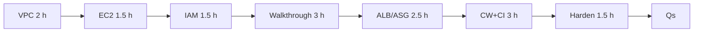

# 10 — AWS EC2 & Deployment (Part 4 of 4): Resources, Practice, Interview Questions & Revision

> **Parts:** [Part 1 — VPC, EC2, IAM, Security Groups](./10-deployment-aws-ec2-part1.md) · [Part 2 — Nginx, PM2, Certbot Walkthrough](./10-deployment-aws-ec2-part2.md) · [Part 3 — ALB, Auto Scaling, CI/CD, Hardening & Ops](./10-deployment-aws-ec2-part3.md) · **Part 4 — Resources, Practice, Interview Questions & Revision**
>
> ~16.5 hours matching the [syllabus](./01-fullstack-syllabus.md#14-aws-ec2--deployment). Verify console names and Free Tier on docs.aws.amazon.com and aws.amazon.com/free — they move. Cross-links: [06](./06-nodejs.md) (shutdown, `trust proxy`), [08](./08-engineering-practices.md) (Actions, OIDC), [09](./09-system-design.md) (L4/L7), [11](./11-deployment-aws-s3.md), [12](./12-cloudflare.md).

## Table of Contents

- [6. Resources](#6-resources)
- [7. How to Learn It](#7-how-to-learn-it)
- [8. Hands-on Practice](#8-hands-on-practice)
- [9. Interview Questions](#9-interview-questions)
  - [Basic](#basic)
  - [Intermediate](#intermediate)
  - [Advanced](#advanced)
  - [Tricky](#tricky)
- [10. Common Mistakes & Red Flags](#10-common-mistakes--red-flags)
- [11. Quick Revision Summary](#11-quick-revision-summary)
- [Next Steps](#next-steps)

---

## 6. Resources

| Subtopic | Resource | Type | Where to find it | Free/Paid | Why it's good |
|----------|----------|------|------------------|:---------:|---------------|
| EC2 | Amazon EC2 User Guide | docs | docs.aws.amazon.com/ec2 | Free | Instances, IMDS, EBS, EIPs |
| VPC | Amazon VPC User Guide | docs | docs.aws.amazon.com/vpc | Free | Subnets, route tables, IGW, NAT |
| IAM | IAM User Guide | docs | docs.aws.amazon.com/IAM | Free | Roles, policies, identity center |
| AL2023 | Amazon Linux 2023 User Guide (Node.js, IMDSv2) | docs | docs.aws.amazon.com/linux/al2023 | Free | `nodejs24`, SELinux, dnf |
| ELB | Elastic Load Balancing (ALB) | docs | docs.aws.amazon.com/elasticloadbalancing | Free | Target groups, ACM, health checks |
| ASG | Amazon EC2 Auto Scaling | docs | docs.aws.amazon.com/autoscaling | Free | Launch templates, target tracking |
| CloudWatch | CloudWatch User Guide | docs | docs.aws.amazon.com/cloudwatch | Free | Agent, alarms, logs |
| SSM | Systems Manager Session Manager | docs | docs.aws.amazon.com/systems-manager | Free | No inbound 22 |
| CodeDeploy | AWS CodeDeploy User Guide | docs | docs.aws.amazon.com/codedeploy | Free | Blue/green, appspec |
| GitHub OIDC | GitHub "Configuring OpenID Connect in Amazon Web Services" | docs | docs.github.com | Free | Trust policy `sub` |
| Nginx | nginx.org/en/docs | docs | nginx.org | Free | `proxy_pass`, upstream |
| PM2 | PM2 docs | docs | pm2.keymetrics.io | Free | `reload` vs `restart`, startup |
| Certbot | certbot.eff.org | docs | certbot.eff.org | Free | HTTP-01; check AL2023 packages |
| Pricing | AWS Pricing Calculator; Free Tier | site | calculator.aws; aws.amazon.com/free | Free | Do not quote blog prices |
| Well-Architected | Framework definitions (six pillars) | docs | docs.aws.amazon.com/wellarchitected | Free | Sustainability is the sixth |
| Route 53 | Developer Guide | docs | docs.aws.amazon.com/route53 | Free | Alias vs CNAME |

> 💡 Interview Tip: 2019 "t2.micro + Elastic IP + Certbot" blogs describe the **lab**, not production. Say both.

---

## 7. How to Learn It

Total: **~16.5 hours**. Prerequisites: [06](./06-nodejs.md) (the process), [08](./08-engineering-practices.md) (CI), [09](./09-system-design.md) (why an ALB).

| Step | What to do | Time |
|------|-----------|:----:|
| **0. Self-assess** | Tick the [Topic Map](./10-deployment-aws-ec2-part1.md#2-topic-map). Cold [Q31–Q36](#tricky). | 0.5 h |
| **1. VPC + SG/NACL** | [Part 1 §3.1–3.2](./10-deployment-aws-ec2-part1.md). Draw public/private, two AZs, NAT per AZ. | 2 h |
| **2. EC2** | [§3.3](./10-deployment-aws-ec2-part1.md#33-ec2-families-amis-keys-user-data). Launch a `t4g` (or `t3`) from CLI; IMDSv2 curl. | 1.5 h |
| **3. IAM** | [§3.4](./10-deployment-aws-ec2-part1.md#34-iam-users-roles-policies-instance-profiles). Instance profile to S3; no keys in env. | 1.5 h |
| **4. Walkthrough** | [Part 2](./10-deployment-aws-ec2-part2.md). Node 24, PM2, Nginx, Certbot, deliberate 502. Stop/terminate when done. | 3 h |
| **5. EIP, EBS, ALB, ASG** | [Part 3 §3.12–3.14](./10-deployment-aws-ec2-part3.md). Two targets, ACM, `/readyz`, launch template. | 2.5 h |
| **6. CloudWatch + CI/CD** | [§3.15–3.16](./10-deployment-aws-ec2-part3.md#315-cloudwatch). Alarm on unhealthy hosts; OIDC sketch. | 3 h |
| **7. Harden, cost, trouble, alts** | [§3.17–3.22](./10-deployment-aws-ec2-part3.md#317-hardening-ssm-patching-imdsv2). SSM, calculator, 502 table, six pillars. | 1.5 h |
| **8. Interview questions** | Every [question](#9-interview-questions) out loud. | 0.75 h |
| **9. Revise** | [Quick Revision](#11-quick-revision-summary) +1 day, +1 week, last day. | 0.25 h |

---

## 8. Hands-on Practice

| # | Exercise | Level | Acceptance criteria |
|---|----------|:-----:|---------------------|
| 1 | **VPC diagram** — two AZs, public+private, IGW, NAT, RDS | 🟢 Easy | App has no public IP; ALB is public; RDS SG allows 5432 only from app SG |
| 2 | **CLI launch** — `t`-family, AL2023, IMDSv2, SSM role | 🟢 Easy | `aws ssm start-session` works; port 22 closed; v2 token curl for AZ succeeds |
| 3 | **Instance profile → S3** | 🟡 Medium | Node SDK lists one prefix; no `AWS_ACCESS_KEY_ID` in the environment; IAM policy is prefix-scoped |
| 4 | **Part 2 walkthrough** | 🟡 Medium | HTTPS 200 on `/readyz`; `pm2 reload` keeps serving; env file not in git |
| 5 | **Deliberate 502** | 🟡 Medium | `pm2 stop` → 502; `error.log` shows connection refused; restart restores 200 |
| 6 | **EBS data volume** | 🟡 Medium | gp3 attached, XFS, UUID in `fstab`, survives reboot |
| 7 | **ALB + two instances** | 🔴 Hard | ACM on 443; health `/readyz`; one instance `pm2 stop` → ALB 200 from the other; SG allows app port only from ALB SG |
| 8 | **ASG target tracking** | 🔴 Hard | Launch template; min 2, two AZs; CPU target tracking; instance refresh completes healthy |
| 9 | **OIDC deploy** | 🔴 Hard | GitHub job with `id-token: write`, no static AWS keys; `pm2 reload` or CodeDeploy; `/readyz` gated |
| 10 | **Cost + incident note** | 🔴 Hard | Pricing Calculator screenshot for 2× `m7g.medium` + ALB + NAT; one-page 502 postmortem from exercise 5 |

---

## 9. Interview Questions

### Basic

#### Q1. Draw a VPC for a Node API and RDS.

**Model answer.** Two AZs. Public subnets: ALB (+ NAT). Private: app ASG and RDS. IGW on public route tables; NAT for private egress. RDS has no public IP. SGs: ALB 443 from internet, app from ALB SG, RDS 5432 from app SG.

**Follow-ups:** Why NAT per AZ?

**Great answer includes:** Egress HA; NAT cost.

#### Q2. Security group vs NACL.

**Model answer.** SG: stateful, ENI, allow-only. NACL: stateless, subnet, allow/deny, ephemeral ports. I firewall with SGs; default NACL stays unless I need a subnet deny.

**Follow-ups:** Reference another SG?

**Great answer includes:** Survives IP changes; ALB→app pattern.

#### Q3. Why an instance profile instead of access keys?

**Model answer.** Role credentials are temporary, rotated, retrieved from IMDS. Keys on disk leak (AMI snapshots, user data, git). The SDK v3 on EC2 picks the role up. `AWS_ACCESS_KEY_ID` in env **overrides** it.

**Follow-ups:** GitHub deploys?

**Great answer includes:** OIDC assume-role, not a long-lived IAM user key.

#### Q4. T vs M vs C vs R. What is the `g` suffix?

**Model answer.** T burstable (credits — sudden slowness). M general. C compute. R memory. `g` = Graviton/ARM, often cheaper for Node; native addons must build on ARM.

**Follow-ups:** `t4g.small` for prod checkout?

**Great answer includes:** Credits; watch `CPUCreditBalance`; M for steady.

#### Q5. What is an AMI? User data?

**Model answer.** AMI = boot image (AL2023 vs Ubuntu). User data = cloud-init, typically **first boot** — install agent, not clone prod with a PAT. Secrets do not belong in user data (IMDS + console).

**Follow-ups:** AL2023 vs AL2?

**Great answer includes:** dnf, `nodejs24`, IMDSv2 required.

#### Q6. Why Nginx in front of Node?

**Model answer.** TLS (lab), static files, buffering, `X-Forwarded-*`, independent restart. Behind an ALB you can skip Nginx and register :3000 — fewer 502 layers. `trust proxy = 1` (or 2 if ALB+Nginx).

**Follow-ups:** `trust proxy true`?

**Great answer includes:** Spoofed `X-Forwarded-For`; [06](./06-nodejs-part2.md).

#### Q7. `pm2 reload` vs `restart`.

**Model answer.** Reload: rolling SIGINT in cluster mode (zero-downtime *if* the app drains). Restart: kill and start. Align `kill_timeout` with shutdown ([06](./06-nodejs-part3.md#322-graceful-shutdown)).

**Follow-ups:** `instances: max`?

**Great answer includes:** OOM on small T instances.

#### Q8. 502 vs 504.

**Model answer.** 502: Nginx/ALB got an invalid/no response (connection refused). 504: upstream didn't finish before timeout. 502 after `pm2 stop` is the teaching case.

**Follow-ups:** SELinux?

**Great answer includes:** AL2023 `httpd_can_network_connect`.

#### Q9. Name the six Well-Architected pillars.

**Model answer.** Operational excellence, security, reliability, performance efficiency, cost optimization, **sustainability**. People forget the sixth.

**Follow-ups:** One sentence each applied to this app?

**Great answer includes:** CI+CW; IAM+SG+SSM; multi-AZ ASG; Graviton; calculator/NAT; utilization.

---

### Intermediate

#### Q10. IMDSv2 vs v1.

**Model answer.** v1 is a GET to `169.254.169.254` — SSRF can steal the role. v2 needs a PUT token then GET. AL2023 requires v2; hop limit 2 for containers. Account default: `modify-instance-metadata-defaults --http-tokens required`.

**Follow-ups:** Hop limit 1 + Docker?

**Great answer includes:** Container cannot reach IMDS.

#### Q11. Elastic IP on every app instance?

**Model answer.** No. EIPs are for the lab box or NAT. Prod: ALB DNS, instances private, ASG replaces them. Idle EIPs bill.

**Follow-ups:** How does DNS work then?

**Great answer includes:** Route 53 **alias** to ALB, not A to an instance.

#### Q12. ALB health check path.

**Model answer.** `/readyz` that checks Postgres/Redis ([06](./06-nodejs-part3.md)). `/` couples HTML/DB to membership. `/healthz` that always 200 never takes you out when deps die. Deregistration delay ≥ drain.

**Follow-ups:** Sticky sessions?

**Great answer includes:** Smell; Redis sessions; WS backplane.

#### Q13. Launch template vs launch configuration.

**Model answer.** Template is current (versions, mix of types, Spot). Configurations are legacy. ASG desired/min/max; target tracking on CPU; ELB health to **replace** bad instances; two AZs.

**Follow-ups:** min=1?

**Great answer includes:** One AZ failure = outage.

#### Q14. ACM vs Certbot.

**Model answer.** Certbot: HTTP-01 on a **stable** instance (lab). ACM: cert on ALB/CloudFront, auto-renew, **not exportable** to Nginx. ASG + Certbot is the wrong shape.

**Follow-ups:** Need HTTPS to the instance?

**Great answer includes:** Optional second TLS; SG still ALB-only.

#### Q15. GitHub → EC2 without storing AWS keys.

**Model answer.** OIDC: `permissions: id-token: write`, `configure-aws-credentials`, IAM trust on `token.actions.githubusercontent.com` constrained by `sub` (repo+branch). Then S3 artifact + SSM SendCommand or CodeDeploy. Environment protection on `production`. [08](./08-engineering-practices-part3.md#315-github-actions).

**Follow-ups:** `pull_request_target`?

**Great answer includes:** Don't; checkout v7 blocks fork pwn; deploys from `main`.

#### Q16. SSM instead of SSH.

**Model answer.** No inbound 22. Agent + instance profile + outbound 443 to SSM (or VPC endpoints). Session logging. Break-glass key in a vault if you must, not in the SG as `0.0.0.0/0`.

**Follow-ups:** Private subnet SSM?

**Great answer includes:** NAT or interface endpoints.

#### Q17. gp3 vs gp2. Snapshot vs backup.

**Model answer.** gp3: provision IOPS/throughput independently. gp2: old burst. Snapshots are incremental crash-consistent disks — not a substitute for RDS/`pg_dump`. `fstab` by UUID. Nitro: `nvme1n1` not `xvdf`.

**Follow-ups:** `DeleteOnTermination`?

**Great answer includes:** Root dies with instance unless false.

#### Q18. CloudWatch alarm you would actually page on.

**Model answer.** `UnHealthyHostCount > 0`, 5xx rate vs SLO, disk_used_percent, not "CPU > 20%". Ship Nginx/PM2/app JSON via the unified agent. [08](./08-engineering-practices-part4.md#328-slis-slos-and-sentry) error budget.

**Follow-ups:** ALB 5xx vs target 5xx?

**Great answer includes:** ELB 5xx vs `HTTPCode_Target_5XX` — different owners.

#### Q19. When Fargate/Lambda beat EC2.

**Model answer.** Fargate: containers, no AMI patching. Lambda: spiky, short; not long WS. App Runner: simple HTTP container. Raw EC2 when you must debug Nginx/SG or run a weird process. Don't invent Kubernetes in a 10-person interview unless they run it.

**Follow-ups:** Elastic Beanstalk?

**Great answer includes:** Exists; less fashionable; know the name.

#### Q20. Alias vs CNAME at the apex.

**Model answer.** CNAME cannot sit at the zone apex. Route 53 **alias** maps apex to ALB/CloudFront. Lab A-record to EIP is fine for one box.

**Follow-ups:** Cloudflare DNS?

**Great answer includes:** One SOA; [12](./12-cloudflare.md).

---

### Advanced

#### Q21. Walk a packet from browser to `node` in prod.

**Model answer.** DNS alias → ALB (TLS, SG 443) → target group HTTP to private IP:80 → instance SG (ALB only) → Nginx or Node → `X-Forwarded-*` → `trust proxy` 1. Return path stateful SG. NAT not on the inbound path.

**Follow-ups:** Where would Cloudflare sit?

**Great answer includes:** In front of the ALB; origin SG = Cloudflare IPs.

#### Q22. Zero-downtime deploy on an ASG.

**Model answer.** Build artifact in CI. New launch-template version or CodeDeploy. Instance refresh / blue-green: new instances `/readyz` 200, drain old (`deregistration_delay`). `pm2 stop` on all at once is downtime. Rollback = previous template version.

**Follow-ups:** Migrations?

**Great answer includes:** Expand/contract in CI *before* instances start ([07](./07-databases-and-apis-part2.md)); not at app boot.

#### Q23. NAT bill is larger than compute.

**Model answer.** NAT Gateway hourly + per-GB. Fixes: S3/DynamoDB **gateway endpoints**; interface endpoints for SSM/ECR; fewer AZs of NAT if you accept the HA trade; don't yum via NAT every five minutes (bake AMIs). Calculator.

**Follow-ups:** NAT instance?

**Great answer includes:** Cheaper, you patch it; Gateway is managed.

#### Q24. One AZ died. What survives?

**Model answer.** If min=2, two AZs, ALB in both publics, RDS multi-AZ: the other half serves. Single NAT in the dead AZ: private egress dies (yum, Stripe). RDS single-AZ: data plane down. EIP lab box in that AZ: you are down.

**Follow-ups:** ALB is "regional"?

**Great answer includes:** Nodes in the subnets you attach; attach two.

#### Q25. SELinux 502 only on AL2023.

**Model answer.** Enforcing policy blocks Nginx → 127.0.0.1:3000 until `httpd_can_network_connect`. Ubuntu lab didn't show it. `ausearch -m avc`. Don't `setenforce 0` as the fix.

**Follow-ups:** Containers?

**Great answer includes:** Different context; hop limit 2 for IMDS.

#### Q26. Mix Spot and on-demand in the ASG.

**Model answer.** Mixed-instances policy, capacity-rebalance, drain on interruption notice. Stateless app only. Not the RDS. Not a single snowflake with a local disk upload ([09](./09-system-design-part4.md)/[11](./11-deployment-aws-s3.md) pre-signed).

**Follow-ups:** Interruption?

**Great answer includes:** 2-minute notice; ALB deregister.

#### Q27. `AdministratorAccess` on the GitHub role "temporarily".

**Model answer.** That's prod admin from a repo that can run Actions. Constrain `sub`, actions (`s3:PutObject` on the artifact bucket, `ssm:SendCommand` on the ASG), environment reviewers. Rotate if it ever leaked. [08 A03](./08-engineering-practices-part4.md).

**Follow-ups:** Environment secrets vs OIDC?

**Great answer includes:** OIDC for AWS; secrets for third parties.

#### Q28. Disk full at 2 a.m.

**Model answer.** `df -h`, journal, PM2 logs, `/tmp`, npm cache. Immediate: truncate logs, `docker system prune` if used. Durable: logrotate, CloudWatch agent, alarm at 80%, don't log request bodies. Root volume vs data volume.

**Follow-ups:** Read-only file system?

**Great answer includes:** Full inode or mount error; `df -i`.

#### Q29. Next.js on EC2 vs Vercel vs S3+CloudFront.

**Model answer.** EC2/ASG: SSR, Node runtime, you own `/readyz`. Vercel: DX, less VPC. Static export: [11](./11-deployment-aws-s3.md) S3+CloudFront, no Node. Match the rendering mode ([05](./05-nextjs.md)). Don't put `next start` on a public instance with :3000 open.

**Follow-ups:** Standalone output?

**Great answer includes:** `output: 'standalone'` copies `node_modules` you need; still behind Nginx/ALB.

#### Q30. Trust policy vs permissions policy.

**Model answer.** Trust: *who* may `sts:AssumeRole` (ec2.amazonaws.com, GitHub OIDC). Permissions: *what* they can do after assuming. Mixing them is a common "why can't EC2 call S3" bug (you attached the S3 policy to a user, not the instance role).

**Follow-ups:** Instance profile vs role?

**Great answer includes:** Profile is the EC2 wrapper; role is the identity.

---

### Tricky

#### Q31. "Open 22, 80, 443, 3000, 5432 to 0.0.0.0/0 so it works."

**Model answer.** That's a lab that escaped. 3000 and 5432 must not be public. 22 must not. 80 only for redirect or HTTP-01. 443 on the ALB (or Cloudflare). App port from ALB SG; DB from app SG.

**Follow-ups:** My IP `/32`?

**Great answer includes:** Fine for a personal lab; still not prod SSH.

#### Q32. App bound to `0.0.0.0:3000`, SG allows 3000 from the world, Nginx also on 80.

**Model answer.** Two front doors; attackers skip Nginx (TLS, rate-limit headers, static). Bind Node to `127.0.0.1` on a single box, or only the ALB SG to 3000 and skip public 3000.

**Follow-ups:** Health checks from ALB?

**Great answer includes:** ALB uses the SG path, not localhost.

#### Q33. Default VPC is "good enough for prod."

**Model answer.** Default VPC is all-public subnets in many accounts' original setup. No private-tier story, easy to give RDS a public IP. Draw a custom VPC in the round even if you didn't build one.

**Follow-ups:** Can I put the ALB in private subnets?

**Great answer includes:** Internet-facing ALB needs public subnets; internal ALB is private-only for service-to-service.

#### Q34. User data clones `main` with a GitHub PAT.

**Model answer.** PAT in user data = PAT in IMDS and the console. First boot != every deploy. Use CI artifacts + instance role to `s3:GetObject`, or CodeDeploy. Rotate the PAT if this already shipped.

**Follow-ups:** Bake the app into the AMI?

**Great answer includes:** Immutable; slower for every commit; mix: bake runtime, pull versioned artifact.

#### Q35. ALB idle timeout 60 s, Nginx `proxy_read_timeout` 30 s, Node SSE 10 min.

**Model answer.** The shortest timeout wins; SSE/WebSocket need idle timeout raised on ALB **and** Nginx, and a backplane ([06](./06-nodejs-part2.md#317-real-time-sse--websockets-at-scale)). Uploads: ALB 60 s default kills large bodies — prefer pre-signed S3 ([11](./11-deployment-aws-s3.md)).

**Follow-ups:** 504 on file upload through Node?

**Great answer includes:** That's why we don't.

#### Q36. `CPUCreditBalance` is zero and p99 exploded.

**Model answer.** T-family burst exhausted. Looks like a "mystery" app regression. Move to M, or unlimited credits (bills), or reduce steal. CloudWatch `CPUCreditBalance` is the tell.

**Follow-ups:** Why did it work all morning?

**Great answer includes:** Credits accumulated overnight.

---

## 10. Common Mistakes & Red Flags

| Red flag | Why it hurts | Say/do instead |
|----------|--------------|----------------|
| Keys in `.env` / user data | IMDS, snapshots, git | Instance profile + Secrets Manager |
| `0.0.0.0/0` on 22 and 3000 | Scanners | SSM; SG from ALB |
| Certbot on every ASG instance | HTTP-01 vs cattle | ACM on ALB |
| Default VPC as the architecture | Public RDS | Custom public/private |
| SG and NACL used interchangeably | Ephemeral ports | SG for the app |
| Health check `/` | Coupled to homepage | `/readyz` |
| `pm2 restart` as deploy | Downtime | `reload` / instance refresh |
| `trust proxy: true` | Spoofed IP | Hop count |
| `setenforce 0` | Hides SELinux | `httpd_can_network_connect` |
| One AZ | "HA" that isn't | min 2, two subnets |
| Quoted 2019 Free Tier | Wrong | calculator + aws.amazon.com/free |
| Five pillars | Forgot sustainability | Six |
| Launch configurations | Legacy | Launch templates |
| Idle EIPs on app nodes | Bill + wrong topology | ALB DNS |

---

## 11. Quick Revision Summary

### One-page recap

**Network.** Custom VPC, two AZs, public (ALB, NAT, IGW) / private (app, RDS). SG stateful, reference SG ids. NACL rarely customized.

**Identity.** Instance profile for AWS APIs. OIDC for GitHub. No long-lived keys on disk. IMDSv2 required (AL2023). SSM, not public SSH.

**Compute.** Family letter + Graviton `g`. AL2023 + `nodejs24`. User data = bootstrap, not deploys.

**Lab.** Nginx → `127.0.0.1:3000` PM2 cluster, Certbot, EIP, deliberate 502. SELinux boolean. `trust proxy 1`.

**Prod.** ALB + ACM + `/readyz` + deregistration delay. ASG launch template, min 2, target tracking. CloudWatch agent + unhealthy-host alarm. `pm2 reload` or CodeDeploy blue/green.

**Ops.** gp3 + UUID fstab. Alias not CNAME at apex. Calculator, NAT cost, Spot only if stateless. Six pillars. 502 refused vs 504 timeout vs T-credits vs disk full.

### Last-day checklist

- [ ] I can draw public/private + SG chain (internet → ALB → app → RDS).
- [ ] I can explain instance profiles vs access keys vs OIDC.
- [ ] I can curl IMDSv2 with a token.
- [ ] I can diagnose a 502 from `error.log` in one sentence.
- [ ] I know why ACM on the ALB replaces Certbot on cattle.
- [ ] I can name launch templates, `/readyz`, min 2 AZs.
- [ ] I can name all six Well-Architected pillars.
- [ ] I can answer Q31–Q36 cold.

---

## Next Steps

- Update your AWS EC2 rows in the [Progress Tracker](./00-README.md#progress-tracker).
- Terminate lab instances and release idle EIPs.
- ➡️ Continue to [11-deployment-aws-s3.md](./11-deployment-aws-s3.md) — buckets, policies, pre-signed uploads, multipart, CloudFront. This file stopped at *compute and the path to Node*; 11 is *where the bytes live*.
