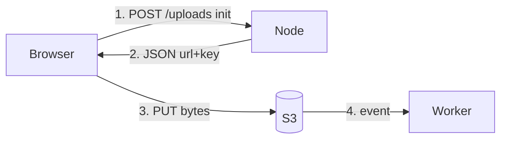

# 11 — AWS S3 & CloudFront (Part 2 of 3): Pre-signed URLs, Multipart & CORS

> **Parts:** [Part 1 — Buckets, Classes, Access Control](./11-deployment-aws-s3-part1.md) · **Part 2 — Pre-signed URLs, Multipart, CORS** · [Part 3 — CloudFront, Events, Security, Cost, Interview](./11-deployment-aws-s3-part3.md)
>
> SDK v3: `@aws-sdk/client-s3`, `@aws-sdk/s3-request-presigner` (`getSignedUrl`, default `expiresIn` **900** s), `@aws-sdk/s3-presigned-post`, `@aws-sdk/lib-storage` (`Upload`). Credentials: the **instance/task role** ([10](./10-deployment-aws-ec2-part1.md#34-iam-users-roles-policies-instance-profiles)), never keys in the browser. Design context: [09 §3.15](./09-system-design-part4.md#315-design-file-upload--storage). Snippets match current v3 docs; they were **not** executed against a live bucket in this session.

## Table of Contents

- [3. Detailed Explanations (Part 2)](#3-detailed-explanations-part-2)
  - [3.4 Pre-signed GET/PUT](#34-pre-signed-getput)
  - [3.5 POST Policies](#35-post-policies)
  - [3.6 Multipart Uploads](#36-multipart-uploads)
  - [3.7 CORS for Browser Uploads](#37-cors-for-browser-uploads)
- [How to think about the code in this file](#how-to-think-about-the-code-in-this-file)
- [Next: Part 3](#next-part-3)

---

## 3. Detailed Explanations (Part 2)

### 3.4 Pre-signed GET/PUT

A **pre-signed URL** is SigV4 baked into a query string so a client **without** AWS keys can do **one** operation (GET or PUT) until `expiresIn`. The server holds the role; the browser only gets the URL.

**PUT (upload).** Server:

```ts
import { PutObjectCommand, S3Client } from '@aws-sdk/client-s3';
import { getSignedUrl } from '@aws-sdk/s3-request-presigner';

const s3 = new S3Client({ region: 'us-east-1' }); // credentials from the default provider chain (role)

export async function presignPut(input: {
  key: string;
  contentType: string;
}): Promise<{ url: string; key: string }> {
  const url = await getSignedUrl(
    s3,
    new PutObjectCommand({
      Bucket: 'notes-uploads-prod',
      Key: input.key,
      ContentType: input.contentType,
    }),
    { expiresIn: 60 }, // seconds; max 7 days for IAM-user sigs, role-limited by session
  );
  return { url, key: input.key };
}
```

Browser (or any HTTP client):

```ts
await fetch(url, {
  method: 'PUT',
  headers: { 'Content-Type': 'image/jpeg' }, // must match what was signed
  body: file,
});
```

If you sign `ContentType: 'image/jpeg'` and the browser sends `application/octet-stream`, S3 returns **SignatureDoesNotMatch**. Same for extra `x-amz-*` headers you signed.

**GET (download).** `GetObjectCommand` + `getSignedUrl`. Use for private objects (invoices). Public product images should go through CloudFront, not a 60-second GET URL per thumbnail.

**Expiry.** Presigner default is **900 seconds** if you omit `expiresIn`. Role credentials cannot outlive the session (typically hours). Don't issue 7-day PUTs for user uploads.

**What the init API still checks:** authn, authz (this user may write this prefix), MIME allow-list, max size (you cannot fully enforce size on a simple signed PUT — see POST policy or a server-side `Content-Length` condition; many teams cap with a policy or scan after the event). Record a `files` row `status=pending` ([09](./09-system-design-part4.md#315-design-file-upload--storage)).



> ⚠️ Pitfall: `@aws-sdk/lib-storage` `Upload` is **not** wired to a pre-signed URL. Server-side (role) uses `Upload`; browser uses `fetch(presigned)` or a multipart protocol you presign per part.

### 3.5 POST Policies

**Pre-signed POST** (`@aws-sdk/s3-presigned-post`, `createPresignedPost`): the browser `multipart/form-data` POSTs to the bucket with fields (`key`, `policy`, `x-amz-signature`, …). The **policy** can enforce `content-length-range`, `eq` on `Content-Type`, a key prefix, SSE. That is how you cap "no files over 10 MB" **before** S3 accepts the body.

Use POST when you need those conditions. Use signed PUT when the client is simple (`fetch` + one header). HTML forms historically needed POST.

Conditions you actually want: `["starts-with", "$key", "uploads/user-42/"]`, `["content-length-range", 1, 10485760]`, `["eq", "$Content-Type", "image/jpeg"]`.

### 3.6 Multipart Uploads

S3 **single PUT** max is 5 GB. Multipart: up to **10,000 parts**, part size **≥ 5 MB** except the last, object max **5 TB**. You want it earlier than 5 GB: retries are per-part, and you can show progress.

**Server-side (role, Node, CLI, CI):** `@aws-sdk/lib-storage` `Upload` does Initiate + parts + Complete, parallel parts, progress events.

```ts
import { S3Client } from '@aws-sdk/client-s3';
import { Upload } from '@aws-sdk/lib-storage';
import { createReadStream } from 'node:fs';

const s3 = new S3Client({ region: 'us-east-1' });

export async function uploadLarge(key: string, path: string): Promise<void> {
  const upload = new Upload({
    client: s3,
    params: { Bucket: 'notes-uploads-prod', Key: key, Body: createReadStream(path) },
    queueSize: 4,
    partSize: 8 * 1024 * 1024, // 8 MiB; must be >= 5 MiB
  });
  upload.on('httpUploadProgress', (p) => {
    // p.loaded / p.total — don't log every byte in prod
  });
  await upload.done();
}
```

**Browser large files.** Either (1) init API returns **per-part pre-signed URLs** after `CreateMultipartUpload`, client PUTs parts, then you `CompleteMultipartUpload` with the etags, or (2) stay under a few hundred MB and one signed PUT. Do not stream 2 GB through Next.js / ALB (idle timeout — [10](./10-deployment-aws-ec2-part3.md#319-troubleshooting)).

**Incomplete uploads bill storage** until you abort. Lifecycle rule: abort incomplete multipart after 7 days. `AbortMultipartUpload` on the IAM role for the prefix.

> 💡 Interview Tip: "When multipart?" — "Over ~8–16 MB, and always over 5 GB. And I abort stragglers with a lifecycle rule."

### 3.7 CORS for Browser Uploads

The browser is a **different origin** than `bucket.s3.us-east-1.amazonaws.com`. Without CORS, `fetch(presignedPut)` fails in the console, not in `curl`. CORS is **not** S3 authorization ([08](./08-engineering-practices-part4.md#321-csrf-and-cors) — browsers only).

Match the **method**, **headers the browser actually sends**, and **origin**:

```json
[
  {
    "AllowedOrigins": ["https://app.example.com"],
    "AllowedMethods": ["GET", "PUT", "HEAD"],
    "AllowedHeaders": ["Content-Type", "x-amz-checksum-sha256"],
    "ExposeHeaders": ["ETag", "x-amz-request-id"],
    "MaxAgeSeconds": 3000
  }
]
```

Use `PUT` if you signed PUT; add `POST` if you use POST policies. `AllowedHeaders: ["*"]` is a lab shortcut. `AllowedOrigins: ["*"]` **cannot** be used with `AllowCredentials` (and you should not need credentials — the signature is in the URL).

**Debug order:** (1) `curl` the pre-signed PUT — if that fails, it's auth/signature/Content-Type, not CORS. (2) If curl works and the browser fails, CORS. (3) Do not disable Block Public Access.

Preflight (`OPTIONS`) must be allowed by the CORS config; S3 handles OPTIONS when CORS is set.

---

## How to think about the code in this file

Typed for Node 24 + SDK v3. Run it only with a role (or a throwaway lab key you will rotate). Wrong `Content-Type` is the first SignatureDoesNotMatch you will hit.

---

## Next: Part 3

➡️ [Part 3 — CloudFront, Events, Security, Cost, Interview](./11-deployment-aws-s3-part3.md): OAC bucket policy, cache behaviors, invalidations vs hashed names, S3 events, SSE, lifecycle, egress, then resources, exercises, and 36 questions.
