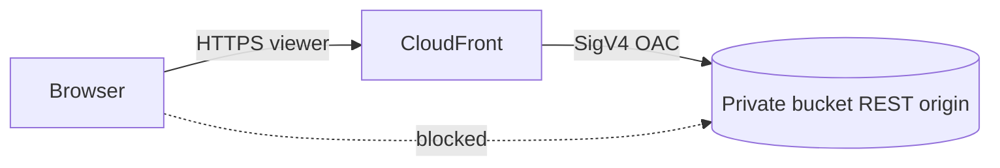
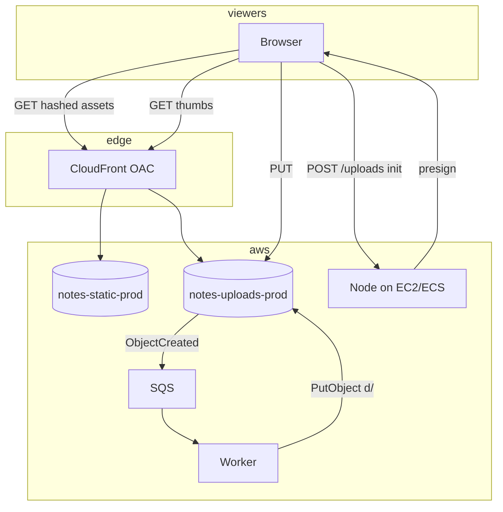
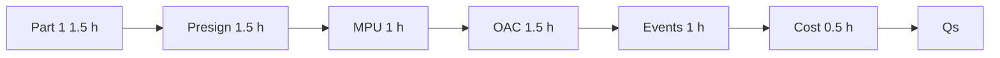

# 11 — AWS S3 & CloudFront (Part 3 of 3): CDN, Events, Security, Cost & Interview

> **Parts:** [Part 1 — Buckets, Classes, Access Control](./11-deployment-aws-s3-part1.md) · [Part 2 — Pre-signed URLs, Multipart, CORS](./11-deployment-aws-s3-part2.md) · **Part 3 — CloudFront, Events, Security, Cost, Interview**
>
> OAC (not OAI). REST origin (not the website endpoint). SSE-S3 is the floor since January 2023; you cannot turn encryption off. S3 Select is **closed to new customers** (July 2024) — skim only. Do not quote prices; use [aws.amazon.com/s3/pricing](https://aws.amazon.com/s3/pricing) and [aws.amazon.com/cloudfront/pricing](https://aws.amazon.com/cloudfront/pricing). R2: [12](./12-cloudflare.md). Instance roles: [10 §3.4](./10-deployment-aws-ec2-part1.md#34-iam-users-roles-policies-instance-profiles). Upload *design*: [09 §3.15](./09-system-design-part4.md#315-design-file-upload--storage). This session did **not** create buckets or distributions in your account.

## Table of Contents

- [3. Detailed Explanations (Part 3)](#3-detailed-explanations-part-3)
  - [3.8 Versioning, Lifecycle, Replication](#38-versioning-lifecycle-replication)
  - [3.9 CloudFront + OAC](#39-cloudfront--oac)
  - [3.10 Cache Behaviors, Invalidations, Static Hosting](#310-cache-behaviors-invalidations-static-hosting)
  - [3.11 Event Notifications](#311-event-notifications)
  - [3.12 Encryption, Logging, Access Logging](#312-encryption-logging-access-logging)
  - [3.13 Object Lock, Transfer Acceleration, Select (skim)](#313-object-lock-transfer-acceleration-select-skim)
  - [3.14 Cost Model: Storage, Requests, Egress](#314-cost-model-storage-requests-egress)
- [4. Full Example: Two Buckets, One Distribution](#4-full-example-two-buckets-one-distribution)
- [5. Diagrams Index](#5-diagrams-index)
- [6. Resources](#6-resources)
- [7. How to Learn It](#7-how-to-learn-it)
- [8. Hands-on Practice](#8-hands-on-practice)
- [9. Interview Questions](#9-interview-questions)
  - [Basic](#basic)
  - [Intermediate](#intermediate)
  - [Advanced](#advanced)
  - [Tricky](#tricky)
- [10. Common Mistakes & Red Flags](#10-common-mistakes--red-flags)
- [11. Quick Revision Summary](#11-quick-revision-summary)
- [Next Steps](#next-steps)

---

## 3. Detailed Explanations (Part 3)

### 3.8 Versioning, Lifecycle, Replication

**Versioning** keeps every overwrite and delete as a new version (`null` is the unversioned id). Enable it **before** you need undelete. A DELETE without a version id writes a **delete marker**; the object looks gone until you delete the marker (or GET a specific version). Versioning is required for Object Lock and for most replication setups.

**Lifecycle** is a JSON (or console) rule on a prefix + filter:

| Action | Typical use |
|--------|-------------|
| Transition → Standard-IA / Intelligent-Tiering / Glacier family | Cool originals after N days |
| Expire current versions | Temp uploads, logs |
| Expire noncurrent versions | Cap version sprawl |
| Abort incomplete multipart | **Always.** 7 days is a sane default ([Part 2](./11-deployment-aws-s3-part2.md#36-multipart-uploads)) |

```json
{
  "Rules": [
    {
      "ID": "abort-mpu",
      "Status": "Enabled",
      "Filter": { "Prefix": "uploads/" },
      "AbortIncompleteMultipartUpload": { "DaysAfterInitiation": 7 }
    },
    {
      "ID": "cool-originals",
      "Status": "Enabled",
      "Filter": { "Prefix": "orig/" },
      "Transitions": [{ "Days": 90, "StorageClass": "STANDARD_IA" }]
    }
  ]
}
```

IA/Glacier classes have **minimum storage duration** and often a **minimum billable object size**. Transitioning a 20 KB thumbnail to IA after 1 day can cost *more* than Standard. Avatars stay Standard; 40 MB originals can cool.

**Replication** (CRR to another Region, SRR same Region) copies *new* objects after you enable it (backfill is a separate batch job). Both buckets versioned. The replication role needs `GetObject` + `ReplicateObject` on source and `ReplicateObject` on dest. RTC (Replication Time Control) is an SLA product — don't claim "15 minutes" unless you buy it. Replica is not a backup if a bad `DeleteObject` replicates; versioning + Object Lock / MFA delete are the "oops" story.

> 💡 Interview Tip: Lifecycle "abort incomplete MPU" is the ops sentence that separates people who have been billed for abandoned parts from people who have not.

### 3.9 CloudFront + OAC

Users must never speak S3 DNS. CloudFront is the public hostname; S3 stays private.

**Origin Access Control (OAC)** — current. CloudFront signs origin requests (SigV4). Bucket policy allows `s3:GetObject` only for `Principal: cloudfront.amazonaws.com` **and** `AWS:SourceArn` of **this** distribution.

**Origin Access Identity (OAI)** — legacy. Canonical user principal, not all Regions the same way, **no SSE-KMS**, **no PUT/DELETE** through CloudFront. Do not design new work on OAI. Migrating: allow **both** principals until the distribution is deployed on OAC, then drop OAI.

**OAC requires the REST origin** (`bucket.s3.region.amazonaws.com`), **not** the website endpoint. Website endpoint = custom HTTP origin, no OAC, usually implies a public bucket. Object Ownership should stay **Bucket owner enforced**.

```json
{
  "Version": "2012-10-17",
  "Statement": [{
    "Sid": "AllowCloudFrontServicePrincipalReadOnly",
    "Effect": "Allow",
    "Principal": { "Service": "cloudfront.amazonaws.com" },
    "Action": "s3:GetObject",
    "Resource": "arn:aws:s3:::notes-static-prod/*",
    "Condition": {
      "StringEquals": {
        "AWS:SourceArn": "arn:aws:cloudfront::111122223333:distribution/EXXXXXXXXX"
      }
    }
  }]
}
```

If objects are **SSE-KMS**, the **KMS key policy** also needs `kms:Decrypt` (and `kms:GenerateDataKey*` if CloudFront PUTs) for `cloudfront.amazonaws.com` with the same `AWS:SourceArn`. SSE-S3 needs nothing extra. OAI cannot do SSE-KMS — that is a common "why OAC" follow-up.

**TLS to viewers.** ACM certificate for the CloudFront alias **must be in `us-east-1`**, even if the bucket is in `eu-west-1`. Route 53 **alias** (or equivalent) to the distribution domain; not a naked CNAME at the zone apex.

**OAC signing mode.** Choose **sign requests** (`always`). Unsigned + private bucket = 403 from origin.



> ⚠️ Pitfall: Pointing CloudFront at `bucket.s3-website-region.amazonaws.com` and then "fixing" 403 by making the bucket public. REST + OAC. Block Public Access stays on.

### 3.10 Cache Behaviors, Invalidations, Static Hosting

**Default root object** (`index.html`) covers `/`. It does **not** rewrite `/about` → `/about/index.html`. For a multi-page static site you either emit `about/index.html` + CloudFront functions, or treat it as an SPA (below).

**Cache.** Prefer **cache policies** + **origin request policies** (managed `CachingOptimized`, `CORS-S3Origin`, etc.) over the old "Min/Default/Max TTL only" UI. What actually gets cached:

1. Object `Cache-Control` / `Expires` (you set these on PUT or metadata).
2. The behavior's policy TTLs as bounds.
3. Query strings, cookies, headers **only** if the cache key includes them — forwarding unused headers **shards** the cache.

**Hashed filenames beat invalidations.** Vite/webpack/`next export` emit `app.a1b2c3.js`. That key is immutable → `Cache-Control: public, max-age=31536000, immutable`. `index.html` stays `no-cache` or a few minutes so it can point at the new hashes. Invalidations (`/*`) work but cost money, are eventual, and are a crutch for mutable keys.

**SPA on REST origin.** Missing keys return **403** (if the caller cannot `ListBucket`) or **404**. Website endpoint would 404 with your error document. With OAC you configure **CloudFront custom error responses**: HTTP 403 and 404 → 200 `/index.html` (and a short TTL on that error response so a real missing asset is not glued forever). Know this; it is the follow-up after "we use OAC."

**Behaviors (typical static app):**

| Path | Policy |
|------|--------|
| `/assets/*`, `/_next/static/*` | Long TTL, compress, GET/HEAD |
| Default (`*`) | Short TTL or honor `Cache-Control` on HTML |

**Compress.** Let CloudFront gzip/brotli; don't upload pre-gzipped unless you know the `Content-Encoding` path.

**Private downloads** (invoices): CloudFront **signed URLs or signed cookies**, or S3 pre-signed GET. Don't put invoices in the public static bucket.

### 3.11 Event Notifications

S3 can emit on `s3:ObjectCreated:*` (and remove, restore, …). Destinations: **SQS, SNS, Lambda**, or **EventBridge**. EventBridge is the cleaner fan-out (multiple rules, archive/replay) without stacking notification configs. Traditional notifications: **one destination type per event type per prefix** — two Lambdas on the same prefix is why people put **SQS in the middle**.

Events are **at-least-once**. The worker that writes `thumb/{id}.webp` must be **idempotent** (same output key, upsert `files.status`). Do not trust the client's `Content-Type`; sniff on the worker ([09](./09-system-design-part4.md#315-design-file-upload--storage)).

Filter by prefix (`uploads/`) and suffix (`.png`) so `thumb/` writes do not re-enter the same function (infinite thumbnail loop — a classic outage).

SQS: enable the bucket's permission to `sqs:SendMessage` on the queue policy (`Principal: s3.amazonaws.com` + `aws:SourceArn` of the bucket + `aws:SourceAccount`). Same shape as the CloudFront bucket policy, different service.

> 💡 Interview Tip: "S3 → SQS → worker, not S3 → Lambda" when the job is slow, bursty, or must retry independently of Lambda's concurrency. Lambda is fine for cheap thumbs.

### 3.12 Encryption, Logging, Access Logging

| Mechanism | Who holds the key | Interview line |
|-----------|-------------------|----------------|
| **SSE-S3** (`AES256`) | AWS, per-object S3-managed | Default since **2023-01-05**. Cannot disable for new uploads. Fine for most product files |
| **SSE-KMS** | CMK in KMS (AWS-managed `aws/s3` or customer CMK) | Audit, rotate, key policy, CloudTrail. Extra KMS request cost. CloudFront OAC needs key-policy allow |
| **SSE-C** | Client supplies the key every request | Rare in product apps; you must present the key on GET |
| **DSSE-KMS** | Dual-layer KMS | Compliance niches |
| **Client-side** | App encrypts before PUT | You lose S3-side features; usually overkill if KMS exists |

Bucket **default encryption** is the floor. A PUT can still specify SSE-KMS. A bucket policy can `Deny` uploads that are not `s3:x-amz-server-side-encryption = aws:kms` if that is the standard.

**Logging.** S3 **server access logs** (another bucket, prefix, delivered eventually) and/or **CloudTrail data events** (`GetObject`/`PutObject` — noisy, precise). CloudFront has **standard logs** (legacy S3 sink) and **v2 / real-time logs**. Turn on access logs for the uploads bucket before you need a forensics story.

Block Public Access + versioning + default SSE + access logs is the "audit this bucket" checklist. Add Object Lock only when legal says WORM.

### 3.13 Object Lock, Transfer Acceleration, Select (skim)

**Object Lock.** WORM. Requires versioning. **Governance** mode: privileged IAM can still override. **Compliance** mode: nobody in the account can shorten the retain until it expires — including root. Retention + optional legal hold. Interview: "SEC/finance bucket," not user avatars.

**Transfer Acceleration.** Distinct hostname (`bucket.s3-accelerate.amazonaws.com`). Uploads enter the AWS edge network and ride the backbone to the bucket Region. Helps **distant PUTs**, not your read CDN (that's CloudFront). Extra request/transfer pricing — measure before you enable.

**S3 Select.** SQL over a single CSV/JSON/Parquet object. **Closed to new customers 2024-07-25**; existing accounts can still use it. For interviews: "I would not propose Select on a greenfield design. Athena / query the warehouse / push a derived object from the worker."

### 3.14 Cost Model: Storage, Requests, Egress

Three meters (numbers live on the pricing pages):

1. **Storage** GB-month × class (and IA/Glacier minimums).
2. **Requests** PUT/POST/LIST are dearer than GET; LIST on a huge prefix is a surprise.
3. **Data transfer out to the internet (egress).** This is the bill that makes "S3 is cheap" false at scale. CloudFront outbound is usually the lever (cached bytes leave from the edge, often cheaper than S3 direct). Same-Region S3→EC2 is cheap/free in the usual tables — still verify.

**Don't** serve product images from pre-signed S3 URLs in `` (egress + no cache + ugly URLs). **Don't** `GetObject` through the Node box (you pay EC2 egress *and* melt the instance). **Do** CloudFront + hashed keys. **Do** abort MPUs. **Do** Intelligent-Tiering when access is unknown, not "IA everything on day 2."

Cloudflare **R2** markets **no egress**; S3-compatible API ([12](./12-cloudflare.md)). Decision factors: already in AWS vs egress-dominated traffic vs lock-in. Not "R2 is always cheaper" — request and storage still exist.

> ⚠️ Pitfall: Quoting a blog's $/GB. Pricing pages move. In the round, name the **meters**, not a number.

---

## 4. Full Example: Two Buckets, One Distribution

Product files and the marketing/app static site are **different threat models**. Two buckets.

| Bucket | Public? | Write | Read |
|--------|---------|-------|------|
| `notes-static-prod` | No. Block Public Access on | CI role (`s3:PutObject` on `/*`) via OIDC ([10](./10-deployment-aws-ec2-part3.md#316-cicd-oidc-codedeploy-zero-downtime)) | CloudFront OAC only |
| `notes-uploads-prod` | No | App instance/task role, prefix `uploads/${userId}/*` + presign ([Part 2](./11-deployment-aws-s3-part2.md)) | CloudFront OAC on `d/*` (derivatives) **or** pre-signed GET for private docs |

**Static path.** `next export` / Vite → artifacts with hashed names → `aws s3 sync --cache-control` (long on hashed, short on `index.html`) → optional invalidation of `/index.html` only.

**Upload path.** Same as [09](./09-system-design-part4.md#315-design-file-upload--storage): init API → pre-signed PUT → `ObjectCreated` → SQS → worker thumbs to `d/{id}/w400.webp` → `files.status = ready` → ``.

**SPA extra.** Custom error 403/404 → `/index.html`. ACM in `us-east-1`. Alternate domain `cdn.example.com` / `app.example.com`.

**What you do not do.** Website hosting checkbox + `Principal: "*"` + CloudFront "because HTTPS." Website hosting is unused in this design.

---

## 5. Diagrams Index



Related: pre-sign sequence in [Part 2](./11-deployment-aws-s3-part2.md#34-pre-signed-getput); OAC in [§3.9](#39-cloudfront--oac).

---

## 6. Resources

| Subtopic | Resource | Type | Where to find it | Free/Paid | Why it's good |
|----------|----------|------|------------------|:---------:|---------------|
| S3 | Amazon S3 User Guide | docs | docs.aws.amazon.com/AmazonS3 | Free | Buckets, consistency, classes, lifecycle |
| Access | S3 "Identity and access management" + Object Ownership | docs | same | Free | BPA, Bucket owner enforced, policies |
| Presign | AWS SDK for JavaScript v3 `s3-request-presigner` | docs | docs.aws.amazon.com/AWSJavaScriptSDK/v3 | Free | `getSignedUrl`, `expiresIn` default 900 |
| POST | `@aws-sdk/s3-presigned-post` | docs | same | Free | `content-length-range` |
| Multipart | S3 multipart + `@aws-sdk/lib-storage` `Upload` | docs | AmazonS3 + JS SDK v3 | Free | Part size ≥ 5 MiB; not for presigned URLs |
| CORS | S3 CORS configuration | docs | AmazonS3 User Guide | Free | Match method + `Content-Type` |
| CloudFront | Developer Guide — OAC, cache policies | docs | docs.aws.amazon.com/AmazonCloudFront | Free | REST origin; OAI legacy |
| OAC how-to | re:Post "Configure OAC…" | article | repost.aws/knowledge-center/cloudfront-oac-origins | Free | Copy-paste policy shape |
| Encryption | Default encryption FAQ | docs | AmazonS3 "default-encryption-faq" | Free | SSE-S3 floor, Jan 2023 |
| Select | S3 Select user guide banner | docs | AmazonS3 "selecting-content-from-objects" | Free | Closed to new customers |
| Pricing | S3 + CloudFront pricing | site | aws.amazon.com/s3/pricing; cloudfront/pricing | Free | Meters, not blog numbers |
| Design | This series | notes | [09 §3.15](./09-system-design-part4.md#315-design-file-upload--storage), [10](./10-deployment-aws-ec2.md), [12](./12-cloudflare.md) | Free | Init API, roles, R2 |

> 💡 Interview Tip: The 2016 "tick website hosting, policy `Principal: *`" tutorial is the **anti-pattern**. Say OAC.

---

## 7. How to Learn It

Total: **~8.5 hours**, matching the [syllabus](./01-fullstack-syllabus.md#15-aws-s3--cloudfront). Prerequisites: [09 §3.15](./09-system-design-part4.md#315-design-file-upload--storage), [10 §3.4](./10-deployment-aws-ec2-part1.md#34-iam-users-roles-policies-instance-profiles). Use a **throwaway lab account**; tear down. Do not PUT in the production account that holds these notes.

| Step | What to do | Time |
|------|-----------|:----:|
| **0. Self-assess** | Tick the [Topic Map](./11-deployment-aws-s3-part1.md#2-topic-map). Cold [Q31–Q36](#tricky). | 0.25 h |
| **1. Store + access** | [Part 1](./11-deployment-aws-s3-part1.md). Create a private bucket; leave BPA on; write a prefix IAM policy. | 1.5 h |
| **2. Presign + CORS** | [Part 2](./11-deployment-aws-s3-part2.md). Node `getSignedUrl` PUT; browser `fetch`; break `Content-Type` on purpose. | 1.5 h |
| **3. Multipart** | `Upload` from Node for a ≥ 100 MB file; add abort-incomplete lifecycle. | 1 h |
| **4. CloudFront OAC** | REST origin, OAC, bucket policy `SourceArn`, ACM `us-east-1`, hashed assets. | 1.5 h |
| **5. Events + SSE** | `ObjectCreated` → SQS → noop worker; confirm SSE-S3 on HEAD. | 1 h |
| **6. Lifecycle + cost** | IA rule on a prefix; Pricing Calculator for storage + CF egress (no quotes in notes). | 0.5 h |
| **7. Interview questions** | Every [question](#9-interview-questions) out loud. | 0.75 h |
| **8. Revise** | [Quick Revision](#11-quick-revision-summary) +1 day, +1 week, last day. | 0.5 h |



---

## 8. Hands-on Practice

Lab only. Delete the bucket (empty including versions) and disable the distribution when done.

| # | Exercise | Level | Acceptance criteria |
|---|----------|:-----:|---------------------|
| 1 | **Private bucket** — BPA on, Bucket owner enforced, SSE-S3 default | 🟢 Easy | Public URL 403; `GetObject` from your role 200 |
| 2 | **Prefix IAM** — role can PUT only `uploads/*` | 🟢 Easy | PUT `uploads/a` 200; PUT `other/a` AccessDenied; `ListBucket` on bucket ARN works |
| 3 | **Pre-signed PUT** — 60 s URL, matching `Content-Type` | 🟡 Medium | Browser PUT succeeds; wrong MIME → SignatureDoesNotMatch; Node never sees bytes |
| 4 | **CORS** — allow your origin + PUT + `Content-Type` | 🟡 Medium | `curl` PUT works; browser works; `curl` fail still fails after CORS (proves CORS ≠ auth) |
| 5 | **Multipart + abort rule** | 🟡 Medium | `Upload` completes a ≥ 100 MB object; lifecycle lists AbortIncomplete 7 days |
| 6 | **POST policy** — `content-length-range` 1–10 MB | 🟡 Medium | 11 MB POST rejected by S3; 1 MB accepted |
| 7 | **CloudFront + OAC** — REST origin, private bucket | 🔴 Hard | CF URL 200; S3 REST URL 403; policy `cloudfront.amazonaws.com` + `SourceArn` |
| 8 | **Hashed deploy** — long cache on `*.[hash].js`, short on `index.html` | 🔴 Hard | Second deploy without `/*` invalidation still serves new app after HTML refresh |
| 9 | **Events** — `uploads/` → SQS, worker writes `d/` | 🔴 Hard | One PUT → one processed message; writing `d/` does **not** re-enqueue; worker is idempotent |
| 10 | **Cost sketch** — Calculator: 1 TB Standard + 10 TB CF out / month | 🔴 Hard | Named meters (storage, GET, egress); no cached blog prices; one sentence on why not S3-direct |

---

## 9. Interview Questions

### Basic

#### Q1. Bucket vs object vs key?

**Model answer.** Bucket = globally unique name in one Region. Object = bytes + metadata. Key = the string (`uploads/user-42/ulid.png`). Prefixes are not folders; `LIST` uses prefix + delimiter.

**Follow-ups:** Path-style vs virtual-hosted?

**Great answer includes:** Virtual-hosted REST is what CloudFront uses; path-style is legacy.

#### Q2. Is S3 eventually consistent?

**Model answer.** No. **Strong** consistency for PUT, overwrite, DELETE, and LIST in **all** Regions since **December 2020**. Stale reads after a write are CloudFront/browser cache, not S3.

**Follow-ups:** What about us-east-1 lore?

**Great answer includes:** That lore is pre-2020; don't design for it.

#### Q3. Website endpoint vs REST endpoint?

**Model answer.** Website: index/error docs, HTTP-only to origin, **no OAC**. REST: API/SDK/CloudFront origin, SigV4, OAC. New static sites: REST + CloudFront, website hosting **off**.

**Follow-ups:** Why 403 on missing keys?

**Great answer includes:** REST without `ListBucket` hides existence as 403; CF custom errors for SPAs.

#### Q4. What does Block Public Access actually do?

**Model answer.** Account/bucket switches that **override** a public bucket policy or ACL. New buckets: all on. Turning them off is a security event, not a CORS fix.

**Follow-ups:** Can I have a public website with BPA on?

**Great answer includes:** Yes — CloudFront OAC, bucket stays private.

#### Q5. IAM policy vs bucket policy vs ACL?

**Model answer.** IAM = identity ("what can this role do?"). Bucket policy = resource ("who can hit this bucket?"). Both must allow. ACLs are **off** under Bucket owner enforced — don't use them.

**Follow-ups:** CloudFront — which one?

**Great answer includes:** Bucket policy, service principal + `SourceArn`. App writes: IAM on the instance role ([10](./10-deployment-aws-ec2-part1.md#34-iam-users-roles-policies-instance-profiles)).

#### Q6. When Intelligent-Tiering vs Standard-IA?

**Model answer.** Unknown/changing access → Intelligent-Tiering (monitoring fee per object). Predictable infrequent **and** objects large enough / stored long enough → IA. Tiny hot files stay Standard. Don't quote prices.

**Follow-ups:** One Zone-IA for user photos?

**Great answer includes:** Recreatable only; AZ loss deletes them.

#### Q7. What is a pre-signed URL?

**Model answer.** SigV4 in the query string for **one** method on **one** key until expiry. Server has the role; browser does not. Default presigner `expiresIn` is **900 s** if omitted.

**Follow-ups:** PUT vs GET?

**Great answer includes:** PUT for uploads; GET for private downloads; public thumbs go through CloudFront.

#### Q8. Why not Express + multer + then S3?

**Model answer.** Bytes on the web tier: RAM, disk, ALB idle timeout ([10](./10-deployment-aws-ec2-part4.md)), no horizontal scale. Init API + browser PUT ([09](./09-system-design-part4.md#315-design-file-upload--storage)).

**Follow-ups:** Tiny profile pictures?

**Great answer includes:** Still presign; consistency of the path matters more than 200 KB.

#### Q9. CORS vs S3 authorization?

**Model answer.** CORS is a **browser** gate ([08](./08-engineering-practices-part4.md#321-csrf-and-cors)). `curl` ignores it. Auth is IAM/bucket policy/signature. Debug: curl first, then CORS.

**Follow-ups:** `AllowedOrigins: "*"`?

**Great answer includes:** Fine without cookies; the signature is in the URL. Still lock to your app origin.

#### Q10. Is encryption optional?

**Model answer.** **SSE-S3 is the default** for new objects since **January 2023**; you cannot disable it. SSE-KMS when you need key policy and audit.

**Follow-ups:** Client-side encryption?

**Great answer includes:** Rare; you lose server-side features.

---

### Intermediate

#### Q11. OAC vs OAI?

**Model answer.** OAC is current: all Regions, SSE-KMS, PUT/DELETE, SigV4, `cloudfront.amazonaws.com` + `SourceArn`. OAI is a legacy CloudFront user. New design: OAC.

**Follow-ups:** Can they coexist?

**Great answer includes:** Yes during migration — two policy statements, drop OAI after deploy.

#### Q12. Write the OAC bucket policy in words.

**Model answer.** Allow `s3:GetObject` on `arn:aws:s3:::bucket/*` for service `cloudfront.amazonaws.com` when `AWS:SourceArn` equals `arn:aws:cloudfront::account:distribution/id`. Not `Principal: "*"`.

**Follow-ups:** Why `SourceArn`?

**Great answer includes:** Otherwise any distribution in the world that knows the bucket could be pointed at it if the principal were overly broad — bind **this** distribution.

#### Q13. Browser PUT returns SignatureDoesNotMatch.

**Model answer.** Signed headers must match. Usual miss: `Content-Type` (signed `image/jpeg`, sent `application/octet-stream`). Clock skew, expired URL, extra `x-amz-*`.

**Follow-ups:** Works in curl, fails in browser?

**Great answer includes:** Then CORS, not the signature.

#### Q14. When multipart?

**Model answer.** Single PUT max **5 GB**. Practically: ≥ **8–16 MB** for retries/progress; always above 5 GB. Parts ≥ **5 MB** except last; ≤ **10,000** parts; object max **5 TB**.

**Follow-ups:** `lib-storage` in the browser with a presigned URL?

**Great answer includes:** **Unsupported.** Server `Upload` uses the role; browser uses fetch or per-part presigns.

#### Q15. Incomplete multipart — why do I care?

**Model answer.** Parts consume storage until Complete or Abort. Lifecycle `AbortIncompleteMultipartUpload` after 7 days. IAM includes `AbortMultipartUpload`.

**Follow-ups:** Who aborts a hung client?

**Great answer includes:** The rule does, not the browser.

#### Q16. Pre-signed POST vs PUT?

**Model answer.** POST policy can enforce `content-length-range`, key prefix, exact Content-Type **before** S3 accepts the body. PUT is simpler `fetch`. HTML forms historically needed POST.

**Follow-ups:** Max size on signed PUT?

**Great answer includes:** Weak on the URL itself; policy or post-event reject.

#### Q17. What does versioning change about DELETE?

**Model answer.** DELETE writes a **delete marker**; old bytes remain as versions. Restore = delete the marker (or GET version id). Replication and Object Lock need versioning.

**Follow-ups:** Is versioning a backup?

**Great answer includes:** Helps undelete; a determined `DeleteObject` of versions still wins without Lock / MFA delete.

#### Q18. Lifecycle to IA after 1 day for all keys?

**Model answer.** IA has minimum duration and minimum object size. Thumbnails will cost more. Prefix-filter large originals; leave small hot objects in Standard.

**Follow-ups:** Intelligent-Tiering instead?

**Great answer includes:** Yes when you cannot predict; watch the per-object monitor fee.

#### Q19. How does CloudFront decide TTL?

**Model answer.** Cache policy + object `Cache-Control`. Don't put cookies/query strings in the cache key unless they change the bytes. Hashed assets: one year immutable. HTML: short.

**Follow-ups:** Origin request policy vs cache policy?

**Great answer includes:** Cache key vs "what we forward"; forwarding extra headers busts hit ratio.

#### Q20. Invalidate `/*` on every deploy?

**Model answer.** Works, costs, eventual. Content-hash the JS/CSS; invalidate only `index.html` if anything.

**Follow-ups:** Users still see old app?

**Great answer includes:** HTML cached; shorten HTML TTL or invalidate that one key.

#### Q21. S3 → Lambda thumbnail loop.

**Model answer.** Events at-least-once. If the function writes back to the **same prefix** it is subscribed to, it retriggers. Filter prefix `uploads/`, write `d/`. Idempotent output keys.

**Follow-ups:** SQS in the middle?

**Great answer includes:** Burst, retry, extra consumers; EventBridge for fan-out.

#### Q22. `AccessDenied` on List but Put works.

**Model answer.** `s3:ListBucket` is a **bucket** ARN action (`arn:aws:s3:::name`). `PutObject`/`GetObject` are **object** ARNs (`.../name/key`). Policies that only list `/*` miss List; policies that only list the bucket miss Get.

**Follow-ups:** Prefix-limited list?

**Great answer includes:** `s3:prefix` condition on `ListBucket`.

---

### Advanced

#### Q23. SSE-KMS objects 403 through CloudFront OAC.

**Model answer.** Bucket policy is not enough. KMS key policy must allow the CloudFront service principal (and `SourceArn` of the distribution) to decrypt. OAI cannot do this — another OAC reason. SSE-S3 just works.

**Follow-ups:** `aws/s3` AWS-managed key?

**Great answer includes:** Customer CMK if you need a custom key policy; AWS-managed keys have limited policy control — check current KMS docs before promising.

#### Q24. SPA refresh on `/settings` is 403 on CloudFront+S3.

**Model answer.** REST origin has no `settings/index.html`. S3 returns 403/404. Custom error response → 200 `/index.html`. Don't switch to the website endpoint to "get" error documents if you want OAC.

**Follow-ups:** Won't that cache 403 as index?

**Great answer includes:** Error-response TTL; keep it short.

#### Q25. ACM for `cdn.example.com` failed in `eu-west-1`.

**Model answer.** CloudFront viewer certificates are requested in **`us-east-1`**. ALB ACM is regional ([10](./10-deployment-aws-ec2-part3.md)). Two certs if both ALB and CF use custom domains.

**Follow-ups:** Apex alias?

**Great answer includes:** Route 53 alias to the distribution; CNAME cannot sit at apex.

#### Q26. Disaster recovery: bucket in one Region.

**Model answer.** CRR to a second Region (both versioned, replica role). Failover: second CloudFront origin or origin group, or app config switch. Replication is not instantaneous unless RTC. Deletes replicate too unless you design otherwise.

**Follow-ups:** Same-Region replication?

**Great answer includes:** SRR for log/aggregation accounts, not AZ disaster (S3 Standard is already multi-AZ).

#### Q27. Finance asks for WORM.

**Model answer.** Object Lock, versioning on, **compliance** vs **governance** mode. Compliance: even root cannot punch a hole until retain expires. Not for user-generated images.

**Follow-ups:** Legal hold vs retain?

**Great answer includes:** Hold until explicitly removed; retain is time-boxed.

#### Q28. "S3 is cheap" but the bill exploded.

**Model answer.** Name **egress**, then GET volume, then abandoned MPU, then LIST, then IA minimums. Architecture: CloudFront cache, hashed keys, don't proxy through EC2, abort MPU, don't presign every thumbnail.

**Follow-ups:** R2?

**Great answer includes:** No egress is the pitch; [12](./12-cloudflare.md) for the rest of the product trade-off.

#### Q29. Upload 2 GB from the browser.

**Model answer.** Not through Next/ALB. CreateMultipartUpload on the server, presign **each part**, Complete with etags — or a dedicated uploader. `lib-storage` stays on the server with the role. Lifecycle abort stragglers.

**Follow-ups:** Parallel parts?

**Great answer includes:** Yes, cap concurrency so you don't melt the client NIC; 8 MiB parts are a common default.

#### Q30. Partner account PUTs into our bucket.

**Model answer.** Bucket owner enforced: **we own** the object even if they wrote it. Grant via **bucket policy** (their role ARN) + they allow in IAM. Old ACL "bucket-owner-full-control" header is the world we left.

**Follow-ups:** They need to read it back?

**Great answer includes:** Same policy, `GetObject` on that prefix; or they never read — we copy.

---

### Tricky

#### Q31. "Make the bucket public so CloudFront can read it."

**Model answer.** No. Private bucket, OAC, BPA on. Public `GetObject` is a data leak waiting for a guessed key.

**Follow-ups:** Website hosting tutorial did that?

**Great answer includes:** Pre-OAC / blog-era; I would not ship it.

#### Q32. "Disable Block Public Access, CORS is broken."

**Model answer.** CORS is `AllowedOrigins` / methods / headers. BPA is public access. `curl` of the presigned URL tells you which.

**Follow-ups:** What header?

**Great answer includes:** `Content-Type` in `AllowedHeaders` for signed PUT.

#### Q33. CloudFront origin = website endpoint + OAC.

**Model answer.** Invalid pairing. Website endpoint cannot use OAC. Use REST. If someone already did website-as-custom-origin, they probably opened the bucket.

**Follow-ups:** Index documents?

**Great answer includes:** Default root object + CF function or SPA error pages.

#### Q34. Designs retry GET for 1 s after PUT "because us-east-1."

**Model answer.** Strong consistency since 2020. Retrying hides CloudFront TTL bugs. If the CDN is in front, purge/hashed names, don't sleep.

**Follow-ups:** LIST immediately after PUT?

**Great answer includes:** Also strongly consistent now.

#### Q35. Seven-day pre-signed PUT for "resume later."

**Model answer.** Role session may die first; a stolen URL is a 7-day write window; you cannot rotate that one URL. Short PUT (minutes) + multipart resume with **new** part URLs.

**Follow-ups:** Max expiry?

**Great answer includes:** IAM user sigs up to 7 days; instance-role limited by the session. Still don't.

#### Q36. "We'll query production JSON in S3 with S3 Select."

**Model answer.** Select is **closed to new customers (2024-07-25)**. Greenfield: Athena, warehouse, or derived objects from the worker. Don't hang an interview design on Select.

**Follow-ups:** Glacier Select?

**Great answer includes:** Same closure; restore + Athena if you must query archives.

---

## 10. Common Mistakes & Red Flags

| Red flag | Why it hurts | Say/do instead |
|----------|--------------|----------------|
| Public bucket / `Principal: "*"` | Enumeration, hot-link, accidental PII | OAC + BPA |
| Website endpoint as CF origin | No OAC; HTTP to origin | REST + OAC |
| OAI in a 2026 design | No SSE-KMS; legacy | OAC |
| "S3 is eventually consistent" | Wrong since 2020 | Strong; blame cache |
| Multer → disk → S3 | Timeouts, state | Presign ([09](./09-system-design-part4.md#315-design-file-upload--storage)) |
| `lib-storage` + presigned URL | Unsupported | Role `Upload` **or** per-part URLs |
| Wrong `Content-Type` on PUT | SignatureDoesNotMatch | Sign what you send |
| Disable BPA to "fix CORS" | Opens the bucket | CORS JSON; curl first |
| No abort-incomplete rule | Silent storage bill | 7-day abort |
| Thumbnail Lambda on `/*` | Recursive invoke | Prefix filter; write elsewhere |
| Invalidate `/*` every commit | Cost, still need hashing | Immutable filenames |
| ACM for CF in the bucket Region | Cert never attaches | `us-east-1` |
| Pre-signed `` | No CDN, leaky URLs | CloudFront |
| Quoted $/GB from a blog | Wrong by interview day | Name meters; open pricing page |
| S3 Select as the analytics plan | Closed to new customers | Athena / derived data |
| ACLs on each object | Disabled by default | Bucket owner enforced |

---

## 11. Quick Revision Summary

### One-page recap

**Store.** Region bucket, keys with ids not user filenames, **strong consistency (2020+)**, REST vs website endpoints. Classes: Standard / Intelligent-Tiering / IA (minimums) / Glacier family / Express One Zone is a different bucket type.

**Who.** BPA on. Bucket owner enforced (no ACLs). App: IAM on the **instance/task role**, prefix-scoped. CDN: **bucket policy** + OAC. Never `Principal: "*"`.

**In.** Pre-signed PUT (match `Content-Type`, short TTL). POST policy for size caps. Multipart ≥ ~8–16 MB; `Upload` is server-side; abort incomplete. CORS for browsers only.

**Out.** CloudFront on **REST** origin, OAC, ACM in **us-east-1**, hashed assets, HTML short TTL. SPA: CF 403/404 → `/index.html`. Private docs: signed GET or CF signed URLs — not the public static bucket.

**Operate.** Versioning, lifecycle (IA + abort MPU), events at-least-once to SQS/EventBridge, SSE-S3 floor / SSE-KMS + key policy for CF, access logs. Object Lock / TA / Select = skim (Select closed to new customers).

**Cost.** Egress first, then requests, then storage class mistakes, then leftover MPUs. R2 comparison is [12](./12-cloudflare.md).

### Last-day checklist

- [ ] I can draw browser → presign API → S3 PUT → event → worker → CloudFront GET.
- [ ] I can say **OAC**, REST origin, BPA on, Bucket owner enforced.
- [ ] I can sketch the OAC bucket policy (`cloudfront.amazonaws.com` + `SourceArn`).
- [ ] I know SSE-S3 is default (2023) and Select is closed to new customers (2024).
- [ ] I know S3 is strongly consistent (2020), not eventually.
- [ ] I can explain SignatureDoesNotMatch vs CORS vs 403 from BPA.
- [ ] I can say why hashed filenames beat `/*` invalidations and why ACM for CF is `us-east-1`.
- [ ] I can name egress as the surprise meter.
- [ ] I can answer Q31–Q36 cold.

---

## Next Steps

- Update your AWS S3 rows in the [Progress Tracker](./00-README.md#progress-tracker).
- Empty (including versions) and delete lab buckets; disable lab distributions.
- ➡️ Continue to [12-cloudflare.md](./12-cloudflare.md) — DNS, CDN/WAF in front of the origin, R2 as the S3-compatible alternative. This file stopped at *AWS object storage and CloudFront*; 12 is *the other edge*.
