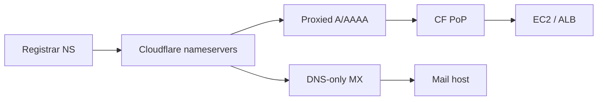

# 12 — Cloudflare (Part 1 of 3): DNS, CDN & TLS Modes

> **Parts:** **Part 1 — DNS, CDN, TLS** · [Part 2 — Origin Lock, WAF, Rules](./12-cloudflare-part2.md) · [Part 3 — Workers, R2, Tunnel, Interview](./12-cloudflare-part3.md)
>
> Product names, plan quotas, and IP lists move — verify on [developers.cloudflare.com](https://developers.cloudflare.com) and [cloudflare.com/ips](https://www.cloudflare.com/ips/) the morning you use them. CDN *theory* is in [09 §3.6](./09-system-design-part2.md#36-cdns-and-edge-caching); CloudFront + OAC is [11](./11-deployment-aws-s3.md); the origin box is [10](./10-deployment-aws-ec2.md). This session did **not** change any of your zones or AWS security groups.

## Table of Contents

- [1. Overview](#1-overview)
- [2. Topic Map](#2-topic-map)
- [3. Detailed Explanations (Part 1)](#3-detailed-explanations-part-1)
  - [3.1 DNS: Records, Orange Cloud, Nameservers](#31-dns-records-orange-cloud-nameservers)
  - [3.2 Reverse Proxy, CDN & Caching](#32-reverse-proxy-cdn--caching)
  - [3.3 SSL/TLS Modes, Origin CA, Authenticated Origin Pulls](#33-ssltls-modes-origin-ca-authenticated-origin-pulls)
- [Next: Part 2](#next-part-2)

---

## 1. Overview

**What this file covers.** How a mid-to-senior full-stack developer puts a Node/Next origin **behind Cloudflare**: nameserver delegation and proxied records, what the edge actually caches, **Full (strict)** vs Flexible, locking the origin so the public cannot skip the proxy, WAF/rate limits, modern Rules (Page Rules are legacy), Workers/Pages, R2 vs S3, KV vs D1 vs Durable Objects, Tunnel, Access, and when CloudFront is the better edge.

**Why interviewers care.** "We use Cloudflare" is not an architecture. They want: orange vs grey, why Flexible is an incident, why allowlisting [cloudflare.com/ips](https://www.cloudflare.com/ips/) is **necessary but not sufficient**, Cache Rules vs `Cache-Control`, and when a Worker is the wrong place for a chat room (use a Durable Object).

| Junior answer | Senior answer |
|---------------|---------------|
| "Cloudflare is a CDN" | "DNS + reverse proxy + CDN + WAF. Orange-cloud the web hostnames; grey-cloud mail" |
| "Flexible SSL, it's HTTPS" | "Flexible is HTTPS to Cloudflare and **HTTP to origin**. Full (strict) + Origin CA" |
| "Open 443 on the instance" | "SG = Cloudflare IPs **and** Authenticated Origin Pulls, or skip inbound entirely with Tunnel" |
| "Page Rule: cache everything" | "Cache Rules. HTML hashed assets long TTL; `/api` bypass. Page Rules are legacy" |
| "Worker for the session store" | "KV is eventually consistent (~60 s). Durable Object if it must be correct" |

> 💡 Interview Tip: If they say "the origin IP leaked on a grey-cloud record," the fix is not "hope nobody scans." Orange-cloud web, rotate the origin IP, lock SG / Tunnel.

---

## 2. Topic Map

**Part 1 — Edge in front of the origin**
- [ ] Nameservers, record types, proxied vs DNS-only — [3.1](#31-dns-records-orange-cloud-nameservers)
- [ ] Reverse proxy, cache keys, Cache Rules, purge, `Cache-Control` — [3.2](#32-reverse-proxy-cdn--caching)
- [ ] SSL/TLS modes, Origin CA, Authenticated Origin Pulls — [3.3](#33-ssltls-modes-origin-ca-authenticated-origin-pulls)

**[Part 2](./12-cloudflare-part2.md) — Lock and filter**
- [ ] Domain in front of EC2/ALB; Cloudflare IP SG; restore visitor IP
- [ ] WAF managed + custom rules; DDoS
- [ ] Rate limiting `/api/login`
- [ ] Page Rules → Cache / Configuration / Redirect / Transform / Origin Rules

**[Part 3](./12-cloudflare-part3.md) — Compute, store, compare, interview**
- [ ] Workers (V8 isolates, lifecycle, limits)
- [ ] Pages; R2 (S3-compatible, no egress)
- [ ] KV vs D1 vs Durable Objects; Tunnel; Access
- [ ] Cloudflare vs CloudFront
- [ ] Resources, ~9.25 h path, exercises, 36 questions

---

## 3. Detailed Explanations (Part 1)

### 3.1 DNS: Records, Orange Cloud, Nameservers

**Delegation.** At the registrar, set the domain's **nameservers** to the two (or more) names Cloudflare assigned the zone (`ada.ns.cloudflare.com` style). Until NS glue is live, dashboard records do nothing on the public internet. Don't run Route 53 **and** Cloudflare as SOA for the same zone ([10](./10-deployment-aws-ec2-part3.md#321-route-53)).

**Orange cloud (proxied).** Cloudflare publishes **anycast** addresses. Visitors never see your origin IP in DNS. HTTP/HTTPS (and a short list of other ports) terminate at a nearby PoP, then Cloudflare fetches origin. You get CDN, WAF, SSL modes, Workers.

**Grey cloud (DNS only).** Straight A/AAAA/CNAME to whatever you typed. No proxy, no cache, no WAF, no SSL mode. The origin IP is public.

| Record | Typical proxy |
|--------|----------------|
| `A` / `AAAA` / `CNAME` for `www`, apex, `api` | **Proxied** if it is HTTP(S) |
| `MX`, `TXT` (SPF/DKIM), `SRV` for mail | **DNS-only**. Orange-clouding mail breaks SMTP |
| `NS` for a delegated subdomain | DNS-only |

**Apex CNAME.** Cloudflare **flattens** CNAME at the zone apex so you can `example.com → some.target` without RFC-breaking a CNAME next to NS/MX. Interview: "CNAME flattening," not "illegal CNAME at apex."

**What grey-cloud leaks.** One `ssh.example.com` A record to the box, DNS-only, and scanners have the IP. Then they hit `:443` **around** Cloudflare. That is why Part 2 locks the security group (or uses Tunnel).

> ⚠️ Pitfall: Orange-clouding `A` for the same host you use for SSH, then wondering why SSH still works — SSH is not proxied. The IP is still the origin if any grey record (or historical DNS) published it.

### 3.2 Reverse Proxy, CDN & Caching

Cloudflare in orange-cloud mode is an **L7 reverse proxy** ([09](./09-system-design-part1.md#34-load-balancing) for L4 vs L7 — don't retell it). The PoP may **cache** the response.

**Default eligibility.** Cloudflare's default list is extension-based (`.js`, `.css`, `.png`, fonts, …). **HTML and JSON APIs are usually `DYNAMIC`** unless a Cache Rule makes them eligible. That is why "we put Cloudflare in front and the homepage is still origin-bound" is normal.

**`Cache-Control`.** Origin headers still matter. `public, max-age=31536000, immutable` on hashed Vite/`_next/static` assets is the same story as [11](./11-deployment-aws-s3-part3.md#310-cache-behaviors-invalidations-static-hosting). `no-store` / `private` on `/api`. Don't fight the origin with "Cache Everything" on a cookie-personalized HTML app — you will leak User A's dashboard to User B.

**Cache Rules** (current) vs Page Rules (legacy, [Part 2](./12-cloudflare-part2.md#37-rules-page-rules-are-legacy)). Typical pair:

1. Bypass cache when `http.request.uri.path` starts with `/api`.
2. Eligible for cache + long edge TTL on `/assets/*` or file extension in `{js css png …}`.

Creating a Cache Rule "Eligible for cache" **enables Cache Everything for that match** (behavior change vs old Page Rules). Read the match twice before you apply it to `*`.

**Cache key.** Default is roughly scheme + host + path + query. Custom keys can include headers, cookies, device type, country. **Every extra cookie in the key shards the cache.** Purge-by-URL in the dashboard may **miss** entries whose key includes headers you did not send; use purge by tag / host / prefix / everything, or the API with those headers. Same idea as CloudFront cache policies ([11](./11-deployment-aws-s3-part3.md#310-cache-behaviors-invalidations-static-hosting)).

**Purge.** Instant purge of URLs, `Cache-Tag` values, hosts, prefixes, or the whole zone. Hashed filenames still beat purge-everything on every deploy.

**Status header.** `CF-Cache-Status: HIT | MISS | EXPIRED | BYPASS | DYNAMIC | …` is how you debug, not guessing.

**Visitor IP.** After the proxy, origin sees a **Cloudflare** address. Real client: `CF-Connecting-IP` (and `X-Forwarded-For`). Restore it in Nginx `real_ip` **only from Cloudflare ranges**, then `trust proxy` hop count on Node ([06](./06-nodejs.md), [10](./10-deployment-aws-ec2.md)). Do not `trust proxy: true`.

> 💡 Interview Tip: "What do you cache?" — "Hashed static: long TTL. HTML: short or none. `/api`: bypass. Personalized HTML is never Cache Everything."

### 3.3 SSL/TLS Modes, Origin CA, Authenticated Origin Pulls

Two hops: **visitor → Cloudflare**, **Cloudflare → origin**. The mode is **the second hop** plus whether the first is encrypted.

| Mode (dashboard) | Visitor → CF | CF → origin | Origin cert checked? | Use |
|------------------|--------------|-------------|----------------------|-----|
| **Off** | HTTP | HTTP | n/a | Never for a product |
| **Flexible** | HTTPS | **HTTP** | n/a | Origins that cannot TLS — **treat as a vulnerability** |
| **Full** | matches visitor | HTTPS if visitor used HTTPS | **No** (self-signed/expired OK) | Lab with a junk cert; not prod |
| **Full (strict)** | matches visitor | HTTPS | **Yes** — public CA or **Cloudflare Origin CA**, unexpired, CN/SAN match | **Default you want** |
| **Strict (SSL-Only Origin Pull)** | HTTP or HTTPS | **Always HTTPS + validate** | Yes | When you want origin TLS even if the visitor used HTTP |

API values: `off`, `flexible`, `full`, `strict`, `origin_pull`. Confirm on [SSL modes](https://developers.cloudflare.com/ssl/origin-configuration/ssl-modes/).

**Flexible failure modes.** Attacker on the path to origin sees cleartext. Origin `return 301 https://…` **loops** (CF speaks HTTP to origin, origin sends people back to HTTPS). Mixed content. Interviewers use this as a filter.

**Full vs Full (strict).** Full will accept a hijacker's self-signed cert on the origin IP. Strict returns **526** if the origin cert is wrong/expired; **525** if the handshake never happens (origin not listening TLS). 526 after enabling strict = you flipped the mode before installing a valid cert.

**Origin CA.** Certificate issued by Cloudflare, installed on Nginx/ALB origin, **trusted by Cloudflare**, **not** by browsers. Fine because browsers never see origin. If you **grey-cloud** or pause Cloudflare, users get a scary untrusted cert — expected. Compatible with Full (strict). On EC2 you often **drop Certbot** for this hostname and use Origin CA; ACM on an ALB is still a valid public cert if Cloudflare is Full (strict) to the ALB.

**Authenticated Origin Pulls (AOP, mTLS).** Cloudflare presents a **client certificate** when pulling origin. Origin Nginx `ssl_verify_client on` with Cloudflare's pull CA (or your uploaded zone/hostname cert). Then a random client hitting origin `:443` fails TLS even if they know the IP. Details: [AOP](https://developers.cloudflare.com/ssl/origin-configuration/authenticated-origin-pull/).

- Does **not** apply in Off or Flexible (there is no origin TLS).
- **Incompatible with Tunnel** — Tunnel is already an authenticated outbound connector; there is no inbound TLS for AOP to speak to.

**Defense in depth (web origin):**

1. Orange-cloud the hostname.
2. Full (strict) + Origin CA (or ACM on ALB).
3. Security group / NACL: 443 only from [Cloudflare IP ranges](https://www.cloudflare.com/ips/) **or** no inbound at all (Tunnel).
4. AOP if inbound 443 still exists (IP allowlist is shared by *every* Cloudflare customer).

> ⚠️ Pitfall: "SG = Cloudflare IPs" alone. Anyone else on Cloudflare can still target your origin IP. AOP or Tunnel closes that.

---

## Next: Part 2

➡️ [Part 2 — Origin Lock, WAF, Rules](./12-cloudflare-part2.md): walkthrough in front of EC2/ALB, WAF + DDoS, rate limit `/api/login`, and the Page Rules → Rulesets map.
