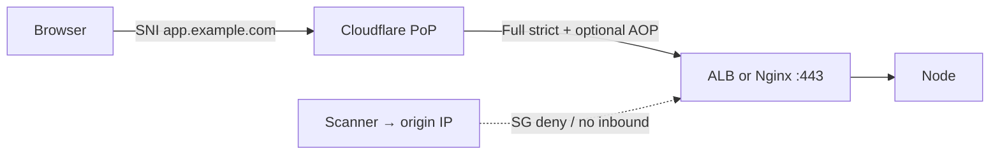

# 12 — Cloudflare (Part 2 of 3): Origin Lock, WAF & Rules

> **Parts:** [Part 1 — DNS, CDN, TLS](./12-cloudflare-part1.md) · **Part 2 — Origin Lock, WAF, Rules** · [Part 3 — Workers, R2, Tunnel, Interview](./12-cloudflare-part3.md)
>
> Walkthrough is **yours** to run on a lab zone + the [10](./10-deployment-aws-ec2.md) box/ALB. This session does **not** edit your Cloudflare account or AWS security groups. IP ranges: [cloudflare.com/ips](https://www.cloudflare.com/ips/). WAF expressions and rule quotas change by plan — [developers.cloudflare.com/waf](https://developers.cloudflare.com/waf). Do not re-teach OWASP injection/XSS ([08](./08-engineering-practices-part4.md)); this file is *where those filters run*.

## Table of Contents

- [3. Detailed Explanations (Part 2)](#3-detailed-explanations-part-2)
  - [3.4 Domain in Front of EC2 / ALB](#34-domain-in-front-of-ec2--alb)
  - [3.5 WAF and DDoS](#35-waf-and-ddos)
  - [3.6 Rate Limiting Rules](#36-rate-limiting-rules)
  - [3.7 Rules: Page Rules Are Legacy](#37-rules-page-rules-are-legacy)
- [Next: Part 3](#next-part-3)

---

## 3. Detailed Explanations (Part 2)

### 3.4 Domain in Front of EC2 / ALB

Goal: `https://app.example.com` hits Cloudflare, then your origin; scanners hitting the origin IP get nowhere useful.



**Walkthrough (lab).** Production uses the same control plane with an ALB in private-facing mode still having a public IP — lock that SG the same way.

1. **Zone.** Add the domain in Cloudflare. At the registrar, replace NS with the assigned Cloudflare nameservers. Wait until the zone is **Active**.
2. **Record.** `A`/`AAAA` to the Elastic IP (lab) or ALB: **CNAME** to the ALB DNS name (or Route 53 alias *or* flatten at Cloudflare — pick **one** DNS boss). Proxy **on** (orange).
3. **TLS at Cloudflare.** Universal SSL covers the proxied hostname once the record is orange. Visitors trust Cloudflare's edge cert.
4. **TLS at origin — pick one:**
   - **Origin CA** on Nginx ([Origin CA](https://developers.cloudflare.com/ssl/origin-configuration/origin-ca/)): paste the cert + key, listen 443, then set zone encryption to **Full (strict)**. Browsers never see this cert.
   - **ACM on the ALB** ([10](./10-deployment-aws-ec2-part3.md#313-alb-target-groups-listeners-acm)): public cert, Full (strict) still validates it. Do **not** run Certbot on every ASG instance *and* Origin CA — one origin cert story.
5. **Lock inbound 443.** Security group (ALB or instance): `443` from Cloudflare IPv4/IPv6 prefixes, not `0.0.0.0/0`. Fetch current lists from [cloudflare.com/ips](https://www.cloudflare.com/ips/) (also `ips-v4` / `ips-v6`). **Automate refresh** — the list changes. Leave 80 closed (Cloudflare can 301 HTTP→HTTPS at the edge).
6. **Authenticated Origin Pulls** if 443 is still reachable from the internet-at-large-on-Cloudflare ([Part 1](./12-cloudflare-part1.md#33-ssltls-modes-origin-ca-authenticated-origin-pulls)). Nginx verifies the client cert. Skip AOP if you move to Tunnel ([Part 3](./12-cloudflare-part3.md#312-cloudflare-tunnel)).
7. **Visitor IP.** Nginx `set_real_ip_from` every Cloudflare prefix; `real_ip_header CF-Connecting-IP`. Node `trust proxy` = hop count, not `true` ([10](./10-deployment-aws-ec2.md)).
8. **Grey-cloud nothing that publishes the web origin IP** unless you accept the leak. SSH: SSM ([10](./10-deployment-aws-ec2-part3.md#317-hardening-ssm-patching-imdsv2)), not `ssh.example.com` on the same box.

**ALB + Cloudflare.** Cloudflare origin = ALB DNS. ALB SG: 443 from Cloudflare IPs. Instance SG: app port from ALB SG only. Health checks are **ALB → instance**, not Cloudflare → `/readyz` (unless you also monitor from the edge). Idle timeout still applies to the CF→ALB hop.

**HTTP-01 Let's Encrypt on origin** will fail if 80/443 from the world is closed — another reason Origin CA or ACM (DNS-01 / ALB) wins behind Cloudflare.

> 💡 Interview Tip: Draw three boxes: visitor, Cloudflare, origin. Point at the SG. Then say "IP allowlist is shared by every CF customer, so AOP or Tunnel."

> ⚠️ Pitfall: Flexible + origin `listen 80` + `return 301 https://$host` → redirect loop. Strict + no origin cert → **526**. Origin down → **521**. Timeout (default ~100 s) → **524**. Handshake fail → **525**.

### 3.5 WAF and DDoS

**DDoS.** L3/L4 volumetric is absorbed on the anycast network by default (orange-cloud). L7 (HTTP flood) is the WAF + rate limits + bot score story. Unproxied (grey) records get **none** of this.

**WAF.** Managed rulesets (Cloudflare managed, OWASP-ish packs — **do not recite OWASP Top 10 here**, [08](./08-engineering-practices-part4.md)) plus **custom rules** on the Rulesets engine. Action: `block`, `challenge` / managed challenge, `JS challenge`, `skip`, `log`. Custom example (read-only knowledge, not an attack):

```text
(http.request.uri.path eq "/admin" and not ip.src in {203.0.113.0/24})
```

Block or challenge. Country/ASN: `ip.src.country`, `ip.src.asnum`. Path + method: `http.request.method eq "POST"` and path `/api/login`.

**Skip rules** exist so a partner integration is not wrecked by a managed SQLi signature. Skip **narrowly** (one path, one rule id), never "disable security" on `*`.

**False positives.** 403 on a legitimate JSON body is a WAF hit. `cf-ray` in the response + Security Events. Don't `$ setenforce 0` the WAF (turning the ruleset off) to debug an API — use log/challenge first.

**What WAF is not.** AuthZ. It will not replace session checks on `/admin`. Complementary to [06](./06-nodejs.md) auth.

### 3.6 Rate Limiting Rules

Current product: **Rate limiting rules** under WAF (not the old Page Rule "Rate Limiting" add-on). You pick:

- **Characteristics** — IP, IP+path, session cookie, JA3, … (plan-dependent).
- **Period** and threshold (requests per period).
- **Counting** — with or without caching nuance; APIs should count regardless of cache.
- **Action** — block / challenge / log.

`/api/login` and `/api/forgot-password` are the interview examples. Edge limit **before** Node ([09](./09-system-design-part3.md) rate-limiter design). **Per-user** quotas that know the account id still belong in Redis/Lua on the app ([06](./06-nodejs-part2.md#315-rate-limiting-with-redis)) — Cloudflare sees IPs and cookies, not your user table.

Combine: CF rate limit stops credential stuffing from one IP; app lockout stops one account across IPs.

Quotas and exact operators are plan-specific — quote the dashboard, not a 2019 blog.

### 3.7 Rules: Page Rules Are Legacy

[Page Rules](https://developers.cloudflare.com/rules/reference/page-rules-migration/) are a **legacy** product. New work uses dedicated Rulesets. Cloudflare has been auto-migrating existing Page Rules; **new Rules take precedence** if both match.

| Old Page Rule setting | Use instead |
|-----------------------|-------------|
| Forwarding URL / Always HTTPS | **Redirect Rules** (single or bulk) |
| Edge / browser cache TTL, cache level, bypass cookie, cache key | **Cache Rules** |
| SSL mode per path, Rocket Loader, polish, disable Zaraz | **Configuration Rules** |
| Host header override, origin port, SNI | **Origin Rules** |
| True-Client-IP / geo headers | **Transform Rules** (managed transforms) |
| URL rewrite | **Transform Rules** (rewrite) |
| Compression | **Compression Rules** |
| Firewall / security | **WAF custom rules** — "Disable Security" is gone on purpose |

**Origin Rules** example: `api.example.com` orange-clouded, origin host header `internal-alb.region.elb.amazonaws.com` while the visitor still sees `api.example.com`. Don't confuse this with changing DNS.

**Order of thinking:** Transform (what the request looks like) → WAF → Cache → origin. You do not need the exact engine order memorized; you need "I would not cache before I strip the auth cookie from the cache key."

> 💡 Interview Tip: If they ask you to "add a Page Rule," translate it: "That's a Cache Rule / Redirect Rule now."

---

## Next: Part 3

➡️ [Part 3 — Workers, R2, Tunnel, Interview](./12-cloudflare-part3.md): V8 isolates, Pages, R2 via SDK v3, KV vs D1 vs Durable Objects, `cloudflared`, Access, Cloudflare vs CloudFront, then resources, ~9.25 h, 10 exercises, 36 questions.
