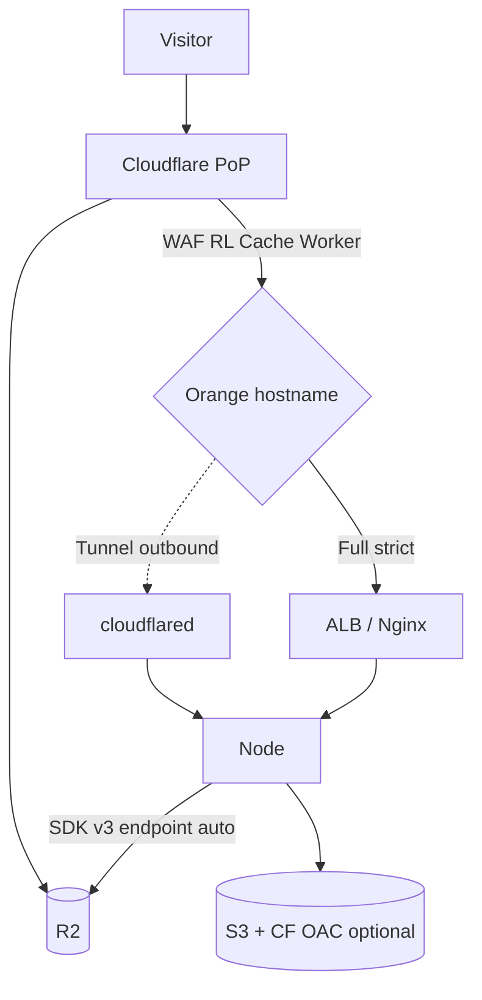
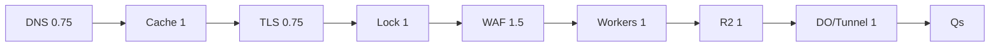

# 12 — Cloudflare (Part 3 of 3): Workers, R2, Tunnel & Interview

> **Parts:** [Part 1 — DNS, CDN, TLS](./12-cloudflare-part1.md) · [Part 2 — Origin Lock, WAF, Rules](./12-cloudflare-part2.md) · **Part 3 — Workers, R2, Tunnel, Interview**
>
> Workers limits: [platform/limits](https://developers.cloudflare.com/workers/platform/limits/) — Free **10 ms** CPU/request; Paid default **30 s**, configurable up to **5 min**; **128 MB** isolate memory. KV is **eventually consistent** (other PoPs can lag ~60 s). Durable Objects are **strongly consistent** per object. R2 is S3-compatible, **no egress** on the product pitch; presigned URLs use `*.r2.cloudflarestorage.com`, not a custom domain. Tunnel ≠ AOP. Plan limits move — re-read the docs. This session did **not** deploy a Worker or open a tunnel in your account.

## Table of Contents

- [3. Detailed Explanations (Part 3)](#3-detailed-explanations-part-3)
  - [3.8 Workers](#38-workers)
  - [3.9 Pages](#39-pages)
  - [3.10 R2](#310-r2)
  - [3.11 KV, D1, Durable Objects](#311-kv-d1-durable-objects)
  - [3.12 Cloudflare Tunnel](#312-cloudflare-tunnel)
  - [3.13 Zero Trust / Access](#313-zero-trust--access)
  - [3.14 Cloudflare vs CloudFront](#314-cloudflare-vs-cloudfront)
- [4. Full Example: Node on AWS Behind Cloudflare](#4-full-example-node-on-aws-behind-cloudflare)
- [5. Diagrams Index](#5-diagrams-index)
- [6. Resources](#6-resources)
- [7. How to Learn It](#7-how-to-learn-it)
- [8. Hands-on Practice](#8-hands-on-practice)
- [9. Interview Questions](#9-interview-questions)
  - [Basic](#basic)
  - [Intermediate](#intermediate)
  - [Advanced](#advanced)
  - [Tricky](#tricky)
- [10. Common Mistakes & Red Flags](#10-common-mistakes--red-flags)
- [11. Quick Revision Summary](#11-quick-revision-summary)
- [Next Steps](#next-steps)

---

## 3. Detailed Explanations (Part 3)

### 3.8 Workers

A Worker is **JavaScript/TypeScript on V8 isolates** at the PoP — not a Node process, not a container. Isolates start fast (no VM cold start story). Memory is isolated per tenant. CPU time is **time spent running JS**, not `await fetch()`.

**Lifecycle.** Module Worker:

```ts
export interface Env {
  // bindings in wrangler.jsonc — secrets, KV, R2, D1, DO
}

export default {
  async fetch(
    request: Request,
    _env: Env,
    ctx: ExecutionContext,
  ): Promise<Response> {
    const url = new URL(request.url);
    if (url.pathname.startsWith('/api/')) {
      const origin = await fetch(request);
      const res = new Response(origin.body, origin);
      res.headers.set('X-Edge', 'pass');
      return res;
    }
    ctx.waitUntil(logAsync(request)); // after the response is sent
    return new Response('ok', { status: 200 });
  },
};

async function logAsync(_request: Request): Promise<void> {
  // analytics; errors here do not fail the client response
}
```

`fetch` / `scheduled` / queue consumers are the usual handlers. `waitUntil` extends the isolate for background work **within CPU limits**.

**Limits (verify live).** Memory **128 MB** per isolate. Free: **10 ms** CPU/request, 100k requests/day. Paid: default **30 s** CPU, raise to **5 min** via `limits.cpu_ms`. Hitting the wall is error **1102**. Subrequest caps exist. Don't quote blog "$/million" in the round.

**Not Node.** No `fs`, no `net.Server`. `nodejs_compat` unlocks a subset. Outbound HTTP is `fetch`. For coordination across requests you **bind** KV/R2/D1/DO — isolate memory is not a session store.

**Where it belongs.** Auth header checks, A/B flags, HTML rewrites, geographic routing, small JSON APIs. **Not** a 200 ms CPU image encoder on the Free plan. Recursive `fetch` to the same Worker route without a bypass = loop.

> 💡 Interview Tip: "V8 isolate, CPU ≠ wall clock, 128 MB, KV for flags, Durable Object if it must serialize."

### 3.9 Pages

**Pages** = git-connected (or direct) **build + static assets** (+ optional Functions, which are Workers). Vite/`next export` output fits. SSR Next on Pages/Workers has a **specific adapter** — don't claim `next start` on Pages is the same as [10](./10-deployment-aws-ec2.md).

Cloudflare has been **unifying** Pages with **Workers + static assets**. New greenfield: read [Pages](https://developers.cloudflare.com/pages/) *and* Workers assets docs the week you build; the dashboard label may say either.

**When Pages vs S3+CloudFront ([11](./11-deployment-aws-s3.md)).** Pages: CF-native git deploy, preview URLs. S3+CloudFront: already in AWS, OAC, IAM. Don't run both as the source of truth for the same files.

### 3.10 R2

Object storage, **S3-compatible API**, marketed **zero egress** (storage + Class A/B operations still bill — don't say "free"). Custom domains / workers.dev bindings for public reads; **presigned URLs must use** `https://<ACCOUNT_ID>.r2.cloudflarestorage.com` ([presigned URLs](https://developers.cloudflare.com/r2/api/s3/presigned-urls/)). **POST policies are not supported.** GET/HEAD/PUT/DELETE presigns are.

Node on EC2 (same SDK as [11](./11-deployment-aws-s3-part2.md) — point the **endpoint**):

```ts
import { PutObjectCommand, S3Client } from '@aws-sdk/client-s3';
import { getSignedUrl } from '@aws-sdk/s3-request-presigner';

const r2 = new S3Client({
  region: 'auto', // required by the SDK; R2 ignores AWS regions
  endpoint: `https://${process.env.CF_ACCOUNT_ID}.r2.cloudflarestorage.com`,
  credentials: {
    accessKeyId: process.env.R2_ACCESS_KEY_ID!,
    secretAccessKey: process.env.R2_SECRET_ACCESS_KEY!,
  },
});

export async function presignPut(key: string, contentType: string): Promise<string> {
  return getSignedUrl(
    r2,
    new PutObjectCommand({ Bucket: 'notes-uploads', Key: key, ContentType: contentType }),
    { expiresIn: 60 },
  );
}
```

Worker binding (no S3 handshake): `await env.NOTES_UPLOADS.put(key, body)`.

**vs S3.** Already on AWS + CloudFront OAC + events to SQS/Lambda → stay on S3 ([11](./11-deployment-aws-s3.md)). Egress-dominated public media, CF-native app → R2. Compatibility gaps exist (some S3 features/headers); test the calls you actually use. CORS + matching `Content-Type` on signed PUT is the same footgun as S3.

### 3.11 KV, D1, Durable Objects

Interview table — pick **one** per problem:

| Product | Consistency | Shape | Use | Don't |
|---------|-------------|-------|-----|--------|
| **KV** | **Eventual** — other locations can lag **~60 s** (or more) | Key/value, read-heavy, cached at edge | Feature flags, i18n strings, config | Counters, locks, "read your write" checkouts |
| **D1** | SQL on SQLite; writes to a **primary**; replicas may lag | Relational, indexes, joins | Modest app DB, admin data | Global hot-row contention (that's a DO) |
| **Durable Objects** | **Strong** per object; single-threaded mailbox | Named instance + storage (SQLite-backed for new classes) | Chat room, collaborative doc, precise rate limit, websocket hub | One object for *all* users (hot shard) |

KV is not Redis. If you need atomic increment, that's a Durable Object (or Redis on AWS — [06](./06-nodejs.md)). D1 is not Aurora. Durable Objects are not a drop-in Postgres.

```ts
// Mental model: one DO per roomId
export class ChatRoom {
  constructor(private readonly ctx: DurableObjectState) {}
  async fetch(request: Request): Promise<Response> {
    // serialized on this object; storage is transactional
    return new Response('ok');
  }
}
```

Wrangler bindings and SQLite vs legacy DO storage: current Durable Objects docs. Don't invent SQL APIs in the interview — say "transactional storage on the object."

### 3.12 Cloudflare Tunnel

`cloudflared` opens **outbound-only** connections to Cloudflare. Origin needs **no public IP and no inbound 443**. Cloudflare maps `app.example.com` → `http://localhost:3000` (or the private ALB). WAF/CDN still apply on the public hostname.

**vs IP allowlist.** Allowlisting [cloudflare.com/ips](https://www.cloudflare.com/ips/) still leaves :443 open to the whole Cloudflare fleet. Tunnel **does not listen**. AOP is **incompatible** with Tunnel (no inbound TLS to present a client cert) — and you don't need it.

**vs SSM.** SSM is for operators ([10](./10-deployment-aws-ec2-part3.md#317-hardening-ssm-patching-imdsv2)). Tunnel is for **user HTTP(S)** (and optionally SSH/RDP through Access). You can use both.

Install location: on the instance, or as a sidecar, token-managed from the Zero Trust dashboard. Keep the token out of git.

### 3.13 Zero Trust / Access

**Access** puts an identity gate (Google/GitHub/OTP/IdP) **in front of** a hostname. Admin panels (`stg.example.com`, `grafana.example.com`) that should not be on the public internet even with a password in the app.

Tunnel + Access: `cloudflared` can require a `Cf-Access-Jwt-Assertion` before proxying (`originRequest.access.required`). Stolen origin URLs without the JWT die at the connector.

Not a replacement for app-level authz on the product API. It's the "VPN-less employee SSO" box. Skim [Cloudflare One](https://developers.cloudflare.com/cloudflare-one/) unless the job is platform/SRE.

### 3.14 Cloudflare vs CloudFront

| | **Cloudflare** (this file) | **CloudFront** ([11](./11-deployment-aws-s3.md)) |
|--|----------------------------|--------------------------------------------------|
| DNS | Often **is** the nameserver | Route 53 (or CF DNS) separately |
| S3 private origin | Custom origin + lock, or R2 | **OAC** is the native answer |
| WAF | Same vendor, orange-cloud | AWS WAF association |
| Edge compute | Workers / DO | CloudFront Functions (tiny) / Lambda@Edge (heavier, regional) |
| Certs | Universal SSL at edge; Origin CA to origin | ACM **us-east-1** for the distribution |
| Egress story | R2 no egress; CF cache | CF often cheaper than S3-direct; still AWS meters |
| Lock-in | Zone on CF | AWS account graph |

**Both in series** (visitor → Cloudflare → CloudFront → S3) is usually two caches, two bills, two purge stories. Pick **one** public edge unless you have a written reason (e.g. CF WAF in front of an existing CloudFront app during migration).

Decision: team already AWS-only + private S3 → CloudFront OAC. Team wants DNS+WAF+Workers on one orange cloud → Cloudflare. Egress-heavy blobs + CF already → R2.

---

## 4. Full Example: Node on AWS Behind Cloudflare

1. Zone on Cloudflare; NS delegated. `app.example.com` **proxied** to ALB DNS. Mail **grey**.
2. Encryption **Full (strict)**. Origin: ACM on ALB *or* Origin CA on Nginx.
3. ALB SG: 443 from Cloudflare prefixes (automated) **or** drop public ALB and use **Tunnel** to the private target.
4. AOP if inbound 443 remains. `real_ip` + `trust proxy` hop count.
5. Cache Rules: bypass `/api`, long TTL hashed `/assets`. WAF managed + custom `/admin`. Rate limit `/api/login`.
6. Uploads: S3 + OAC ([11](./11-deployment-aws-s3.md)) **or** R2 presign to `r2.cloudflarestorage.com`.
7. Optional Worker: add a header / flag. Chat fan-out: Durable Object, not KV.
8. `stg.example.com`: Access + Tunnel.

Do **not** Flexible. Do **not** Page Rule Cache Everything on `/`. Do **not** publish the origin IP on a grey A record.

---

## 5. Diagrams Index



TLS modes: [Part 1 §3.3](./12-cloudflare-part1.md#33-ssltls-modes-origin-ca-authenticated-origin-pulls). Origin lock: [Part 2 §3.4](./12-cloudflare-part2.md#34-domain-in-front-of-ec2--alb).

---

## 6. Resources

| Subtopic | Resource | Type | Where to find it | Free/Paid | Why it's good |
|----------|----------|------|------------------|:---------:|---------------|
| DNS | Cloudflare DNS docs; Learning Center "What is DNS?" | docs | developers.cloudflare.com/dns; cloudflare.com/learning | Free | Proxy vs DNS-only |
| Cache | Cache Rules, Cache-Control, purge API | docs | developers.cloudflare.com/cache | Free | Keys, eligibility, purge |
| TLS | Encryption modes; Origin CA; AOP | docs | developers.cloudflare.com/ssl | Free | Flexible vs strict; mTLS |
| IPs | Cloudflare IP ranges | list | cloudflare.com/ips | Free | SG allowlists; they change |
| WAF | WAF + DDoS docs | docs | developers.cloudflare.com/waf; …/ddos-protection | Free | Custom rules language |
| Rules | Page Rules migration | docs | developers.cloudflare.com/rules/reference/page-rules-migration | Free | What replaces what |
| Workers | How Workers works; limits | docs | developers.cloudflare.com/workers | Free | Isolates, CPU vs wall |
| Pages | Pages docs | docs | developers.cloudflare.com/pages | Free | Git deploys; check Workers assets |
| R2 | S3 API; SDK v3 example; presigned | docs | developers.cloudflare.com/r2 | Free | `region: "auto"`; no POST policy |
| Storage | KV how it works; DO concepts; D1 | docs | developers.cloudflare.com/kv; …/durable-objects; …/d1 | Free | Consistency picker |
| Tunnel / Access | Cloudflare One / Tunnel | docs | developers.cloudflare.com/cloudflare-one; …/tunnel | Free | Outbound-only origin |
| CloudFront | This series | notes | [11](./11-deployment-aws-s3.md) | Free | OAC comparison |

> 💡 Interview Tip: Universal SSL + Origin CA is the "two different certs" sentence. Edge cert for browsers; origin cert for the pull.

---

## 7. How to Learn It

Total: **~9.25 hours**, matching the [syllabus](./01-fullstack-syllabus.md#16-cloudflare). Prerequisites: [09 §3.6](./09-system-design-part2.md#36-cdns-and-edge-caching) CDN theory, [10](./10-deployment-aws-ec2.md) origin, [11](./11-deployment-aws-s3.md) if you compare OAC/R2. Use a **lab domain**; tear down tunnels and wide-open SGs.

| Step | What to do | Time |
|------|-----------|:----:|
| **0. Self-assess** | Tick the [Topic Map](./12-cloudflare-part1.md#2-topic-map). Cold [Q31–Q36](#tricky). | 0.25 h |
| **1. DNS** | [§3.1](./12-cloudflare-part1.md#31-dns-records-orange-cloud-nameservers). Orange vs grey on a throwaway zone. | 0.75 h |
| **2. Cache** | [§3.2](./12-cloudflare-part1.md#32-reverse-proxy-cdn--caching). `CF-Cache-Status`; bypass `/api`. | 1 h |
| **3. TLS** | [§3.3](./12-cloudflare-part1.md#33-ssltls-modes-origin-ca-authenticated-origin-pulls). Full (strict) + Origin CA. | 0.75 h |
| **4. Walkthrough** | [§3.4](./12-cloudflare-part2.md#34-domain-in-front-of-ec2--alb). SG from ips, `real_ip`. | 1 h |
| **5. WAF + rate + Rules** | [§3.5–3.7](./12-cloudflare-part2.md#35-waf-and-ddos). Login rate limit; one Cache Rule. | 1.5 h |
| **6. Workers** | [§3.8](#38-workers). Deploy a header-adding Worker. Read limits page. | 1 h |
| **7. Pages + R2** | [§3.9–3.10](#39-pages). SDK v3 `region: "auto"`; one presigned PUT. | 1 h |
| **8. Storage + Tunnel + Access + vs** | [§3.11–3.14](#311-kv-d1-durable-objects). Pick KV vs DO; skim tunnel. | 1 h |
| **9. Interview questions** | Every [question](#9-interview-questions) out loud. | 0.75 h |
| **10. Revise** | [Quick Revision](#11-quick-revision-summary) +1 day, last day. | 0.25 h |



---

## 8. Hands-on Practice

Lab zone only. Delete Workers, disable Tunnel, restore SGs when done.

| # | Exercise | Level | Acceptance criteria |
|---|----------|:-----:|---------------------|
| 1 | **NS + orange A** | 🟢 Easy | `dig` shows Cloudflare anycast, not the Elastic IP |
| 2 | **Grey MX, orange web** | 🟢 Easy | Mail records DNS-only; web proxied |
| 3 | **Full (strict) + Origin CA** | 🟡 Medium | Browser padlock; origin cert is Origin CA (`openssl s_client` to origin IP from a box that can still reach it) |
| 4 | **Cache Rule** — bypass `/api`, cache `/assets` | 🟡 Medium | `CF-Cache-Status: DYNAMIC` or `BYPASS` on `/api`; `HIT` on a hashed JS after two loads |
| 5 | **SG lock** — 443 from Cloudflare IPs only | 🟡 Medium | Direct origin IP 443 times out from a non-CF path; orange hostname 200 |
| 6 | **Rate limit** `/api/login` | 🟡 Medium | Burst from one IP → 429/challenge; other paths unaffected |
| 7 | **Worker** — set a response header | 🟡 Medium | Header present; `/api` still reaches origin; no fetch loop |
| 8 | **R2 presign** — SDK v3 `region: "auto"` | 🔴 Hard | PUT with matching `Content-Type` 200; custom-domain presign **fails** as documented |
| 9 | **Tunnel** — inbound 443 closed | 🔴 Hard | `cloudflared` to `localhost:3000`; SG has no public 443; hostname 200 |
| 10 | **KV vs DO write-up** | 🔴 Hard | One page: flag in KV, chat room in DO, why D1 is not the chat backlog |

---

## 9. Interview Questions

### Basic

#### Q1. What does the orange cloud actually do?

**Model answer.** Proxies HTTP(S) through Cloudflare anycast. DNS no longer publishes the origin IP. CDN, WAF, SSL modes, Workers apply. Grey = DNS only.

**Follow-ups:** MX?

**Great answer includes:** Mail stays grey; orange-cloud SMTP breaks mail.

#### Q2. How do you move a domain onto Cloudflare?

**Model answer.** Add zone, copy records, set registrar NS to Cloudflare's nameservers, wait Active. One SOA — don't also serve the zone on Route 53 ([10](./10-deployment-aws-ec2-part3.md#321-route-53)).

**Follow-ups:** Apex CNAME?

**Great answer includes:** CNAME flattening.

#### Q3. Flexible vs Full vs Full (strict)?

**Model answer.** Flexible: HTTPS to CF, **HTTP to origin**. Full: HTTPS to origin, **no cert validation**. Full (strict): validates a public CA or Origin CA cert. Want strict.

**Follow-ups:** Off?

**Great answer includes:** Cleartext both hops; never for a product.

#### Q4. What is an Origin CA certificate?

**Model answer.** CF-issued cert for **the pull**, not for browsers. Install on Nginx/ALB origin. Strict-compatible. Grey-clouding that hostname shows untrusted cert to users.

**Follow-ups:** Why not Let's Encrypt on the instance?

**Great answer includes:** HTTP-01 needs 80 from the world; cattle + Certbot is the [10](./10-deployment-aws-ec2.md) anti-pattern. Origin CA or ACM.

#### Q5. Default cache: is HTML cached?

**Model answer.** Usually **no** — extension defaults, HTML/JSON `DYNAMIC`. Cache Rules make paths eligible. Don't Cache Everything personalized HTML.

**Follow-ups:** How do you see it?

**Great answer includes:** `CF-Cache-Status`.

#### Q6. `CF-Connecting-IP` vs `X-Forwarded-For`?

**Model answer.** Connecting-IP is the visitor as Cloudflare saw them. XFF is a list and can be spoofed unless you only trust CF hops. `real_ip` from CF prefixes; Node `trust proxy` hop count ([10](./10-deployment-aws-ec2.md)).

**Follow-ups:** `trust proxy: true`?

**Great answer includes:** Spoofed client IP → broken rate limits.

#### Q7. Why lock the origin security group?

**Model answer.** Otherwise attackers use the origin IP and skip WAF/TLS/cache. 443 from [cloudflare.com/ips](https://www.cloudflare.com/ips/) or no inbound (Tunnel).

**Follow-ups:** Enough?

**Great answer includes:** **No** — every CF customer shares those IPs. AOP or Tunnel.

#### Q8. Page Rules?

**Model answer.** Legacy. Cache / Redirect / Configuration / Origin / Transform Rules. New rulesets win if both exist.

**Follow-ups:** Cache Everything default on new Cache Rules?

**Great answer includes:** "Eligible for cache" is Cache Everything for that match — don't apply to `*`.

#### Q9. Worker vs Node process?

**Model answer.** V8 isolate, no local disk, CPU-time billed/limited, `fetch` handler. Not `pm2`. Isolate RAM is not Redis.

**Follow-ups:** Cold start?

**Great answer includes:** Isolates start fast vs containers; still not free CPU.

#### Q10. R2 in one sentence?

**Model answer.** S3-compatible object store with **no egress** as the pitch; SDK v3 `region: "auto"` and account endpoint. Operations still cost. Presign on the S3 API hostname.

**Follow-ups:** Drop-in for every S3 feature?

**Great answer includes:** Test; no POST policy; events/IAM differ.

---

### Intermediate

#### Q11. Redirect loop after "turning on SSL."

**Model answer.** Flexible + origin 301 to HTTPS. CF talks HTTP to origin; origin sends the browser back. Fix: Full (strict) and origin TLS, edge HTTP→HTTPS redirect.

**Follow-ups:** 526 right after strict?

**Great answer includes:** Origin cert missing/expired/name mismatch.

#### Q12. 525 vs 526 vs 521 vs 524?

**Model answer.** 525 handshake failed (origin not TLS). 526 invalid origin cert (strict). 521 origin refused/down. 524 origin didn't answer in time (~100 s default).

**Follow-ups:** 522?

**Great answer includes:** TCP timed out to origin — SG, routing, origin dead.

#### Q13. Cache key with `Cookie: session=`?

**Model answer.** Shards or, worse, caches private HTML. Bypass cache on cookie, or don't put the cookie in the key, or don't cache that path.

**Follow-ups:** Purge one URL in the dashboard fails?

**Great answer includes:** Custom key headers; purge tag/host/API with those headers.

#### Q14. Rate limit login at Cloudflare **and** in Node?

**Model answer.** Edge: IP/path floods never hit Node ([§3.6](./12-cloudflare-part2.md#36-rate-limiting-rules)). App: per-account lockout with Redis ([06](./06-nodejs-part2.md#315-rate-limiting-with-redis)). Different keys.

**Follow-ups:** NAT / mobile CGNAT?

**Great answer includes:** IP limits false-positive; challenge + app-level account key.

#### Q15. WAF vs application authz?

**Model answer.** WAF is packet/HTTP filter (SQLi patterns, country, bots). `/admin` still needs your session. Skip rules are exceptions, not `Disable Security`.

**Follow-ups:** Managed rule blocks a partner?

**Great answer includes:** Narrow skip on path + rule id; log first.

#### Q16. Authenticated Origin Pulls in one sentence?

**Model answer.** mTLS: origin requires Cloudflare's client cert so a stolen origin IP + HTTPS still fails. Needs Full/Full (strict). Not for Tunnel.

**Follow-ups:** Global vs zone cert?

**Great answer includes:** Global = "from Cloudflare somewhere"; zone/hostname cert = your account.

#### Q17. Worker CPU 10 ms?

**Model answer.** **Free** plan per-request CPU. `await fetch(origin)` doesn't count. Paid default 30 s, max 5 min. 1102 when you blow it. Don't design image transcode on Free.

**Follow-ups:** Memory?

**Great answer includes:** 128 MB isolate, including concurrent requests on that isolate.

#### Q18. KV for a like-counter?

**Model answer.** No — eventual + no atomic increment you'd trust. Durable Object per entity, or Redis.

**Follow-ups:** What is KV good for?

**Great answer includes:** Flags, translations, rarely-written config.

#### Q19. D1 vs Durable Object vs Postgres on RDS?

**Model answer.** D1: SQLite, Worker-native, primary writes. DO: per-key serial, websocket. RDS: the product DB you already have ([07](./07-databases-and-apis.md), [10](./10-deployment-aws-ec2.md)). Don't move checkout to D1 in a 45-minute design without a reason.

**Follow-ups:** Chat room?

**Great answer includes:** One DO per room.

#### Q20. R2 presigned URL on `cdn.example.com`?

**Model answer.** Documented **not** to work. Sign against `ACCOUNT.r2.cloudflarestorage.com`. Public reads: custom domain or Worker binding.

**Follow-ups:** POST policy?

**Great answer includes:** Unsupported; PUT + CORS.

#### Q21. Pages vs `next start` on EC2?

**Model answer.** Pages/Workers assets = static (and Functions). `next start` needs Node ([10](./10-deployment-aws-ec2.md)). Match the rendering mode ([05](./05-nextjs.md)).

**Follow-ups:** ISR?

**Great answer includes:** Check current CF Next adapter; don't bluff.

#### Q22. Cloudflare in front of CloudFront?

**Model answer.** Two edges, two caches, two purges. Transitional only. Prefer one public CDN.

**Follow-ups:** WAF only at CF, origin CloudFront?

**Great answer includes:** Possible; still lock CloudFront to CF IPs — messy. Usually pick.

---

### Advanced

#### Q23. IP allowlist is not origin authentication. Why?

**Model answer.** The prefixes belong to **all** Cloudflare customers. Attacker orange-clouds *their* zone at your origin IP, or sends traffic from CF. AOP (client cert) or Tunnel (no listener).

**Follow-ups:** Rotate origin IP after a leak?

**Great answer includes:** Yes, plus grey records gone, plus lock.

#### Q24. Design edge A/B without poisoning cache.

**Model answer.** Cookie or header in the **cache key** only for the experiment path, or bypass cache for HTML and vary at origin, or Worker that fetches two hashed asset sets. Don't Cache Everything + Set-Cookie.

**Follow-ups:** 10% to variant B?

**Great answer includes:** Worker assigns cookie; origin/cache key includes it.

#### Q25. WebSockets through Cloudflare.

**Model answer.** Orange-cloud supports WS if origin times out long enough and you don't cache the upgrade. Scale: Durable Object or a backplane ([06](./06-nodejs-part2.md)), not in-memory on one Node ([09](./09-system-design.md)).

**Follow-ups:** Tunnel WS?

**Great answer includes:** Works; still one room → one DO or Redis pub/sub.

#### Q26. `waitUntil` vs returning after a KV write.

**Model answer.** `waitUntil` is for logging/metrics after the response. A KV write you care about for the **next** request may still be stale at another PoP for ~60 s — `waitUntil` does not make KV strong.

**Follow-ups:** Read-your-write on the same request?

**Great answer includes:** Same isolate may see it; don't rely globally.

#### Q27. Next.js SSR at the edge?

**Model answer.** Possible via Workers adapters; constraints are CPU, 128 MB, no long Node APIs. Default senior path for heavy SSR remains Node on [10](./10-deployment-aws-ec2.md) behind CF as **proxy**, not as the runtime.

**Follow-ups:** RSC?

**Great answer includes:** Match [05](./05-nextjs.md); don't invent a CF-only RSC runtime.

#### Q28. Automating Cloudflare IPs in a security group.

**Model answer.** Pull `ips-v4`/`ips-v6` on a schedule, update SG/NACL/prefix lists. Stale list = 521 after CF adds a prefix. Tunnel removes the job.

**Follow-ups:** IPv6?

**Great answer includes:** Dual-stack or you blackhole AAAA clients.

#### Q29. R2 vs S3 for the [09](./09-system-design-part4.md#315-design-file-upload--storage) upload design.

**Model answer.** Same init → presign PUT → worker. S3: events to SQS/Lambda, OAC read path. R2: event notifications differ (check current R2 event sinks); public read via custom domain/Worker; presign host is the S3 API. Egress is the reason to switch.

**Follow-ups:** Multipart?

**Great answer includes:** S3-compatible multipart exists; POST policy does not — don't copy the S3 POST snippet blindly.

#### Q30. Access on `/admin` but the API is on the same host.

**Model answer.** Access is hostname (or path with some plans) IdP gate — easy to break SPA APIs. Split `admin.example.com` (Access) and `api.example.com` (app auth). Don't put Access in front of a public mobile API.

**Follow-ups:** Service tokens?

**Great answer includes:** Machine-to-machine Access; still not user RBAC.

---

### Tricky

#### Q31. "Flexible is fine; Cloudflare is HTTPS."

**Model answer.** Users see a padlock; **origin path is HTTP**. MITM between CF and origin, cookie theft, loop with origin redirects. Full (strict).

**Follow-ups:** Origin can't do TLS?

**Great answer includes:** That's a debt ticket, not an architecture. Tunnel to HTTP localhost is still CF↔origin encrypted.

#### Q32. "Open 443 to the world; Cloudflare is just DNS."

**Model answer.** Then you greysourced it. Orange + lock, or you have no WAF. Scanners will find the IP from history even after you orange-cloud — **rotate**.

**Follow-ups:** Historical DNS?

**Great answer includes:** SecurityTrails-style archives; assume leaked.

#### Q33. "Cache Everything on `*` sped up the app."

**Model answer.** You cached `Set-Cookie` HTML. User B got User A's dashboard. Bypass authenticated paths.

**Follow-ups:** How caught?

**Great answer includes:** `CF-Cache-Status: HIT` on `/account` — that's the incident.

#### Q34. "Put sessions in KV because it's global."

**Model answer.** Logout/login races across PoPs. Eventual. DO or Redis.

**Follow-ups:** 60 seconds OK for a banner flag?

**Great answer includes:** Yes — that's KV's job.

#### Q35. "AOP + Tunnel for defense in depth."

**Model answer.** Incompatible. Tunnel already authenticates the connector. Pick Tunnel (preferred: no inbound) or AOP+IP lists.

**Follow-ups:** Why does AOP not apply?

**Great answer includes:** No inbound TLS listener for CF to present a cert.

#### Q36. "We'll query R2 with S3 Select."

**Model answer.** That's an S3 feature, and Select is closed to new S3 customers anyway ([11](./11-deployment-aws-s3-part3.md#313-object-lock-transfer-acceleration-select-skim)). Don't hang analytics on a compatibility maybe. Worker + derived objects / warehouse.

**Follow-ups:** Feature parity?

**Great answer includes:** I test the API; I don't assume the S3 catalog.

---

## 10. Common Mistakes & Red Flags

| Red flag | Why it hurts | Say/do instead |
|----------|--------------|----------------|
| Flexible in prod | HTTP to origin | Full (strict) |
| Grey-cloud web A record | Origin IP public | Orange + lock/Tunnel |
| `0.0.0.0/0` on 443 "because CF" | Bypass | CF IPs + AOP, or Tunnel |
| IP allowlist as authn | Shared prefixes | AOP / Tunnel |
| Cache Everything `*` | Session leak | Bypass `/api` and HTML auth |
| Page Rules in a 2026 design | Legacy | Named Rulesets |
| `trust proxy: true` | Spoofed IP | Hop count + `real_ip` |
| KV counter / session | Eventual | DO / Redis |
| Presign on R2 custom domain | Doesn't work | `r2.cloudflarestorage.com` |
| Worker as Node host | 10 ms / 128 MB | Proxy to [10](./10-deployment-aws-ec2.md) |
| CF + CloudFront stacked blindly | Two caches | One public edge |
| Certbot HTTP-01 behind locked SG | Can't solve | Origin CA / ACM |
| Reciting OWASP as "the WAF" | Wrong layer | Point at [08](./08-engineering-practices-part4.md); WAF is filters |

---

## 11. Quick Revision Summary

### One-page recap

**DNS.** Registrar NS → Cloudflare. Orange = proxy (anycast). Grey = origin IP in DNS. Mail grey. One SOA.

**Cache.** Defaults skip HTML. Cache Rules; hashed assets long TTL; `/api` bypass. Cache key cookies are a footgun. `CF-Cache-Status`. Purge tags > purge everything.

**TLS.** Full (strict) + Origin CA or ACM. Flexible is HTTP to origin. AOP = mTLS. 525/526/521/524.

**Lock.** SG from [cloudflare.com/ips](https://www.cloudflare.com/ips/) (stale list breaks you) **or** Tunnel (no inbound). IP list ≠ authentication.

**Filter.** WAF managed + custom. Rate limit login at the edge; per-user in Redis. Page Rules → Cache/Redirect/Configuration/Origin/Transform.

**Compute.** Workers: V8 isolate, CPU ≠ wall, 128 MB. Pages: static(+Functions). KV eventual; D1 SQL; DO strong per object.

**Store.** R2: S3 API, `region: "auto"`, no egress pitch, presign on S3 hostname, no POST policy. Else S3+OAC ([11](./11-deployment-aws-s3.md)).

**Access.** IdP in front of admin hostnames. Not API RBAC.

**vs CloudFront.** CF = DNS+WAF+Workers zone. CloudFront = AWS OAC native. One public edge.

### Last-day checklist

- [ ] I can draw visitor → orange cloud → origin and mark SG/Tunnel.
- [ ] I can explain Flexible vs Full vs Full (strict) and Origin CA vs browser certs.
- [ ] I know IP allowlist is shared; AOP or Tunnel.
- [ ] I can say what is cached by default and why Cache Everything `*` is an incident.
- [ ] I can map a Page Rule to a modern Rules product.
- [ ] I can pick KV vs D1 vs Durable Object in one sentence each.
- [ ] I can point SDK v3 at R2 (`region: "auto"`) and say where presigns work.
- [ ] I can contrast Cloudflare vs CloudFront without dumping features.
- [ ] I can answer Q31–Q36 cold.

---

## Next Steps

- Update your Cloudflare rows in the [Progress Tracker](./00-README.md#progress-tracker).
- Delete lab Workers/Tunnels; tighten any SG you opened.
- ➡️ Continue to [13-coding-round-practice.md](./13-coding-round-practice.md) — DSA patterns and machine coding. This file stopped at *the other edge*; 13 is *the whiteboard and the IDE*.
