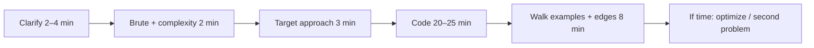

# 13 — Coding Round Practice (Part 1 of 4): Format, Big-O, Arrays, Pointers & Windows

> **Parts:** **Part 1 — Format, Big-O, Arrays, Pointers, Windows** · [Part 2 — Stack, Binary Search, Lists, Trees, Heap](./13-coding-round-practice-part2.md) · [Part 3 — Graphs, DP, Greedy, Tries](./13-coding-round-practice-part3.md) · [Part 4 — Machine Coding, Mocks, Interview](./13-coding-round-practice-part4.md)
>
> Problem set of record: **[NeetCode 150](https://neetcode.io/practice)** (names below match that list). Solve on LeetCode / NeetCode — this file is **patterns + JS/TS templates**, not a dump of problem statements. React UI builds live in [04 Part 3](./04-react-part3.md). JS output puzzles: [14](./14-js-logical-interview-questions.md). Templates are TypeScript for Node 24 type-stripping (no constructor parameter properties). Complexity is stated **before** code in a real round.

## Table of Contents

- [1. Overview](#1-overview)
- [2. Topic Map](#2-topic-map)
- [3. Detailed Explanations (Part 1)](#3-detailed-explanations-part-1)
  - [3.1 The Coding Round](#31-the-coding-round)
  - [3.2 Big-O in JavaScript](#32-big-o-in-javascript)
  - [3.3 Arrays & Hashing](#33-arrays--hashing)
  - [3.4 Two Pointers](#34-two-pointers)
  - [3.5 Sliding Window](#35-sliding-window)
- [Next: Part 2](#next-part-2)

---

## 1. Overview

**What this file covers.** How a mid-to-senior JS/TS engineer passes **DSA** (45-min CoderPad) and **machine/live coding** (45–90 min UI or API): the talk track, JS-specific costs (`shift` is not O(1)), one template per pattern, the NeetCode 150 as the work list, then UI/API rounds without duplicating [04](./04-react-part3.md).

**Why interviewers care.** They are not hiring a LeetCode rank. They want: you pick a pattern in 3 minutes, state O(time)/O(space), write working TypeScript, test an edge, and do not mutate the caller's array by accident. Product companies still ask mediums. "I don't do DSA" is a fail at many bars.

| Junior answer | Senior answer |
|---------------|---------------|
| Starts typing Two Sum brute force silently | "Hash map of value → index, O(n) time O(n) space; duplicate values?" |
| `queue.shift()` in BFS | "Shift is O(n). Index pointer or deque" |
| `+` in a loop to build a string | "Quadratic. Push to array, `join`" |
| `lo <= hi` vs `lo < hi` guessed | Names the invariant: what `lo` and `hi` mean when the loop exits |
| 40 minutes on CSS in a UI round | Happy path in 20, then keyboard and empty states ([04](./04-react-part3.md#30-strategy--time-boxing)) |

> 💡 Interview Tip: First 90 seconds: repeat the problem, constraints (`n` up to?), duplicates, mutate in place?, integer overflow (JS `Number` is IEEE-754; use `BigInt` only if they say so). Then brute force one-liner, then the target complexity.

---

## 2. Topic Map

**Part 1 — Speed and linear scans**
- [ ] Round format, talking aloud — [3.1](#31-the-coding-round)
- [ ] Big-O + JS method costs — [3.2](#32-big-o-in-javascript)
- [ ] Arrays & hashing — [3.3](#33-arrays--hashing)
- [ ] Two pointers — [3.4](#34-two-pointers)
- [ ] Sliding window (fixed vs variable) — [3.5](#35-sliding-window)

**[Part 2](./13-coding-round-practice-part2.md) — Structure**
- [ ] Stack / monotonic stack
- [ ] Binary search (`lo < hi` vs `lo <= hi`, search on answer)
- [ ] Linked list
- [ ] Trees DFS/BFS/BST
- [ ] Heap in JS (no built-in)

**[Part 3](./13-coding-round-practice-part3.md) — Graphs and "hard mediums"**
- [ ] Graphs, topo, union-find; Dijkstra skim
- [ ] Backtracking; 1D/2D DP
- [ ] Greedy & intervals; tries; prefix/bits
- [ ] Mocks

**[Part 4](./13-coding-round-practice-part4.md) — Other live rounds**
- [ ] Machine coding (points at [04](./04-react-part3.md)); vanilla DOM; backend 45-min API
- [ ] Debugging a PR; resources; ~99 h path; 36 questions

---

## 3. Detailed Explanations (Part 1)

### 3.1 The Coding Round

Typical: **one medium** in 45 minutes, sometimes easy+medium. Language: JavaScript or TypeScript. Editor: CoderPad / CodeSignal / HackerRank — **no LeetCode autocomplete**.



**Talk track (not syntax).** "I'll scan once and store complements in a `Map`." "This is the sliding-window template: expand `right`, shrink `left` while invalid." If stuck: restate the invariant, try a 5-element example on the pad, drop to brute force that still finishes.

**What they grade.** Correctness on the sample + one edge (`[]`, duplicates, negatives). Clean names. You did not claim O(n) for a hidden O(n²) (`includes` inside a loop). You asked whether the array is sorted.

**JS pitfalls in the pad.** `==` vs `===`. `sort()` **lexicographic** on numbers (`[10,2]` → `[10,2]` as strings — use `(a, b) => a - b`). Sparse holes. `for...in` on arrays. Recursion depth ~10k will throw ([02](./02-javascript-part1.md#31-execution-context--the-call-stack)) — iterate or explicit stack.

> ⚠️ Pitfall: Silent coding for 20 minutes. They cannot give hints if they cannot see the plan. Wrong plan, pretty code, still no hire.

### 3.2 Big-O in JavaScript

Big-O is the **growth** of operations as `n` → large, worst case unless you say average/amortized. Space counts the **extra** arrays/maps, not the input, unless they ask total.

**Arrays (contiguous in the spec's model; engines are more complex — interview with the model):**

| Operation | Time | Notes |
|-----------|------|--------|
| `a[i]`, `a.length`, `push`, `pop` | O(1) amortized | End of the array |
| `unshift`, `shift` | **O(n)** | Rewrites every index |
| `splice(i, …)` | **O(n)** | Tail moves |
| `includes`, `indexOf`, `lastIndexOf` | **O(n)** | |
| `slice` / spread `[...a]` | O(k) | |
| `sort` | **O(n log n)** | Timsort-like; **comparator required for numbers** |
| `a[i] = x` | O(1) | |

**Objects / `Map` / `Set`:** average O(1) get/set/has. Adversarial keys exist in theory; interviews assume amortized O(1). `Map` for non-string keys and frequent delete. `Object.create(null)` if you would collide with `__proto__` — prefer `Map`.

**Strings:** immutable. `s[i]` / `s.charCodeAt(i)` O(1) per UTF-16 code unit. `s + c` in a loop over `n` chars is **O(n²)**. `parts.push(c); parts.join('')` is O(n). `s.slice` O(k).

**Amortized.** `push` is O(1) amortized because of geometric backing-store growth. Don't say "push is O(n)" unless they want the rare resize.

**JS-specific landmines:**

```ts
const a = [10, 2, 1];
a.sort();            // [1, 10, 2]  — string sort. Wrong.
a.sort((x, y) => x - y); // [1, 2, 10]

const q = [1, 2, 3];
q.shift();           // O(n) — illegal inside a hot BFS
```

State complexity **out loud** before you write the loop. If the inner call is `includes`, you do not have O(n).

> 💡 Interview Tip: They will ask "can you do it in O(1) extra space?" Know in-place two-pointers vs "I need the set."

### 3.3 Arrays & Hashing

**Pattern.** One pass (or sort + pass). `Map`/`Set` for membership, frequency, last index, complement.

**Template — complement / frequency:**

```ts
function twoSum(nums: number[], target: number): [number, number] {
  const seen = new Map<number, number>(); // value -> index
  for (let i = 0; i < nums.length; i++) {
    const n = nums[i]!;
    const j = seen.get(target - n);
    if (j !== undefined) return [j, i];
    seen.set(n, i);
  }
  throw new Error('no pair');
}

function groupAnagrams(strs: string[]): string[][] {
  const g = new Map<string, string[]>();
  for (const s of strs) {
    const key = [...s].sort().join(''); // O(k log k) per string
    const bucket = g.get(key);
    if (bucket) bucket.push(s);
    else g.set(key, [s]);
  }
  return [...g.values()];
}
```

**Longest consecutive (O(n), not sort):** insert all into a `Set`. Only start a run at `x` when `x - 1` is **absent**. Inner `while` visits each number once.

**NeetCode 150 — Arrays & Hashing (9).** Solve in order: Contains Duplicate · Valid Anagram · Two Sum · Group Anagrams · Top K Frequent Elements · Product of Array Except Self · Valid Sudoku · Encode and Decode Strings · Longest Consecutive Sequence. Source: [neetcode.io/practice](https://neetcode.io/practice).

Product except self: prefix from left, suffix from right, **no division**. Top K: frequency map + bucket sort or heap ([Part 2](./13-coding-round-practice-part2.md#310-heap--priority-queue)).

### 3.4 Two Pointers

**When.** Sorted array, palindrome, pair/triplet sum, shrinking from both ends (container / rain water). Unsorted → sort first (state the extra O(n log n)) or use a map ([§3.3](#33-arrays--hashing)).

```ts
function twoSumSorted(nums: number[], target: number): [number, number] {
  let lo = 0;
  let hi = nums.length - 1;
  while (lo < hi) {
    const sum = nums[lo]! + nums[hi]!;
    if (sum === target) return [lo, hi]; // 0-indexed; LC 167 is 1-indexed
    if (sum < target) lo++;
    else hi--;
  }
  throw new Error('no pair');
}
```

**3Sum:** sort, fix `i`, two-pointer the rest, skip duplicates at all three indices. O(n²).

**Container with most water:** `area = min(h[lo], h[hi]) * (hi - lo)`. Move the **shorter** pointer (the width always shrinks; only a taller min can win).

**NeetCode 150 — Two Pointers (5).** Valid Palindrome · Two Sum II · 3Sum · Container With Most Water · Trapping Rain Water.

### 3.5 Sliding Window

**Fixed width.** Window size `k` (permutation in string, max in window). Add `right`, remove `right - k`.

**Variable width.** Expand `right` always; shrink `left` **while the invariant is broken** (too many unique chars, need more of a required char, etc.). Each index enters/leaves at most once → O(n).

```ts
function longestNoRepeat(s: string): number {
  const last = new Map<string, number>();
  let left = 0;
  let best = 0;
  for (let right = 0; right < s.length; right++) {
    const ch = s[right]!;
    const prev = last.get(ch);
    if (prev !== undefined && prev >= left) left = prev + 1;
    last.set(ch, right);
    best = Math.max(best, right - left + 1);
  }
  return best;
}
```

**Minimum window substring.** `need` remaining unique chars; expand until `need === 0`; shrink while valid; track best `left..right`.

**Max in window.** Monotonic **decreasing deque** of indices — that is a stack/deque problem; see [Part 2](./13-coding-round-practice-part2.md#36-stack--monotonic-stack).

**NeetCode 150 — Sliding Window (6).** Best Time to Buy and Sell Stock · Longest Substring Without Repeating Characters · Longest Repeating Character Replacement · Permutation in String · Minimum Window Substring · Sliding Window Maximum.

Stock I is "min so far" — a degenerate window. Don't force a two-pointer if a running min is clearer.

> 💡 Interview Tip: Draw `left`/`right` on a 7-char example. If you cannot say *when `left` moves*, you do not have the invariant yet.

---

## Next: Part 2

➡️ [Part 2 — Stack, Binary Search, Lists, Trees, Heap](./13-coding-round-practice-part2.md): monotonic stacks, `lo`/`hi` invariants, dummy-head lists, tree DFS/BFS, and a `MinHeap` you actually reuse.
