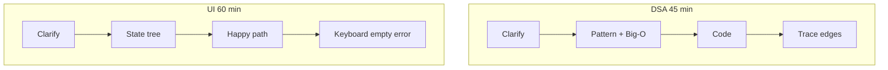
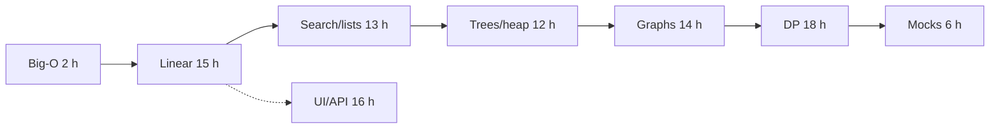

# 13 — Coding Round Practice (Part 4 of 4): Machine Coding, Mocks & Interview

> **Parts:** [Part 1 — Format, Big-O, Arrays, Pointers, Windows](./13-coding-round-practice-part1.md) · [Part 2 — Stack, Binary Search, Lists, Trees, Heap](./13-coding-round-practice-part2.md) · [Part 3 — Graphs, DP, Greedy, Tries](./13-coding-round-practice-part3.md) · **Part 4 — Machine Coding, Mocks, Interview**
>
> React component implementations (autocomplete, infinite scroll, modal, stars, todo, tabs, pagination, plus the practice table) are **[04 Part 3](./04-react-part3.md)** — do not rebuild them here. This part is the **shared live-coding plan**, vanilla DOM, a 45-min API, PR debugging, then the 99-hour path. a11y as a release gate: [08](./08-engineering-practices-part4.md#329-accessibility-as-a-release-practice). REST/pagination: [07](./07-databases-and-apis.md).

## Table of Contents

- [3. Detailed Explanations (Part 4)](#3-detailed-explanations-part-4)
  - [3.19 Machine Coding Strategy](#319-machine-coding-strategy)
  - [3.20 Vanilla JS Builds](#320-vanilla-js-builds)
  - [3.21 Backend Live Coding](#321-backend-live-coding)
  - [3.22 Code Reading / Debugging](#322-code-reading--debugging)
- [4. Full Example: 45-Minute Medium](#4-full-example-45-minute-medium)
- [5. Diagrams Index](#5-diagrams-index)
- [6. Resources](#6-resources)
- [7. How to Learn It](#7-how-to-learn-it)
- [8. Hands-on Practice](#8-hands-on-practice)
- [9. Interview Questions](#9-interview-questions)
  - [Basic](#basic)
  - [Intermediate](#intermediate)
  - [Advanced](#advanced)
  - [Tricky](#tricky)
- [10. Common Mistakes & Red Flags](#10-common-mistakes--red-flags)
- [11. Quick Revision Summary](#11-quick-revision-summary)
- [Next Steps](#next-steps)

---

## 3. Detailed Explanations (Part 4)

### 3.19 Machine Coding Strategy

Same loop as [04 §3.0](./04-react-part3.md#30-strategy--time-boxing) (clarify → plan → skeleton → core → edges → polish). Syllabus shorthand is five steps; the extra "plan" minute is what stops a 40-minute CSS spiral.

**Time box (60 min UI).** 5 clarify, 5 state/tree, 10 skeleton, 25 happy path, 10 edges (empty/loading/error/keyboard/abort), 5 "what I'd do next."

**DSA vs UI.** DSA: invariant + complexity. UI: **state ownership** + data flow. Both: talk decisions, not keystrokes.

**React list (build in 04, time-box here).** Autocomplete, infinite scroll, modal, tabs, accordion, star rating, todo, pagination, file explorer, OTP, progress, data table. a11y patterns are in the 04 table — interviewers notice `role="dialog"` and focus trap more than gradients.

**Stuck.** Drop a feature out loud ("I'll skip virtualization; the list is 20 items"). A working subset beats a genius architecture that does not render.

### 3.20 Vanilla JS Builds

No React. Proves you know the DOM ([02](./02-javascript.md)) and **event delegation** (one listener on the parent, `event.target.closest('[data-id]')`).

**Todo (no framework).** `ul` + input. State = array of `{ id, text, done }`. Render function **replaces** children (or diffs, but don't write a reconciler). Delegate `click` on the list for toggle/delete. Persist `localStorage` if time.

**Carousel.** Index modulo `n`. Prev/next buttons. Autoplay `setInterval` **paused** on hover/focus; `clearInterval` on unmount/teardown. Keyboard left/right.

**Delegation list.** 1_000 rows: do **not** bind 1_000 handlers. One `click` on `tbody`.

```ts
list.addEventListener('click', (e) => {
  const btn = (e.target as HTMLElement).closest('button[data-id]');
  if (!btn || !list.contains(btn)) return;
  const id = btn.getAttribute('data-id');
  // mutate state, rerender
});
```

Build each in ≤ 45 minutes once.

### 3.21 Backend Live Coding

Prompt: "POST `/v1/items` and GET list with pagination in 45 minutes, tests if you can." Stack you already know ([06](./06-nodejs.md)).

**Must ship.** Route, validation (Zod), 400 on bad body, pagination (`limit`/`cursor` or `page`), 201 + JSON, one happy-path test. **Don't:** auth SSO, Prisma schema design, Docker.

**Talk.** Idempotency if they say retries ([07](./07-databases-and-apis.md)). Don't pretend the in-memory array is Postgres. `trust proxy` is irrelevant here.

**45-min cut line.** Minute 30: GET+POST work with a map. Minute 40: Zod + one test. Minute 45: list edges (`limit` cap).

### 3.22 Code Reading / Debugging

Some rounds: "here's a PR / this function is wrong."

**Method.** (1) What should it do, in one sentence. (2) Walk a 3-row example. (3) Hunt off-by-one, mutation, async races, `==`, missing `await`, sort without comparator, `shift` in a loop, stale closure ([14](./14-js-logical-interview-questions.md), [02](./02-javascript.md)). (4) Patch the smallest cause. (5) Add the test that would have caught it.

Practice: open three real bug-fix PRs on a library you use; hide the fix; predict.

---

## 4. Full Example: 45-Minute Medium

**Prompt.** Longest substring without repeating characters.

**Minute 0–3.** "Variable window. `left` moves when `s[right]` was seen inside the window. O(n) time, O(min(n, Σ)) space. Empty string → 0. All unique → `n`."

**Minute 3–20.** Code the [Part 1 template](./13-coding-round-practice-part1.md#35-sliding-window).

**Minute 20–30.** Trace `abba`: when second `b` hits, `left` jumps past the first `b`; then `a` repeats — `left` to 2. Result 2 (`bb` is wrong; `b` then `ba` → 2). `" "` → 1.

**Minute 30+.** If they want more: "same template as min-window; I'd change the invariant."

---

## 5. Diagrams Index



Talk track: [Part 1 §3.1](./13-coding-round-practice-part1.md#31-the-coding-round). UI: [04 §3.0](./04-react-part3.md#30-strategy--time-boxing).

---

## 6. Resources

| Subtopic | Resource | Type | Where to find it | Free/Paid | Why it's good |
|----------|----------|------|------------------|:---------:|---------------|
| Roadmap | NeetCode 150 | list | neetcode.io/practice | Free list; videos mixed | **The work list for this file** |
| Big-O | Big-O Cheat Sheet | site | bigocheatsheet.com | Free | Structures; pair with [§3.2](./13-coding-round-practice-part1.md#32-big-o-in-javascript) |
| Patterns | NeetCode roadmap videos | video | neetcode.io | Mixed | One pattern per sitting |
| LC | LeetCode | site | leetcode.com | Free tier | Submit; premium problems exist on NC with alts |
| UI | GreatFrontEnd; BigFrontEnd.dev | site | greatfrontend.com; bigfrontend.dev | Mixed | Machine coding prompts |
| React builds | This series | notes | [04 Part 3](./04-react-part3.md) | Free | Full components + tests |
| Thinking aloud | Tech Interview Handbook "Coding interview" | docs | techinterviewhandbook.org | Free | Communication |
| Mocks | Pramp; interviewing.io | site | pramp.com; interviewing.io | Mixed | Timed, other human |
| DOM | MDN events / event delegation | docs | MDN | Free | Vanilla builds |
| API | Express/Fastify + Zod | notes | [06](./06-nodejs.md), [07](./07-databases-and-apis.md) | Free | 45-min backend |
| Schedule | Study plan | notes | [16](./16-study-plan.md) | Free | 1 DSA/day from day 1 |

> 💡 Interview Tip: Grind **patterns**, not random hard. A second pass on the 150 three days later beats 400 unreviewed easies.

---

## 7. How to Learn It

Total: **~99 hours** = [DSA 81](./01-fullstack-syllabus.md#17-dsa--coding-rounds) + [machine 18](./01-fullstack-syllabus.md#18-machine-coding--live-coding). Most of that is **solving**, not rereading. One DSA problem **every day** from week 1 ([00](./00-README.md#recommended-study-order)).

| Step | What to do | Time |
|------|-----------|:----:|
| **0. Self-assess** | Timed medium. Cold [Q31–Q36](#tricky). | 0.5 h |
| **1. Format + Big-O** | [Part 1 §3.1–3.2](./13-coding-round-practice-part1.md). Say complexity of `shift`/`sort`/`includes`. | 2 h |
| **2. Linear patterns** | Arrays, two pointers, window — all NC 150 in those buckets. Re-solve +3 days. | 15 h |
| **3. Stack + binsearch + lists** | [Part 2](./13-coding-round-practice-part2.md) NC lists. Write `lo < hi` on paper. | 13 h |
| **4. Trees + heap** | Recursive + iterative; paste `MinHeap` until muscle memory. | 12 h |
| **5. Graphs + backtracking** | Islands, course schedule, UF, subsets template. | 14 h |
| **6. DP + greedy + tries + extras** | Recurrence in English first. Skim Dijkstra/math. | 18 h |
| **7. Mocks** | 45 min out loud, weekly from week 3. | 6 h |
| **8. Machine coding** | [04](./04-react-part3.md) seven builds + table; vanilla ×3; API twice. | 16 h |
| **9. Debug + talk** | Three PRs; record one round. | 2 h |
| **10. Questions + revise** | [§9](#9-interview-questions); last-day list. | 0.5 h |



---

## 8. Hands-on Practice

| # | Exercise | Level | Acceptance criteria |
|---|----------|:-----:|---------------------|
| 1 | **JS costs sheet** — `shift` / `includes` / `sort` / concat | 🟢 Easy | You can quote the table in [§3.2](./13-coding-round-practice-part1.md#32-big-o-in-javascript) cold |
| 2 | **Two Sum + Group Anagrams** timed 25 min | 🟢 Easy | Spoken complexity; `Map`; numeric `sort` comparator |
| 3 | **Variable window** — longest no-repeat + min-window | 🟡 Medium | Trace `abba`; O(n) claimed only if each index moves ≤ once |
| 4 | **Binsearch on answer** — Koko | 🟡 Medium | `lo < hi`, `can(mid)` monotone, no off-by-one on the sample |
| 5 | **MinHeap** — 20 random push/pop vs sorted copy | 🟡 Medium | Always matches; used in a Top-K problem |
| 6 | **Islands + Course Schedule** | 🟡 Medium | DFS mutate or visited set; Kahn detects cycle |
| 7 | **Coin Change + Merge Intervals** | 🟡 Medium | `dp[0]=0`; sort by start; one sentence each for `dp[x]` |
| 8 | **React build from 04** in 60 min | 🔴 Hard | Happy path + keyboard + empty; no CSS rabbit hole |
| 9 | **Vanilla todo + delegation** | 🔴 Hard | One list listener; 200 items stay snappy |
| 10 | **Mock** — 45 min medium out loud, recorded | 🔴 Hard | Clarify first; complexity before code; one edge traced |

---

## 9. Interview Questions

### Basic

#### Q1. Time complexity of `array.shift()` in a BFS?

**Model answer.** O(n) per call, O(n²) for a queue of n. Use an index `head` or a linked list.

**Follow-ups:** `unshift`?

**Great answer includes:** Also O(n). `push`/`pop` are the O(1) ends.

#### Q2. Why is string `+` in a loop dangerous?

**Model answer.** Strings are immutable; each `+` copies. O(n²) to build length n. `push` + `join`.

**Follow-ups:** `+=` in V8 sometimes?

**Great answer includes:** Don't bet an interview on an optimization; `join` is obvious.

#### Q3. `sort()` on numbers.

**Model answer.** Default is lexicographic Unicode. `[10,2]` → `[10,2]` as strings. `(a,b) => a - b`.

**Follow-ups:** Stability?

**Great answer includes:** Modern engines: stable sort; still don't rely on it unless ECMA says so for your target.

#### Q4. Two Sum: brute vs map.

**Model answer.** Nested loop O(n²). One pass `Map` value→index, O(n) time O(n) space. Ask duplicates / return indices vs values.

**Follow-ups:** Sorted?

**Great answer includes:** Two pointers O(n) extra O(1) after sort (sort is n log n if unsorted).

#### Q5. When two pointers vs sliding window?

**Model answer.** Two pointers: sorted pair, opposite ends, palindrome. Window: contiguous subarray/substring, expand/shrink.

**Follow-ups:** 3Sum?

**Great answer includes:** Sort + fix one + two pointers, O(n²).

#### Q6. `Map` vs object for a frequency table?

**Model answer.** `Map` for unknown keys, non-strings, `.size`, no `__proto__` footgun. Object is fine for `'a'..'z'`.

**Follow-ups:** `Object.create(null)`?

**Great answer includes:** Acceptable; I still prefer `Map` on the pad.

#### Q7. Valid parentheses.

**Model answer.** Stack of opens; on close, pop must match. Empty stack at end. O(n).

**Follow-ups:** Min stack?

**Great answer includes:** Store running min with each push.

#### Q8. What do you say in the first two minutes?

**Model answer.** Repeat the problem, constraints, I/O types, mutate?, examples, brute complexity, target complexity.

**Follow-ups:** They are quiet.

**Great answer includes:** I still talk; they cannot hint on a silent pad.

#### Q9. `includes` inside a loop.

**Model answer.** That's O(n²). Preload a `Set`.

**Follow-ups:** `indexOf`?

**Great answer includes:** Same linear scan.

#### Q10. Recursion vs iteration for trees?

**Model answer.** Recursion is clear; skewed tree / long list can `RangeError`. Iterative stack/queue. JS has no TCO you should rely on ([02](./02-javascript-part1.md#31-execution-context--the-call-stack)).

**Follow-ups:** Typical limit?

**Great answer includes:** Engine-dependent thousands, not millions.

---

### Intermediate

#### Q11. `lo <= hi` vs `lo < hi`.

**Model answer.** Exact match on a closed range: `<=`, move `mid±1`. Lower-bound / first-true: `lo < hi`, `hi = mid` or `lo = mid+1`, `hi` exclusive.

**Follow-ups:** Infinite loop?

**Great answer includes:** `lo = mid` with `lo < hi` and integer mid toward lo. Always shrink.

#### Q12. Search on answer (Koko).

**Model answer.** Monotone `can(speed)`. Binary search the speed. `lo` ends at the minimum feasible.

**Follow-ups:** How do you know monotone?

**Great answer includes:** Faster eating never hurts; if not monotone, binsearch is wrong.

#### Q13. Dummy head?

**Model answer.** Fake node before head so delete/insert don't special-case empty/head. Return `dummy.next`.

**Follow-ups:** Reverse list?

**Great answer includes:** Three pointers; dummy optional.

#### Q14. Validate BST.

**Model answer.** Pass `(lo, hi)` bounds, not just children. Inorder strictly increasing also works.

**Follow-ups:** Duplicates?

**Great answer includes:** Ask the problem; often left < node ≤ right or strict.

#### Q15. Why implement a heap?

**Model answer.** No `PriorityQueue` in JS. Binary heap array, O(log n) push/pop. Top K = size-k heap.

**Follow-ups:** `sort` each time?

**Great answer includes:** O(n log n) per op; they wanted log.

#### Q16. BFS shortest path on a grid.

**Model answer.** Queue, visited, steps. Unweighted. 4-dir. Don't `shift`.

**Follow-ups:** Weighted?

**Great answer includes:** Dijkstra ([Part 3](./13-coding-round-practice-part3.md#317-dijkstra-mst-math--skim)).

#### Q17. Course Schedule cycle.

**Model answer.** Kahn: if processed < n, cycle. Or DFS three-colors; grey neighbor = cycle.

**Follow-ups:** Order of courses?

**Great answer includes:** The Kahn output is Course Schedule II.

#### Q18. Backtracking `pop`.

**Model answer.** Mutate `cur`, recurse, **unchoose**. Forgetting `pop` aliases all answers to the last state.

**Follow-ups:** `cur.slice()` at the leaf?

**Great answer includes:** Copy then, yes; still pop on the way up.

#### Q19. Coin change `dp[x]`.

**Model answer.** Min coins to make `x`. `dp[0]=0`, rest inf. Unbounded: loop amounts then coins (or coins then amounts — know which permutation problem you are in).

**Follow-ups:** Coin Change II?

**Great answer includes:** Count combinations; loop coins outer to avoid permutation double-count.

#### Q20. Merge intervals.

**Model answer.** Sort by start. If next.start ≤ cur.end, extend end; else push. O(n log n).

**Follow-ups:** Meeting rooms II?

**Great answer includes:** Min heaps of end times, or two pointers on sorted starts/ends.

#### Q21. Trie vs `startsWith` on a `Set`?

**Model answer.** Set of words does not make prefix search O(length). Trie is O(len) prefix. Word Search II needs the trie to prune.

**Follow-ups:** Hash all prefixes?

**Great answer includes:** Works for memory-small dictionaries; still a trie in spirit.

#### Q22. UI round: what if time is almost up?

**Model answer.** Freeze CSS. Ship happy path. List missing a11y/tests out loud. Don't start a new architecture at minute 55.

**Follow-ups:** Tests?

**Great answer includes:** One RTL test if the harness exists; [04](./04-react-part3.md).

---

### Advanced

#### Q23. Sliding window maximum in O(n).

**Model answer.** Monotonic decreasing deque of **indices**. Pop back while ≤ new value; pop front when `i - k`. Front is max.

**Follow-ups:** Heap?

**Great answer includes:** O(n log n); they asked linear.

#### Q24. Union-Find vs DFS for components.

**Model answer.** Both O(n). UF shines when edges stream / "add edge, are they connected?" DFS shines on grids already in memory.

**Follow-ups:** Path compression + rank?

**Great answer includes:** Inverse Ackermann; say "almost O(1) per op."

#### Q25. Max path sum in a binary tree.

**Model answer.** DFS returns **best one-arm** to parent. At node, combine both arms for a candidate answer (global max). Don't pass a two-arm sum up.

**Follow-ups:** Diameter?

**Great answer includes:** Same split: height up, diameter via two arms.

#### Q26. LRU in JS.

**Model answer.** `Map` is insertion-ordered: `get` = delete + re-set; `set` evicts `map.keys().next()` when over cap. Or DLL + Map for the textbook.

**Follow-ups:** O(1)?

**Great answer includes:** Both O(1) average if you don't iterate.

#### Q27. Median of a stream.

**Model answer.** Max-heap lower half, min-heap upper; sizes differ by at most 1. Rebalance on insert.

**Follow-ups:** Even count?

**Great answer includes:** Average of two peeks.

#### Q28. 0/1 knapsack vs unbounded.

**Model answer.** 0/1: each item once — iterate capacity **downward** if 1D. Unbounded: upward (or item outer). Mixing them double-counts or skips.

**Follow-ups:** Partition equal subset?

**Great answer includes:** 0/1 knapsack of sum/2.

#### Q29. 45-min API: pagination.

**Model answer.** Cursor over offset for large mutating lists ([07](./07-databases-and-apis.md)). In the pad, `limit` + `offset` on an array is enough if I name the prod version.

**Follow-ups:** Invalid `limit`?

**Great answer includes:** Zod cap, 400.

#### Q30. Debugging: stale fetch in autocomplete.

**Model answer.** Race: older response wins. AbortController or ignore mismatch request id. Full build: [04](./04-react-part3.md#31-autocomplete--typeahead).

**Follow-ups:** Debounce vs abort?

**Great answer includes:** Both; debounce reduces calls, abort kills in-flight.

---

### Tricky

#### Q31. "BFS with `queue.shift()` is O(V+E)."

**Model answer.** Shifts make it O((V+E)·V) on dense arrays. Index or deque.

**Follow-ups:** Linked-list queue?

**Great answer includes:** O(1) pop front; more code on the pad.

#### Q32. "BST is valid; I checked every node vs its children."

**Model answer.** Counterexample: `2 → right 10 → left 1`. Local OK, global not. Range or inorder.

**Follow-ups:** BST LCA?

**Great answer includes:** Walk from root; split is the LCA.

#### Q33. `while (lo < hi) { mid = (lo+hi)>>1; if (ok) lo = mid; else hi = mid - 1; }`

**Model answer.** When `hi = lo+1` and `ok(lo)`, `mid = lo`, `lo = mid` forever. Use `lo = mid+1` / `hi = mid` **or** exact-match template.

**Follow-ups:** Prove termination?

**Great answer includes:** Interval shrinks every iteration.

#### Q34. `a.sort()` then two-pointer, claimed O(n).

**Model answer.** Sort is O(n log n). Total O(n log n). Don't hide it.

**Follow-ups:** Already sorted input?

**Great answer includes:** Ask; then O(n).

#### Q35. UI: Cache the whole page in component state copied from props.

**Model answer.** Stale props, extra source of truth. Derived data during render ([04](./04-react.md)). Not a DSA fail but a machine-coding fail.

**Follow-ups:** List filter?

**Great answer includes:** `useMemo` from `items` + `query`, not an effect that writes state.

#### Q36. "I'll bit-trick this medium first."

**Model answer.** If the pattern is window/heap, bits are a detour. XOR is for the *obvious* XOR problems. Clarity > clever.

**Follow-ups:** Single Number?

**Great answer includes:** Then XOR *is* the pattern.

---

## 10. Common Mistakes & Red Flags

| Red flag | Why it hurts | Say/do instead |
|----------|--------------|----------------|
| Silent pad | No hints | Narrate the invariant |
| `shift` BFS | Hidden n² | Index queue |
| `sort()` numbers | Wrong order | Comparator |
| `includes` in loop | Hidden n² | `Set` |
| `+` strings in loop | n² | `join` |
| Local BST check | Wrong | Range / inorder |
| Mix binsearch templates | Infinite loop | Name A vs B |
| Forget `pop` in backtracking | All answers aliased | Unchoose |
| `dp` without English | Random table | One-sentence subproblem |
| CSS for 20 min | No feature | Happy path first |
| "I don't do DSA" | Bar fail | One medium/day |
| Mutating caller arrays | Surprise bugs | Copy or ask |
| Recursion on 10⁵ list | Stack overflow | Iterate |

---

## 11. Quick Revision Summary

### One-page recap

**Round.** Clarify → brute+O → pattern → code → trace. Talk.

**JS costs.** `shift`/`unshift`/`splice`/`includes` O(n). `sort` n log n + comparator. Strings immutable. `Map`/`Set` average O(1).

**Patterns.** Hash complement · two pointers · window expand/shrink · monotonic stack/deque · binsearch A (`<=`) vs B (`<`, answer space) · dummy list · tree DFS + BFS index-queue · heap you wrote · graph DFS/BFS/Kahn/UF · backtrack choose/unchoose · DP sentence → table · interval sort · trie.

**UI.** [04](./04-react-part3.md) time-box. Vanilla: delegation. API: validate + paginate + one test.

**Mocks.** Weekly, timed, out loud.

### Last-day checklist

- [ ] I can quote `shift` / `sort` / `includes` / string concat costs.
- [ ] I can write Two Sum, a variable window, and `lowerBound` from memory.
- [ ] I can say `lo <= hi` vs `lo < hi` and why `lo = mid` loops.
- [ ] I can reverse a list and BFS a tree without `shift`.
- [ ] I have a `MinHeap` I trust.
- [ ] I can flood-fill islands and detect a cycle with Kahn.
- [ ] I can define `dp[i]` in English for robber / coin change.
- [ ] I know the 60-min UI cut line and where the 04 builds live.
- [ ] I can answer Q31–Q36 cold.

---

## Next Steps

- Update your coding-round rows in the [Progress Tracker](./00-README.md#progress-tracker).
- Do **one** NeetCode 150 problem today, out loud.
- ➡️ Continue to [14-js-logical-interview-questions.md](./14-js-logical-interview-questions.md) — output-prediction and `this`/closure puzzles. This file stopped at *algorithms and live builds*; 14 is *what does this snippet print*.
