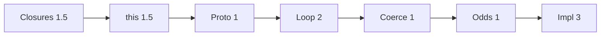

# 14 — JS Logical Questions (Part 3 of 3): More Output, Implementations & Interview

> **Parts:** [Part 1 — Closures, `this`, Prototypes](./14-js-logical-interview-questions-part1.md) · [Part 2 — Event Loop, Coercion, Oddballs](./14-js-logical-interview-questions-part2.md) · **Part 3 — Implementations, Interview**
>
> Output bank continues (Q87–Q108) then **≤ 20 min** implementations. Full polyfills (`bind` + `new`, `Promise.all`, `flat`, `promisify`): [02 Part 2 §4](./02-javascript-part2.md#4-code-examples-polyfills--utilities). Debounce/curry/clone: [02 §3.15–3.17](./02-javascript-part2.md#315-functional-utilities-currying-compose-memoize). No constructor parameter properties (Node 24 strip). Test with `node:test` or Vitest ([08](./08-engineering-practices.md)).

## Table of Contents

- [10. More Output — Q87–Q108](#10-more-output--q87q108)
- [11. Implementations (≤ 20 min each)](#11-implementations--20-min-each)
- [12. Resources](#12-resources)
- [13. How to Learn It](#13-how-to-learn-it)
- [14. Hands-on Practice](#14-hands-on-practice)
- [15. Interview Questions](#15-interview-questions)
- [16. Common Mistakes & Red Flags](#16-common-mistakes--red-flags)
- [17. Quick Revision Summary](#17-quick-revision-summary)
- [Next Steps](#next-steps)

---

## 10. More Output — Q87–Q108

**Q87** `[...[1,2], ...[3]]` → `[1,2,3]` (shallow). Nested objects still shared.

**Q88**
```js
const { a = 1, b } = { b: 2 };
console.log(a, b);
```
> **Prints:** `1` `2` (default only on `undefined`, not missing-with-null).

**Q89** `const { a = 1 } = { a: null }` → `a` is `null` (default only for `undefined`, not `null`).

**Q90** `void 0` → `undefined` (old safe `undefined`).

**Q91**
```js
const a = [1, 2, 3];
delete a[1];
console.log(a.length, a[1], 1 in a);
```
> **Prints:** `3` `undefined` `false` (hole, length unchanged).

**Q92** `[,,].length` → `2`. `[undefined, undefined].length` → `2` but `1 in [,,]` is `false`, `1 in [undefined, undefined]` is `true`.

**Q93**
```js
console.log([1, , 3].map((x) => x ?? "h"));
```
> **Prints:** `[ 1, <1 empty item>, 3 ]`  
> **Why:** `map` **skips holes**; `??` never runs for index 1. `Array.from([1, , 3], (x) => x ?? "h")` → `[1, "h", 3]`.

**Q94** `JSON.stringify({ a: undefined, b: 1 })` → `'{"b":1}'` (keys with `undefined` dropped). `JSON.stringify([undefined])` → `'[null]'`.

**Q95** `JSON.stringify(Infinity)` → `null` (same for `NaN`).

**Q96**
```js
const m = new Map();
m.set(NaN, "a");
m.set(NaN, "b");
console.log(m.size, m.get(NaN));
```
> **Prints:** `1` `"b"` (`SameValueZero`: `NaN` matches `NaN`).

**Q97** `new Set([{ n: 1 }, { n: 1 }]).size` → `2` (different references).

**Q98** `new WeakMap([[{}, 1]])` is fine. `new WeakMap([["x", 1]])` **throws** `TypeError` (string key). Node 24 also accepts **symbol** keys. Interview line: objects (and symbols in current engines) — never strings. [MDN WeakMap](https://developer.mozilla.org/en-US/docs/Web/JavaScript/Reference/Global_Objects/WeakMap).

**Q99**
```js
class C { #x = 1; get() { return this.#x; } }
const c = new C();
console.log(c.get());
console.log(c.#x);
```
> **Prints:** `1` then **Throws** `SyntaxError` (private field outside class).

**Q100** `Object.create(null)` → `instanceof Object` is `false`; no `toString` unless you add it. `obj.hasOwnProperty` throws (no prototype).

**Q101** `new Array(3)` → sparse length 3. `new Array(3).map(() => 0)` still holes. `Array.from({ length: 3 }, () => 0)` → `[0,0,0]`.

**Q102** `0 || "a"` → `"a"`; `0 ?? "a"` → `0`; `"" ?? "a"` → `""`; `null ?? "a"` → `"a"`.

**Q103** `??` and `||` mix without parens: **SyntaxError** (`??` cannot mix with `&&`/`||` unparenthesized).

**Q104**
```js
let x = 1;
console.log(x++, ++x, x);
```
> **Prints:** `1` `3` `3`

**Q105** `` `${[1,2]}` `` → `"1,2"` (toString of the array).

**Q106** `Number("")` → `0`; `Number("  ")` → `0`; `Number("1 2")` → `NaN`.

**Q107** `[] instanceof Array` → `true`; `[] instanceof Object` → `true`.

**Q108**
```js
const f = (x, x) => x;
```
> **Throws:** `SyntaxError` in strict (duplicate param). Sloppy non-arrow `function f(x, x)` allowed — last wins.

That's 108 output items (Q1–Q108).

---

## 11. Implementations (≤ 20 min each)

State types, then tests: empty input, `this`, cancel, cycles. Point at 02 when the full spec version is already there.

### 11.1 Debounce

```ts
export function debounce<A extends unknown[]>(
  fn: (...args: A) => void,
  wait: number,
): ((...args: A) => void) & { cancel: () => void } {
  let t: ReturnType<typeof setTimeout> | undefined;
  const wrapped = (...args: A): void => {
    if (t !== undefined) clearTimeout(t);
    t = setTimeout(() => {
      t = undefined;
      fn(...args);
    }, wait);
  };
  wrapped.cancel = () => {
    if (t !== undefined) clearTimeout(t);
    t = undefined;
  };
  return wrapped;
}
```

Leading/trailing, `flush`: [02 §3.16](./02-javascript-part2.md#316-debounce--throttle). Throttle: last-ran timestamp + trailing timeout.

### 11.2 `bind` (interview-sized)

```ts
export function bind<T extends (...args: never[]) => unknown>(
  fn: T,
  thisArg: unknown,
  ...bound: unknown[]
): (...args: unknown[]) => unknown {
  const boundFn = function (this: unknown, ...args: unknown[]): unknown {
    const useThis = new.target ? this : thisArg;
    return fn.apply(useThis, [...bound, ...args] as never);
  };
  Object.defineProperty(boundFn, "length", {
    value: Math.max(0, fn.length - bound.length),
  });
  return boundFn;
}
```

`new` + prototype: [02 §4.1](./02-javascript-part2.md#41-call-apply-bind).

### 11.3 `Promise.all`

```ts
export function promiseAll<T>(xs: Iterable<T | PromiseLike<T>>): Promise<T[]> {
  const arr = [...xs];
  if (arr.length === 0) return Promise.resolve([]);
  return new Promise((resolve, reject) => {
    const out: T[] = Array.from({ length: arr.length });
    let left = arr.length;
    arr.forEach((item, i) => {
      Promise.resolve(item).then((v) => {
        out[i] = v;
        left--;
        if (left === 0) resolve(out);
      }, reject);
    });
  });
}
```

Preserve **index** order. First reject wins. Combinators: [02 §4.3](./02-javascript-part2.md#43-promise-combinators).

### 11.4 Flatten

```ts
export function flatten<T>(input: unknown, depth = 1): T[] {
  const out: T[] = [];
  const walk = (v: unknown, d: number): void => {
    if (d < 0 || !Array.isArray(v)) {
      out.push(v as T);
      return;
    }
    for (const item of v) walk(item, d - 1);
  };
  walk(input, depth);
  return out;
}
```

Native `Array.prototype.flat` skips holes; mention it. Depth `Infinity` for deep.

### 11.5 Deep equal (interview)

```ts
export function deepEqual(a: unknown, b: unknown, seen = new WeakMap<object, object>()): boolean {
  if (Object.is(a, b)) return true;
  if (typeof a !== "object" || typeof b !== "object" || a === null || b === null) return false;
  if (seen.get(a as object) === b) return true;
  seen.set(a as object, b as object);
  if (a instanceof Date && b instanceof Date) return a.getTime() === b.getTime();
  if (Array.isArray(a) !== Array.isArray(b)) return false;
  const ka = Object.keys(a);
  const kb = Object.keys(b);
  if (ka.length !== kb.length) return false;
  return ka.every((k) => deepEqual((a as Record<string, unknown>)[k], (b as Record<string, unknown>)[k], seen));
}
```

Full Date/Map/Set/cycle clone: [02 §3.17](./02-javascript-part2.md#317-copying-deep-clone--immutability).

### 11.6 Event emitter / pub-sub

```ts
type Handler = (...args: unknown[]) => void;

export class EventEmitter {
  private map = new Map<string, Set<Handler>>();

  on(ev: string, fn: Handler): () => void {
    let set = this.map.get(ev);
    if (!set) {
      set = new Set();
      this.map.set(ev, set);
    }
    set.add(fn);
    return () => this.off(ev, fn);
  }

  off(ev: string, fn: Handler): void {
    this.map.get(ev)?.delete(fn);
  }

  emit(ev: string, ...args: unknown[]): void {
    for (const fn of [...(this.map.get(ev) ?? [])]) fn(...args);
  }

  once(ev: string, fn: Handler): () => void {
    const wrap: Handler = (...args) => {
      this.off(ev, wrap);
      fn(...args);
    };
    return this.on(ev, wrap);
  }
}
```

Copy the set before emit so `off` inside a handler is safe.

### 11.7 LRU

```ts
export class LRU<K, V> {
  private map = new Map<K, V>();
  private cap: number;
  constructor(cap: number) {
    this.cap = cap;
  }

  get(key: K): V | undefined {
    if (!this.map.has(key)) return undefined;
    const v = this.map.get(key)!;
    this.map.delete(key);
    this.map.set(key, v);
    return v;
  }

  set(key: K, val: V): void {
    if (this.map.has(key)) this.map.delete(key);
    this.map.set(key, val);
    if (this.map.size > this.cap) this.map.delete(this.map.keys().next().value!);
  }
}
```

`Map` is insertion-ordered. Same idea as [13 LRU](./13-coding-round-practice-part4.md) / [02 memoize](./02-javascript-part2.md#315-functional-utilities-currying-compose-memoize).

### 11.8 Retry with backoff

```ts
export async function retry<T>(
  fn: () => Promise<T>,
  { tries = 3, baseMs = 50, factor = 2 }: { tries?: number; baseMs?: number; factor?: number } = {},
): Promise<T> {
  let last: unknown;
  for (let i = 0; i < tries; i++) {
    try {
      return await fn();
    } catch (e) {
      last = e;
      if (i === tries - 1) break;
      await new Promise<void>((r) => setTimeout(r, baseMs * factor ** i));
    }
  }
  throw last;
}
```

Jitter: `Math.random() * delay`. Don't retry 4xx blindly.

### 11.9 Promise pool (concurrency limiter)

```ts
export async function pool<T, R>(
  items: T[],
  limit: number,
  worker: (item: T, i: number) => Promise<R>,
): Promise<R[]> {
  const out: R[] = Array.from({ length: items.length });
  let next = 0;
  const run = async (): Promise<void> => {
    for (;;) {
      const i = next++;
      if (i >= items.length) return;
      out[i] = await worker(items[i]!, i);
    }
  };
  const n = Math.min(limit, items.length);
  await Promise.all(Array.from({ length: n }, () => run()));
  return out;
}
```

Empty `items` + `limit 0`: treat as `[]`. Don't `Promise.all(items.map)` unbounded.

### 11.10 Curry / pipe / memoize

Copy from [02 §3.15](./02-javascript-part2.md#315-functional-utilities-currying-compose-memoize) in the round; don't re-derive `fn.length` pitfalls (defaults, rest) unless asked.

---

## 12. Resources

| Subtopic | Resource | Type | Where to find it | Free/Paid | Why it's good |
|----------|----------|------|------------------|:---------:|---------------|
| Quiz bank | Lydia Hallie javascript-questions | repo | github.com/lydiahallie/javascript-questions | Free | Extra drills; **explain first** |
| Quiz | BigFrontEnd.dev JS quiz | site | bigfrontend.dev | Mixed | Event loop + impl |
| Impl | GreatFrontEnd JavaScript | site | greatfrontend.com | Mixed | Timed polyfills |
| Theory | This series 02 | notes | [02](./02-javascript.md) | Free | Rules behind every Q |
| Node loop | 06 | notes | [06](./06-nodejs.md) | Free | `nextTick` vs promises |
| Equality | MDN Equality comparisons | docs | MDN | Free | `==` / `===` / `Object.is` |
| IEEE-754 | MDN `Number` | docs | MDN | Free | `0.1+0.2` |

> 💡 Interview Tip: Five puzzles/day beats a 200-question cram the night before. Wrong answer + right rule still scores.

---

## 13. How to Learn It

Total: **~11 hours** ([syllabus](./01-fullstack-syllabus.md#19-js-logical--output-questions)). Parallel with [02](./02-javascript.md) from day 1. Five puzzles/day; do not peek.

| Step | What to do | Time |
|------|-----------|:----:|
| **1. Closures / TDZ** | [Q1–Q18](./14-js-logical-interview-questions-part1.md#4-closures-varletconst-hoisting--q1q18) + [02 §3.2–3.4](./02-javascript-part1.md) | 1.5 h |
| **2. `this`** | [Q19–Q32](./14-js-logical-interview-questions-part1.md#5-this--q19q32). Classify by the four rules. | 1.5 h |
| **3. Prototypes** | [Q33–Q42](./14-js-logical-interview-questions-part1.md#6-prototypes--classes--q33q42). Draw the chain. | 1 h |
| **4. Event loop** | [Q43–Q56](./14-js-logical-interview-questions-part2.md#7-event-loop--q43q56). Paper queues. | 2 h |
| **5. Coercion** | [Q57–Q72](./14-js-logical-interview-questions-part2.md#8-coercion--equality--q57q72). ToPrimitive out loud. | 1 h |
| **6. Oddballs** | [Q73–Q108](#10-more-output--q87q108) | 1 h |
| **7. Implementations** | §11 with tests, ≤ 20 min each | 3 h |



---

## 14. Hands-on Practice

| # | Exercise | Level | Acceptance criteria |
|---|----------|:-----:|---------------------|
| 1 | **Q1–Q18** cover-and-say | 🟢 Easy | Zero "I need to run it" on var/let/TDZ |
| 2 | **Four `this` rules** on Q19–Q32 | 🟢 Easy | Each answer starts with the rule |
| 3 | **Q43** queues on paper | 🟡 Medium | Matches `1 5 7 3 4 6 2` |
| 4 | **ToPrimitive** on Q57–Q72 | 🟡 Medium | You never say "JS is weird" |
| 5 | **`debounce` + cancel** tests | 🟡 Medium | Fake timers; no fire after cancel |
| 6 | **`promiseAll`** | 🟡 Medium | `[]` → `[]`; reject first; order preserved |
| 7 | **`deepEqual` cycles** | 🔴 Hard | `{a:x}` mutual refs don't stack overflow |
| 8 | **LRU cap 2** | 🟡 Medium | `set a,b,c` evicts a; `get a` miss; `get b` refreshes |
| 9 | **pool limit 2** | 🔴 Hard | Third worker starts only after one finishes (fake clock) |
| 10 | **Mixed 15 Qs timed 20 min** | 🔴 Hard | ≥ 12 correct with a named rule each |

---

## 15. Interview Questions

These are **meta** (how you think). The bank is Q1–Q108.

### Basic

#### Q1. Why `var` in a loop prints the last index?

**Model answer.** One function-scoped binding. Timeouts close over that binding, read after the loop. `let` = new binding per iteration.

**Follow-ups:** IIFE? `setTimeout` third arg?

**Great answer includes:** [Q1–Q4](./14-js-logical-interview-questions-part1.md#4-closures-varletconst-hoisting--q1q18).

#### Q2. Four `this` rules?

**Model answer.** `new` > `call`/`apply`/`bind` > `obj.fn()` > default `undefined` (strict). Arrows skip all of that (lexical).

**Follow-ups:** extraction? `bind` twice?

**Great answer includes:** Q19, Q23.

#### Q3. Microtask vs task?

**Model answer.** Promise/`queueMicrotask`/`await` continuation = microtask, drain **all** after a task. `setTimeout` = task, **one** per turn.

**Follow-ups:** Q43 output?

**Great answer includes:** `1 5 7 3 4 6 2`.

#### Q4. `==` vs `===` vs `Object.is`?

**Model answer.** `===` same type, no coerce. `==` ToNumber/ToPrimitive (and `null == undefined`). `Object.is`: `NaN` equals `NaN`, `+0` ≠ `-0`.

**Follow-ups:** `null == 0` vs `null >= 0`?

**Great answer includes:** Q64–Q67.

#### Q5. `typeof null`?

**Model answer.** `"object"` — historical bug. Check `=== null`.

#### Q6. Why `0.1 + 0.2 !== 0.3`?

**Model answer.** IEEE-754 binary floats. Money: integer cents.

#### Q7. `typeof` undeclared vs `let` TDZ?

**Model answer.** Unresolvable → `"undefined"`. TDZ → `ReferenceError`. Q9.

#### Q8. Freeze nested?

**Model answer.** Shallow. Nested mutate still works. Q74.

#### Q9. `Promise.all([])`?

**Model answer.** Resolves `[]` as a microtask.

#### Q10. Duplicate `bind`?

**Model answer.** `this` stuck on the first. Q23.

---

### Intermediate

#### Q11. `[] == ![]`?

**Model answer.** `![]` is `false`; `[] == false` → both to `0`. Q71.

#### Q12. Arrow on object literal?

**Model answer.** Lexical `this` (module: `undefined`), not the object. Q20.

#### Q13. `new` on a bound function?

**Model answer.** `new` wins; instance is still `instanceof` the original. Q24.

#### Q14. `forEach` + `async`?

**Model answer.** Doesn't wait. Q50.

#### Q15. `return p` vs `return await p` in `try`?

**Model answer.** Only `await` is in the `try`. Q55.

#### Q16. Node `nextTick` vs `then`?

**Model answer.** nextTick first. Q54. Browser: no nextTick.

#### Q17. `map` over holes?

**Model answer.** Skips holes. Q93. `Array.from` materializes.

#### Q18. `Object.assign` and getters?

**Model answer.** Invokes getter, copies **value**. Q76.

#### Q19. Class field arrow vs prototype method?

**Model answer.** Field = per instance, bound. Method = shared, dynamic `this`. Q22, Q41–Q42.

#### Q20. `JSON.stringify(undefined)` in an object vs array?

**Model answer.** Drop key vs `null` in array. Q94.

#### Q21. WeakMap key?

**Model answer.** Object (not string). GC-friendly.

#### Q22. Implement debounce vs throttle in one sentence each?

**Model answer.** Debounce: after quiet. Throttle: max once per window.

---

### Advanced

#### Q23. Implement `Promise.all` failure mode.

**Model answer.** `Promise.resolve` each; store by index; first `reject` fails the wrapper; empty → `[]`.

#### Q24. LRU with `Map`.

**Model answer.** Re-insert on get/set; evict `keys().next()`.

#### Q25. Pool of 2 over 5 tasks.

**Model answer.** Shared index `next++`; two runners; `Promise.all` the runners. Unbounded `map` is the fail.

#### Q26. Deep equal with a cycle.

**Model answer.** `WeakMap` of visited pairs; `Object.is` first.

#### Q27. `finally` return value.

**Model answer.** Ignored unless throw/reject. Q48.

#### Q28. Derived class `this` before `super`.

**Model answer.** TDZ. Q40.

#### Q29. `Array` subclass `.map` species.

**Model answer.** Returns the subclass. Q39.

#### Q30. Microtask spin.

**Model answer.** Starves render/timers. Yield a task. Q52.

---

### Tricky

#### Q31. "`this` is always the object to the left of the dot."

**Model answer.** Only for that call. Extraction, arrows, `bind`, `new` disagree. Q19–Q24.

#### Q32. "`==` is banned so I skip ToPrimitive."

**Model answer.** `if ([])` and `+[]` still coerce. Know the algorithm.

#### Q33. "I'll `await` inside `forEach` to serialize."

**Model answer.** You won't. Q50.

#### Q34. "`typeof x === 'object'` means it's a plain object."

**Model answer.** `null`, arrays, dates. Use `=== null`, `Array.isArray`.

#### Q35. "Freeze makes the graph immutable."

**Model answer.** Shallow. Q74.

#### Q36. "Promises are parallel threads."

**Model answer.** One JS thread; interleaving at await/task boundaries. [02](./02-javascript-part1.md#37-the-event-loop-browser).

---

## 16. Common Mistakes & Red Flags

| Red flag | Why it hurts | Say/do instead |
|----------|--------------|----------------|
| Memorized output, no rule | One variant and you're lost | Name the binding / queue / ToPrimitive |
| "JS is weird" | Gives up | Algorithm |
| Running the snippet first | They asked you to reason | Paper, then they let you run |
| `forEach`+`async` in impl | Wrong control flow | `for...of` / `Promise.all` / pool |
| Debounce without `cancel` | Leaks timers | Return `cancel` |
| `Promise.all` `push` | Shuffled order | Index |
| Deep clone no cycles | Stack overflow | `WeakMap` |
| Mixing `??` and `\|\|` | SyntaxError | Parens |
| Node answers in a browser round | `nextTick` doesn't exist | Ask the environment |

---

## 17. Quick Revision Summary

### One-page recap

**Closures.** `var` one binding; `let` per iteration; TDZ ≠ `undefined`; `typeof` undeclared is special.

**`this`.** `new` > explicit > implicit > default. Arrows lexical. Extract → lose. `bind` sticky. `new` beats `bind`.

**Proto.** `Object.create`, `instanceof` walks, `super()` before `this`, methods shared, field arrows not.

**Loop.** Sync → **all** microtasks → **one** task. `await` continues as microtask. Node: nextTick before promises.

**Coerce.** `+` string if either string; `==` ToNumber; `null == undefined` only; `null >= 0` true; `Object.is` for NaN/−0.

**Odds.** Freeze shallow; `map` skips holes; JSON drops `undefined` keys; `0.1+0.2`; `typeof null === "object"`.

**Impl.** Debounce+cancel, `Promise.all` by index, LRU `Map`, emitter copy-on-emit, pool with `next++`, retry+backoff.

### Last-day checklist

- [ ] Q1 vs Q2 (var/let loop) cold.
- [ ] Q43 output and the three queues.
- [ ] Four `this` rules + Q19 extraction.
- [ ] `null == 0` vs `null >= 0`.
- [ ] I can write debounce, `promiseAll`, LRU, emitter in 20 min each.
- [ ] I know `forEach`+`async` is a trap.
- [ ] I can answer Q31–Q36 cold.

---

## Next Steps

- Tick the [Progress Tracker](./00-README.md#progress-tracker) for 14.
- Five puzzles tomorrow **before** you open the answers.
- ➡️ Continue to [15-other-interview-questions.md](./15-other-interview-questions.md) — STAR, project deep-dive, incidents, negotiation. This file stopped at *what this snippet prints*; 15 is *what you say about yourself*.
