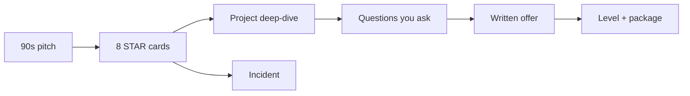
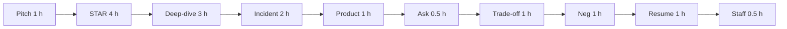

# 15 — Behavioral & Career (Part 3 of 3): Resume, Negotiation, Leadership & Interview

> **Parts:** [Part 1 — Pitch & STAR](./15-other-interview-questions-part1.md) · [Part 2 — Deep-Dive, Incidents, Product, Questions](./15-other-interview-questions-part2.md) · **Part 3 — Resume, Negotiation, Leadership, Interview**
>
> Resume: [TIH Resume](https://www.techinterviewhandbook.org/resume/). Negotiation: [Patrick McKenzie](https://kalzumeus.com/2012/01/23/salary-negotiation/) *Salary Negotiation: Make More Money, Be More Valued*; [Haseeb Qureshi](https://haseebq.com/my-ten-rules-for-negotiating-a-job-offer/) *Ten Rules for Negotiating a Job Offer* — paraphrase, don't recite. Estimation drills: [09](./09-system-design-part1.md). Staff-shaped work: *The Staff Engineer's Path* (Tanya Reilly); manager contrast: *The Manager's Path* (Camille Fournier). Do not quote 2026 salary bands.

## Table of Contents

- [3. Detailed Explanations (Part 3)](#3-detailed-explanations-part-3)
  - [3.9 Estimation & Trade-offs](#39-estimation--trade-offs)
  - [3.10 Salary Negotiation](#310-salary-negotiation)
  - [3.11 Resume](#311-resume)
  - [3.12 Leadership & Mentoring (Senior Signals)](#312-leadership--mentoring-senior-signals)
- [4. Full Example: One Loop](#4-full-example-one-loop)
- [5. Diagrams Index](#5-diagrams-index)
- [6. Resources](#6-resources)
- [7. How to Learn It](#7-how-to-learn-it)
- [8. Hands-on Practice](#8-hands-on-practice)
- [9. Interview Questions](#9-interview-questions)
  - [Basic](#basic)
  - [Intermediate](#intermediate)
  - [Advanced](#advanced)
  - [Tricky](#tricky)
- [10. Common Mistakes & Red Flags](#10-common-mistakes--red-flags)
- [11. Quick Revision Summary](#11-quick-revision-summary)
- [Next Steps](#next-steps)

---

## 3. Detailed Explanations (Part 3)

### 3.9 Estimation & Trade-offs

Whiteboard **Fermi** (DAU → QPS → storage) is [09 §3.2](./09-system-design-part1.md). Here they mean **judgment**: build vs buy, time, risk.

**"How long would that take?"** Split **calendar** vs **focused engineering**. Name unknowns (auth vendor, migration freeze). Give a range + what would make it the high end. "Two weeks" with no risks is a junior tell.

**Build vs buy.** Time-to-value, lock-in, on-call, compliance. Example: Auth0 vs custom JWT ([06](./06-nodejs.md)); CloudFront vs Cloudflare ([11](./11-deployment-aws-s3.md), [12](./12-cloudflare.md)). Pick **one** constraint you optimize (time vs cost vs control).

**Practice (15 min each, paper):** (1) "Add SSO." (2) "Move uploads off the API box." (3) "Cut p95 in half." For each: options, 2-week slice, metric, what you'd measure before committing.

### 3.10 Salary Negotiation

Read the two essays; this is the **interview behavior**, not a compensation course. Markets move — don't memorize numbers.

**Principles (paraphrased):**

- **Level first.** A level step beats a 5% cash tweak. Ask what level they mapped you to and **why**.
- **Whole package.** Base, bonus, equity (type, vest, refresh), signing, remote, equipment, start date.
- **Don't invent a competing offer.** You can say you are in other processes.
- **Let them number first** when you can. If forced: a **range** grounded in data (levels.fyi as a *starting* scout, not a quote in the round).
- **Enthusiasm is compatible with asking.** "I'm excited; I want the package to match the scope we discussed."
- **Get it in writing.** Recruiter verbal ≠ offer letter.
- **Walk-away privately decided** before the call.
- Recruiter is a **channel**, not your manager. Be precise, not hostile.

**"What are your expectations?"** (rehearse)

> I'm more attached to **level and scope** than a single number. For similar {{level}} roles in {{city / remote}} I've seen {{range from your research}}. I'd like to understand how you leveled this seat and the full package, then I can be specific.

If you give a number, you have **anchored**. If they already offered, negotiate against **that written offer**, not a fantasy.

> ⚠️ Pitfall: Negotiating in the onsite closer with the engineer who cannot change comp. Thank them; take numbers to the recruiter.

### 3.11 Resume

[TIH Resume](https://www.techinterviewhandbook.org/resume/). One page if < ~10 years is still the default for product IC; two pages only if every line earns it.

**Bullet formula.** Did **X**, measured by **Y**, by doing **Z**.

| Weak | Strong |
|------|--------|
| Worked on the payments service | Cut checkout p95 from ~900 ms to ~320 ms by moving uploads to pre-signed S3 and adding `/readyz` on the ASG |
| Responsible for mentoring | Paired 2 engineers through first on-call; their unpage rate dropped after we added the runbook |
| Used React and Node | Shipped the {{surface}} used by {{N}} weekly users |

**ATS / humans.** Reverse chronological. Standard headings (`Experience`, `Education`, `Skills`). No icons, no photo, no three-column tables. PDF unless they specify. File name `FirstLast-Resume.pdf`. Skills = things you can **defend in a loop** (if it's on there, [02](./02-javascript.md)–[12](./12-cloudflare.md) may be asked).

**Match the JD** with **true** nouns, not a keyword dump. Drop 2014 jQuery unless asked.

### 3.12 Leadership & Mentoring (Senior Signals)

Senior / staff is **scope and influence**, not years. *The Staff Engineer's Path* describes archetypes (tech lead, architect, solver, right-hand) — you need **stories**, not the labels in the round. *The Manager's Path* is how **managers** are measured (people, not the codebase) so you don't confuse "I want staff" with "I want to be a manager."

**Signals**

- People ship **your** RFC without you in every review.
- You mentored someone to an outcome (promotion, first design, calmer on-call).
- You said no to a rewrite with a number.
- You improved a **system** (templates, checklists, SLOs), not only a ticket.

**Two stories (0.5 h to outline).** (1) Influence without authority — slot 8. (2) Mentoring — slot 7. If both are empty, you are interviewing as mid regardless of years.

---

## 4. Full Example: One Loop

1. Recruiter: 90-second pitch ([§3.1](./15-other-interview-questions-part1.md#31-tell-me-about-yourself-90-seconds)); ask loop + level.
2. Tech screens: [13](./13-coding-round-practice.md) / [14](./14-js-logical-interview-questions.md) / [09](./09-system-design.md).
3. HM behavioral: two STARs (conflict + impact); deep-dive 10 min ([§3.5](./15-other-interview-questions-part2.md#35-project-deep-dive)).
4. You ask: last production break; 6-month success ([§3.8](./15-other-interview-questions-part2.md#38-questions-to-ask)).
5. Offer: written; level; package; McKenzie/Qureshi — not a same-day yes unless you already decided.

---

## 5. Diagrams Index

---

## 6. Resources

| Subtopic | Resource | Type | Where to find it | Free/Paid | Why it's good |
|----------|----------|------|------------------|:---------:|---------------|
| Behavioral | TIH behavioral interview | docs | techinterviewhandbook.org/behavioral-interview | Free | STAR |
| Intro | TIH self-introduction | docs | techinterviewhandbook.org/self-introduction | Free | 90 s |
| Question list | TIH 30 common behavioral Qs | docs | techinterviewhandbook.org/behavioral-interview-questions | Free | Coverage |
| Ask them | TIH final questions | docs | techinterviewhandbook.org/final-questions | Free | By purpose |
| Resume | TIH resume | docs | techinterviewhandbook.org/resume | Free | Impact bullets |
| LPs | Amazon Leadership Principles | page | amazon.jobs (Leadership Principles); aboutamazon.com | Free | 16 prompts |
| Postmortem | Google SRE Book + Workbook | book | sre.google/books | Free | Blameless |
| Negotiation | McKenzie; Qureshi | essays | kalzumeus.com; haseebq.com | Free | Behavior, not bands |
| Fermi | This series | notes | [09](./09-system-design.md) | Free | Numbers |
| Staff | *Staff Engineer's Path*; *Manager's Path* | books | O'Reilly | Paid | Scope vs people-mgmt |

> 💡 Interview Tip: Eight true short stories beat one epic you cannot defend.

---

## 7. How to Learn It

Total: **~15 hours** ([syllabus](./01-fullstack-syllabus.md#20-behavioral--career)). One STAR per week from day 1 ([00](./00-README.md#recommended-study-order)).

| Step | What to do | Time |
|------|-----------|:----:|
| **1. 90-second pitch** | Write, record, cut to 90 s. | 1 h |
| **2. STAR bank** | Eight cards from real work; quantify. | 4 h |
| **3. Deep-dive** | Draw one system; five whys. | 3 h |
| **4. Incident** | One blameless postmortem. | 2 h |
| **5. Product sense** | Three apps, four lenses, one bet each. | 1 h |
| **6. Questions to ask** | Five per stage; pick two. | 0.5 h |
| **7. Estimation / trade-off** | Three "how long / build vs buy" on paper; Fermi in [09](./09-system-design-part1.md). | 1 h |
| **8. Negotiation rehearsal** | "Expectations?" out loud; read both essays. | 1 h |
| **9. Resume** | Every bullet X/Y/Z. | 1 h |
| **10. Senior signals** | Two influence/mentor outlines. | 0.5 h |

---

## 8. Hands-on Practice

| # | Exercise | Level | Acceptance criteria |
|---|----------|:-----:|---------------------|
| 1 | **90 s pitch** recorded | 🟢 Easy | Timed 75–100 s; ends on why *this* company |
| 2 | **Conflict STAR** | 🟢 Easy | I/we clear; no villain; result + learn |
| 3 | **Failure STAR** | 🟡 Medium | Your miss; fix that stayed fixed |
| 4 | **Architecture one-pager** | 🟡 Medium | Diagram + your boxes + one regret |
| 5 | **Postmortem** | 🟡 Medium | Detect → mitigate → cause → lasting fix; blameless |
| 6 | **Improve an app you use** | 🟡 Medium | User, one bet, metric, what you won't do |
| 7 | **Ask list** | 🟢 Easy | ≥ 5; two you would actually ask this loop |
| 8 | **Resume pass** | 🟡 Medium | Every experience bullet has a metric or an honest "qualitative" tag |
| 9 | **Expectations answer** | 🔴 Hard | Recorded; level-first; no fake offer |
| 10 | **Mock behavioral 30 min** | 🔴 Hard | Peer uses TIH questions; you don't reuse the same story twice |

---

## 9. Interview Questions

Answers are **shapes**. Fill with your facts.

### Basic

#### Q1. Tell me about yourself.

**Model answer.** Present role → two quantified beats → why this team. 90 s. [§3.1](./15-other-interview-questions-part1.md#31-tell-me-about-yourself-90-seconds).

**Follow-ups:** Favorite project?

**Great answer includes:** A hook they can deep-dive.

#### Q2. Why this company?

**Model answer.** A **specific** problem/stack/user you can point at (JD, blog, product) + how your last work maps. Not "prestige."

**Follow-ups:** Why leave?

**Great answer includes:** Pull (scope) more than push (complaints).

#### Q3. Why leave your current role?

**Model answer.** What you want next (scope, domain). No manager-bashing. If layoff: one factual sentence, then the work.

**Follow-ups:** What would make you stay?

**Great answer includes:** Honesty without a hostage negotiation in the interview.

#### Q4. Walk me through STAR.

**Model answer.** S/T short, **A** is the meat, R is a number + learn.

**Follow-ups:** Weakest story?

**Great answer includes:** You know which slot is thin.

#### Q5. A conflict on the team.

**Model answer.** Slot 3. Disagreed with data; committed or escalated. Person still respected.

**Follow-ups:** What did they think of you after?

**Great answer includes:** Relationship intact or repaired.

#### Q6. A time you failed.

**Model answer.** Slot 4. Your miss, blast radius, lasting fix. Not a humblebrag ("I worked too hard").

**Follow-ups:** Who else was at fault?

**Great answer includes:** You don't need them.

#### Q7. Tight deadline.

**Model answer.** Slot 6. What you **cut**, what you would not, how quality was checked.

**Follow-ups:** Did it bounce in prod?

**Great answer includes:** If yes, that's also a failure story — connect them.

#### Q8. How do you handle ambiguity?

**Model answer.** Slot 5. You wrote the spec / spike / RFC. You named the decision owner.

**Follow-ups:** What if they never decided?

**Great answer includes:** Time-box + default.

#### Q9. Questions for me?

**Model answer.** Two from [§3.8](./15-other-interview-questions-part2.md#38-questions-to-ask): last incident; 6-month success.

**Follow-ups:** Comp?

**Great answer includes:** Recruiter / after offer, unless they opened it.

#### Q10. Strengths / weaknesses?

**Model answer.** Strength = evidenced by a story. Weakness = real, **with a mechanism** (checklist, pairing), not "I care too much."

**Follow-ups:** Feedback you received?

**Great answer includes:** Slot from a review, what changed.

---

### Intermediate

#### Q11. Most impactful project.

**Model answer.** Deep-dive lite: users, picture, your role, metric, regret.

**Follow-ups:** 10× traffic?

**Great answer includes:** [09](./09-system-design.md) language on **your** boxes.

#### Q12. Production incident.

**Model answer.** Detect, impact, mitigate first, then cause, then lasting fix. Blameless.

**Follow-ups:** What alert was missing?

**Great answer includes:** The one you added.

#### Q13. How would you improve our product?

**Model answer.** User + one lens + 2-week bet + metric. You used the product or you say so and use a public analog.

**Follow-ups:** First 90 days?

**Great answer includes:** Instrument, then one bet.

#### Q14. Build vs buy auth.

**Model answer.** Time, compliance, on-call, lock-in. Pick the constraint. Not "always Auth0" / "always custom."

**Follow-ups:** What did you pick last time?

**Great answer includes:** A real decision.

#### Q15. How long to add SSO?

**Model answer.** Range, unknowns, calendar vs engineering, high-end drivers.

**Follow-ups:** Commit to a date now?

**Great answer includes:** Spike first.

#### Q16. Disagreement with your manager.

**Model answer.** Backbone then commit, or a principled escalate. Not "I updated my resume."

**Follow-ups:** Would you do it again?

**Great answer includes:** Reflection.

#### Q17. Mentored someone.

**Model answer.** Their outcome. Your mechanism (review bar, pairing cadence).

**Follow-ups:** They still struggled?

**Great answer includes:** What you changed.

#### Q18. Not enough people / "not my job."

**Model answer.** Ownership: you unblocked the user, then you created a permanent owner.

**Follow-ups:** Did you burn out?

**Great answer includes:** Boundary you set later.

#### Q19. Resume: walk this bullet.

**Model answer.** You can expand any bullet to STAR. If you cannot, delete the bullet.

**Follow-ups:** Did you write that code?

**Great answer includes:** Honest split.

#### Q20. What are your salary expectations?

**Model answer.** Level-first; range if forced; want their package. [§3.10](#310-salary-negotiation).

**Follow-ups:** We need a number to proceed.

**Great answer includes:** A researched range, not a panic floor.

#### Q21. Competing offers?

**Model answer.** Truthful. Process yes; fake exploding offers no.

**Follow-ups:** Will you sign if we match?

**Great answer includes:** Scope/level still matter.

#### Q22. Where do you see yourself in 5 years?

**Model answer.** IC staff-shaped vs manager — pick with eyes open (*Staff Path* vs *Manager's Path*). Near-term: scope you want in **this** role.

**Follow-ups:** Management?

**Great answer includes:** Don't fake "yes" for a staff IC seat.

---

### Advanced

#### Q23. Five whys on your architecture.

**Model answer.** You have them written. Stop at a decision with a number, not turtles.

**Follow-ups:** What were you wrong about?

**Great answer includes:** One.

#### Q24. Error budget was empty. What did you do?

**Model answer.** Freeze features, reliability work, [08](./08-engineering-practices-part4.md#328-slis-slos-and-sentry). Story if you have it; method if not.

**Follow-ups:** PM still wanted the launch?

**Great answer includes:** Data + who owns the SLO.

#### Q25. You were the bottleneck.

**Model answer.** You documented, delegated, changed the review path. Senior = less hero.

**Follow-ups:** Bus factor now?

**Great answer includes:** A named backup.

#### Q26. Influence without authority across teams.

**Model answer.** Slot 8. What they needed; RFC; metric that made it their win too.

**Follow-ups:** It still failed?

**Great answer includes:** What you'd do with more political capital — without bitterness.

#### Q27. Bar-raiser: "give me another example."

**Model answer.** Second story from the bank. Don't retell the same incident with new adjectives.

**Follow-ups:** Only one conflict in 3 years?

**Great answer includes:** A smaller, recent one.

#### Q28. How do you raise the quality bar?

**Model answer.** Tests/a11y/perf as **gates** ([08](./08-engineering-practices.md)), not a lecture. One before/after.

**Follow-ups:** Team thought you were blocking?

**Great answer includes:** You measured escaped bugs, not opinions.

#### Q29. On-call philosophy.

**Model answer.** Load, compensation, runbooks, SLO ownership. Question *you* ask them too.

**Follow-ups:** 3 a.m. pages?

**Great answer includes:** A time you made the next night quieter.

#### Q30. Offer is below your range but you like the work.

**Model answer.** Level, equity, start date, written counter. Walk-away already decided. Don't accept "we'll bump at review" without a mechanism.

**Follow-ups:** They won't move.

**Great answer includes:** You can decline cleanly.

---

### Tricky

#### Q31. "We" for every action.

**Model answer.** They cannot hire a team. Re-tell with I/they split.

**Follow-ups:** Were you even there?

**Great answer includes:** Dates, PR, design doc you can name.

#### Q32. Hypothetical instead of a time.

**Model answer.** "I haven't done that exact thing; closest is…" then STAR. Don't role-play a novel.

#### Q33. Bashing the last manager.

**Model answer.** Reframe to pull factors. If pressed: one factual constraint, no character attack.

#### Q34. Invented metric on the resume.

**Model answer.** You're one SQL query away from getting caught in the deep-dive. Remove it.

#### Q35. Negotiating with the coding interviewer.

**Model answer.** Wrong room. "I'll follow up with recruiting."

#### Q36. "I don't have questions."

**Model answer.** You always have two. If they ran long: "I'll send them to the recruiter" **and actually send them**.

---

## 10. Common Mistakes & Red Flags

| Red flag | Why it hurts | Say/do instead |
|----------|--------------|----------------|
| 4-minute intro | They stop listening | 90 s + why here |
| No numbers | Not senior-shaped | Order of magnitude beats silence |
| Only "we" | No ownership signal | I / the team / they |
| Villain story | Earn-trust fail | Blameless + your miss |
| One story for every prompt | Looks thin | Eight slots |
| Fake competing offer | Ethics + later check | Truth |
| Resume keyword dump | Loop will quiz it | Defendable skills |
| No questions | No interest | Two high-signal |
| Comp in the coding round | Wrong owner | Recruiter |
| "Rewrite in week one" | Product-sense fail | Instrument + one bet |

---

## 11. Quick Revision Summary

### One-page recap

**Pitch.** Present → two beats with metrics → why here. 90 s.

**STAR.** Short S/T, long A, R = number + learn. Eight slots: impact, ownership, conflict, failure, ambiguity, deadline, mentor, influence.

**Deep-dive.** Draw it; your boxes; one hard part; one regret; five whys.

**Incident.** Mitigate first; mechanism; lasting fix; blameless.

**Product.** User, one lens, 2-week bet, metric.

**Ask.** Last break; 6-month success; who decides dates.

**Resume.** X/Y/Z; ATS-simple; only defendable skills.

**Neg.** Level first; writing; no fake offers; McKenzie + Qureshi.

**Senior.** Influence without reports; systems not heroics.

### Last-day checklist

- [ ] Pitch recorded under 100 s.
- [ ] Eight STAR cards, two of them failure/conflict.
- [ ] One architecture you can draw from memory.
- [ ] One postmortem with a lasting fix.
- [ ] Two questions per upcoming round.
- [ ] Resume bullets expandable to STAR.
- [ ] Expectations answer rehearsed.
- [ ] Q31–Q36 cold.

---

## Next Steps

- Update the [Progress Tracker](./00-README.md#progress-tracker) for 15.
- Draft **one** STAR card today from a real project.
- ➡️ Continue to [16-study-plan.md](./16-study-plan.md) — 4 / 8 / 12-week calendars. This file stopped at *what you say about your work*; 16 is *when you practice it*.
