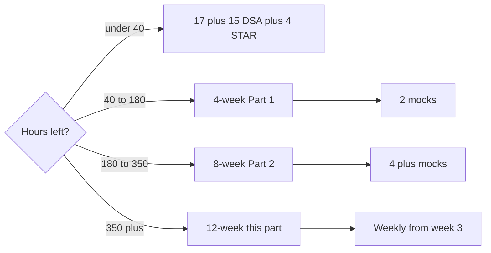

# 16 — Study Plan (Part 3 of 3): 12-Week, Mocks, Emergency & Interview

> **Parts:** [Part 1 — Choose + 4-Week](./16-study-plan-part1.md) · [Part 2 — 8-Week](./16-study-plan-part2.md) · **Part 3 — 12-Week, Mocks, Interview**
>
> **~480 h** at **5.5–6 h/day**. Fits [01 totals](./01-fullstack-syllabus.md#time-budget-overview). Daily template: [Part 1 §5](./16-study-plan-part1.md#5-daily-template). DSA 75–90 min ([13](./13-coding-round-practice.md)). Puzzles with [02](./02-javascript.md). STAR weekly ([15](./15-other-interview-questions.md)). Mocks from **week 3**. Do **not** launch billed AWS to "finish" [10](./10-deployment-aws-ec2.md)–[11](./11-deployment-aws-s3.md); use the labs as written (local/docs). Do **not** start the user's Postgres/Redis containers — 07 labs are self-contained.

## Table of Contents

- [12. 12-Week Intent](#12-12-week-intent)
- [13. Twelve Weeks](#13-twelve-weeks)
- [14. Mock Scripts](#14-mock-scripts)
- [15. Less Than Two Weeks](#15-less-than-two-weeks)
- [16. Code: Day Log](#16-code-day-log)
- [17. Diagrams](#17-diagrams)
- [18. Resources](#18-resources)
- [19. How to Learn It](#19-how-to-learn-it)
- [20. Hands-on Practice](#20-hands-on-practice)
- [21. Interview Questions](#21-interview-questions)
- [22. Common Mistakes](#22-common-mistakes)
- [23. Quick Revision](#23-quick-revision)
- [Next Steps](#next-steps)

---

## 12. 12-Week Intent

Complete path: High **and** Medium, Low **optional** if the JD is silent. Weekly mock from week 3. Optional **one** production-shaped slice (Next + Node + Postgres + Redis + S3 **or** R2 + Cloudflare) — only if you already have an app; do not greenfield a startup.

| Track | Target |
|-------|--------|
| Topics | [02](./02-javascript.md)–[12](./12-cloudflare.md) as written |
| DSA | NeetCode 150 + mixed review; [13](./13-coding-round-practice.md) 81 h budget |
| Machine | 04 Part 3 + 13 Part 4 |
| 14 | All 108 once; implementations from memory |
| 15 | Pitch + 8 STARs + deep-dive + incident + ask list |
| Mocks | **Weekly from week 3** (10 sessions) |

Hours: **6 h × 6 days × 12 = 432**, plus ~4 h Sundays (mocks/Low/review) → **~480**.

---

## 13. Twelve Weeks

Topic block ≈ 4 h after DSA. STAR still one/week (W1–8 slots; W9–12 **rehearse**, don't invent new epics).

| Week | Primary files | Secondary | Mock (Sun) | Done when |
|:----:|---------------|-----------|------------|-----------|
| 1 | [02](./02-javascript.md) Parts 1–2 High | [14](./14-js-logical-interview-questions.md) ×5/day; pitch | — | Event loop + closures aloud |
| 2 | 02 Medium + implementations | [03](./03-typescript.md) High start | Light: 2 timed easies | `Promise.all` / debounce from memory |
| 3 | 03 finish | [04](./04-react.md) High start | **Coding** 45 min | No `any` in a small module |
| 4 | 04 Medium + [Part 3](./04-react-part3.md) | a11y/RTL as in 04 | **Machine** 60 min | One component timed |
| 5 | [05](./05-nextjs.md) | CWV as in 05 | Coding 45 | Cache story end-to-end |
| 6 | [06](./06-nodejs.md) | Auth + shutdown | **API** 45 | Token talk 4 min |
| 7 | [07](./07-databases-and-apis.md) | Pagination, idempotency | **Design** limiter | Index + isolation pick |
| 8 | [08](./08-engineering-practices.md) | Test pyramid, CI, OWASP High | Coding + 15 min security | Pyramid without cargo-cult |
| 9 | [09](./09-system-design.md) | Six 45-min designs | **Design** feed/chat | Framework without notes |
| 10 | [10](./10-deployment-aws-ec2.md) | IMDSv2, ALB, OIDC **as written** | Coding mixed | Deploy story (no billed lab required) |
| 11 | [11](./11-deployment-aws-s3.md) + [12](./12-cloudflare.md) | OAC, Full strict, Cache Rules | Design **or** behavioral | Edge vs origin one page |
| 12 | [15](./15-other-interview-questions.md) leftover + [17](./17-cheatsheets.md) | Low rows **only** if JD | **Dress:** 90–120 min | [Ready](./00-README.md#what-ready-means) ticks |

**DSA across 12 weeks** (don't skip ahead):

| Weeks | Patterns ([13](./13-coding-round-practice.md)) |
|:-----:|-----------------------------------------------|
| 1–2 | Arrays, hashing, pointers, window |
| 3–4 | Stack, binsearch, lists |
| 5–6 | Trees, heap |
| 7–8 | Graphs, UF |
| 9–10 | 1D DP, greedy |
| 11–12 | Mixed timed + weak patterns; tries if extra |

> 💡 Interview Tip: Week 12 is **not** "read everything again." It is mocks + cheatsheets + sleep. New topics in week 12 are a failure of weeks 1–11.

> ⚠️ Pitfall: Building a new portfolio in weeks 10–12. Interviewers ask about **shipped** work. One improvement on an existing system beats a half-finished clone.

---

## 14. Mock Scripts

Book the slot **before** the week starts. Peer, [Pramp](https://www.pramp.com/), [interviewing.io](https://interviewing.io/), or a voice memo of yourself. Same rules: timer, talk, no docs.

### 14.1 Coding (45 min)

1. 2 min: restated problem + example.
2. 5 min: brute → better; complexity.
3. 25 min: code ([13](./13-coding-round-practice.md) templates).
4. 8 min: tests / bugs.
5. 5 min: after: what you'd retry.

### 14.2 Machine (60 min)

Pick from [04 Part 3](./04-react-part3.md): autocomplete, infinite scroll, modal. Ship happy path, then a11y, then polish. Stop at 60.

### 14.3 API (45 min)

[13 Part 4](./13-coding-round-practice-part4.md): list + filter + cursor **or** idempotent POST. Types, errors, one test idea.

### 14.4 System design (45 min)

[09](./09-system-design.md) framework. One diagram. Numbers Fermi-style. Stop with failures and the first scale lever.

### 14.5 Behavioral (45 min)

Pitch 90 s. Two STARs. Deep-dive 10 min **or** incident. Two questions for them ([15](./15-other-interview-questions.md)).

### 14.6 Dress (90–120 min)

Coding **or** machine, plus design **or** behavioral. Same day rest after. Log three gaps; those become week-12 mornings — **not** new files.

---

## 15. Less Than Two Weeks

**Follow the dedicated calendars** (checkboxes, hour blocks): [18 — 2 days](./18-prep-2-days.md) · [19 — 1 week](./19-prep-1-week.md) · [20 — 2 weeks](./20-prep-2-weeks.md). Do not mix those with the 12-week table above.

From [00](./00-README.md#recommended-study-order): compress **4-week High**, then [17](./17-cheatsheets.md). **< 40 h** triage in [01](./01-fullstack-syllabus.md#priority-triage-if-you-only-have-x-hours). Sketch kept here so 16 still reads if you only have this part open:

| Day | Hours | Do |
|-----|:-----:|----|
| 1–3 | 6 | [02](./02-javascript.md) High + [14](./14-js-logical-interview-questions.md) closures/loop/`this` + 1 DSA/day (arrays/window) |
| 4–5 | 6 | [04](./04-react.md) render/hooks + one 45-min UI |
| 6 | 6 | [05](./05-nextjs.md) cache talk only |
| 7–8 | 6 | [06](./06-nodejs.md) loop + auth; [07](./07-databases-and-apis.md) indexes |
| 9 | 6 | Two designs: limiter + shortener |
| 10 | 5 | Four STARs + pitch ([15](./15-other-interview-questions.md)) |
| 11 | 5 | Cheatsheets + `Promise.all` / LRU / debounce |
| 12 | 4 | One mock; **sleep** |
| 13–14 | — | Interview or rest. No new patterns. |

**Skip:** AWS/CF depth, DP, 08 Medium, GraphQL/gRPC, Workers/DO.

---

## 16. Code: Day Log

Runnable TypeScript — strip types on Node 24 or compile. Use it as a **private** log; don't invent metrics on your resume.

```ts
type DayLog = {
  day: number; // 1-based in the plan
  topicFile: string;
  topicMinutes: number;
  dsa: { slug: string; minutes: number; solvedTimed: boolean };
  puzzlesDone: number;
  starSlot?: "impact" | "ownership" | "conflict" | "failure" | "ambiguity" | "deadline" | "mentor" | "influence";
  mock?: "coding" | "machine" | "api" | "design" | "behavioral" | "dress";
  fiveBullets: string[];
};

export function weekHours(logs: DayLog[], week: number): number {
  const start = (week - 1) * 7 + 1;
  const end = week * 7;
  return logs
    .filter((l) => l.day >= start && l.day <= end)
    .reduce((n, l) => n + l.topicMinutes + l.dsa.minutes, 0) / 60;
}

const sample: DayLog = {
  day: 1,
  topicFile: "02-javascript-part1.md",
  topicMinutes: 210,
  dsa: { slug: "two-sum", minutes: 50, solvedTimed: true },
  puzzlesDone: 5,
  fiveBullets: [
    "Closure = function + lexical env, not 'inner function'.",
    "Two Sum: hashmap one pass; said O(n) time O(n) space.",
  ],
};
void sample;
void weekHours;
```

> ⚠️ Pitfall: Constructor **parameter properties** (`constructor(private cap: number)`) fail Node 24 type-stripping. Explicit fields — as in [14 LRU](./14-js-logical-interview-questions-part3.md).

---

## 17. Diagrams

```mermaid
gantt
    title 12-week primary files (topic blocks)
    dateFormat X
    axisFormat %s
    section Language
    02 JavaScript           :0, 2
    03 TypeScript           :1, 2
    section App
    04 React                :2, 2
    05 Next.js              :4, 1
    06 Node.js              :5, 1
    07 DB and APIs          :6, 1
    section Senior
    08 Practices            :7, 1
    09 System design        :8, 1
    10 EC2                  :9, 1
    11 to 12 Edge           :10, 1
    section Loop
    15 and 17 polish        :11, 1
```



(Units = weeks. Parallel: DSA every day, 14 during 02, STAR every week.)



---

## 18. Resources

| Resource | Type | Where | Cost | Use |
|----------|------|-------|------|-----|
| This repo | notes | [01](./01-fullstack-syllabus.md)–[17](./17-cheatsheets.md) | Free | Canonical order |
| NeetCode 150 | list | [neetcode.io/practice](https://neetcode.io/practice) | Free list | DSA order in [13](./13-coding-round-practice.md) |
| Tech Interview Handbook | guide | [techinterviewhandbook.org](https://www.techinterviewhandbook.org/) | Free | Grind table, behavioral |
| Pramp | mocks | [pramp.com](https://www.pramp.com/) | Free tier | Peer coding |
| interviewing.io | mocks | [interviewing.io](https://interviewing.io/) | Paid / limited | Anonymous |
| Learning method | notes | [01](./01-fullstack-syllabus.md#the-learning-method-applies-to-every-row) | Free | Read → build → aloud |

Do not binge random "100 days of DSA" playlists. The 150 list is enough.

---

## 19. How to Learn It

The **plan** is 1–2 hours to choose + set the tracker. The **hours below** are the calendars themselves (already in 01). Do not add a second 479.

| Plan | Calendar hours | Your job |
|------|----------------|----------|
| 4-week | ~144–168 | [Part 1](./16-study-plan-part1.md) |
| 8-week | ~300–340 | [Part 2](./16-study-plan-part2.md) |
| 12-week | ~480 | This part |
| < 2 weeks | ~50–70 | [§15](#15-less-than-two-weeks) |

Print or pin: daily template, this week's file, Sunday mock type.

---

## 20. Hands-on Practice

1. Tick **authoring** is done; set **learning** confidence on [00](./00-README.md#progress-tracker) for 02–15.
2. Write the first three `DayLog` rows (even on paper).
3. Book mock 1 on the calendar **now** (week 2 for 4-week; week 3 otherwise).
4. Day 1: Two Sum + 02 Part 1 + five puzzles + pitch skeleton.
5. After mock 1: three gaps only — those override "next Medium row."

---

## 21. Interview Questions

These are **meta** ("How did you prepare?"). Topic questions live in 02–15.

### Basic

#### Q1. How have you been preparing?

**Model answer.** Named plan (4/8/12), daily DSA, weekly STAR, mocks from week N. One sentence per track.

**Follow-ups:** Hours per day?

**Great answer includes:** A number you actually did, not a fantasy 10 h.

#### Q2. Why this stack?

**Model answer.** JD + your last 3 years. Point at 02–07 as the core, 09–12 as how you ship.

**Follow-ups:** What would you drop?

**Great answer includes:** Low rows you skipped on purpose.

#### Q3. Favorite problem you solved this month?

**Model answer.** One DSA **or** one production bug. Pattern + complexity **or** detect → mitigate.

**Follow-ups:** Could you code it now?

**Great answer includes:** Yes, or the honest gap.

#### Q4. How do you keep skills from decaying?

**Model answer.** 1 DSA/day, puzzles while in JS, STARs from real tickets.

**Follow-ups:** If you skip a week?

**Great answer includes:** Don't double; resume streak.

#### Q5. Books / courses?

**Model answer.** These notes + official docs + NeetCode. Name **one** talk if it changed a mental model.

**Follow-ups:** Certificates?

**Great answer includes:** Irrelevant unless they asked AWS cert.

#### Q6. How long until you're productive here?

**Model answer.** 30/60/90: repo + on-call shadows; one scoped ticket; one design. Not "day one hero."

**Follow-ups:** What do you need from us?

**Great answer includes:** Access, a buddy, the last incident doc.

#### Q7. How do you study a new API?

**Model answer.** [01 method](./01-fullstack-syllabus.md#the-learning-method-applies-to-every-row): smallest program, then failure modes.

**Follow-ups:** Example from last quarter?

**Great answer includes:** A real library, not "I read the README."

#### Q8. Mock interviews?

**Model answer.** Cadence from this file. What the last mock failed.

**Follow-ups:** How did you fix that?

**Great answer includes:** A drill, not "I'll try harder."

---

### Intermediate

#### Q9. You have 8 weeks. What's the plan?

**Model answer.** [Part 2](./16-study-plan-part2.md) in 90 seconds: High all, Medium React/Next/Node/design, 150 attempted, mocks week 3+, 8 STARs.

**Follow-ups:** Cut in half?

**Great answer includes:** [Part 1](./16-study-plan-part1.md) core High.

#### Q10. Frontend role vs this plan?

**Model answer.** Steal from 10–12; give to 04/05/machine. Keep DSA + STAR.

**Follow-ups:** CSS trivia?

**Great answer includes:** Layout/a11y as in 04, not a CSS-tricks binge.

#### Q11. Backend-heavy JD.

**Model answer.** 07, 09, queues, Node. Machine coding still one component.

**Follow-ups:** Kafka on the JD?

**Great answer includes:** 09 comparison, not a 40-hour course.

#### Q12. How do you know you're ready?

**Model answer.** [Ready checklist](./00-README.md#what-ready-means) **without notes**, plus two recent mocks that didn't collapse.

**Follow-ups:** Confidence 1–5?

**Great answer includes:** 3–4 with named gaps. 5 is a smell.

#### Q13. Failed a loop last month. Now?

**Model answer.** Three notes from the debrief → calendar. Not "I applied more."

**Follow-ups:** Same company again?

**Great answer includes:** Time + evidence of change.

#### Q14. How many problems have you done?

**Model answer.** Count + **quality** (timed, talked). 80 clean beats 300 silent.

**Follow-ups:** Hard DP?

**Great answer includes:** Honest: 1D yes / exotic no.

#### Q15. Balancing job and prep?

**Model answer.** 3 h template: 2 topic + 45 DSA + 15 close. Sunday mock or rest.

**Follow-ups:** Burnout?

**Great answer includes:** Half-day off is scheduled.

#### Q16. Would you do a take-home?

**Model answer.** Time-box, README, tests, what you'd do next. Company-dependent.

**Follow-ups:** Unpaid 20 h?

**Great answer includes:** Decline or negotiate scope.

---

### Advanced

#### Q17. Staff loop in 12 weeks — extra?

**Model answer.** 15 staff vs IC, 09 trade-offs, one cross-team story. Not more LeetCode hards.

**Follow-ups:** Strategy vs code?

**Great answer includes:** Both rounds exist; you practiced both.

#### Q18. How do you practice system design without a partner?

**Model answer.** Timer, draw, talk to a recorder, compare to 09. Then one live mock.

**Follow-ups:** Overfit to URL shortener?

**Great answer includes:** Six problems, same framework.

#### Q19. Your weakest area going in?

**Model answer.** Named (e.g. DP, IAM). Mitigation: skip in 4-week / extra in 12-week week 12 **mornings**.

**Follow-ups:** Why still interviewing?

**Great answer includes:** Strengths cover the JD; weakness isn't the gate.

#### Q20. How would you onboard a junior with this syllabus?

**Model answer.** They don't do 480 h. High JS/React/Node + 1 DSA/day. You review their mocks.

**Follow-ups:** Your mentoring story?

**Great answer includes:** [15](./15-other-interview-questions.md) mentor STAR.

---

### Tricky

#### Q21. "I grind 10 hours a day."

**Model answer.** You don't. Quality blocks, sleep, one mock. 10 h reading is not 10 h skill.

**Follow-ups:** Hustle culture?

**Great answer includes:** Delivery at work was sustainable.

#### Q22. Why no AWS cert?

**Model answer.** You can tell the EC2/S3/CloudFront **story** from 10–11. Cert optional.

**Follow-ups:** Prove it.

**Great answer includes:** IMDSv2, OAC vs public bucket, ACM region for CloudFront.

#### Q23. You skipped Cloudflare. JD lists it.

**Model answer.** You **re-weight**: 12 High this week, Cache Rules + Full strict. You don't bluff Workers CPU limits.

**Follow-ups:** Orange vs grey?

**Great answer includes:** Proxy vs DNS-only as in 12.

#### Q24. How did you use AI to prepare?

**Model answer.** Quiz, review solutions **after** you tried, never paste a take-home. You still talk unaided.

**Follow-ups:** In the interview?

**Great answer includes:** Follow **their** policy.

#### Q25. Calendar slipped two weeks.

**Model answer.** Drop Low and AWS Medium. Keep DSA streak. Mock still happens.

**Follow-ups:** Offer in 10 days?

**Great answer includes:** [§15](#15-less-than-two-weeks).

---

## 22. Common Mistakes

- Deferring DSA; cramming 150 in week 8.
- Reading 09 instead of **drawing** 09.
- Eight fake STARs. [15](./15-other-interview-questions.md) wants placeholders filled with **your** tickets.
- Launching real AWS "to be thorough." Labs in 10–11 say when not to.
- Changing plan every weekend (new course, new list).
- Mocks only with friends who hint.
- Week-12 new framework.
- Logging 6 h of YouTube as 6 h of [01 method](./01-fullstack-syllabus.md#the-learning-method-applies-to-every-row).
- Skipping rest before on-site.
- Treating 17 as a substitute for never opening 02–06.

---

## 23. Quick Revision

**Pick:** <40 h → 17 + 15 DSA + 4 STAR. 40–180 → 4-week. 180–350 → 8-week. 350+ → 12-week.

**Every day:** 1 DSA. During 02: 5 puzzles. Every week: 1 STAR. From week 3: 1 mock.

**4-week:** JS → React/Next → Node/DB → 3 designs + behavioral. 2 mocks. No AWS depth.

**8-week:** All High + Medium 04/05/06/09. 150 attempted. Cloud High skim. 4+ mocks.

**12-week:** Full 02–15. Weekly mocks. Week 12 = polish.

**Steal hours** from Low/cloud when the JD is silent; **never** from DSA/STAR.

### Last-day checklist

- [ ] Plan name you can say in 20 s
- [ ] Tomorrow: file + DSA slug + no new topic
- [ ] Mock booked or just completed with 3 gaps
- [ ] Pitch 90 s + two STARs warm
- [ ] Sleep

---

## Next Steps

- ➡️ Continue to [17-cheatsheets.md](./17-cheatsheets.md) — compact sheets for the last 48 hours. This file scheduled the work; 17 is what you **re-read**, not what you learn from scratch.
- Hub: [16-study-plan.md](./16-study-plan.md)
